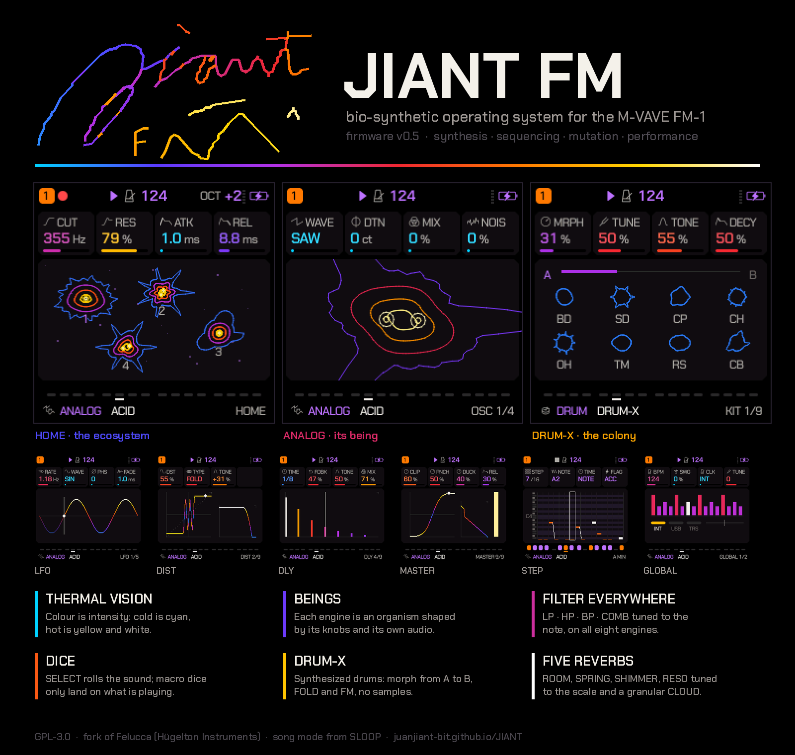
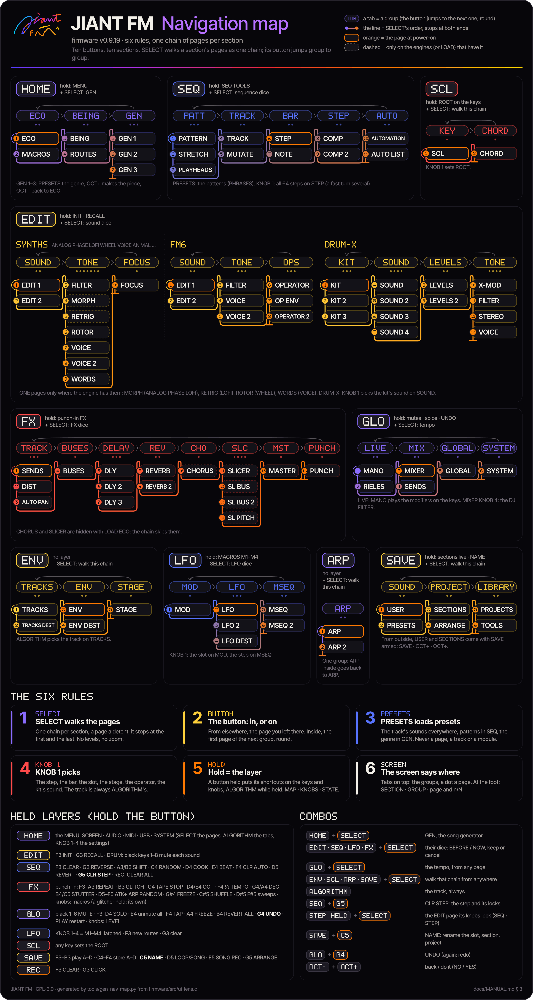
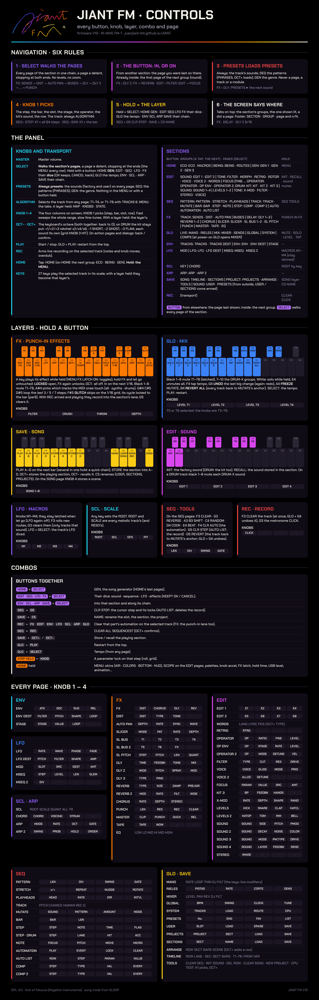
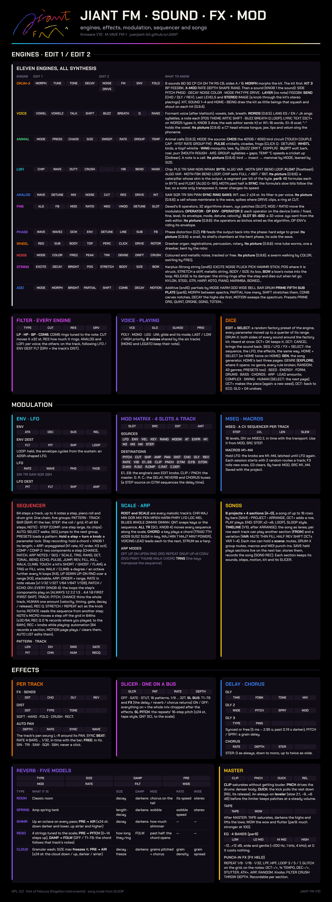
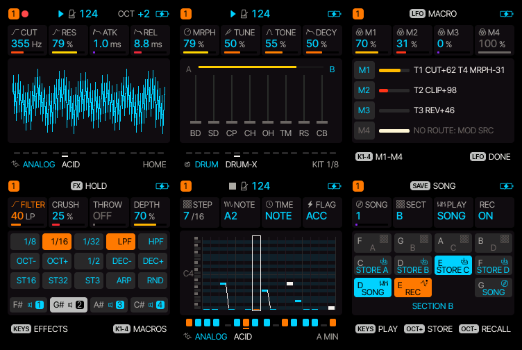

# JIANT FM

**Bio-synthetic operating system for the M-VAVE FM-1** — synthesis, sequencing, mutation, performance.

[](LICENSE)
[](https://juanjiant-bit.github.io/JIANT/emu/)



JIANT FM is an alternative firmware for the **M-VAVE FM-1**, made for playing live and building whole songs without
a computer. It is a fork of [Felucca](https://github.com/hugelton/Felucca) 1.1.5.1 by Hügelton Instruments (GPL-3.0)
and takes its song system from [SLOOP](https://github.com/isod89/sloop-fm1).

**▶ [Try it in the browser](https://juanjiant-bit.github.io/JIANT/emu/)** · **[Web installer](https://juanjiant-bit.github.io/JIANT/webapp/installer/)** · **[Web editor](https://juanjiant-bit.github.io/JIANT/webapp/editor/)** · **[JIANT Stems for Android](https://juanjiant-bit.github.io/JIANT/app/jiant-stems.apk)**: the emulator runs the same code as
the FM-1, with sound, and is played with your computer keyboard or the mouse. The emulator, the installer and the
editor update themselves with every change merged into `main`.

> **Status: in development (v0.9.9).** It builds and passes every test (Felucca's and its own). Back up the flash before installing it.
  **GLO › LIVE: the six sequences in parallel, with live modifiers** (main 0.9.11, here since v0.9.9-par2), a new
  first group of GLO (**LIVE · MIX · GLOBAL · SYSTEM · COMPS**; at power-on GLO still opens the MIXER). **MANO** makes
  the keys a performance board: the black keys 1–6 pick the tracks while held (several at once, none = all), the white
  keys are momentary modifiers (/2 x2 3/2 2/3, LOOP 8 4 2 1, REV, PING, RATCH x2 x3, THIN, OCT±, RETURN) with a LATCH
  key, GIRO and RND; KNOB 1–3 RATE LOOP THIN, KNOB 4 the DJ FILTER; off the page the keys play notes again. **RIELES**
  draws six rails, each loop at its own length with its playhead and its ghost; KNOB 1 PISTAS (ALL, T1 … T6, SYN, DRM),
  KNOB 2 RATE (/4 … x4 with 2/3 and 3/2, on the next beat), KNOB 3 CORTE (the first N steps), KNOB 4 DENS (THIN ← →
  RATCH x2–x4). One set of modifiers per track; never destructive: a ghost playhead keeps each track's true place; OCT−
  tapped RETURNs on the next beat, held is BYPASS (the original), OCT+ twice COMMITs into DIV (or STRETCH), LEN, ROTATE
  and CHANCE, with UNDO (GLO + G4). Recording while modified writes at the ghost's step. Not saved. The FX layer's 1/2
  TEMPO and LOOP 3 / 5 / 7 are LIVE's RATE /2 and LOOP now (the same ghost; the PLAYHEADS keep in step). Only the
  sequencer changed, nothing in the audio render. The manual's [§ 11](docs/MANUAL.md#11-performance).
  **SEQ + SELECT dices with GEN's own generator** (main 0.9.18, v0.9.9-par2): the part on the song's harmony and in the
  track's role where a GEN piece plays, never what was there before nor one of the last four (6 KB of flash back).
  **DRUM-X, VOICE and ANIMAL first** (0.9.9): the FM-1 powers on with T1 DRUM-X, T2 VOICE singing words, T3 ANIMAL's
  bird, T4 LOFI's bytebeat, T5 ANALOG's bass and T6 FM6's electric piano, and PRESETS lists the engines in that order.
  **A new skin, AIR** (0.9.7, the default of new settings): HUD's light look on every page with the knob row on top,
  the middle of the screen free; HOME's beings over the whole screen. **MENU › DISPLAY › SCOPE** (OFF by default): an
  engine's EDIT pages give its creature the whole panel. **HOME's beings have faces**: three isotherms coloured by their
  own level, eyes that shut on a hit, a mouth that opens with the sound, a look up when MUTATE changes them. 15 KB of
  flash given back, nothing removed, the sound bit for bit.
  **Every engine draws its own creature** (0.9.6): ANALOG a cell whose membrane is its wave, FM6 its operators as
  little beings wired as the algorithm (also on OPERATOR and OP ENV), WHEEL nine tube worms, one a drawbar, NOISE a
  swarm, PHASE a snail whose shell is the bent phase, LOFI a caterpillar whose skin is its output and segments its bits.
  **Messages no longer darken the screen** (0.9.5): a message is a small pill over the page, which keeps moving behind
  it, clear of the page's words; a page's hint comes only once you stay on it (never while SELECT walks past), at most
  twice ever; a layer button's tap no longer says "HOLD [X] QUICK". On JIANT each card's colour follows its value
  again, as in 0.6.
  **Three engines draw their own creature** (0.9.4): VOICE its vocal tract singing, a glowing tube in a ghost of a
  head (main 0.9.10's "Tracto vivo", v0.9.9-par2: the tongue, jaw, lips and velum move with the phoneme sung, glottal
  pulses travel up it, waves leave the mouth, the jaw opens downward), ANIMAL a creature that metamorphoses between bird, insect and mammal, DRUM-X its kit as
  little beings that squash, shut their eyes and shout with every hit.
  **MUTATE can go back** (0.9.3): turning MUTATE off asks to return the track to its anchor; SEQ + D5 REVERT, GLO + B4 REVERT ALL, undoable.
  **0.9.2 is driven by six rules** (see [Navigation](#navigation)): SELECT walks a section's pages as one chain, the
  section's button jumps group to group, PRESETS always loads presets, KNOB 1 picks, a button held is its layer, and
  the tabs and the footer say where you are. Every page, knob and function is where it was; only the way between them
  changed.
  **The dice starts in EXPLORE** (0.8.6): HOME + SELECT opens GEN on a choice that follows no genre and breaks every
  rule (any tempo, odd metres and polyrhythm, exotic modes, any engine on any role, DRUM-X octaves, PLAYHEADS, MUTATE),
  each seed a very different piece, still in the key its SCALE and CHORD pages show. RANDOM and the 43 genres follow.
  **DRUM-X octaves** (0.8.5): the kit stays on its keys at every OCT; above the centre it ratchets in time (x2, x4, x8),
  below it plays SHORT, GHOST or FLAM, each sound its own on each step, and live recording keeps exactly what you
  played. MIDI drum notes outside 35–81 now trigger these variations: see the changelog before installing.

> ⚡ **New in 0.8.3 – 0.9.2: a new look, nine engines, finer timing and a map you can learn in a minute.**
> - **Flat navigation** (0.9.2): one chain of pages per section, the groups as tabs on top (a dot a page), the
>   breadcrumb **SECTION · GROUP · page n/N** at the foot; SCL and ARP two sections; GEN three HOME pages. Clearing a
>   step is **SEQ + G5**, renaming **SAVE + C5**: EDIT is always EDIT.
> - **Three skins, MENU > DISPLAY > SKIN** (0.8.9; HUD faster in 0.9.0; 0.9.7: a fourth, **AIR**, the default of new
>   settings): **COLORS** (rounded cards, each
>   card its colour, on JIANT its value's heat as in 0.6), **BOTTOM** (the picture edge to edge, a slim knob row) and **HUD**
>   (HOME's beings under everything). The **LENTE** look (0.8.5): tabs, cards and a breadcrumb in a crisp 5 × 7 pixel
>   face, values in Inter Tight. **Held layers** show the keyboard itself: MAP, KNOBS and STATE (ALGORITHM while held).
> - **VOICE sings words** (0.8.5): ES, EN or JA, each note the next syllable of a lyric you type (or the dice's).
>   **ANIMAL** (0.8.3), the ninth engine: birds, insects, frogs and beasts from physical models.
> - **DRUM-X in every octave** (0.8.5): the kit stays on its keys; above the centre it ratchets (x2, x4, x8), below it
>   plays SHORT, GHOST or FLAM, each sound its own on each step, recorded as you played.
> - **The dice starts in EXPLORE** (0.8.6): HOME + SELECT opens GEN on a choice that follows no genre and breaks every
>   rule (odd metres, exotic modes, any engine on any role, PLAYHEADS, MUTATE); RANDOM and 43 genres follow.
> - **A DJ FILTER on the master** (0.9.1, GLO › MIXER KNOB 4): low-pass to the left, high-pass to the right, out of
>   the chain in the middle; automatable, saved with the project. **REC off the grid in 64ths** of a step (0.9.1):
>   SEQ › NOTE's MICRO, −32/64 … +31/64.
> - **USB audio that keeps its time** (0.8.9): no lost half buffers (the clicks under load), no dropped packets, the
>   48 kHz resampler on the second core. **Stems**: every track to the computer (MENU > SYSTEM > USB > STEMS), or to the
>   phone with the **[JIANT Stems](android/README.md)** app (record, line up your voice, export a ZIP or a mix;
>   [APK](https://juanjiant-bit.github.io/JIANT/app/jiant-stems.apk)).
> - Every version's details: the **[Changelog](#changelog)**.

> 🫶 If you resonate with my work, consider supporting me on **[Ko-fi](https://ko-fi.com/juanjiant)** (in Argentina:
> **[Cafecito](https://cafecito.app/juanjiant)**). Thanks for all the good energy, hope you enjoy this little beast ✨🎹

## Navigation

Ten buttons, ten sections, and the same six rules in every one of them (0.9.2). The map shows every section, its
groups (the tabs on the screen) and its pages in the order SELECT walks them, with the held layers and the combos.
Click it to open it full size ([SVG](docs/navigation-map.svg), zoomable · [en español](docs/navigation-map.es.svg)).

[](docs/navigation-map.svg)

1. **SELECT walks the pages**: one chain per section, a page a detent, stopping at the first and the last.
2. **The section's button: in, or on**: from elsewhere, the page you left there; inside, the first page of the next
   group (round). FX › DLY 2 → REVERB; EDIT › FILTER → FOCUS.
3. **PRESETS loads presets**: the track's sounds everywhere, the patterns in SEQ, the genre in GEN; never a page, a
   track or a module.
4. **KNOB 1 picks**: the step, the bar, the slot, the stage, the operator, the kit's sound. The track is always
   **ALGORITHM**'s.
5. **Hold = the layer**: a button held puts its shortcuts on the keys and knobs (SEQ + G5 CLR STEP, SAVE + C5 NAME,
   GLO + G4 UNDO …). Held + SELECT: **HOME** GEN, **EDIT / SEQ / LFO / FX** their dice, **GLO** the tempo,
   **ENV / SCL / ARP / SAVE** walk their chain.
6. **The screen says where**: on top the section's groups as tabs (a dot a page), at the foot
   **SECTION · GROUP · page** and **n/N**: **FX · DELAY · DLY 2  6/16**.

The whole chapter: [the manual, § 3](docs/MANUAL.md#3-pages-and-layers) ·
[el manual, § 3](docs/MANUAL.es.md#3-páginas-y-capas). The map is generated from the firmware's own chain tables
(`firmware/src/ui_lens.c`) by `tools/gen_nav_map.py`.

## Manual

What changed in each version: the **[Changelog](#changelog)**, at the end of this page.

The full user manual, every page, layer and setting, with a careful chapter on saving: **[English](docs/MANUAL.md)** ·
**[Español](docs/MANUAL.es.md)**.

## Cheat sheets

Two printable sheets with everything on the device. Click an image to open it full size, or download the PDF.

| Controls | Sound · FX · Mod |
| --- | --- |
| [](docs/cheatsheet-controls.png) | [](docs/cheatsheet-sound.png) |
| Every knob and button, the layers with their key maps (FX, GLO, SAVE, EDIT, LFO, SCL, SEQ, REC), the combos and every page's four knobs. **[PDF](docs/cheatsheet-controls.pdf)** | The nine engines' EDIT pages, FILTER, VOICE, ENV, LFO, the MOD matrix, MSEQ, macros, the sequencer, scales and ARP, songs, and every effect: DIST, the SLICER bus, delay, the five reverbs and the master. **[PDF](docs/cheatsheet-sound.pdf)** |

## The idea

A pocket synthesizer shouldn't feel like a menu. JIANT starts from a simple question: what if the device behaved
less like a tool and more like an organism?

That's why everything in JIANT is alive and visible. The screen works like a **thermal camera**: colour isn't
decoration, it's intensity. Cold is cyan and violet, hot is red, orange, yellow and white. A high parameter burns; a
sounding voice glows; silence cools down. Each engine is a **being**, a protozoan drawn in lines whose shape comes
from what you're playing: open the filter and it grows spines, raise the resonance and its membrane vibrates, detune
the oscillators and its nuclei drift apart. HOME is an **ecosystem**: six creatures, one per track, breathing with
their own audio. You don't need to read numbers to know what's going on; you can see it.

At the same time, what is technical is shown as technical. The LFO runs at its rate, the envelope shows where the
voice is, the distortion draws its transfer curve, the delay its echoes, the reverb its response. The organic invites
you to play; the technical lets you understand what you did.

The second idea is that **randomness is an invitation, not an accident**. Every session starts with macros rolled
towards what your sounds have; HOME + SELECT writes a whole piece, EDIT + SELECT dices the sound; macro dice only land on what is playing.
The system pushes you to move things and always leaves you near something that works: the dice start from factory
presets and vary around them, never from nothing.

The third is that **everything is playable and everything is recordable**. Effects are played on the keys and land
in an automation lane; knobs record their movement; songs are built from bars and scenes, and recorded while you
play them. No computer, no samples: everything is synthesized in real time on a chip designed for something else.

And the last one is a discipline: **lightweight**. Every graphic is a handful of lines, every effect fits in the
audio CPU budget, the signature shown at power-on is 428 bytes. An instrument that feels big inside a small device.

## The system

### Both cores (dual core)

*Since 0.6.71, experimental.* The FM-1's chip (JieLi AC791N) has **two processor cores**; Felucca and JIANT up to
0.6.70 used one, which ran everything: the sound, the screen, the keys. Now the second one helps with the sound:

- **How the work is shared.** Every block (1.45 ms since 0.9.9, 0.7 ms before: see below), the tracks are split between the two cores by how long each took to
  render over the last blocks (timed as they play, since 0.6.73). While the first core renders its tracks, the second
  renders the others into buffers of its own; then they are added together and go through the master on the first
  core. The drum tracks go together, on one core or the other. Since 0.6.75 the second core also runs the effect
  buses (chorus, delay, reverb), on the sends of the block before (a block later, inaudible), so they no longer wait.
- **The same sound.** The sum is exactly the one-core sum: a test plays a whole six-track song both ways and checks
  that the output is identical, bit for bit.
- **More room.** With the second core doing part of the synth work, the load meter stays lower: more tracks, voices,
  FM6 and heavy reverbs before the clicks and the cut notes start. LOAD LITE / ECO are still there for the heaviest
  songs.
- **Units that cannot run it.** On some FM-1s the second core now and then reads a word of memory wrong, more often
  under load (found by the Melodee and fm1-x0x developers). JIANT guards against it: every job carries a check word,
  and if the second core reads a wrong one, faults or does not answer in time, it is **stopped at once and the first
  core plays every track again**, with no crash (at most one block of those tracks is lost). Since 0.6.76 the
  effects' output is checked too: far out of range, the block is muted, their lines cleared and the second core stopped
  the same way. Such a unit
  then stays on one core **until it is switched off**, and so does any unit after a crash while both cores ran.
- **What it says.** MENU > ABOUT, under AUDIO LOAD: **CORES 2**, or **CORES 1** with the reason: REC AT POWER-ON,
  BAD READ, NO ANSWER, FAULT, SINCE A FAULT (an earlier one this power-on), NO START.
- **One core on purpose.** Hold **REC** while switching the FM-1 on: that session plays on one core, as before.
- **The core supplies (0.9.9-stab).** Up to 0.9.9-cpu3 JIANT ran both cores at 360 MHz on the boot loader's core
  voltages (1.40 V / 1.26 V), a configuration no M-VAVE firmware uses: M-VAVE's own firmware raises them to 1.60 V /
  1.38 V as it starts, at the same 360 MHz. JIANT now does the same at boot, before the second core and the audio
  (`firmware/hal/fm1_sys.h`, after fm1-base's code, MPL-2.0). MENU > ABOUT shows the steps reached: **RAILS 7/15**
  (and the boot loader's 3/11).
- **MENU > SYSTEM > CPU CLOCK: 360 MHZ / 320 MHZ (0.9.9-stab; editor id 24).** JieLi rates the chip at 320 MHz; the FM-1's
  boot stage runs it at 360, and so does M-VAVE's firmware with the supplies above, so **360 MHZ stays the default**. 320
  MHZ is the configuration of M-VAVE's open firmware and of Skiff: switched at power-on, before the audio and the second
  core, with curist's switch from [fm1-clk320-probe](https://github.com/curist/fm1-clk320-probe) (MIT,
  `firmware/hal/fm1_clk320.h`); ~11 % fewer cycles a block, so the load governor sheds voices sooner on the heaviest
  songs. A change applies from the next power-on; ABOUT shows the clock it runs at (**CPU 360 MHZ** / **CPU 320 MHZ**).
- **If it crashes (0.9.9-stab).** The red screen names its numbers (VEC PC EMU DBG RETS as before, then SP USP SSP, the
  second core's PC and the bus master of a bad access) and stays 10 s for a photo; MENU > ABOUT repeats the main ones until
  the unit is switched off. A hardware window now closes the RAM code and the first core's stacks to the second core and
  to every DMA: a stray write there is caught at once and attributed, where before it was only seen afterwards as a
  corrupted word.
- **Blocks of 64 samples (0.9.9 "ctl64").** The audio is rendered in blocks: each one runs the sequencer, splits the
  tracks between the cores, hands the second core its job and waits for it, clears and sums the buffers, runs the
  effect buses and the master. Up to 0.9.8 a block was 32 samples (0.7 ms: four per 2.9 ms half of the output buffer);
  since 0.9.9 it is 64 (1.45 ms, two per half), so that fixed work happens half as often: measured on the host, a
  silent mixer costs 17 % less, four MONO tracks cutting each other's notes 21 % less, the whole test song 9 % less
  (`docs/CPU3_PERFORMANCE.md`). Envelopes, LFOs, glides and fades tick at the new rate with their times unchanged.
  The sequencer did not get coarser: a note that falls inside a block (an off-grid MICRO step, a strum, HUMAN time, a
  ratchet, an ARP step, a gate's end) now starts or ends **at its own sample** within the block (before, at the
  block's first sample: up to 0.7 ms off), for every engine but FM6, whose operators render whole blocks (its notes
  start at the nearer block edge, within 0.7 ms, as every engine did before). A key or a MIDI note still plays at the
  start of the next block, as before: its latency is set by the output buffer, not the block. What did change: the
  effect buses run a block behind the dry sound, so their return is now 1.45 ms late instead of 0.7 (a shorter
  pre-delay than any room has; with a sustained tone and a heavy send the dry and wet now add up with another phase,
  and the master's leveler, which reads the peaks of the sum, can sit a few dB from where it did).
- **Credits.** How to start the second core safely on the FM-1 and the guard against misreads come from
  [Melodee](https://github.com/keremimo/melodee) (keremimo) and [fm1-x0x](https://github.com/charlesvestal/fm1-x0x)
  (Charles Vestal), both GPL-3.0; JIANT's version is in `firmware/hal/fm1_multicore.h`.

### A living screen



*HOME with its six beings, the song in ARRANGE, SEQ › NOTE with a note 13/64 late, the delay, the DRUM-X colony and
VOICE singing its lyric, in the COLORS skin, exactly as the firmware draws them (the renders of `tests/ui_render.c`).*

- **Thermal palette**: values, curves, steps, hits and notes are coloured by intensity (cyan → blue → violet → red →
  orange → yellow → white). Selection is violet and active is orange; on JIANT each card's value and gauge are its
  amount's heat (0.9.5, as 0.6), the other palettes give each knob its own colour.
- **Skins** (MENU > DISPLAY > SKIN, 0.8.9): **AIR** (0.9.7, the default of new settings: HUD's floating words on
  every page, the knob row on top under the tabs, the middle free), **COLORS** (near-black rounded cards on top, a rounded
  panel), **BOTTOM** (no cards: the picture the screen's width, a slim knob row at the foot) and **HUD** (HOME's
  beings swim under everything, the words float over them). Every skin wears the **LENTE** layout (0.8.5): the
  section's groups as tabs on top (a dot a page), the breadcrumb **SECTION · GROUP · page n/N** at the foot. Values
  in [Inter Tight](https://github.com/rsms/inter-tight) SemiBold, names, tabs and the breadcrumb in a crisp 5 × 7
  pixel face, small captions in [Chakra Petch](https://github.com/m4rc1e/Chakra-Petch).
- **HOME, the ecosystem**: one being per track (its species from its engine, its shape from its four knobs). Each one
  heats up, swells and moves with its own audio; the selected track is drawn bigger; muted ones go dark; in silence
  they all stay still. (0.9.7) Each wears a little face: its eyes shut on a hit, its mouth opens with its level, it
  looks up when MUTATE changes it; muted, it sleeps.
- **Engine pages**: each engine draws its own creature (0.9.4 / 0.9.6, [below](#v096)): VOICE a singing head, ANIMAL
  a bird / insect / mammal, DRUM-X its kit of little beings, ANALOG a cell, FM6 a colony of operators, WHEEL tube worms,
  NOISE a swarm, PHASE a snail, LOFI a caterpillar. (Before: the sound's being drawn in isotherms, four contours of
  the same body, cold edge, hot core, as HOME's ecosystem still shows them.) The being's knobs read as what they are: **CUT** grows spines (more harmonics, spikier), **RES** makes the membrane vibrate,
  **DTN/SPRD** splits two nuclei, **NOIS/RAND/CRSH** frays the edge, **WAVE** changes the lobes.
- **DRUM-X, the colony**: one being per kit sound, each with its own shape (round kick, spiky snare, fringed hats,
  clustered clap, star-shaped cowbell) that swells and heats up when it hits (KIT 2, KIT 3, X-MOD); on KIT, SOUND 1–4
  and HOME (0.9.4) **the kit as little beings** with eyes and mouths that squash and shout with every hit.
- **Live technical graphs**: LFO (the wave runs at its rate, with playhead and current value), ENV (a dot travels the
  curve with the sounding voice), DIST (transfer curve by TYPE and TONE response), DLY and DLY 2 (the echoes, L and
  R), REVERB and REVERB 2 (the impulse response, stereo, drawn per model), CHORUS (the three modulated lines), AUTOPAN (the swing across the stereo field), MASTER
  (clipper curve, PUNCH shape, how much DUCK pulls down), ENV/LFO DEST (bipolar columns under each knob, lit by what
  they send), VOICE (one cell per voice and the glide curve), GLOBAL (the bar in thermal columns with swing, clock and
  tuning).
- **Load meter**: five small bars next to the battery showing the current audio load.
- **Power-on**: the "Jiant FM1" signature is written stroke by stroke in thermal colours (MENU > ANIM OFF: it shows
  up whole).

### Engines
Nine engines, all synthesis, no samples: **DRUM (DRUM-X), VOICE, ANIMAL, LOFI, ANALOG, FM6, PHASE, WHEEL and NOISE**,
in the order PRESETS shows them (0.9.9; the first six are the tracks at power-on, T1–T6).
- **ANALOG**: two oscillators with **INT** (an interval of ±24 semitones: fifths, octaves) and DTN; besides SAW, SQR,
  TRI, SIN and PWM it has **SYNC**, **RING** and **SAW3** (three saws). Its filter is per voice.
- **FM6**: Dexed's engine (imports .syx), with its algorithms drawn. Fully editable on the device (from Felucca 1.5):
  **EDIT > OPERATOR** (KNOB 1 the operator 1–6, then RATIO or FIXED frequency, FINE, LEVEL), **OP ENV** (the stage
  ATK DEC SUS REL, its RATE and LEVEL, drawn as the envelope) and **OPERATOR 2** (MODE ratio/fixed, DETUNE, VEL), the
  operator lit in the algorithm's colony of operators (0.9.6: each a little being wired as the chart was) with its
  frequency; OP ENV's operator rides its envelope. Editing makes the patch the track's own (SLOT OWN) and it is
  saved with the project; the macros (EDIT 1 / 2) still act on top. The web editor edits every byte of it too.
  **Voice bank** (from Felucca 1.4.1): import a 32-voice DX7 cartridge (.syx) in the web editor's 6-OP FM tab and press
  **Send to the device's voice bank**; on an FM6 track **SLOT** (EDIT 2, KNOB 4) then goes F1–F8, OWN, **B1–B32**
  (empty slots skipped), the voice's name on the chart. A voice loaded is copied into the track: projects and user
  presets keep it even after you send another bank. The bank lives in its own flash sector, written power-cut safe;
  the full backup does not include it (keep the .syx).
- **PHASE**: phase distortion with **FB** (the output feeds back into the phase: from hard edge to growl).
- **LOFI**: 1, 4 and 8-bit chip with **BYTE** (bytebeat: 32 formulas picked with ALGO and mutated with VAR). In
  BYTE, **MOTN** sets the speed of the formula's rhythm, **GRIT** crushes its rate, **BEND** folds time and **LOOP**
  repeats a short stretch of the formula: the noise becomes a tone tuned to the note. **FLOAT** is a floatbeat
  generator: 32 formulas of `t` made of sines (rhythm, melody and timbre at once), in the key played.
- **VOICE** (formants, after klattsch), **WHEEL** (drawbar organ) and **NOISE** (coloured and metallic noise).
  **VOICE sings words** (0.8.5): LANG ES / EN / JA, each note the next syllable of a lyric you type (on the device or
  from the web editor) or of phrases the dice puts together from each language's word bank; POS and LOOP automate it.
- **ANIMAL** (0.8.3): animal calls from physical models: a source that oscillates or strikes exciting a resonator,
  with a call's rhythm on top. **CMOS** is the owner's 40106 / 4093 breadboard "bird machine" (Schmitt-trigger RC
  oscillators: a slow one gates and sweeps a fast one, the exponential charge is the chirp's hook), **PULSE** an
  escapement into a resonator (crickets, katydid, cicada, frogs, toad), **WHSTL** a Hopf oscillator whose tone is born
  as the pressure crosses a threshold (canary, cardinal, dove, owl, peeper, bat), **WING** flight tones with drift and
  Doppler fly-bys (mosquito, bee, fly), **GLOTT** a glottal pulse into two formants with subharmonics and chaos (wolf,
  bark, roar, purr). GROUP makes chirps and trills, TEMP (°C) speeds insects up as warmth does (Dolbear's law); a note
  is a call. 24 presets.
- **FILTER on every engine** (EDIT > FILTER): **TYPE** LP, HP, BP or **COMB** (a comb tuned to the note you're
  playing; CUT moves it ±32 semitones and RES is how much it rings), **CUT** and **RES**. On ANALOG it's its per-voice
  filter, with DRV; on LOFI it's per voice too (its CUT and RES are the ones on this page); on the others it's a filter
  on the track that follows the LFO and the envelope (LFO/ENV DEST FLT), and its DRV is the track's DIST.

### DRUM-X: synthesized drums with morph
An 8-sound kit (BD SD CP CH OH TM RS CB) generated in real time, Microtonic style.
- Each sound has two sides, **A** and **B**; **MORPH** (KNOB 1) moves between them.
- **FOLD** runs each sound's oscillator through a wavefolder after its envelope: the hit starts bright and the tail
  returns to the clean wave. **FM** changes the timbre with harmonic FM in 8 bands; plus TUNE, TONE, DECAY, NOISE and
  DRV.
- **EDIT > SOUND 1–4** (one sound each, KNOB 1 picks it): SIDE, PITCH, PMOD; DECAY, NOISE, COLOR; **MODE**,
  **PM.TYPE** (how the pitch moves: DECAY, LONG like the 808, NOISE, SINE), DRIVE; **LAYER**, **FEEDBK** and a
  per-hit **SEND**.
- **The kit in every octave** (0.8.5): the keys play the kit on the same keys at every OCT; above the centre a key
  **ratchets** in time (x2, x4, x8), below it plays **SHORT**, **GHOST** or **FLAM**, each sound its own on each step,
  and live recording keeps exactly what you played. MIDI drum notes outside 35–81 trigger the same variations.
- **Group mutes** (KICK, SNARE, HAT, PERC) with GLO held and **per-sound mutes** with EDIT held.
- **EDIT > X-MOD** (0.5.1): a tempo-synced LFO on MORPH and RAND, which gives every hit its own MORPH and tune.
- Nine kits as the DRUM engine's presets (DRUM-X, 909 CLUB, 808 BOOM, LOFI DUST …); EDIT + SELECT rolls a new kit.

### Dice: the system invites you to move everything
- A button held + **SELECT** rolls that part's dice (0.9.2: SELECT alone walks the pages). **EDIT + SELECT rolls the
  track's sound dice**: a synth loads one of its factory presets at random and moves each engine parameter up to a
  quarter of its range; DRUM-X rolls the A and B sides of each sound around the factory kit. **SEQ / LFO / FX +
  SELECT** dice the sequence, the LFO, the effects, each shown **BEFORE** and **NOW** to keep or cancel; **GLO +
  SELECT** is the tempo. **HOME + SELECT** opens
  **GEN**, the song generator (since 0.6.91; HOME's last three pages since 0.9.2): it opens on **EXPLORE** (0.8.6: no
  genre, every rule broken: odd metres, exotic modes, any engine on any role), then RANDOM or a genre among 43 (house,
  techno, dub, UK garage, funk, post punk, jazz, ambient …), a seed, an energy, a form (a loop, parts, a club song); how much drums,
  bass, chords, arp and lead; complexity, swing, how human. **OCT+** writes the piece from them (OCT+ again: a new
  seed; a knob turned and OCT+: the same piece with that one thing changed), **OCT−** is done. Every piece has one
  key, written to the SCALE page (and the CHORD page set to its chords: the keys play along in key), drums from the
  genre's priority map, a bass archetype written against the kick, a functional or modal progression with cadences
  voiced and led voice by voice, a lead composed from a motif in periods and sentences, a sound recipe a role, the
  genre's kit and space (see v0.6.91, v0.8.3).
- **UNDO: GLO held + G4** takes back the last big change (DICE ALL, a sound diced, a clear, INIT, RECALL, a pattern or
  project loaded); pressing it again goes forward (redo). G4 breathes when there is something to undo.
- **Macros M1–M4** (LFO held; they stay latched when released until you press LFO again): every session starts with
  two random routes per track towards what its sound has. With the macros open, **F3** rolls new routes, only on
  the tracks that are playing; G3 clears them (LFO + SELECT rolls the track's LFO). They can be assigned by hand in MOD (SRC M1…M4) and are saved
  with the project.

### Punch-in FX: effects you play and record
With FX held the keys become effects that act while held; on release everything goes back exactly.
- **Audio**: REPEAT 1/8 · 1/16 · 1/32, LPF and HPF.
- **On the notes, OP-Z style**: OCT− and OCT+, 1/2 TEMPO, short DECAY (also lowers sustain: plucks) and long, STUTTER
  1/8 · 1/16, ATK+ (drums too), momentary ARP (on drums, a different fill every time) and RANDOM.
- **Quantized**: they kick in on the transport's next sixteenth; REPEAT and SLICER follow the grid from the first
  moment.
- **Automatable**: with REC armed they land in a 4-bar lane per section. A#4 chooses whether they affect everything,
  the synths or the drums.

### Sequencing
- 64 steps per track, piano roll, drum grid, parameter locks, chance, ratchets, slide and knob automation; live
  recording with overdub, metronome and count-in.
- **SEQ's chain** (0.9.2): PATTERN (PATTERN, STRETCH, PLAYHEADS), TRACK (TRACK, MUTATE), BAR (BAR, STEP, NOTE), STEP
  (COMP, COMP 2), AUTO (AUTOMATION, AUTO LIST); KNOB 1 the bar on BAR, all 64 steps on STEP; PRESETS loads a pattern.
- **Off the grid in 64ths** (0.9.1): live recording with REC Q under 100 % keeps where you played, to a 64th of a
  step; **SEQ › NOTE**'s MICRO edits it (−32/64 … +31/64), and playback honours it to the sample.
- **ROTATE** (STRETCH, KNOB 4) and **PITCH** (TRACK, KNOB 1) shift the sequence in steps and in pitch, automatable.
- **One scale for everything**: ROOT, SCALE and QUANT are the song's, the same on every melodic track (no track keeps
  a scale of its own, whatever loads it); **STRN** moves all sequences through the
  scale degrees. **ARP TRNS**: the keys transpose the sequence.
- **SEQ + REC** clears every sequence; **REC + FX / EDIT / ENV / LFO…** clears only that part's automation.

### Songs inside the device
**8 projects**, each with **4 sections (A–D)** and a song of up to 16 rows by bars (SAVE > **ARRANGE**), SLOOP style:
live sections that come in on the next bar, quick chain, SONG REC and STORE / RECALL. Each row can hold a **scene**
(mutes, DRUM-X group mutes, macros and MIDI punch-ins), saved with KNOB 4 on ARRANGE or on its own when recording with
SONG REC. The song's END plays it once (STOP), x2..x8 or forever (LOOP).

### Modulation
- **MOD matrix**: 4 slots per track. Sources: LFO, ENV, VEL, KEY, RAND, MIDI controllers, the 4 macros and STEP.
- **MSEQ**: a modulation sequencer per track (16 levels, LEN, DIV, SLEW), like a CV sequencer.
- **ENV LOOP**: with the note held, the envelope goes back to the attack when it reaches sustain: an ADSR-shaped LFO.

### Effects and master
- **DIST** per track with TYPE (SOFT, HARD, FOLD, CRUSH, RECT) and TONE; the **SLICER** on a bus: T1–T6 and the FX returns switched in (SL BUS), a pitch sequence for its repeats (SL PITCH).
- **Delay**: synced or free TIME (5 ms to 2.95 s, every division its real length up to 2.97 s; past 0.74 s the line at
  half rate, past 1.49 s a quarter: the long tails darker, as a tape's), a single TONE, **grain delay** with PITCH and
  SPRAY (at long times too), stereo WIDTH.
- **Reverb** with five models: ROOM, SPRING, **SHIMR** (shimmer, goes up an octave on every pass), **RESO** (four
  strings tuned to the song's scale) and **CLOUD** (a granular wash that blooms into a tail and can freeze); with pre-delay, modulation,
  filter and width; **chorus**, a three-voice stereo ensemble.
- **Master**: **CLIP** (saturation with level compensation: adds character, not volume), **PUNCH** (drives the drums into saturation: denser, fatter body),
  **DUCK** (the kick pulls the rest down) and an **always-on leveler** (a slow 2:1 rider with automatic make-up, from
  −9 to +6 dB: it follows the song, not each hit) before the limiter and the soft clip: quiet patches and heavy CLIP play at a consistent volume.
- **DJ FILTER** (0.9.1, GLO › MIXER KNOB 4): one bipolar knob on the whole mix, before CLIP and the leveler: a
  low-pass sweeping down to the left, a high-pass sweeping up to the right, out of the chain (bit for bit, no CPU) in
  the middle. Automatable and saved with the project.

### Knob acceleration
Turning fast sweeps the whole range; turning slowly is fine adjustment. Turn it off in MENU > KNOB ACCEL.

### Connections and storage
- USB: class-compliant MIDI and audio (the master reaches the computer); TRS MIDI; internal, USB or TRS clock. Since
  0.8.9 the USB audio keeps its time: no half buffer lost under load (the clicks), no packet dropped, the 48 kHz
  resampler on the second core.
- **Stems** (MENU > SYSTEM > USB): **STEMS** sends every track on its own channel (8: T1–T6, FX L R), **STEMS+IN** adds
  your voice through the FM-1. On the phone, the **JIANT Stems** app records them, lines the voice up by the measured
  latency and exports a ZIP or a mix ([android/README.md](android/README.md),
  [APK](https://juanjiant-bit.github.io/JIANT/app/jiant-stems.apk), Android 10+). The emulator page renders a backup's
  song as stems too.
- 32 named user presets; the project autosaves 10 s after the last change while stopped (not at power-off).
- **Web editor** for every parameter: FM6 patches, grid, mix and full backup (all 8 songs with their sections, rows
  and scenes).

<details>
<summary><b>What changed from Felucca 1.1.5.1</b></summary>

- **New interface**: thermal palette, four skins (AIR, COLORS, BOTTOM, HUD), the LENTE layout (tabs, cards, breadcrumb),
  beings, HOME ecosystem, live technical graphs and a power-on signature; navigation by six rules (0.9.2).
- **DRUM** is DRUM-X; Felucca's kits were retired. **CHORD** was retired (its parameters are SHIFT). **PHYS** and
  **TRIO** were retired (TRIO lives inside ANALOG; a PHYS sound plays as ANALOG's first preset).
- **No samples**: user samples and the SAMPLE, SLICE and GRAIN engines are gone, to make room for DRUM-X, the effects,
  the punch-ins and the songs. A sound from those engines loads as ANALOG.
- **8 songs**: song 1 is the usual 4 projects, so whatever you saved with Felucca shows up there.
- **FX layer**: REVERSE, TAPE STOP, FREEZE and the harmonizer are gone; the MIDI punch-ins came in.
- **SELECT**: walks the section's pages; with a button held: HOME GEN, EDIT / SEQ / LFO / FX their dice, GLO the
  tempo, ENV / SCL / ARP / SAVE their chain.
- **EDIT held**: INIT / RECALL instead of the voice selector. One-step **UNDO** with GLO held + G4 (SAVE held: OCT+ stores the
  section, OCT− recalls it). **No layer lock.**
- **USB names**: "JIANT FM" (MIDI and audio), "JIANT Update" while updating; the web editor and the installer take the older "Felucca" too.

</details>

## Controls

- (0.9.2) Six rules, the same in every section: **SELECT** walks the section's pages; its **button** brings you back
  to the page last shown there, or, already inside, to the next group; **PRESETS** always loads presets (sounds; SEQ:
  patterns; GEN: the genre); **KNOB 1** picks (the step, the bar, the slot); **held** is the layer; the tabs and the
  footer say where you are (**FX · DELAY · DLY 2  6/16**).
- **Holding** a button opens its quick layer: keys and knobs change function while it is held.

| Hold | Keys | Knobs |
| --- | --- | --- |
| **FX** | F3 G3 A3 REPEAT 1/8, 1/16, 1/32; B3 LPF; C4 HPF. MIDI punch-ins: D4 OCT−, E4 OCT+, F4 1/2 TEMPO, G4 DEC−, A4 DEC+, B4 C5 STUTTER 1/8 · 1/16, D5 ATK+ (everything's attack up, drums included), E5 ARP (drums: a new fill on every press), F5 RANDOM (notes and steps). Everything comes in on the transport's next 1/16. Black keys 1–6: mute T1–T6; A#4 chooses which tracks the MIDI ones affect (all, synths, drums). **Automate**: with REC armed and playing (not in a song), the note effects D4–F5 you hold are recorded in the section's lane (64 steps of 1/16, one a step: the lowest held); repeats, filters, mutes and latched effects are not; G5 erases it where the playhead passes, or entirely with the transport stopped | FILTER, CRUSH, THROW, DEPTH |
| **ARP TRNS** | With the ARP mode on TRNS, the keys (and incoming MIDI) transpose the track's sequence by their interval from C4, without playing notes; the transposition stays on release | — |
| **SEQ > STRETCH · TRACK** | ROTATE (STRETCH, KNOB 4) reads the track's sequence from another step, −32 to +32 (within LEN; live recording writes where you hear it) and PITCH (TRACK, KNOB 1) transposes it ±24 semitones (not on kits). Both can be automated and are also on the SCL layer (KNOB 3 / 4) | ROTATE, PIT |
| **REC + another button** | Hold REC and press FX, EDIT, ENV, LFO, SCL, ARP or GLO: clears that part's automation on the selected track (knob movements and per-step locks; stored values stay). FX: the punch-in lane too. GLO: levels and pan of the 6 tracks. The other way round (FX held then REC) arms recording, as always | — |
| **SEQ + REC** | Hold SEQ and press REC: CLEAR ALL SEQUENCES? (OCT+ confirms): clears the steps and automation of the 6 tracks and the punch-in lane | — |
| **LFO** | — (**MACRO** layer: below, where each macro goes) | M1, M2, M3, M4 |
| **GLO** | Black keys 1–6 mute T1–T6 (latched); 7–10 DRUM group mutes: KICK, SNARE, HAT, PERC; F3–D4 solo T1–T6 while held; E4 unmutes everything; F4 tap tempo; G4 **UNDO** the last big change (again: redo) | T1–T4 level (with T5 or T6 selected: T3–T6) |
| **SCL** | Any key picks the root | ROOT, SCALE, ROTATE, PITCH |
| **EDIT** | F3 **INIT**: the track's sound goes back to factory (on DRUM, the DRUM-X kit too). G3 **RECALL**: back to the sound saved in the section (on DRUM, with its kit). Both ask for confirmation and leave the steps alone. On a DRUM track, black keys 1–8 mute each DRUM-X sound. The engine and sounds are picked in PRESETS | The engine's first 4 EDIT knobs |
| **SEQ** | On the SEQ pages: SEQ TOOLS; G5 CLR STEP (the cursor step; AUTO LIST: deletes the record) | LEN, DIV, SWING, GATE |
| **REC** | F3 CLEAR the track, G3 CLICK | CLICK |
| **HOME** | Tap: HOME; held ~0.7 s: MENU | — |
| **SAVE** | Song layer (on SAVE > ARRANGE, KNOB 4 = SCENE): F3–B3 play A–D on the next bar (stopped: at once; several in one hold: quick chain), C4–F4 store into A–D, D5 LOOP / SONG, E5 SONG REC, G5 ARRANGE, C5 NAME (renames on USER, SECTIONS, PROJECTS); OCT+ stores the playing section, OCT− recalls it | KNOB 1: project 1–8 (on release, stopped: loads its section A, replacing the music, no UNDO) |

Others: **PLAY** starts and stops; **REC** arms the selected track; **SELECT** walks the section's pages (held with
a button: HOME GEN, EDIT / SEQ / LFO / FX their dice, GLO the tempo, ENV / SCL / ARP / SAVE their pages);
**ALGORITHM** picks the track on every page; **PRESETS** loads the sound (SEQ: a pattern); **OCT− / OCT+** the octave (on action pages and dialogs: back / confirm); GLO + PLAY restarts from the
beginning.

## User manual

A practical guide to what's new, in the order you'll run into it. The [Controls](#controls) table has the details of
each layer; the complete manual is in **[docs/MANUAL.md](docs/MANUAL.md)** (en español:
**[docs/MANUAL.es.md](docs/MANUAL.es.md)**).

### 1. Getting around
- (0.9.2) Each section is one chain of pages in groups. **SELECT** walks the pages (a page a detent, stopping at the
  ends); the section's button brings you back to the page you left there and, inside, jumps to the next group's first
  page (round). The tabs on top are the groups (a dot a page), the footer **SECTION · GROUP · page n/N**. **HOME**
  takes you to the ecosystem (ECO → BEING → GEN).
- **FX in one chain**: TRACK (SENDS, DIST, AUTO PAN), BUSES, DELAY (3), REVERB (2), CHORUS, SLICER (4 pages), MASTER,
  PUNCH: SELECT walks all 16, an FX tap jumps to the next module.
- **PRESETS** always loads presets: the track's sounds, on the SEQ pages a pattern, on GEN the genre.
- **Jump through a section** from anywhere: hold ENV, SCL, ARP or SAVE and turn **SELECT** (HOME + SELECT opens GEN,
  EDIT / SEQ / LFO / FX + SELECT roll their dice, GLO + SELECT the tempo).
- **ALGORITHM** picks the track (T1–T6) from any page; track pages show the selected track.
- The four knobs drive the four columns on screen. Turning fast sweeps the whole range, slowly fine-tunes.
- **Holding** a button opens its layer (FX, GLO, SCL, LFO, EDIT, SAVE…): release it and you're back where you were.

### 2. Reading the screen
- **HOME**: each being is a track. Its species tells the engine, its shape comes from its four knobs, and it swells
  and heats up with its own audio. The biggest one is the selected track; a dark one is muted.
- **Colours**: cold (indigo, violet) is little, hot (red, orange, cream, white) is a lot. Violet is what's selected,
  orange what's active; on JIANT each card is coloured by its value (cold low, hot high; 0.9.5, as 0.6), the other
  palettes give each knob its own colour.
- **Skin** (MENU > DISPLAY > SKIN, 0.8.9): **AIR** (0.9.7, the default of new settings) HUD's look on every page with
  the knob row on top, **COLORS** the cards on top in the 0.6 colours, **BOTTOM** the knobs a slim
  row at the foot and the middle free, **HUD** HOME's beings over the whole screen under floating words.
- **Load meter** (top right, next to the battery): five small bars showing how much of the audio time the sound is
  using right now. The firmware's RAM is reserved entirely at boot and doesn't change, so this is what's worth
  watching: with all five lit (red, yellow) you're close to the limit and should cut voices, the CLOUD reverb or heavy
  effects. If it's often full: GLO > SYSTEM > **TRACKS 4** (the default; also MENU > AUDIO > TRACKS) leaves T5 and T6
  asleep for headroom, and **LOAD** (next to it; also MENU > SYSTEM > LOAD) lightens the sound: **FULL** everything as
  set, **LITE** the heavy reverbs, the GRAIN delay and FM6 lightened (SHIMMER and CLOUD as ROOM, RESO as SPRING, the
  GRAIN delay plain, FM6 two voices), **ECO** that plus every reverb a SPRING, no SLICER, no chorus (their pages
  hidden) and at most 4 voices a synth track. The project keeps its settings: back on FULL it sounds as saved.
- **Power-on**: the signature draws itself in about a second, with beings swimming round it. To boot straight in: MENU > **ANIM OFF**.

### 3. Making a sound
1. Pick the track with ALGORITHM and the engine/preset with **PRESETS**.
2. **EDIT** opens the engine's pages. Every engine has a **FILTER** page: KNOB 1 TYPE (LP, HP, BP, COMB), KNOB 2 CUT,
   KNOB 3 RES and KNOB 4 DRV (on ANALOG the filter's saturation; on the others the track's DIST). COMB with lots of
   RES and CUT near the centre turns any sound metallic, tuned to the note.
3. **ENV** and **LFO** have their DEST pages: each column sends to a destination (FLT also moves the FILTER page's
   filter). **ENV LOOP** turns the envelope into an LFO while the note is held.
4. **Out of ideas?** **EDIT + SELECT** rolls the sound's dice: it loads a random factory preset of the engine and
   moves its parameters (SELECT again: another roll; OCT+ keeps it, OCT− cancels). **HOME + SELECT** opens GEN, which
   writes a whole piece. Roll until something clicks; GLO + G4 undoes the last one.
5. **EDIT held**: F3 INIT puts the sound back to factory, G3 RECALL to the one you saved in the section.

**LOFI BYTE** (LOFI with WAVE on BYTE): ALGO picks one of 32 bytebeat formulas and **VAR** mutates it (0–15 as
written, then 7 more ways, each with 16 amounts: try sweeping it slowly). On the second page **MOTN** speeds the
formula's rhythm up or down without changing the pitch (64 as written), **GRIT** holds each sample longer (a rate
crusher), BEND folds time (glitches) and LOOP repeats a tiny stretch: with LOOP high the noise turns into a tuned
note. Use the FILTER page for the cutoff and resonance.

**LOFI FLOAT** (WAVE on FLOAT): a floatbeat generator. ALGO picks one of 32 formulas of `t` made of sines (F01
`sin(t·(t>>11^t>>13&7))`, F02 FM with a walking index, F03 a nibble-table melody, F05 a kick and a bass, F06
Sierpinski partials, F07 rhythmic drive, F10 a snare and a tone, F13 a fold, F15 a staircase sine, F19 odd partials
building up, F22 a drum loop, F23 bytebeat inside the phase, F26 a dropped bit, F30 a glide up the partials, F32
euclid hats over a walking chord…). Hold a key: the formula plays in that key. **VAR** mutates `t` like in BYTE,
**MOTN** speeds its slow bits up or down, **FBK** feeds the output back into the formula's time (from a shimmer to chaos), **BEND** folds `t`, **LOOP**
locks it into a short window. CHIP sets the resolution: FULL is smooth, 4BIT and 1BIT crush it.

### 4. DRUM-X drums
- Set a track to DRUM. **KNOB 1 MORPH** goes from side A to side B of the whole kit: it's the knob to play live.
- **FOLD** folds each hit's wave: the attack shines and the tail comes back clean. **FM ENV** strikes FM on each hit's attack (a beater, a click, a metal edge) and leaves the tail clean; EDIT > **TONE** has a band-pass for the hats, rim and cowbell (**BP**) and the oscillators' **FEEDBK**.
- **EDIT > SOUND, SOUND 2, SOUND 3** edit each sound (BD, SD, CP, CH, OH, TM, RS, CB; KNOB 1 on SOUND and SOUND 3
  picks which). SOUND 3 has **PMOD**
  (how the pitch falls: DECAY, 808-style LONG, NOISE, SINE), DRV and WAVE.
- Mutes: **GLO held** + black keys 7–10 (KICK, SNARE, HAT, PERC); **EDIT held** + black keys 1–8 (each sound).
- EDIT + SELECT on a DRUM track rolls a new kit around the factory one.
- **OCT** on a DRUM track changes how the keys play (0.8.5): +1..+3 ratchets x2, x4, x8; −1..−3 SHORT, GHOST, FLAM.
- **EDIT > X-MOD** moves the kit by itself: **RATE** (OFF, 4 bars … 1/32, in time with the tempo), **DEPTH** (how far
  it swings MORPH), **SHAPE** (SINE, TRI, SAW, RAMP, S&H) and **RAND** (each hit gets its own MORPH and up to a
  semitone of tune: no two hits alike, great on hats and percussion). INIT turns it off.

### 5. Macros (M1–M4)
- **Hold LFO**: the knobs become M1–M4. Release LFO and they stay **latched** until you press LFO again.
- Every session starts with random routes. With the macros open, **F3** rolls new routes only on the tracks that
  are playing; **G3** clears them.
- To pick them by hand: LFO > **MOD**, SRC M1…M4 to any destination. They're saved with the project.

### 6. Effects
- **FX held** turns the keyboard into effects that act while you hold the key and come in on tempo: REPEAT, LPF/HPF,
  octaves, stutter, short/long decay, ARP, RANDOM… (details in [Controls](#controls)). With REC armed and playing,
  they're recorded into the section's lane; G5 erases it.
- **FX** pages: DIST and AUTOPAN per track; SLICER, SL BUS, SL BUS 2 and SL PITCH (the slicer bus, per section); the global DLY / DLY 2, REVERB / REVERB 2, CHORUS and MASTER.
- **AUTOPAN** (FX, after DIST): the track's pan swings left and right around its PAN. **DEPTH** how far (0: off),
  **RATE** how fast, **SYNC** BEAT (RATE in divisions, 4 BARS to 1/32, in time with the bar while playing) or FREE
  (RATE in Hz), **WAVE** SIN, TRI, SAW, SQR or S&H. Square and S&H jump side to side without clicking. The screen
  draws the stereo field with the swing running down it and a dot where the sound is now.
- **CHORUS > STEREO**: the chorus's stereo spread. 0 sounds as it always did; down to mono, up to about twice as wide.

**REVERB > TYPE** (KNOB 1) picks the model. **SIZE is the decay** on every model: the top of the knob gives very long
tails. The other knobs change meaning with the type:

| TYPE | What it is | SIZE | DAMP | MOD | RATE | WIDE |
| --- | --- | --- | --- | --- | --- | --- |
| **ROOM** | Classic room | Decay | Darkens the highs | Modulates the tail (chorus) | Modulation speed | Stereo |
| **SPRING** | Amp spring tank | Spring length and decay | Darkens | How much it wobbles | Wobble speed | Stereo |
| **SHIMR** (shimmer) | A room that rises an octave on every pass: angelic tail | Decay | Darkens | **How much shimmer** (0 = ROOM) | — | — |
| **RESO** | Four strings ringing **tuned to the scale** (I, III, V and VII of ROOT/SCALE). On RESO, PRE becomes **PITCH** (the chord 0–14 steps up the scale) and DAMP becomes **FOLLOW** (OFF / T1–T6: the chord follows the lowest note that track plays, gliding) | Decay (how long they ring) | FOLLOW | Past halfway: opens the chord an octave | — | — |
| **CLOUD** | Granular wash: grains of the last ~0.7 s, scattered and bloomed into a reverb tail that feeds back into itself | Decay; **at max it freezes** the cloud | Darkens | How many grains change pitch (×2, ×½, fifth), plus a chorus on the tail | Grain density | Stereo spread of the grains and the tail |

PRE (pre-delay) and FILT (input tone) work on ROOM and SPRING; on SHIMMER and CLOUD the PRE knob is **AIR** (±24
semitones), on RESO it is PITCH (and DAMP is FOLLOW). LOAD LITE / ECO swaps the heavy ones while they sound (see
GLO > SYSTEM). Ideas: RESO on the drums so the kit sings in the song's
key; CLOUD with SIZE at max to freeze a chord and keep playing over it; SHIMR on a slow pad.

**MASTER**: CLIP saturates without raising the volume (the leveler compensates), PUNCH fattens the drums (more body and density, the tails stay whole), DUCK
makes the kick pull the rest down. The leveler is always on: no need to babysit the volume between patches.

### 7. Sequencing and modulation
- **SEQ**: steps, piano roll, per-step locks, chance, ratchets. **REC** arms live recording; moving a knob while it
  plays records automation.
- **SEQ > TRACK**: PITCH transposes the sequence, CHANCE thins it, HUMAN loosens it; STRETCH's ROTATE reads it from
  another step. **SCL**: ROOT and SCALE apply to every track
  (and to the RESO reverb).
- **LFO > MSEQ**: a 16-step modulation sequencer. KNOB 1 picks the step, KNOB 2 its level, LEN and SLEW its length and
  smoothness; send it to a destination from MOD (SRC STEP).
- Clearing: **REC + button** clears that part's automation; **SEQ + REC** clears every sequence.

### 8. Songs and scenes
- **SAVE held**: F3–B3 launch sections A–D on the next bar while playing (stopped: at once; several in a row build a
  chain), C4–F4 store the current
  section into A–D, D5 toggles LOOP / SONG, E5 records the song live (SONG REC).
- SAVE > **ARRANGE** builds the song: a column of rows (up to 16), each a section and its bars; + ADD adds one; the END
  row plays the song once, x2..x8 or in a LOOP. KNOB 4 stores a **scene** (mutes, macros, punch-ins) in the row.
- 8 projects: KNOB 1 with SAVE held picks which (on release, with the transport stopped: it loads that project's
  section A, replacing the music; no UNDO).

### 9. Saving
- **Sound presets**: SAVE > **USER**: KNOB 1 picks the slot (32), KNOB 4 SAVE stores the track's sound, KNOB 2 LOAD
  loads it, KNOB 3 ERASE deletes it. **SAVE + C5** names it (0.9.2).
- **Project**: SAVE > **SECTIONS**: KNOB 1 the section A–D, LOAD, SAVE; SAVE > **PROJECTS**: KNOB 1 the project (1–8),
  KNOB 2 its section, LOAD, SAVE; SAVE > ARRANGE chains the sections into the song. SAVE from another section comes
  back with SAVE armed on USER and SECTIONS: **SAVE, OCT+, OCT+** stores. The project autosaves 10 s after your last change while stopped
  (at most once a minute; never at power-off: stop and wait a moment before switching off). MENU > RESTORE LAST OFF
  turns it off. The full story, with what is saved where: **[the manual, chapter 12](docs/MANUAL.md)**.
- **Backup**: the web editor (USB) downloads and restores everything: songs, sections, scenes and presets.

### Share your presets
Made something you love? Build it on the device, save it to USER, download the backup with the web editor and share
it (or just describe the idea: name, engine, what you use it for). The best ones can become factory presets in the
next release.

## Building and testing

See [BUILDING.md](BUILDING.md). In short:

```
./build.sh                 # firmware: build/felucca.fwsc
web/emu/build.sh           # browser emulator: build/emu
tests/run_tests.sh         # host, web editor and emulator tests
```

Every change is tested in the emulator first. The published site
([juanjiant-bit.github.io/JIANT](https://juanjiant-bit.github.io/JIANT/): the front page, web/landing, with the installer,
the editor and the emulator under [emu/](https://juanjiant-bit.github.io/JIANT/emu/)) is built by
[.github/workflows/emulator.yml](.github/workflows/emulator.yml) on every push to `main` (in the repository:
Settings → Pages → Source: **GitHub Actions**, once).

## Installing (at your own risk)

1. **Back up the flash** before the first install. **JIANT has no user samples:** if you're coming from Felucca,
   samples USR1–3 are lost on install (that flash now stores the songs). Keep your WAVs.
2. **Coming from another custom firmware (Felucca, baudgirl or any other)? Return to official V15 first** (the
   installer's **Return to official V15 first** button, which also saves a complete backup), then install JIANT: writing
   it straight over another custom firmware has bricked an FM-1. From official V15 or an earlier JIANT, install
   directly from the **[web installer](https://juanjiant-bit.github.io/JIANT/webapp/installer/)** (Chrome or Edge, the
   FM-1 connected by USB straight to the computer). It checks the FM-1 first and writes only over official V15 or JIANT. It offers the **approved** version only: every change merged into `main` goes first to the
   [emulator](https://juanjiant-bit.github.io/JIANT/emu/), is checked there, and only
   then reaches this installer ([web/STABLE](web/STABLE.md)). Offline: `python3 tools/fm1_install.py build/felucca.fwsc`.
3. **Since 0.6.71 JIANT uses both cores** ([details](#both-cores-dual-core)). If your FM-1 crashes, freezes or
   clicks more than before, hold **REC** while switching it on (one core) and tell us what MENU > ABOUT says.
4. To go back to the official firmware, use M-VAVE's updater or the installer's **Return to official V15**.

If the FM-1 stays black after an interrupted update, check whether the computer sees it as **WL80UBOOT** (or a USB
device 4C4A:8057): that's the chip's boot mode and it can be recovered by running the installer again with another
cable. If that's not enough, [FM-1 Transporter](https://github.com/kurogedelic/FM-1-transporter) reads and writes the
flash with a Seeed XIAO RP2040.

## Documents

These design notes are in Spanish.

| Document | What's in it |
| --- | --- |
| [FELUCCA-TONIC-VISION.md](FELUCCA-TONIC-VISION.md) | The vision and the full wish list |
| [FELUCCA-TONIC-SPEC.md](FELUCCA-TONIC-SPEC.md) | The phases and the working rules |
| [docs/TONIC-AUDIT.md](docs/TONIC-AUDIT.md) | Audit: memory, engines, effects, SLOOP's song mode |
| [docs/TONIC-SONG-PLAN.md](docs/TONIC-SONG-PLAN.md) | Song mode plan |
| [docs/TONIC-DRUMX.md](docs/TONIC-DRUMX.md) | DRUM-X: the voice, the per-section kit and the phases |
| [docs/TONIC-UI.md](docs/TONIC-UI.md) | The JIANT FM interface: screen map, format, flash measurements |
| [Navigation map](docs/navigation-map.svg) ([ES](docs/navigation-map.es.svg)) | Every section, group and page in chain order, the six rules, the layers and the combos (made by `tools/gen_nav_map.py` from `firmware/src/ui_lens.c`; `--check` says whether it is up to date) |
| [Cheat sheets](#cheat-sheets) | Controls and sound reference (PNG and PDF; made by `tools/gen_cheatsheets.py` + `tools/render_cheatsheets.mjs`) |
| [BUILDING.md](BUILDING.md) | Toolchain, build, emulator and tests |
| [web/EDITOR_PROTOCOL.md](web/EDITOR_PROTOCOL.md) | The editor's SysEx protocol |
| [LICENSING.md](LICENSING.md) | Licenses of each part |

## Credits

- **[Felucca](https://github.com/hugelton/Felucca)** by [Hügelton Instruments](https://hugelton.com)
  (Leo Kuroshita, [@kurogedelic](https://github.com/kurogedelic)): the whole base of this firmware; PHASE's waveforms
  (a port of [CrispyZebra](https://github.com/hugelton/CrispyZebra), GPL-3.0); the DRUM voices and kits; the
  [Fukiai](https://github.com/hugelton/Fukiai) icon font ([MIT](LICENSES/MIT-Fukiai.txt)). And Felucca's
  contributors: keremimo, ChanceTheMaker, andreahaku, spinkham, zednaked, jasonpersinger.
- **[SLOOP](https://github.com/isod89/sloop-fm1)** by isod89 (GPL-3.0): the sections, quick chain and SONG REC system
  the song mode is based on.
- Fonts: [Chakra Petch](https://github.com/m4rc1e/Chakra-Petch) ([SIL OFL 1.1](LICENSES/OFL-ChakraPetch.txt)), the
  labels; since 0.6.56 [IBM Plex Mono](https://github.com/IBM/plex) ([SIL OFL 1.1](LICENSES/OFL-IBMPlexMono.txt)), the values,
  and [Michroma](https://github.com/googlefonts/Michroma-font) ([SIL OFL 1.1](LICENSES/OFL-Michroma.txt)), the big titles; [Inter Tight](https://github.com/rsms/inter-tight) ([SIL OFL 1.1](LICENSES/OFL-InterTight.txt)), up to 0.4 and again since 0.8.9 the values (and the navigation map's text);
  in the emulator, [DotGothic16](https://github.com/fontworks-fonts/DotGothic16) ([SIL OFL 1.1](LICENSES/OFL-DotGothic16.txt)).
- VOICE: after [klattsch](https://github.com/tgies/klattsch) by Tony Gies (MIT); formant data from Klatt (1980) and
  Hillenbrand et al. (1995).
- FM6: msfa from [Dexed](https://github.com/asb2m10/dexed), Google Inc. and Pascal Gauthier
  ([Apache-2.0](LICENSES/Apache-2.0-msfa.txt)).
- Both cores (0.6.71): the way to start the AC79's second core and the guard against its misreads after
  [Melodee](https://github.com/keremimo/melodee) by keremimo and [fm1-x0x](https://github.com/charlesvestal/fm1-x0x)
  by Charles Vestal (both GPL-3.0).
- Emulator: after [X0X](https://github.com/charlesvestal/fm1-x0x) by charlesvestal (GPL-3.0).
- Testing and CPU work on a real FM-1: **praztalfractal** ([GitHub: gospodindilly-ops](https://github.com/gospodindilly-ops)):
  the load measurements behind the dual core work, the guard on the effects (0.6.76) and the hot code in RAM (0.6.78).
- Package format: [JieLi AC79 SDK](https://gitee.com/Jieli-Tech/fw-AC79_AIoT_SDK)
  ([Apache-2.0](LICENSES/Apache-2.0.txt); three of its files go into every package, none in this tree).

## AI-assisted development

JIANT is developed with the help of AI agents for the code, the tests and the documentation. The instrument's design
and the decisions are made by its author.

## License

Free software: [GPL-3.0-only](LICENSE), like Felucca. The fonts and the ported DSP keep their own licenses
([LICENSES/](LICENSES/)); details in [LICENSING.md](LICENSING.md).

"Felucca" and "Hügelton Instruments" are names of Hügelton Instruments; JIANT is not affiliated with them. M-VAVE and
FM-1 are trademarks of their owners; JIANT is not affiliated with or endorsed by them.

Copyright (C) 2026 Leo Kuroshita (@kurogedelic), Hügelton Instruments — Felucca.
JIANT's modifications are distributed under the same license.

## Changelog

Every update is listed here, newest first. (Since 0.6.80 at the end of the page: what the synth does comes first.)

### v0.9.9
- **DRUM-X, VOICE and ANIMAL first: the tracks at power-on.** The FM-1 (and MENU › SYSTEM › INIT SYSTEM, SAVE › TOOLS
  › NEW PROJECT) starts with **T1 DRUM-X** (the factory kit), **T2 VOICE SINGER EN** (it sings English words),
  **T3 ANIMAL CMOS BIRD**, **T4 LOFI BYTEBEAT** (the bytebeat organism), **T5 ANALOG FAT BASS** and **T6 FM6 TINE EP**,
  each its preset's sound (EDIT values, envelope, MONO / POLY, VOICE's words, FM6's patch) and dry: no DIST, CHORUS,
  DELAY or REVERB send (until 0.9.8: T1 ANALOG, T2 FM6, T3 LOFI, T4 DRUM, T5 PHASE, T6 WHEEL at their engines'
  defaults). With TRACKS 4, the default, T1–T4 play: drums, a voice, a bird and a bytebeat. INIT SOUND on a track is as
  before (its engine's own defaults).
- **The engines in that order**: PRESETS (the list and KNOB 2 ENG), the web editor's engine lists and the cheat sheet
  show **DRUM-X, VOICE, ANIMAL, LOFI, ANALOG, FM6, PHASE, WHEEL, NOISE** (DIGITAL, in FELUCCA_FM4 builds, last); was
  ANALOG FM6 PHASE LOFI VOICE WHEEL NOISE DRUM ANIMAL. Only what you see moved: the engine numbers that projects, user
  presets, favourites, backups and the editor protocol hold are the same (a display-order table maps the selector to
  them), so everything saved before loads unchanged; the old formats' extra tracks still load as 0.9.8's power-on
  sounds. **PROGRAM CHANGE** keeps 0.9.8's numbers (ANALOG's SAW LEAD is still 0): a MIDI rig loads what it did.
- Everything that looks for the drums finds them on T1: the DRUM-X kit and its octaves, the grid, MIDI, GEN / DICE's
  drum part all ask which track plays DRUM (GEN, when none does, still makes T4 the drums, as before); the stems go by
  track.
- Memory: image **563020 B** of 581564 (0.9.8: 562700; +320 B: the power-on table, PROGRAM CHANGE's order); .data +
  .bss **79556 B**, pool spare **10816 B**, RAM code **22460 B**, all as 0.9.8. cpu_vg every line as 0.9.8 (song/cputest
  3079), target budgets met: no audio-path change.
- Tests (ui_test): the power-on's six engines and presets in this order, dry, DRUM on T1 alone, each sounding with no
  effect and none clipping, a key and a MIDI note on HOME sounding on T1 (as the browser emulator's boot test plays
  them), NEW PROJECT the same value for value; the display order (every engine once, place ↔ engine
  round trips, DIGITAL and the retired ones where they play, KNOB 2 round); ENGINES[] numbers unchanged; PROGRAM CHANGE
  in 0.9.8's order; a project of 0.9.8's tracks loading unchanged after the new power-on and saving byte for byte the
  same. The tests that asserted the old order or power-on now assert the new (KNOB 2's steps, ENGINE_ORDER, NEW
  PROJECT's sounds, the web editor's lists and mock); the UI tests, renders and CPU sections keep 0.9.8's tracks as
  their fixture (engines.c TRK_OLD). Goldens (every one a preset or project render), cpu_vg and the target budgets
  unchanged. The README's HOME render (tests/ui_render.c, the hero) shows the power-on tracks now; the navigation map
  and the cheat sheets (the engines' table in the device's order) regenerated at v0.9.9.

### v0.9.8
- **Clean USB stems** (MENU › USB STEMS / STEMS+IN; the stereo modes were not affected): the 8-channel endpoint said
  720 bytes (45 frames) while the FM-1 sends 46-frame packets whenever its clock gets ahead (often: it runs a little
  fast); the host dropped each one as babble and paused, the FM-1's ring filled and whole 32-frame blocks were lost,
  ~100 a second, in every stem at once: clicks and a chopped sound. Now **736 bytes** (a build-time check that every
  packet fits, in every mode); STEMS / STEMS+IN keep ~1 ms more in the ring, and a frame made up after an underrun is
  spread over the packet (n + 1 frames read into n) instead of skipped. A track through the **SLICER** now has its own
  sound in its stem as the SLICER let it through (its repeats in the first such track's stem, or with the SLICER's FX ON
  in the FX return): the eight add up to the mix (before, that track was in its stem dry and again, sliced, in FX).
  **Update the FM-1 and the app, and record again**: a take made before 0.9.8 cannot be mended.
- **JIANT Stems 1.1** (android/stems): only whole frames are kept from a USB packet in error (a frame cut short no
  longer moves every channel after it); the mic sent to the FM-1 follows the clocks' drift by reading a little faster
  or slower instead of skipping a sample (a click in VOX); it tells an FM-1 on 0.9.7 or older in STEMS; a take being
  recorded is never "recovered" by the takes list and a take cut short keeps all it wrote; the trim's edges are taken
  by their grips, move from where they were taken and land exactly on the take's ends; EXPORT says when the take is
  trimmed; Spanish INICIO AQUÍ / FINAL AQUÍ / SIN RECORTE.
- **VOICE sings softer and more like a singer** (LANG ES / EN / JA; the vowel presets as before, but for their glide):
  - **Softer S** (and z, sh, f, th): the hiss is band-passed (no fizz past ~12 kHz; s centred ~6 kHz, sh ~2.7 kHz),
    comes in over ~10 ms instead of switching on (s: 10–90 % in 9 ms, was 3; at most 9 % of its level a ms, was 23)
    and sits ~5 dB lower (s −19.6 dB of the vowel, was −14.6); the vowel's tail fades under it (~6 ms).
  - **Joined syllables**: the formants move from phoneme to phoneme as an S-curve (two smoothing stages, no corner),
    nasals keep a low, round murmur, the singers' presets release slower (REL ~190 ms) and start softer (ATK ~5 ms),
    so a note's vowel carries into the next syllable: no click at the joins ("sus sueños son sonidos suaves": the worst
    join 1.2× the sound around it, was 3.7), no hole between notes (la le li lo lu: −22 dB at the gap, was −48).
  - **A voice**: a vibrato on held notes (~5.5 Hz, ±20 ct, after ~0.3 s; each choir voice at its own phase; none while
    gliding), each glottal period its own length and level (jitter ~0.3 %, shimmer ~0.4 dB), a softer source and less
    presence. BUZZ at its top (the last ~12 %) steadies it all away: ROBOT EN stays a robot.
  - **The glide as sung**: VOICE's GLIDE is an S-curve in pitch (eases out of the note and into the next) over the same
    time, the formants on the vowel all the way, the syllable not re-attacked; a legato note while singing words glides
    ~60 ms even at GLIDE 0. The other engines' glide is untouched.
  - Cost: VOICE words +3 % CPU (cpu_vg VOICE.ES 1796, peak VOICE.EN6 +4 %), the vowels and every other engine as before
    (song/cputest the same); +0.9 KB flash, 60 B of the pool, .data + .bss and the RAM code unchanged. Goldens: the eight
    word presets and VOICE LEGATO (its glide) only. voice_test checks the soft s and sh, the joins, the glide's S-curve
    and the formants across it, the vibrato (and none on ROBOT EN).
- Memory: image **562700 B** of 581564 (0.9.7: 559976); .data + .bss **79556 B** (0.9.7: 79172; the stems'
  fix: +384 B); pool spare **10816 B** (0.9.7: 10880; VOICE's 60 B, aligned); RAM code **22460 B** (0.9.7:
  22472). cpu_vg song/cputest 3079 (baseline 3046), every line within budget; target budgets met.
- Tests: stems_usb_test (8 / 10 channels for minutes into an app-like host: every frame once in its lane, no babble;
  the old 720 B shown losing blocks), stems_test (DICE songs: each stem bit for bit its solo render in FULL / LITE /
  ECO, CORES 1 / 2; the sum the mix; the SLICER GATE / STUT / FX ON), uac_test 736 B, the app's C and JVM tests;
  voice_test (as above). Goldens: VOICE's word presets and VOICE LEGATO only.

### v0.9.7
- **AIR, a new skin, the default of new settings** (the approved option of the "skin aireado" mock-up): HUD's look on
  every page (no cards, no panel box, the words light with a dark outline) with the **knob row on top**, right under
  the tabs; the middle of the screen is free for the picture and the footer is the breadcrumb. HOME as HUD's: the
  beings over the whole screen, the knob row on top fading a few seconds after the last turn. Every palette, FLAT and
  LINE, every lens page, layer, dialog and the MENU; MENU › LARGE keeps its big cards on top as in every skin. MENU ›
  DISPLAY › SKIN now steps **AIR, COLORS, BOTTOM, HUD**. A new FM-1 (or erased settings) starts in AIR; settings saved
  before keep the skin they had (COLORS, BOTTOM, HUD), nothing changes for them. The HUD dirty-cell audit, run on AIR
  as on HUD: no stale pixel.
- **MENU › DISPLAY › SCOPE ON / OFF** (a new row under SKIN; the MENU 26 rows, DISPLAY 8; the editor's MENU id 22):
  **OFF, the default** (new settings, and settings saved before, which never held it), an engine's EDIT pages draw its
  creature on the **whole panel**, centred, the page's name and the sound's name small in its corners (no SCOPE card, no
  chips); **ON** as 0.9.6 (the creature on the left, the scope and the chips on the right). Saved with the settings.
- **HOME, variant A, "today's being with a face"**: each being is its species' spiky outline (the spikes as it sounds)
  in **three isotherms** (four before), coloured by **its own level** (quiet cyan and blue .. loud red, orange and
  yellow; the inner lines warmer; JIANT the creatures' ramp, other palettes the beings'), and where its nuclei were a
  **face**: two eyes that **shut on a hit** (0.1 s), a mouth that **opens with the level**. A muted track's being
  **sleeps** (a dim outline, its eyes shut). **MUTATE**: when a mutation lands the being **looks up**, its number lights
  **white** and **one ring in the accent opens** round it. The 36 critters and the ring of twelve MUTATE dots are gone;
  the granules stay; the swim, the swell and the bounces are exactly as before. Every skin.
- **15 KB of flash back** (image 575384 B -> 559864 B before the rest; 559976 B with AIR, SCOPE and HOME's faces), with
  no feature removed, every screen pixel for pixel (225,549 screens compared) and the sound bit for bit: GEN's and the
  dice's drum maps and bass archetypes packed at build time (tools/gen_drum_maps.py: lanes as nibbles and 2-bit
  codes, shared lanes stored once), more of the main loop's files built for size, the UI's repeated idioms (the
  selected track, its engine, a value's colour) as functions, and code no page reached any more taken out.
- Memory: image **559976 B** of 581564 (0.9.6: 575384); .data + .bss **79172 B** (as 0.9.6); pool spare **10880 B**
  (as 0.9.6); RAM code 22472 B (as 0.9.6). No audio change: every function the audio reaches compiles to the same code
  (GlobalMerge laid out as before), goldens, cpu_vg and the target budgets as 0.9.6.
- Tests: ui_test (AIR the first in the menu and the default of new settings, saved settings keeping theirs, AIR's
  geometry on every lens page and HOME's fade; SCOPE's row, OFF by default and for older settings, saved and read
  back, every engine's EDIT page ON and OFF in every skin; HOME A: the face's mouth, eyes and look, a hit shutting
  only its being's eyes for 0.1 s, a mutation only its being's look, no critters and no MUTATE ring in every skin);
  startup_test (no settings: AIR, SCOPE OFF); editor_test (SKIN's order, SCOPE's id 22); ui_render draws AIR
  everywhere, the creatures on the whole panel (SCOPE OFF, every engine) and HOME A (home_faces, home_mutate) in every
  palette, skin and LARGE: 0 lint findings.

### v0.9.6
- **Every engine draws its own creature now**: the six that still showed the generic being get theirs, ported from the
  approved mock-up (the family's), on **EDIT › SOUND** (on the left, as 0.9.4's; the scope and the chips on the right as
  before) and on **HOME › BEING** for their tracks (HOME's ecosystem keeps its beings). The same thermal line art (in
  the JIANT palette the mock-up's ramp, the other palettes as the beings), the bichos' face and outline shared with
  DRUM-X's beings; each moves only while its track sounds and rests in silence:
  - **ANALOG: a cell ("CÉLULA")** whose membrane, three isotherms, is two cycles of its oscillators (WAVE with MORPH,
    DETUNE, MIX, NOISE, INT) through its filter (CUT on the note, RES) and DRIVE, drawn round in polar form: a SAW makes
    a pinwheel, a SQR battlements, a low CUT a soft round cell. **Spikes** grow where DRIVE clips the wave, a **ring**
    sits at CUT and glows and spreads with RES, NOISE gives it cilia, the two oscillators orbit inside at DETUNE's beat.
  - **FM6: a colony ("COLONIA")**: the six operators as little beings wired exactly as the algorithm (the 32 charts'
    cells and routes: the carriers standing on the output's floor, the modulators above, pulses down the wires as fast
    as the modulator's ratio). Each is as large and as hot as its LEVEL times its envelope now (the notes sounding),
    has as many spikes as its RATIO, the feedback operator a curled tail as long as FB, the carriers shouting. On EDIT,
    on **OPERATOR** and **OPERATOR 2** (the operator picked in the theme colour, DETUNE a shimmer; "ALG 05 PAT" and
    "OP3 x1.50" kept over it, the cards as before) and on **OP ENV** (the envelope as the patch has it, the stage edited
    lit, and the operator's bicho **riding the curve** where its envelope is now: up the attack, along the hold,
    down the release; "OP3" and "ATK R 95 L 99" kept).
  - **WHEEL: nine tube worms ("TUBÍCOLAS")**, one a drawbar, as tall as its level (the registration's digits under
    them, as 888000888), their crowns as many tentacles as the harmonic; **the rotor is a current bending them** (its
    real phase and speed, DEPTH), PERC makes its worm leap and shout, CLICK sends bubbles out of their mouths, DUST motes.
  - **NOISE: a swarm ("ENJAMBRE")** of protozoa round a queen with a face: **COLOR is how they walk** (white: they
    jitter in place; brown: they drift), **FREQ how they swirl** and the ring they keep, PEAK how tight; in DUST they
    flare and jump with the impulses, in LFSR / META they march in columns, a column a bit of the register.
  - **PHASE: a snail ("CARACOL")** whose shell's chambers sit at the **bent phase** (even at DCW 0, crowding where the
    phase rushes as DCW rises), coloured by the output, **its foot's sole the wave** (WAVE and WAVE2 alternating); FB
    frays the spiral, SUB makes the outer whorl breathe, the eyestalks pull in on each note; the second line (DETUNE,
    RING) a little snail following, RING a thread between them.
  - **LOFI: a caterpillar ("ORGANISMO DE CIRCUITO")** whose two skins are **the last 256 samples out** (read from the
    scope's buffer the UI already reads: nothing more from the audio), held steps on BYTE, smooth on FLOAT; its 8
    segments are **the byte's bits** (BYTE: the highest next to the head), lit and lifting their legs with their bit,
    the antennae tipped by the two lowest, the head a bicho shouting with the level. On FLOAT and the chip waves
    (PLS TRI SAW NOIS WRAM) the same caterpillar, the skin the waveform and the segments lit by its level.
  - Each draws into a rectangle it is given and scales to it (EDIT's left panel, HOME's middle, or the whole panel:
    a layout without the scope can use it).
  - Cost: **~14.0 KB of flash for the six** (image 574220 B of 581564; FM6's chart and envelope drawing they replace
    given back), 1.4 KB more of the pool (vxs: 1536 B; spare 11136 B), .data + .bss unchanged; drawn no dearer than
    ANALOG's EDIT page with its being was (host, a whole screen, sounding: 0.9.4's ANALOG EDIT ~165 µs; now ANALOG
    ~157, FM6 EDIT ~160, OPERATOR ~147, OP ENV ~122, WHEEL ~149, NOISE ~143, PHASE ~143, LOFI ~155 (FLOAT ~157),
    HOME › BEING 151–169; on the whole panel 127–146). Read-only: the track's
    knobs, its voices (notes, envelopes, FM6's operator envelopes, LOFI's held byte), WHEEL's rotor and PERC, the
    scope's buffer, as the UI already read them. No audio change: goldens, cpu_vg and the target budgets as 0.9.4.
  - Tests: ui_render draws them (ANALOG SAW / SQR / RING, silent, HOME, whole panel; FM6 EDIT, ALG 32, OPERATOR,
    OPERATOR 2 with DETUNE, OP ENV attack and release, HOME, whole panel; WHEEL, rotor FAST with PERC and CLICK, HOME,
    whole panel; NOISE DUST, LFSR, white, HOME, whole panel; PHASE, WAVE2 + RING + SUB + FB, HOME, whole panel; LOFI
    BYTE, FLOAT, PLS, HOME, whole panel) in every palette, COLORS / BOTTOM / HUD and LARGE, lint and alignment clean;
    every FM6 algorithm's colony linted (no two operators overlapping, inside the panel) where the chart was; FM6's
    operator pages checked to keep every number they showed; ui_test: each moves while it plays and holds still in
    silence (EDIT, OPERATOR / OP ENV / OPERATOR 2, HOME).
  - **With 0.9.5's messages and colours**: a toast's pill floats over the creatures as over any page, clear of their
    words ("ALG 05 PAT", "OP3 x1.00", the scope's rows), and the cards above them take their per-value heat colours on
    JIANT. ui_render draws a toast over FM6 OPERATOR and ANALOG EDIT (toast_fm6_op, toast_analog) in every skin, the pill
    never over a word. Both merged: image 575384 B of 581564, .data + .bss 79172 B, pool spare 10880 B, RAM code 22472 B.

### v0.9.5
- **Messages and hints stop blanking the screen.** A message on a lens page (SAVED, LOADED, an octave's name on DRUM-X,
  a page's hint...) was a box alone in a panel gone black for a second; now it is a small pill near the panel's foot,
  dark only behind its words, over the page, whose graph, roll or beings keep drawing and moving behind it, in every
  skin (COLORS, BOTTOM, HUD), palette and LARGE. A NOTICE question covers only its card, its tabs and its breadcrumb:
  the page stays in sight round it, still moving (DICE's BEFORE / NOW are the whole screen, as before).
- **A page's hint waits for you to stay.** MUTATE's "OCT+ KEEP  GLO+A4 FREEZE" (and its second line), MOTION's and
  PUNCH's "REC + PLAY ..." come only after about 0.8 s on the page, never while SELECT walks past it (walking SEQ's
  chain no longer carries MUTATE's hint onto BAR), and each at most **twice in all**: the count is kept with the
  settings (older settings start at 0), and SAVE › TOOLS › INIT SYSTEM starts them over.
- **The layer hints removed.** Tapping a layer button no longer says "HOLD [X] QUICK" (it was hard to read and the
  layers show themselves when held); nothing is said after a tap, dwelt on or not.
- **The toast pill keeps clear of the page's words.** It sits near the panel's foot where nothing is written there,
  else in the nearest free rows (MUTATE's "REVERT: NO ANCHOR" and hint lines, AUTO LIST's rows, MOTION's, PUNCH's stay
  readable); a page with no free rows gets no pill, the header says the message alone.
- **Per-parameter colours as in 0.6** (JIANT palette): each card's value and gauge are coloured by its amount as heat
  (violet low, yellow and cream high; the value lifted a fifth toward the text), so every parameter has its own colour
  that moves as you turn it; a centred parameter (PAN, DETUNE, a MOD amount) by its distance from the centre. In all
  three skins, the knob row of BOTTOM / HUD, a layer's KNOBS gauges and EDIT's chips. The other palettes keep their four
  knob colours.

### v0.9.4
- **Three engines draw their own creature**, long promised, where every engine shows its being (EDIT › SOUND on the
  left, HOME › BEING large), in the beings' thermal line art; each moves only while its track sounds:
  - **VOICE: a sagittal CT of a head** (skin, the skull's two tables, the folded brain, the cerebellum, the spine, the
    nasal cavity, the palate, the velum, the tongue, the mandible, the lips, the pharynx, the larynx, the trachea). The
    vocal tract follows the synthesis: the tongue's height from F1 and its front / back from F2, the jaw open with F1,
    the lips rounded (o u w sh) or closed (p b m), the lower lip on the teeth (f v), the tongue's tip, blade or body on
    the consonant's place with a hot mark where it closes, the velum down for m n ng, the vocal folds and the trachea's
    rings pulsing with the voicing, turbulence out of the constriction (s sh f x, the bursts) and at the glottis (h,
    BREATH); WORDS: the phoneme sung (sing.c), without: VOWEL → VOWEL2 over TALK. A scan line sweeps down as it sounds.
  - **ANIMAL: a bird, an insect and a mammal in one**: the same points in the three, mixed; MODE sets the animal (CMOS
    WHSTL bird, PULSE WING insect, GLOTT mammal) and the creature glides to it (~0.6 s); SIZE leans it along insect –
    bird – mammal past the presets' sizes, CHAOS stirs it. The call opens the beak / jaw, swells the throat and sends
    song arcs out; an insect's wings buzz (PULSE stridulating, WING flapping) and its abdomen pulses; a mammal breathes.
  - **DRUM-X: the kit as little beings ("BICHOS")** on EDIT › KIT (the sound last struck named at the top right),
    EDIT › SOUND 1–4 (the sound edited lit and named) and HOME › BEING; KIT 2, KIT 3 and X-MOD keep the colony. Each
    drum a small being with eyes and a mouth, standing as a kit: the kick large in the middle, the snare flat on its
    stand, the toms on little legs, the hi-hat two shells (CH together, OH the top one lifted, its mouth open), the
    crash on a long stem and the cowbell a small head (BELL), the clap two little ones clapping, the rim (RS) a spark.
    A hit squashes its being, shuts its eyes and opens its mouth in a shout, as hard as the hit (the lane's own
    envelope: velocity, accent) and springing back with the sound's DECAY; a GHOST a small squash, a FLAM two (its hit
    to come a shadow), a ratchet repeated squashes. In the JIANT palette in the thermal ramp of the mock-up it was
    picked from (blue and violet outlines, the kick's core orange, a cyan floor).
  - Cost: ~10.5 KB of flash for the three (image 559884 B of 581564, 0.9.3's 549132 B), 160 B of the pool (vxs: no
    global of the RAM region moves; spare 12512 B), .data + .bss unchanged; drawn about as cheaply as a being (host:
    EDIT's panel 120 µs with the head, the kit's beings on SOUND 115 µs against ANALOG's being 101 µs;
    whole screens: KIT 167 µs, HOME › BEING with the kit 188 µs, ANALOG's EDIT 167 µs). Read-only: the
    singer's state (sing_view), each voice's level (env_out) and the kit's lanes (age, envelope, TOUCH, FLAM), as the
    UI already read them.
  - Tests: ui_render draws them (VOICE a e i u s m k t f, the vowels without WORDS, silent, HOME; ANIMAL as bird, CMOS,
    insect, WING, mammal, half insect / bird, half bird / mammal, HOME; DRUM-X's beings on KIT each sound struck alone
    (BD SD CP CH OH TM RS CB), a GHOST, a FLAM, a ratchet, silent, and on SOUND 1–4 struck, ghosted, muted, HOME) in
    every palette, COLORS / BOTTOM / HUD and LARGE, lint and alignment clean, and times them; ui_test: each moves while
    it plays and holds still in silence (EDIT, KIT and HOME), MODE turned in silence metamorphoses the bird into a
    mammal and SIZE leans it back, KIT and SOUND 1–4 draw the kit's beings while KIT 2 / KIT 3 / X-MOD keep the
    colony, each of a ratchet's hits squashes again. No audio change: goldens, cpu_vg and the target budgets as 0.9.3.

### v0.9.3
- **MUTATE can go back** (asked in a YouTube comment: "after the mutation, can I return to the sound I had before?
  The synth just keeps the changes"). MUTATE always kept its anchor (the music when it came on, PLAY started, KEEP or
  steps were written); now the track can return to it:
  - Turn a track's SOUND and PATTERN both **OFF** after MUTATE changed it and the NOTICE asks **BACK TO BEFORE
    MUTATE?**: **OCT+** BACK puts the track's sound and steps back exactly as the anchor holds them, **OCT−** KEEP leaves
    it as it is. Nothing changed: no question.
  - **SEQ + D5 REVERT** (the SEQ layer, every SEQ page) brings the selected track back at any time; **GLO + B4 REVERT
    ALL** (next to A4 FREEZE) every track that plays. The MUTATE page's OCT+ / OCT− stay KEEP / FREEZE (rule 5: the
    rest is a layer key); the page and its entry hint name both keys.
  - Only what MUTATE changes: the engine's values, the filter, its envelope, DEC, REL, the sends and the steps; never
    LEVEL, PAN, MUTE, the pattern's settings or the other tracks (a track on another engine since: its steps). With
    DRIFT the anchor is still the starting (or KEEP) point. **GLO + G4 UNDO** undoes a revert (again: redo). After a
    load or NEW PROJECT the anchor is the other music's: **NO ANCHOR**.
  - Tests: ui_test mutates four bars, turns MUTATE off (the NOTICE; OCT+ the anchor byte for byte, LEVEL and the other
    track kept; OCT− keeps), UNDO and redo of the revert, SEQ + D5, GLO + B4 on two tracks, no question when nothing
    changed, NO ANCHOR after NEW PROJECT; ui_render: the NOTICE in COLORS, BOTTOM and HUD, lint and alignment clean.
  - No audio change (goldens, cpu_vg, target budgets as 0.9.2): main loop only, the anchor already in the pool; RAM
    +16 B, image +1456 B (549132 B of 581564). Cheat sheet: GLO's A4 FRZ and B4 REVERT ALL, SEQ TOOLS' D5.

### v0.9.2
- **Navigation: six rules, the same in every section** (the approved mock-up "navegación": "beautiful but hard to
  navigate"). Every page, knob, picture and function is where it was; only the way between them changed.
  1. **SELECT walks the section's pages** as one chain, a page a detent, stopping at the first and last (no levels, no
     zoom). FX: SENDS → DIST → AUTO PAN → BUSES → DLY → DLY 2 → DLY 3 → REVERB → … → PUNCH, 16 pages.
  2. **The section's button**: from elsewhere the page last shown there; already inside, the first page of the next
     group (round). FX › DLY 2 → REVERB; EDIT › FILTER → FOCUS.
  3. **PRESETS always loads presets**: the sounds everywhere (FX, ENV, SAVE included), on SEQ the patterns (the PHRASES
     loader, hidden since 0.6.37, OCT+ loads), on GEN the genre; nothing in the MENU. It no longer picks the bar, the
     step, the track, the module, the slot or the row.
  4. **KNOB 1 picks**: a new **SEQ › BAR** page (KNOB 1 the bar, KNOB 2 LEN; the bars' picture), STEP's KNOB 1 walks
     all 64 steps; the track is always ALGORITHM's.
  5. **Held = the layer**; held + SELECT kept: HOME GEN, EDIT / SEQ / LFO / FX the dice, GLO the tempo, ENV / SCL /
     ARP / SAVE their chain. Held + PRESETS (pages) is gone.
  6. **The screen says where**: the tabs on top are the section's groups (the one shown lit, a dot a page), the footer
     **SECTION · GROUP · page** and **n/N** of the chain, in COLORS, BOTTOM and HUD, every palette.
  - **SCL and ARP** are two sections (KEY · CHORD / ARP · ARP 2). **GEN** is three ordinary HOME pages (GEN 1–3, the
    last group: the buttons work there, OCT+ makes, OCT− back to ECO), no longer modal. **SAVE** comes back to the page
    last shown, USER and SECTIONS with SAVE armed when entered from outside (SAVE, OCT+, OCT+ as before). ENV's
    six-envelope views are pages of their own (TRACKS, TRACKS DEST); NOTE appears once; FX's module picker is gone
    (BUSES is a page between TRACK and DELAY). The **MENU**: SELECT walks every row across the tabs, ALGORITHM jumps
    tabs, ABOUT scrolls with SELECT.
  - **EDIT is always EDIT**: clearing the step is the SEQ layer's new **G5 CLR STEP** (AUTO LIST: DEL REC, the
    record; NOTE with a note in focus: that note), and TIME turned to REST clears it too; renaming is the SAVE layer's
    new **C5 NAME** (USER, SECTIONS, PROJECTS). A step held + EDIT still clears its locks.
  - Inside: one table of chains (`ui_lens.c`) drives SELECT, the buttons, the tabs, the footer and the page titles;
    each section remembers its page (EDIT one per kind of track); the pages keep the pictures 0.8.5's lenses drew.
    Tests: ui_test's navigation tests rewritten for the chains, plus a reach test (every 0.9.1 page and its knobs reached
    by SELECT and the buttons, on every kind of track and LOAD) and the mock-up's 14 tasks, each in the number of
    actions the mock-up's PROPOSED column says (73 in all); ui_render: SEQ › BAR added, lint and alignment clean.
  - No audio change (goldens, cpu_vg, target budgets as 0.9.1); RAM 0 B; image −768 B (547676 B of 581564).
  - The web emulator and editor show no navigation hints of their own (only key maps): unchanged.

### v0.9.1
- **A DJ FILTER on the master** (GLO › MIXER KNOB 4, where the track's MUTE was): one bipolar knob on the whole mix,
  just before CLIP and the leveler. **In the middle it is out of the chain** (not run at all: the sound bit for bit as
  0.9.0's, the CPU too); left a **low-pass** sweeping down (~15 kHz .. ~70 Hz), right a **high-pass** sweeping up
  (~30 Hz .. ~6 kHz), on a musical (log) scale, with a mild resonance (Q 0.72, 1.1 toward the ends). The cutoff glides
  and the coefficients ramp every sample (no zipper); into and out of the chain, and from one side to the other, a
  ~6 ms crossfade: no click crossing the middle, and turning the knob it stops there once. Stereo, a trapezoidal SVF in
  64-bit products (the 32-bit one left a -31 dB floor of highs through the closed low-pass). The card shows the cutoff
  and the side (**1.2k LP**, **OFF**) and a small response curve.
  - **Automatable**: armed and playing, the knob records into the selected track's automation (AUTO LIST: DJ FILT rows;
    automation, no lock); a stop or the loop's restart brings the knob's value back; the editor can set and record it.
  - **Saved with the project** in the place of a global that was never used (G_NAME, always 0): every older project
    loads with it OFF. Its automation goes in a block of its own after the others, so firmware before 0.9.1 still loads
    a newer project (without the filter).
  - **Mutes**: a track is muted from the GLO layer (hold GLO, black keys 1–6, latched), as before; the MIXER still shows
    the MUTE badge. KNOB 4 was the only knob for it; nothing else muted only there.
  - Cost: none centred (every golden render, CPU baseline and target budget unchanged); on, ~200 instructions a sample
    on the FM-1 (target budget `djf_block` 200), the CPU TEST song +1.7 % on the host (`song/cputest.djf`). RAM +52 B
    (main RAM, in a section of its own so the ISR's other statics keep their places and their code), image +2.9 KB (547880 B of 581564).
  - The web editor: its DJ FILTER page, the global's name, automation rows named.
- **REC off the grid, 4 x finer: MICRO in 64ths of a step** (was sixteenths): -32/64 .. +31/64, ~2 ms a 64th of a 1/16
  at 120 BPM. Live recording with REC Q under 100 % writes it (REC Q 0 %: where you played, to the nearest 64th: within
  1/64 of a step at any tempo and division, swung or not; 50 %: half way to the grid); playback honours it to the sample
  (a late step's notes queued, an early one's step before ending sooner); the piano roll and the big step draw it;
  SEQ › NOTE's KNOB 4 edits it a 64th a detent and shows **+5/64**.
  - **No RAM, no hot struct moved**: the 64ths are two free bits of the step's flags (bits 5-6), the sixteenth stays in
    `cwhen` as always, so `step_t` is still 20 bytes (its 6 x 64 in `trk[]`, the project scratch, the section stage,
    the tools' and GEN's copies: 0 B more).
  - **Projects**: an older project plays exactly as before (its sixteenths x 4: the same samples, the same bytes when
    saved again); the 64ths go in a block of their own after the others ('M' 'F', only when a step has some), so
    firmware before 0.9.1 still loads a newer project and plays each step at the sixteenth at or before it (up to 3/64
    sooner). The editor's STEP_SET keeps a step's MICRO; backups carry it.
  - Cost: no audio change for anything recorded before (goldens, cpu_vg, target budgets as 0.9.0); image +564 B
    (548444 B of 581564), RAM 0 B.

### v0.9.0
The HUD skin, fixed (every finding of the HUD audit), and a faster screen there.
- **HUD's HOME is about 2.5 times faster**: the beings swim under every strip, so the whole screen was sent every
  frame (~77 ms at the panel's 12 MHz: the UI ran at ~12 frames a second, the keys, knobs and LEDs with it). Now each
  strip is still drawn whole but only the 8 x 4 cells that changed go to the panel: ~22,500 px a frame instead of
  57,600 (~30 ms), exactly the same picture (the beings move as before).
- **No frozen beings behind the header** during the count-in or UPDATE MODE's countdown from HUD's HOME: their header
  is on the background, as on every other page.
- **The knob row fades on HUD's HOME only**, and comes back whole when the page, the level or the set changes (it was
  already dim on arriving at a page). Faded, it no longer cuts dark holes and a band into the beings; the bar's outline
  is 1 px round the line and the bar.
- **Easier to read over the beings**: a 2 px outline (was 1 px) and the grey captions (labels, units, OCT, the
  tabs, the breadcrumb, the beings' numbers, ROUTES) in the text colour. The header's unlit load bars are outlines, the
  track box's and the REC dot's corners, the REC ring's and the song disc's holes show the beings, not black.
- EDIT > SOUND in BOTTOM / HUD: the page's name and the sound's name outlined over the being's spikes.
- **NAME wears the skin** (BOTTOM / HUD: the skin's tabs, no boxes), as NOTICE and DICE.
- MONO's inverted label chip and MENU > LARGE's card labels kept their bottom rows while a value rolls; LARGE's GEN
  scope moves again; the MIXER's meters fall as drawn after any redraw (no segments left lit); messages hold 39
  characters (were cut silently at 23: MUTATE's "...A4 FREEZ") and longer ones end in "…"; a layer's hint ("HOLD [EDIT]
  QUICK") no longer follows you onto the next page.
- Opening a dialog, NAME or the MENU, and the count-in's first frame, fill only round what they draw (was the whole
  screen and then the strips over it); the count-in sends its four cells a beat, not the screen.
- The panel's SPI clock stays 12 MHz (20 MHz is within the ST7789's write spec, but not tried on the FM-1's wiring).
- No change in the audio path (golden renders, CPU baselines and target budgets unchanged). Image 569528 -> 572252 B
  (+2724; 9312 B of the 581564 B slot free); the pool +7808 B (the cells' hashes), 23552 B spare.

### v0.8.9
- **Three skins, MENU > DISPLAY > SKIN** (the approved mock-up "skin aireado", options 1, 3 and 4), every page and
  palette, FLAT and LINE:
  - **COLORS** (the default; older settings load as it): the LENTE layout in the **0.6 colours**: black, near-black
    rounded cards with a small mark, **each knob its colour** on its value and bar (violet, yellow, blue, red on JIANT;
    four per palette), the knob you turn framed in its colour, the level tab filled violet, the track's number in an
    orange box with a violet ▶ and a big violet BPM, a near-black rounded panel, the beings in the 0.6 heat.
  - **BOTTOM**: the tabs three words, no cards, no panel box: the middle of the screen is the picture, edge to edge, the
    four knobs a slim row over the breadcrumb.
  - **HUD**: on HOME the beings swim under everything, over the whole screen; the header, tabs, knobs and breadcrumb
    float over them as outlined words; the knob row fades to a fifth a few seconds after the last turn.
  Values are in a rounded sans again (Inter Tight SemiBold), as in 0.6. MENU > LARGE keeps its tall cards on top in
  every skin.
- **The held layers look like JIANT, not like Felucca**: MAP is the keyboard itself (F3–G5, every key named upright
  by what it does, held keys lit, the value violet, muted tracks pale), KNOBS the four as gauges in their colours with the
  layer's key words, STATE what is on as chips; the header names the layer in words ("[GLO] SET", no keycap), and so do
  the header's messages. The dialogs (NOTICE, DICE) wear the skin too. Every key, knob and combo does what it did.
- The sound is the same: no change in the audio path (golden renders, CPU baselines and target budgets unchanged).
  Image 568320 -> 572288 B (+3968; 9276 B of the slot free).
- **A late half no longer loses the next one (a click every time, and audio missing over USB)**: the audio ISR
  acknowledged a half buffer after rendering it, so a render that ran past its 2.9 ms cleared the next half's request
  and that half was never rendered (the DAC played 2.9 ms of old audio again; USB got 128 frames fewer). The 0.8.7
  field test's heavy song had ~15 of these a second, ~50 with USB audio on. Now the request is taken first and a late
  render is followed at once by the next one, which catches up without a sound; a half is lost only past ~1.7 halves
  (the console's new `audio_lost`).
- **USB audio never drops a packet and keeps its time**: every 1 ms packet goes with the frames the clocks ask (47..49
  at 48 kHz); a short ring repeats the last frame (no step, unlike silence) and the repeats are made up later, a frame
  a packet, so a capture keeps the length and timing of the music (`uac_repeats_made_up`). Tested over minutes against
  a simulated 48 kHz host at ±500 ppm, renders up to 131 % and overload bursts: no empty packet, every frame sent once.
- **USB audio at 48 kHz costs the render almost nothing with CORES 2**: the 44.1 → 48 kHz resampler runs on the second
  core after each half (while the first goes back to the screen), from RAM with its table in RAM (bit for bit the same
  output); about 90 % less work on the first core by instruction count (~11 points of CPU before). With CORES 1 it stays
  on the first core, ~20 % cheaper. Its table is stored as differences: the image ~2.9 KB smaller.
- **The console's voice counters mean what they say**: `voices_given_up` counts each voice ended early once (one already
  fading is not counted again), split into `voices_trimmed` (tails already under −50 dB the load budget took: inaudible,
  most of them on a heavy song), `voices_stolen` (taken for a new note with all 8 busy) and `voices_shed` (the overload
  guard). The sound is the same: every golden render and CPU baseline unchanged.

### v0.8.8
- **HOME's beings roam free again, exactly as before 0.8.5**: no grid, no ring, no names. Each track's being swims by
  itself over the whole panel under the cards (wandering, bouncing off the walls, a hit kicking it on, swelling and
  heating with its sound), its MUTATE dots round it and its number under it; the selected track is the larger one, its
  number in the theme's colour (as 0.8.4). The cytoplasm drifts behind them again; the critters swim among them. The
  lens around it (tabs, cards, breadcrumb), BEING and GEN as in 0.8.7.
- **DRUM-X's KIT 3 colony moves again**: its eight beings swell and shiver with each hit, as on KIT and KIT 2 (the
  panel was redrawn only when a value changed). The sound is the same: every golden render and CPU baseline unchanged.

### v0.8.7
- **The whole system is LENTE, as the approved HTML mock-up**: every part a lens of three levels that **SELECT** zooms
  (no wrap), a button's tap going round the level's sets, the levels as three tabs on top and "LENTE · LEVEL · SET k/n" at
  the foot. On top of SEQ, SAVE and FX (0.8.5) now HOME, EDIT, ENV, LFO · MOD, SCL · ARP, GLO, the MENU, the held
  layers and the dialogs. Every page, knob and parameter is still there (ui_test checks that every page an engine shows
  sits in a level of its lens). The sound is the same: every golden render and CPU baseline unchanged.
- **FX's pictures live again**: while it plays or sounds, the echoes swell and a pulse runs along them, the reverb's
  tail swells under a sweep, the chorus waves run at RATE, the slicer frames its step, MASTER's meter follows the
  output, PUNCH's playhead walks the lane, DIST's level is a dot on its curve and AUTO PAN's dot swings (the panel
  redrawn every other frame while it sounds, still when silent; host draw cost: DLY's panel 48.8 µs).
- **No icons anywhere, as the mock-up**: the last ones (the header's NO FILE, BPM LOCK and SONG marks, MENU > LARGE's
  card icons, the calibration title, the stars, the song list's marks) are text or a few drawn pixels; the Fukiai icon
  font is no longer in the image (11.7 KB of flash back; FELUCCA_ICONS now 0 by default).
- **The dialogs as the approved mock-up**: tabs NOTICE · DICE · NAME. A question is a card under a violet rule with
  OCT− NO / OCT+ YES (no warning icon); a part's dice shows BEFORE and NOW side by side (the being then and now, the
  steps, the values) over a KEEP DICED …? strip, SELECT still re-rolling; a message on a lens page is also a toast in
  its panel; NAME has the CURSOR, CHAR, LEN, OCT+ cards over the name and its keys.
- **The held layers are lenses, as the approved mock-up**: ALGORITHM while the button is held goes **MAP · KNOBS ·
  STATE** (SELECT keeps the layers' combos, so ALGORITHM is the one that was free). MAP: the keys' cells with their
  names (no icons); KNOBS: the four cards as gauges; STATE: the key hints (were the footer) and what is on. The footer
  is the breadcrumb.
- **The MENU is a lens, as the approved mock-up**: SELECT zooms **MENU · TAB · ROW** (it opens at TAB). MENU: the four
  tabs as tiles with their rows and values; TAB: the rows, the selected row's four as cards (ROWS 1–4 / 5–6); ROW: the
  row's values as chips (COLOR: each palette's colours). The header says MENU · DISPLAY; ALGORITHM, PRESETS, the knobs
  and OCT± as before; ABOUT as before. The tab icons, the switches and the sliding bar are gone.
- **GLO is a lens, as the approved mock-up**: **MIX · GLOBAL · SYSTEM**; a GLO tap goes MIXER → SENDS → GLOBAL →
  SYSTEM → MIXER. SENDS is new: each track's DIST, CHORUS, DLY and REV as bars, the knobs the selected track's (as FX >
  SENDS). SYSTEM draws the tracks that play, LOAD's three settings, MIDI's route and the CPU load as a line (was the
  scope).
- **SCL · ARP is a lens, as the approved mock-up**: **KEY · CHORD · ARP** (SCL taps KEY ↔ CHORD, ARP goes to ARP and
  taps ARP ↔ ARP 2). KEY: the notes round a circle with the scale joined, ROOT large, a keyboard under it (was twelve
  bars); CHORD: the chord every degree plays now (chord_build's, as a key would); ARP: the pattern it plays over a triad
  (was the scope; OFF: "ARP OFF"). PRESETS: ROOT on KEY, the track on CHORD and ARP.
- **LFO · MOD is a lens, as the approved mock-up**: **MOD · LFO · MSEQ** (it opens on LFO). MOD: the matrix as a net,
  the sources down the left, each slot's curve to its box D1–D4 (DEST, AMT), the slot picked framed with a pulse running
  along it (was a list); LFO under its rate and wave / LFO DEST: the LFO small and the four amounts as rows lit live;
  MSEQ / MSEQ 2 under their captions. PRESETS: the slot, the track, the step.
- **ENV is a lens, as the approved mock-up**: **TRACKS · ENV · STAGE** (it opens on ENV). TRACKS: the six tracks'
  envelopes as tiles, the selected one tinted with its level live (DEST: the three amounts under each), PRESETS picks
  the track; ENV: the envelope / ENV DEST as before; STAGE, a new page: KNOB 1 the stage, KNOB 2 its value, KNOB 3 LOOP,
  the stage shaded on the envelope over its own curve large.
- **EDIT is a lens, as the approved mock-up**: **SOUND · TONE · the detail**, SELECT zooms, an EDIT tap goes round the
  level's sets. SOUND: the engine's being on the left (graph_being's, alive with the sound; WHEEL's and FM6's EDIT 1 / 2
  too, their old pictures gone), the scope in a well and the eight E parameters as chips; DRUM keeps its colony. TONE:
  FILTER draws the response of TYPE at CUT with RES (was the scope), VOICE and the new **VOICE 2** page (ALLOC,
  UNISON's DETUNE, both unreachable before) the voices one a row and GLIDE's curve; MORPH, RETRIG, ROTOR and the kit's
  keep theirs. The detail: FM6's OPERATOR · OP ENV · OPERATOR 2, DRUM's SOUND 1–4, and on the other synths the new
  **FOCUS**: one E parameter as a gauge, KNOB 3 / 4 the source and amount of the MOD slot aimed at it (a free slot
  taken from OFF). PRESETS: the sounds on SOUND and TONE, KNOB 1's on the detail.
- **HOME is a lens, as the approved mock-up** (LENTE everywhere): **ECO · BEING · GEN**, SELECT zooms. ECO: the six
  beings on a grid (the mock-up's places), each swimming in its cell with its sound, its name under it, the selected one
  in a violet ring; MACROS (a HOME tap): KNOB 1–4 are M1–M4, the routes counted, LATCH shown. BEING: the track's being
  large with its four HOME knobs as organs at the corners / ROUTES: M1–M4 and where they go. GEN is the generator as the
  last level (a HOME tap its page, PRESETS the GENRE, OCT− closes to ECO, SELECT left back to BEING; HOME held + SELECT
  still opens it from anywhere). The beings are JIANT's own (the same species, isotherms, swelling, swimming and kicks
  with each track's sound); new **critters** swim round them: 36 tiny ciliates, spores, drifting cells, flagellates and
  diatoms that gather round the tracks that sound, scatter on a hit and pulse with the output (drawn by the screen
  alone, nothing in the audio path). MENU > LARGE keeps its tall cards under the tabs (the scope a strip).
- **A small crisp mono face, as the mock-up's labels.** The cards' names, the level tabs, the breadcrumb, the header's
  middle words and the lens panels' captions and chips (SEQ's STEP chips and notes, SAVE's tiles and slots, FX's tiles
  and captions) are set in a new 5 x 7 pixel font on a 6 px pitch (capitals 7 px, was 9 in the smallest antialiased
  face), one bit a pixel, capitals, lower case (the units "ms", "Hz" as the mock-up writes them), figures and
  punctuation (tools/gen_px_font.py: 94 glyphs, 1127 B of flash); the values keep their face. Names that did not fit now do ("DEEP", "WOBB" in the slots, cut without an ellipsis as the
  mock-up cuts them).
- **With 0.8.5 / 0.8.6 in the lenses**: VOICE's **WORDS** is a set of EDIT's **TONE** level on a VOICE track (FILTER ·
  MORPH · RETRIG · ROTOR · VOICE · VOICE 2 · WORDS), its picture under the lens's tabs and cards; the LYRIC typing screen
  is the NAME dialog (CURSOR · CHAR · LEN n/63 · OCT+ SET, the field's window following the cursor, "LENTE · LYRIC · K3
  DICE · OCT- CANCEL" at the foot). The DRUM grid's HIT card names its sound's mode (x2 x4 x8 SHORT GHOST FLAM), OCT on
  a DRUM track still names the octave, COMP's TOUCH and ECHO EVEN read as before. HOME's **GEN** level opens on
  **EXPLORE** (GENRE: EXPLORE, RANDOM, then the 43 genres; PRESETS too).
- **What 0.8.7 costs** (0.8.6 → 0.8.7): flash image 561072 → 567968 B (+6.9 KB: the lenses' code and pictures, the
  5 x 7 face 1.1 KB, against the icon font's 11.7 KB and the replaced panels' 7.7 KB taken out); the app slot (581564 B)
  keeps 13596 B free. RAM .data+.bss 88960 B of 98304 (+620: each lens's level and sets, the critters); LOWBUF 18232 B of
  28672 and the pool 268412 B (spare 52096 B) unchanged; RAM code 22112 B of 24576. No audio code changed (WHEEL's
  drw_level kept out of line, as its cost was measured): every golden render and CPU baseline as before.

### v0.8.6
- **The dice always starts in EXPLORE** (the owner: "el dice siempre empieza en modo EXPLORE, que es un modo que no
  sigue ningún género y rompe todas las reglas"). GEN's **GENRE** now reads **EXPLORE**, **RANDOM**, then the 43
  genres; the screen opens on EXPLORE every time (at power-on, after NEW PROJECT, on every HOME + SELECT), so OCT+
  straight away throws an EXPLORE piece (**LAST: EXPLORE 0421**). RANDOM (with its A+B mutants) and every genre are
  as they were, bit for bit: the same settings make the same piece as in 0.8.5 (tests/gen_test.c's metrics unchanged,
  a fingerprint of 792 pieces over every genre, RANDOM, the three FORMs identical).
- **What EXPLORE throws**, field by field from everything the generator knows, its own stream a seed: a tempo from 56
  to 200 BPM; any of the 39 drum maps (the procedural IDM's too) and the 8 kits, each sound pulled far from the kit's;
  any three of the ~60 bass archetypes against any kick rule; any chord play, voicing, arp and lead; a role's sound
  from a wider pool (a plucked or chip bass, a bell or organ lead, a choir or noise texture); any reverb, delay time
  and type, how wet, how human, any FORM.
- **Its key**: a mode of seven from the SCALE page, the exotic ones likeliest (phrygian, lydian, harmonic and melodic
  minor, and **locrian**, which no genre takes: its diminished tonic chord is never in the plan), the lead's degrees
  all seven, a pentatonic, a hexatonic or a gapped set. **Its harmony**: one to four chords on any degrees in any
  order (non-functional moves: a chord a major or minor triad of the mode, any quality: triad, 7, 9, add9, sus, 6,
  quartal, power, 11), now and then a borrowed, secondary or flat-side chord where its thrown harmony takes them (the
  out-of-key notes), any family (loop, jazzy, pop, colour, film, jazz) with its cadences; FORM PARTS' last section
  moves anywhere (a semitone, a minor third, a fourth, a tritone, down), not a whole step up.
- **Its time**: a chord 8 to 48 steps, the loop 8 to 64 (3/4, 5/4, 7/8 ..); **each track its own LEN** (5 to 60 steps
  against the loop's: polyrhythm, in nine pieces of ten) **and DIV** (1/8, 1/32, 8T, 16T, 1/4), a track's own swing,
  drum hits off the grid (TIMING) and on chance.
- **Its sounds**: **any engine on any role**, ANIMAL and VOICE included (a VOICE sings words seven times in ten: ES,
  EN or JA, a W phrase or S scat), within the genres' budgets: FM6 on two tracks at most, ANIMAL and VOICE two each,
  NOISE never the bass, the lead or the arp; the DRUM-X **octaves per sound** on the steps (x2 x4 x8, x8 a hat's or the rim's
  only, SHORT, GHOST, FLAM); wide pans, glides, vibratos, the distortion's types, detune.
- **Its motion**: step components scattered on every melodic part, the bass too (RAND, OCT, BEND, ECHO / EVEN, PULSE,
  WALK, CLIMB, ARP, TONAL, JUMP, REV; some every other loop or the first only), **PLAYHEADS** (a head on a track or
  two: 1/4 .. x2 or x3, any direction, -7 .. +7 degrees; a 1/32 track's never past x1), **MUTATE** on a track or two
  (SOUND or PATTERN every 2 .. 16 bars, ORBIT mostly); the grain delay's pitch (±5, 7, 12) and spray, ping-pong, the
  feedback held under 86 %.
- **What it keeps**: it always plays (two melodic parts at least; LEAD never NONE), at the genres' levels; the SCALE
  page (ROOT, SCALE, QUANT SNAP) and the chord track's CHORD page say the key and the chords it plays; every note is
  in that key but the coloured chords' own tones and the bass's approaches. The same seed is the same piece. After an
  EXPLORE piece a genre's piece puts DIV back to 1/16 and PLAYHEADS off (the only settings EXPLORE writes that a
  genre's piece does not).
- **Compatibility**: GEN's settings are not stored (no project or settings field holds the genre), and the value keeps
  its meaning: 0 RANDOM, 1 + a genre's index, EXPLORE after them (44); only the knob shows EXPLORE first. The web
  emulator's `web_gen(genre, ..)` takes 44 for EXPLORE, every other number as before; `dice_all` (the tests, the films,
  the renders) still throws RANDOM. Projects saved from an EXPLORE piece are ordinary projects (DIV, PLAYHEADS, MUTATE,
  lane modes, components: the formats of 0.8.5).
- **Tests** (tests/gen_test.c): GENRE EXPLORE at power-on, after NEW PROJECT and where the screen opens; the knob's
  order (EXPLORE, RANDOM, HOUSE .., back from EXPLORE the last genre); 60 EXPLORE seeds at varied ENERGY and COMPLEX,
  each heard (RMS, never stuck at full scale, no more voices at once than the genres' pieces reach), each with two
  melodic parts, the budgets, its SCALE and CHORD pages on its key, every note in it but the colours and approaches,
  storable; varied (46 tempos from 60 to 191 BPM, 9 keys, 29 loop lengths, 29 drum maps, 8 engines, polyrhythm in 54
  of 60, DIVs, components, DRUM-X octaves, playheads, singing VOICEs); deterministic; PARTS and SONG sections on the
  piece's SCALE; HOUSE 0421 identical before and after six EXPLORE pieces. FELUCCA_VERSION is v0.8.6.
- **What 0.8.6 costs**: flash image 555928 → 561072 B (+5144 B: the tables 0.4 KB, the throw and the parts' extras in
  gen.c), the app slot (581564 B) keeps 20492 B free. RAM .data+.bss 88340 B of 98304 (unchanged: EXPLORE's state is 5
  bytes in the padding), the pool 268412 B (spare 52096 B), RAM code 22084 B: unchanged. No audio path changed: the CPU
  baselines (tests/cpu_baseline_vg.txt, tests/target_budget.txt) are untouched; the worst case stays the shared voice
  budget's (8 voices, the overload guard), which EXPLORE's pieces never pass more than the genres' do.

### v0.8.5
- **VOICE sings words** (the owner: "word generation with the Voice engine in several languages, Spanish, English and
  maybe Japanese; a multilingual database, many words; phrases that literally sing lyrics, random or written by the
  user; automatable"). EDIT > **WORDS** > **LANG** ES / EN / JA turns a VOICE track into a singer: **each note sings the
  next syllable** of its lyric (a held note holds the vowel, a TIE holds it on, the release sings the syllable's last
  consonants; legato glides from syllable to syllable, a choir sings it together). LANG OFF is VOICE as before, bit for
  bit (the goldens are unchanged).
- **The voice**: the same glottal source and Klatt cascade, now articulated. Every phoneme is a target the formants
  glide to (6–23 ms, block rate), with three gains: voicing, aspiration (noise into the cascade: *h*, the aspiration
  after *p t k*: ~45 ms in English, 20 in Japanese, 6 in Spanish) and frication (high-passed noise into the fourth
  resonator, tuned to the consonant: *s* ~6 kHz, *sh* ~2.7 kHz, *f* broad and weak, the bursts). **Plosives** a closure
  (silent, a voice bar for *b d g*; the formants at the place's locus), a burst, the vowel's transition;
  **affricates** (*ch ts j*) a closure into their fricative; **nasals** (*m n ñ ng*, Japanese moraic *n*) and
  **liquids** voiced with wide bandwidths; the Spanish tap a 22 ms dip, the trill three; glides *y w*. 46 phonemes:
  the vowels of Spanish / Japanese (*a e i o u*, the Japanese unrounded *u*) and of English (*ih eh ae aa ao uh ah er
  ax*, diphthongs as a vowel and its offglide). The release sings the coda at the note's level, not faded by the ADSR.
- **Reading**: **Spanish** by rules (seseo, *ll y*, *rr*, *j ge gi*, *ch qu gu*, diphthongs and hiatus, the onset
  clusters *pl br tr* ..; ñ written NY), **Japanese** romaji to morae (Hepburn and kunrei, a note a mora, moraic *n*,
  doubled consonants as a stop, *ou* sung o-o), **English** through a dictionary of **2095 words** (the most common, from
  the CMU Pronouncing Dictionary, BSD-2-Clause; syllabified by maximal onset at build time, `tools/gen_lyrics.py`) and
  rough letter rules for a word it lacks. In a lyric, "-" holds the vowel one more note, "_" joins words (*mi_amor*).
- **LYRIC**: **TEXT** (the track's own lyric, up to 63 characters) or **W1–W16**, the dice: phrases of real words from
  the language's bank (**306 Spanish, 272 English, 169 Japanese words** in seven themes, THEME: LOVE NIGHT SEA SKY ROAD
  DREAM FIRE or ANY), put together by templates (*mi luna brilla*, *in the cold night*, *kaze ga fuku*; a Spanish
  adjective agrees with its noun), each phrase exactly as long as the pattern's notes, the same lyric for the same seed;
  **S1–S8** scat (pseudo-words of the language's syllables). An empty TEXT sings W1.
- **Automatable**: with LANG on the EDIT values read **POS THEME ARTIC SHIFT | BUZZ BREATH Q LOOP**. **POS** (AUTO, or
  1–127) makes the next note sing that syllable when it changes: a lock on a step starts a line there, automation jumps;
  **LOOP** FREE / 1 / 2 / 4 / 8 brings the lyric back to its start every so many pattern loops; **ARTIC** crisp ..
  slurred consonants; **SHIFT** the voice's size. LYRIC (in DRUM's IMAGE slot) records as automation too.
- **Writing the lyric**: on the device, EDIT > WORDS, **OCT+** (TYPE): the NAME screen for 63 characters (the field
  scrolls with the cursor), **KNOB 3** throws the dice into it, OCT+ sets it (also while playing: no flash write). From
  the web editor: a **Lyric** box on a VOICE track (LANG, LYRIC, the text; accents and ñ converted), protocol command
  **39 LYRIC** (INFO tag `59 01 63`). Saved with the project: FUNC's optional `L` `Y` block per track (a project
  without it loads with no lyric; firmware before 0.8.5 stops reading at it, so the rest loads there as before).
- **The screen**: a singing VOICE's EDIT pages and WORDS show the language and source, the syllables sung, the word,
  its syllable's phonemes (the one sounding lit), the text from there, and a vowel chart whose dot moves with F1 / F2
  (with the voicing and noise levels): the articulation the UI reads (`sing_view`: the phoneme, its place of
  articulation and lip rounding, the formants, the gains) is there for the sagittal CT head to come. In the mock-up's
  skin: the language line small and grey, square phoneme chips and a square chart frame, WORDS' breadcrumb
  **EDIT · WORDS**; the LYRIC typing screen is the NAME screen's.
- **Presets** (appended, every sound before keeps its number): CANTOR ES, CANTORA ES, SINGER EN, UTA JA, WORD CHOIR,
  SCAT EN, ROBOT EN, WHISPER JA.
- **Tests**: tests/voice_test.c (40 Spanish words and 21 Japanese ones against their expected phonemes and
  syllables, the English dictionary, every bank word's syllables, the generator's determinism and phrase lengths, the
  vowels' F1 / F2, *s sh f* bands and levels, a plosive's closure and burst, no click at syllable changes, DC, clipping
  at the corners, notes / ties / "-" / POS / LOOP with the sequencer, LANG OFF bit for bit), the lyrics' project round
  trip and older projects without them (tests/project_test.c), LYRIC over the protocol and the editor's mock
  (tests/editor_test.c, web/test_web.mjs), the WORDS and LYRIC screens linted (tests/ui_render.c), cpu_vg's
  eng/VOICE.ES / .EN.
- **DRUM-X octaves** (the owner: "in the centre octave the DRUM-X as it is now; going up the octaves the same sounds in
  ratchet with the step components that exist, an octave up half the ratchet time and so on; going down something
  else"). On a DRUM track the keys keep the kit on the same keys at every OCT (C the kick, D the snare …); OCT now says
  **how** they play, and the screen names it: **+1 RATCHET x2, +2 x4, +3 x8** (in time while held: playing on the step's
  RATCH grid, swing included, stopped every step/n from the press); **−1 SHORT** (half the decay), **−2 GHOST** (short,
  ~45 % of the level, darker: a ghost note), **−3 FLAM** (a soft grace hit, the hit ~20 ms later whatever the tempo).
  OCT 0 is the kit as it was, bit for bit (every golden render unchanged).
- **Per sound** (the owner chose it): every step holds a **mode for each of the 8 sounds** (none, x2, x4, x8, SHORT,
  GHOST, FLAM), on that sound's hit and its notes only. A hi-hat roll recorded onto a step with a kick ratchets the
  hi-hat alone; a ghost snare leaves the kick as it is. On the DRUM grid (SEQ > STEP) **KNOB 3 HIT** of the selected
  sound goes --, ON, x2, x4, x8, SHORT, GHOST, FLAM. The step's own RATCH / ECHO / TOUCH (SEQ > COMP; ECHO's new
  **EVEN** keeps its repeats at one level, TOUCH a whole step's SHORT / GHOST / FLAM) work on the whole step as before.
- **Recorded as played** ("y que se graben así en record en la secuencia"): live REC writes the hit and its sound's mode,
  so the pass after sounds as you heard it (tested to the block); a ratchet held over several steps writes each of them
  (an early release in the last one puts it back, as a held note's TIE). The last hit recorded on a sound sets it.
- **MIDI**: 35–81 play the GM drum map exactly as before. The notes around it, which played their octave of 36–47 plain,
  are now the octaves' bands by pitch class: 23–34 SHORT, 11–22 GHOST, 0–10 FLAM, 82–93 x2, 94–105 x4, 106–127 x8 (MIDI
  OUT sends the keys' notes the same way). **A song or setup that sent drum notes below 35 or above 81 sounds different
  now**: move them into 35–81 to keep the old sound. Notes stored in steps play as before, whatever their number; the
  keys with OCT moved no longer reach GM 56–81 (MIDI still does).
- **Projects**: the same FUNC format; a step with lane modes sets bit 6 of its extension byte and adds 3 bytes (3 bits
  a sound). Every 0.8.4 project loads unchanged (no modes) and saves byte for byte as before until a mode is set.
  Firmware before 0.8.5 refuses a project holding a lane mode or a TOUCH (back up first) and plays an ECHO EVEN as an
  ordinary, fading ECHO. User presets' patterns have no room for the modes. The editor protocol: INFO `4F 01 07`, 8
  mode bytes after a step's ratchet (written with them, read with STEP_GET's flag 1); every older reply unchanged.
- Tests: tests/drumx_oct_test.c (centre bit for bit, the ratchets stopped and playing on the grid, SHORT / GHOST / FLAM
  measured, live REC played back as heard both ways, per sound: kick plain + hat x4 + snare GHOST on one step, recorded
  and played back; the grid's HIT list; MIDI bands and MIDI REC; FUNC round trip, a 0.8.4-style step packed as before,
  an older FUNB project with none; the OCT message, COMP); editor_test and web/test_web.mjs: the lane modes over the
  protocol and the installer's notice. The installer (preview and official) shows a notice (EN / JA / ES) whenever
  0.8.5 is the version picked and asks to confirm a backup; the landing page does not. FELUCCA_VERSION is v0.8.5.
  tests/ui_render.c: the grid's HIT x4 / GHOST, the OCT messages (RATCHET x8, FLAM), COMP's TOUCH and ECHO EVEN in
  the mock-up's skin, every palette, linted.
- **What 0.8.5 costs** (0.8.4 → 0.8.5: the words, the DRUM-X octaves, the mock-up's skin and lenses together): flash
  image 498108 → 555928 B (+57.8 KB: the words +41.7 KB of it, the English dictionary 18.9 KB, the word banks 7.4 KB,
  their code, phoneme table, UI and protocol ~15 KB; the octaves +1.2 KB; the skin and the three lenses the rest); the
  app slot (581564 B) keeps 25636 B free. A step is 3 bytes longer (17 → 20 B, the lanes' modes, every copy): RAM
  .data+.bss 84848 → 88340 B of 98304 (the tracks' 408 steps +1224, the dice / shape / GEN copies +576, the held
  ratchets; the six singers' state, 104 B each; the lenses' state). LOWBUF was full after 0.8.4: the project's scratch
  (now with the lyrics, +384 B) and the fonts' decode tables (1.5 KB) moved from LOWBUF to the pool, the section stage
  grew in it (+1152): LOWBUF 28064 → 18232 B of 28672 (10440 B free). The pool 247584 → 268412 B (the project scratch,
  the lens panel's canvas +7.5 KB, the decode tables, the lyrics; spare 72928 → 52096 B); RAM code 21676 → 22084 B. No
  state per voice. CPU (callgrind, instructions a sample): the heaviest section song/cputest 3079 → 3081; eng/DRUM
  1579 → 1582 (a table look-up a hit, a byte test a block when nothing is held or ratchets); VOICE's vowels 1606,
  singing 1744 (ES) / 1727 (EN), against ANALOG's 2314 with eight voices. On the target VOICE's loop
  (tests/target_budget) 312 → 315 with LANG OFF, 326 singing (ANALOG's 603); drum_render 33 and dx_run 419 unchanged.
- **FX is a lens, as the approved mock-up** (FX "LENTE"): **TRACK · BUSES · EFFECT**, SELECT zooms. TRACK: an FX tap
  goes round SENDS · DIST · AUTO PAN, each with its picture (the sends as bars, DIST's curve, AUTO PAN's swing) and
  DIST's curve small under it. BUSES (a new page): the six modules DELAY REVERB CHORUS SLICER MASTER PUNCH as tiles
  with small pictures, the knobs DLY MIX · REV SIZE · CHORUS DEPTH · SLICER DEPTH, PRESETS picks the module, FX opens
  it. EFFECT: the module large, an FX tap its pages round (DLY → DLY 2 → DLY 3), PRESETS the next module. Every FX
  page and parameter where it was; the two quick taps (the next section) are gone with the sections. The pictures
  redraw when their values change (the old FX graphs redrew every other frame).
- **SAVE is a lens, as the approved mock-up** (SAVE "LENTE"): three level tabs, **LIBRARY · PROJECT · SOUND**,
  SELECT zooms (no wrap), a SAVE tap switches the level's two sets. LIBRARY: the eight projects as tiles with their
  sections A–D as coloured chips (the other projects read from their flash headers, a project a frame, no loading) /
  TOOLS as a list. PROJECT: the four sections large, the arrangement as chips ("A16", scenes dotted), the song as a
  strip with its length and END / ARRANGE (ROW SECT BARS SCENE; **OCT+ adds a row** after the last, PLAY plays the
  song as before). SOUND: the track's being (its engine's creature, alive with its sound) and the 32 user slots with
  small creatures / the factory sounds. Every page, knob, dialog and the NAME screen as before; SAVE from another
  page still opens the sound save ready (SAVE, OCT+, OCT+). On the PROJECT level KNOB 1 is the section and KNOB 2
  shows its name. The sections' colours on JIANT are the mock-up's: A cyan, B violet, C orange, D yellow.
- **The mock-up's skin on every page** (the owner: "I want it to be the same as the model you sent me"). Only the
  drawing changed; every page, knob, key and function is where it was.
  - **Header**: one quiet line over a thin rule, as the mock-up's: the play state (a grey square, an orange triangle)
    and the BPM small at the left (then BPM LOCK's lock and the REC dot), **T1 · ANALOG ACID** in the middle (on the
    song's pages **P1 NAME**, on FX **T1**), the octave / song row, five small load bars and an outlined battery at the
    right. The track's big number, the play icon, the metronome and the big BPM are gone (the track is in the middle
    words; the metronome stood still since 1.1.5).
  - **Cards**: square RAISE boxes, the name small and grey on top, the value white, a thin violet bar under it; no
    icons; an action armed (SAVE, LOAD, CLEAR...) a violet-tinted card saying **OCT+**.
  - **Footer**: the engine and sound moved to the header; the footer's last line is a small grey breadcrumb,
    **FX · DLY 2/3**, **LENTE · BAR · STEP**.
- **The sequencer's lens as the mock-up, closer** (on top of the first pass below): its tabs 76 x 13 square at y 26,
  the cards 38 tall at 42, the panel 84..223 (140 px: the canvas grew from 124 rows, +7.5 KB of POOL), the footer the
  breadcrumb alone. BAR's roll across the whole width, 30 semitones of 4 px, the cursor a violet frame, components
  marked on top, slides 2 px into the next step (the keyboard strip and the C names are gone: STEP names the notes);
  PATTERN's cells and PLAYHEADS roll as the mock-up's (PRESETS' BAR hint gone); STEP's notes where their pitch puts
  them and its chips as one line each, "MICRO +3/16", "COMP1 NOTES". The notes in the mock-up's colours (JIANT: warm,
  an accent near white; another palette: notes in the accent, accents in the text colour). On a lens page the key
  hints of AUTO LIST (OCT+ / EDIT / OCT-) are not shown: the cards say OCT+.
- **The sequencer looks like the LENTE design that was approved** (the owner: "it looks nothing like what you showed
  me in the HTML"). Only the drawing changed: the levels, the sets, the knobs and the keys work as in 0.8.3 / 0.8.4.
- **The level tabs at the top.** On every SEQ page, right under the header and over the cards: three equal tabs
  **PATTERN · BAR · STEP**, the level you are on filled with the selection colour (violet in JIANT), the others raised.
  The cards, the panel and the footer move down under them (the cards keep their size; MENU > LARGE's tall cards too);
  the footer keeps one line, the sound and the set ("PATTERN 1/5", "NOTE 1/3"). The footer's old first row (the
  levels and the bar numbers) is gone; on the DRUM grid, ACC held says ACCENT in that line.
- **PATTERN**: the bars as large thumbnails side by side, each a small piano roll of its 16 steps (a kit: its lanes),
  the bar you edit framed in the selection colour, the bar playing with its number in orange, bars past LEN dark; under
  them **PLAYHEADS**, the whole pattern as one small roll with the playhead and PLAYHEADS' extra heads, PRESETS' BAR
  hint at the right.
- **BAR**: a strip of the bars, small, over the piano roll (the roll shows 19 semitones under it, was 21); the DRUM grid
  gets the same strip, its lanes 12 px. ALL TR sits at the strip's right when it is set.
- **STEP**: as the design: **STEP n** on top, NOTE / TIE / REST (or LEN n) at the right; the notes at the left spaced by
  their interval with their names, the focused note in the accent; the six chips ACC, SLIDE, MICRO, COMP, COMP 2,
  CHANCE at the right, a value set lit, the set you are on filled. The small bar over it is gone (the tabs and cards
  say where you are).
- Draw cost about the same (host, aligned builds: a full LENTE screen 98-103 us against 98-110 before; the roll's
  panel +3 us for its strip); RAM and flash about unchanged. ui_test: the tabs, the geometry and the roll / grid read
  back under the strip; ui_render: every LENTE screen in every palette, FLAT, LINE and LARGE, lint and alignment clean.

### v0.8.4
- **RAM freed for what comes next** (the owner: room for assignable FX buses). The sound is the same (every golden
  render bit for bit), projects and backups unchanged.
- **The reverbs share their lines.** The five models never run at once: a TYPE change fades the old model's block out
  and the new one starts from silence, never a crossfade of two. So CLOUD's line (32 KB), SHIMMER's (4 KB) and the
  pre-delay of ROOM and SPRING (4 KB) now live in one 32 KB place: 8 KB of the pool back. A change silences what the
  next model reads there: all of it going into CLOUD, SHIMMER's part going into SHIMMER, the pre-delay's part leaving
  SHIMMER or CLOUD (also through RESO: CLOUD → RESO → ROOM finds nothing of CLOUD's). Between ROOM, SPRING and RESO the
  pre-delay runs on as it always did. In the one block of a change from SHIMMER or CLOUD the pre-delay is skipped (its
  line still holds theirs; that block only fed the model fading out, never heard). The change itself is as before: the
  old tail cut with a 32-sample fade (0.73 ms), no click; it applies however TYPE changes (knob, automation / motion,
  a project or song section, MIDI, the editor, LOAD LITE / ECO).
- **Coming back to CLOUD starts an empty cloud**: its line used to be kept from the last time (a frozen cloud came
  back after a trip to another TYPE or LOAD LITE), and its tone's state was not cleared on a change (a residue fed the
  next cloud's line). Both silenced now, as the other models always were.
- **Main RAM** (.data + .bss, the tightest region): the FM6 user-preset patches (3.7 KB, back in the pool where they
  were before 0.6.53) and the project's serialized scratch (proj_wire, 3.8 KB) moved to the pool, the fonts' decode
  tables (1.5 KB) to LOWBUF. All main-loop only: no interrupt reaches them (checked on the call graph from the audio
  ISR, TIMER5 and the second core); every region is zeroed at boot alike.
- **What it costs**: .data + .bss 93952 → 84832 B (13.5 KB free, was 4.3); the pool 311860 → 311236 B (spare 8640 →
  9248 B; undoing the two moves would give 7.5 KB more there); LOWBUF 26514 → 28062 B of 28672; RAM code 21580 → 21640
  B; flash +124 B. CPU: the target's render loops identical (tests/target_budget), callgrind +1 instruction a sample
  (+0.05 %) on every section; a change into CLOUD clears 32 KB once, ~6000 instructions in that block (which runs no
  new model). tests/reverb_test.c: every change between any two models and through a third, PRE on: no click, and
  silence after (it fails, loud, without the clears).
- **The long delay** (the owner: "it's important that it can have a long tail: resample the tail and make it
  lighter"). Every TIME now plays its real length up to **2.97 s**. Before, everything past 1.49 s was cut to
  1.49 s: 1/2 below 81 BPM, 1/1 below 162 BPM, 2BAR and 4BAR always. Now 1/1 at 120 BPM is 2 s, 1/2 at 60 BPM is 2 s,
  and 2BAR fits from 162 BPM. Free times go on past 1.48 s: 1.67, 1.89, 2.13, 2.40, 2.71 and 2.95 s (appended, so a
  project's TIME means what it did; a matrix slot on D.TIM keeps its depth). PING-PONG now reaches 1.49 s (was 0.74).
  The delay's line now runs at three rates, chosen from TIME:

  | TIME | the line | the repeats' top end |
  | --- | --- | --- |
  | up to 0.74 s | the full rate | full, as before |
  | 0.74 – 1.49 s | half rate | flat to 9.5 kHz, -1 dB at 10 kHz, -3 dB at 10.35 kHz |
  | 1.49 – 2.97 s | a quarter rate | flat to 4.75 kHz, -1 dB at 5 kHz, -3 dB at 5.15 kHz |

  The input goes down through a half-band decimator (55 taps, 14 distinct values, Q14) and the output comes back up
  through the same filter, the way CLOUD and the pre-delay already store their lines at half rate. The whole loop runs
  at the line's rate: the reads, MOD, the GRAIN, FEEDBK, TONE (its filter moved up the table to the same Hz). So the
  rate limits the band once, and the repeats do not get darker with each pass.
  Measured (tests/delay_test.c, echoes of sines through DIGITAL):
  - any alias or image landing in the pass band is under -75 dB;
  - the images of a pass-band tone are -75 dB;
  - the residue of a 1 kHz sine is -92 dBFS at half rate, -86 at a quarter and -93 at full rate; after 8 repeats all
    three are at -78;
  - DIGITAL FEEDBK 100 still holds its level (+0.05 dB after 4 repeats);
  - the first echo is 1.2 ms (half) or 3.7 ms (quarter) late, and the repeats stay exactly TIME apart.

  A tone between 9.5 and 12.85 kHz is in the filter's transition band and leaves a weaker image in that same band
  (10 kHz: -26 dB, at 12.05 kHz). That is the half-band's nature, and it sits above the pass band. For
  comparison, a tape echo or a BBD / PT2399 pedal loses its top end as the time grows too, typically more than this.
- **A change of rate never clicks.** When TIME crosses 0.74 s or 1.49 s (the knob, the tempo, automation, a project or
  section load, an external clock), the delay fades out over 2.9 ms. The line is then cleared, 32 KB a block as
  rev_line_clear does, and starts again at the new rate with its input faded in. You hear a gap of about 6 ms plus the
  echo time; the echoes that were in the line are dropped. Going back to the faster rate needs TIME 1/32 inside its
  reach, so a clock wavering at a boundary restarts the line once, not every beat. Tests: TIME swept 634 ms → 2.95 s
  and back, the tempo 120 → 60 → 120 → 40 → 200 → 70 at 1/2, and a jump from 1/8 to 4BAR and back, each while a sine
  plays: the largest sample step stays within the echo's own; nothing of the old line is heard after a change.
- **Long echoes come back at their level.** Before, the FX gate closed after 1.5 s with nothing sent, so a 2 s echo
  came back faded in. For TIME past 1.5 s the gate now stays open while an echo is still due (a send, or a repeat
  above the floor fed back, within TIME). Shorter times are as before.
- **Fixed: the delay read past its end at the longest TIME with MOD on** (found in the RAM pass above). The wow's
  offset and the Hermite's older taps wrapped round to the newest samples, so the sound being sent leaked into the
  wet output. With the wow at its peak it measured -32 dB at MOD 20, -28 dB at MOD 42 and -7.5 dB at MOD 127 (the
  read wraps; PING-PONG and WIDE too). Every read now stays DLY_EDGE (8 samples of the line) inside its end: MOD 127's
  4.46 samples of drift, the two older taps and one to spare. tests/delay_test.c checks it at 1/1 at 120 BPM, at the
  old 65535-sample cap, at each rate's own end and at the longest, plain, PING-PONG and WIDE: nothing comes out before
  the echo. It fails on 0.8.4's first commit (seven cases).
- **Memory: the line is half the size.** Its length is now one constant, DLY_LEN (params.c), set to 32768 samples
  (64 KB, was 128 KB). With 65536 the rates would reach 1.49 / 2.97 / 5.94 s. Chosen as the plan said: the half rate
  measures clean (above) and no golden render changed. All 149 renders are bit for bit as before, with either size
  (none goes past 0.74 s). The cost of 64 KB is the band of 0.74 – 1.49 s: 9.5 kHz instead of the full range. That
  includes 1/2 at 81 – 161 BPM (1 s at 120), 1/1 from 162 BPM up and the 0.8.3 free times 808 ms –
  1.48 s. Above 1.49 s it is a quarter rate where 128 KB would give half: 1/1 at 120 BPM has a 4.75 kHz top end,
  where 128 KB would give 9.5 kHz. And 2.97 s is the longest instead of 5.94 s.
- **What it costs**:
  - Pool: 311236 → 247584 B, spare 9248 → 72928 B, so 63.7 KB back. The half-band filters' states and the block
    (1.9 KB) are in the pool too.
  - .data + .bss: 84832 → 84848 B. RAM code: 21640 → 21676 B. Flash: +4216 B, mostly dly_lo, the loop at the slower
    rates, kept out of the RAM copy.
  - CPU at the full rate is the same: fx_run0's loop is not larger (tests/target_budget), and callgrind is ±1
    instruction a sample on every old section.
  - At the slower rates (callgrind, a pad into the delay, new sections dly/full, dly/half, dly/quarter): 1447, 1605
    and 1649 instructions a sample, so half rate is +158 (~+2.7 % of the device at reverb_test's ratio) and a
    quarter +202 (~+3.4 %). dly_lo's own target budget line is added. When the right echo is the left's (no WIDE,
    PING), only one channel is interpolated.
  - A rate change clears the line once, 32 KB a block for 2 blocks.
- **Found, not changed** (for the owner to decide): the FX gate (0.6.14) also closes in the gaps between sparse
  repeats once nothing has been sent for 1.5 s, at any TIME. Each later repeat then comes back faded in over ~23 ms.
  A pluck through 1/4 at 120 BPM loses ~5.6 dB on the peak of every repeat after 1.5 s (FEEDBK 50 and 80; the same
  before and after this change). Giving every TIME the long delay's hold (fx.c fxg_hold) would fix it, but would
  change the golden renders with a delay send in their tails.
- **A recorded note made longer or shorter** (a tester: only step recording set a length). SEQ > STEP's KNOB 3 (TIME)
  is one range, REST ← TIE ← NOTE → 2 ST … 16 ST: right lengthens the note at the cursor (TIEs after it, a chord whole,
  round past the pattern's end as it plays, up to 16 steps or LEN; the next note stops it: NEXT NOTE), left shortens
  it, then TIE, REST; the card says 3 ST, LENTE's STEP LEN 3. DRUM tracks, locks, step recording and the project
  format unchanged.

### v0.8.3
- **GEN composes** (the owner: "the melodies too random, little musicality; use the CHORD and SCALE pages"). The
  piece's key is now **a mode of seven written to the SCALE page** (ROOT, SCALE, QUANT SNAP unless another QUANT was
  chosen) and the chord track's **CHORD page** set to its chords (TRIAD / 7TH / ADD9 / SUS2 / SUS4 as the progression is
  coloured, VOICING LEAD): the keys play along in key. A genre's pentatonic or blues is its lead's palette over the
  mode that holds it, so the chords stay real chords. **Harmony**: progressions as degrees of the mode, each loop ending
  on its cadence chord (IV–I, bVII–i, V–i, bII–i, the Andalusian and Aeolian cadences, ii–V–I, I–vi–ii–V ..); a mode
  that would turn one of its chords diminished never takes that progression; the minor key's dominant raised before
  its tonic, jazz's turnaround, secondary dominants and mixture (IV–iv–I, bVII and bVI in major) only where the genre
  colours. **Voicing**: voice by voice to the nearest inversion or spread (common tones held; 4.6 semitones of motion a
  change, 5.5 before), drop 2 for washes and film, rootless 3-5-7-9 for jazz and deep house, no seconds below G3.
  **Bass**: the root at every chord change (mid-bar ones too), the chord's own third, fifth and seventh, approaches that
  always resolve, a walking bass's roots in the octave nearest its line. **Lead**: a one-bar motif developed by a
  phrase template (period, sentence, A A B A', call and response, the techno hook), moved to each chord the voice-led
  way, with retrograde, augmentation, truncation and ornament as variations; chord tones on beats 1 and 3, passing and
  neighbour notes between, a leap past a fourth turned back by a step, never past an octave, the phrase closing on a
  stable degree, no avoid note held, a borrowed chord's tones followed; no more random walks thrown on the lead or the
  arp at playback. **Sections**: B on the predominant (the chords turned), and the pop genres' last section a whole
  step up, a real modulation stored with its SCALE page.
- **Measured** (tests/gen_test.c, every genre at 12 seeds; the same metrics on 0.8.2 over 860 pieces in brackets):
  every note in the key but rule-based chromaticism (0 unexplained, [88]); lead beats on chord tones 90 % [64 %];
  steps 60 % of the lead's moves [44 %], leaps past a fourth 10 % of them [26 %], turned back by a step 79 % [21 %],
  none past an octave; phrases closing on a stable chord tone 80 % [32 %]; the bass on the root at every change
  100 % [98 %].
- **CHORD page in the scales of five, six or eight notes** (PEN MPEN BLUES WHOLE DIMHW DIMWH): every other note made
  odd stacks (C minor pentatonic's triad on C was C F Bb); now each tone is the interval the chord asks for where the
  scale has it, else the nearest it offers: triads, sus chords and sixths in the pentatonics, augmented in whole tone,
  diminished and dominant sevenths in the diminished scales; every tone in the scale. The modes of seven as before.
- **A section's key with a DRUM track selected**: the scale link kept the key before the song brought a section in its
  own key; the first melodic track's key counts now.
- **What it costs**: 9.5 KB of flash; RAM 1152 B less (.data + .bss 93940 B, was 95092: the generator's kept chord
  steps are made again instead, the kick a bit mask); the pool unchanged. GEN runs in the main loop: a full piece 9 %
  more instructions (LOOP), 20 % (PARTS), 22 % (SONG), against 0.8.2's (callgrind); the audio path untouched.
  Project and backup formats unchanged.
- **LENTE: the sequencer as a lens** (a tester: reaching a sequencer function took many SEQ taps, eleven pages in a
  chain, and the next bar sixteen KNOB 1 detents). On a SEQ page **SELECT zooms** between three levels, **PATTERN ↔
  BAR ↔ STEP** (no wrap), and a **SEQ tap goes round the level's sets**: PATTERN shows the pattern's bars side by side
  (up to four, each its sixteen steps small, the edited bar framed, the playhead) with PATTERN (LEN DIV SWING GATE),
  STRETCH, PLAYHEADS, TRACK and MUTATE, and **PRESETS picks the bar**; BAR is the piano roll (a kit: the grid, its keys
  as before) with STEP, NOTE, AUTOMATION and AUTO LIST, PRESETS the step; STEP draws the cursor step large (its notes,
  the one in focus lit, MICRO and RATCH shown, a TIE's held notes; chips for ACC, SLIDE, MICRO, COMP, COMP 2, CHANCE,
  the set's own lit) with NOTE, COMP and COMP 2. The footer's first row says where you are on every SEQ page: the three
  levels, the one shown lit, and the bars, the edited one lit, a line under the one playing (the page's name flashes
  under it). SEQ from another page comes back to the level and set last used on that track. COMP 2 is now SELECT + two
  taps (was five), the next bar one PRESETS detent (was sixteen), MUTATE SELECT + four taps (was ten). Same edits as
  before: the pages, their knobs, the editor protocol and the saved data are unchanged (LENTE groups the existing
  pages); SEQ held is SEQ TOOLS on every SEQ page now, SEQ + SELECT the dice, SEQ + REC clear all, locks, step
  recording and the hidden pages as they were. KNOB 1 stays LEN on PATTERN (the mock-up had the bar there: PRESETS
  takes it, so nothing is lost). COMP's own picture (the ladder, TRIG's loops) gave way to the large step.
  **What it costs**: no audio-path change; 12 B of RAM (.data + .bss 95092 → 95104 B; the level and a 16-bit memory a
  track), the pool's spare unchanged (8640 B), RAM code unchanged (21580 B), 1088 B of flash (482712 → 483800 B);
  drawing (ui_render, host): only on a change, as before (a frame that changes nothing: 0.35–0.8 µs, the signature);
  the footer's pills add 4 texts to every SEQ page (STEP full redraw ~110 → ~115 µs); PATTERN's bars draw about as fast
  as the roll did there (panel ~55 µs); STEP's large step and chips are the heaviest (46 texts, 10.9k glyph px against
  the roll's 24 / 5.3k: a full redraw ~114 → ~150 µs, the panel ~59 → ~65–82 µs), still within the roll's league.
  ui_test checks the zoom, the sets, the memory per track, PRESETS by level, the tools and the dice
  on every level and the DRUM grid; ui_render draws the three levels (melodic and DRUM, a chord, a TIE, a REST) in every
  palette, FLAT and LINE, LARGE: lint and alignment clean.
- **Two DRUM tracks, one kit, never overwritten by the other** (reported again by a tester): the section keeps one
  DRUM-X kit. Browsing presets already left another track's kit alone (0.8.1); now the sound dice (EDIT + SELECT) and
  INIT SOUND do too: a second DRUM track inits or dices its own sound and the screen says KIT OF T4 KEPT / INIT, KIT KEPT.
- **A new engine: ANIMAL** (engine 14, after DRUM in the lists), from the research report on bioacoustic synthesis:
  four cheap primitives (a nonlinear oscillator, a pulse or relaxation generator, a resonator, a slow control layer)
  make most of the fauna. **MODE** picks the source and every mode relabels the knobs: **CMOS** (the owner's 40106 /
  4093 circuit: TOUCH COUPLE CAP · HYST RATE GROUP FM; at C5 it chirps at ~1.05 kHz with rising hooks, 2.4–4.5 a second,
  or a trill of 8–10, as in his video), **PULSE** (crickets, cicadas, frogs: CLICK Q · DETUNE), **WHSTL** (a Hopf
  oscillator: no tone below the pressure's threshold, a real onset above it; SWEEP's hooks narrow at fast trills),
  **WING** (BUZZ DRIFT · DOPPLR) and **GLOTT** (MOUTH ROUGH · AIR: period doubling, then a logistic map once a cycle).
  The call's rhythm is the same everywhere: RATE syllables a second, GROUP (HOLD, TRILL, 1+1 .. 32+32: syllables and
  gaps), TEMP in °C scaling every rate (Dolbear). SIZE moves the animal up or down from the key. 24 presets: CMOS
  BIRD, CMOS TRILL, CMOS MONKEY, CMOS BUG, CRICKET, TREE CRICKT, KATYDID, CICADA, TREEFROG, TOAD, BULLFROG, CANARY,
  CARDINAL, DOVE, OWL, PEEPER, BAT, MOSQUITO, BEE, FLY, WOLF, DOG BARK, ROAR, PURR.
- **What it costs**: no RAM (each voice's state fits the voice's own 44 bytes; .data + .bss unchanged at 95092 B, the
  pool's spare unchanged), 7.6 KB of flash, no code in RAM. CPU with eight voices (callgrind, instructions a sample a
  voice): CMOS 103, PULSE 92, WHSTL 86, WING 67, GLOTT 167, against ANALOG's 193 (the heaviest): all eight voices on
  every mode. tests/animal_test.c checks the CMOS pitch (±2 cents), the video's chirps, the cricket's carrier and
  rate, TEMP, the Hopf onset, no DC or clipping at any corner, the same samples twice; cpu_vg measures each mode.
- **The lists**: ANIMAL comes after DRUM, so every sound keeps its place in PRESETS and its PROGRAM CHANGE number;
  programs now end inside ANIMAL's presets (the user presets after them are picked on the device or the editor).
  The web editor, the protocol notes, the cheat sheets and both manuals know it.

### v0.8.2
- **SEQ: the piano roll stays** (a tester: "too many submenus, while they change you forget where you were"). The
  pages that edit the roll (STEP, PATTERN, NOTE, STRETCH, COMP, COMP 2, PLAYHEADS) keep it on the screen (a kit: the
  grid); turning SELECT or tapping SEQ changes only the four cards, and a row of segments over the roll shows which of
  the seven you are on. COMP marks each step's component under it, PLAYHEADS draws its heads where they play. TRACK
  moves after PLAYHEADS, with AUTOMATION, AUTO LIST and MUTATE: the track's own pages, with their own graphs. ui_test
  checks which pages keep the roll and the new order.
- **The site's front page**: juanjiant-bit.github.io/JIANT now opens on a page for people who just want to play (try,
  install, edit, what's inside, what comes next); the emulator moved to /emu/.

### v0.8.1
- **Fix: DX7 voices from the web editor sounded distorted** (reported by a user: "digital distortion", fine on the
  stock firmware). The FM6 macros (FB, MOD, RATIO, DETUNE ...) stayed on the track when a voice arrived, and JIANT's own
  FM6 presets set them for their factory patch (HARD BASS: FB +2, MOD +25; DX KEYS: MOD +12): left on a DX7 voice they
  drove its modulators into aliasing, 25 to 40 dB more noise on most of the ROM and Synprez banks. A voice sent from the
  editor, or picked from a bank slot B1..B32, now plays as its file has it: the macros back to none (turn them from
  there as before; the factory slots F1..F8 keep them). Measured against stock Felucca with 1056 DX7 voices through
  the whole mix: the same sound. editor_test and fm6bank_test cover it.
- **Fix: browsing one track's sounds could change another track's drums** (reported by a user, and seen here too: T4 on
  DRUM-X, T5 browsing PRESETS past the DRUM kits, T4's drums changed with every kit). A section has one DRUM-X kit,
  shared by every track on DRUM; a DRUM preset loads its kit into it, so passing the kits on T5 overwrote T4's. Now a
  kit preset loads the kit only on the track that has it to itself: while another live track plays DRUM-X, browsing,
  the editor or a PROGRAM CHANGE on a different track leave the kit as it is and say "KIT OF T4 KEPT". On the drum
  track itself the kits load as before. ui_test: T4's hand-edited kit survives T5 passing INDUSTRIAL; on T4 a kit loads.

### v0.8.0
- **USB STEMS+IN (test version): MENU > SYSTEM > USB > STEMS+IN** (asked for: record a voice through the FM-1 from the
  phone, in time). The stems and IN+OUT's audio output together: the host's audio (the phone app's mic) comes into the
  last live track as in IN+OUT (its LEVEL, PAN, MUTE, CHORUS / DELAY / REVERB sends, the FX) and 10 channels go back:
  T1–T6, the FX return L R, then the input as the track mixed it, in a channel of its own (not in the track's stem: the
  app moves it earlier by the latency, the track's own sound stays where it is), and the input as it came (the
  reference the app measures the latency against). 16 bit 44.1 kHz, 920-byte packets (5 words a frame in the ring,
  now 10 KiB), bcdDevice + 0xC0, no console. The input's sends go into the shared FX return, which cannot be moved:
  its share of the reverb and the delays stays the latency late (~20–30 ms). The phone app reads and writes the USB
  audio with its own driver: Android passes only some of a USB device's channels on to apps (an S23 Ultra: two of 8).
- Tests: uac_test (the 10-channel configuration with the output as a host parses it; a block as five words a frame:
  the stems, the input mixed, the input as it came, silent while none comes), audio_test (STEMS+IN: the input in its
  own stem, the last track's without it; IN+OUT with the 8 stems as 0.7.5), ui_test (the USB row's STEMS+IN).
- JIANT Probe (android/probe), the stems app's phase 0: test 2 counts the channels that carry sound; 2b tries the ways
  of opening the input; 5 reads the FM-1 with its own driver (usbfs isochronous reads); 6 with the phone's mic beside
  it; 7 sends the mic to the FM-1 in STEMS+IN and measures the latency (the phone near the speaker: the stems against
  the raw mic). One debug key for every build: a new APK installs over the last.

### v0.7.9
- **Lighter audio** (reported: clicks on 0.7.8). The FM-1's code measured again (tests/target_budget.py, the
  instructions in each audio loop; valgrind for the whole path): DIST no longer tests for AMP on every sample of the
  other types (AMP has a loop of its own, dist_amp) and keeps its filter state in registers through the block; DRUM-X's
  STEREO no longer divides on every sample (the kit's curve's gain every 4th, none where the curve is flat) and reads
  its core's state once; DRIFT and the NOISE source have no divides; the ROOM reverb (also SHIMMER's) keeps its combs'
  and allpasses' indices and filters in registers instead of memory: its loop on the FM-1 down 38 %, the same sound
  sample for sample. The whole path is back at or under 0.7.6 on the host (song 3059 instructions a sample, was 3096);
  drum_bus, dist_amp, dx_hands_step and drw_dust join the target budget.
- **DRUM-X KIT 3 > HANDS** (asked for: several hands clapping at once): KNOB 3, OFF and 1..15. Each extra hand strikes the
  CLAP's noise again at a moment of its own (3 .. 45 ms after the hit, the dice thrown again on every hit: no tempo in
  it) and at a level of its own, then dies as the hit does: one running gain over the noise (dx_hands_gain), so the
  cost is a few multiplies a sample on the clap alone. Kept with the project in the high nibble of the kit's byte 0
  (beside the group mutes; 0 in every older project: off). drumx_test: OFF as before, 15 about x5 the energy in 1 .. 60
  ms, the strike as it was, under full scale, the kick untouched; ui_test: KNOB 3 turns it, the project keeps it.

### v0.7.8
- **DIST TYPE AMP** (asked for: an amp emulator): two triode stages, each a biased tanh leaning its own way (even and
  odd harmonics), a coupling high-pass between them (~110 Hz: the bias moves with the level, the sag and bloom), the
  second stage's gain rising with DIST (clean, crunch, lead); then a cabinet: a two-pole low-pass at a speaker's
  corner (TONE ~2.5 .. 6 kHz) and a state-variable resonance at ~1.8 kHz added (a 12" cone's presence). Its graph
  draws the two stages' curve; the web editor lists it. mod_test: AMP sounds its own, within 6 dB of SOFT.
- **DRIFT** (EDIT > MORPH, KNOB 2, on ANALOG PHASE LOFI): each voice's pitch (up to ~27 ct) and filter wander, a smooth
  value noise of its own (a new point every ~0.6 .. 1 s, smoothstep between), no state per voice. 0 % off.
- **WHEEL: EDIT > ROTOR**, DEPTH (the rotary speaker's AM and Doppler, 100 % as before) and DUST (an old organ's
  crackle and hiss, once a part, on its first sounding voice).
- **The matrix's NOISE source**: a smooth random wander per track (a new point every ~46 ms, eased), bipolar; on the
  web editor too.
- **DRUM-X STEREO fixed** (reported: grit like a downsampling and clicks on one side). Its sides (what each sound's
  pan takes from one channel) and their "image on" flag were one set for both cores; the two cores render two parts at
  once (0.6.71), so the other core's part cleared them mid-render: the image on and off block by block. Now a core
  each (dx_core, as mod.c's mod_c). And the kit's curve (DRV, the knee) now scales the sides as it scales the sum, so
  a loud hit's side is never over-taken. ui_test: a sound panned hard keeps the other side silent; the other core's
  part leaves this core's image. **STEREO comes right after X-MOD** (the kit's pages first: KIT, KIT 2, KIT 3, X-MOD,
  STEREO, FILTER; then SOUND 1-4; the volumes last: LEVELS, LEVELS 2).
- The new parameters live in the retired DIGITAL's last slots (P_FM3_SUS, P_FM3_LEVEL, P_FM4_SUS): every project and
  preset before them holds 127 there, which each reads as "as before" (DRIFT and DUST 0 %, DEPTH 100 %). mod_test:
  at 127 each is bit-identical, at 0 % / 100 % each sounds its own.

### v0.7.7
- **The screen, polished** (asked for, from the HTML studies: "R.1 Pulido"). The values are set in Chakra Petch again
  (SemiBold, the labels' family; IBM Plex Mono retired from the device) and drawn in white: only the knob just turned
  lights orange, its bar with it, so the cards hold one colour. The bars are a hairline with the value on it, 2 px, in
  grey; fine lines divide the four cards and one sits under the header; the step bars in the footer stand four under
  each card. JIANT's palette only (the others as before); HOME's beings and every graph untouched. UI renders: 0 lint
  findings, 0 alignment misses (the step bars declared under the cards).

### v0.7.6
- **MASTER is FX's second page** (asked for: the master at hand). FX's sections are now MIX (FX, MASTER: the sends and
  the master), TRACK (DIST, AUTO PAN), DELAY, REVERB, CHORUS, SLICER and PUNCH; a tap on FX goes from FX to MASTER, two
  quick taps to the next section; the footer says "MASTER 2/2", "AUTO PAN 2/2". The web editor lists MASTER after FX.
- **SCL: KNOB 4 is ALL TR** (asked for), the global move of every sequence along the scale, where the track's TRANS was;
  SCL 2, which held ALL TR alone, is gone (SCL, then CHORD). TRANS stays a track parameter, kept in projects and on
  the web editor's SCL page, off the device's pages. ui_test: KNOB 4 turns ALL TR, TRANS untouched, no SCL 2.
- The web installer's notice no longer says "a fork of Felucca"; the credits stay in its small print, in ABOUT and here.

### v0.7.5
- **USB audio in (test version): MENU > SYSTEM > USB > IN+OUT.** The FM-1 is the computer's or the phone's USB audio
  output as well as its input (UAC1, stereo 16 bit 44.1 kHz on EP4 OUT, isochronous adaptive; the device re-enumerates,
  bcdDevice + 0x80, no console). What the host plays comes into the last live track (T6, or T4 with TRACKS 4): into the
  dry mix with its LEVEL and PAN (a balance), its CHORUS / DELAY / REVERB sends from the sum, ducked by DUCK, silenced by
  its MUTE and the mute layer, on top of whatever the track's engine plays; the recording side is the stereo master
  with the input in it. TIMER5 takes each 1 ms packet into a ring (2 KiB, in the pool); the audio ISR reads it at the
  I2S clock through a linear interpolation whose step follows the ring's fill (the host's 44,100 Hz against the
  FM-1's ~44,117.6: ~3.6 ms behind, steady within 0.01 %); a host that stops fades out and is primed again. Not on by
  default: some hosts make a new USB audio device their default output.
- Tests: uac_test (the duplex configuration as a host parses it; the ring against a fast and a slow I2S clock: no
  glitch once settled, a 1 kHz sine at 65 dB, the step steady; a 200 ms gap: one fade out, primed again), audio_test
  (the input through the last track: LEVEL, PAN, MUTE, LEVEL 0, the REVERB send), ui_test (the USB row's IN+OUT).
- The build's RAM-code reach check (tools/build.py) measures the calls RAM code makes, not the whole image: the
  farthest callee (master_out) has ~400 KB of reach to spare, where the image's end had 12 KB.

### v0.7.4
- **The GEN screen (HOME + SELECT) no longer flickers on every knob or SELECT turn (reported).** The 0.6.96 fix cleared
  the screen's body only on entering, or so it meant: its test also cleared it whenever the header had been drawn since,
  and the header is drawn after every frame, so every turn still blanked the body before the cards were repainted. It is
  cleared on entering only now; a turn repaints its cards in place. ui_test counts the full-body clears while the knobs
  and SELECT turn on GEN (none).

### v0.7.3
- **The speaker's buzz once the music stops (reported): the LEDs' idle glow drew a current pulse.** Since 0.6.96 LEDS
  DIM HI holds every idle key and button at the mid level, lit as a lit LED on one frame in eight; all of them in the
  same frame was a current pulse at ~114 Hz on the supply, heard from the speaker whenever the music stopped (the
  music masked it). The columns now take the mid level in turn, a frame apart (hal/fm1_input.h fm1__mid_q): one or
  two columns lit in any frame, the current near even, each LED as bright as before. The DRUM grid's beats and the
  scale's root, a level above (three frames in eight), take turns the same way. input_test checks the turns.

### v0.7.2
- **Nine DRUM-X kits as DRUM presets**: DRUM-X (the factory kit), 909 CLUB (driven kick, bright snare and hats, the
  snare and clap into the reverb), 808 BOOM (the long-decay kick and tom, the sine snare, soft hats, a metal cowbell),
  LOFI DUST (dark, short, noisy, with layers and feedback on the snare and rim), INDUSTRIAL (FM kick driven, metal
  snare, glitch rim and bell, delay on the tom and rim), ACOUSTIC (bell-toned snare and tom, soft hats, a little reverb
  on everything), DUB ROOTS (deep kick, the snare and clap wet, the rim and bell into the delay), TECHNO RAW (FM kick,
  hard snare, loud hats), BREAKS (snappy snare, band-passed hats). Browsing them on a DRUM track (PRESETS, the editor,
  PROGRAM CHANGE) loads the whole kit into the section: the eight sounds' A and B, their LAYERs and SENDs, plus the
  track's MORPH, TUNE, TONE, DECAY, NOISE, FM ENV and DRIVE. An engine switch, INIT SOUND, a project load and the
  generator leave the section's kit as it is; browsing back to DRUM-X brings the factory kit.

### v0.7.1
- **Stems over USB: MENU > SYSTEM > USB > STEMS.** The device re-enumerates as an 8-channel USB audio input (44.1 kHz,
  16 bit): channels 1–6 the six tracks, each mono with its LEVEL, DIST, SLICER routing and mutes in (its PAN not: what it
  adds to the mix, L + R halved), channels 7–8 the FX return in stereo (the DELAY, REVERB and CHORUS buses, the
  SLICER's when it is on). All before the master (no leveler, limiter, clip or MASTER knob: the mix's own scale; USB
  LEVEL −6 dB or more gives headroom). Record the eight in Ableton, Logic or Reaper and post-process each track. The
  row replaces USB SERIAL: **CONSOLE** (the serial console with stereo audio, as ON was), **STEREO** (audio + MIDI only,
  as OFF was), **STEMS**.
- **Stems from the browser: the emulator page renders a backup's song as separate WAV tracks in a ZIP.** Back up the
  FM-1 (the editor's or the installer's "Back up"), load the file on the emulator page (Stems), pick a song or the live
  section with a bar count, and get T1..T6 and MIX, all the same length, 16-bit 44.1 kHz, each track alone with its own
  share of the DELAY, REVERB and CHORUS (the others' sends left out), the song's rows once (a LOOP song once round).
  Faster than real time, no USB limits, nothing on the device.
- The USB audio ring moved into the pool (8 KiB: the stems need four times the stereo stream's); the RAM-code reach
  margin 12 KiB (was 16: RAMTEXT has moved up twice already, each move off the user stack).

### v0.7.0
- **46 new factory presets**, a palette the song generator and the player share: ANALOG JUNO PAD, REESE, HOOVER, DUB
  STAB, CELLO, ARP PLUCK, MOOG LEAD, DARK PAD, GLASS KEYS, ORGAN SQR; PHASE CZ PIANO, GLASS PAD, DIGI STAB, SYN BASS,
  VOX PAD, HARP, PD LEAD, RING KEYS; LOFI CHIP PAD, GB ARP, TRI BASS, SOFT CHIP, SAW CHIP; VOICE OOH PAD, CHANT, TALK
  BOX; WHEEL DUB ORGAN, SOFT KEYS, CHURCH, WAVE ORGAN, REED BASS; NOISE SEA, HISS PAD, CRACKLE, TAPE AIR; FM6 ICE
  BELL, DX KEYS, FM PLUCK, SOFT BELL, FM STRINGS, HARD BASS, WOOD. Appended: every stored preset number stays.
- **GEN: the sounds from that palette** (every recipe's words point at the new presets first: a pad is a JUNO PAD or a
  GLASS PAD, a stab a DUB STAB or a DIGI STAB, a lead a MOOG LEAD or a PD LEAD, a texture the SEA or TAPE AIR ..), and
  **melodies that hold together**: the line stays in its octave (a leap past a sixth takes the octave nearer the last
  note), the motif follows the chord the nearer way (a fourth up is a fifth down, never an octave's worth of leap, and
  less often), every phrase ends on a chord tone.
- **GEN: HOME closes the screen** (OCT− still does).
- **The modulation matrix reaches the FX buses**: eight destinations after CLIP and PNCH, D.TIM D.FB D.TON D.MIX
  (DELAY), R.SIZ R.DMP (REVERB), C.RAT C.DEP (CHORUS); AMT 64 at a full source = the whole range, every track's
  slots add. A STEP source (the mod sequence) on D.TIM sequences the delay time; an LFO on R.SIZ breathes the room.
- **MENU > AUDIO > USB LEVEL: −6 / −12 / −18 / −24 dB** after MASTER and FIXED: USB audio fixed and attenuated, for a
  phone or a computer whose input clips at the full level (the recordings came out distorted). The speaker and the
  headphones keep the MASTER knob.
- **The device is JIANT everywhere it speaks**: USB MIDI and audio "JIANT FM" (the updater "JIANT Update"), the
  editor's version string "JIANT v0.7.0", the splash, ABOUT, CREDITS, the console and the crash screen. The web
  editor and the installer accept both names, so an older firmware still connects.
- **Fix (a community report): browsing presets switched SCL > CHORD off.** A sound load now keeps CHORD, VOICING and
  STRUM, and with them C.LEN, CHANCE and MUTATE: the sequencer's settings, not the sound's.

### v0.6.99
- **FX > PUNCH: the punch-in effects' sequencer.** The lane that records them gets a page: **LEN** 1 … 64 steps, **RES**
  1/8, 1/16 or 1/32 of a beat, KNOB 3 its state (REC, PLAY, or how many steps hold an effect), **CLEAR** (KNOB 4,
  OCT+). The page draws the lane's cells in the effects' colours with the playhead, the last effect's name and the
  tracks it acts on. Recording as before: REC armed and playing, FX held with the effect's key; G5 erases. LEN and
  RES are saved with the section (a new block: older firmware ignores it, older projects load as 64 steps of 1/16).

### v0.6.98
- **WALK and CLIMB, evolving step components** (after the OP-Z's and OP-XY's): the step's notes move a degree of the
  scale (WALK) or an octave (CLIMB) every so many loops (1 … 10, 12, 16), over a range (3, 5, 7, 12 degrees; 1 … 4
  octaves), UP, DOWN, UP-DN or RND, then round again. They stack: a WALK on COMP with a CLIMB on COMP 2, a TONAL or an
  OCT on top, an ARP walking with its chord. Four notes, two of these, and the pattern evolves for dozens of loops
  before it comes back to itself. The COMP page draws the moves round the range, this loop's lit; GEN uses them on
  leads and arps. Older projects are untouched (new component ids).

### v0.6.97
- **GEN: the drums less alike.** A throw takes its closed hats, open hats, rim, cowbell and toms from pools of
  patterns (eighths, driven sixteenths, offbeats, shuffles, tresillos ..) now and then instead of the genre's map, swaps
  the snare and the clap now and then, adds a kick on a weak step more often; FORM PARTS / SONG give **each section
  its own fill** (roll, toms, hat roll, drop, linear, kick sixteenths).
- **The kit's space**: the snare and the clap into the reverb (the kit's own SENDs, by how wet the genre is), the rim
  into the delay and a touch of reverb on the open hat where the genre is wet; **MORPH automated** over the loop on the
  drum track now and then (the kit's character drifting and back).
- **Effects by genre**: the wet genres (dub, dub techno, shoegaze, ambient ..) get long delay tails with the tape's
  wobble (FEEDBK 58–80, MOD 20–50); a **punch-in lane** in the SONG form: a stutter into the drop (1/8, then 1/16 on
  the build's last beat), the synths an octave up on the break's last bar.
- **Sounds**: leads no longer at full sustain (SUS 30–90, their decay in play), a late vibrato on half the leads, a
  slow tremolo or pan on pads, arps panning on the beat; **more step components** (from COMPLEX 30 up: echoes,
  octaves, bends, pulses, ratchets, some every other loop).
- **Lead melodies** from a library of rhythmic cells that hold together (a long note and two short ones, a tresillo, a
  pickup into the three, a dotted push ..) thinned by COMPLEX, instead of onsets drawn one by one.
- **POST PUNK after Joy Division and New Order**: Hook's bass high on the neck (Transmission's eighths over root,
  fifth, octave and seventh; Blue Monday's sequenced sixteenth octaves; Ceremony's run), Morris's drums (the kick
  syncopated against flat sixteenth hats, or four on the floor with a clap, open hats and toms into the one),
  Sumner's pulsed chords, an octave arp, strings and a choir behind, 118–148 BPM.
- **PLAY on the GEN screen** runs and stops the transport: the piece heard without leaving the screen.
- The memory map: the RAM code 4 KiB higher (the image grew past a call's reach from it), the user stack 4 KiB
  shorter (19.75 KiB).

### v0.6.96
- **MUTATE** (reported on r/MVaveFM1): a new piece from GEN or the dice turns MUTATE off on every track and makes the
  piece its anchor (a reroll kept the lanes, the drum track's above all, and ORBIT mutated around the previous piece's
  sounds); a sound loaded onto a mutating track re-anchors too. The MUTATE page shows the selected track alone since
  0.6.92 (it showed six with TRACKS 4).
- **LEDS DIM HI brighter** (reported): the idle glow was the pulse alone (~1/30 of lit), too dim to find the keys;
  now the glow plus a lit frame in eight (~15 %), the grid's beats and the scale's root a level above (~40 %). DIM LO
  stays the darker one, OFF and INV as they were.
- **STRETCH over REPEAT**: the other knob's result is the base now, so REPEAT x2 then STRETCH x2 stretches the
  repeats (it went back to the sequence before the repeat); the same knob still works from its own base.
- **ABOUT / CREDITS** opens on the project's own information (JIANT FM for the MVAVE FM-1, by Juan Jiant, Argentina:
  the site, the videos, Ko-fi and Cafecito), Felucca's credits and licences below as before.
- **GEN screen**: the body is cleared once on entering, not on every knob or page (it flickered).
- **MIDI CC for the engine's knobs** (asked on YouTube): CC16–23 set the engine's eight values (EDIT 1 / EDIT 2's
  knobs, E1–E8, whatever the engine), CC102 / CC103 the post filter's cutoff / resonance, CC104 DRIVE, CC105 SUSTAIN;
  recorded as automation like a knob, as the rest of the map.

### v0.6.95
- **GEN: every throw its own.** A genre's throw may take a neighbour's drum map (the map's family: HOUSE takes DEEP's
  or TECH HOUSE's, TECHNO DETROIT's or HYPNOTIC's ..), another chord play (stabs become pulses or dub chords ..) and a
  role's neighbouring recipe (a pluck a bell, a pad strings ..), each about a third of the time, so two throws of a
  genre are no longer the same piece in another key. The hats and the percussion thin with the DRUMS amount a hit at a
  time.
- **RANDOM throws mutants** half the time or so: the drums of one genre, the bass of another, the chords, arp, lead and
  space from either, a tempo between the two, more components, and an arp or lead in another metre (12, 20, 24 or 28
  steps against the 16). Named after both: **EBM+JAZZ 0421**.
- **EBM after Nitzer Ebb**: three new bass archetypes (relentless sixteenths on the root, the octave and the minor
  third, a rest where the body hits, accents on the beat), a square bass recipe, short and driven, 118–132 BPM.
- **POST ROCK after Radiohead**: add9 / sus progressions (i add9, VI7, VII sus2, iv add9; i, III, VI, V sus4), long roots
  walking up at the phrase's end, a clean arpeggio, an electric piano, a voice lead, strings behind.
- A power chord voiced over the top of its range came down an octave (HARD TECHNO's pads).

### v0.6.94
- **GEN: the snare a snare.** The generated kits' snare came out tonal (the FM oscillator's sweep over the noise):
  now mostly noise (NOISE +26..40 on both ends of the lane), shorter (DECAY −10..18), less pitch sweep, the noise's
  band a little brighter, and its own FEEDBK (3..6) on top of the factory LAYER. Every genre's kit, over the genre's
  offsets. **The hats** a band-pass high up (COLOR +10..18, the factory kit's high-pass replaced) with more noise in
  them (NOISE +18..28).

### v0.6.93
- **GEN opens on RANDOM** every time (a genre is that visit's choice), and the generator tuned against its own labels
  (every genre dumped as text and read: tempo, sounds, drums, bass, chords, arp, lead):
  - **ARP**: the amount is its density (20–95 % of the steps; under 35 % in eighths): no more sixteenths everywhere.
  - **Chords**: stabs and comping present at the genre's amounts (the comp figure varied a bar, an anticipation of 3
    or of the bar), POWER pushes every bar.
  - **Sounds**: a recipe's words tried in order (a reese is FAT BASS before SAW LEAD), its cutoff and resonance set as
    written (plucks were dull, square basses squelchy), no LOFI for leads, keys, strings or sine keys (chip sounds
    only where the genre asks: electro, micro house, IDM), the texture track quieter (the noise drone half).
  - **Drums**: ENERGY in the density and the velocities, the hats driven to sixteenths above 66 %, the open hats and
    percussion thinned under 34 %; hat rolls in TRAP, DUBSTEP and UK GARAGE; the disco cowbell softer.
  - **Lead**: SPARSE varied (a long note, or two short ones stepping into it, from the one or the third beat); the
    HOOK and McCARTNEY basses back in the bass's octave.
  - Harmonic minor out of TECHNO, ELECTRO, EBM, TRIBAL PUNK and DRUM & BASS.

### v0.6.92
- **A compact sequencer: 11 SEQ pages instead of 15, the same powers** (an audit of every parameter: what each does,
  what was twice, what did nothing). The order: STEP, PATTERN, NOTE, STRETCH, COMP, COMP 2, TRACK, PLAYHEADS,
  AUTOMATION, AUTO LIST, MUTATE.
- **EVERY** (COMP and COMP 2, KNOB 4): one setting a step saying on which loops of the pattern its components play:
  ALWAYS, 1:2, 2:2, 1:3, 2:3, 3:3, 1:4 … 4:4, 1:8, FIRST, !FIRST, SKIP. An arpeggio that comes in every fourth bar,
  an echo on the odd loops, a JUMP only the first time (it is JUMP / REV's TIMES too). It replaces the WHEN page (its
  A read as is; a step saved with a B other than ALWAYS reads as another EVERY: set it again) and the components' lane
  C.LEN.
- **ARP RATE in musical time** (COMP, KNOB 4): x1 (a note a step), 1/32, 1/32T, 1/64, 1/64T, 1/128 — the card says the
  note value for the track's DIV. KNOB 3 ORDER and range as one list (UP … RND over 1 … 4 OCT; SCALE 3 … 15 DEG).
- **TRACK** (it was SHIFT + HUMAN): PITCH, CHANCE, **HUMAN** and REC Q. HUMAN is one amount: each note's velocity
  (±50 at 100 %), start (up to 40 ms late), length (±40 %) and its envelope's DECAY and RELEASE (±20) vary a little
  every loop. Projects saved with VEL / TIME / GATE load with the smallest of the three. SHIFT's OFFSET is **ROTATE** on
  the STRETCH page (and the SCL layer's KNOB 3).
- **STRETCH and REPEAT act as the knob turns** (no OCT+), always from the sequence as it was before the first turn
  (x2 then x4 is x4; back to the middle: back to it); the message says LEN before > after; UNDO as ever. KNOB 3 NUDGE,
  KNOB 4 ROTATE.
- **NOTE** gained **MICRO** (KNOB 4; the TIMING page's OFFSET): the focused step's place off the grid by sixteenths.
  The TIMING page is gone; REC Q is on TRACK. The step's LEN is the TIE on STEP (the WHEN page's LEN is gone).
- **AUTOMATION** and **MUTATE** say what they are: a hint line on entering, MUTATE's page the selected track's next
  32 bars as one strip (SOUND / PATTERN marks, the playhead) and a line a knob.
- GEN writes HUMAN as the one amount. The tests (`tests/ratchet_test.c`, `tests/ui_test.c`) cover EVERY, RATE, the
  TRACK page, HUMAN's spread and STRETCH / REPEAT on the turn.

### v0.6.91
- **GEN: the song generator, rewritten, with a screen (HOME + SELECT).** Three pages: **GENRE** (43: HOUSE, DEEP
  HOUSE, MICRO HOUSE, TECH HOUSE, ACID HOUSE, TECHNO, DETROIT, DUB TECHNO, HARD TECHNO, HYPNOTIC, TRANCE, ELECTRO, EBM,
  ITALO, SYNTH POP, DARKWAVE, POST PUNK, TRIBAL PUNK, MINIMAL SYNTH, MAN MACHINE, MOTORIK, INDIE, SHOEGAZE, POST ROCK,
  FUNK, DISCO, BOOM BAP, TRAP, UK GARAGE, DUBSTEP, BREAKS, DRUM & BASS, DUB, STEPPERS, JAZZ, BOSSA, AFROBEAT, AMBIENT,
  NEO CLASSIC, IMPRESSION, SOUNDTRACK, IDM, BROKEN; or RANDOM), **SEED** (0000..9999), **ENERGY**, **FORM** (LOOP,
  PARTS: sections A B A C in ARRANGE, SONG: intro, build, drop, break); **DRUMS BASS CHORDS ARP** and **LEAD**
  amounts (OFF .. 100 %, AUTO the genre's); **COMPLEX**, **SWING** (AUTO the genre's), **HUMAN**. **OCT+** makes the
  piece; the same settings and OCT+ again throw a new seed; a knob turned and OCT+ re-make the same piece with that one
  part changed (each part draws from its own stream). **OCT−** closes; **UNDO** (GLO + G4) as before.
- How it writes: the **drums** from a map of priorities a genre (after Mutable Instruments' Grids: a hit where the
  level clears the density, ghosts first to go, the kick's anchors last; the snare's ghosts on the best positions, the
  hats' accent cell, a variation on the even bars, the genre's fill on the phrase's last bar — a roll, toms, the kick
  dropped, a hat roll, a linear fill — and the snare laid back where the genre plays late); the **bass** from ~50
  archetypes written against the kick (offbeat, bounce, deep walk, rolling sixteenths, Detroit, EBM, italo, psy, UKG,
  Jamerson, around the kick, on the one, slap, Good Times, walking, two-feel, boogie, country, ska, tumbao, bossa,
  rock eighths, punk sixteenths, McCartney, Hook, motorik, angular, indie, one drop, steppers, rockers, dub, boom bap,
  trap, DnB, jungle, wobble, pedal, fifths, Suicide, Kraftwerk, acid by the 303's rules), the root at every chord
  change, approaches by a semitone, the kick doubled, answered or interlocked; the **chords** from progressions with a
  quality a chord (sevenths, ninths, add9, sus2, sus4, sixths, fourths, power; a dominant's raised third in minor),
  voiced in C3..G5 and led to the nearest voicing (or moved in parallel), played held, stabbed, pulsed, dubbed,
  skanked, comped, broken or trance-gated; the **arp** an order over the voiced chord (up, up-down, Alberti, Glass,
  pulse, sequencer, walk, cycles of 3 and 5, a trance gate, octaves); the **lead** a one-bar motif (its onsets by the
  metre, its contour by the key's weights, leaps filled, chord tones on the strong steps) in a four-bar phrase
  (A A A A', A A' A A'', A R A R' ..) varied by one operator a bar, or an ostinato, long notes, a tintinnabuli line, a
  machine's figure, a two-bar call and answer; the **sounds** by recipe a role (sub, acid, Reese, FM bass, rock bass,
  Hook's chorused bass, pad, strings, choir, organ — WHEEL at last —, EP, stab, dub chord, pluck, bell, lead, vox,
  chip, keys, drone, noise, texture, hoover, wall, tremolo guitar), the **kit** a kit (909, 808, click, industrial,
  soft, dub, breaks), the **mix** by role, **HUMAN** and the snare's TIMING by how human the genre is, the reverb
  and the delay (type, ping-pong, time) the genre's. The lead keeps off minor seconds and tritones against the bass.
  With TRACKS 6 the sixth track is a texture (drone, noise, choir, organ). The old DICE ALL's genres are inside
  (DARKWAVE, POST PUNK, EBM, MAN MACHINE, HYPNOTIC, SOUNDTRACK, IDM, BROKEN ..).
- The tests: `tests/gen_test.c` measures every genre (one scale, the kick anchored, the bass's roots at the changes,
  the lead's chord tones, every piece storable, the forms); `web/emu/gen_bench.mjs` renders every genre to WAV from
  the browser build.

### v0.6.90
- **DLY 3 > TYPE: ANALOG or DIGITAL.** ANALOG is the delay as it was (soft saturation, resonant TONE, past 100 % it
  self-oscillates); DIGITAL repeats clean, TONE a plain filter, FEEDBK 100 % at most (past it the repeats hold, never
  grow).
- **DLY 3 > PING: ping-pong.** The repeats go left, right, left … across the stereo field, each FEEDBK softer (one delay
  line read twice: no extra memory; TIME up to 0.74 s).
- **SEQ pages in a sensible order**: the piano roll (STEP) and the pages that edit it come one after another, NOTE,
  TIMING, STRETCH, COMP, COMP 2, WHEN; then the track's, PATTERN, SHIFT, HUMAN, PLAYHEADS, AUTOMATION ...
- DICE ALL: an accent left on a drum lane without its hit (it was never heard, but undo / redo lost it) no more.

### v0.6.89
- **The delay, fixed and cleaner.** Long FEEDBK tails were cut off abruptly after a few seconds: the effects' noise
  gate, meant for the reverbs' residue, took them for silence; now a delay tail is never gated while it is heard. With
  **TONE in the middle** each repeat is a copy of what went in (no fixed darkening any more; a DC block at 1 Hz only),
  and at **FEEDBK 100 %** the echoes hold for a long time (about −0.2 dB a second). **TONE at either end** with high
  FEEDBK self-oscillates at its band. The loop's saturation is exact up to half scale (it colored every repeat a
  little). **MOD** reads the line with 4-point Hermite interpolation (as DaisySP's delay line), so drifting repeats
  stay bright; its default is now 0.
- README: new images (TIMING, HUMAN, STRETCH, CHORD, the delay) and what's new on top.

### v0.6.88
- **Record off the grid.** SEQ > TIMING's **REC Q** (per track): at 100 % (the default) live recording snaps to the
  grid as always; lower, each step keeps where you played it, up to half a step early or late (in sixteenths of a
  step), and plays it back there. 50 % keeps half of it, 0 % all of it.
- **SEQ > TIMING** (after NOTE): KNOB 1 the step, KNOB 2 its **OFFSET** (−8/16 … +7/16: early / late; EDIT puts it
  back on the grid), KNOB 3 REC Q. The piano roll draws each note where it plays. Early notes really play early (the
  step before ends that much sooner, the grid kept); a moved, stretched or repeated step keeps its offset; stored with
  the project, no extra memory.

### v0.6.87
- **SEQ > HUMAN**: the sequencer plays like a person, each note a little different every time round (the steps
  stay as written). **VEL** varies each note's velocity (up to ±38 at 100 %), **TIME** starts it a little late (up to
  30 ms, never early; a chord stays together), **GATE** varies its length (up to ±40 %). 0 % (the default, and every
  project before) plays exactly as written. Per track, kept when you change the sound, automatable.

### v0.6.86
- **The delay feeds back like an analog one** (a tape, a PT2399). Its FEEDBK reached only 84 % and the loop clipped
  hard, so the echoes always died within a couple of seconds. Now each repeat gets a little darker and thinner and
  wobbles slightly (wow and flutter); around **100 %** the echoes hang on for many seconds, and **past 100 %** they
  grow into themselves and hold, saturating softly (turn it down to let them go). Up to 80 % it sounds as before; the
  screen shows FEEDBK as 0–120 % (100 % = the loop's gain 1).
- **DLY 2 > MOD**: the delay's tape drift (slow wow, fast flutter) on the repeats, as the reverb has its MOD: 0 none,
  20 the default, up to a seasick chorus. Saved with the project.
- **Resonant TONE (delay) and FILT (reverb)**: one way a low-pass sweeping down, the other a low cut sweeping up, both
  with a peak at the cutoff, like a band-pass: carve where the repeats and the room sit. The delay's repeats narrow
  to that band pass after pass. All this costs about 2 % more audio CPU.

### v0.6.85
- **SEQ > STRETCH**, a new page after NOTE, to reshape a whole sequence (pick with a knob, OCT+ does it, UNDO
  brings it back):
  - **STRETCH x2 … x8 or /2 … /8**: the steps spread that many times apart (held notes held, short ones short) or
    squeezed together; automation and locks move with their steps.
  - **REPEAT x2 … x8 or TO 64**: clone a pattern of any length after itself, e.g. four notes into a 64-step bed for an
    arpeggio to record more notes over.
  - **NUDGE**: the whole sequence a step left or right at once (one note or chord: NOTE > MOVE, as before).

### v0.6.84
- **CHORD records whole in step recording too.** Armed and stopped on STEP, a key now writes the chord it plays (it
  wrote its note alone); live recording already did.
- **STRUM records cleanly.** A strummed chord went into the grid note by note, its later notes falling into the next
  step, irregular and ugly. Now the chord goes whole into the step where the key went down, and the sequencer strums
  every chord step back as you played it, low to high (STRUM 0: all at once, as before).
- **The keys show every note sounding**, a chord's whole shape included (CHORD, LATCH, a chord gliding, MIDI): see
  the chords as you play them, and learn them.
- **SAVE > TOOLS > 6 CPU TEST**: builds a heavy test song (chords of four, two step components a step, long glides,
  the kit on every lane, every FX, 160 BPM) to measure the CPU on the device and listen for clicks; UNDO brings your
  music back.
- **CPU watched on Linux too**: the tests count the audio path's instructions under valgrind (every engine, every
  reverb, a full mix, the sequencer at its heaviest, the CPU TEST song) and fail on +8 %; the Mac-only reverb check
  follows what the FM-1's own code measures.

### v0.6.83
- **Long, smooth chord slides.** The glide into a chord now lasts as long as that chord, its TIEs included (GLIDE: how
  much of it). Hold a chord over TIEs on slow steps and it slides for seconds (DIV 1/4 at 120 BPM, ten steps: 5 s),
  smoothly: the pitch moves in fractions of a step, and a new note fades in as it glides (it rises from the nearest
  other note, never from its own pitch).
- **Step components on drums.** OCT, RAND and TONAL tune the hits, BEND bends each one over the step; ARP NOTES plays
  the step's sounds one after another, ARP SEQ the pattern's in the order they play, ARP SCALE retriggers the step's
  hits a degree further up each part.

### v0.6.82
- **Two step components on one step, and WHEN for every one (SEQ > COMP, COMP 2, WHEN).** COMP 2 gives a step a
  second component; both play (an ECHO with an OCT: the repeats an octave up). One that keeps the note silent wins: a
  TRIG or FILL in either place decides first whether the step plays. WHEN sets the loops each plays on: ALWAYS, 1:2,
  2:2 or SKIP (kept but off).
- **Division and duration**: RATCH and ECHO get a **DIV** (the step shared out, or the hits 1/2 … 1/8 of a step
  apart), ECHO goes up to x8, and a step's **LEN** sets each note's (or each RATCH / ECHO / ARP part's) gate on its
  own. ARP SEQ now plays the pattern's melody in its order (it was sorted like NOTES).
- **Chord glide**: a POLY chord with SLD glides into the next one, each note to its partner; with **GLIDE** up on a
  POLY track every chord glides by itself. Three into four: the new note fades in from the nearest; four into three:
  the extra one glides on and fades out. It follows the voices actually sounding.
- **Piano roll: SEQ > NOTE** focuses one note of a chord: PITCH moves it, MOVE moves it (or the whole step) along
  the steps, LEN stretches it, EDIT deletes it; holding a step shows how far its length reaches.
- **SEQ pages in a new order**: STEP, PATTERN, SHIFT, **PLAYHEADS** (was FUGUE), then NOTE, COMP, COMP 2, WHEN,
  AUTOMATION, AUTO LIST, MUTATE.
- **Fixes**: ANALOG MORPH sounds on every wave (SIN round to saw, PWM's width, SYNC / RING's ratio, SAW3's spread);
  every LFO and ENV destination is heard on every engine; SCL TRANS moves the sequence too; FM6's ENV page (SUS did
  nothing) moves the carriers' envelopes; AUTO PAN named on its page and the SLICER before MASTER in FX.

### v0.6.81
- **CHORD is back, light (SCL > CHORD; after the Omnichord and the Orchid).** A key plays a chord: in the scale
  (TRIAD 7TH ADD9 SUS2 SUS4, always in key) or a shape on any key (MAJ MIN 7 MAJ7 MIN7 POWER); VOICING CLOSE, **LEAD**
  (each chord the inversion nearest the last: voice leading), OPEN, +BASS; **STRUM** the notes in one by one, low to
  high, as a harp. It records into the step and feeds the ARP. Old projects: OFF.
- **DICE ALL learned from records.** Post punk measured on Joy Division and Bauhaus: the kick on every beat, the hat on
  the offbeat eighths, the bass repeating each note two to four eighths, one or two chords over four bars, major too,
  open filters. **GOTHIC** slower and on one chord; a new genre, **DARKWAVE** (Boy Harsher: four on the floor, a low
  bass hammering its root). And **EBM, GOTHIC, BREAKBEAT, IMPRESSION**; songs of two to four parts sequenced in
  ARRANGE (PLAY plays the song); sevenths, ninths and suspended chords, ambient arps; leads always moving (filter
  envelope, LFO, auto pan or chorus); a short cowbell, a low or middle kick; the master glued (DUCK, CLIP, PUNCH).
- **No more clicks turning things** (found sweeping every parameter over a held chord): the delay's TIME, WIDE and
  PITCH crossfade instead of jumping; the chorus DEPTH, its width and the delay MIX glide; the filter TYPE fades
  (into and out of the COMB too); the COMB no longer crackles on a loud part (an overflow); FM6's ALG and PHASE's FB
  smooth.
- **DRUM-X IMAGE**: no clicks turning it, no bitcrusher-like grit through the kit's filter.
- **ARRANGE survives power-off** (the power-on reset it, then saved the empty rows over it).
- **The palette**: settings from Felucca (often GREY or MONO, a black and white screen) are set to JIANT once at the
  first power-on; a palette picked after that stays.

### v0.6.80
- **DICE ALL (HOME + SELECT): less cheesy, closer to the wave.** The generator wrote textbook pieces: a lead phrased
  like a nursery tune (a motif, its sequence, a cadence held on the tonic), every chord four lush notes, the arps up
  and down. Now:
  - **Four new genres** after Joy Division, Suicide, New Order and Kraftwerk, two throws in five: **POST PUNK** (the
    bass singing the tune high, power chords, a tight kit with sixteenths on the hat), **SYNTH POP** (a melodic bass,
    a sequencer, four on the floor and a handclap, Blue Monday's sixteenth kicks at the loop's end), **MINIMAL SYNTH**
    (a rockabilly bass ostinato over one organ chord held through, a cheap rhythm box) and **MAN MACHINE** (a
    sequencer bass, root, octave, fifth; a machine's tune repeated exactly, the same strength every note; a dry
    machine kit with its metal). They take the places of COLD WAVE, INDIE POP and ELECTRO PUNK. Their chords are one
    or two, never the scale's diminished one.
  - **Every genre:** the lead repeats its motif (A A A A', the last note moved or left out) instead of ending on the
    tonic; its strong notes a chord tone three times in five, a ninth or an eleventh the others; repeated notes in its
    contour. Chords may be power chords (root, fifth, octave) or triads.
  - **A fix:** the arps built their chords a scale step above the harmony (against the bass); now on it.
  - `tools/dice_render.c` writes thrown pieces as WAV files, to judge the generator by ear.
- **MIDI: sections and projects by PROGRAM CHANGE on channel 16** (the song's channel: it never loads a sound there).
  Programs 0–3 jump to section A–D (playing: on the next bar, as the song layer's keys; stopped: at once), 16–23 load
  project 1–8 (stopped only). A foot controller or a DAW can run a set. A test sends them.
- **MIXER: the six columns with every COLOR and STYLE** (they showed only with COLOR JIANT FM and STYLE FLAT; any other
  showed Felucca's four). MENU > LARGE still shows four, bigger.

### v0.6.79
- **Credits:** praztalfractal ([GitHub: gospodindilly-ops](https://github.com/gospodindilly-ops)), who tests JIANT
  on a real FM-1 and brings the CPU ideas (the effects' guard, the code in RAM), joins the credits: MENU > ABOUT and
  [Credits](#credits). Welcome!

### v0.6.78
- **Experimental: the hottest sound code runs from RAM** (another idea from a tester, after Melodee). The firmware runs
  from the flash through a cache; between two audio blocks the screen and the keys fill that cache with their own
  code, and the next block has to fetch its code from the slow flash again: likely one source of the load peaks
  (LATE, SHED in ABOUT). Now 18 KB of it is copied to RAM at power-on and runs from there: the mix and the master, the
  FX layer, the SLICER, and the first core's copies of a track's mix and the effect buses. The second core keeps the
  flash copies (it now and then misreads RAM on some units). The code itself is the same as before (only its place
  changed), so the sound is identical; whether the peaks go down can only be measured on a real FM-1: compare PEAK,
  LATE and SHED in MENU > ABOUT with 0.6.77 on the same song. If it does not help, it goes.

### v0.6.77
- **FM6: the operator graphs follow the knobs again.** On EDIT > OP ENV the envelope's curve did not move while you
  turned RATE or LEVEL (nor when you changed the stage or the operator), and OPERATOR's chart missed its edits too:
  the screen redraws a graph only when something it shows changed, and on these pages the patch was not on that list.
  It is now, with a test that turns each knob and checks the graph redraws.

### v0.6.76
- **The effects guarded on the second core** (a tester's idea, thanks!). On some FM-1s the second core now and then
  reads a word of memory wrong; the check word guards the hand-over of each job, not the numbers the job reads. With
  the effects there since 0.6.75, a test now feeds every value of their state a wrong word (on all five reverbs):
  their lines are 16-bit and clamped, so nothing can grow through the feedback, at worst a short burst the master's
  limiter holds. Two guards came out of it: ROOM's modulation, given a wrong offset, now puts it back instead of
  reading far outside its buffers; and if the effects' output ever goes far out of range (as the known wrong read
  would make it), that block is muted, every delay and reverb line is cleared, and the second core is stopped as a
  BAD READ (one core until switched off). USB console `status`: `fx_trips`.

### v0.6.75
- **The effects on the second core.** The chorus, delay and reverb buses ran on the first core after both cores had
  rendered their tracks: a fixed piece of every block the second core could not help with (up to a quarter of the
  work, more with a heavy reverb). Now they run on the second core while the first renders its tracks, on the sends
  of the block before, so the wet signal comes 0.7 ms later than the dry one, too little to hear. With one core they
  run at the same point, so the sound is the same either way (the test still checks it bit for bit). In the
  simulation of a heavy six-track song the mean load falls from 77 % to 63 % of one core, and the peaks (the ones that
  make the LATE and SHED counts in ABOUT) are now about 18 % lower than on one core (before, they barely moved).

### v0.6.74
- **Fewer clicks.** When the FM-1 has to let a voice go (all 8 voices busy and a new note comes, or the load guard
  freeing time), it cut it in 0.7 ms: on a loud note, a bass note most, that is a click, and it happened a few times a
  second in a busy song. Now the voice fades out over ~4.4 ms along a half cosine (gentle in and out): measured on a
  55 Hz bass, the click is about 7 times smaller. A new test keeps it so. The voices fading do not count in the
  budget, so the new note never waits.

### v0.6.73
- **Both cores, better shared** (after the first tests on a real unit: mean load 54 %, but a few blocks near the limit,
  a click now and then): each track's render is now **timed** as it plays, and the tracks are split between the cores
  by what they really take (it was an estimate from their voices and engines). The **drums can go to the second core
  too** (all the DRUM tracks together, on one core or the other): they were always on the first, often the heaviest
  part of a song, which left the cores uneven.
- USB console `status`: `cpu2`, `cpu2_jobs`, `cpu2_tracks`, `cpu2_wait_max_us` (0.6.72), to see the second core at work.

### v0.6.72
- **MIDI OUT** (MENU > CONTROL > MIDI OUT, over USB): **KEYS** (as before), **CLOCK** (and the clock with START / STOP
  while the tempo is the FM-1's own: drum machines and DAWs follow it), **ALL** (and every note the FM-1 plays: the
  sequencer, the arp, FUGUE, the punch-in repeats with OCT and RANDOM, each track on its channel, every note ended),
  **OFF**.
- **PROGRAM CHANGE**: program *n* on a track's channel loads the PRESETS list's sound *n* + 1 into that track.
  (0.6.80) On **channel 16**, the song's: 0–3 jump to section A–D (on the next bar), 16–23 load project 1–8.
- MIDI check: USB / TRS MIDI IN, clock, Start / Continue / Stop and the punch-ins verified by the tests. MIDI OUT on the
  TRS jack is not possible (the jack is an input only) and neither is Bluetooth MIDI (it needs JieLi's closed SDK).

### v0.6.71
- **Both cores** (experimental, [details](#both-cores-dual-core)): the FM-1's chip has two cores and JIANT used one. Now, while the first renders its
  tracks, the second renders some synth tracks of its own (the drums stay on the first), whichever has less to do;
  the sound is bit for bit the one core's (a test checks it). The way to start it safely and the guard for units that
  cannot run it come from Melodee (keremimo) and fm1-x0x (Charles Vestal), GPL-3.0: if the second core reads a wrong
  job, faults or does not answer, it is stopped and the first plays every track again, no crash; such a unit stays on
  one core until switched off. **MENU > ABOUT** says CORES 2 or CORES 1 and why. Hold **REC** while powering on for
  one core that session.

### v0.6.70
- **LOAD ECO really lighter** (4 tracks with reverb and delay still crackled on ECO): the SPRING every reverb becomes
  on ECO was heavier than a plain ROOM; on ECO it now runs a shorter chain (4 stages instead of 10, a third of the
  reverb's cost gone). The voices all tracks share drop from **8 to 6** on ECO, and the load budget steps in sooner
  (at half the time instead of 65 %), taking only tails that are nearly silent: the peaks when every track hits at
  once no longer reach the point where the sound breaks.

### v0.6.69
- **SELECT scrolls inside the section**: alone it goes through the pages of the section you are in (EDIT's on an EDIT
  page, FX's on an FX page …), stopping at its first and last page; on HOME it opens DICE EVERYTHING? as before. The button combos stay:
  HOME / EDIT / SEQ / LFO / FX + SELECT their dice, GLO + SELECT the tempo.
- **The presentation film**: a new one for this version (tools/video/capture_promo.c, promo.html): dark hypnotic
  techno by the real engines, the screen floating in a living membrane, annotated like a specimen, and the list of all
  that is new.

### v0.6.68
- **Fix: a cleared sequence came back by itself.** With MUTATE PATTERN on, clearing a track while it played let the
  old melody return a few bars later (ORBIT mutated around the anchor taken before the clear), and DRIFT could add drum
  hits to an empty kit. Now the anchor follows the steps you write or clear, and MUTATE never fills an empty pattern.

### v0.6.67
- **SELECT scrolls the pages**: turn it alone and it goes through every page, one a detent, in the panel's order (HOME,
  EDIT, ENV, LFO, FX, SCL, ARP, SEQ, GLO, SAVE), the page's name shown below for a moment.
- **A button held + SELECT is its dice**, heard at once under **KEEP?** (OK keeps, CANCEL puts back what was there):
  **HOME** everything (DICE EVERYTHING?), **EDIT** the sound, **SEQ** a new sequence for the track (as DICE ALL writes
  a part, in its scale), **LFO** the track's LFO, **FX** its effects and the shared reverb and delay. **GLO + SELECT**
  is the tempo; ENV, SCL, ARP, SAVE + SELECT (and any button + PRESETS) jump through their pages. The macros' dice is F3.

### v0.6.66
- **Pages with SELECT**: hold a page button and turn **SELECT** to go through its pages (PRESETS still works too).
  While it pages, SELECT dices nothing, nor in the moment after you let go. GLO + SELECT stays the tempo; with LFO
  held, F3 rolls the macros.

### v0.6.65
- **Sound dice with OK / CANCEL**: EDIT + SELECT rolls the sound and you hear it at once under **KEEP DICED SOUND?**
  (DRUM: KEEP DICED KIT?). Turn SELECT again for another roll; **OCT+ OK** keeps it, **OCT− CANCEL** brings back
  the sound you had, only that track's, with the music playing on. No more sounds lost by accident.

### v0.6.64
- **FX held opens the punch-in FX and stays**: hold FX until its map opens and let go: the FX screen stays open, both
  hands free, until you press FX again. The effects are **momentary** again by default (a key plays its effect while
  held); MENU > CONTROL > FX LATCH ON makes them toggle, as in 0.6.44–0.6.63.
- **Page name at the bottom**: the page's name now shows for a moment over the footer (which says the same), so the
  header, the cards and the graph stay in sight.
- **Granules for free**: the drifting dots behind the panels move only when the panel redraws anyway (a knob, the LFO,
  the envelope); they no longer redraw the panel on their own.

### v0.6.63
- **A safer installer**: before writing, it checks the FM-1's firmware by itself (no tick box any more): official V15
  or JIANT, it installs; Felucca, baudgirl or anything else, it writes nothing and sends you to **Return to official
  V15 first** (going straight from another custom firmware has bricked an FM-1). JIANT now tags itself in the editor's
  INFO for it; older JIANT versions are recognised by their six tracks.

### v0.6.62
- **Step components with TIMES**: JUMP and REV get KNOB 4, **TIMES**: ALWAYS (as before), **x1** (once a pass, then
  the pattern plays on past it: a section twice, then the rest), **x2**, **1:2** (once, every other pass). A jump back
  no longer has to shorten the sequence. Old projects play as before (ALWAYS).

### v0.6.61
- **The page name in the header**, not over the parameters or the graph: for 0.9 s the header shows the page (and the
  track and engine at the right); on HOME a track change shows its engine, with "HOME" small.
- **Granules in the panels**: a few dots drift behind the graphs, as on HOME (LOAD FULL with ANIM ON; not on the lists
  and the step grids).

### v0.6.60
- **All black**: cards, panels, menu rows and dialogs are their text, graphs and beings on black, with no box drawn
  (the chosen row and the buttons keep their fill).

### v0.6.58
- **Page name over the cards, shorter**: the big name now covers the four cards for 0.45 s (was the graph for 0.7 s), on
  one line with the track and engine at the right; the graph stays in sight.
- **INIT SYSTEM in the MENU** (SYSTEM tab): everything back to zero for a new song, after OCT+ asks (as SAVE > TOOLS >
  NEW PROJECT; UNDO brings the music back).
- **FX LATCH on in the browser emulator too** (the punch-in FX latch was ON on the device only).
- **DRUM-X pages: the kit, a sound, then the volumes and the stereo**: KIT, KIT 2, KIT 3 (BP, FEEDBK), X-MOD, FILTER;
  SOUND 1–4; LEVELS, LEVELS 2 and **STEREO** (IMAGE, moved from KIT 3).

### v0.6.57
- **LOAD LITE / ECO also lighten the screen**: the beings, the scope and the animated graphs redraw at most every 50 ms
  (LITE, ~20 frames a second) or 70 ms (ECO, ~14), the beings' outlines with fewer points (LITE about half the lines,
  ECO a third), and values snap instead of rolling. The main loop keeps that time for the keys, the knobs and the LCD.
  A new page or track still draws at once; FULL is unchanged.

### v0.6.56
- **The landing's typography and windows** (the JIANT palette; the beings, DRUM-X and the colours stay as they are):
  values in **IBM Plex Mono**, page names and big numbers in **Michroma**, labels still in Chakra Petch. Cards, panels,
  rows, tabs and buttons are square with four **HUD corners**; the page banner is the landing's tag (a dark window,
  orange corners, the name in Michroma, the track under it). The fonts take 4 KB less flash than before; no CPU cost.

### v0.6.55
- **ALGORITHM only offers the tracks that play**: with TRACKS 4 it stops at T4, T5 and T6 no longer show up (they were
  asleep and confusing). TRACKS 6 brings them back; going back to 4 while on T5 / T6 selects T4.

### v0.6.54
- **DRUM-X pages in order**: first the whole kit, then one sound. **KIT** (EDIT 1), **KIT 2** (EDIT 2), **KIT 3** (TONE's
  BP and the kit's FEEDBK, with IMAGE), X-MOD, FILTER, **LEVELS**; then **SOUND 1–4**, KNOB 1 always the sound: SOUND
  (SIDE PITCH PMOD), SOUND 2 (DECAY NOISE COLOR), SOUND 3 (MODE PM.TYPE DRIVE), SOUND 4 (LAYER FEEDBK SEND, the bus and
  amount on one knob). 14 pages became 12; the TONE, LAYER, SEND and IMAGE pages are folded in, SOUND 3's WAVE (MODE
  has it) is gone.

### v0.6.53
- **Memory check.** Flash 392 KB of 568 KB; RAM 80 KB of 96 KB; the big-buffer pool 325 KB of 336 KB. The pool was the
  tight one (3.9 KB usable over its 8 KB reserve): the DRUM-X hits' state and the FM6 user-voice buffer moved to the
  ordinary RAM, so the pool has 11 KB to spare and the RAM 16 KB. No sound or behaviour changed.

### v0.6.52
- **FUGUE** (SEQ > FUGUE), after the Fugue Machine: three more playheads on every track, each with its RATE (1/4 .. x4),
  DIRECTION (FWD, REV, PING, RND) and INTERVAL in the scale (-14 .. +14 degrees), reading the same steps: canons,
  counterpoint, a pattern phasing against itself. Saved with the section. Cost: a few operations a block a head; RAM
  +0.4 KB.

### v0.6.51
- **LFO in time and free-running** (asked on YouTube): RATE turned left past the slowest goes in time with the tempo
  (4BAR … 1/32, triplets and a dotted eighth), locked to the bar while playing; PHASE turned left past 0 is **FREE**:
  the LFO never restarts with a note. The mod matrix moves RATE within its kind (free or in time).
- **The page's name, big**: changing page or track by hand shows the page's name in the middle for 0.7 s, with the track
  and its engine, so the pages need no memorising.
- **The power-on signature** stays a little longer (written in 0.8 s, held 0.9 s).

### v0.6.50
- **Fix: MORPH clicked when turned** (ANALOG, PHASE, LOFI). It moved in steps once a block; now it is slewed and ramped
  sample by sample across each block, including in and out of 0.

### v0.6.49
- **DRUM-X LAYER** (EDIT > LAYER, each sound): a second, out-of-tune oscillator frequency-modulated by the sound, from a
  metal edge to a clang with no note, so drums melt into the rhythm and stop fighting the harmony. **FEEDBK** per sound
  on the same page (on top of TONE's, the kit's). Saved with the kit; the dice (SELECT, DICE ALL) set both boldly.
- **Cowbell tamed**: the factory one shorter, noisier, with a LAYER, and the cowbell 4 dB under the other sounds in
  every kit (it stuck out). The factory snare and hats get a LAYER too.
- **Power-on is a clean INIT**: every track its engine's own defaults (not its first preset), every effect send at 0,
  FM6 the init voice; INIT SOUND and NEW PROJECT the same. (The power-on still loaded the presets with their sends.)
- Cost: a sound with a LAYER costs about what FEEDBK does; the factory kit with all 8 sounds ringing at once +13 % on the
  drum voices (host), nothing on sounds without one. RAM: +200 B of pool, +16 B. Older projects keep their kit as it was (no LAYER).

### v0.6.48
- **DRUM-X IMAGE** (EDIT > IMAGE on a DRUM track, one knob, automatable): sweeps the kit through its stereo placings
  (each sound on its own curve), so you turn it until the image sits right. 0 = all in the middle, as before. The kick
  stays near the middle; with DRV, DIST or the FILTER the image narrows (they work on the kit's sum).
- **DRUM-X SEND** (EDIT > SEND): each sound its own send to CHORUS, DELAY or REVERB and an AMOUNT, so one hit goes to an
  effect without the whole kit. Saved with the section's kit.
- Cost, measured: about +3 % of the mix with IMAGE on and every sound sending (host); nothing when IMAGE is 0 and no
  SEND is set. RAM +1.3 KB, no pool.

### v0.6.47
- **C.LEN** (SEQ > SHIFT, KNOB 4): the step components get a length of their own. OFF: each step its own component, as
  before. 1–64: the components of steps 1..C.LEN are read in turn as the track plays, so over a pattern of another
  length they drift across the notes (polymeter, as the OP-Z's). The COMP page marks the lane and where it is.
  Automatable. Costs nothing on the audio: a copy of the step once per step.

### v0.6.46
Feedback from users (YouTube, Reddit):
- **INIT SOUND is dry**: every effect send (DIST, CHORUS, DELAY, REVERB) at 0, so the effects are yours to add. On
  **FM6** INIT is the init voice (OP1 alone at full level, the rates at 99: a plain sine) instead of a factory patch.
- **NEW PROJECT** (it was INIT SYSTEM: SAVE > TOOLS, 5th row): a clean start, every track its engine's sound, dry, FM6
  the init voice, no steps or automation.
- **NOISE DUST** never silent: at DENS 0 it still crackles softly (DUST is only the crackle).
- **FM6 EDIT 1**: the chart says the algorithm's number also when ALG follows the patch ("ALG 05 PAT").
- **Web installer**: pick an earlier version to go back to (the last few stay there), and links to the manual
  (English, Español).

### v0.6.45
- **MORPH** (EDIT > MORPH) on ANALOG, PHASE and LOFI: the wave slides continuously into the next ones; on ANALOG and
  LOFI the SHAPE modulation sweeps it too. The page draws the morphed cycle.
- **Fix (reported on Reddit): "the sequence pitch drops by itself"**. It was SCL 2's STRN, a global transpose of
  every sequence that is easy to turn by mistake next to ROOT. Renamed **ALL TR**; when it is not 0 the piano roll
  shows an **ALL TR** badge and PLAY warns. 0 = off.

### v0.6.44
- **Punch-in FX latched by default** (asked by many): **FX LATCH** is now ON (turned on once for everyone; turn it OFF
  in MENU > CONTROL if you prefer holding). **Lock**: hold FX until its map opens and let go without touching
  anything: the FX layer stays open (**[FX] LOCKED**), as the macros latch with LFO; keys toggle effects, knobs are
  FX's macros, OCT− all off. Press FX again to unlock.

### v0.6.43
- **MUTATE** (SEQ > MUTATE, a suggestion from the community): each track's **SOUND** and **PATTERN** change by
  themselves every 1 to 32 bars, on the bar, in time with the clock; **AMOUNT** how much; **ORBIT** varies around an
  anchor (KEEP: OCT+ on the page) so the music stays itself for minutes, **DRIFT** wanders on. Never LEVEL, PAN or
  MUTE, never the kick. **FREEZE** (OCT− on the page, or GLO + A4) stops it all. The page draws the next 32 bars of
  every track; on HOME each being gets a ring filling up to its next change.

### v0.6.42
- **Step components, the second set** (SEQ > COMP): **RAND** (the note at random in the scale), **OCT** (an octave,
  every loop or every other one, by turns, at random), **TONAL** (the rest of the loop moved along the scale),
  **BEND** (the note glides over the step), **ECHO** (repeats, each softer), **PULSE** (again on the empty steps
  after it), **JUMP** (then another step), **REV** (back to step 1: ping-pong), **FILL** (only while FX is held) and
  **KILL** (cuts what the track sounds). Each with its picture on the page.

### v0.6.41
- **Smooth engine and waveform changes**: another engine fades the old one out (~12 ms) and what is held (keys, the
  sequencer's notes) goes on in the new engine, fading in, instead of being cut. A list value changed while notes
  sound (WAVE, CHIP, a type) dips for ~3 ms instead of clicking; the notes go on.

### v0.6.40
- **INIT SYSTEM** (SAVE > TOOLS, 5th row, with a dialog; UNDO brings the music back): everything to zero at once:
  every track its engine's default sound, no steps, automation or locks, the mix, effects, tempo and SLICER at their
  defaults, the song empty, macros at 0, the factory DRUM-X kit. Saved projects, user presets, MENU, CLOCK, TUNE and
  MIDI stay.
- **Power-on at zero**: the device starts as INIT SYSTEM leaves it. **RESTORE LAST** (MENU > SYSTEM) is now **OFF** by
  default; turn it ON to get the last session back at power-on (if you had set it OFF before, it reads ON once: set
  it again).

### v0.6.39
- **Step components** (OP-Z style), on a new page **SEQ > COMP** right after STEP: one per step, picked with KNOB 2.
  **ARP NOTES / SEQ / SCALE** turn a step into an arpeggio (its own notes, every note of the pattern, or the scale up
  from it; UP, DOWN, UP-DN, RND; x2 to x8 in the step; 1 to 4 octaves or 3 to 15 degrees) that goes on over the ties
  after it. **TRIG** plays a step only on some loops (1:2 .. 4:4, 1:8, FIRST, NOT FIRST). The step's own **CHANCE**
  and **RATCH** are back here too. The page draws the arpeggio's ladder (the note playing lit) and TRIG's loops.

### v0.6.38
- **Step recording, chords with a length and arpeggios**: on STEP with REC (stopped), hold a note or a chord and turn
  **KNOB 1**: it lasts that many steps, written when you let go. Press **ARP** while holding it: the chord goes into
  the roll as an arpeggio, KNOB 1 its resolution (1/16 .. 1/4), KNOB 2 the order (UP, DOWN, UP-DN, RND), KNOB 3 the
  octaves.
- **DICE ALL**: the lead never goes past G5 on any of its paths (a FRANTIC cell could reach C#6).

### v0.6.37
- **SEQ pages, lighter**: PHRASES and the step CHANCE page are out of the cycle; **SHIFT** is now the last SEQ page
  and has a third knob, **CHANCE**: the whole track's probability (100 % plays every step as written, lower thins it
  out), automatable like OFFSET and PITCH. Old projects and presets keep playing as they were.
- **Films**: the presentation video in the landing page's look, with a dark minimal techno track (low FM chords, acid,
  a cyber line).

### v0.6.36
- **DRUM-X: FM becomes FM ENV.** The old FM knob put a fixed FM over every hit and muddied the kit (the macros' dice
  liked it a lot). **FM ENV** strikes the FM with each hit and lets it go with the pitch envelope (a few ms): a beater,
  a click, a metal edge on the attack, the tail as the kit has it. Projects keep the value; its effect is the new one.
- **DRUM-X: EDIT > TONE**, a new page after X-MOD: **BP**, a band-pass on the hats, the rim and the cowbell (OFF or 15
  centres, about 1.5 to 9 kHz), and **FEEDBK**, every sound's oscillator fed back into itself (warm to growl to noise).
  Saved with the section's kit in a byte it already reserved: older projects open with both OFF, sections no bigger.
- **Films**: the features film's music is new and darker (E harmonic minor, Em(add9) Cmaj7 Am7 B7, a rolling sub, a
  low arp, the robot low and spaced) and the camera cuts to HOME's beings every two bars of a long scene; the DICE ALL
  film shows HOME's beings instead of the mixer.

### v0.6.35
- **DICE ALL: the drums as before, darker.** The chords, the variety and the guard rails of 0.6.34 stay; the drums go
  back to 0.6.33's, which sounded better: the DRUM-X kit rolled around the factory one through a soft low-pass, the
  patterns written whole (the energy no longer thins or fills them), and in the night's genres they almost always play.
  The night's genres come up four throws in five (IDM and DARK IDM still the most).
- **Two new films**: the DICE ALL film (one minute: a throw every few seconds, an animated die rolling between them,
  no names) and the features film updated; thumbnails for both (`tools/video/thumbnails.py`).

### v0.6.34
- **DICE ALL: a generator of pieces, not of conditions.** Each throw makes three choices and guard rails keep it
  musical inside the chaos (see the manual, chapter 8):
  - **A genre**: the dark ones, plus five new worlds: **SOUNDTRACK** (enveloping pads, no drums or a heartbeat),
    **HARD TECHNO**, **INDIE POP**, **ELECTRO PUNK** and **NEO CLASSICAL** (Reich's pulses and phases, Glass's additive
    arps, Pärt's tintinnabuli).
  - **An energy**: **SPACE** (two or three things, long tails: minimalism with cared-for timbres), MID, **FRANTIC**.
  - **An orchestration**: which roles play; **the drums may not play at all** (about a third of the throws).
  - Guard rails: **chords always of four notes**, **deep basses** (from E1), **arps in the middle octaves** (C3–C5:
    Alberti, Glass groups, a Reich pulse, a walk), **coherent melodies** (a motif in steps developed over four bars,
    ending on a cadence), **space between notes**, **high notes softer** and high parts quieter, the lead under G5.
  - **Seven drum kits** built on DRUM-X: 808, HARD, CLICK, INDUS, SOFT, GLITCH, ELECTRO.
  - Sounds always fit their role (never a bass sound off the bass); envelopes shaped for the role and the energy.
  - **A twist** in one throw in five: two loops phasing, a comb, the grain delay down, a polymetric lead, a drone.

### v0.6.33
- **DICE ALL: more IDM, darker, never flat.** IDM and a new **DARK IDM** (slow, phrygian, a drone, in-scale fourths,
  a few long notes) come up about 4 throws in 10; IDM's scales and progressions darker (PHRY, HARM; the flat second).
  - **A filter envelope on every sound** (strongest on the bass and the arps, their envelope made a pluck), so each
    note opens and closes instead of sitting still.
  - **The filter TYPE changes**: LP mostly, BP on chords, arps and textures, the COMB tuned to the note on arps and
    textures; a slow LFO of its own shape (SIN, TRI, S&H for the IDM arps) on the cutoff; a little drive (SOFT, FOLD)
    on some basses and leads; the drums through a soft low-pass (the hats not glassy).
  - **Delay and reverb vary**: the delay time (1/4, 1/8, 8T, 16T, 1/16), the GRAIN delay pitched an octave or a fourth
    down or a fifth up (often on IDM), the reverb type among ROOM, SPRING, RESO and CLOUD, its size, modulation and
    width; each track its own space, now and then one soaked and one dry, chorus on some chords.
  - Measured over 90 throws: brightness 1714 Hz (0.6.31) → **722 Hz**, the same loudness.

### v0.6.32
- **DICE ALL goes dark.** "Out of 30 sequences one is OK": the song ideas were shrill, cheesy, too bright and happy.
  Now they are night music: **DARK MINIMAL**, **DUB TECHNO**, **IDM**, **DARK ELECTRO**, **ACID NIGHT**, **COLD WAVE**,
  **BROKEN**, **HYPNOTIC**, **DEEP BREAKS**, in minor modes only (MIN, DOR, PHRY, HARM, MEL, MPEN; no major,
  mixolydian, lydian or blues), no pop progressions.
  - **A harmony bug fixed**: the chords were built from the scale's fifth and the lead from its third, so a v chord
    sounded over a i bass. Every part now starts from the same tonic.
  - **Chords with colour**: voiced as 7ths, 9ths without the 5th, in-scale fourths or suspended, and led to the
    nearest voicing in a middle register (no leaps); dub stabs keep one voicing, offbeat after offbeat, into the delay.
  - **Filtered**: every synth's cutoff goes down by role (chords and arps darkest), with some resonance; a slow LFO
    makes the chords breathe, the envelope plucks the arps. Bright factory sounds (bells, brass, marimbas, organs,
    chiptune) are never picked.
  - **Melodies lower and stranger**: the lead around C3–C4 in small steps, or a hypnotic euclidean ostinato that turns
    on itself (Marc Houle, The Hacker), or a few long notes; arps an octave lower without octave jumps.
  - **Grooves**: a rolling offbeat sub and a dub bass, minimal and deep-techno beats with ghosts, rims and chance,
    velocities a little human; darker delay and reverb (lower tone, more damping, no SHIMMER, CLOUD pitched down).
  - Measured over 90 throws: the mix's brightness (its spectral centroid) **1714 Hz → 1376 Hz**, the average note
    **an octave lower** (65 → 55).

### v0.6.31
- **The full manual, in English and Spanish**: [docs/MANUAL.md](docs/MANUAL.md) · [docs/MANUAL.es.md](docs/MANUAL.es.md).
  Every page and its four knobs, every layer's keys, the engines, DRUM-X, the sequencer, ARRANGE, the dice and UNDO,
  effects, modulation, performance, the MENU, MIDI, the web tools and troubleshooting, and a careful chapter on
  **saving**: what is saved where, how the autosave really works (10 s after the last change while stopped, never at
  power-off), quick stores, copying, switching projects, names and user presets.
- **SELECT on the MIXER sets the tempo**, as on GLO's other pages (GLO's button opens it); it said DICE: HOME / EDIT.
- **New README images** and **presentation video v3**: the screens as they look now, taken from the video's footage
  (song ideas, ARRANGE, UNDO, TRACKS and LOAD, one scale), with the support links at the end.
- README and cheat sheets corrected against the firmware: the autosave, ARRANGE instead of the SONG page, what the
  punch-in lane records, UNDO on GLO's G4, HOME held for MENU, the reverbs' AIR knob, DRUM-X's labels.

### v0.6.30
- **LOAD, next to TRACKS** (GLO > SYSTEM: KNOB 1 **TRACKS 4 / 6**, KNOB 2 **LOAD ECO / LITE / FULL**; also MENU > SYSTEM >
  LOAD). TRACKS says how many tracks play, LOAD how heavy the sound may get, so you choose: a lean, ultra-optimised
  system to push to the limit, or a slow one full of heavy effects. Everything is swapped only while it sounds; the
  project keeps its settings and sounds as saved back on FULL (or on another unit).
  - **FULL** (the default): everything as set.
  - **LITE**: the heavy parts swapped for their nearest light kin: SHIMMER and CLOUD reverbs as ROOM, RESO as SPRING,
    the GRAIN delay as a plain delay, FM6 two voices.
  - **ECO**: LITE, and every reverb a light SPRING (0.6.70: a shorter chain), **no SLICER** (its tracks go straight
    to the mix) and **no chorus**: their pages disappear until you leave ECO. Every synth track plays at most
    **4 voices** (the drums as ever), **6** between all tracks (8 otherwise), and the load budget steps in sooner.
  - Since 0.6.71 the second core takes part of the synth work ([both cores](#both-cores-dual-core)): FULL goes much
    further before LOAD is needed.
  - The cards of what's swapped say **LITE** or **ECO** under their value.
  - Why CPU and not RAM: the firmware reserves all its memory at boot, so nothing can be freed while it runs. What runs
    out is the audio time (the load meter, the CPU % card next to LOAD), and that's what LOAD gives back.
- 0.6.29's **6 LITE** comes up as TRACKS 6 + LOAD LITE. GLO > SYSTEM's USB card is gone (the header shows USB).
- **Ko-fi / Cafecito**: support links in the README, the web installer, the web editor and the emulator.

### v0.6.29
- **TRACKS has a middle option: 6 LITE.** GLO > SYSTEM > TRACKS (and MENU > AUDIO > TRACKS) now reads **4 FULL** (the
  default), **6 LITE** or **6 FULL** (the old 6 HIGH). With 6 LITE all six tracks play and the heaviest parts are
  swapped for their nearest light kin while they sound: the **SHIMMER** and **CLOUD** reverbs play as **ROOM**,
  **RESO** as **SPRING**, the **GRAIN** delay (DLY 2 PITCH / SPRAY) as a plain delay, and **FM6** plays two voices
  instead of four. Nothing in the project changes: back on 6 FULL (or on another unit) it sounds as saved. The cards
  that are swapped say **LITE** under their value.
- **Fixed**: when a message covered the header while the BPM was rolling, the old BPM could stay half-rolled.

### v0.6.28
- **"After clearing a sequence it still triggers notes on all tracks" — fixed.** The punch-in FX lane (effects
  recorded by holding FX keys while REC is armed) kept repeating the last notes of the cleared steps with STUTTER and
  ARP, and ARP played random fills on a DRUM track with no steps. Now a clear ends those repeats and forgets the notes,
  a DRUM track with no steps gets no fill, and an effect **latched** with FX LATCH no longer records itself into the lane
  (only one held by hand does). A section jump or quick chain waiting for the next bar is called off by a clear (it
  brought the steps back). To erase the lane itself: hold REC and press FX.
- **Clears say which track**: "T3 CLEARED", and below it "SEQ+REC: ALL TRACKS" (the others play on; SEQ held + REC
  clears all six).
- **T5 and T6 asleep (TRACKS 4) can't go unnoticed**: when a note is sent to them (a key, MIDI, their steps) or PLAY
  starts with steps on them, the screen says T5-T6 ASLEEP · GLO>SYSTEM>TRACKS 6.

### v0.6.27
- **DICE ALL never repeats itself**: the moment you press (the timer's ticks) stirs the random numbers on every throw,
  and the last 32 pieces are remembered by a fingerprint (every track's steps, engines and the tempo): a piece that
  matched one would be thrown again. **The tempo moves on every throw** (at least 3 BPM, inside the style's range),
  unless MENU > BPM LOCK is on.

### v0.6.26
- **HOME + SELECT is a song-idea generator.** Each throw picks a **style** with its own tempo, swing, scales, chord
  progressions, drums, bass, how much silence it leaves, the engines it likes and its delay and reverb: **ROBOT POP**,
  **ELECTRO**, **BIG BEAT**, **ORGANIC**, **ART ROCK**, **DUB PUNK**, **MINIMAL**, **SYNTH POP**, **IDM** (the screen
  says which). Every track gets a **role** (DRUMS, BASS, CHORDS, LEAD, ARP, TEXTURE; with TRACKS 4 the first four), a
  **new engine** the style likes for it (FM6 on two tracks at most: its CPU), a factory sound whose name fits the role,
  moved a little, its voice mode, gate, level, pan and sends, and a part written from **one harmony**: the bass on the
  chords' roots (octaves, pumping, acid with slides, walking, drones, blips), chords voiced in the scale (7ths in some
  styles; held, stabbed, pulsed or sparse), the arp over the chord's notes with holes, the lead a motif repeated with a
  variation or answered, and whole bars left silent. ORGANIC, MINIMAL and IDM put loops of odd lengths against each
  other. Drums from each style's bars with fills, ghosts and accents; IDM's euclidean, ratcheted and by chance.
  No automation and no modulation beyond the macros' routes (nothing that takes RAM). UNDO (GLO + G4) as before.

### v0.6.25
- **Interface audit, second round.**
  - **SAVE > TOOLS is a list**: KNOB 1 (or PRESETS, or any knob) moves the pick down and up, OCT+ does it (its dialog
    first). It was one knob per action.
  - **The footer on the song's and the instrument's pages** (PROJECT, ARRANGE, TOOLS, GLOBAL, SYSTEM) shows the
    project and its name, not the track's engine and sound.
  - **Clearer messages**: SAVED (NO FLASH) instead of SAVED (RAM); an empty favourites list says NONE (was --/0).
  - **Layers**: on GLO, a track asleep (TRACKS 4) has its SOLO and MUTE dim and its key quiet.

### v0.6.24
- **Interface audit, first round.**
  - **The song in one place**: SAVE > ARRANGE (SEQ > SONG was the same page twice and is gone from SEQ).
  - **Readable names**: LEVEL, SWING, CLOCK, DEPTH, STEREO, FEEDBK, SPRAY, FOLLOW, PUNCH, TRACKS, ROUTE, SCALE, QUANT,
    TRANS, OFFSET, PITCH, FILTER, SHAPE, PHASE, ORDER, VOICE, GLIDE, DEST, DETUNE, NOISE, CRUSH, DRIFT, DECAY, COLOR,
    VOWEL, BREATH, MORPH, MOTION, DRIVE, ROTOR, RATIO... instead of LVL, SWG, CLK, CDP, STER, FDBK, SPRY, FOLW...
    Library files saved by the web editor with the old names load as before.
  - **Mixer (6 columns)**: each sound's name cut to fit (no "..."); a muted track keeps its name, in the accent colour.
  - **FX in sections** (TRACK, SLICER, DELAY, REVERB, CHORUS, MASTER): a tap the next page, two quick taps the next
    section; the footer counts within the section.

### v0.6.23
- **ARRANGE: delete a row right there**: KNOB 2 (SECT) turned left of A asks **DELETE ROW?** (OCT+ yes).

### v0.6.22
- **ARRANGE (SEQ > SONG) redrawn, after SLOOP's arranger**: the song as a column of rows, each a coloured section chip
  (A, B, C, D each its own heat), its bars as blocks that fill as they play, the count on the right and a dot for its
  scene; a section with nothing stored says EMPTY. Under them **+ ADD** (how many rows of the 16 are used) and **END**.
  On the right the whole song as one strip (each row as long as its share of the bars, the play head on it) and the bars
  in all. KNOB 1 the row, 2 its section (left of A: DELETE ROW?), 3 its bars, 4 its scene.
- **END: STOP, x2 .. x8 or LOOP**: the song plays once, that many times, or round and round (KNOB 2 on END).
- **Tracks asleep (TRACKS 4) in grey**: on HOME as a muted being, on the mixer greyed with OFF.

### v0.6.21
- **HOME + SELECT dices everything** (after **DICE EVERYTHING?**, OCT+ yes / OCT− no): one musical scale for every
  engine and the effects, each track a new engine, sound and sequence in that scale (T1 a bass; the others a lead, pad
  or arpeggio; DRUM a beat), the macros' routes and the delay, reverb and chorus. Tempo, levels and mutes stay.
- **SELECT by page**: the tempo on GLO's pages (GLOBAL, SYSTEM, MIXER), the sound's dice on EDIT only, nothing on the
  others (it says where).
- **UNDO: GLO held + G4**: the last big change taken back (DICE ALL, a sound diced, a clear, INIT, RECALL, a pattern or
  project loaded); again: forward. The transport keeps playing.
- **Installer**: a warning to return to official V15 first when coming from another custom firmware (a brick was
  reported going straight from one), with the button right there; Install is enabled once you confirm the FM-1 runs
  official V15 or JIANT.

### v0.6.20
- **SCALE is global, strictly**: ROOT, SCALE and QNT are one for the whole song. Before, a project, MIDI or
  automation could leave a track in its own scale; now every melodic track follows the selected one's at once.

### v0.6.19
- **TRACKS on GLO > SYSTEM** (KNOB 2: TRKS 4 LOW / 6 HIGH), next to the tracks: the same setting as MENU > AUDIO >
  TRACKS, saved. Going to 4, T5 and T6 now fade out (they were cut: a click).
- **Less stutter under load** (a full check of the last updates):
  - the overload guard sheds a voice again only after two overloaded blocks in a row (since 0.6.17 one spike, e.g. a
    key scan, was enough: a voice cut every 3 ms, clicks and cut tails);
  - the load budget is measured on the sound alone, and it only takes tails under -50 dB (was -30: audible);
  - a track let go from a black-key mute or a solo no longer keeps the FX layer working every block.
- **GRAIN delay without clicks**: with a long TIME, a grain's new spray moved the other grain in the middle of its
  window (a click every grain); and the FX buses' quiet gate now opens and reopens with a short fade (it jumped).
- **DRUM-X DRV**: several loud hits at once with DRV high could wrap into a full-scale click; held now.
- **LATCH**: turning HOLD off or ARP on with a key down, SEQ TOOLS CLEAR and REC CLEAR ALL now let the latched notes
  go (they kept droning and stacked up); a panic also ends them on MIDI OUT.
- MENU > ABOUT's AUDIO LOAD updates live.

### v0.6.18
- **MENU > AUDIO > TRACKS: 4 LOW (the default) or 6 HIGH.** With 4, tracks 5 and 6 sleep: they keep their sound,
  steps and mix but don't play or cost anything, and the whole CPU goes to T1-T4 (selecting T5 or T6 says so). With
  6, all six play and you know you're near the limit: watch the load meter. The setting is kept with the others.
- **Release tails ring out again with a sequence running.** Since 0.6.16 the load budget took the oldest released
  voice for every new note once the audio passed 65 %, so with the sequencer playing the tails were cut. Now it only
  takes a tail that is nearly gone (under -30 dB); otherwise the note is added and the tails ring. The guard at 80 %
  stays the last line.

### v0.6.17
- **DRUM-X at half the work**: each hit computed at 22 kHz (it is low-passed at ~8 kHz anyway) and brought back to
  full rate, its noise kept at the same level: the kit costs about 45 % less, the heaviest part of a busy song.
- **The guard acts sooner**: the load budget from 65 % (was 70), and over 80 % a voice fades after a single
  overloaded block (was two in a row).
- **MENU > ABOUT shows the audio's load** (scroll with PRESETS): NOW and PEAK (% of the time the audio took), LATE
  (blocks that came too late: each one a click) and SHED (voices the guard faded), since power-on. Send a photo of
  it after a click to tell what happened.

### v0.6.16
- **Stable under load: the load budget.** The device measures how much of its time the audio takes. Past 70 %, the
  sound may not grow: a new note takes a voice (the oldest released first) instead of adding one, and CLOUD spawns
  half its grains; under 60 % for a while, back to normal. The overload guard (80 %) stays as the last line. The
  load stops climbing before the screen lags or the sound clicks, whatever you turn on.
- **Mutes and solos cost nothing**: GLO's solo and the FX layer's black-key mutes were the sound silenced after
  being made; now they are MIDI mutes: the track gets no new notes and, once faded, its voices end.
- **FM6 plays 4 voices a track** (was 6): six operators a voice, the heaviest engine.
- **DRUM-X's DRV and knee on the kit's sum** (were each hit's): the same glue on the bus, half the work.

### v0.6.15
- **No hiss at rest with CLIP up**: the clipper rounded a tail's tiny negative residue down (-1) and drove it x4: a
  constant offset with a faint hiss on one side, even with every track off. Now rounded; and the FX buses (delay,
  chorus, reverbs) fade their own last residue to silence once nothing has been sent to them for a while (1.5 s at
  -55 dB, 4 s at -36 dB, 8 s at -30 dB), so the tails' rounding never leaves a hum. CLOUD's FREEZE is never gated.
- **CLOUD always dies out**: past SIZE ~80 its loop rang on for ever (its tail fed back into its own line); now only
  the grains feed it: a long tail that ends (SIZE 126 stays a faint wash for long, close to FREEZE).
- **More headroom**: DRUM-X stops computing a hit at -66 dB (was -84), FM6 ends a released note once its carriers
  are under ~-66 dB (its six operators no longer run for seconds on an inaudible tail), and the overload guard steps
  in at 80 % of the audio's time (was 85 %): it fades a voice before the sound clicks and the screen starves.

### v0.6.14
- **No more sharp highs when changing presets**: the notes still sounding used to take the new sound's values at once
  (its filter, its envelope amounts), jumping bright and loud. Now they fade out in ~3 ms with the sound they had
  (all of it, kept the moment before the change), and the new notes start clean. Also on user presets and sections.
- **SEQ TOOLS** (SEQ held): each cell shows its key with the octave (F3 CLEAR, F4 CLR AUTO: both read "F" before),
  and the footer shows **REC: CLEAR ALL** (all six tracks' steps and automation, OCT+ confirms), which was nowhere
  on screen.
- **Key LATCH**: with ARP OFF, **ARP 2 > HOLD ON** latches the keys: the notes keep sounding when you let go, the
  next chord replaces them, HOLD OFF lets them go.
- **CLOUD costs about a third less CPU**: its grains computed every other sample (the line they read is written at
  half rate anyway), the same sound. First step against the lag and clicks with six tracks busy.

### v0.6.13
- **AIR on SHIMMER and CLOUD** (REVERB's fourth knob, PRE on ROOM / SPRING): ±24 semitones. Down, the reverb goes lower
  and darker; up, higher and airier, in pitch and in filter at once. SHIMMER's loop climbs octave + AIR on each pass
  (an octave down to two up); CLOUD's grains move with it. 0 sounds as before.
- **CLOUD's graph** is a swarm of moving dots: AIR lifts or sinks the cloud, MOD splits it into octave layers, the
  grains playing now drawn bigger.
- **AUTOPAN's graph** fixed (SIN came out wrong) and drawn like LFO's: two cycles across, the playhead and a dot on
  where the pan is now, L up, R down.
- **CHORUS STER** moves its graph: the three taps fan apart with it, and fold into one line at mono.
- **SAVE > TOOLS** says what each knob does (CLEAR SEQ, INIT SOUND, DELETE ROW n, CLEAR SONG) instead of "TURN TO PICK";
  the page name in the footer is lit, so you always see where you are.
- **LOFI BYTE / FLOAT: RETRIG** (EDIT > RETRIG, after EDIT 2): **RTRG ON** starts the formula from the top on every
  note, instead of carrying on where it was.

### v0.6.12
- **Projects in SAVE**: SAVE > PROJECT now shows the project (1–8, each a whole song) and its four **sections A–D**,
  each with its own sequences and sounds for the six tracks. KNOB 1 opens another project (stopped; the music you are
  playing stays, ready to be stored into one of its sections), KNOB 2 or PRESETS picks the section, LOAD makes it the
  music, SAVE stores the music into it. Each section shows whether it's saved, **NOW** on the one playing and the bars
  it plays in the song; the arrangement sits below in a line (A4>B8>D4>B8).
- **ARRANGE**, right after PROJECT: the project's song, sections chained by bars as in SLOOP (the same rows as
  SEQ > SONG; OCT+ plays it). To copy a section, LOAD it and SAVE it into another letter.

### v0.6.11
- **FM6 voice bank**, from Felucca 1.5.1: a whole 32-voice DX7 cartridge (.syx) sent from the web editor (6-OP FM tab,
  **Send to the device's voice bank**), picked on the device with **SLOT B1–B32** after F1–F8 and OWN (empty slots
  skipped; the voice's name above the algorithm). Loading a voice copies it into the track, so projects and presets
  keep it whatever the bank holds later. Its own flash sector (0xE7000), written so a power cut leaves the old bank or
  the new one, never half; editor commands 74–77 as Felucca's. The full backup doesn't include it: keep the .syx.

### v0.6.10
- **FM6 fully editable on the device**, brought from Felucca 1.5.1: EDIT > **OPERATOR** (operator 1–6, RATIO / FIXED,
  FINE, LEVEL), **OP ENV** (each stage's RATE and LEVEL, drawn) and **OPERATOR 2** (MODE, DTUN, VEL), on an FM6 track
  only. The patch becomes the track's own (SLOT OWN), saved as always; no new format, a few bytes of RAM. An edit keeps
  the patch's volume trim (0.6.8), so the level doesn't jump while you turn.
- **Fix**: a card could keep a stale gauge colour or width (or lose its tail with a long label) until the page was
  redrawn; its cache now holds the whole card.

### v0.6.9
- **AUTOPAN** per track (FX > AUTOPAN, after DIST): DPTH, RATE, SYNC (BEAT: 4 BARS .. 1/32 in time with the bar;
  FREE: Hz) and WAVE (SIN TRI SAW SQR S&H), through the pan's glide so even SQR doesn't click; its own graph. It
  lives in the slots of the old per-track slicer (a bus since 0.6.3): no more memory, the project format unchanged,
  every old project and preset loads with it off.
- **CHORUS > STER**: the chorus's stereo amount, 0 as it always sounded, down to mono, up to about twice as wide
  (in a stored slot that was unused).
- Cheat sheets and manual updated.

### v0.6.8
Fixes from the first users' reports:
- **No more crackles turning knobs.** Measured on every engine, a knob turned fast against the same move made smooth:
  - **FILTER** (every engine but ANALOG): going in and out of the chain (CUT at the top with RES 0, the LP open) and
    changing TYPE now crossfade, the filter starting from the sound instead of a stale state. It clicked each time CUT
    or RES crossed the open point (FM6's CUT 17x the high-frequency energy, now as smooth as a slow turn).
  - **LEVEL and PAN** glide (~3 ms) instead of stepping at each knob move.
  - **DIST** comes in smoothly from 0: DST 1..8 blend the dry sound into the drive (at 1 it was the full drive, with
    its low cut, at once).
- **FM6: SysEx voices no longer distort.** DX7 voices with several carriers at full came out up to 5x louder than the
  factory patches, and their chords kept the master's limiter about 10 dB down (that was the glitchy, noisy sound). A
  voice above the level every voice is made for is now trimmed to it, per patch and automatically: its chords
  sit where the factory patches' do (the limiter about 2 dB, as theirs). Quieter voices and the 8 factory patches are
  untouched; nothing is ever boosted. Tested with 71 classic DX7 voices.
- **SEQ TOOLS: F4 CLR AUTO** clears the selected track's automation and parameter locks (every step), the steps stay.
  It breathes when there is automation to clear. Next to F3 CLEAR (the sequence).
- **Video v2** (`tools/video/`): every effect, DRUM-X's pages, the modulators, sequencers and automation, a beat from
  soft to industrial at 132 BPM, fast montage cuts; the captions come from the capture's own script.

### v0.6.7
- **Cheat sheets** in the README: controls, and sound · effects · modulation, as images and printable PDFs.
- **Page jump fix**: once you turn PRESETS with a page button held, that button's layer (its map) stays off until you
  let the button go, even if you keep holding past the HOLD time or the first turn came at the very moment you pressed
  it. Hold it again afterwards and the layer works as always.
- **Presentation video tools** (`tools/video/`): `capture.c` plays a 60 s demo song on the real engines in the host
  build and records the FM-1's screen and audio; `compose.py` makes a 1080p video from them in the project's look.

### v0.6.6
- **Jump straight to a page**: hold a page button (ENV, LFO, FX, SCL, EDIT, GLO, SAVE, ARP, SEQ) and turn **PRESETS**
  to go through that button's pages forwards or back (FX has 13, EDIT up to 16), the title on screen; let go and you
  stay on that page. It doesn't take anything away: with a button held, PRESETS did nothing before; a tap still goes to
  the next page, and once you used a layer's knobs or keys while holding, PRESETS stays out of it.

### v0.6.5
- **RESO (reverb) changes chords now.** On RESO, the REVERB page's PRE knob becomes **PITCH** (the strings' chord
  0–14 steps up the scale) and DAMP becomes **FOLW**: OFF, or T1–T6, the chord built on the lowest note that track
  plays, so the strings follow your bass line or your chords, gliding from one to the next (the chord stays when the
  track goes quiet). The pre-delay and the damping were barely used on RESO; ROOM, SPRING, SHIMMER and CLOUD keep them.

### v0.6.4
- **LOFI FLOAT: DRV is gone, FBK takes its place.** DRV had a scaling bug that silenced the engine as soon as it was
  turned up, and it duplicated the DIST on the FILTER page anyway. **FBK** (feedback) sends the output back into the
  formula's time: the floatbeat modulates itself like FM, from a slight shimmer to chaos, a different deformation on
  every ALGO. Projects saved before keep their values (FBK starts where DRV was).

### v0.6.3
- **The SLICER is now one slicer on a bus, like a sampler's chop.** Its settings (mode, pattern, rate, depth) are the
  section's, and on **SL BUS** / **SL BUS 2** you choose with seven ON/OFF switches what goes in: **T1–T6** and
  **FX** (the delay, reverb and chorus returns). Everything ON turns it into a **stutter sequencer for the whole mix,
  after the effects**: the reverb and delay tails get cut too. With FX OFF the tails ring free over the cut.
  The routed tracks enter after their DIST, filter, level and pan; their sends still go to the effects.
- **SL PITCH**: the repeats (STUT) follow a **16-step pitch sequence** (±24 semitones, with the mod sequencer's page
  layout: KNOB 1 the step, KNOB 2 its pitch, LEN, QNT). Played like a tape (higher = faster), the loop keeps the
  step's rhythm; **QNT SCL** snaps the steps to the song's scale. One sample turns into an arpeggio.
- No limit of tracks any more (STUT on four was the 0.6.2 compromise), the same memory as before (32 KB, now a
  stereo recording of 371 ms), and less CPU: one slicer instead of one per track.
- Each section of a song keeps its own SLICER settings. Projects from before load with their slicer settings turned
  into the bus's: the first track that had it on gives the mode, pattern, rate and depth, the tracks that had it on
  go in, FX stays out.

### v0.6.2
- **SLICER memory shared**: GATE works on all six tracks as before; **STUT** (the one that records and repeats) can
  run on **up to 4 tracks at once**. A fifth STUT track plays live without repeats and the screen says
  **STUT: 4 TRACKS MAX**; when one of the four leaves STUT, the waiting one takes its place on the next step. Each
  track keeps its own pattern, rate and depth, and its sends still follow the chopped sound. This frees 16 KB of
  the big-buffer memory (pool now at 92 %, 25 KB free) for future effects.

### v0.6.1
- **MIXER: the six tracks at once** in the JIANT style, as six thermal columns (number, sound, LEVEL as the heat
  column with the meter over it, its dB, PAN and REV as two bars underneath). The other styles keep four cards that
  follow the selected track.

### v0.6.0
- **Six tracks instead of four.** T5 starts on PHASE and T6 on WHEEL (any engine can go on any track, as always),
  each with its own sequence, sound, effects sends and automation. **ALGORITHM** scrolls T1..T6.
- **Same storage, everything kept**: still 8 songs × 4 sections plus the 4 project slots, and the song sequencer
  (rows of sections with repeats and scenes) works as before, so you can build whole songs with intro, verse,
  chorus and bridge. To fit six tracks in the same space, sections are now saved **compressed**: only the steps
  that have something, and only the parameters you changed, are stored. The music at power-on takes about a
  quarter of a section; even six tracks with 4-note chords on all 64 steps fit.
- **A fill warning**: a moment after you stop editing, if the music is near the size of a section the screen says
  **SECTION 90% FULL**; if it no longer fits, **TOO FULL TO SAVE**. Saving a section in that state says
  **SECTION FULL** and changes nothing: the section already saved stays as it was. All memory is fixed at build
  time (nothing is allocated while you play), so a full section can never crash the system.
- **Projects and sections from 0.5 load as they were**: their four tracks keep their sound and steps, T5 and T6
  start empty on their default sounds.
- **GLO** (held): black keys 1–6 mute T1–T6, 7–10 the DRUM groups (KICK, SNARE, HAT, PERC); white keys F3–D4 solo
  T1–T6 while held, E4 unmutes everything, F4 tap tempo. The four knobs are T1–T4's levels, or T3–T6's when T5 or
  T6 is selected. **FX** (held): black keys 1–6 mute T1–T6.
- **MIXER** shows four tracks at a time and follows the selected one (T5 or T6 selected: T3–T6). (0.6.1: all six in the JIANT style.)
- **HOME**: six beings in the ecosystem, a bit smaller.
- **Song scenes** remember the mutes of T5 and T6 too. **Automation** (knobs and per-step locks) works on all six.
- **MIDI IN**: ROUT **CH1-6** (was CH1-4): channels 1–6 play tracks 1–6, 7–16 stay free for other instruments.
- Web editor: six tracks in the track selector, the mixer and automation.

### v0.5.5
- **FLOAT is a floatbeat generator now**: bytebeat's sibling in floats. Each of the 32 ALGOs is a formula of `t`
  made of sines, as in the floatbeat scene: `sin(t·(t>>11 ^ t>>13 & 7))`, FM whose index walks with `t`'s bits,
  melodies read from nibble tables, kicks, snares and hats inside the formula, Sierpinski partials, drive and folds,
  staircase sines, xor'd and dropped bits, risers, polyrhythms, chords whose root walks… rhythm, melody and timbre at
  once. `t` runs 32 steps per cycle of the note, so every formula plays in the key you hold (and, as in bytebeat, its
  rhythm runs faster up the keyboard). It shares BYTE's controls: **VAR** mutates `t` (8 ways), **MOTN** runs its
  slow bits faster or slower, **BEND** folds it, **LOOP** locks it into a short window; the new **DRV** folds the
  output from clean to wild.

### v0.5.4
- **FLOAT makes patterns now, not just waveforms.** Every ALGO is a step sequencer: 8 patterns (an arpeggio, a
  melody, a Sierpinski rhythm, a 5-in-8 euclid, a random walk, a `t>>9 % 13` line, a drone with 3-against-4 accents,
  octave leaps) × 4 smooth timbres (sine, FM that darkens as each note falls, wavefold, hard sync sweeping down).
  The notes are harmonics of the key you play (just intonation), the steps are the song's 1/16 notes.
- **New knob, MOTN (motion)**, on BYTE and FLOAT, in the slot that was empty: the speed of the formula's time. In
  FLOAT it goes from one step per bar to steps so fast the pattern turns into a timbre; in BYTE it speeds up or slows
  down the formula's slow bits (its rhythm and melody) without changing the pitch. 64 is as written.
- **VAR is drastic now**, on every BYTE and FLOAT formula: it mutates the formula's time in 8 different ways (stairs
  that transpose as they go, xor and or with itself, holes in the rhythm, the phrase backwards, multiplied,
  scrambled), so each formula gives many timbres and sequences.
- **The second LOFI page cleaned up**: BYTE shows MOTN · GRIT · BEND · LOOP (GRIT holds samples longer, a rate
  crusher), FLOAT MOTN · DCY · BEND · LOOP (DCY: from short plucks to legato). The second RES (already on the FILTER
  page) and the empty slot are gone. Projects saved before keep their sound (MOTN set to 64, GRIT/DCY to 0).

### v0.5.3
- **A new power-on screen**, after feedback from the community: the signature used to be drawn as straight segments
  (it looked like MS Paint next to the rest of the interface). Now each stroke is smoothed and drawn as a curve with a
  round pen that tapers at the ends, like ink; the pen's tip is a glowing nucleus; and three small beings (a
  radiolarian, an amoeba, a hydra) swim in from outside the screen and circle the signature while it is written,
  warming up as it grows and pulsing once it is done. It costs 16 bytes of RAM, and the splash now runs on the clock
  (drawing the beings does not make it longer). MENU > ANIM OFF still shows it whole at once.

### v0.5.2
- **BYTE: new formulas, no silent starts.** The 17 most familiar one-liners (`t*(42&t>>10)`, `t&t>>8` and friends)
  were replaced by less obvious ones: rhythms and arpeggios after Tejeez, xpansive's "lost in space", a melody of
  `t>>9` modulo 13, textures built from `t%24` and `t%19`, and more. Each formula now starts where it is already
  moving: 14 of the 32 used to sit silent for up to half a second after the note; now all 32 sound within 30 ms.
- **FLOAT: 32 formulas** (16 new): drifting unison, sub-and-fifth organ, self-FM, glides through partials, gated
  rhythms, CZ-style phase distortion, formants, breath, harmonic chords, breathing bells, stepped sines, PWM, random
  held partials, hard sync, three-against-four. **CHIP now sets FLOAT's resolution**: FULL (smooth, the default),
  4BIT, 4B/2, 1BIT, STEP.
- **LOFI presets in order**: browsing shows the BYTE presets, then FLOAT, then the classic chip sounds.
- **Parameter check**: NOISE's resonance is now **PEAK** (it sat next to the FILTER page's RES with the same name).
- **Lighter audio interrupt**: 0.5.1's X-MOD LFO had been compiled into the audio interrupt's inner path with its
  divisions (its cost estimate almost tripled); it now runs once per block, outside it, and the interrupt is back to
  its 0.5 budget.

### v0.5.1
- **Master no longer smears the mix.** The always-on leveler was riding every hit: measured on the demo song, its
  gain swung about 5 dB inside each beat and the limiter was working 95 % of the time. Now it follows the song's
  loudness over about a second and a half (0.3 dB of movement per beat) and leaves the limiter more headroom (active
  less than half as often, and lighter). Same loudness, transients and space come back.
- **CLOUD is bigger**: 12 overlapping grains instead of 8, each one a few cents off (a chorused shimmer), the grains
  fed back into the cloud so it keeps building, and a louder bloom.
- **RESO rings much longer**: the top of SIZE now sustains for many seconds.
- **Chorus rebuilt as an ensemble**: three voices swept a third of a cycle apart, left, right and centre: stereo
  even with WIDTH at 0, wider with it.
- **New LOFI wave: FLOAT** (floatbeat, bytebeat's smooth sibling): 16 formulas made of sines (FM, harmonic
  arpeggios, folded sines, beating pairs, plucks, pads), tuned to the note; VAR, BEND, RES and LOOP as in BYTE.
  Three new presets: FLOAT FM, FLOAT ARP, FLOAT PAD.
- **New DRUM-X page: X-MOD**, a modulator for the whole kit: a tempo-synced LFO on MORPH (RATE from 4 bars to
  1/32, DPTH, SHPE: sine, triangle, saw, ramp, sample & hold) and RAND (every hit its own MORPH and tune). Saved
  with the kit; the A–B bar shows the morph moving.

### v0.5
First public release.
