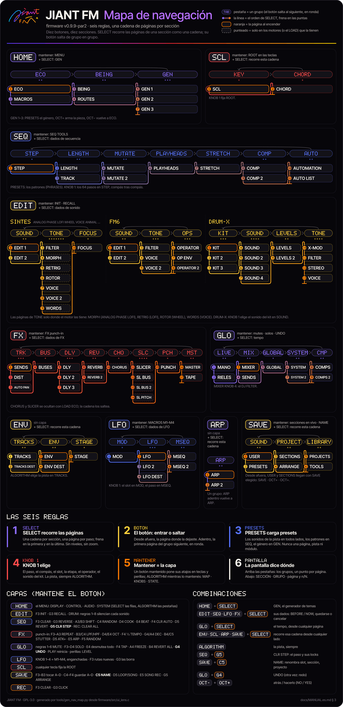

# JIANT FM — Manual de usuario

**Firmware v0.6.30 para el M-VAVE FM-1**

> *English version: [MANUAL.md](MANUAL.md).*

Este manual es para músicos que acaban de instalar JIANT FM y quieren saber cómo tocarlo, cómo armar temas con él
y, sobre todo, **cómo guardar su trabajo sin perder nada**. Sigue el firmware tal como está en la v0.6.30: cada
botón, perilla y mensaje aparece nombrado exactamente como lo muestra el equipo.

Si vas a leer un solo capítulo, leé [12. Guardar y cargar](#12-guardar-y-cargar).

## Contenido

0. [Inicio rápido](#0-inicio-rápido)
1. [El panel](#1-el-panel)
2. [La pantalla](#2-la-pantalla)
3. [Páginas y capas](#3-páginas-y-capas)
4. [Motores](#4-motores)
5. [DRUM-X](#5-drum-x)
6. [El secuenciador](#6-el-secuenciador)
7. [ARRANGE: canciones, secciones y escenas](#7-arrange-canciones-secciones-y-escenas)
8. [Dados y UNDO](#8-dados-y-undo)
9. [Efectos y master](#9-efectos-y-master)
10. [Modulación y macros](#10-modulación-y-macros)
11. [Tocar en vivo](#11-tocar-en-vivo)
12. [Guardar y cargar](#12-guardar-y-cargar)
13. [Sistema: TRACKS, LOAD y el MENU](#13-sistema-tracks-load-y-el-menu)
14. [MIDI y USB](#14-midi-y-usb)
15. [Herramientas web: emulador, instalador, editor, backup](#15-herramientas-web-emulador-instalador-editor-backup)
16. [Problemas y preguntas frecuentes](#16-problemas-y-preguntas-frecuentes)

---

## 0. Inicio rápido

### Instalación

1. Abrí el **instalador web** en Chrome o Edge: <https://juanjiant-bit.github.io/JIANT/webapp/installer/>
2. Conectá el FM-1 **directamente** a la computadora con un cable USB de datos.
3. **¿Venís de otro firmware custom (Felucca, baudgirl o cualquier otro)?** Volvé primero al firmware oficial V15
   con el botón **Return to official V15 first** del instalador (que además guarda un backup completo). Escribir
   JIANT directamente encima de otro firmware custom ya dejó algún FM-1 sin poder arrancar.
4. Apretá **Install**. Primero revisa el firmware del FM-1 y solo escribe sobre el oficial V15 o JIANT (si encuentra otro,
te manda a volver al V15 oficial primero). No desenchufes el cable mientras escribe.

JIANT no tiene samples de usuario: si venís de Felucca, sus samples de usuario (USR1–3) se pierden al instalar.
Guardá tus archivos WAV.

### Tu primer sonido (1 minuto)

1. Encendé el equipo. La firma se dibuja sola y después llegás a **HOME**: seis criaturas, una por pista. (0.9.9) Las
   pistas arrancan como **T1 DRUM-X** (el kit de fábrica), **T2 VOICE** (SINGER EN: canta palabras), **T3 ANIMAL**
   (CMOS BIRD), **T4 LOFI** (BYTEBEAT), **T5 ANALOG** (FAT BASS) y **T6 FM6** (TINE EP), cada una con el sonido de su
   preset, seco.
2. Girá **ALGORITHM** para elegir una pista (T1–T6). Con el valor por defecto, **TRACKS 4**, se detiene en T4: T5 y T6 aparecen solo con TRACKS 6 (ver
   [13](#13-sistema-tracks-load-y-el-menu)).
3. Girá **PRESETS** para recorrer sonidos. Tocá las teclas.
4. Girá **KNOB 1–4**: en HOME son los cuatro controles más útiles del motor de la pista.
5. ¿No te gusta? Mantené **EDIT** y girá **SELECT**: el sonido se tira a los dados y sale una variación nueva, que escuchás al
   instante. **OCT+ OK** la deja, **OCT− CANCEL** devuelve el sonido.

### Tu primer tema (5 minutos)

1. Mantené **HOME** y girá **SELECT** (o en HOME tocá **HOME** dos veces: ECO → BEING → **GEN**). Se abre el **GENERATOR** en
   **EXPLORE** (ningún género, todas las reglas rotas): apretá **OCT+** así, o antes elegí RANDOM o uno de los 43 géneros
   con KNOB 1 o PRESETS. Aparece una idea de tema completa: motores, sonidos, partes, escala, tempo y efectos. Apretá
   **PLAY**.
2. ¿No te convence? Apretá **OCT+** otra vez: semilla nueva, pieza nueva. ¿Demasiado cargada? Girá **SELECT** un paso a la
   derecha para GEN 2 y bajá **DRUMS** o **ARP**, después OCT+: la misma pieza con eso cambiado. **OCT−** vuelve a ECO. Para volver a lo que había antes: mantené **GLO** y apretá **G4** (UNDO).
3. ¿Te gusta? **Pará** (PLAY), apretá **SAVE** (abre USER, los sonidos de usuario) y apretá **SAVE** otra vez:
   **SECTIONS**, del grupo PROJECT, las cuatro secciones del proyecto. Girá **KNOB 4** a la derecha para que su tarjeta diga
   **OCT+** y apretá **OCT+**. Escribí un nombre con las teclas (o dejá el que te ofrece) y apretá **OCT+** otra vez. La
   pantalla dice **SAVED**.
4. Hacé una variación (cambiá algunos pasos, muteá una pista) y guardala en la sección **B**: en SECTIONS girá
   **KNOB 1** hasta **B** y después KNOB 4 y OCT+ como antes.
5. Girá **SELECT** un paso a la derecha: **ARRANGE** (las filas del tema). Apretá **OCT+** para agregar una fila,
   elegí su sección con **KNOB 2** y su largo con **KNOB 3** (compases). Agregá una fila para A y otra para B. Apretá
   **PLAY**: el tema reproduce las filas en orden.

Ese es todo el ciclo: **hacer música → guardarla en una sección → encadenar secciones en ARRANGE**.

---

## 1. El panel

Los nombres de abajo son los que usa el firmware (la pantalla HARDWARE CALIBRATION los pide con estos nombres).

### Encoders y perillas

| Control | Qué hace |
| --- | --- |
| **SELECT** (encoder) | Solo (0.9.2): **recorre las páginas de la sección**, una página por paso, en una sola cadena, frenando en la primera y en la última (sin niveles, sin zoom; ver [Cómo funciona la navegación](#cómo-funciona-la-navegación-seis-reglas-092)). En el MENU: sus filas, las cuatro pestañas en una cadena. Con un botón mantenido: **HOME** + SELECT **GEN**, **EDIT / SEQ / LFO / FX** + SELECT los **dados** de esa parte, **GLO** + SELECT el **tempo**, **ENV / SCL / ARP / SAVE** + SELECT recorren la cadena de esa sección desde donde estés. |
| **ALGORITHM** (encoder) | Elige la pista desde cualquier página: T1–T6 (T1–T4 con TRACKS 4). La pista es siempre de ALGORITHM (0.9.2: PRESETS ya no la elige en ENV, LFO, CHORD, ARP). En el MENU: la pestaña siguiente / anterior. Con una capa mantenida: su vista, MAP ↔ KNOBS ↔ STATE. |
| **PRESETS** (encoder) | **Siempre presets** (0.9.2): los sonidos de la pista seleccionada (los presets de fábrica de cada motor y después tus presets de usuario) en todas las páginas; en las páginas **SEQ** los **patrones** (abre el cargador PHRASES con el patrón siguiente elegido: OCT+ lo carga, OCT− vuelve a la página SEQ); en **GEN** el GENRE. En el MENU y con un botón mantenido no hace nada. Nunca cambia de página, de pista, de módulo ni de fila. |
| **KNOB 1–4** | Las cuatro tarjetas (columnas) de la pantalla. Una página que elige algo lo elige con **KNOB 1** (el paso, el compás, el slot, la etapa, el operador, el sonido del kit, la fila). Con una capa mantenida, las perillas propias de la capa. Girar rápido recorre todo el rango, despacio ajusta fino (MENU > KNOB ACCEL lo desactiva). |
| **MASTER** | El volumen de salida. |

### Botones

| Botón | Toque | Mantener |
| --- | --- | --- |
| **HOME** | HOME (0.9.2, como el botón de cualquier sección): desde otra sección, la última página de HOME; en HOME la primera página del grupo siguiente, en ronda: **ECO → BEING → GEN → ECO**. | Unos 0,7 s: abre el **MENU**. |
| **ENV** | La sección ENV: desde otro lado, la última página mostrada (al encender, ENV); adentro, el grupo siguiente: **TRACKS → ENV → STAGE**, en ronda. | (sin capa) |
| **LFO** | La sección LFO: desde otro lado, la última página mostrada (al encender, LFO); adentro **MOD → LFO → MSEQ**, en ronda. | Capa **MACRO**: KNOB 1–4 son M1–M4. |
| **FX** | La sección FX: desde otro lado, la última página mostrada; adentro, el módulo siguiente: **TRACK → BUSES → DELAY → REVERB → CHORUS → SLICER → PUNCH → MASTER**, en ronda. | Capa de **FX punch-in**. |
| **SCL** | La sección SCL (0.9.2: propia, separada de ARP): **KEY ↔ CHORD**. | Capa **SCL**: las teclas fijan la tónica. |
| **EDIT** | La sección EDIT: desde otro lado, la última página mostrada (una memoria para los sintes y una para FM6 y otra para DRUM); adentro el grupo siguiente: **SOUND → TONE → FOCUS** (FM6: SOUND → TONE → OPERATOR; DRUM: KIT → SOUND → LEVELS → TONE). Siempre EDIT (0.9.2: borrar un paso es SEQ + G5, renombrar SAVE + C5). Un paso mantenido + EDIT sigue borrando los locks de ese paso. | Capa **EDIT**: INIT, RECALL, mutes de los sonidos de DRUM-X, SELECT los dados de sonido. Mantenido + KNOB 1–4: **MOMENTARY** (la página de abajo, vuelve al soltar). |
| **GLO** | La sección GLO: desde otro lado, la última página mostrada; adentro **LIVE → MIX → GLOBAL → SYSTEM → COMPS**, en ronda (al prender MIXER; LIVE, las secuencias en vivo, primero). | Capa **GLO**: mutes, solos, niveles, tap tempo, UNDO. |
| **SAVE** | La sección SAVE: desde otro lado, la última página mostrada, y USER o SECTIONS llegan con su **SAVE ya elegido** (SAVE, OCT+, OCT+ como antes); adentro **SOUND → PROJECT → LIBRARY**, en ronda. | Capa **SAVE**: tocar/guardar secciones en vivo; C5 NAME. |
| **ARP** | La sección ARP (ARP · ARP 2, un grupo): desde otro lado, la última página mostrada; adentro, vuelve a ARP. Un acorde mantenido + ARP al grabar por pasos lo sigue arpegiando. | (sin capa) |
| **SEQ** | La sección SEQ: desde otro lado, la última página mostrada (al encender STEP, el piano roll); adentro el grupo siguiente: **PATTERN → TRACK → BAR → STEP → AUTO**, en ronda. | Capa **SEQ TOOLS** (en todas las páginas SEQ); G5 CLR STEP. |
| **PLAY** | Arranca / para. | — |
| **REC** | Arma / desarma la grabación en la pista seleccionada. | Capa **REC**: CLEAR, CLICK. |
| **OCT− / OCT+** | Octava del teclado (−3 a +3; los dos juntos: vuelve a 0; en una pista DRUM el kit queda en sus teclas: ratchets arriba, SHORT / GHOST / FLAM abajo, ver [5](#5-drum-x)). En páginas de acción y en diálogos: **OCT−** = atrás / NO, **OCT+** = hacerlo / YES. | — |

### Las teclas

27 teclas de **F3 a G5** (16 blancas, 11 negras). Tocan la pista seleccionada. Con una capa mantenida se convierten en
atajos de esa capa; en la grilla DRUM son pasos y carriles; en la pantalla NAME escriben.

### Combinaciones útiles

| Combinación | Resultado |
| --- | --- |
| **GLO** mantenido + **PLAY** | Reinicia desde el principio sin parar (clock interno). |
| **GLO** mantenido + **SELECT** | Tempo, desde cualquier página. |
| **GLO** mantenido + **G4** | **UNDO** del último cambio grande (otra vez: rehacer). |
| **SEQ** mantenido + **REC** | **CLEAR ALL SEQUENCES?** — los pasos y la automatización de las seis pistas, y el carril de punch-in. |
| **REC** mantenido + **FX / EDIT / ENV / LFO / SCL / ARP / GLO** | Borra la automatización de esa parte en la pista seleccionada (GLO: la automatización de nivel y paneo de todas las pistas; FX: también el carril de punch-in). Sin diálogo. |
| **SAVE** mantenido + **OCT+** / **OCT−** | Guarda la música en la sección que está sonando / recupera esa sección tal como quedó guardada. |
| **HOME** mantenido + **SELECT** | **GEN**, el generador de temas (las últimas páginas de HOME; ver [8](#8-dados-y-undo)). |
| **EDIT / SEQ / LFO / FX** mantenido + **SELECT** | Los dados: el sonido / la secuencia / el LFO / los efectos (ver [8](#8-dados-y-undo)). |
| **ENV / SCL / ARP / SAVE** mantenido + **SELECT** | Entra a esa sección y recorre su cadena, como SELECT adentro. (0.9.2: botón mantenido + **PRESETS** ya no recorre páginas.) |
| **SEQ** mantenido + **G5** | **CLR STEP**: borra el paso del cursor y sus locks (NOTE con una nota en foco: esa nota; AUTO LIST: borra el registro). |
| **SAVE** mantenido + **C5** | **NAME**: renombra el slot en SAVE > USER, la sección o el proyecto en SECTIONS / PROJECTS. |
| Un paso mantenido (SEQ > STEP) + **KNOB 1–4** | Un parameter lock en ese paso. |
| Teclas de paso mantenidas (SEQ, el roll / la grilla) + **SELECT** / una tecla de paso + **REC** | **COPIAR** esos pasos / **PEGARLOS** desde ese paso (ver Copiar y pegar). |
| **OCT− + OCT+** mantenidos al encender | HARDWARE CALIBRATION. |
| **OCT− + OCT+** mantenidos 5 s con el equipo funcionando | Modo de actualización (UBOOT), con una cuenta regresiva desde los 2 s; soltá para cancelar. |

---

## 2. La pantalla

### Pieles: AIR, COLORS, BOTTOM, HUD (0.8.9, AIR 0.9.7)

**MENU > DISPLAY > SKIN** elige cómo se visten las lentes (la maqueta aprobada "skin aireado", opciones 1, 3 y 4; 0.9.7:
AIR, la opción aprobada); en todas las páginas, todas las paletas, FLAT y LINE. El menú las recorre AIR, COLORS, BOTTOM,
HUD:

- **AIR** (0.9.7; la de fábrica de los ajustes nuevos: un FM-1 nuevo o con sus ajustes borrados; los ajustes guardados
  antes conservan la piel que tenían): el aspecto de HUD en **todas** las páginas, con la **fila de perillas arriba**,
  justo debajo de las pestañas: sin cartas ni caja de panel, el texto claro con un borde oscuro de 2 px, el medio de la
  pantalla libre para el dibujo y el pie solo la miga de pan. En HOME los seres nadan por la pantalla entera debajo del
  encabezado, las pestañas, la fila de perillas y la miga, como en HUD (la fila de perillas se apaga ahí unos segundos
  después de la última vuelta); todas las capas, diálogos y el menú con la misma ropa. La palabra del grupo va
  subrayada con una rayita.
- **COLORS** (los ajustes guardados antes de 0.9.7 sin otra piel elegida cargan con ella): la estructura LENTE con los **colores de la 0.6**.
  Negro, cartas casi negras redondeadas con una marquita y el nombre de la perilla, **cada perilla con su color** en el
  valor y en la barra (JIANT, 0.9.5 como la 0.6: el color propio de cada parámetro **se mueve con su cantidad**, como
  calor, violeta si es poco, amarillo y crema si es mucho; uno centrado como PAN o DETUNE frío en el medio y caliente en
  los dos extremos; las otras paletas sus cuatro colores de perilla), la carta de
  la perilla que girás enmarcada en su color; la pestaña del grupo rellena de violeta; el número de la pista en una
  cajita naranja, un ▶ violeta y el BPM grande en violeta en el encabezado; un panel casi negro redondeado; los seres con
  el calor de la 0.6 (púas violetas, anillos rojo y naranja, núcleos crema).
- **BOTTOM**: las pestañas son las palabras de los grupos (la del grupo en el que estás con una pastillita debajo, un punto por página), sin cartas ni caja de panel: el
  medio de la pantalla es el dibujo, de borde a borde (los seres de HOME tienen todo el lugar), y las cuatro perillas
  son una fila fina sobre la miga de pan (marca y nombre, el valor en su color, una barra finita).
- **HUD**: como BOTTOM, pero en HOME los seres nadan **debajo de todo, por la pantalla entera**: el encabezado, las
  pestañas, las perillas y la miga flotan encima como texto claro con un borde oscuro de 2 px (0.9.0). Ahí la fila de
  perillas se apaga a un quinto unos segundos después de la última vuelta de perilla y vuelve con la siguiente o al
  cambiar de página; en las demás páginas queda encendida. La palabra del grupo va subrayada con una rayita.

Los valores (cartas, el BPM del encabezado) vuelven a una sans redondeada (Inter Tight SemiBold), como en la 0.6; los
nombres, las pestañas y la miga siguen con las letras de píxel de 5 x 7. **MENU > LARGE** deja sus cartas grandes arriba
en todas las pieles (la piel conserva sus pestañas y sus colores; en AIR quedan donde va su fila de perillas, debajo de
las pestañas), así LARGE se lee igual en cualquiera.

Desde la 0.8.5 todas las páginas llevan la piel del diseño que aprobó el dueño (la maqueta HTML "LENTE"):

- **Encabezado (arriba)**: una sola línea tranquila sobre una regla fina. A la izquierda el estado de reproducción (un
  cuadrado gris parado, un triángulo naranja sonando, violeta durante la cuenta) y los **BPM** (violeta; naranja
  mientras cambian), después el candado de BPM LOCK y el punto de REC (lleno: la pista seleccionada armada; un aro:
  otra pista). Al medio de qué es la página: **T1 · ANALOG ACID** (la pista, su motor y su sonido); en las páginas del
  tema (SAVE, ARRANGE, TOOLS, GLOBAL) **P1 NOMBRE** (el proyecto); en FX **T1** en naranja. A la derecha la octava
  (**OCT +2**, o la fila del tema mientras suena un tema), el **medidor de carga** (cinco barritas, violetas a medida
  que el sonido ocupa más del tiempo de audio) y la batería (violeta cuando la alimenta el USB). Los mensajes aparecen
  al medio ("SAVED", "T1 CLEARED"...), a veces con una segunda línea.
- **Tarjetas**: las cuatro cajas debajo del encabezado son KNOB 1–4: el nombre chico y gris arriba, el valor debajo en
  blanco y una barra violeta fina debajo del valor. La que estás girando se enciende en naranja, así es el único color
  en las tarjetas. Un valor automatizado o con lock tiene el nombre en violeta; una tarjeta apagada significa "acá
  ahora no hay nada". Una acción armada (SAVE, LOAD, ERASE, CLEAR...) es una tarjeta teñida de violeta, con el nombre
  violeta y **OCT+** como valor. Desde la 0.8.5 las tarjetas no llevan íconos, ni nada más (las tarjetas de MENU > LARGE:
  un punto violeta para un valor que se mueve solo; el encabezado: "!" antes de un mensaje NO FILE, un candado y un
  disco dibujados).
- **Nombre de página**: al cambiar de página (o de pista) a mano, el nombre de la página aparece un momento sobre el pie
  de la pantalla, con la pista y su motor a la derecha; en HOME el motor de la pista, y "T1 HOME" en chico (en una
  página de lente se enciende su miga de pan). La barra de arriba, las tarjetas y el gráfico quedan a la vista.
- **Gránulos**: unos puntitos flotan detrás del gráfico del panel, como en HOME (LOAD FULL con ANIM ON). Se mueven solo cuando
  el panel se redibuja igual (una perilla, el LFO, la envolvente), así que no gastan CPU.
- **Panel (al medio)**: el gráfico de la página — la criatura del motor, una envolvente, el LFO en movimiento, la
  grilla de pasos, una lista...
- **Pie**: las barras de pasos del compás que editás (de a cuatro debajo de cada tarjeta) o ayudas de teclas, y debajo
  una **miga de pan** chica y gris: **SECCIÓN · GRUPO · página** y a la derecha el lugar de la página en la cadena de
  la sección (0.9.2; p. ej. **FX · DELAY · DLY 2  6/16**, **ENV · TRACKS · TRACKS DEST  2/5**).
- **Las pestañas** (0.9.2): debajo del encabezado, los **grupos** de la sección (FX: TRK · BUS · DLY · REV · CHO · SLC ·
  PCH · MST; SEQ: PATT · TRACK · BAR · STEP · AUTO), encendido el del grupo en el que estás (COLORS: relleno violeta;
  BOTTOM: una pastillita; HUD y AIR: una rayita), y **un punto por página** debajo de cada uno, encendido el de la página que
  se ve. Las tarjetas debajo, un panel más alto, y el pie es solo la miga de pan.

- **Las letras chicas** (desde la 0.8.5): los nombres de las tarjetas, las pestañas, la miga de pan, las
  palabras del medio del encabezado y los rótulos y fichas chicas de los paneles van en una letra de píxeles de 5 x 7,
  nítida, las mayúsculas mono chicas de la maqueta; los valores siguen en la letra redondeada más grande.

Los **colores** funcionan como una cámara térmica: frío (índigo, violeta) es poco, caliente (rojo, naranja, crema, blanco; 0.8.9: la escala de la 0.6) es
mucho. Violeta es lo seleccionado, naranja lo activo.

**HOME** es el ecosistema: una criatura por pista, su especie según su motor, su forma según sus cuatro perillas, que
se hincha y se calienta con su propio audio (0.8.8: nadando libres por toda la pantalla, solas, como antes de 0.8.5; ver
[las secciones](#las-secciones-y-sus-cadenas)). (0.9.7) Cada ser lleva una **carita**: cierra los ojos con un golpe y abre
la boca con su nivel. La pista seleccionada se dibuja más grande, su número en violeta, una muteada se **duerme** (un
contorno apagado, los ojos cerrados), una pista dormida (TRACKS 4) se dibuja como muteada. En el **MIXER**, las pistas dormidas aparecen en gris y dicen OFF.

Los **diálogos** preguntan antes de cualquier cosa destructiva: **OCT− NO**, **OCT+ YES**. (0.8.5, como la maqueta)
Llevan las pestañas **NOTICE · DICE · NAME**: una pregunta es una tarjeta bajo una regla violeta con sus dos botones
(YES en el acento); el dado de una parte (EDIT, SEQ, LFO, FX + SELECT) muestra **BEFORE** y **NOW** lado a lado (el
ser del sonido antes y ahora, los pasos, los valores del LFO o de los efectos) sobre una franja **KEEP DICED …? ·
SELECT: DICE AGAIN · OCT− CANCEL · OCT+ OK**; NAME tiene sus tarjetas CURSOR, CHAR, LEN y OCT+ SAVE / WRITE sobre el
nombre, las letras de las teclas y las funciones de las teclas negras. (0.9.5) La tarjeta de una pregunta solo tapa su
propio recuadro, sus pestañas y su ruta: la página sigue a la vista alrededor, en movimiento.

**Mensajes** (0.9.5): un mensaje en una página con lente aparece como una pequeña píldora cerca del pie del panel, sobre
la página, que sigue dibujándose y moviéndose detrás (el encabezado también lo dice; no sobre los seres de HOME ni el
mapa de una capa); nada se oscurece. La píldora no tapa el texto de la página: si el pie está escrito (las filas de
AUTO LIST, las líneas de MUTATE) se pone en las filas libres más cercanas, y en una página sin filas libres no aparece y
lo dice solo el encabezado. La **ayuda** de una página (la de MUTATE "OCT+ KEEP  GLO+A4 FREEZE", la de MOTION y PUNCH
"REC + PLAY ...") aparece solo si te quedás en la página unos 0,8 s, nunca mientras SELECT pasa por ella, y cada una
como mucho dos veces en total (se cuentan con los ajustes: tampoco vuelven tras reiniciar). SAVE › TOOLS › INIT SYSTEM
las reinicia. Tocar un botón de capa no dice nada (ya no están las ayudas "HOLD [X] QUICK"): mantenelo y su capa se
muestra sola.

---

## 3. Páginas y capas

*Todo el sinte en una página: el botón de cada sección, sus grupos (las pestañas de la pantalla) y sus páginas en el
orden en que las recorre SELECT (el número de cada punto es la n del n/N del pie; en naranja, la página al encender;
punteada, una página que solo tienen algunos motores o LOADs), con las seis reglas, las capas y las combinaciones.
Hacé clic para abrir el SVG, con zoom ([in English](navigation-map.svg)). Se genera desde las tablas de cadenas del
firmware (`tools/gen_nav_map.py`).*

### Cómo funciona la navegación: seis reglas (0.9.2)

Desde la 0.9.2 todas las secciones se manejan igual (el diseño que aprobó el dueño, la maqueta "navegación"): lo
aprendés una vez y ya conocés todas. Hasta la 0.9.1 cada parte era una lente de tres niveles con juegos de perillas; las
páginas, sus perillas, sus dibujos y todas las funciones son las mismas, solo cambió el camino entre ellas.

1. **SELECT recorre las páginas.** Girar SELECT pasa por todas las páginas de la sección, en una sola cadena, una
   página por paso, y frena en la primera y en la última. Sin niveles, sin zoom. FX: SENDS → DIST → AUTO PAN → BUSES →
   DLY → DLY 2 → DLY 3 → REVERB → … → PUNCH.
2. **El botón de la sección: entrar o saltar.** Desde otra sección te devuelve a la última página donde estabas ahí. Si
   ya estás adentro, salta a la **primera página del grupo siguiente** (y da la vuelta). En FX › DLY 2, FX va a REVERB;
   en EDIT › FILTER, EDIT va a FOCUS.
3. **PRESETS carga presets.** Siempre: los sonidos de la pista en todas las secciones, los **patrones** en SEQ (el
   cargador PHRASES), el **género** en GEN. Nunca cambia de página, de pista ni de módulo (en el MENU no hace nada).
4. **KNOB 1 elige.** Si una página elige algo (un paso, un compás, un slot, una etapa, un operador, el sonido del kit,
   una fila), KNOB 1 es la que lo elige. La pista, siempre **ALGORITHM**. SEQ › STEP: KNOB 1 recorre los 64 pasos,
   compás tras compás; la página nueva **SEQ › BAR**: KNOB 1 el compás.
5. **Mantener = la capa.** Mantener un botón abre su capa de atajos, como antes (más allá del tiempo HOLD, MENU >
   HOLD, 0,4 s por defecto: las teclas y perillas cambian de función mientras lo mantenés, un mapa muestra qué hace
   cada tecla; una tecla o una perilla la abre al instante; soltá y volvés). Mantenido + SELECT: **HOME** GEN, **EDIT /
   SEQ / LFO / FX** sus dados, **GLO** el tempo, **ENV / SCL / ARP / SAVE** recorren su cadena. (Mantenido + PRESETS ya
   no recorre páginas: regla 3.)
6. **La pantalla dice dónde estás.** Arriba, las pestañas son los **grupos** de la sección, el actual encendido y un
   puntito por cada una de sus páginas. Abajo: **SECCIÓN · GRUPO · página** y **n/N**, el lugar de la página en la
   cadena: **FX · DELAY · DLY 2  6/16**. Igual en AIR, COLORS, BOTTOM y HUD, con todas las paletas.

- Cada sección recuerda la página donde la dejaste (EDIT una para los sintes y una para FM6 y otra para DRUM); al
  encender SEQ abre en STEP, ENV en ENV, LFO en LFO, las demás en su primera página.
- **SCL y ARP son dos secciones** (hasta la 0.9.1 una lente): SCL es KEY · CHORD, ARP es ARP · ARP 2 (un grupo: un
  toque de ARP adentro vuelve a ARP).
- **GEN son tres páginas de HOME** (GEN 1–3, el último grupo de HOME), ya no una pantalla aparte: los botones de
  sección funcionan ahí, OCT+ arma la pieza, OCT− vuelve a ECO. HOME + SELECT lo sigue abriendo desde cualquier lado.
- **SAVE desde afuera** vuelve a la página de SAVE que dejaste; **USER** y **SECTIONS** llegan con su SAVE ya elegido,
  así SAVE, OCT+, OCT+ sigue guardando el sonido (o la sección).
- **EDIT es siempre EDIT**: borrar un paso pasó a la capa SEQ (**SEQ + G5**, CLR STEP; en AUTO LIST borra el
  registro; llevar TIME a REST también borra la nota) y renombrar a la capa SAVE (**SAVE + C5**, NAME).
- **El MENU** (mantené HOME): SELECT recorre todas las filas (DISPLAY → CONTROL → AUDIO → SYSTEM), ALGORITHM salta de
  pestaña, una perilla cambia el valor, HOME lo cierra.
- Algunas páginas solo aparecen cuando corresponden: las páginas de operadores de FM6 en una pista FM6, las de DRUM-X
  en una pista DRUM, RETRIG en LOFI BYTE/FLOAT, y con **LOAD ECO** se ocultan las páginas SLICER y CHORUS; la cadena
  las saltea.

### Las secciones y sus cadenas

SELECT recorre cada fila de izquierda a derecha; el botón salta a la primera página del grupo siguiente. Cada página es
la misma de la 0.9.1, con sus perillas y su dibujo (los que dibujaban las lentes de la 0.8.5).

| Sección | Grupos (el botón) · páginas (SELECT) | Páginas |
| --- | --- | --- |
| **HOME** | **ECO**: ECO · MACROS — **BEING**: BEING · ROUTES — **GEN**: GEN 1 · GEN 2 · GEN 3 | 7 |
| **EDIT** (un sinte) | **SOUND**: EDIT 1 · EDIT 2 — **TONE**: FILTER · MORPH · RETRIG · ROTOR · VOICE · VOICE 2 · WORDS (las que tenga el motor) — **FOCUS**: FOCUS | hasta 10 |
| **EDIT** (FM6) | **SOUND**: EDIT 1 · EDIT 2 — **TONE**: FILTER · VOICE · VOICE 2 — **OPERATOR**: OPERATOR · OP ENV · OPERATOR 2 | 8 |
| **EDIT** (DRUM) | **KIT**: KIT · KIT 2 · KIT 3 — **SOUND**: SOUND · SOUND 2 · SOUND 3 · SOUND 4 — **LEVELS**: LEVELS · LEVELS 2 — **TONE**: X-MOD · FILTER · STEREO · VOICE | 13 |
| **SEQ** | STEP · **LENGTH**: LENGTH · TRACK · **MUTATE**: MUTATE · MUTATE 2 · PLAYHEADS · STRETCH · **COMP**: COMP · COMP 2 · **AUTO**: AUTOMATION · AUTO LIST | 11 |
| **FX** | **TRACK**: SENDS · DIST · AUTO PAN — **BUSES**: BUSES — **DELAY**: DLY · DLY 2 · DLY 3 — **REVERB**: REVERB · REVERB 2 — **CHORUS**: CHORUS — **SLICER**: SLICER · SL BUS · SL BUS 2 · SL PITCH — **PUNCH**: PUNCH — **MASTER**: MASTER | 16 |
| **GLO** | **LIVE**: MANO · RIELES — **MIX**: MIXER · SENDS — **GLOBAL**: GLOBAL — **SYSTEM**: SYSTEM · SYSTEM 2 — **COMPS**: COMPS · COMPS 2 | 9 |
| **ENV** | **TRACKS**: TRACKS · TRACKS DEST — **ENV**: ENV · ENV DEST — **STAGE**: STAGE | 5 |
| **LFO** | **MOD**: MOD — **LFO**: LFO · LFO DEST — **MSEQ**: MSEQ · MSEQ 2 | 5 |
| **SCL** | **KEY**: SCL — **CHORD**: CHORD | 2 |
| **ARP** | **ARP**: ARP · ARP 2 | 2 |
| **SAVE** | **SOUND**: USER · PRESETS — **PROJECT**: SECTIONS · ARRANGE — **LIBRARY**: PROJECTS · TOOLS | 6 |

Dónde vivía cada página en la 0.9.1: las vistas de seis envolventes de ENV (el nivel TRACKS) ahora son páginas propias,
**TRACKS** y **TRACKS DEST**, con las perillas de ENV y ENV DEST; **NOTE** aparece una sola vez (el grupo BAR; su
dibujo del paso grande es el de COMP); el **SENDS** de FX es la página FX; la página PROJECT de SAVE es **SECTIONS** (el
nivel PROJECT) y **PROJECTS** (el nivel LIBRARY); EDIT 1 / EDIT 2 del kit DRUM son **KIT** / **KIT 2**. La página nueva
**BAR** es el dibujo de los compases de PATTERN con KNOB 1 el compás y KNOB 2 LEN.

- **ECO**: los seres de las seis pistas nadando libres por todo el panel, solos (0.8.8: como antes de 0.8.5), cada
  uno hinchándose con su sonido (un golpe lo empuja), su número debajo; el seleccionado más grande, su número violeta.
  (0.9.7, "hoy con carita") Cada ser es el contorno con púas de su especie (las púas según suena) en **tres isotermas**,
  coloreadas por **su propio nivel** como una cámara térmica (bajito: cian y azul; fuerte: rojo, naranja y amarillo; las
  de adentro más calientes), y donde estaban sus núcleos una **carita**: dos ojos que **se cierran con un golpe** y una
  boca que **se abre con el nivel**. El ser de una pista muteada duerme (un contorno apagado, los ojos cerrados). Cuando
  **MUTATE** cambia una pista, su ser **mira para arriba**, su número se enciende **blanco** y se abre un anillo del
  color de acento a su alrededor. Detrás derivan los gránulos del citoplasma (los dibuja solo la pantalla: nada del
  tiempo del sonido). **MACROS**: KNOB 1–4 son **M1–M4** (las macros, como LFO
  mantenido), las rutas contadas arriba a la izquierda, LATCH a la derecha.
- **BEING**: el ser de la pista grande, sus cuatro perillas de HOME como órganos en las esquinas (un medidor cada una,
  su valor, una vena hasta el cuerpo), el nombre del sonido debajo. (0.9.4) Una pista VOICE muestra ahí su **cabeza**, una ANIMAL su
  **criatura**, una DRUM-X su **batería de bichitos** (ver [sus dibujos](#tres-motores-dibujan-su-propia-criatura-094)); (0.9.6) los otros
  seis motores los suyos ([una célula, una colonia, gusanos, un enjambre, un caracol, una oruga](#seis-motores-más-dibujan-su-propia-criatura-096)). **ROUTES**: M1–M4 a la izquierda con sus rutas
  dibujadas hasta donde van (**T2 CUT+62**).
- **ENV** › **TRACKS** / **TRACKS DEST**: las envolventes de las seis pistas como mosaicos (la seleccionada teñida, con su nivel actual
  como punto; DEST: FILTER, PITCH y SHAPE como barras debajo de cada una); las perillas son de la pista seleccionada —
  **ALGORITHM** elige la pista. **ENV**: la envolvente grande / las columnas de ENV DEST, como antes.
  **STAGE**: KNOB 1 elige la etapa (ATK DEC SUS REL), KNOB 2 la ajusta, KNOB 3 LOOP; la
  envolvente entera con la etapa sombreada sobre la curva propia de la etapa, grande, y su tiempo.
- **GLO** › **MIX**: las seis pistas como tiras (MIXER: LEVEL con el vúmetro, PAN, REV; **SENDS**, nueva: DIST,
  CHORUS, DLY y REV de cada pista como cuatro barras, las perillas de la pista seleccionada). **GLOBAL**: el compás de
  semicorcheas, como antes. **SYSTEM**: las pistas que suenan como fichas, los tres ajustes de LOAD (encendido el
  elegido), la ruta MIDI, la carga de CPU de los últimos segundos como una línea.
- **SCL · ARP** › **KEY**: las doce notas en un círculo (C arriba), las de la escala encendidas y unidas, ROOT en el
  acento con el nombre de la escala en el medio, QUANT y ALL TR a la derecha, la escala en un teclado debajo; KNOB 1
  fija ROOT. **CHORD**: el acorde que toca ahora cada grado de la tonalidad (I–VII, como lo tocaría una tecla: una nota
  si CHORD está en OFF o la voz no es POLY). **ARP** / **ARP 2**: "MODE · RATE · OCT" y el patrón que toca sobre una
  tríada (GATE el largo de las celdas, SWING los contratiempos tarde, PROB algunas fuera); en OFF lo dice.
- **LFO · MOD** › **MOD**: la matriz como red — las fuentes a la izquierda (encendidas las que lee un slot), una curva
  de la fuente de cada slot a su caja **D1–D4** a la derecha (DEST, AMT como barra), el slot elegido con KNOB 1
  enmarcado con un pulso que corre por su curva. **LFO**: la onda bajo "RATE · WAVE" / **LFO
  DEST**: el LFO chico a la izquierda, los cuatro montos como filas encendidas por lo que el LFO manda ahora.
  **MSEQ** / **MSEQ 2**: los dieciséis pasos bajo su leyenda; KNOB 1 el paso.
- **EDIT** › **SOUND**: la criatura del motor a la izquierda (0.9.4 / 0.9.6: cada motor la suya, ver abajo; vivo con el sonido, el nombre de la página arriba, el del
  sonido abajo), el osciloscopio en un pozo y los ocho parámetros E como fichas a la derecha, encendidas las cuatro de
  la página. **TONE**: **FILTER** dibuja la respuesta de TYPE en CUT con su pico de RES (LP, HP, BP, COMB), CUT una
  línea, DRIVE / DIST una fila de celdas; **VOICE** / **VOICE 2** las voces una por fila, tan llenas como suenan,
  VOICE y PRIO (VOICE 2: ALLOC), la curva de GLIDE; las demás conservan su dibujo. **FOCUS** (nueva): un parámetro E
  grande como medidor — KNOB 1 lo elige (E1–E8), KNOB 2 lo ajusta, KNOB 3 la **fuente** del slot de MOD que apunta a
  él (subida desde OFF la toma un slot libre, con ese parámetro como DEST; de vuelta a OFF lo libera), KNOB 4 el
  **AMT** de ese slot; E1–E8 como pestañas abajo.
- **GEN 1–3** son el generador (como HOME mantenido + SELECT, desde cualquier página): **SELECT** cambia la página (a
  la izquierda de GEN 1: ROUTES), **PRESETS** el GENRE, **OCT+** arma la pieza, **OCT−** vuelve a ECO, un toque de
  **HOME** sigue a ECO.

### Cada página y sus cuatro perillas

"—" significa una tarjeta vacía. Una tarjeta de "acción" elegida (girá la perilla a la derecha) queda teñida de
violeta, con el nombre violeta, y dice **OCT+**; apretá OCT+ para ejecutarla.

**ENV** (por pista)

| Página | KNOB 1 | KNOB 2 | KNOB 3 | KNOB 4 |
| --- | --- | --- | --- | --- |
| ENV | ATK | DEC | SUS | REL |
| ENV DEST | FILTER | PITCH | SHAPE | LOOP |
| STAGE (0.8.5) | STAGE (ATK DEC SUS REL) | su valor | LOOP | — |

**LFO** (por pista)

| Página | KNOB 1 | KNOB 2 | KNOB 3 | KNOB 4 |
| --- | --- | --- | --- | --- |
| LFO | RATE | WAVE | MODE (TRIG / FREE) | FADE |
| LFO 2 | PHASE (donde arranca TRIG; atenuado en FREE) | — | — | — |
| LFO DEST | PITCH | FILTER | SHAPE | AMP |
| MOD | SLOT (1–4) | SRC | DEST | AMT |
| MSEQ | STEP (1–16) | LEVEL | LEN | SLEW |
| MSEQ 2 | DIV | — | — | — |

**MODE** del LFO: **TRIG** reinicia el LFO (en PHASE) y su FADE en cada frase nueva; **FREE** sigue corriendo entre
notas y golpes, nunca se reinicia (su FADE una vez, al cargar un proyecto o al pasar MODE a FREE). Se guarda como
PHASE −1, como desde 0.6.51: todo proyecto abre como estaba.

**FX** (las páginas TRACK son por pista; el resto son globales)

| Página | KNOB 1 | KNOB 2 | KNOB 3 | KNOB 4 |
| --- | --- | --- | --- | --- |
| FX | DIST | CHORUS (envío) | DLY (envío) | REV (envío) |
| DIST | DIST | TYPE | TONE | — |
| AUTO PAN | DEPTH | RATE | SYNC | WAVE |
| BUSES (0.8.5) | MIX (del delay) | SIZE (de la reverb) | DEPTH (del chorus) | DEPTH (del SLICER) |
| SLICER | MODE | PAT | RATE | DEPTH |
| SL BUS | T1 | T2 | T3 | T4 |
| SL BUS 2 | T5 | T6 | FX | — |
| SL PITCH | STEP | PITCH | LEN | QUANT |
| DLY | TIME | FEEDBK | TONE | MIX |
| DLY 2 | WIDE | PITCH | SPRAY | MOD |
| DLY 3 | TYPE (ANALOG / DIGITAL) | PING (OFF / ON) | DRIVE | — |
| REVERB | TYPE | SIZE | DAMP (RESO: FOLLOW) | PRE (SHIMMER/CLOUD: AIR; RESO: PITCH) |
| REVERB 2 | MOD | RATE | FILT | WIDE |
| CHORUS | RATE | DEPTH | STEREO | — |
| MASTER | CLIP | PUNCH | DUCK | REL |

**SCL**

| Página | KNOB 1 | KNOB 2 | KNOB 3 | KNOB 4 |
| --- | --- | --- | --- | --- |
| SCL | ROOT | SCALE | QUANT | ALL TR (0.7.6; antes TRANS, y SCL 2 tenía solo ALL TR) |

**EDIT** (por pista; qué páginas aparecen depende del motor)

| Página | KNOB 1 | KNOB 2 | KNOB 3 | KNOB 4 | Aparece en |
| --- | --- | --- | --- | --- | --- |
| EDIT 1 | E1 | E2 | E3 | E4 | todos los motores (ver [4](#4-motores)) |
| EDIT 2 | E5 | E6 | E7 | E8 | todos los motores |
| WORDS | LANG | LYRIC | POS | (OCT+ TYPE: la letra) | VOICE (0.8.5, [palabras](#voice-palabras-y-letras-085)) |
| RETRIG | RTRG | — | — | — | LOFI con WAVE en BYTE o FLOAT |
| MORPH | MORPH | — | — | — | ANALOG (SAW..SIN), PHASE, LOFI (hasta WRAM) |
| OPERATOR | OP | RATIO / FIXED | FINE | LEVEL | FM6 |
| OP ENV | OP | STAGE | RATE | LEVEL | FM6 |
| OPERATOR 2 | OP | MODE | DTUN | VEL | FM6 |
| FILTER | TYPE | CUT | RES | DRIVE (ANALOG) / DIST (los demás) | todos los motores |
| KIT 3 | BP | FEEDBK | HANDS | GLUE | DRUM (todo el kit) |
| X-MOD | RATE | DEPTH | SHAPE | RAND | DRUM (todo el kit) |
| STEREO | IMAGE | — | — | — | DRUM (todo el kit) |
| SOUND | SOUND | SIDE | PITCH | PMOD | DRUM (un sonido) |
| SOUND 2 | SOUND | DECAY | NOISE | COLOR | DRUM (un sonido) |
| SOUND 3 | SOUND | MODE | PM.TYPE | DRIVE | DRUM (un sonido) |
| SOUND 4 | SOUND | LAYER | FEEDBK | SEND | DRUM (un sonido) |
| LEVELS | KICK | SNARE | CLAP | HATCL | DRUM |
| LEVELS 2 | HATOP | TOM | RIM | BELL | DRUM |
| VOICE | VOICE | GLIDE | MODE | PRIO | todos los motores |
| VOICE 2 (0.8.5) | ALLOC | DETUNE (la apertura de UNI) | — | — | todos menos DRUM |
| FOCUS (0.8.5) | PARAM (E1–E8) | su valor | SRC (el slot de MOD sobre él) | AMT | los sintes (no FM6, DRUM) |

**GLO** (MANO y RIELES actúan sobre las pistas elegidas; MIXER es por pista; GLOBAL y SYSTEM son globales)

| Página | KNOB 1 | KNOB 2 | KNOB 3 | KNOB 4 |
| --- | --- | --- | --- | --- |
| MANO (main 0.9.11) | RATE | LOOP | THIN | DJ FILT (el del MIXER; las teclas: los modificadores en vivo, [11](#11-tocar-en-vivo)) |
| RIELES (main 0.9.11) | PISTAS (ALL, T1 … T6, SYN, DRM) | RATE | CORTE | DENS |
| MIXER | LEVEL | PAN | REV | DJ FILT (0.9.1: el DJ FILTER del master; era MUTE, ahora en la capa GLO) |
| SENDS (0.8.5) | DIST | CHORUS | DLY | REV (los de la pista seleccionada, como FX > SENDS) |
| GLOBAL | BPM | SWING | CLOCK | TUNE |
| SYSTEM | TRACKS | LOAD | ROUTE | CPU (%) |

**SAVE**

| Página | KNOB 1 | KNOB 2 | KNOB 3 | KNOB 4 |
| --- | --- | --- | --- | --- |
| PRESETS | No. (el sonido) | ENG (el motor) | FAV (marcar como favorito) | LIST (ALL / FAV) |
| USER | SLOT (U01–U32) | LOAD (acción) | ERASE (acción) | SAVE (acción) |
| PROJECTS / SECTIONS (la página PROJECT) | PROJECT (1–8; en SECTIONS: SECT A–D) | SECT (A–D; en SECTIONS: el NAME de la sección) | LOAD (acción) | SAVE (acción) |
| ARRANGE | ROW ("2/6") | SECT (en END: STOP / x2–x8 / LOOP) | BARS | SCENE |
| TOOLS | cualquier perilla elige de la lista: CLEAR SEQ, INIT SOUND, DELETE ROW, CLEAR SONG, NEW PROJECT, CPU TEST | | | |

**ARP** (por pista)

| Página | KNOB 1 | KNOB 2 | KNOB 3 | KNOB 4 |
| --- | --- | --- | --- | --- |
| ARP | MODE | RATE | OCT | GATE |
| ARP 2 | SWING | PROB | HOLD | ORDER |

**SEQ** (por pista)

Las páginas SEQ son una cadena de cinco grupos (0.9.2; ver [6](#cómo-moverse-la-cadena-de-seq)): **SELECT** las
recorre página por página, un toque de **SEQ** salta al grupo siguiente.

| Grupo (toque de SEQ) | Página (SELECT) | KNOB 1 | KNOB 2 | KNOB 3 | KNOB 4 |
| --- | --- | --- | --- | --- | --- |
| PATTERN | PATTERN | LEN | DIV | SWING | GATE |
| PATTERN | STRETCH | STRETCH (/8 … /2, x1, x2 … x8) | REPEAT (OFF, x2 … x8, TO 64) | NUDGE | ROTATE (−32 … +32) |
| PATTERN | PLAYHEADS | HEAD | RATE | DIR | INTERVAL |
| TRACK | TRACK | PITCH | CHANCE | HUMAN | REC Q |
| TRACK | MUTATE | WHAT | AMOUNT | DIR | LOOP |
| TRACK | MUTATE 2 (0.9.9-seq2c) | PARAM | SCALE | KEEP (girar) | REVERT (girar) |
| BAR | BAR (0.9.2) | BAR (el compás que editás) | LEN | — | — |
| BAR | STEP (melódica: piano roll) | STEP (los 64, compás tras compás) | NOTE | TIME (REST ← TIE ← NOTE → 2 ST … 16 ST: la duración de la nota en pasos; REST borra el paso) | FLAG (– / ACC / SLD / A+S) |
| BAR | STEP (DRUM: grilla) | STEP | LANE | HIT | ACC |
| BAR | NOTE | FOCUS | PITCH | MOVE | MICRO (−32/64 … +31/64; 0.9.1) |
| STEP | COMP | ACTION | LENGTH | CONDITION | VALUE (0.9.9-seq2d: C1) |
| STEP | COMP 2 | ACTION | LENGTH | CONDITION (ELSE: MONO) | VALUE (C2) |
| AUTO | AUTOMATION | PLAY (ON/OFF) | EVENT (cantidad) | LOCK (cantidad) | CLEAR (acción) |
| AUTO | AUTO LIST | ROW | STEP | PARAM | VALUE |

PRESETS en cualquier página SEQ carga un patrón (PHRASES); el compás es el KNOB 1 de BAR, el paso el de STEP (0.9.2;
hasta la 0.9.1 PRESETS hacía las dos cosas).

### Las capas (mantené el botón)

(0.8.5) Una capa mantenida también es una lente, como la maqueta: **girá ALGORITHM mientras mantenés el botón** para
ir **MAP · KNOBS · STATE** (recuerda el nivel; SELECT conserva sus combinaciones: GLO + SELECT el tempo, los dados).
(0.8.9, en las pieles) **MAP** es el teclado mismo, de F3 a G5: cada tecla que hace algo lleva su nombre parado encima
(clara en las blancas, teñida en las negras), la mantenida encendida en naranja, el valor actual en violeta, una pista
muteada pálida, lo que ahora no se puede apagado, y la nota de cada blanca debajo; **KNOBS**: las cuatro como medidores
en el color de su perilla (JIANT: el calor de su valor), con las palabras de las teclas de la capa debajo (p. ej. **PLAY RESTART · GLO DONE**);
**STATE**: lo que está activo, como fichas (FX: el bloqueo, las pistas, el latch, los efectos mantenidos; GLO: cada
pista ON / MUTE, los grupos de batería, UNDO, MUTATE; LFO: el latch y las rutas de cada macro; REC, SAVE, SCL, EDIT y
SEQ las suyas). El encabezado nombra la capa en palabras, **[GLO] SET**. El pie es la miga de pan, **FX · MAP**. Las teclas y las perillas hacen exactamente lo mismo que antes.

**FX — efectos punch-in** (detalles en [11](#11-tocar-en-vivo))

| Teclas | Efecto |
| --- | --- |
| F3 G3 A3 | REPEAT 1/8, 1/16, 1/32 |
| B3 / C4 | LPF / HPF |
| D4 / E4 | OCT− / OCT+ |
| F4 | 1/2 TEMPO |
| G4 / A4 | DEC− / DEC+ |
| B4 / C5 | STUTTER 1/8 / 1/16 |
| D5 | ATK+ |
| E5 | ARP |
| F5 | RANDOM |
| G5 | borra el carril de punch-in |
| Teclas negras 1–6 (F#3 G#3 A#3 C#4 D#4 F#4) | mutean T1–T6 mientras las mantenés |
| A#4 | a qué pistas afectan los efectos de nota: ALL / SYN / DRM |
| **Perillas** | FILTER, CRUSH, THROW, DEPTH |

**GLO — mezcla**

| Teclas | Acción |
| --- | --- |
| Teclas negras 1–6 | MUTE T1–T6 (enganchado: apretá de nuevo para desmutear) |
| Teclas negras 7–10 (G#4 A#4 C#5 D#5) | Mutes de grupo de DRUM-X: KICK, SNARE, HAT, PERC |
| F3–D4 | SOLO T1–T6 mientras las mantenés |
| E4 | desmutea todo (pistas y grupos de batería) |
| F4 | TAP tempo (desde el tercer toque; solo con clock interno) |
| G4 | **UNDO** (otra vez: rehacer) |
| PLAY | reinicia desde el principio |
| SELECT | tempo |
| **Perillas** | LEVEL T1–T4 (con T5 o T6 seleccionada: T3–T6) |

**SCL** — cualquier tecla fija la ROOT (tónica) en el nombre de su nota. Perillas: ROOT, SCALE, ROTATE, PITCH (las dos
últimas son el ROTATE de SEQ > STRETCH y el PITCH de SEQ > TRACK).

**EDIT** — F3 **INIT** (el sonido de la pista vuelve a los valores por defecto de su motor (un INIT limpio, no un preset), seco: todos los envíos a efectos
en 0; en FM6 la voz init, solo OP1 a nivel máximo; en DRUM, también el kit
DRUM-X de fábrica), G3 **RECALL** (el sonido tal como lo guardó la sección actual; en DRUM, con su kit). Los dos
preguntan antes y no tocan los pasos. En una pista DRUM, las teclas negras 1–8 mutean cada sonido de DRUM-X (BD SD CP
CH OH TM RS CB). **SELECT** (con EDIT mantenido): los **dados de sonido** (0.9.9-seq2f, como antes de seq2e: SELECT no es un parámetro
de sonido), con su diálogo KEEP / CANCEL. Las tarjetas muestran **ENG**, **No.** y **FAV**; los presets se recorren solo
en PRESETS (KNOB 2) y FAV se marca ahí (KNOB 3). Las perillas son **MOMENTARY** (abajo).

**Los tres gestos de EDIT** (0.9.9-seq2e):

1. **Tocá EDIT** (apretás y soltás, sin girar perillas): las páginas de EDIT, como siempre.
2. **Mantené EDIT** sin girar perillas: la capa EDIT de arriba (INIT, RECALL, los mutes de DRUM-X, SELECT los dados de sonido).
3. **Mantené EDIT y girá cualquiera de KNOB 1–4: MOMENTARY.** La perilla cambia su parámetro en la página que se veía
   cuando apretaste EDIT (cualquiera: HOME, una página FILTER, FX, DLY, ENV …), en vivo, como una edición normal. Podés
   girar varias. La pantalla se queda en esa página con los valores moviéndose y **MOMENTARY** en el encabezado; la capa
   no aparece. Al soltar EDIT, cada parámetro que tocaste vuelve con un glide corto (unos 30 ms, sin clic) al valor que
   tenía cuando lo tocaste por primera vez. Soltar nunca cambia de página. No queda nada: un guardado, un STORE de
   sección, un preset de usuario o el autoguardado hechos durante el gesto guardan los valores de antes, y no se graba
   nada en la automatización. Un giro decide en el acto, aunque la capa todavía no haya aparecido; un giro con la capa ya
   abierta la cierra y pasa a MOMENTARY. Hasta 16 parámetros por gesto. Las páginas cuyas perillas no son parámetros
   simples (pasos, los sonidos del kit, los operadores de FM6, listas, acciones) dicen **NOT MOMENTARY HERE**. SELECT con
   EDIT mantenido es siempre los dados de sonido, nunca MOMENTARY (una tirada durante MOMENTARY se queda, y los valores
   de esa pista no se devuelven).

**SEQ TOOLS** (en todas las páginas SEQ) — F3 CLEAR, G3 REVERSE, A3 / B3 SHIFT a la izquierda /
derecha, C4 RANDOM, D4 COOK, E4 BEAT (DRUM), F4 CLR AUTO (la automatización y los locks de la pista; los pasos quedan).
En una pista DRUM, las herramientas de carril: G4 CLR, A4 REV, B4 FILL, C5 RND sobre el carril elegido con las teclas
negras 1–8. **G5 CLR STEP** (0.9.2; antes el toque de EDIT): borra el paso del cursor y sus locks, y el cursor pasa al
siguiente (en NOTE con una nota en foco: solo esa nota; en AUTO LIST, **DEL REC**: borra el registro de la fila).
**REC** (con SEQ mantenido): CLEAR ALL. Perillas: LEN, DIV, SWING, GATE. Estas herramientas no tienen
UNDO.

**REC** — F3 **CLEAR** borra los pasos y la automatización de la pista seleccionada (sin diálogo; UNDO lo puede
recuperar), G3 **CLICK** (OFF / REC / ON). KNOB 1: CLICK.

**SAVE — capa de tema** (detalles en [7](#7-arrange-canciones-secciones-y-escenas))

| Teclas | Acción |
| --- | --- |
| F3 G3 A3 B3 | tocar la sección A / B / C / D (en el compás siguiente si está sonando; al instante si está parado). Varias en una misma mantenida: una cadena rápida. |
| C4 D4 E4 F4 | STORE: guarda la música en A / B / C / D |
| D5 | LOOP / SONG: qué reproduce PLAY |
| E5 | SONG REC |
| G5 | ir a la página ARRANGE |
| C5 | **NAME** (0.9.2; antes el toque de EDIT): renombra el slot en USER, la sección en SECTIONS, el proyecto en PROJECTS (en otras páginas, apagada) |
| OCT+ / OCT− | guardar en / recuperar la sección que está sonando |
| **KNOB 1** | el proyecto (1–8); se aplica al soltar SAVE, solo con el transporte parado |

**LFO — macros**: KNOB 1–4 son M1–M4. Soltá y quedan **enganchadas** (el encabezado dice [LFO] LATCH, y KNOB 1–4
siguen controlando las macros en todas las páginas) hasta que apretás LFO de nuevo. F3 tira rutas nuevas, G3 las
borra. (LFO + SELECT tira el LFO de la pista, con KEEP / CANCEL: ver los dados.)

---

## 4. Motores

Nueve motores, todos de síntesis, sin samples. Cualquier motor puede ir en cualquier pista. Elegilos con **PRESETS**
(una sola lista con todos los motores) o con KNOB 2 (ENG) en SAVE > PRESETS. También figuran las cuatro perillas de
HOME de cada pista.

**El orden** (0.9.9): PRESETS, KNOB 2 (ENG) y las listas del editor web muestran los motores así: **DRUM-X, VOICE,
ANIMAL, LOFI, ANALOG, FM6, PHASE, WHEEL, NOISE** (los seis primeros son las pistas al encender, T1–T6). Solo cambió el
orden que ves: los proyectos, presets de usuario, favoritos y backups nombran los motores por su número, que no cambia,
así que todo lo guardado antes carga igual. PROGRAM CHANGE conserva los números de la 0.9.8 (ver [14](#14-midi-y-usb)).

**Cambios suaves**: pasar una pista a otro motor apaga el anterior de a poco (unos 12 ms) y lo que estés sosteniendo
(teclas, o las notas que sostiene el secuenciador) sigue en el motor nuevo, entrando de a poco; no se corta nada.
Cambiar un valor de lista (WAVE, CHIP, un tipo) mientras suenan notas hace una pequeña bajada (unos 3 ms) en vez de un
click; las notas siguen.

| Motor | EDIT 1 | EDIT 2 | Perillas de HOME |
| --- | --- | --- | --- |
| **ANALOG** | WAVE, DETUNE, MIX, NOISE | CUT, RES, DRIVE, INT | CUT, RES, ATK, REL |
| **FM6** | ALG, FB, MOD, RATIO | MEG, VMOD, DETUNE, SLOT | MOD, RATIO, MEG, SLOT |
| **PHASE** | WAVE, WAVE2, DCW, ENV | DETUNE, LINE, SUB, FB | DCW, ENV, DETUNE, REL |
| **LOFI** | CHIP, WAVE, DUTY, CRUSH | —, VIB, BEND, MASK | WAVE, DUTY, CRUSH, REL |
| **VOICE** | VOWEL, VOWEL2, TALK, SHIFT | BUZZ, BREATH, Q, RAND | VOWEL, BUZZ, BREATH, TALK |
| **WHEEL** | REG, SUB, BODY, TOP | PERC, CLICK, DRIVE, ROTOR | REG, PERC, DRIVE, ROTOR |
| **NOISE** | MODE, COLOR, FREQ, PEAK | TRK, DENSE, DRIFT, CRUSH | FREQ, PEAK, COLOR, REL |
| **DRUM** (DRUM-X) | MORPH, TUNE, TONE, DECAY | NOISE, FM ENV, FOLD, DRIVE | MORPH, TUNE, TONE, DECAY |
| **ANIMAL** (0.8.3) | MODE, PRESS, CHAOS, SIZE | SWEEP, RATE, GROUP, TEMP | PRESS, SWEEP, RATE, SIZE |

- **ANALOG**: dos osciladores. WAVE: SAW, SQR, TRI, SIN, PWM, SYNC, RING, SAW3. **INT** fija el intervalo del
  oscilador 2 (±24 semitonos). Su filtro es por voz.
- **FM6**: un motor FM de seis operadores (msfa, de Dexed), 32 algoritmos dibujados en pantalla, cuatro voces por
  pista. Las perillas de EDIT 1/2 son macros sobre el patch. **SLOT**: los patches de fábrica F1–F8, OWN (un patch
  editado o importado) y B1–B32 (un banco DX7 de 32 voces enviado desde el editor web; los slots vacíos se saltean). Una voz del editor o de un
  slot B suena tal como viene en el archivo: los macros vuelven a cero (0.8.1).
  **OPERATOR / OP ENV / OPERATOR 2** editan cada uno de los seis operadores en el equipo (KNOB 1 elige el operador);
  editar convierte el patch en propio de la pista (SLOT OWN), y se guarda con el proyecto. Una voz del banco que
  elegís se copia a la pista, así que los proyectos la conservan aunque después mandes otro banco. (0.9.6) Su panel es
  el algoritmo como una **colonia de operadores** (OP ENV: la envolvente con el operador recorriéndola), con todos los
  números que mostraban.
- **PHASE**: distorsión de fase. WAVE / WAVE2: SAW, SQR, PLS, DSIN, SPLS, RSAW, RTRI, RTRP. LINE: MIX o RING.
  **FB** realimenta la salida hacia la fase.
- **LOFI**: sonidos de chip. CHIP: 4BIT, 4B/2, 8BIT, 1BIT, STEP. WAVE: PLS, TRI, SAW, NOIS, WRAM, **BYTE**, **FLOAT**.
  - **BYTE** (bytebeat): KNOB 3 pasa a ser **ALGO** (32 fórmulas), KNOB 4 **VAR** (muta la fórmula); EDIT 2 pasa a
    ser **MOTION, GRIT, BEND, LOOP**. MOTION acelera o frena el ritmo de la fórmula (64 = tal como está escrita),
    GRIT es un reductor de frecuencia de muestreo, BEND pliega el tiempo, LOOP repite un tramo mínimo (con LOOP alto
    el ruido se vuelve una nota afinada).
  - **FLOAT** (floatbeat): CHIP pasa a ser la resolución (4BIT, 4B/2, FULL, 1BIT), KNOB 3 **ALGO** (32 fórmulas
    hechas de senos), KNOB 4 **VAR**; EDIT 2: **MOTION, FEEDBK, BEND, LOOP**. Mantené una tecla: la fórmula suena en
    esa tonalidad.
  - Página **RETRIG** (BYTE / FLOAT): **RTRG ON** reinicia la fórmula desde el principio en cada nota.
- **MORPH** (EDIT > MORPH, en ANALOG, PHASE y LOFI): la onda se desliza de forma continua hacia las siguientes (en
  ANALOG SAW > SQR > TRI > SIN, en PHASE hacia su forma siguiente, en LOFI hacia la onda siguiente hasta WRAM). 0 = la
  onda tal como la elegiste. En ANALOG y LOFI la modulación **SHAPE** también mueve el morph, así un LFO o una
  envolvente barren la onda. La página dibuja un ciclo de la onda resultante y dice qué dos ondas mezcla. La KNOB 2 es
  **DRIFT** (0–100 %, 0 = apagado): la afinación de cada voz (hasta unos ±27 cents) y su filtro derivan lento, cada una
  a su manera, como los osciladores analógicos viejos. Un acorde cobra vida; en valores altos se marea.
- **VOICE**: una voz por formantes (basada en klattsch): vocales, habla, aliento. Desde 0.8.5 también canta palabras
  y letras en castellano, inglés y japonés: ver [VOICE: palabras y letras](#voice-palabras-y-letras-085).
- **WHEEL**: un órgano de drawbars: registraciones (REG), percusión (PERC: OFF, 2ND, 3RD, 2SOFT, 3SOFT, 2SLOW,
  3SLOW), click de tecla, drive, ROTOR (OFF, SLOW, FAST). EDIT > **ROTOR** (solo WHEEL): **DEPTH** (cuánto gira el
  parlante rotativo: 100 % como antes, 0 % quieto) y **DUST** (0–100 %: el crujido y el siseo de un órgano viejo mientras
  suena).
- **NOISE**: ruido coloreado y metálico. MODE: ANLG, DUST, LFSR, META (DUST es solo el crepitar: con DENS en 0 igual crepita suave). PEAK es su propia resonancia.
- **DRUM**: DRUM-X, ver [5](#5-drum-x).
- **ANIMAL**: cantos de animales con modelos físicos, ver [ANIMAL](#animal-083) más abajo.

### ANIMAL (0.8.3)

Cantos de animales hechos como los hacen los animales: **una fuente que se autooscila o golpea** (la siringe de un
pájaro, la lima y el raspador de un grillo, el tímbalo de una cigarra, la laringe de una rana, un ala) **excita uno o
dos resonadores** (el ala, el abdomen, el saco vocal, el tracto), con una capa lenta de **presión, tensión y ritmo**.
**MODE** elige la fuente; cada modo lee las ocho perillas a su manera y la pantalla les cambia el nombre. La tecla fija
la tensión (la altura, la portadora), la velocidad la presión; **una nota empieza un canto**, así que una secuencia de
notas es una secuencia de cantos, afinada con el resto de la música.

| MODE | EDIT 1 (KNOB 2..4) | EDIT 2 | Qué modela |
| --- | --- | --- | --- |
| **CMOS** | TOUCH, COUPLE, CAP | HYST, RATE, GROUP, FM | la "máquina de pájaros" con 40106 / 4093 (abajo) |
| **PULSE** | CLICK, Q, SIZE | DETUNE, RATE, GROUP, TEMP | grillos, esperanzas, cigarras, ranas y sapos |
| **WHSTL** | PRESS, CHAOS, SIZE | SWEEP, RATE, GROUP, TEMP | silbidos de pájaros (y un murciélago, transpuesto) |
| **WING** | BUZZ, DRIFT, SIZE | DOPPLR, RATE, GROUP, TEMP | mosquito, abeja, mosca |
| **GLOTT** | MOUTH, ROUGH, SIZE | SWEEP, RATE, GROUP, AIR | mamíferos: lobo, perro, rugido, ronroneo |

**El ritmo del canto** (todos los modos menos CMOS): **RATE** es la tasa de sílabas (0,05–40 por segundo); **GROUP**
cómo se agrupan: **HOLD** (una sílaba mientras dure la nota: un arrullo, un aullido, un zumbido), **TRILL** (sin pausas)
o *n*+*m* (*n* sílabas y después *m* en silencio: 3+9 es el chirrido de tres del grillo de campo); **TEMP** (°C, 22 como
está escrito) escala todas las tasas como lo hace la temperatura en insectos y ranas (ley de Dolbear: un grillo a 30 °C
chirría unas 2,4 veces más rápido que a 14 °C). **SIZE** mueve todo el animal hacia arriba o abajo desde la tecla, un
semitono por paso (64: como se toca; menos: más chico y más agudo; en GLOTT es el largo del tracto: todos los
formantes juntos, sin tocar la altura). **SWEEP** es el gesto de altura de cada sílaba: un gancho exponencial desde
abajo (+) o desde arriba (−) hacia la nota, hasta dos octavas; por encima de 16 sílabas por segundo se angosta, como el
trino de un pájaro, que no puede ser a la vez tan rápido y tan ancho (Podos).

- **CMOS**: el circuito de protoboard del dueño, un chip Schmitt 40106 / 4093, dos capacitores grandes, tres potes y una
  punta que se toca con la mano ("una máquina de cantos de pájaros, monos y bichos"). Un oscilador RC rápido (una
  octava sobre la tecla: C5 chirría a ~1,05 kHz, como en el video) carga y descarga su capacitor exponencialmente entre
  dos umbrales; su onda cuadrada se limita en banda en el flanco exacto. Uno lento lo compuertea (la NAND del 4093) y
  la tensión de su capacitor lo barre (la FM del 40106): la carga exponencial es el "gancho" que se oye al principio de
  cada chirrido. **RATE** el lento (chirridos por segundo), **CAP** cuánto carga contra cuánto descarga (pitidos cortos
  .. barridos largos), **HYST** su ventana de umbrales (la profundidad del gancho; + sube hacia la nota, − baja hacia
  ella), **FM** 0 solo la compuerta (pitidos), 20 compuerta y barrido (el pájaro), 40 solo el barrido (una sirena),
  **TOUCH** la mano en la punta (más rápido, menos regular), **COUPLE** un segundo oscilador rápido acoplado en los dos
  sentidos (enganche, después caos: bichos), **GROUP** un tercero, muy lento, que agrupa los chirridos en frases y
  acelera mientras carga (monos).
- **PULSE**: un escape de reloj. Cada diente de la lima de un grillo (cada costilla del tímbalo de una cigarra, cada
  pulso de la laringe de una rana) es un impulso hacia un resonador afinado a la tecla (el ala, el abdomen, el saco
  vocal). **CLICK** 100 %: un pulso por ciclo de la resonancia, el tono puro del grillo de relojería; menos, un pulso
  cada 2 .. 64 ciclos: clics que lo hacen sonar (el zumbido de una cigarra, el croar de una rana; en 1/2, los dos picos
  a una octava de la rana arborícola). **Q**: de banda ancha (el raspado de una esperanza) a puro (un grillo).
  **DETUNE**: los pulsos fuera de la resonancia (batidos, un canto "anómalo") y con jitter.
- **WHSTL**: una siringe como **oscilador de Hopf**: el tono nace cuando la **PRESS**ión del saco aéreo cruza un umbral
  y crece con ella (su nivel ~ la raíz de cuánto lo pasa: debajo del umbral no suena, sea cual sea la envolvente), así
  que cada sílaba tiene un ataque real; la altura sube un poco con el nivel. **CHAOS**: ruido en la presión y en la
  altura, y un segundo armónico.
- **WING**: un pulso limitado en banda al ritmo del aleteo con una **DRIFT** lenta y aleatoria de altura; **BUZZ** lo
  angosta (más brillante); cada sílaba es una pasada: más fuerte y brillante al acercarse, su altura corrida por
  **DOPPLR** (más aguda al venir, más grave al irse). HOLD: un vuelo quieto.
- **GLOTT**: un pulso glótico hacia dos formantes. **MOUTH** cerrada (u) a abierta (a), y de oscura a brillante;
  **ROUGH** en dos mitades de lo que hacen los mamíferos: duplicación de período (un subarmónico, F0/2) hasta 50 %,
  después un mapa logístico que mueve cada ciclo (caos determinista: un rugido); **AIR**: ruido de aliento. Un
  ronroneo: tocá grave (C1–C2), ROUGH baja la altura a la mitad.

**Presets** (24): CMOS BIRD, CMOS TRILL, CMOS MONKEY, CMOS BUG · CRICKET, TREE CRICKT, KATYDID, CICADA, TREEFROG, TOAD,
BULLFROG · CANARY, CARDINAL, DOVE, OWL, PEEPER, BAT · MOSQUITO, BEE, FLY · WOLF, DOG BARK, ROAR, PURR. Están pensados
para sonar bien alrededor de C5 (los de ranas y mamíferos una o dos octavas más abajo: BULLFROG y OWL C4, WOLF G4,
ROAR C3, PURR C2).

En la 0.8.3 ANIMAL fue último en la lista de PRESETS, después de DRUM, para que cada sonido anterior conservara su lugar
y su número de PROGRAM CHANGE; desde la 0.9.9 la lista lo muestra tercero (DRUM-X, VOICE, ANIMAL …) y PROGRAM CHANGE lo
sigue numerando último. No usa RAM (el estado de cada voz entra en la voz), unos 7,6 KB de flash y, con ocho voces, como
mucho ~85 % de la CPU del motor más pesado (GLOTT; CMOS, PULSE, WHSTL y WING alrededor de la mitad): las ocho voces en
todos los modos.

### VOICE: palabras y letras (0.8.5)

VOICE canta: sílabas, palabras y letras enteras, en **castellano**, **inglés** y **japonés**. Se activa con
EDIT > **WORDS** > **LANG** (OFF, ES, EN, JA), o eligiendo un preset de palabras: **CANTOR ES**, **CANTORA ES**,
**SINGER EN**, **UTA JA**, **WORD CHOIR**, **SCAT EN**, **ROBOT EN**, **WHISPER JA**. Con LANG en OFF es el VOICE de
siempre (sus vocales), nota por nota igual que antes.

**Cómo canta.** Cada nota canta la sílaba siguiente de la letra. Si mantenés la nota, la vocal se sostiene; un TIE la
sigue sosteniendo; al soltar suenan las consonantes finales de la sílaba (la *s* de "es", la *n* de "son"). Las notas
en legato pasan de sílaba en sílaba deslizándose, y si una sílaba no llegó a cantar su final, lo canta rápido antes de
la siguiente. Con varias voces todas cantan la misma sílaba: un coro. Cuando la letra termina, vuelve a empezar.

**Cómo suena (0.9.8).** Como un cantante: el siseo de la *s*, la *sh* y la *f* entra y sale suave (filtrado en banda,
~6 kHz para la *s*, por debajo del nivel de la vocal), los formantes pasan de un sonido a otro sin esquinas, la vocal de
una nota sigue hasta la sílaba siguiente, las notas sostenidas toman un vibrato suave después de unos 0,3 s (cada voz
de un coro el suyo) y la voz nunca queda perfectamente quieta (un poco de jitter y shimmer). Un glide entre notas sale
despacio de la primera y llega despacio a la segunda (una curva en S, tan larga como dice GLIDE); cantando palabras,
las notas en legato se deslizan un poco (~60 ms) aun con GLIDE en 0.

**EDIT > WORDS** (solo en pistas VOICE): **LANG**, **LYRIC**, **POS**; **OCT+** (TYPE) abre la pantalla para escribir
la letra.

| LYRIC | canta |
| --- | --- |
| **TEXT** | tu letra (vacía: W1) |
| **W1–W16** | el dado: frases de palabras reales del banco del idioma (tema: THEME), cada una tan larga como las notas del patrón; cada número es una semilla, así que W3 siempre es la misma letra |
| **S1–S8** | scat: pseudopalabras hechas con las sílabas del idioma (*la, ta, ri* · *doo, bop, yeah* · *ra, shi, n*) |

Con LANG activo, las páginas EDIT dicen **POS THEME ARTIC SHIFT** | **BUZZ BREATH Q LOOP** (la pantalla las renombra):

| Perilla | Hace |
| --- | --- |
| **POS** | AUTO: cada nota, la sílaba siguiente. 1–127: la próxima nota canta esa sílaba de la letra, cada vez que POS cambia: ponelo como lock en un paso para empezar un verso ahí, o automatizalo |
| **THEME** | las palabras del dado (W): LOVE, NIGHT, SEA, SKY, ANY, ROAD, DREAM, FIRE (amor, noche, mar, cielo, cualquiera, camino, sueño, fuego) |
| **ARTIC** | las consonantes: 100 % nítidas (cierres, explosiones y siseos completos) .. 0 % arrastradas (un murmullo) |
| **SHIFT** | todos los formantes arriba o abajo (−: una voz más grande, +: más chica, femenina, de niño) |
| **BUZZ**, **BREATH**, **Q** | como en las vocales: brillo, aire (127: un susurro), qué tan marcados son los formantes. (0.9.8) Arriba de todo (~112–127) BUZZ además aquieta la voz: sin vibrato ni jitter, una máquina (ROBOT EN) |
| **LOOP** | FREE: sigue por toda la letra. 1, 2, 4, 8: vuelve al principio cada tantas vueltas del patrón (un estribillo) |

**Escribir una letra.** En el equipo: EDIT > WORDS, **OCT+**. Es la pantalla NAME con lugar para 63 caracteres (el
campo se desplaza con el cursor): las teclas escriben al estilo teléfono, **KNOB 3** tira el dado (una frase del
generador en el idioma y el tema de la pista, para editarla a gusto), **OCT+** la confirma (también mientras suena),
**OCT−** cancela. Desde la computadora: en la pestaña Sound del editor web aparece el recuadro **Lyric** en una pista
VOICE (LANG, LYRIC y el texto; convierte los acentos y la ñ a lo que el equipo lee). Cada pista tiene su propia letra,
que se guarda con la sección del proyecto.

**Reglas del texto.**
- El **castellano** se lee por reglas, tal como se escribe: seseo (*z* y *ce ci* como *s*), *ll* e *y* como *y*, *rr*
  y la *r* inicial vibrantes, *j* y *ge gi* como jota, *ch*, *qu*, *gu*; los diptongos como una sílaba (*bien*,
  *cuidado*). No hacen falta tildes; escribí la **ñ como NY** (NINYO).
- El **japonés** en romaji (Hepburn o kunrei), **una nota por mora**: *sakura* 3, *konnichiwa* 5 (ko-n-ni-chi-wa),
  *arigatou* 5 (la *ou* larga se canta o-o); una consonante doble (*kitto*) es una pausa corta, no una nota.
- El **inglés** sale de un diccionario de ~2100 palabras comunes (del CMU Pronouncing Dictionary) con sus sílabas; una
  palabra que no está se lee con reglas aproximadas de letras, que funcionan peor.
- Un **-** solo sostiene la vocal una nota más (un melisma: *A - MOR* es a, a, mor). **_** une dos palabras en una
  (*MI_AMOR*: mia-mor, la sinalefa). La puntuación y los dígitos solo separan palabras.

**La pantalla.** Las páginas EDIT de un VOICE que canta muestran el idioma y la fuente, las sílabas cantadas, la
palabra en grande, los fonemas de su sílaba (el que suena, iluminado), tu texto desde ahí, y un diagrama de vocales
cuyo punto se mueve con los formantes (F1 hacia abajo, F2 de lado: dónde está la lengua), con los niveles de voz y
ruido.

**Qué esperar.** Es síntesis por formantes, como un chip de voz antiguo que canta: las vocales, *s sh f*, *t k p*,
*ch*, *m n l* y las semivocales se entienden en contexto; *b d g*, *v z* y la *r* inglesa son aproximadas, y se
entiende menos con notas muy cortas (las consonantes de una sílaba toman 40–100 ms antes de su vocal). El castellano y
el japonés se leen mejor (su ortografía es regular); el inglés depende del diccionario.

**Costo.** Nada de estado por voz (la articulación es de la pista); ~1 KB de RAM para las seis letras y cantantes;
~42 KB de flash (casi todo es el diccionario inglés); alrededor de +9 % de CPU sobre las vocales de VOICE, así que
cuatro voces cantando siguen costando bastante menos que las ocho de ANALOG.

### Tres motores dibujan su propia criatura (0.9.4)

Donde cada motor muestra su ser (EDIT › SOUND a la izquierda, HOME › BEING grande), tres motores dibujan algo propio,
con el mismo dibujo de líneas térmico (cuanto más fría la línea, menos densa o más callada; el blanco es lo más
caliente), que se mueve solo mientras la pista suena y queda quieto en silencio:

- **VOICE: el tracto vocal, vivo** (0.9.9), visto de cerca, la boca y el cuello llenando el panel: el contorno de la
  cabeza es un fantasma tenue (la frente, la nariz, los labios, el mentón, la garganta) y el tracto vocal un tubo
  brillante de dos paredes, de los labios por el paladar y el velo, bajando por la faringe hasta la glotis, con la
  tráquea abajo. **Canta lo que se oye**: la lengua (el piso del tubo) sube y baja con el F1 de la vocal y va adelante y
  atrás con el F2, la mandíbula se abre hacia abajo con el F1, los labios se redondean en o, u, w y sh y se cierran en p,
  b, m, el labio de abajo toca los dientes en f y v, la punta, la lámina o el dorso de la lengua van al punto de cada
  consonante (t d n l r en los alvéolos, k g ng en el velo ..) y el tubo se angosta y se calienta ahí, con una marca
  caliente donde se cierra; en m, n y ng baja el velo y se abre una rama hacia la nariz. Cada pulso glótico es un
  abultamiento que sube por el tubo (por la nariz en m, n, ng), las cuerdas vocales se abren y cierran como una V con la
  sonoridad, y salen ondas de sonido por la boca (por la nariz en las nasales); sale un chorro de turbulencia de la
  constricción en s, sh, f, x y las explosiones, y sube aliento en la glotis con la h y BREATH. La cabeza cabecea un poco
  al empezar cada vocal y se balancea y respira despacio con el nivel. Con WORDS sigue la sílaba que canta (el fonema,
  sus formantes y ganancias); sin WORDS, VOWEL → VOWEL2 en TALK y BREATH (el cabeceo en cada nota).
- **ANIMAL: una criatura entre pájaro, bicho y mamífero.** Su contorno, patas, ala, antenas y ojo son los mismos puntos
  en los tres animales, mezclados: MODE elige el animal (CMOS y WHSTL un pájaro, PULSE y WING un insecto, GLOTT un
  mamífero) y la criatura **se metamorfosea** hacia él en medio segundo; **SIZE** la inclina por la línea insecto –
  pájaro – mamífero (más allá de los tamaños de los presets: PULSE subido se vuelve pájaro, GLOTT bajado un pájaro
  murciélago) y CHAOS la revuelve. Con cada llamada: se abre el pico o la boca y se hincha la garganta (siringe,
  laringe), salen arcos de canto, las alas del insecto vibran (PULSE: estridulando, frotando la pata; WING: aleteando
  borrosas) y laten los segmentos del abdomen, respiran las costillas del mamífero.
- **DRUM-X: la batería como bichitos ("BICHOS")**, en **EDIT › KIT** (la primera página de KIT: arriba a la derecha
  el nombre del último sonido que sonó), en **EDIT › SOUND 1–4** (encendido y nombrado el sonido que se edita) y en
  **HOME › BEING**; KIT 2, KIT 3 y X-MOD conservan la colonia (un ser por sonido en dos filas). Cada tambor es un ser
  chiquito con ojos y boca, parados como una batería: el **bombo** grande en el medio (su núcleo naranja caliente), el
  **redoblante** chato en su soporte, los **toms** con patitas (el de piso con patas más largas), el **hi-hat** dos
  conchas en su pie (juntas en CH, la de arriba se levanta con la boca abierta en OH), el **crash** en un tallo largo y
  el **cencerro** una cabecita sobre el bombo (los dos BELL), el **clap** dos bichitos que se chocan, el **aro** (RS)
  una chispa en el borde del redoblante. Con cada golpe el ser de ese tambor **se aplasta, cierra los ojos y grita**
  (abre la boca), tan fuerte como suena el golpe (la envolvente de su carril: la velocidad, el acento) y se recupera
  a medida que el sonido decae (DECAY); un **GHOST** se aplasta poco, un **FLAM** dos veces (su golpe por venir, una
  sombra bajo el tambor), un **ratchet** (x2 x4 x8) una y otra vez.

Cuestan más o menos lo que cuesta dibujar un ser (en el host: el panel de EDIT ~113 µs contra ~122 µs del ser de
ANALOG; la pantalla de KIT entera con los bichos ~167 µs, como la de EDIT de ANALOG) y ~10 KB de flash los tres, 160
bytes de RAM; nada en el sonido.

### Seis motores más dibujan su propia criatura (0.9.6)

Con 0.9.6 cada motor tiene su propio dibujo: ANALOG, FM6, WHEEL, NOISE, PHASE y LOFI dibujan el suyo en **EDIT › SOUND**
(a la izquierda; el osciloscopio y las fichas a la derecha como antes; 0.9.7: con **MENU › DISPLAY › SCOPE** en ON — en OFF,
el de fábrica, la criatura tiene todo el panel, centrada, el nombre del sonido un rótulo chiquito en una esquina) y en **HOME › BEING** (el ecosistema de HOME
conserva sus seres), con el mismo dibujo térmico, la cara de los bichitos compartida con los de DRUM-X, y se mueven
solo mientras la pista suena:

- **ANALOG: una célula.** Su membrana (tres isotermas, la de afuera fría) son dos ciclos de los osciladores a través
  del filtro y el drive, dados vuelta en círculo: WAVE (y MORPH), DETUNE, MIX, NOISE e INT le dan forma, el CUT sobre la
  nota la suaviza, la RES la hace sonar; un SAW la vuelve un molinete, un SQR almenas. Donde el **DRIVE** recorta la onda
  le salen púas; un anillo en el **CUT** brilla y se repite tanto como la **RES**; NOISE le pone cilios; los dos
  osciladores giran adentro al batido del DETUNE; la cara grita con el nivel y parpadea con cada nota.
- **FM6: una colonia de operadores.** Los seis operadores son bichitos cableados como el algoritmo (las celdas y rutas
  de los 32 gráficos: los portadores parados sobre el piso de la salida, los moduladores arriba, un pulso por cada
  cable tan rápido como el RATIO de su modulador). Cada uno es tan grande y caliente como su **LEVEL por su envolvente
  de ahora**, tiene tantas púas como su **RATIO**, y el operador con realimentación enrosca una cola tan larga como el
  **FB**. En **OPERATOR** y **OPERATOR 2** la colonia ocupa el panel con el operador elegido encendido (el DETUNE lo hace
  titilar), "ALG 05 PAT" a la izquierda y su frecuencia ("OP3 x1.50") a la derecha, las tarjetas como antes; en
  **OP ENV** la envolvente como la tiene el patch (encendida la etapa que editan KNOB 3 / 4) y el bichito del operador
  **la recorre** donde está su envolvente ahora: sube el ataque, sigue el sostenido, baja el release.
- **WHEEL: nueve gusanos de tubo**, uno por tirante, tan altos como su nivel (los dígitos de la registración debajo),
  cada uno con una corona de tantos tentáculos como su armónico; el **rotor es una corriente** que los dobla (SLOW, FAST,
  su DEPTH), PERC hace saltar y gritar a su gusano, CLICK les saca burbujas por la boca, DUST deja motas.
- **NOISE: un enjambre** de protozoos alrededor de una reina: **COLOR** es cómo caminan (blanco: tiemblan en el lugar;
  marrón: derivan), **FREQ** cómo giran y qué tan ancho es el anillo que guardan, **PEAK** qué tan apretado; en DUST cada
  impulso hace que algunos se enciendan y salten; en LFSR y META marchan en columnas, una por bit del registro.
- **PHASE: un caracol.** Las cámaras de la caparazón están en la **fase doblada** (parejas con DCW en 0; al subir el DCW
  se amontonan donde la fase corre, que es lo que hace la distorsión de fase), coloreadas por la salida; **la suela del
  pie es la onda** (WAVE y WAVE2 alternando); FB deshilacha la espiral, SUB hace respirar la vuelta de afuera, los ojos
  en sus antenas se recogen con cada nota; con DETUNE o RING lo sigue un caracolito (RING: un hilo entre los dos).
- **LOFI: una oruga** cuyas dos pieles son las **últimas 256 muestras de la salida** (las del osciloscopio: no se le
  saca nada más al sonido), en escalones en BYTE, suaves en FLOAT. Sus 8 segmentos son los **bits del byte** (el más
  alto junto a la cabeza), cada uno encendido y levantando las patas con su bit; las antenas terminan en los dos más
  bajos; la cabeza es un bichito que grita con el nivel. En FLOAT y en las ondas de chip (PLS TRI SAW NOIS WRAM) la
  misma oruga, la piel la forma de onda y los segmentos encendidos por su nivel.

Cada uno se dibuja en el rectángulo que le den (el panel izquierdo de EDIT, el medio de HOME, el panel entero). Unos
14 KB de flash para los seis, 1,4 KB de RAM (el pool); cada página no cuesta más dibujarla que la de EDIT de ANALOG con
su ser; nada en el sonido.

### FILTER (todos los motores)

EDIT > **FILTER**: **TYPE** LP, HP, BP, **COMB**, **COMB-** o **MS20** (un filtro peine afinado a la nota que tocás; CUT lo mueve, RES es
cuánto resuena), **CUT**, **RES**, y KNOB 4: en ANALOG su propio DRIVE, en todos los demás motores el DIST de la
pista. En ANALOG el filtro es por voz; en LOFI la página de filtro maneja su filtro por voz; en los demás es un filtro
sobre la pista que sigue a LFO DEST / ENV DEST FILTER.

**COMB** y **COMB-** (0.9.9-snd1): el peine se afina a la nota más nueva (CUT 64 = la nota, ±32 semitonos a cada
lado) y se desliza cuando se mueven CUT o la nota (sin escalones). **RES** es cuánto resuena, lo mismo en cada nota:
desde un color corto (25 ms) hasta ~9 s, cerca de la auto-oscilación arriba de todo; un recorte suave dentro del lazo
mantiene la resonancia acotada y un pasabajos de amortiguación en el lazo (que se abre con RES) apaga primero los
agudos, como una cuerda. **COMB** (realimentación positiva) suena metálico, tipo flanger; **COMB-** (negativa) deja
solo los armónicos impares: hueco, tipo clarinete, a la misma altura.

**MS20** (0.9.9-snd1): un pasabajos de 2 polos agresivo, a la manera del Korg MS-20: su resonancia vuelve por un
recorte tipo diodo, así que grita con RES alto pero queda controlado (el recorte fija cuán fuerte puede sonar, y una
entrada caliente gruñe en vez de reventar); RES es exponencial (suave en 0, muy filoso en el último tramo, y la
resonancia igual se apaga cuando la parte queda en silencio). Las mismas perillas: CUT (con LFO / ENV DEST FILTER),
RES y el drive de la KNOB 4. En ANALOG y LOFI el MS20 (como los peines) es el filtro de la pista después de las voces:
su propio filtro se abre. LP, HP y BP suenan exactamente igual que antes.

El **CHORUS** (0.9.9-snd2) es más liviano: su LFO se lee cada 64 muestras (16, 8, 4 en los RATE más rápidos) y las
tres voces se deslizan entre esos puntos, en vez de tres senos por muestra; suena igual (-63 dB de diferencia con el de
antes en el valor por defecto).

**DELAY DRIVE** (0.9.9-snd2; DLY 3 KNOB 3, la perilla libre de la página; 0–100): una saturación suave dentro del lazo
de realimentación del delay. Una repetición suave vuelve como entró, una fuerte sale redondeada y aplastada, así que
cada pasada queda un poco más sucia y un poco más baja, como una cinta o un BBD manejados fuerte; con FEEDBK pasado
100 sostiene el desborde más abajo. En 0 el delay es exactamente el de antes (un proyecto viejo abre con DRIVE 0).

### VOICE (todos los motores)

EDIT > **VOICE**: **VOICE** POLY, MONO, LEG (legato), UNI (unísono); **GLIDE**; **MODE** RATE o TIME (cómo se mide el
glide); **PRIO** LAST, LOW, HIGH. Las seis pistas comparten un presupuesto de 8 voces; FM6 toca como máximo cuatro por
pista. (0.9.8) VOICE hace el glide como un cantante: una curva en S de la altura en el mismo tiempo (los
demás motores: una recta, como antes).

---

## 5. DRUM-X

DRUM-X es un kit sintetizado de ocho sonidos, **BD SD CP CH OH TM RS CB**, generados en tiempo real.

- (0.7.2) **Nueve kits como presets del motor DRUM**: DRUM-X (el kit de fábrica), 909 CLUB, 808 BOOM, LOFI DUST,
  INDUSTRIAL, ACOUSTIC, DUB ROOTS, TECHNO RAW, BREAKS. Recorrer uno (PRESETS en HOME, el editor, un PROGRAM CHANGE)
  carga el kit completo en la sección: los lados A y B de los ocho sonidos, sus LAYER y SEND, y las perillas KIT de la
  pista. Cambiar de motor, INIT SOUND, cargar un proyecto y GEN dejan el kit de la sección como está; DRUM-X devuelve el
  de fábrica. Editá cualquiera en EDIT > SOUND; la sección guarda el resultado.

- Cada sonido tiene dos lados, **A** y **B**. **MORPH** (KIT, KNOB 1, también en HOME) mueve todo el kit entre ellos:
  la perilla para tocar en vivo.
- Las páginas van **primero todo el kit, después un sonido, al final los volúmenes y el estéreo** (0.6.58):
  - **KIT** (EDIT 1): MORPH, TUNE, TONE, DECAY. **KIT 2** (EDIT 2): NOISE, **FM ENV** (FM golpeada con cada golpe que se
    va en pocos milisegundos: un parche, un click, un filo metálico en el ataque, la cola limpia), **FOLD** (un
    wavefolder después de la envolvente: ataque brillante, cola limpia), DRIVE.
    (0.9.9-snd1) **FM ENV** y **FEEDBK** (el de KIT 3 y el de SOUND 4) van sobre curvas: casi todo el recorrido es
    musical (un parche, goma, metal, el filo de una sierra creciendo sobre un seno; transitorios limpios), el ruido
    áspero solo en los últimos pasos (FM ENV pasado el ~90 %, FEEDBK 14–15). El índice de FM es el mismo en todo el
    teclado pero se suaviza en los golpes muy agudos para que nunca se pliegue en siseo; FEEDBK realimenta el promedio
    de las dos últimas muestras (sin fritura). Los valores guardados conservan la posición de la perilla, así que un
    kit con FM ENV o FEEDBK arriba suena más limpio que antes.
  - **KIT 3**: **BP**, un pasa-banda sobre los sonidos de metal (hi-hats, rim, cowbell), OFF o 15 centros de 1,5 a 9 kHz
    aprox.; **FEEDBK**, el oscilador de cada sonido realimentado sobre sí mismo (OFF, 1–15: cálido, gruñido, arena,
    ruido); **HANDS** (OFF, 1–15): más gente aplaudiendo en el CLAP. Cada mano extra golpea unos milisegundos después de
    la primera (3 a 45 ms), en su propio momento y nivel, sorteados de nuevo en cada golpe: nunca a tempo. OFF es el clap
    como antes; unas pocas, un grupo chico; 15, una multitud. **GLUE** (0.9.9-snd1; OFF, 1–15): una perilla de
    compresión / limitador sobre el bus del kit, después de su DRV: OFF es el kit exactamente como antes; el medio, una
    compresión suave (más o menos 2:1, ataque rápido, ~90 ms de release) que pega los golpes; arriba de todo, un límite
    duro con ganancia de compensación y un recorte suave (fuerte y denso, los picos sujetos). Se guarda con el proyecto
    (un proyecto de antes abre con GLUE en OFF).
  - **X-MOD**: **RATE** (OFF, 4BAR … 1/32, a tempo), **DEPTH** (cuánto oscila MORPH), **SHAPE** (SINE, TRI, SAW, RAMP,
    S&H), **RAND** (cada golpe con su propio MORPH y un poco de afinación).
  - **FILTER**: el del kit.
  - **SOUND 1–4**, un sonido cada una: la KNOB 1 es siempre **SOUND** (cuál; tocar una tecla también lo elige).
    - **SOUND**: SIDE (A / B), PITCH, PMOD (cuánto cae la afinación).
    - **SOUND 2**: DECAY, NOISE, COLOR, del lado elegido en SOUND (la KNOB 1 lo muestra: "SD B").
    - **SOUND 3**: **MODE** (onda SIN / FM / MTL / BEL, filtro de ruido LP / BP / HP, "+" para snap), **PM.TYPE** (cómo
      se mueve la afinación: DECAY, LONG, NOISE, SINE), **DRIVE** (ON / OFF).
    - **SOUND 4**: **LAYER** (OFF, 1–15): un segundo oscilador en un intervalo desafinado, modulado en frecuencia por el
      sonido, más cuanto más alto: de un filo metálico a un golpe sin nota, así el sonido se funde en el ritmo y no
      molesta a la armonía (el kit de fábrica lo tiene en redoblante, hi-hats y cowbell); **FEEDBK** (OFF, 1–15): el de
      ese sonido (se suma al de KIT 3); **SEND**: ese golpe solo hacia un efecto, OFF y después CHO, DLY, REV con 16
      cantidades cada uno, en una sola perilla ("REV 75%"), además de los envíos de la pista. Los dados (DICE ALL; los
      dados de sonido) mueven fuerte LAYER y FEEDBK. Cada sonido con LAYER usa un poco de CPU (como FEEDBK).
  - **LEVELS / LEVELS 2**: el nivel de cada sonido (KICK, SNARE, CLAP, HATCL, HATOP, TOM, RIM, BELL).
  - **STEREO**: **IMAGE** (automatizable) barre el kit por sus ubicaciones en el estéreo. 0 (MONO): todos al medio; los
    primeros pasos lo abren; desde ahí cada paso es otra ubicación (cada sonido por su propia curva), así que girala
    hasta que la imagen quede bien. El bombo queda cerca del medio. DRV, DIST y el FILTER trabajan sobre la suma del
    kit, así que con ellos la imagen se angosta (la página dibuja los sonidos en gris).
  - KIT 3, X-MOD, LAYER, FEEDBK y SEND se guardan con el kit de la sección.
- **Mutes**: GLO mantenido + teclas negras 7–10 mutean los grupos KICK, SNARE, HAT, PERC; EDIT mantenido + teclas
  negras 1–8 mutean cada sonido.
- **EDIT mantenido + SELECT** tira los dados del kit (0.9.9-seq2f, de nuevo; los presets de DRUM: PRESETS). **EDIT mantenido + F3 (INIT)** trae de
  vuelta el kit de fábrica.

### El kit en cada octava (0.8.5)

Las teclas tocan el kit en las mismas teclas en **cualquier OCT** (C el bombo, D la caja, F# el hi-hat cerrado …); OCT
ahora cambia **cómo** suenan, no qué sonido. La pantalla lo dice cuando apretás OCT en una pista DRUM:

| OCT | Qué hace una tecla | Se graba (REC) como el golpe y el modo de su sonido |
|---|---|---|
| **+3** | **RATCHET x2**: el golpe dos veces por paso mientras la mantenés | **x2** |
| **+2** | **REPEAT**: el golpe una vez por paso mientras la mantenés (un redoble al ritmo del paso) | ninguno, en cada paso que mantenés |
| **+1** | **REPEAT 1/2**: el golpe cada dos pasos mientras la mantenés | ninguno, cada dos pasos que mantenés |
| **0** | el kit como siempre | ninguno (**ON**) |
| **−1** | **SHORT**: la mitad del decay | **SHORT** |
| **−2** | **GHOST**: corto, más suave (~45 %), más oscuro: una nota fantasma | **GHOST** |
| **−3** | **FLAM**: un golpe de adorno suave y el golpe ~20 ms después (sea cual sea el tempo) | **FLAM** |

- Los ratchets van **a tempo**: con PLAY caen en la grilla del RATCH del paso (el comienzo de cada paso y cada paso/n,
  con swing); parado, cada paso/n del DIV de la pista desde que tocás. Al soltar se detienen.
- **Cada sonido tiene su propio modo en cada paso** (0.8.5): un redoble de hi-hat grabado sobre un paso con bombo hace
  ratchet solo del hi-hat, una caja fantasma deja el bombo como está. El modo vale para el golpe de ese sonido y para
  sus notas en el paso (un tom grave en TM); el último golpe que grabás en un sonido lo define.
- **La grabación en vivo guarda lo que tocaste**: el paso donde cae el golpe recibe el golpe y el modo de su sonido; si
  mantenés un ratchet varios pasos, cada paso en el que sigue apretado también se escribe (y lo toca el secuenciador,
  así la vuelta siguiente suena exactamente como lo escuchaste). Si soltás antes de la mitad del último, ese paso
  vuelve a como estaba, igual que con una nota sostenida de un sinte.
- **Verlo y editarlo** en SEQ > STEP (la grilla DRUM): KNOB 2 elige el sonido, **KNOB 3 HIT** recorre **--, ON, x2, x4,
  x8, SHORT, GHOST, FLAM** para él en el paso del cursor (volver a -- saca el golpe y su modo). El RATCH, ECHO y TOUCH
  propios del paso (SEQ > COMP) siguen valiendo para todo el paso, como antes.
- **MIDI** (0.8.5): las notas 35–81 siguen tocando el mapa GM de batería exactamente como antes. Las notas alrededor,
  que antes sonaban como su octava de 36–47 sin más, ahora son estas octavas, por clase de altura: **23–34 SHORT, 11–22
  GHOST, 0–10 FLAM, 82–93 x2, 94–105 x4, 106–127 x8** (84 el bombo x2, 24 el bombo SHORT, 90 el hi-hat cerrado x2). Las
  teclas mandan esas notas por MIDI OUT. **Una canción o un setup MIDI que mandaba notas de batería debajo de 35 o arriba
  de 81** (un bombo en 24, por ejemplo) ahora va a escuchar estas variaciones: movelas a 35–81 (36–47 para las del kit)
  para conservar el sonido de antes. Las notas guardadas en los pasos suenan como antes, sea cual sea su número.
- Con el ARP prendido las teclas alimentan el arpegio sin cambios (sin ratchet ni TOUCH). Las teclas de carril de la
  grilla DRUM son siempre la octava central.

Un kit por sección, compartido por todas las pistas en DRUM: mientras otra pista toca DRUM-X, recorrer kits en una pista distinta deja ese kit como está ("KIT OF T4 KEPT", 0.8.1); cargá los kits en la pista de batería. El kit se guarda con cada sección de un proyecto (no con los presets de usuario — ver [12](#12-guardar-y-cargar)).

---

## 6. El secuenciador

Cada pista tiene su propio patrón de **64 pasos** con su propio largo (LEN), división (DIV), swing y gate, así que
patrones de distinto largo giran unos contra otros.

### Cómo moverse: la cadena de SEQ

(0.9.2) Las doce páginas del secuenciador son una cadena de cinco grupos, como en todas las secciones: **SELECT** las
recorre una página por paso (sin dar la vuelta), un toque de **SEQ** salta a la primera página del grupo siguiente (en
ronda), y las **pestañas de arriba** son los grupos, **PATT · TRACK · BAR · STEP · AUTO**, encendido el actual con un
punto por cada una de sus páginas; el pie dice **SEQ · BAR · STEP  7/12**. Hasta la 0.9.1 SELECT hacía zoom en tres
niveles (PATRÓN ↔ COMPÁS ↔ PASO, la LENTE de la 0.8.3) y el toque recorría los juegos de cada nivel: las páginas y sus
dibujos son los mismos, solo es nuevo el camino entre ellas. Los compases del patrón (hasta cuatro, con LEN 64) se
dibujan como celdas chicas: el que editás teñido de violeta con su número en violeta, el número del que suena en
naranja, un compás más allá de LEN oscuro.

| Grupo | Páginas | Qué muestra la pantalla |
| --- | --- | --- |
| **PATTERN** | PATTERN · STRETCH · PLAYHEADS | Los compases del patrón uno al lado del otro en miniaturas grandes, cada una sus dieciséis pasos como rayitas (una pista DRUM: sus carriles); debajo, **PLAYHEADS**: el patrón entero como un solo roll chiquito (las filas de la escala teñidas, las líneas de los tiempos más claras, un paso con componente marcado arriba, los pasos más allá de LEN oscuros) con el cabezal y los cabezales extra de PLAYHEADS (una marquita cada uno al pie). |
| **TRACK** | TRACK · MUTATE | El mismo dibujo, con los ajustes de la pista en las tarjetas. |
| **BAR** | **BAR** · STEP · NOTE | **BAR** (nueva): los compases como en PATTERN, **KNOB 1 el compás** que editás (el cursor conserva su lugar dentro del compás), KNOB 2 LEN. **STEP** / **NOTE**: arriba una tira con los compases del patrón en chiquito (el que editás teñido), y debajo el **piano roll** del compás a todo el ancho: 30 semitonos, las filas de la escala teñidas, el cursor un marco violeta alrededor de su columna, el cabezal una línea naranja, un paso con componente una marquita arriba, un lock una marca al pie, una tecla apretada en la pista una marca a la izquierda de su fila (una pista DRUM: la **grilla**, con sus teclas). El KNOB 1 de STEP recorre **los 64 pasos** y entra solo en el compás siguiente. |
| **STEP** | COMP · COMP 2 | El paso del cursor dibujado grande: arriba **STEP n** y a la derecha NOTE / TIE / REST (una nota de más de un paso: **LEN n**, que se fija con el KNOB 3 de STEP); a la izquierda sus notas como barras donde las pone su altura, cada una con su nombre (la nota en foco en naranja, MICRO las corre, RATCH las parte; un TIE muestra las notas que sostiene), y a la derecha sus fichas: **ACC, SLD, MICRO n, COMP1 x, COMP2 x, CHANCE n%** (con un valor puesto: una ficha teñida de violeta; sin nada: apagada). |
| **AUTO** | AUTOMATION · AUTO LIST | La automatización de la pista: los registros contados, después como lista. |

Desde la 0.8.5 el roll ya no tiene la tira de teclado ni los nombres de las filas de C (como la maqueta): el dibujo del
paso nombra las notas y la tarjeta PITCH dice la nota en foco.

- **SEQ desde otra página** vuelve a la página que dejaste; al encender, STEP, el piano roll.
- **PRESETS** en una página SEQ carga un **patrón**: abre el cargador PHRASES con el patrón siguiente elegido (KNOB 1
  también elige), **OCT+** lo carga en la pista, **OCT−** vuelve a la página SEQ de la que viniste.
- **SEQ mantenido** abre SEQ TOOLS en todas las páginas (**G5 CLR STEP**, nueva: borra el paso del cursor), **SEQ +
  SELECT** tira los dados de la secuencia, **SEQ + REC** borra todo, un paso mantenido + una perilla es un lock (en
  STEP), la grabación paso a paso funciona en STEP y NOTE.
- CHANCE (la probabilidad de un paso) se alcanza desde el código (los dados, el editor); se dibuja como el grupo STEP.

### Escribir pasos

- **SEQ > STEP** en una pista melódica es un **piano roll**. KNOB 1 mueve el cursor de paso, KNOB 2 transpone el paso,
  KNOB 3 es **TIME**, KNOB 4 fija acento / slide. Un paso guarda hasta cuatro notas.
- **La duración de una nota** (0.8.4): KNOB 3 (TIME) es un solo recorrido, REST ← TIE ← NOTE → 2 ST → … → 16 ST.
  Sobre una nota, girar a la derecha la **alarga**: los pasos que siguen se vuelven TIEs, uno por paso de perilla (la
  tarjeta dice **3 ST**, el piano roll dibuja la barra más larga); un acorde conserva todas sus notas. Girar a la
  izquierda la **acorta** (sus últimos TIEs pasan a REST) hasta NOTE; después el paso mismo pasa a TIE y luego a REST,
  como antes (un giro rápido se frena primero en NOTE). Solo se alarga sobre RESTs y pasos vacíos: **la nota siguiente
  la frena** (la pantalla dice NEXT NOTE; pasá ese paso a TIE o borralo con SEQ + G5 para seguir). Hasta 16 pasos o LEN;
  cerca del final del patrón da la vuelta al paso 1, como lo toca el secuenciador. Así cualquier nota, grabada o
  escrita, se alarga o se acorta después, sin REC. (En una pista DRUM no cambia nada: los golpes no tienen duración.)
- **Grabación por pasos**: en STEP, con el transporte **parado**, apretá **REC** (la pantalla dice KEYS WRITE STEPS).
  Tocá una nota o un acorde: entra en el paso del cursor y, cuando soltás, el cursor avanza. Sin armar, las teclas
  solo suenan.
  - **Duración**: con las teclas apretadas, girá **KNOB 1**: la nota o el acorde dura esa cantidad de pasos (1–16,
    con ties). Se escribe cuando soltás y el cursor salta al final. **SELECT** hace lo mismo (0.9.9-seq2c), y la barra
    de la nota crece en el roll mientras girás.
  - **Cursor** (0.9.9-seq2c): armado y parado, sin teclas apretadas, **SELECT** mueve el cursor un paso a la izquierda
    o a la derecha (dando la vuelta dentro de LEN) en vez de recorrer las páginas; sin armar recorre las páginas como en
    todos lados. La grilla de DRUM-X, igual que antes.
  - **Arpegio**: con las teclas apretadas, apretá **ARP**: el acorde se escribe arpegiado en el piano roll. KNOB 1 pasa
    a ser la resolución (1/16, 1/8, 1/8., 1/4: una nota cada 1–4 pasos), KNOB 2 el orden (UP, DOWN, UP-DN, RND) y
    KNOB 3 las octavas (1–3). La pantalla muestra lo elegido; al soltar se escribe y el cursor queda después. KNOB 4
    (y 2–3 sin ARP) sigue haciendo parameter locks en el paso.
- **SEQ mantenido + G5** (CLR STEP, 0.9.2; hasta la 0.9.1 un toque de EDIT) borra el paso del cursor y sus locks y
  corre el cursor; en NOTE con una nota en foco borra solo esa nota. Bajar TIME (KNOB 3) hasta **REST** también borra
  las notas del paso.
- En una pista **DRUM**, STEP es una **grilla**: las teclas blancas son los 16 pasos de la página, las teclas negras
  1–8 eligen el carril (y lo tocan), la tecla negra 9 mantenida es ACC (las teclas blancas entonces activan o
  desactivan acentos), las teclas negras 10 / 11 bajan / suben de página cuando LEN pasa de 16. Perillas: STEP,
  LANE, HIT, ACC.

### Grabación en vivo

Apretá **REC** en cualquier lado (no en STEP con el transporte parado): la pista queda armada y arranca el transporte.
Lo que tocás se graba en el patrón, cuantizado a sus pasos, en overdub. Los movimientos de perilla en la pista
seleccionada se graban como **automatización**. MENU > AUDIO tiene el **CLICK** (OFF / REC / ON), **CLICK LEVEL** y
**COUNT-IN** (OFF, 1 BAR, 2 BARS).

### Páginas de patrón

- **COMP** (step components v2, 0.9.9-seq2d): hasta dos por paso, **COMP** el primero (C1), **COMP 2** el segundo
  (C2). Elegí el paso en el roll (KNOB 1 de STEP, o una tecla en la grilla DRUM) y SELECT hasta COMP. Todo componente
  tiene los mismos cuatro campos: **KNOB 1 ACTION**, **KNOB 2 LENGTH** (1–32: los pasos que dura, desde el suyo, como
  los toca la pista), **KNOB 3 CONDITION** (en qué pasadas del patrón actúa), **KNOB 4 VALUE**. En el roll, un paso con
  componentes muestra arriba una marca chica por componente (violeta altura, naranja tiempo, gris flujo, blanco
  sonido) y una línea fina del mismo color sobre los pasos que cubre su LENGTH.
  - **ARP**: un arpegio durante su LENGTH, en lugar de esos pasos. VALUE: NOTES (el acorde del paso) o SCALE (desde su
    nota más grave), el rango, ORDER (UP DN UD RND: arriba, abajo, ida y vuelta, al azar) y al lado el RATE
    (16 = 1/16, 32T; x1 … x8 pasado 1/64, en el tiempo de la pista). (0.9.9-gen3) Las tarjetas muestran cada valor entero,
    en corto: STUT, TRANS, RAND; LENGTH "8 ST"; CONDITION "1:4", "!3:8", "50%", "1ST"; la etiqueta dice MONO / POLY.
  - **SEQ**: el caminante de notas. Cada pasada del patrón este paso toca la siguiente nota programada del patrón
    (pasada 1 su primera nota, pasada 2 la segunda…): las mismas notas que escribiste, recombinadas en el tiempo.
    VALUE: la nota desde la que arranca, LOOP o PING (ida y vuelta).
  - **OCT+ / OCT-**: los pasos de su LENGTH 1–3 octavas arriba / abajo, y vuelve.
  - **RATCH**: cada paso de su LENGTH partido en x2 … x8; DECAY FLAT, FADE (cada parte más suave) o RISE.
  - **STUT** (stutter): este paso otra vez en lugar de los siguientes (EVERY 1 … 4 pasos; los del medio, en silencio).
  - **MUTE**: su LENGTH de pasos en silencio (CUT: además corta lo que suena en la pista).
  - **TRANS** (transponer): las notas se mueven MOVE grados (−7 … +7, en la escala). RANGE **FIX**: cada vez que su condición da;
    RANGE 2 … 16: suma un MOVE cada pasada en que su condición da, en una vuelta de RANGE lugares (vuelve a 0), y actúa
    en todas las pasadas.
  - **RAND**: cada nota sube o baja por la escala al azar, hasta 1–7 grados.
  - **LOCK**: los parameter locks del paso (paso sostenido y girar, ver Parameter locks) sólo cuando su condición da,
    sostenidos durante su LENGTH. VALUE muestra cuántos locks tiene el paso.
  - **JUMP**: después de este paso, el paso 1–64 (o **REV**: hacia atrás hasta el paso 1); a lo sumo una vez por
    pasada desde el mismo paso.
  - **SOUND** (pista DRUM): golpes SHORT, GHOST o FLAM. **BEND** (queda de antes): la nota se desliza ±12 semitonos.
  - **CONDITION**: **ALWAYS**; **25 / 50 / 75 %**; **1ST** / **!1ST** (la primera pasada tras PLAY); **FILL** /
    **!FILL** (FX apretado); **PRE** / **!PRE** (la última condición de la pista dio / no dio); **NEI** / **!NEI** (lo
    mismo, la pista anterior); **N:M** / **!N:M** (la pasada N de cada M, M hasta 16). Las pasadas se cuentan por
    pista, por vuelta de su patrón.
  - **MONO / POLY**: la condición **ELSE** en C2 hace el paso MONO: actúa uno solo, C1 si su condición da, si no C2 (la
    tarjeta dice MONO). Cualquier otra condición en C2 es POLY: actúan los dos, C1 sobre el paso y C2 sobre el
    resultado.
  - Ejemplo: cuatro notas en los pasos 1 5 9 13, cada una con C1 MUTE en !1:4, !2:4, !3:4, !4:4 (una nota por compás),
    y en el paso 1 C2 TRANSP +1 RANGE 4 en 1:4, LENGTH 16: una melodía de 16 compases, todos distintos, y vuelve.
  - **Proyectos anteriores a 0.9.9-seq2d** cargan migrados: ARP NOTES / SCALE un ARP sobre los TIEs que lo siguen, ARP
    SEQ el caminante SEQ, TRIG un MUTE con la condición opuesta, FILL MUTE !FILL, EVERY la condición de cada
    componente, OCT OCT+ / OCT- (ALT: los dos lugares, 1:2 y 2:2), TONAL un TRANSP FIX hasta el fin del loop, WALK /
    CLIMB un TRANSP que suma, ECHO RATCH (DECAY DOWN; EVEN FLAT), PULSE STUTTER sobre los pasos vacíos, JUMP / REV JUMP,
    KILL MUTE CUT, TOUCH SOUND. No exactamente igual: el paso de un KILL ahora calla; ARP SEQ camina en vez de
    arpegiar; un EVERY junto a un TRIG, FILL, OCT alternado o WALK con RATE se pierde; OCT RND pasa a 50 %; WALK / CLIMB
    UP-DN y RND van UP, CLIMB mueve 7 grados (una octava en una escala de siete notas); JUMP x2 salta una vez por pasada.
    Guardado de nuevo, el proyecto queda v2 (el firmware anterior a seq2d lo rechaza). El **CHANCE** y el **RATCH**
    propios del paso siguen en la página CHANCE.
  - **Componentes globales** (0.9.9-seq2f): **GLO > COMPS** (la última pestaña de GLO, después de SYSTEM) es un carril
    de 16 pasos sobre la 1/16 del transporte (un compás, en loop) cuyos componentes actúan sobre varias pistas a la
    vez. Las teclas blancas eligen su paso, **KNOB 1–4** son ACTION, LENGTH, CONDITION, VALUE como en COMP (acciones
    MUTE, STUTTER, OCT+ / OCT−, RATCH, TRANSP, ARP sobre las notas de cada pista, JUMP, RANDOM; condiciones como las de
    las pistas, sin NEI ni ELSE; las pasadas son los compases desde PLAY, el carril tiene su propio PRE y sus propios
    dados). Las teclas negras 1–6 prenden y apagan las pistas a las que aplica (el roll las muestra como marcas chicas
    bajo cada paso); **COMPS 2**: STEP, TRACK, esa pista ON / OFF y **MODE**: **POLY** (por defecto) el global
    transforma el paso primero y C1 / C2 de la pista corren sobre el resultado (el ARP de una pista dentro de un
    STUTTER global); **MONO** mientras un global actúa sobre una pista, los componentes propios de esa pista no. Un
    componente por paso; su LENGTH cuenta pasos globales. Un carril vacío no cambia nada. Ejemplo: paso 1 STUTTER
    LENGTH 2 en 4:4 en todas, paso 3 MUTE LENGTH 14 en 8:8 sólo en T1: cada cuarto compás tartamudea, el compás 8
    saca la batería. El carril se guarda con el proyecto (y en el slot de cada sección); los proyectos anteriores a
    seq2f cargan con el carril vacío.
- **Un slide de acordes largo** (0.6.83): el glide hacia un acorde dura lo que dura ese acorde, con sus TIEs; GLIDE
  fija cuánto de ese tramo (127: todo). Un acorde sostenido con TIEs en pasos lentos (p. ej. DIV 1/4 a 120 BPM: diez
  pasos, 5 s) se desliza así de lento y suave; las notas nuevas aparecen a medida que se deslizan.
- **PATTERN** (la primera página del grupo PATTERN): LEN (1–64), DIV, SWING, GATE — el largo del patrón, la figura de su paso, su
  swing y la duración de todas las notas (la de un paso solo: el TIE de STEP, o MICRO para su entrada).
- **Mover una nota o un acorde** que entró antes o después: **NOTE**, KNOB 1 FOCUS en el paso, KNOB 3 **MOVE** lo
  corre de a un paso a los costados (FOCUS ALL: el acorde entero con sus TIE; una nota enfocada: esa sola).
- **STRETCH** (0.6.85; grupo PATTERN, después de PATTERN): cambia la forma de toda la secuencia de la pista elegida **mientras girás la
  perilla** (0.6.92; antes esperaba OCT+). Cada giro parte de la secuencia como estaba antes del primero (su base), así
  que x2 y después x4 es x4, no x8, y volver al medio es volver a donde empezaste; el cartel dice el LEN antes y
  después (LEN 4 > 16); **UNDO** (GLO + G4) lo deshace; si editás el resultado, pasa a ser la nueva base. La otra
  perilla toma el resultado como su base (0.6.96): REPEAT x2 y después STRETCH x2 estira las repeticiones.
  - **KNOB 1 STRETCH**: **x2 … x8** separa los pasos esa cantidad de veces (LEN 4 x4: 16); una nota sostenida sigue
    sostenida y las cortas quedan cortas; pasados los 64 pasos se corta el final. **/2 … /8** la comprime: de cada
    grupo de pasos queda el primero que suena (LEN 32 /2: 16). **x1** en el medio: como estaba. La automatización y los
    locks se mueven con sus pasos.
  - **KNOB 2 REPEAT**: copia los pasos 1..LEN detrás de sí mismos, **x2 … x8** veces o **TO 64** (todas las copias
    enteras que entren), con automatización y locks; **OFF** a la izquierda: como estaba. Cuatro notas pasan a ser una
    base de 64 pasos sobre la que grabar más notas (REC en vivo suma encima).
  - **KNOB 3 NUDGE**: toda la secuencia un paso a la derecha / izquierda, dando la vuelta dentro de LEN (como TOOLS
    A3 / B3).
  - **KNOB 4 ROTATE** (−32 … +32; era el OFFSET de SHIFT): la secuencia leída desde otro paso, sin mover los pasos —
    una rotación en vivo, automatizable (también en el KNOB 3 de la capa SCL).
- **MICRO** (0.6.92, KNOB 4 de NOTE; era el OFFSET de la página TIMING): el lugar propio del paso enfocado fuera de la
  grilla, en **64avos de paso** (0.9.1; antes dieciseisavos), de −32/64 (medio paso antes) a +31/64 (después): un 64avo
  de un paso de 1/16 son unos 2 ms a 120 BPM. Un 64avo por paso de perilla (girada más rápido, más: aceleración); la
  tarjeta muestra **+5/64**; en 0 vuelve a la grilla. Los pasos adelantados suenan realmente antes: el paso
  anterior termina antes y la grilla se mantiene. El piano roll dibuja las notas donde suenan. Un acorde comparte el
  offset de su paso; mover, estirar o repetir pasos lo conserva; se guarda con el proyecto. **REC Q** (KNOB 4 de TRACK)
  es la cuantización de grabación que lo escribe: en 100 % (por defecto) la grabación en vivo se ajusta a la grilla; más
  abajo, el paso guarda esa parte de dónde lo tocaste (0 %: todo, al 64avo más cercano), antes o después; 50 %: a mitad
  de camino de la grilla.
  Los proyectos anteriores a 0.9.1 suenan exactamente como antes (cada dieciseisavo son 4/64). Un proyecto guardado con
  64avos carga igual en un firmware anterior, que toca cada paso en el dieciseisavo en o antes de sus 64avos (hasta 3/64
  antes).
- **TRACK** (0.6.92; era SHIFT + HUMAN): los ajustes de toda la pista. **PITCH** (±24 semitonos; no en baterías).
  **CHANCE**: la probabilidad de toda la pista; 100 % toca cada paso como está escrito, menos lo va raleando (escala la
  probabilidad propia de cada paso, la de los dados o el editor). **HUMAN** (una sola cantidad, 0–100 %): la pista
  toca como una persona, cada nota un poco distinta en cada vuelta, con los pasos como están escritos — su velocity
  sube o baja al azar (hasta ±50 al 100 %), entra un poco tarde (hasta 40 ms, nunca más de un tercio del paso, nunca
  antes; las notas de un acorde siguen juntas y un STRUM mantiene su separación), dura más o menos (hasta ±40 %) y el
  DECAY y el RELEASE de su envolvente se alargan o acortan un poco (hasta ±20). En 0 % toca exactamente lo escrito
  (por defecto). Se mantiene al cambiar el sonido; se puede automatizar. Un proyecto guardado con los viejos VEL / TIME
  / GATE carga con el menor de los tres como HUMAN. **REC Q**: ver MICRO. El viejo **C.LEN** (los componentes como un
  carril con su propio largo) ya no existe: los componentes viven en sus pasos y EVERY dice cada cuánto suenan.
- **AUTOMATION**: PLAY activa o desactiva la automatización de la pista, EVENT y LOCK cuentan los registros, CLEAR
  los borra (OCT+, con diálogo). La automatización es lo que grabás girando una perilla con REC encendido mientras la
  pista suena (un valor que se mueve a lo largo del patrón), más los parameter locks (un valor por paso, ver abajo):
  esta página muestra cuántos de cada uno tiene la pista y si suenan; la pista de ayuda de la página lo dice. En AUTO
  LIST se ven y se editan uno por uno.
- **AUTO LIST**: cada evento de automatización y cada lock en forma de lista. KNOB 1 la fila, 2 el paso, 3 el
  parámetro, 4 el valor. En **+ ADD LOCK**, OCT+ agrega un lock; sobre un registro, OCT+ lo alterna entre LOCK y AUTO;
  **SEQ + G5** (DEL REC; hasta la 0.9.1 EDIT) lo borra.
- **MUTATE**: la pista cambia sola, sincronizada con el clock, para que una textura evolucione durante minutos.
  **0.9.9-seq2c: dos páginas** (SELECT las recorre). **MUTATE**: **WHAT**, qué toca: OFF, **NOTES** (las alturas, en la
  escala), **RHYTHM** (qué pasos suenan, los acentos; en DRUM los golpes), **PATTERN** (las dos), **SOUND** (como abajo),
  **PARAM** (un solo valor, el de MUTATE 2), **ALL** (patrón y sonido); **AMOUNT**; **DIR**: ORBIT / DRIFT (abajo);
  **LOOP**: OFF (un resultado nuevo cada compás), **1..5** (cada resultado se repite esos compases sin cambiar, dura 2..6),
  **HOLD** (el resultado queda como está, sin cambios hasta sacar LOOP de HOLD). La ficha del roll dice NEXT 1 BAR,
  **LOOP n/m** (el compás del resultado) o **HOLD**. **MUTATE 2**: **PARAM** (CUT, RES, ENV, DEC, REL, DLY, REV, EDIT 1;
  en ANALOG su CUT y RES propios), **SCALE** (ON: NOTES camina los grados de la escala; OFF: semitonos), **KEEP** (girar
  a la derecha: la música de ahora es el ancla) y **REVERT** (girar a la derecha: vuelta al ancla, con UNDO antes). Un
  proyecto de antes conserva sus períodos SOUND / PATTERN y suena igual (WHAT muestra SOUND, PATTERN o ALL, LOOP sus
  compases como EVERY); girar una perilla de la página lo pasa a los ajustes nuevos. El texto de 0.6.43, que sigue valiendo
  para los períodos:
  **SOUND** y **PATTERN**: cada OFF, 1, 2, 4, 8, 16 o 32 compases (el cambio cae en el 1 del compás). **AMOUNT**:
  cuánto (al activar uno queda en 50 %). La página (0.6.92) muestra los próximos 32 compases de la pista elegida como
  una sola tira, una marca en cada compás donde cae un cambio (naranja: SOUND, violeta: PATTERN), el cabezal encima y
  una línea que dice qué hace cada perilla. **MODE**: **ORBIT** varía alrededor del ancla (la música como estaba al
  activar MUTATE, al dar PLAY, cuando apretás **OCT+** acá: KEEP, o cuando escribiste o borraste pasos por última
  vez), así nunca pierde su identidad y una secuencia que borrás queda borrada; MUTATE nunca llena un patrón vacío; **DRIFT** sigue desde
  como está ahora. SOUND cambia los valores del motor, el filtro, su envolvente, DEC, REL y los envíos (nunca LEVEL, PAN
  ni MUTE); PATTERN mueve notas por la escala, cambia acentos, agrega o saca una nota fuera del tiempo (nunca en el
  tiempo); en DRUM cambia golpes, nunca el bombo. **OCT−** acá (o **GLO + A4**, FREEZE) frena todas las mutaciones
  hasta volver a apretarlo. En HOME (0.9.7) el ser al que le llega un cambio mira para arriba, su número se enciende
  blanco y se abre un anillo del color de acento a su alrededor.
  **Volver atrás** (0.9.3): MUTATE guarda su ancla, así que una pista puede volver a ella. Si apagás WHAT (antes SOUND y PATTERN) de
  una pista (los dos en OFF) después de que MUTATE la cambió, un aviso (NOTICE) pregunta **BACK TO BEFORE MUTATE?**:
  **OCT+** (BACK) devuelve el sonido y los pasos de la pista como los tiene el ancla, **OCT−** (KEEP) la deja como está
  (si nada cambió, no pregunta). En cualquier momento **SEQ + D5** (**REVERT**, en todas las páginas de SEQ) hace lo
  mismo con la pista elegida, y **GLO + B4** (**REVERT ALL**, al lado de FREEZE) con todas las pistas que suenan. En
  esta página OCT+ y OCT− siguen siendo KEEP y FREEZE, por eso volver es una tecla de capa (regla 5). Vuelve solo lo
  que MUTATE cambia: los valores del motor, el filtro, su envolvente, DEC, REL, los envíos y los pasos (notas, acentos,
  golpes); LEVEL, PAN, MUTE, los ajustes del patrón (LEN, DIV …) y las otras pistas quedan (una pista que cambió de
  motor desde entonces: solo sus pasos). El ancla es el punto de arriba (MUTATE encendido, PLAY, KEEP, pasos escritos),
  también en DRIFT: después de un DRIFT largo, REVERT vuelve hasta ese punto, no un cambio atrás; apretá KEEP para que
  la música de ahora sea el punto al que volver. Un REVERT se deshace con **GLO + G4** (UNDO). Después de cargar un
  proyecto o una sección, o de NEW PROJECT, el ancla es de otra música: REVERT dice **NO ANCHOR** hasta que MUTATE tome
  una nueva.
- **PLAYHEADS** (grupo PATTERN; antes FUGUE), a la Fugue Machine: tres **cabezales** más (2, 3 y 4) leen los mismos pasos que el
  secuenciador de la pista. KNOB 1 **HEAD** elige uno, KNOB 2 **RATE** (OFF, 1/4, 1/3, 1/2, 2/3, x1, 3/2, x2, x3, x4 del
  de la pista), KNOB 3 **DIR** (FWD, REV, PING, RND), KNOB 4 **INTVL**, su intervalo en grados de la escala (−14 a +14; una
  pista de batería mantiene sus carriles). Un cabezal toca las notas de cada paso con su velocidad, acento y probabilidad
  y el GATE de la pista (sin components, locks ni ratchets: esos son del secuenciador): cánones, contrapunto, patrones
  que se desfasan consigo mismos. La página dibuja los pasos, el cabezal del secuenciador y dónde va cada cabezal. Se
  guarda con la sección; los cabezales arrancan y paran con el transporte.

### Parameter locks

En **SEQ > STEP** (el grupo BAR), **mantené un paso** (una tecla de la grilla, o la nota que estás entrando en el roll) y girá una
perilla: ese paso recibe su propio valor del parámetro que esa perilla edita en la última página de sonido que
visitaste. Tocá EDIT mientras mantenés el paso para borrar sus locks. Los eventos de automatización y los locks
comparten **64 registros por sección** (todas las pistas juntas); cuando se acaban, la pantalla dice
**AUTOMATION FULL**.

### Copiar y pegar (0.9.9-seq2h)

En las páginas de SEQ con el roll (STEP, NOTE, ..; también la grilla de una pista DRUM), parado o andando, **las 16 teclas
blancas son los pasos del compás que se ve** (el compás del cursor, como en la grilla y en COMP):

- **COPIAR un paso**: mantené su tecla y girá **SELECT** (alcanza con un paso del encoder).
- **COPIAR un rango**: mantené la primera y la última tecla y girá SELECT: todos los pasos entre ellas.
- **COPIAR el compás**: mantené las teclas **1 y 16** y girá SELECT.
- **PEGAR**: mantené una tecla de paso y **tocá REC**: el portapapeles cae desde ese paso, dando la vuelta dentro de LEN
  (4 pasos pegados en el 14 con LEN 16: 14 15 16 1).

La pantalla dice **COPIED n STEPS** / **PASTED n STEPS**, y el pie muestra **[n]** mientras el portapapeles tiene algo.
Qué se copia: cada paso entero (notas, largo / TIEs, acento, slide, ratchet, MICRO, chance, los dos componentes con su
LENGTH y N:M; en una pista DRUM los golpes, acentos y modos de sus carriles) y los parameter locks de esos pasos. El
portapapeles queda al cambiar de pista, compás o sección: elegí otra pista y pegá. **DRUM <-> melódico** se rechaza
(**DRUM <-> NOTES: NO**). **UNDO** (GLO + G4) deshace el último pegado.

REC tocado sin tecla de paso, o con el portapapeles vacío, arma / desarma como siempre. En una pista melódica **armada
para grabar** las teclas escriben (o graban) notas, así que copiar y pegar esperan a que REC esté apagado; en la grilla
DRUM las teclas blancas siguen siendo los pasos (una tecla apretada en un paso vacío para copiar o pegar no deja su golpe
ahí). En el roll las teclas mantenidas siguen sonando sus notas.

### Escala

**ROOT, SCALE y QUANT son globales**: una sola escala para todo el tema. En la pista que sea que los fijes (perilla,
capa SCL, MIDI, la carga de un proyecto), todas las pistas melódicas la siguen al instante; las pistas de batería no
tienen. Cada pista conserva su propio TRANS.

- SCALE: CHR, MAJ, MIN, DOR, MIX, PEN, MPEN, HARM, PHRY, LYD, LOC, MEL, BLUES, WHOLE, DIMHW, DIMWH.
- QUANT: OFF; SNAP (las teclas se ajustan a la escala); WHITE (las teclas blancas recorren la escala, las negras no
  suenan); SEQ (como SNAP, y además las notas del secuenciador se ajustan mientras suenan).
- **SCL > ALL TR**, KNOB 4 (0.7.6; hasta entonces en SCL 2; antes se llamaba STRN) mueve todas las secuencias hacia arriba o hacia abajo por la escala (±14
  grados), en todas las pistas a la vez. Es global y se guarda con el proyecto: si tus notas suenan más graves o más
  agudas de lo que muestra el piano roll, fijate acá. Cuando no está en 0 el piano roll muestra **ALL TR** y su valor, y
  al dar PLAY también lo avisa. 0 = apagado.
- La reverb RESO y los pasos de afinación del SLICER también siguen la escala.
- (0.8.3) **Cada sección guarda su tonalidad**: ROOT y SCALE se guardan con cada sección, así que un tema puede cambiar
  de tonalidad de una sección a otra (el PARTS de GEN lo hace en los géneros pop: la última sección un tono arriba).
  Cuando el tema entra a una sección, las teclas, CHORD, ALL TR y la reverb RESO siguen su tonalidad, también con una
  pista de batería seleccionada (entonces cuenta la de la primera pista melódica; hasta 0.8.3 una pista de batería
  seleccionada se quedaba con la tonalidad anterior).

### CHORD (0.6.81)

**SCL > CHORD** hace que una tecla toque un acorde en la pista (inspirado en el Omnichord y el Orchid):

- **CHORD**: OFF; en la escala (todos los acordes afinados, sin pensar): **TRIAD**, **7TH**, **ADD9**, **SUS2**,
  **SUS4**, armados sobre el grado de la tecla (una tecla fuera de la escala toma la nota de la escala de abajo; CHR: la
  escala mayor de ROOT); formas en cualquier tecla: **MAJ**, **MIN**, **7**, **MAJ7**, **MIN7**, **POWER**. En un modo
  de siete notas (MAJ MIN DOR MIX HARM PHRY LYD LOC MEL) el acorde es el propio del modo en ese grado (una nota de la
  escala sí, una no). (0.8.3) En las escalas de cinco, seis u ocho notas (PEN, MPEN, BLUES, WHOLE, DIMHW, DIMWH) saltear
  notas armaba pilas raras (la "tríada" de C pentatónica menor sobre C era C F Bb), así que ahora cada nota es el
  intervalo que pide el acorde donde la escala lo tiene, o si no el más cercano que ofrece: una tercera mayor o menor
  (si no hay: el acorde queda suspendido), una quinta justa (si no, disminuida sobre tercera menor, aumentada sobre
  mayor), una séptima menor o mayor (si no, una sexta), la novena. Todas las notas quedan en la escala: una tonalidad
  pentatónica da tríadas, acordes sus4 / sus2 y sextas (C pentatónica menor: Cm, Eb, Fsus4, Eb/G, Bbsus4; 7TH sobre F:
  F7sus4), la de tonos enteros acordes aumentados, las disminuidas acordes disminuidos y séptimas de dominante.
- **VOICING**: CLOSE (posición fundamental); **LEAD** (cada acorde toma la inversión más cercana al anterior: el voice
  leading, la suavidad del Orchid); OPEN (la segunda nota una octava arriba); +BASS (suma la fundamental una octava
  abajo).
- **STRUM**: 0 todas a la vez; desde ahí, las notas entran una tras otra de grave a agudo (hasta ~63 ms entre ellas),
  como un arpa.

Al soltar la tecla terminan todas las notas del acorde (las que faltaban del strum ya no entran). El acorde se graba en
el paso, en vivo y en la grabación por pasos (0.6.83: la grabación por pasos tomaba solo la nota de la tecla), y el ARP
lo arpegia. Se encienden las teclas de todas las notas que suenan, la forma completa del acorde también: sirve para ver
y aprender los acordes. Con **STRUM** (0.6.84) un acorde grabado entra entero en el paso donde bajaste la tecla (sus
notas siguientes ya no se van al paso de al lado), y el secuenciador rasguea cada paso con acorde de la misma manera,
de grave a agudo (dentro de la mitad del gate del paso). STRUM en 0: los acordes de los pasos como antes, todos juntos. Una pista de batería, MONO, LEGATO y UNISON tocan solo la fundamental. Las notas MIDI
suenan tal cual llegan.

### ARP

ARP: MODE, RATE, OCT (1–4), GATE. ARP 2: SWING, PROB, HOLD, ORDER (NOTE / PLAY). Modos: OFF, UP, DN, UPDN, RND, ORD,
REPEAT, DNUP, UP+8, CONV, DIVG, PINKY, THUMB, WALK, CHORD, **TRNS** (las teclas y el MIDI entrante transponen la
secuencia de la pista según su distancia a C4, sin tocar notas). **Latch de teclas**: con MODE OFF, **HOLD ON** deja
las notas sonando después de soltarlas; el acorde siguiente las reemplaza.

### Borrar

| Para borrar | Hacé |
| --- | --- |
| Los pasos y la automatización de la pista seleccionada | **REC mantenido + F3**, o SAVE > TOOLS > CLEAR SEQ, o SEQ TOOLS F3 |
| Los pasos y la automatización de las seis pistas, y el carril de punch-in | **SEQ mantenido + REC**, después OCT+ |
| **Todo** (NEW PROJECT): cada pista con su sonido de encendido (0.9.9: T1 DRUM-X, T2 VOICE SINGER EN, T3 ANIMAL CMOS BIRD, T4 LOFI BYTEBEAT, T5 ANALOG FAT BASS, T6 FM6 TINE EP, seco), sin pasos ni automatización; mezcla, efectos, tempo y SLICER por defecto; el arreglo vacío, las macros en 0, el kit DRUM-X de fábrica. Quedan los proyectos guardados, los presets de usuario, el MENU, CLOCK, TUNE y MIDI | **MENU > SYSTEM > INIT SYSTEM** o **SAVE > TOOLS > 5 NEW PROJECT**, después OCT+ (UNDO devuelve la música) |
| *(no borra)* Una canción de prueba pesada, para medir la CPU en el equipo y escuchar si hay clics (cada pista viva con acordes de cuatro notas, dos componentes por paso y glides largos, el kit con todos los carriles, todos los FX, 160 BPM) | **SAVE > TOOLS > 6 CPU TEST**, OCT+, después PLAY (UNDO devuelve tu música) |
| Solo la automatización de una parte en la pista seleccionada | **REC mantenido + FX / EDIT / ENV / LFO / SCL / ARP / GLO** |
| La automatización de la pista, conservando los pasos | SEQ TOOLS **F4 CLR AUTO**, o SEQ > AUTOMATION > CLEAR |

Al borrar una pista aparece **T3 CLEARED** con **SEQ+REC: ALL TRACKS** debajo, como recordatorio de la combinación
para todas las pistas.

---

## 7. ARRANGE: canciones, secciones y escenas

### Las piezas

- Un **proyecto** es un tema. Hay **8 proyectos**.
- Cada proyecto tiene **4 secciones, A–D**. Una sección es una foto completa de la música: el sonido, los pasos y la
  automatización de cada pista, el kit DRUM-X y sus mutes, el carril de punch-in, el SLICER, las macros, más el tempo
  y los efectos globales.
- Cada proyecto tiene un **arreglo**: hasta **16 filas**, cada una una sección que suena durante **1–64 compases**,
  opcionalmente con una **escena**, y una regla de **END** (final).

Son 32 secciones en total (8 × 4).

### La página ARRANGE (SAVE > ARRANGE)

ARRANGE es la segunda página del grupo PROJECT de SAVE (0.8.5; 0.9.2 SECTIONS → ARRANGE con SELECT): arriba las cuatro secciones del proyecto en grande
(guardadas: en su color, la que suena dice **NOW**), después **ARRANGE**: las filas del tema como fichas (**A16**: la
sección y sus compases, en el color de la sección; una escena: un punto blanco; la fila en la que estás encendida y
enmarcada), y debajo todo el tema como una sola tira (sus filas según su largo, una línea blanca donde suena) con su
largo y su END (**120 BARS · LOOP**).

| Perilla | Sobre una fila | Sobre + ADD | Sobre END |
| --- | --- | --- | --- |
| KNOB 1 | elige la fila | | |
| KNOB 2 | su sección A–D; girada a la izquierda más allá de A: **DELETE SONG ROW?** | agrega una fila (misma sección que la fila de arriba, 1 compás) | **STOP**, **x2 … x8**, **LOOP** |
| OCT+ | agrega una fila después de la última (su sección y sus compases) y la elige (0.8.5) | | |
| KNOB 3 | sus compases (1–64) | agrega una fila | |
| KNOB 4 | derecha: guarda una **escena** (SCENE STORED); izquierda: la borra | | |

- **PLAY** en ARRANGE reproduce el tema desde el principio; otra vez: para. (Hasta la 0.8.4 OCT+ también; ahora agrega una fila.)
- Cuando el tema termina (o lo parás), vuelve la música que tenías antes de apretar PLAY (SONG END).
- END: **STOP** reproduce el tema una vez, **x2–x8** esa cantidad de veces, **LOOP** para siempre.
- Si una fila apunta a una sección vacía, el tema no arranca: la pantalla dice **PATTERN A EMPTY** (o B, C, D).
- Mientras suena un tema, la edición de pasos está bloqueada (**STOP TO EDIT**).
- Para borrar una fila también podés usar SAVE > TOOLS > DELETE ROW (la fila que tiene seleccionada ARRANGE). Para
  borrar todo el arreglo: TOOLS > CLEAR SONG (**CLEAR SONG ORDER?**). Ninguna de las dos cosas se puede deshacer.
- El arreglo se guarda automáticamente (unos 2 segundos después de un cambio, con el transporte parado). Ver
  [12](#12-guardar-y-cargar).

### Escenas

Una escena se guarda por fila y, cuando esa fila arranca, recupera: los mutes de pista (T1–T6), los mutes de grupo de
DRUM-X, las macros M1–M4 y los efectos de nota punch-in que estén mantenidos. Sigue vigente durante las filas
siguientes que no tengan escena. Las escenas se aplican cuando suena un tema, no en una cadena rápida. SONG REC también
guarda una por fila a medida que empieza cada una.

### Tocar secciones en vivo (capa SAVE)

Mantené **SAVE**:

- **F3–B3**: tocar la sección A–D. Si está sonando, entra en el **compás siguiente**; si está parado, se carga al
  instante.
- Tocá **dos o más** de F3–B3 en una misma mantenida: una **cadena rápida** — suenan por turno, cada una durante el
  largo de su patrón más largo, una y otra vez, empezando en el compás siguiente (parado: al instante).
- **C4–F4**: **guardar** la música actual en A–D (funciona mientras suena; ver [12](#12-guardar-y-cargar) para saber
  cuándo llega a la flash).
- **OCT+**: guardar en la sección que está sonando (PLAY A SECTION FIRST si no hay ninguna). **OCT−**: recuperarla tal
  como quedó guardada.
- **D5**: **LOOP / SONG** — en modo SONG, PLAY desde cualquier página reproduce el arreglo.
- **E5**: **SONG REC** — las secciones que tocás en vivo (y sus compases) se escriben en las filas del arreglo, con
  una escena cada una. Reemplaza las filas actuales.
- **G5**: saltar a ARRANGE.
- **KNOB 1**: elegir otro proyecto; cambia al soltar SAVE (solo parado) y **carga su sección A**.

---

## 8. Dados y UNDO

### GEN — el generador de temas (HOME + SELECT)

Mantené **HOME** y girá **SELECT**, desde cualquier página, o en HOME recorré la cadena con **SELECT** (ECO · MACROS ·
BEING · ROUTES · **GEN 1 · GEN 2 · GEN 3**) o tocá HOME hasta su grupo siguiente (ECO → BEING → GEN). (0.9.2) El
**GENERATOR** es el último grupo de HOME, tres páginas comunes, ya no una pantalla aparte: **SELECT** cambia de página,
**KNOB 1–4** fijan los cuatro valores que se ven (**PRESETS**: el GENRE, el preset del generador), **OCT+** arma la
pieza y **OCT−** vuelve a ECO (la pieza queda; **UNDO**, GLO + G4, devuelve lo que había antes); todos los botones de
sección funcionan desde ahí. El panel muestra las cinco partes como filas
(las que pesan las perillas de la página, encendidas) con un adelanto de su densidad y su calor, las secciones de la
FORM como fichas de colores, la última pieza y **OCT+ MAKE**. **PLAY** arranca y para el transporte sin salir de la
pantalla (0.6.97).

| Página | KNOB 1 | KNOB 2 | KNOB 3 | KNOB 4 |
|---|---|---|---|---|
| 1/3 | **GENRE**: **EXPLORE** (la pantalla siempre abre ahí: ningún género, todas las reglas rotas, ver abajo), RANDOM (la mitad de sus tiradas son mutantes de dos géneros, con nombre A+B) o uno de 43, en ese orden | **SEED** 0000–9999 | **ENERGY** 0–100 % | **FORM**: LOOP, PARTS, SONG |
| 2/3 | **DRUMS** | **BASS** | **CHORDS** | **ARP** — cada uno OFF, 10–100 %, o **AUTO** (lo que pide el género) |
| 3/3 | **LEAD** (igual) | **COMPLEX** 0–100 % | **SWING** AUTO o 0–100 % | **HUMAN** 0–100 % |

La pieza es **determinista**: los mismos ajustes dan siempre la misma pieza, así que una semilla que te gustó se
puede volver a marcar. **OCT+ con los ajustes sin tocar tira una semilla nueva** (otra pieza); girá una perilla y
apretá OCT+ y tenés **la misma pieza con esa sola cosa cambiada**: cada parte saca sus números al azar de su propio
flujo, así que mover BASS deja la batería y el lead como estaban. La pantalla muestra **LAST: HOUSE 0421** (el género
y la semilla).

Los géneros, en el orden en que los gira KNOB 1 después de EXPLORE y RANDOM (0.9.9-gen2: ACID HOUSE primero, el más
pedido; cada género conserva su número, así que un ajuste de GEN guardado conserva su género): ACID HOUSE, HOUSE, DEEP
HOUSE, MICRO HOUSE, TECH HOUSE, TECHNO, DETROIT, DUB TECHNO, HARD TECHNO,
HYPNOTIC, TRANCE, ELECTRO, EBM, ITALO, SYNTH POP, DARKWAVE, POST PUNK, TRIBAL PUNK, MINIMAL SYNTH, MAN MACHINE,
MOTORIK, INDIE, SHOEGAZE, POST ROCK, FUNK, DISCO, BOOM BAP, TRAP, UK GARAGE, DUBSTEP, BREAKS, DRUM & BASS, DUB,
STEPPERS, JAZZ, BOSSA, AFROBEAT, AMBIENT, NEO CLASSIC, IMPRESSION, SOUNDTRACK, IDM, BROKEN. Cada uno sabe su rango de
tempo, sus escalas y progresiones, su mapa de batería y su kit, sus arquetipos de bajo y su registro, cómo hablan sus
acordes, su arpegio y su lead, qué receta de sonido toma cada rol, qué tan humano toca y su espacio (tipo de reverb,
tipo y tiempo del delay, cuánta humedad).

**Una base limpia** (0.9.9-gen1): cada pieza arranca del **estado de NEW PROJECT** — los parámetros, el sonido, los
pasos, los componentes, los p-locks y la automatización de cada pista, MUTATE, los globales del tema (salvo el reloj,
la afinación, MIDI y el ruteo), los carriles de punch-in y de componentes globales, el kit de DRUM-X (GLUE, octavas,
envíos, capas), los cabezales de FUGUE, el modo SONG de PLAY — así que nada de la pieza anterior, ni de lo que
editaste, se cuela: **los mismos ajustes y la misma semilla dan el mismo proyecto, haya lo que haya antes**. Se
conservan: el tempo con **BPM LOCK**, el nombre del proyecto y tus propias secciones (PARTS nunca las pisa); **UNDO**
devuelve la música de antes.

**Arquetipos de sonido y gramática de patrones** (0.9.9-gen1). Cada rol de un género toca un **arquetipo de sonido**
fijado en los parámetros reales del motor: el motor y su preset de fábrica (un bajo siempre en el motor del
arquetipo), la onda del oscilador, el tipo de filtro, su corte, resonancia y envolvente, la envolvente de amplitud,
glide, drive y chorus, un LFO sobre el filtro, cada uno con un rango chico al azar para que dos semillas difieran sin
dejar de ser ese sonido. Algunos:

| Arquetipo | Géneros | El sonido |
|---|---|---|
| **ACID** (la 303) | ACID HOUSE, BREAKS | (0.9.9-gen2, según el Open303 de X0X) ANALOG sierra (o cuadrada), un oscilador, sin ruido; LP bajo (~400 Hz en reposo), RES 104–120 (alta, nunca sonando sola), la envolvente alta sobre él (~2 kHz en el pico) con un decay corto (400–900 ms) sobre un sustain (el cuerpo de la nota: la única envolvente de ANALOG es también la del nivel); un **ACCENT** abre el filtro ~2 octavas más y suena más fuerte; LEGATO, así que un **SLIDE** sostiene el gate y la nota siguiente se desliza (MODE TIME, ~55 ms sea cual sea el intervalo) **sin redisparar** la envolvente; DIST después |
| **TECH BASS** | TECHNO, TECH HOUSE, HARD TECHNO, HYPNOTIC | ANALOG sierra o cuadrada, corto, LP resonante, envolvente, drive |
| **EBM BASS** | EBM, DARKWAVE, MINIMAL SYNTH | ANALOG cuadrada por el filtro **MS20**, corto, envolvente, drive |
| **808** | TRAP | el bum largo de un seno, glide 30+, con drive |
| **WOBBLE** | DUBSTEP | sierras gordas, LP resonante movido por un LFO **a tempo** (1/8) |
| **REESE** | DRUM & BASS, UK GARAGE | SAW3 desafinada, un LFO lento en el filtro, chorus |
| **BAJO DE OCTAVAS** | ITALO, SYNTH POP, ELECTRO, DETROIT, TRANCE | ANALOG sierra o cuadrada pulsada por la envolvente del filtro |
| **CONTRABAJO** | JAZZ, BOSSA, BOOM BAP | un triángulo, corto y pulsado |
| **SUB** | DEEP HOUSE, DUB, STEPPERS, DUB TECHNO, AMBIENT, SOUNDTRACK | un seno, LP bajo |
| **SUPERSAW** | TRANCE (acordes, lead) | ANALOG SAW3 con chorus |
| **FM BASS** | HOUSE, MICRO HOUSE, FUNK, MAN MACHINE, IDM, BROKEN | FM6 FM BASS / HARD BASS |

Sobre el mapa de batería, los arquetipos de bajo, el toque de los acordes, el arpegio y el lead del género, una
**gramática de patrones** por género agrega: en el bajo, ACCENTs fuera del bombo, SLIDEs hacia la nota siguiente (su
glide), saltos de octava en las semicorcheas a contratiempo (cada uno 0–3 según el género: FUNK y DISCO saltan, TRAP y
DUBSTEP ligan, EBM y HARD TECHNO acentúan; el bajo ácido sigue las reglas de la 303, según el TB-3PO de X0X (0.9.9-gen2):
una línea de 16 pasos, ~68 % de los pasos una nota (el primero del compás siempre), los grados del modo sobre el acorde
(la raíz la que más), una octava arriba un tercio de las veces y abajo de vez en cuando, ACCENTs en ~30 % de las notas,
SLIDEs en ~25 % (nunca hacia un silencio), de vez en cuando un TIE, un compás sí y otro no unas notas re-sorteadas); **GLUE de DRUM-X** donde el género comprime el bus (la familia
techno, EBM, DnB, dubstep); de vez en cuando el hat cerrado **redoblado en la última semicorchea del tiempo, una vuelta
sí y otra no** (TRAP, DnB, UK GARAGE, BREAKS, ELECTRO, HARD TECHNO, IDM); **MUTATE** (WHAT PATTERN, LOOP 4, ORBIT) en el
arpegio o los acordes donde el género orbita (MICRO HOUSE, DUB TECHNO, HYPNOTIC, MINIMAL SYNTH, MAN MACHINE, MOTORIK,
AMBIENT, SOUNDTRACK, IDM). El sonido de un rol es siempre su arquetipo (ya no se cambia por una receta vecina).

**Leads y batería** (0.9.9-gen2). El vibrato de un lead es el de un cantante, no el de una sirena: LFO PITCH 1 (~19
cents), 5,1–6,3 Hz, con fundido de entrada de 160–450 ms para que el ataque quede limpio y el LFO del filtro apagado
debajo; si no, nada de LFO de afinación, sólo uno lento y sutil en el filtro. Los pads nunca tienen más que una deriva
de afinación chica y lenta (EXPLORE incluido). La batería deja lugar al bajo y al lead: el DECAY de cada carril más
corto (la cola del bombo, el clap, los hats, los toms los que más; los bombos 808 y DUB también), los offsets de barrido
de afinación, FM y drive de los kits a la mitad, el FEEDBK del redoblante 2–4, MORPH moviéndose menos, GLUE 8 como mucho,
el LEVEL de la pista de batería 94 (era 106) y envíos más secos: en los 43 géneros la batería pasó del 74 % de la
energía de la mezcla al 48 %.

**EXPLORE** (0.8.6), la primera opción y donde la pantalla siempre abre (al encender, después de NEW PROJECT, cada vez
que abrís GEN), no sigue **ningún género** y rompe sus reglas a propósito, así que cada semilla es una pieza muy
distinta (**LAST: EXPLORE 0421**):
- **Tempo** cualquiera entre 56 y 200 BPM; **cualquier mapa de batería** (también el procedural de IDM) y kit, con sus
  sonidos lejos de los del kit; tres arquetipos de bajo cualesquiera contra cualquier regla del bombo; cualquier forma
  de tocar los acordes, voicing, arpegio y lead; un rol puede tomar el tipo de sonido de otro (un bajo punteado, un
  lead de campana, una textura de órgano).
- **La tonalidad**: un modo de siete de la página SCALE, los exóticos más probables (frigio, lidio, menor armónica y
  melódica, **locrio**), el lead sobre una pentatónica, hexatónica o escala con huecos encima. **Armonía**: de uno a
  cuatro acordes sobre cualquier grado en cualquier orden (movimientos no funcionales), cualquier calidad, cada tanto
  un acorde prestado, secundario o del lado bemol (las notas fuera de la tonalidad), la familia y los colores también
  tirados; la última sección de un PARTS puede ir a cualquier lado (un semitono, un tritono ..), no solo un tono arriba.
- **Tiempo**: un acorde de 8 a 48 pasos, el loop de 8 a 64 (compases impares: 3/4, 5/4, 7/8 ..); **cada pista su
  propio LEN y DIV** (1/8, 1/32, 8T, 16T: polirritmia), el swing propio de una pista, golpes de batería fuera de la
  grilla.
- **Sonido**: **cualquier motor en cualquier rol**, ANIMAL y VOICE incluidos (VOICE cantando palabras en ES / EN / JA,
  una frase o scat), FM6, ANIMAL y VOICE en dos pistas como mucho; las octavas de DRUM-X por sonido en los pasos (x2 x4
  x8, SHORT, GHOST, FLAM); paneos amplios, glides, vibratos, tipos de distorsión.
- **Movimiento**: componentes de paso desparramados (RAND, OCT, BEND, ECHO, PULSE, WALK, CLIMB, ARP, TONAL, JUMP, REV,
  algunos cada dos vueltas), **PLAYHEADS** en una o dos pistas, **MUTATE** en una o dos pistas; el pitch y el spray de
  granos del delay, ping-pong, cualquier reverb.
- Lo que respeta: siempre suena (al menos dos partes melódicas, los niveles de los géneros, el presupuesto de voces
  compartido, el delay sin llegar a auto-oscilar), la **página SCALE** y la **página CHORD** dicen la tonalidad y los
  acordes que toca, y cada nota está en esa tonalidad salvo las propias de los acordes coloreados y las aproximaciones.
  La misma semilla es la misma pieza; las piezas de los géneros no cambian por él; la de un género después de una
  pieza EXPLORE arranca de la base limpia (DIV 1/16, sin PLAYHEADS).

De qué está hecha una pieza:

- **Batería** a partir de un **mapa de prioridades** (como el Grids de Mutable Instruments): cada paso de cada carril
  tiene un nivel, y suena donde el nivel supera la densidad que fija DRUMS; al bajarla se van primero los ghosts y al
  final las anclas del bombo. Después los ghost notes del redoblante en las mejores posiciones (primero la
  semicorchea antes del 2 y del 4), la célula de acentos de los hats (house, funk, garage, máquina), una pequeña
  variación en los compases pares (COMPLEX), el **fill** del género en el último compás de la frase (redoble, corrida
  de toms, el bombo que se va, redoble de hats, fill lineal de funk, los bombos en semicorcheas de Blue Monday, un rim
  de dub, un corte antes del uno) y el redoblante atrasado donde el género toca atrás (TIMING). ENERGY y las
  cantidades deciden cuánto suena; el bombo nunca se cae del uno.
- **La tonalidad** (0.8.3): un modo de siete notas para cada género (de su lista: mayor, menor, dórico, mixolidio,
  frigio, lidio, menor armónica y melódica), **escrito en la página SCALE** (ROOT, SCALE, y QUANT SNAP salvo que hayas
  elegido otro QUANT) en todas las pistas, así que las teclas que toques después, la página CHORD, ALL TR y la reverb
  RESO están en la tonalidad de la pieza. Un género que canta en pentatónica o blues (deep house, funk, boom bap, D&B,
  afrobeat ..) recibe el modo que la contiene (dórico o eólico; mayor para la pentatónica mayor) y su **lead** se queda
  en las notas de la pentatónica: los acordes siguen siendo acordes de verdad y todas las notas siguen en la escala de
  la página SCALE. La **página CHORD** de la pista de acordes queda con los acordes de la pieza (TRIAD, 7TH, ADD9, SUS2
  o SUS4, según cómo esté coloreada su progresión), VOICING LEAD, un strum donde los toca una guitarra; CHORD queda
  apagado en las demás pistas.
- **Armonía** (0.8.3): cada género tiene una familia (loops modales; loops de séptimas; pop funcional; colores
  lavados; cine; jazz) y progresiones escritas como grados del modo, cada loop terminando en el acorde que vuelve al
  primero (IV–I, bVII–i, V–i, bII–i ..): i bVII, i iv7, i bII (frigio), I V vi IV, vi IV I V, I vi IV V, i bVI bIII
  bVII, la andaluza i bVII bVI V, la eólica bVI bVII i, i7 bIIImaj7 bVII7 iv7, ii7 V7 Imaj7, Imaj7 vi7 ii7 V7, la de
  bossa Imaj7 II7 ii7 V7, I bVII IV I .. Un modo que volvería disminuido uno de sus acordes (el vi del dórico, el #iv
  del lidio) nunca toma esa progresión: la siguiente del género, si no el loop propio del modo. Después las cadencias y
  colores que el género permite: la **dominante de la tonalidad menor subida antes de su tónica** (la sensible: trance,
  italo, synth pop, cine, jazz), el **turnaround del jazz** (ii–V en el último compás), una **dominante secundaria** en
  la segunda mitad del acorde anterior a su destino (V/vi, V/ii, V/IV: indie, disco, jazz, cine; con COMPLEX), el **IV
  que se vuelve menor** antes del I en mayor (mixtura: synth pop, indie, shoegaze, cine), el lado bemol prestado en
  mayor (bVII, bVI: motorik, indie, soundtrack). Ritmo armónico por género: un acorde por compás, cada dos o cuatro
  compases, o un solo acorde para todo el loop. Los acordes son tríadas, séptimas, novenas (nunca una b9), add9, sus2 /
  sus4 (solo con cuarta justa), sextas, pilas cuartales, power chords, recoloreados por el género (simples, ricos,
  suspendidos, cuartales, power, paralelos).
- **Bajo** a partir de unos cincuenta **arquetipos escritos contra el bombo**: offbeat y bounce de house, walking de
  semicorcheas deep, semicorcheas rodantes y rebote de octava de techno, Detroit, EBM, italo, psy, UK garage,
  Jamerson, alrededor del bombo, on the one, slap, Good Times, walking y two-feel de jazz, boogie, country, ska,
  tumbao, bossa, corcheas de rock, semicorcheas punk, McCartney, Peter Hook, motorik, post punk angular, indie, one
  drop, steppers, rockers, dub, boom bap, 808 de trap, DnB, jungle, wobble, pedal, quintas, Suicide, Kraftwerk; y
  **acid** con las reglas de la 303 (acentos en 3–5 pasos, slides en 2–3, un salto de octava después de un slide, los
  acentos variando por compás). **La raíz en cada cambio de acorde** (un acorde que entra a mitad de compás tiene su raíz
  ahí), la tercera, la quinta y la séptima del arquetipo las del acorde (también las de un acorde prestado o con la
  sensible), aproximaciones por semitono a la raíz siguiente en un tiempo débil (siempre resuelven: un bajo más fino
  nunca deja una colgada), un pickup al final del cuarto compás; el bombo **doblado**, **respondido** (el bajo no pisa
  los pasos del bombo), **entrelazado** (y una nota justo después) o sostenido debajo, según el género.
- **Acordes voiceados** (0.8.3): de las inversiones y aperturas de cada acorde, la más cercana al acorde anterior, voz
  por voz (las notas comunes sostenidas, el menor movimiento: unos 4,6 semitonos por cambio en total, contra 5,5 antes),
  en C3..G5, sin segundas debajo de G3 ni una tercera cerrada en el fondo; cerrados en la mano para stabs y comping,
  **abiertos** (drop 2) para los colores lavados y el cine, **sin fundamental** (3 5 7 9) donde el jazz y el deep house
  tienen el bajo en la raíz, movidos en paralelo para el techno y el impresionismo; tocados sostenidos, creciendo, en
  stabs a contratiempo, pulsados, dubeados por el delay, en skank, comping, con empuje, como drone, escasos, broken (UK
  garage) o con gate de trance, cada uno sostenido hasta el final de su acorde.
- **Arpegio**: un orden sobre el acorde voiceado — arriba, arriba y abajo, abajo, Alberti, los grupos de Glass, un
  pulso de Reich, un secuenciador, una caminata, ciclos de 3 o 5 contra el compás (polimetría), un gate de trance,
  octavas — en semicorcheas o corcheas, con huecos (ARP), en D3..D5; la figura de cada acorde desde su primera nota;
  solo las notas del acorde.
- **Lead** (0.8.3: compuesto, no caminado): un **motivo** de un compás — una célula rítmica (una nota larga y dos cortas,
  un tresillo, un pickup al tres, un empuje con puntillo ..) y un contorno de pasos (una tercera de vez en cuando, un
  salto devuelto por un paso, un arco, una caída, una subida o una onda) — desarrollado en la **frase** de cuatro
  compases por una plantilla: un **período** (antecedente que cierra abierto en la 2.ª o la 5.ª, consecuente que cierra
  en la tónica), una **oración** (el motivo, su secuencia, una continuación que sube al clímax a dos tercios, la
  cadencia), **A A B A'**, **pregunta y respuesta** (la respuesta con el contorno de la pregunta dado vuelta), el **hook**
  de techno A A A A', o la del dub con un compás de aire; un operador en un compás variado (su última nota omitida, su
  final movido, una bordadura hacia su última nota). El motivo pasa al acorde de cada compás por conducción de voces
  (su primera nota la nota del acorde a un paso de la última; el mismo acorde: el motivo como era). Las reglas de todo
  lead: **una nota del acorde en los tiempos 1 y 3**, en el 2 y el 4 una nota del acorde o una de paso que se mueve por
  pasos, notas de paso y bordaduras entre medio, **mayormente pasos** (el 60 % de sus movimientos), nunca más de una
  octava, un salto mayor que una cuarta seguido de un paso de vuelta, un ámbito de una décima más o menos, la frase
  **cerrando en un grado estable** (la tónica, la tercera o la quinta sobre una nota del acorde) y sostenida, ni novena
  menor ni tritono sobre la raíz del acorde, ninguna nota a evitar sostenida (una cuarta sobre una tercera mayor), las
  notas de un acorde prestado o con la sensible respetadas (la b7 de la tonalidad menor se vuelve sensible sobre su V).
  O si no: un **ostinato** hipnótico sobre un euclidiano (las notas de su célula en el acorde en los tiempos), una figura
  de máquina que se mueve con el acorde, **notas largas** como una línea de notas guía (cada una la nota del acorde a un
  paso o una tercera, de vez en cuando una figura corta que entra por pasos), una línea **tintinnabuli** (por pasos, una
  nota del acorde en cada nota larga, una de paso entre medio). Nunca por encima de A5 (B5 en una sección subida un
  tono); los agudos más suaves. Cada lead, figura y patrón de batería es propio del género para una semilla (la misma
  semilla en dos géneros: dos temas).
- **Sonidos** por **receta** según el rol: sub, acid, Reese, bajo FM, bajo de rock, el bajo con chorus de Hook, wow
  bass; pad, cuerdas, coro, órgano (WHEEL), piano eléctrico, stab, acorde de dub, pluck, campana, lead, lead vocal,
  chip, teclas, drone, ruido, textura, hoover, un muro shoegaze, una guitarra con trémolo. Una receta elige un motor,
  un sonido de fábrica cuyo nombre encaja, mueve un poco sus parámetros, da forma a la envolvente, al filtro (tipo,
  corte, resonancia, la envolvente sobre él), un LFO lento, saturación, chorus, glide, el modo de voz. El **kit** es
  uno de siete (909, 808, click, industrial, suave, dub, breaks) escrito sobre el kit DRUM-X de fábrica, con el TONE,
  DECAY, NOISE y DRIVE de la pista de batería.
- **Mezcla**: nivel, paneo y envíos por rol y según la humedad del género; **HUMAN** fija el HUMAN de SEQ > TRACK en cada pista
  según el rol (hats y leads más, el bombo nada) escalado por qué tan humano es el género (una banda más que una
  máquina); SWING el del género salvo que lo fijes; DUCK, CLIP y PUNCH en el master; el TYPE, PING-PONG y TIME del
  delay y el tipo de reverb, los del género.
- Con **TRACKS 6** la sexta pista es una **textura** (un drone, ruido, un coro, un órgano, cuerdas) en notas largas.
- **FORM**: **LOOP** escribe un loop (2 o 4 compases). **PARTS** además guarda las secciones **A** (la pieza), **B**
  (un break: sin batería ni bajo) y **C** (un drop: la batería más densa) y llena ARRANGE con A B A C (PLAY toca el
  tema, como hacía el DICE ALL de 0.6.81). (0.8.3) Las secciones son una misma pieza en una tonalidad: B empieza el
  loop en su predominante (los mismos acordes rotados: IV–I–V–vi para I–V–vi–IV; un loop de un acorde va a su
  subdominante y vuelve), el motivo y las figuras los mismos, llevados a esos acordes; en los géneros pop (ITALO, SYNTH
  POP, INDIE, DISCO) **C está un tono arriba**, un cambio de tonalidad real guardado en la sección con su página SCALE (el
  último estribillo del pop). Los loops modales (techno, house minimal, dub ..) conservan su loop en todas las secciones.
  **SONG** escribe una forma de club: **A** el drop, **B** la intro (batería y
  bajo), **C** el build (entran los acordes, su filtro se abre a lo largo del loop, un redoble al final, el delay
  lanzado en el último paso) y **D** el break (sin batería ni bajo, los acordes más húmedos; 0.8.3: en su predominante,
  salvo en los loops modales), en ARRANGE como B C A D C A con filas de 16 compases (el drop 32). Los géneros ambient y
  post-rock reciben un arco (fino, entra, ápice: en su predominante). Las secciones tuyas (guardadas por vos, no por GEN) nunca se pisan: entonces la pieza queda en un loop.

Cada pieza reemplaza los pasos, sonidos, kit, mezcla y automatización de todas las pistas. Los mutes quedan como
estaban. Los roles que suenan van en las primeras pistas (la batería en la pista DRUM), así que con TRACKS 4 escuchás
los más importantes.

### Dados de sonido

(0.9.9-seq2f: **EDIT + SELECT** vuelve a ser los dados de sonido; seq2e se lo había dado a los presets, que quedan en
PRESETS.) Los dados de sonido: la pista seleccionada carga un preset de fábrica al azar de su motor y cada
parámetro del motor se mueve hasta un cuarto de su rango. En DRUM, los dos lados de cada sonido del kit se tiran
alrededor del kit de fábrica. Lo escuchás al instante bajo **KEEP DICED SOUND?** (DRUM: **KEEP DICED KIT?**): girá
SELECT otra vez para otra tirada, **OCT+ OK** la deja, **OCT− CANCEL** devuelve el sonido que tenías antes de la
primera tirada (solo el sonido de esa pista: la música sigue). Después de OK, **GLO mantenido + G4** también lo deshace.

### Dados de secuencia, LFO y FX (SEQ / LFO / FX + SELECT)

La misma idea para las otras partes de la pista seleccionada, cada una se escucha al instante bajo su diálogo **KEEP
DICED …?** (SELECT otra vez: otra tirada, **OCT+ OK** la deja, **OCT− CANCEL** devuelve lo que había, el resto sigue
sonando):

- **SEQ + SELECT**: una secuencia nueva escrita por el propio generador de GEN. Donde suena una pieza de GEN en la
  tonalidad de la pista, sobre sus acordes y en el rol de la pista en ella (la parte encaja con las otras); si no, sobre
  elecciones hechas para ella, en la escala de la pista: un beat en una pista DRUM; si no, el rol al que suenan sus pasos
  (notas graves: un bajo, acordes: los acordes, si no una lead o un arpegio). Nunca lo que tocaba antes, ni una de sus
  últimas cuatro. Su sonido, su mezcla y su automatización quedan.
- **LFO + SELECT**: el LFO de la pista: un rate en el medio del rango, cualquier onda y fase, a veces un fade, apuntado
  sobre todo al filtro, un poco a la forma, rara vez al pitch o al volumen.
- **FX + SELECT**: el drive de la pista (la mitad de las veces nada), sus envíos de chorus, delay y reverb, un AUTO PAN
  una vez de cada tres, y el tipo, tamaño y damping del reverb compartido y el tiempo y feedback del delay (con pitch una
  vez de cada cinco).

### Dados de macros

Con las macros abiertas (LFO mantenido) o enganchadas: **F3** tira rutas de macro nuevas en las pistas que están
sonando; G3 las borra. Ver [10](#10-modulación-y-macros).

### UNDO (GLO mantenido + G4)

Un paso atrás sobre el **último cambio grande**. Apretarlo otra vez va hacia adelante (rehacer). El transporte sigue
sonando. G4 "respira" en el mapa de GLO cuando hay algo para deshacer; si no hay nada, dice **NOTHING TO UNDO**.

**UNDO cubre**: DICE ALL, un sonido tirado a los dados, una pista borrada (REC F3, TOOLS CLEAR SEQ), CLEAR ALL
SEQUENCES (SEQ + REC), NEW PROJECT, INIT y RECALL (capa EDIT o TOOLS), borrar la automatización
(SEQ > AUTOMATION) y una sección cargada con **SAVE > SECTIONS > LOAD**. Restaura la música tal como estaba: sonidos,
pasos, automatización, el kit, el carril de punch-in, las macros, el tempo y los efectos globales.

**UNDO no cubre**: saltos de sección, cadenas rápidas y RECALL desde la capa SAVE, cambiar de proyecto con KNOB 1 de
la capa SAVE, CLEAR SONG, borrar una fila, SONG REC, nada de lo guardado (secciones, presets de usuario), cargas de
presets de usuario, sonidos elegidos con PRESETS, acciones de SEQ TOOLS, ni giros comunes de perilla. No está
disponible mientras suena un tema (**STOP TO EDIT**). Guarda un solo paso, en RAM: se pierde al apagar.

---

## 9. Efectos y master

### La cadena de FX: TRACK · BUSES · DELAY · REVERB · CHORUS · SLICER · PUNCH · MASTER

(0.9.9-snd2) MASTER pasó al final de la cadena, después de PUNCH.

(0.9.2) FX es una sola cadena plana de 16 páginas en ocho grupos, con las pestañas **TRK · BUS · DLY · REV · CHO · SLC ·
MST · PCH**: **SELECT** recorre todas las páginas (SENDS → DIST → AUTO PAN → BUSES → DLY → DLY 2 → DLY 3 → REVERB →
REVERB 2 → CHORUS → SLICER → SL BUS → SL BUS 2 → SL PITCH → PUNCH → MASTER), un toque de **FX** salta al módulo
siguiente (en ronda), y ya no hay selector de módulo (hasta la 0.9.1 SELECT hacía zoom TRACK ↔ BUSES ↔ EFFECT, PRESETS
elegía el módulo y el toque de FX su página). PRESETS carga los sonidos de la pista, como en todos lados. Las páginas,
sus perillas y sus dibujos son los mismos.

| Grupo | Páginas | Qué muestra la pantalla |
| --- | --- | --- |
| **TRACK** | SENDS (la página FX: DIST CHORUS DLY REV) · DIST · AUTO PAN | El juego de la pista: su dibujo (los cuatro envíos como barras, la curva de DIST con TYPE y TONE, el vaivén de AUTO PAN con WAVE y RATE) y la curva de DIST en chiquito debajo. |
| **BUSES** | BUSES | Los seis módulos como fichas, cada uno con su dibujo en chiquito: **DELAY** (sus ecos), **REVERB** (su caída), **CHORUS** (tres ondas), **SLICER** (sus 16 pasos, el que suena enmarcado), **MASTER** (la salida ahora, la curva del duck), **PUNCH** (el carril); con LOAD ECO CHORUS y SLICER quedan oscuros ("ECO"). Perillas: **DLY MIX, REV SIZE, CHORUS DEPTH, SLICER DEPTH**. |
| **DELAY · REVERB · CHORUS · SLICER · PUNCH · MASTER** | DLY · DLY 2 · DLY 3 — REVERB · REVERB 2 — CHORUS — SLICER · SL BUS · SL BUS 2 · SL PITCH — PUNCH — MASTER | El módulo en grande: su dibujo, "DELAY 2/3" (su página) en el título. Con LOAD ECO la cadena saltea CHORUS y SLICER. |

- **FX desde otra página** vuelve a la página FX que dejaste.
- El pie dice **FX · DELAY · DLY 2  6/16**; el encabezado muestra la pista, **T1**, en naranja.
- Los dibujos siguen a los valores (un giro los redibuja) y, mientras suena o reproduce, al sonido (0.8.5, FX en
  vivo): los ecos se inflan con el nivel y un pulso corre por ellos, la cola de la reverb se infla y una línea la
  recorre, las ondas del chorus corren a RATE, el slicer enmarca el paso que suena, el medidor de MASTER sigue la
  salida, el cabezal de PUNCH recorre el carril, el nivel de DIST es un punto en su curva, el punto de AUTO PAN oscila.
  Detenido y en silencio quedan quietos (los dibuja solo la pantalla; nada del tiempo del audio).

### Por pista

- **FX**: cantidad de DIST y los tres envíos (CHORUS, DLY, REV).
- **DIST**: cantidad, **TYPE** (SOFT, HARD, FOLD, CRUSH, RECT, **AMP**), **TONE** (más oscuro / más brillante). **AMP**
  es un amplificador de guitarra: dos etapas de válvula que saturan desparejo (DIST bajo limpio, después crunch, después
  lead), el bias respirando con el nivel, y un bafle con su pico de presencia; TONE mueve el brillo del bafle.
- **AUTO PAN**: el paneo de la pista oscilando a izquierda y derecha alrededor de su PAN. **DEPTH** (0 = apagado),
  **RATE**, **SYNC** (BEAT: RATE en divisiones 4BAR … 1/32, sincronizado al compás; FREE: RATE en Hz), **WAVE** (SIN,
  TRI, SAW, SQR, S&H).
- **FILTER**: ver [4](#4-motores).

### SLICER (uno solo, en un bus)

- **SLICER**: **MODE** OFF, GATE, STUT; **PAT** 1–16; **RATE** 1/8 … 32T; **DEPTH**.
- **SL BUS / SL BUS 2**: ON / OFF para lo que entra: **T1–T6** y **FX** (los retornos de delay, reverb y chorus).
  Con todo en ON corta toda la mezcla después de los efectos; con FX en OFF las colas suenan libres.
- **SL PITCH**: las repeticiones siguen una secuencia de afinación de 16 pasos (±24 semitonos). KNOB 1 el paso,
  KNOB 2 su afinación, LEN, QUANT (CHR o SCL: la escala del tema).
- Cada sección conserva su propia configuración del SLICER. Con **LOAD ECO** no hay SLICER (sus pistas van directo a
  la mezcla).

### Delay

- **DLY**: **TIME** (divisiones sincronizadas 4BAR … 1/32, o tiempos libres de 5 ms a 2,95 s), **FEEDBK**, **TONE**
  (por debajo del centro más oscuro, por encima más fino), **MIX**. FEEDBK se comporta como el de un delay analógico
  (una cinta, un PT2399; 0.6.86, 0.6.89): con **TONE al centro (50 %)** cada repetición es una copia de lo que entró;
  en **100 %** los ecos mantienen su volumen mucho tiempo (bajan muy de a poco y nunca se cortan), y **pasado 100 %**
  se realimentan y se sostienen, saturando suave en vez de recortar (bajalo para que se apaguen). Hasta 80 % es igual
  que antes. **TONE** es resonante: del centro hacia abajo un pasabajos que barre de ~8 kHz a ~250 Hz, del centro
  hacia arriba un corte de graves que barre de ~70 Hz a ~3 kHz, los dos con un pico en el corte: las repeticiones se
  oscurecen o afinan y se angostan a una banda en cada pasada (estilo dub), y en los extremos con FEEDBK alto el lazo
  autooscila en esa banda.
- **Tiempos largos** (0.8.4): cada división suena con su largo real hasta **2,97 s**, el máximo (antes todo lo que
  pasaba de 1,49 s se cortaba a 1,49 s: 1/2 por debajo de 81 BPM, 1/1 por debajo de 162 BPM, 2BAR, 4BAR). Para que
  entren, la línea del delay corre a tres velocidades, que elige el TIME solo:

  | TIME | Línea | Agudos de las repeticiones |
  | --- | --- | --- |
  | hasta 0,74 s | velocidad completa | todo el rango, como antes |
  | 0,74 s – 1,49 s | media velocidad | planos hasta ~9,5 kHz, -3 dB en ~10,4 kHz |
  | 1,49 s – 2,97 s | un cuarto | planos hasta ~4,7 kHz, -3 dB en ~5,2 kHz |

  Así, cuanto más largo el tiempo, más oscura la cola, como en un delay de cinta o de BBD. Solo se pierden agudos:
  no hay suciedad ni aliasing (lo que se repliega queda más de 70 dB abajo) ni ruido de más. La velocidad se aplica
  una sola vez, así que las repeticiones no se oscurecen en cada pasada (eso lo hacen solo TONE y FEEDBK). MOD, el
  delay GRAIN, PING, WIDE, TYPE y TONE funcionan igual en todas las velocidades. En las dos velocidades más lentas el
  primer eco llega ~1 ms (media) o ~4 ms (un cuarto) tarde; las repeticiones siguen exactamente a TIME entre sí.
  Cuando TIME cruza 0,74 s o 1,49 s (perilla, tempo, automatización, carga de proyecto o sección, reloj externo) el
  delay se apaga en 3 ms y vuelve a empezar vacío. Queda un hueco corto: los ecos que había en la línea se pierden,
  pero no hay clic. Un reloj que oscila alrededor de un límite no lo reinicia una y otra vez. Los ecos largos vuelven
  a pleno volumen aunque no suene nada más.
- **DLY 2**: **WIDE** (el eco derecho más tarde), y el delay **GRAIN**: **PITCH** (±12 semitonos por repetición) y
  **SPRAY**. Con LOAD LITE o ECO el delay GRAIN suena como un delay común (la tarjeta dice LITE / ECO). **MOD**
  (0.6.86): la deriva de la cinta, WOW lento y FLUTTER rápido sobre las repeticiones (0, por defecto: nada, copias
  exactas; ~20 como una cinta; hasta un chorus mareado); las repeticiones siguen brillantes mientras derivan (0.6.89);
  se guarda con el proyecto.
- **DLY 3** (0.6.90): **TYPE**: **ANALOG** (por defecto: la saturación suave, el TONE resonante, FEEDBK pasado 100 %
  autooscila) o **DIGITAL** (repeticiones limpias, TONE un filtro común, FEEDBK 100 % como máximo: pasado eso las
  repeticiones se mantienen, nunca crecen). **PING**: **ON** manda las repeticiones izquierda, derecha, izquierda … por
  el estéreo, cada una FEEDBK más suave (TIME hasta 1,49 s desde 0.8.4, el lado derecho al doble de TIME; sin WIDE ni el delay GRAIN). Se guarda con el proyecto.

### Reverb (cinco modelos)

**REVERB > TYPE** elige el modelo; **SIZE** es el decaimiento en todos los modelos. KNOB 3 y 4 cambian de significado
según el tipo:

| TYPE | Qué es | KNOB 3 | KNOB 4 |
| --- | --- | --- | --- |
| **ROOM** | Sala clásica | DAMP | PRE (pre-delay, ms) |
| **SPRING** | Tanque de resortes de amplificador | DAMP | PRE |
| **SHIMR** (shimmer) | Sube una octava en cada pasada | DAMP | **AIR** (±24 st: más oscuro y grave / más aireado y agudo) |
| **RESO** | Cuatro cuerdas afinadas a la escala del tema | **FOLLOW** (OFF / T1–T6: el acorde sigue la nota más grave que toca esa pista) | **PITCH** (el acorde 0–14 grados hacia arriba en la escala) |
| **CLOUD** | Nube granular; SIZE al máximo la congela | DAMP | **AIR** |

**REVERB 2**: **MOD** (profundidad de modulación), **RATE**, **FILT** (tono de entrada: más oscuro / más brillante;
0.6.86 resonante, una banda en el corte para tallar el lugar del espacio), **WIDE**.

Con **LOAD LITE**, SHIMMER y CLOUD suenan como ROOM y RESO como SPRING; con **LOAD ECO** todas las reverbs suenan como
SPRING. La configuración se conserva; la tarjeta TYPE muestra LITE o ECO debajo de su valor.

Cambiar el modelo (la perilla, la automatización o el motion, un proyecto o una sección de canción, MIDI, el editor, o
LOAD pasando a LITE / ECO y de vuelta) corta la cola del modelo anterior con un fundido breve (menos de un milisegundo,
sin clic) y el nuevo empieza en silencio. Desde 0.8.4, volver a **CLOUD** empieza con la nube vacía, también una
congelada (antes retomaba la nube que había quedado).

### Chorus

**CHORUS**: RATE, DEPTH, **STEREO** (0 como siempre, hacia abajo hasta mono, hacia arriba hasta casi el doble de
ancho). Se oculta con LOAD ECO (la tarjeta de envío de chorus de una pista dice entonces ECO).

### MASTER

- **CLIP**: saturación que agrega carácter, no volumen.
- **PUNCH**: engorda las pistas DRUM.
- **DUCK**: el bombo baja todo lo demás; **REL** es su release.

### DJ FILTER (0.9.1, GLO › MIXER KNOB 4)

Una perilla sobre toda la mezcla, justo antes de CLIP y del nivelador. **En el medio (OFF) queda fuera de la cadena**:
no se procesa nada y el sonido es exactamente el de sin él. Hacia la izquierda es un **pasa-bajos** que baja (más
oscuro: de ~15 kHz a un paso del medio hasta ~70 Hz al final); hacia la derecha un **pasa-altos** que sube (más fino:
de ~30 Hz a ~6 kHz). El barrido sigue al oído (cada paso, el mismo intervalo musical), con una resonancia suave que
crece un poco hacia los extremos. La tarjeta muestra el corte y el lado (**1.2k LP**, **400 HP**, **OFF**) y una
pequeña curva de respuesta donde iría la barra.
- Se desliza: el corte sigue a la perilla en ~6 ms, sin escalones; al entrar en la cadena, al salir y al pasar de un
  lado al otro hace un fundido (~6 ms), así que cruzar el medio nunca hace clic. Al girarla, se detiene una vez en el
  medio.
- **Automatización**: armada y en marcha, girarla la graba en la pista seleccionada (SEQ › AUTOMATION; AUTO LIST muestra
  filas **DJ FILT**; solo automatización, sin lock); un stop o la vuelta del loop devuelven la perilla a donde estaba.
  El editor también puede fijarla y grabarla.
- Se guarda con el proyecto (en el lugar de un global que nunca se usó: todo proyecto anterior carga con el filtro en
  OFF). Un firmware anterior a 0.9.1 carga un proyecto nuevo sin su DJ FILTER ni su automatización.
- Costo: nada en el medio; encendido, unas 200 instrucciones por muestra en el FM-1 (la canción CPU TEST +1,7 % en el
  host).

---

## 10. Modulación y macros

- **ENV DEST**: la envolvente hacia FILTER, PITCH, SHAPE; **LOOP ON**: con la nota mantenida, la envolvente vuelve al
  ataque cuando llega al sustain (un LFO con forma de ADSR).
- **LFO**: RATE, WAVE (SIN, TRI, SAW, SQR, S&H), PHASE, FADE. **LFO DEST**: PITCH, FILTER, SHAPE, AMP.
  - **RATE** es libre en Hz; girándolo a la izquierda pasado el más lento queda **a tempo** (4BAR, 2BAR, 1BAR, 1/2,
    1/4, 1/8D, 1/4T, 1/8, 1/8T, 1/16, 1/16T, 1/32), enganchado al compás mientras el transporte toca (PHASE es su
    desfase).
  - **PHASE** es dónde reinicia el LFO una frase nueva; girándolo a la izquierda pasado 0 queda en **FREE**: nunca se
    reinicia, corre libre.
- **Matriz MOD**: 4 slots por pista (KNOB 1 elige el slot).
  - Fuentes: OFF, LFO, ENV, VEL, KEY, RAND, MODW (MIDI CC1), AT (aftertouch), EXPR (CC11), **M1–M4**, **STEP** (MSEQ), **NOISE** (un vagar aleatorio suave, un valor nuevo cada
    ~46 ms: un temblor vivo sobre el filtro, el paneo, un envío).
  - Destinos: PITCH, CUT, SHP, AMP, PAN, DIST, CHO, DLY, REV, RATE (velocidad del LFO), VIB, **E1–E8** (las perillas
    EDIT propias del motor, mostradas por nombre), **CLIP** y **PNCH** (el master), y (0.7.0) los buses de FX: **D.TIM D.FB
    D.TON D.MIX** (DELAY TIME, FDBK, TONE, MIX), **R.SIZ R.DMP** (REVERB SIZE, DAMP), **C.RAT C.DEP** (CHORUS RATE,
    DEPTH). AMT 64 con la fuente a tope = todo el rango del parámetro; los slots de todas las pistas sobre el mismo bus se
    suman. Una fuente STEP (la secuencia de modulación) sobre D.TIM secuencia el tiempo del delay.
- **MSEQ**: un secuenciador de modulación de 16 pasos por pista, como un secuenciador de CV. KNOB 1 elige el paso,
  KNOB 2 fija su nivel, LEN y SLEW; DIV en MSEQ 2. Usalo desde MOD con SRC **STEP**.

### Macros M1–M4

- **Mantené LFO**: KNOB 1–4 pasan a ser M1–M4, y el mapa muestra a dónde va cada una ("NO ROUTE: MOD SRC" si no van a
  ningún lado).
- Soltá: quedan **enganchadas** — KNOB 1–4 siguen moviendo las macros en cualquier página — hasta que apretás LFO de
  nuevo.
- Cada encendido arranca con rutas al azar (dos por pista) en las pistas que no tienen ninguna. **F3**
  tira rutas nuevas en las pistas que están sonando; **G3** las borra.
- Las rutas son slots MOD comunes (SRC M1–M4): editalas a mano en LFO > MOD. Los valores de las macros se guardan con
  cada sección.

---

## 11. Tocar en vivo

### Secuencias en vivo: GLO › LIVE (main 0.9.11; v0.9.9-par2)

Las seis secuencias una al lado de la otra y modificadores para tocar encima, como efectos MIDI sobre un master:
dividir, multiplicar, acortar, dar vuelta, ralear, repetir. Nunca tocan los pasos: cambian cómo el secuenciador los
recorre, y la pista siempre vuelve en fase. Dos páginas, el primer grupo de GLO (**LIVE · MIX · GLOBAL · SYSTEM · COMPS**): un
toque de GLO adentro recorre los grupos, SELECT a la izquierda de MIXER llega a ellas; al prender, GLO sigue abriendo
el MIXER.

**RIELES**: el loop de cada pista a lo ancho con su propio largo, su cabezal (naranja) a su propia velocidad, el
**fantasma** (puntos violeta: donde estaría la pista sin modificar) y la ventana de CORTE o LOOP enmarcada en violeta
(los pasos de afuera se apagan). Los números de la izquierda: la pista de ALGORITHM en la insignia naranja, las pistas
a las que van las perillas en violeta con una raya.

- **KNOB 1 PISTAS**: a qué pistas van las otras tres: **ALL**, después **T1 … T6** de a una, después **SYN** (los
  sintes) y **DRM** (las baterías). La pista que editás sigue siendo la de ALGORITHM.
- **KNOB 2 RATE**: /4 /3 /2 2/3 · x1 · 3/2 x2 x3 x4 (2/3 puntillo, 3/2 tresillo). Entra en el próximo tiempo.
- **KNOB 3 CORTE**: solo los primeros N pasos (32 … 1, OFF). En el próximo 1/16.
- **KNOB 4 DENS**: a la izquierda THIN (suena del 90 al 10 % de los pasos; los mismos pasos en la misma vuelta en cada
  PLAY), al centro todo, a la derecha RATCH (cada paso x2 … x4, nunca una parte de menos de ~1,4 ms). En el próximo 1/16.

**MANO**: las teclas pasan a ser una botonera; arriba los carriles chicos, abajo la botonera (mantenido: naranja;
enganchado: violeta).

- **Negras 1–6** (F#3 … F#4): mantenelas para elegir pistas (varias a la vez); ninguna, o **A#4**: todas.
- **Blancas**, activas mientras las mantenés, de vuelta en fase al soltarlas: **F3** /2, **G3** x2, **A3** TR (3/2),
  **B3** DT (2/3), **C4 … F4** LOOP 8 4 2 1 (los N pasos donde está el cabezal; gana el más corto), **G4** REV,
  **A4** PING, **B4 C5** RATCH x2 x3, **D5** THIN 50 %, **E5 F5** OCT+ OCT− (las notas de la secuencia una octava
  arriba / abajo), **G5** RETURN. Entran en el próximo 1/16 (las de velocidad también).
- **G#4 LATCH**: entonces una blanca enciende su modificador y otro toque lo apaga (para las pistas mantenidas en ese
  momento). **C#5 / D#5** GIRO: el cabezal un paso atrás / adelante (una rotación). **F#5** RND: los pasos en cualquier
  orden (encendido / apagado).
- **KNOB 1 RATE, 2 LOOP, 3 THIN** sobre las pistas mantenidas (ninguna: todas), enganchadas como cualquier perilla;
  **KNOB 4** el DJ FILTER, el mismo del KNOB 4 de MIXER.
- En MANO las teclas no tocan notas; en cualquier otra página vuelven a tocar (una tecla todavía apretada sostiene su
  modificador hasta que la soltás).

**En las dos páginas**: **OCT− tocado** es RETURN: las pistas elegidas pierden todo modificador y caen sobre su
fantasma en el próximo tiempo. **OCT− mantenido** es BYPASS: el original mientras lo apretás, todas las pistas; al
soltar vuelven los modificadores. **OCT+** es COMMIT: pregunta (WRITE LIVE CHANGES?) y **OCT+ otra vez** escribe lo que
suena en las pistas: RATE en DIV cuando hay una que calza (x2 de 1/16 = 1/32, 3/2 = 16T, /2 = 1/8), si no STRETCH
(/2 /3 /4 más lento, x3 x4 más rápido); CORTE en LEN (los pasos de un LOOP pasan al principio); GIRO en ROTATE; THIN en
el CHANCE de la pista. REV, PING, RND, RATCH, OCT y una velocidad sin DIV ni STRETCH (2/3 de 1/16) siguen en vivo.
**UNDO: GLO + G4.**

**Cómo se combinan las dos páginas**: mueven los mismos modificadores, un juego por pista. Las perillas de las dos
páginas son una sola capa enganchada: RATE es el mismo valor en las dos; el LOOP de MANO y el CORTE de RIELES son la
misma ventana (LOOP cuenta desde donde está el cabezal, CORTE desde el paso 1; gana la última que giraste); THIN y DENS
son la misma densidad. Las teclas de MANO van encima mientras están mantenidas o enganchadas: una tecla de velocidad
reemplaza la velocidad, una de LOOP achica la ventana (gana la más corta), THIN toma el más raleado, RATCH el mayor;
REV, PING y OCT son solo de las teclas. MANO es la cara para tocar (momentánea, varias pistas a la vez), RIELES la
enganchada y visual.

**Grabar**: con REC armado, una nota tocada mientras su pista está modificada cae donde está el fantasma (donde está
el paso en el patrón escrito), así grabar sobre una pista modificada nunca la desordena; la automatización y los locks
siguen al paso que suena.

**Nunca se guardan**: los modificadores son estado de interpretación, como los FX punch-in; STOP no los borra, NEW
PROJECT sí. Lo que queda es lo que hacés COMMIT. No cuestan nada en el render de audio; en el secuenciador, unas pocas
instrucciones por pista.

**1/2 TEMPO y los LOOP 3 / 5 / 7 de la capa FX** son estos mismos modificadores: 1/2 TEMPO es RATE /2 (o más lento, si
LIVE ya tiene la pista más lenta), un LOOP los últimos N pasos (el que suena, el último de ellos), entran enseguida en
el 1/16 en que empieza el punch-in, y al soltarlos la pista cae en su fantasma, donde habría estado. Con un RATE más
lento (o 1/2 TEMPO) los PLAYHEADS (SEQ › PLAYHEADS) van más lentos con la pista y, de vuelta en fase, saltan lo que se
perdieron; uno más rápido los deja a tiempo.

### FX punch-in (mantené FX)

Efectos que actúan mientras mantenés su tecla y vuelven exactamente atrás cuando la soltás. **FX > PUNCH** (0.6.99)
es su secuenciador: el carril que los graba. **LEN** su largo, 1 … 64 pasos; **RES** el paso, 1/8, 1/16 o 1/32 de
tiempo (64 pasos de 1/16 son cuatro compases, de 1/32 dos, de 1/8 ocho); el KNOB 3 dice qué está haciendo (REC
mientras graba, PLAY mientras suena, si no cuántos pasos tienen un efecto); **CLEAR** (KNOB 4 y OCT+) lo vacía. La
página dibuja las celdas del carril con el color de cada efecto y el cabezal encima, el nombre del último efecto y
las pistas sobre las que actúa (ALL, SYN, DRM). Para grabar: REC armado y tocando (no en una canción), mantené FX y
la tecla del efecto; los pasos que pasa lo reciben; **G5** sostenido borra por donde pasa el cabezal. Se guarda con
la sección.

- **Sobre el audio**: REPEAT 1/8, 1/16, 1/32 (F3 G3 A3), LPF (B3), HPF (C4). REPEAT arranca en la siguiente 1/16
  mientras suena. Por debajo de unos 81 BPM, REPEAT 1/8 es demasiado largo para su buffer y aparece atenuado.
- **Sobre las notas**: OCT− / OCT+ (D4 E4), 1/2 TEMPO (F4), DEC− (corto, punteado) / DEC+ (largo) (G4 A4), STUTTER
  1/8 / 1/16 (B4 C5), ATK+ (ataques lentos, baterías incluidas) (D5), ARP (E5; en una pista DRUM, un fill nuevo en cada
  pulsación), RANDOM (F5). Entran en la siguiente 1/16. **A#4** elige a qué pistas afectan: ALL, SYN (sintes) o DRM
  (baterías); el encabezado lo muestra.
- **Perillas** con FX mantenido: **FILTER** (izquierda pasa-bajos, derecha pasa-altos), **CRUSH**, **THROW** (manda la
  mezcla seca al delay y la reverb), **DEPTH** (el nivel del REPEAT). (0.9.9-snd2) Mientras THROW manda, y 12 s
  después (su cola), las repeticiones del delay pasan por una banda, al estilo de un eco de cinta: un corte de graves en
  ~180 Hz y un pasabajos en ~4,8 kHz que se cierra hasta ~3 kHz cuanto más FEEDBK y más todavía (~1,8 kHz) en la cola:
  un loop de batería tirado al delay suena a ecos y no a una nube de ruido de hats y caja (cada pasada pierde el ruido
  mucho más rápido que las notas). El delay sin THROW queda como antes.
- **Teclas negras 1–6**: mutean T1–T6 mientras las mantenés (no se guarda).
- (0.9.9-snd2) **G5 CLR AUTO** (con su nombre en el mapa): FX + G5 vacía el carril de punch-in (su automatización) y
  nada más, parado o tocando; grabando, sigue borrando solo donde pasa el cursor. La KNOB 4 de FX > PUNCH también es
  **CLR AUTO** (lo mismo, con un diálogo), y la línea del carril en la página PUNCH va en letras grandes.
- (0.9.9-snd2) **G#4 LOOP 3**, **C#5 LOOP 5**, **D#5 LOOP 7**: mientras los mantenés, cada pista (de las que elige A#4)
  repite sus últimos 3, 5 o 7 pasos (desde el paso que suena cuando entra, en el próximo 1/16), sin alinearse al compás:
  loops impares que giran contra el 4/4. Al soltar, cada pista vuelve a donde habría estado. **F#5 GLITCH** (de la
  0.9.18): el master cortado en los 1/16, cada uno en vivo, repetido, al revés, una octava arriba o abajo, con gate,
  saltando o triturado, según su lugar en un ciclo de 2 compases (siempre igual, así que tiene groove); acá con sus
  valores por defecto.

**El carril de punch-in**: cada sección tiene un carril de 64 pasos de 1/16 (4 compases). Con **REC armado y sonando**
(no durante un tema), los **efectos de nota (D4–F5)** que mantenés se graban en él, uno por paso (REPEAT, LPF, HPF y
los mutes no se graban). Mantené **FX + G5** mientras suena para borrar por donde pasa el cabezal; parado, FX + G5
borra todo el carril. **REC mantenido + FX** también lo borra (junto con la automatización de FX de la pista).

**Traba**: mantené FX hasta que se abra su mapa y soltalo sin tocar nada: la capa FX queda abierta (**[FX] LOCKED**),
como las macros con LFO; las teclas tocan los efectos (momentáneos: apretada suena, soltada se apaga), las perillas son
las macros del FX y OCT− es ALL OFF, con las dos manos libres. Apretá **FX** otra vez para destrabar (los efectos
trabados que dejaste prendidos siguen). Si lo mantenés tocando teclas o perillas, FX funciona como siempre y se cierra al soltar.

**FX LATCH** (MENU > CONTROL > FX LATCH, **OFF por defecto**; ON por defecto de 0.6.44 a 0.6.63): en ON, una tecla
apretada con FX activa y desactiva su efecto, las macros de las perillas conservan sus valores, **FX + OCT−** apaga
todo (FX ALL OFF). Los efectos trabados no se graban en el carril.

### Mutes y solos

- **GLO mantenido**: las teclas negras 1–6 mutean T1–T6 (enganchado, se guarda con el proyecto y en las escenas);
  F3–D4 hacen solo mientras las mantenés; las teclas negras 7–10 mutean los grupos de DRUM-X; E4 desmutea todo.
- (0.9.1) El KNOB 4 del MIXER ahora es el DJ FILTER: una pista se silencia desde la capa GLO (arriba), como siempre; el
  MIXER sigue mostrando la insignia MUTE en una pista silenciada.
- **EDIT mantenido** en una pista DRUM: las teclas negras 1–8 mutean cada sonido de DRUM-X.
- **FX mantenido**: las teclas negras 1–6 mutean mientras las mantenés.

### Capas en vivo y el tema

La capa SAVE (saltos de sección en el compás, cadenas rápidas, guardar, recuperar, SONG REC) está descripta en
[7](#7-arrange-canciones-secciones-y-escenas). GLO + PLAY reinicia desde el principio sin parar.

---

## 12. Guardar y cargar

Este es el capítulo para leer con atención. JIANT guarda varios tipos de datos en lugares distintos y de maneras
distintas.

### El panorama general

- **La música** es lo que está sonando ahora, en RAM: los sonidos y pasos de las seis pistas, la automatización, los
  efectos, el tempo.
- Las **secciones** (A–D de cada uno de los 8 proyectos) son donde **guardás** la música de forma permanente, en
  flash.
- El **arreglo** (filas, END, escenas) pertenece al proyecto y se guarda solo.
- Los **presets de usuario** (32 slots) guardan sonidos sueltos.
- La **configuración** (el MENU, TRACKS, LOAD) se guarda sola.
- El **autoguardado** (autosave) es una copia de seguridad de la música, para que la vuelvas a encontrar después de
  apagar. **No es un guardado en una sección**, y no ocurre al apagar.

### Qué se guarda dónde

| Qué | Dónde vive | Cómo se guarda | ¿Sobrevive al apagado? |
| --- | --- | --- | --- |
| La música actual (sonidos, pasos, automatización, tempo, efectos, kit, macros, carril de punch-in, SLICER) | RAM | No se guarda sola — guardala en una sección. El **autoguardado** conserva una copia. | Solo a través del autoguardado |
| Una **sección** (A–D de un proyecto) | Flash | **SAVE > SECTIONS > SAVE** (parado), o **capa SAVE C4–F4 / OCT+** | Sí (guardados desde la capa: una vez que parás) |
| El **arreglo** (filas, compases, END, escenas) de cada proyecto | Flash (índice de temas) | Automáticamente, ~2 s después de un cambio con el transporte parado | Sí |
| **Presets de usuario** U01–U32 (un sonido + un patrón de 16 pasos) | Flash | **SAVE > USER > SAVE** (parado) | Sí |
| **Configuración** (MENU, TRACKS, LOAD, favoritos) | Flash | Automáticamente (MENU: al cerrarlo; mientras suena: después de parar) | Sí |
| El **autoguardado** | Flash, en su propio lugar | 10 s después del último cambio, parado y sin actividad, como máximo una vez por minuto | Sí (se restaura al encender si RESTORE LAST está en ON) |
| El **banco de voces FM6** B1–B32 | Flash, en su propio lugar | Se envía desde el editor web | Sí (no está en el backup: guardá el .syx) |
| **UNDO** | RAM | — | No |

### Cómo funciona realmente el autoguardado

- Escribe una copia de la música **después de 10 segundos sin cambios**, solo cuando el transporte está **parado**,
  no hay ninguna tecla ni botón mantenido y no está sonando nada, y **como máximo una vez por minuto**.
- **No** guarda cuando apagás. Si cambiás algo y apagás dentro de esos segundos, ese último cambio se pierde. Para ir
  a lo seguro: **pará, esperá ~10 s**, o mejor, guardá en una sección.
- Al encender, el equipo arranca en cero, como lo deja **NEW PROJECT** (0.9.9: T1 DRUM-X, T2 VOICE, T3 ANIMAL, T4 LOFI,
  T5 ANALOG, T6 FM6, cada una con el sonido de su preset, seco; sin pasos). Con **MENU > SYSTEM > RESTORE LAST ON** el autoguardado pasa a ser la música (la pantalla dice
  **RESTORED**). Desde 0.6.40 RESTORE LAST viene en **OFF**: sin autoguardado.
- Después de un crash, un cuelgue o un arranque fallido, el autoguardado no se restaura (la música que estaba sonando
  podría ser lo que causó el crash).

### La cadena de SAVE: SOUND · PROJECT · LIBRARY

(0.9.2) SAVE es una cadena de seis páginas en tres grupos, como todas las secciones: **SELECT** recorre USER → PRESETS
→ SECTIONS → ARRANGE → PROJECTS → TOOLS, un toque de **SAVE** salta al grupo siguiente (en ronda). Las páginas, sus
perillas, OCT+, los diálogos y la pantalla NAME son los de siempre (hasta la 0.9.1 SELECT hacía zoom LIBRARY ↔ PROJECT
↔ SOUND y el toque cambiaba los dos juegos de cada nivel).

| Grupo | Páginas | Qué muestra la pantalla | Perillas |
| --- | --- | --- | --- |
| **SOUND** | USER · PRESETS | El ser de la pista (la criatura de su motor, viva con su sonido), la pista y su sonido debajo; a la derecha los 32 lugares de usuario (uno guardado: la criatura de su motor en chiquito y su nombre) o los sonidos de fábrica. | SLOT, LOAD, ERASE, SAVE / No., ENG, FAV, LIST |
| **PROJECT** | SECTIONS · ARRANGE | Las cuatro secciones del proyecto en grande, las filas de ARRANGE como fichas, el tema como una tira (ver [7](#7-arrange-canciones-secciones-y-escenas)). | SECT, NAME (se muestra; SAVE + C5 lo renombra), LOAD, SAVE / ROW, SECT, BARS, SCENE (OCT+ agrega una fila) |
| **LIBRARY** | PROJECTS · TOOLS | Los ocho proyectos como fichas: el número, el nombre (el de su sección A), sus cuatro secciones A–D como chips (guardadas: en el color de la sección; vacías: oscuras). El proyecto abierto teñido y enmarcado en violeta, su sección elegida enmarcada en blanco. / Las seis herramientas en lista. | PROJECT, SECT, LOAD, SAVE / la herramienta |

- **SAVE desde otra página** vuelve a la página de SAVE que dejaste; **USER** y **SECTIONS** llegan con su SAVE ya
  elegido: SAVE, OCT+, OCT+ guarda el sonido (o la sección), como antes. Si dejaste SAVE en otra página, volvé a USER
  con SELECT (o con un toque de SAVE desde LIBRARY, en ronda); llegando desde adentro, SAVE no queda elegido (KNOB 4
  a la derecha).
- Las fichas de los otros proyectos se leen de la flash de a un proyecto por cuadro (solo los encabezados: no se carga
  nada, el audio no lo nota) y se guardan hasta que se guarda, carga o renombra un proyecto.
- El pie dice **SAVE · LIBRARY · PROJECTS  5/6**. Las ayudas OCT+ / OCT− no se dibujan en estas páginas: la tarjeta
  armada dice OCT+.

### Para guardar una sección de un proyecto

1. **Pará** el transporte (guardar necesita el transporte parado: si no, **STOP TO SAVE**).
2. Apretá **SAVE** y después **SAVE** otra vez hasta el grupo siguiente (o girá **SELECT**): **SECTIONS** (el grupo
   PROJECT) o **PROJECTS** (el grupo LIBRARY).
3. En **PROJECTS**, **KNOB 1**: el proyecto (1–8), su ficha enmarcada; **KNOB 2** su sección. Girar KNOB 1
   **no** cambia la música que estás tocando — solo elige dónde guardar. (Cambia de proyecto, así que hacelo con el
   transporte parado.)
4. En **SECTIONS**, **KNOB 1**: la sección A–D, dibujada en grande con su nombre (o USED / EMPTY) y **NOW**
   en la sección de la que vino la música; la tarjeta de KNOB 2 muestra su nombre.
5. **KNOB 4** a la derecha: SAVE queda elegido ([OCT+]). Apretá **OCT+**.
6. Si la sección ya tiene algo: **OVERWRITE PROJECT A?** (con su nombre). OCT+ YES.
7. Se abre la pantalla **NAME** con un nombre listo. Editalo o no, y después **OCT+** escribe. **OCT−** cancela y no
   escribe nada.
8. La pantalla dice **SAVED**.

Una sección guarda la música **incluyendo el tempo y los efectos globales**. El **nombre del proyecto** es el nombre
de su sección A.

### Para cargar una sección

1. En SAVE > PROJECTS: **KNOB 1** el proyecto, **KNOB 2** la sección (o en SECTIONS: **KNOB 1** la sección).
2. **KNOB 3** a la derecha (LOAD), apretá **OCT+**. La pantalla dice **LOADED**.

LOAD **detiene la reproducción** y reemplaza la música: sonidos, pasos, automatización, el kit, el carril de punch-in,
las macros, y el **tempo, los efectos, el ruteo MIDI y la configuración de clock** guardados con ella. El arreglo se
queda. Si no era lo que querías, **GLO + G4** (UNDO) trae de vuelta lo que tenías.

### Guardado rápido mientras suena (capa SAVE)

Mantené SAVE y apretá **C4–F4** para guardar la música en la sección A–D del proyecto actual, u **OCT+** para guardar
en la sección que está sonando. Esto funciona **mientras suena**, sin poner nombre. El guardado queda en **RAM al
instante y pasa a la flash cuando parás**. Si apagás antes de parar, se pierde — así que pará antes de apagar.

### Copiar

- **Una sección a otra letra**: cargala (LOAD) y después guardala (SAVE) en la otra letra.
- **Una sección a otro proyecto**: cargala, girá KNOB 1 hasta el otro proyecto (la música se queda) y guardá en una
  letra.
- **"Guardar como" un proyecto nuevo**: con tu música sonando, pará, andá a SAVE > PROJECTS, girá KNOB 1 hasta un
  proyecto vacío y guardá en A.

### Cambiar de proyecto

- En **SAVE > PROJECTS, KNOB 1** cambia de proyecto pero **conserva la música** (para guardarla ahí o cargar una de
  sus secciones).
- Con **KNOB 1 de la capa SAVE** (mantené SAVE, girá, soltá) cambia el proyecto **y su sección A pasa a ser la
  música** (si tiene una). La música anterior se reemplaza y **UNDO no la puede traer de vuelta** — guardala antes.
- Las dos cosas necesitan el transporte parado (**STOP TO CHANGE PROJECT** / **STOP TO CHANGE SONG**). Las secciones
  guardadas con la capa SAVE se escriben en la flash antes del cambio.

### Poner nombres (la pantalla NAME)

Se abre cuando guardás una sección o un preset de usuario, y con **SAVE mantenido + C5** (NAME, 0.9.2; hasta la 0.9.1
un toque de EDIT) en SAVE > USER, SECTIONS o PROJECTS (renombra el slot, la sección o el proyecto elegido; solo se
escribe el nombre). Hasta 12 caracteres, en mayúsculas.

| Control | Hace |
| --- | --- |
| Teclas blancas | Letras al estilo teléfono: AB, CD, EF, GH, IJK, LM, NO, PQ, RS, TU, VW, XYZ, después 123, 456, 789, 0-. — tocá de nuevo dentro de 0,8 s para el siguiente carácter |
| Teclas negras (por nombre) | **F#** cursor a la izquierda, **G#** espacio, **A#** cursor a la derecha, **C#** borrar, **D#** alternar ABC / 123 (dígitos y símbolos, uno por tecla) |
| KNOB 1 | mover el cursor |
| KNOB 2 | cambiar el carácter en el cursor |
| OCT+ / OCT− | escribir / cancelar |

Un nombre vacío: una sección de proyecto queda sin nombre, un preset de usuario recibe uno automático.

La misma pantalla sirve para escribir la **letra** de una pista VOICE (EDIT > WORDS, OCT+): hasta 63 caracteres, el
campo se desplaza con el cursor, **KNOB 3** tira el dado y OCT+ la confirma aunque esté sonando (no escribe en la
flash).

### Presets de usuario (SAVE > USER)

32 slots para sonidos sueltos. **SAVE** vuelve a esta página con SAVE ya elegido (si dejaste SAVE en ella, como al
encender), así que **SAVE, OCT+, OCT+** guarda el sonido de la pista seleccionada con el nombre que te ofrece.

- **KNOB 1**: el slot (U01–U32). **KNOB 2** LOAD, **KNOB 3** ERASE (pregunta antes), **KNOB 4** SAVE (pregunta antes
  de sobrescribir, después NAME). Girá la perilla a la derecha para elegir, **OCT+** para ejecutar. Guardar y borrar
  necesitan el transporte parado.
- Un preset de usuario guarda el **motor, sus parámetros de sonido y un patrón de 16 pasos**; un sonido FM6 conserva
  su patch.
- **No** guarda el **kit DRUM-X** (ese vive en las secciones del proyecto).
- Cargar uno carga solo el sonido.
- Tus presets de usuario también aparecen al recorrer con PRESETS, después de los sonidos de fábrica.

### Preguntas frecuentes sobre guardar

**Apagué y se perdieron mis últimos cambios.** El autoguardado solo escribe después de 10 s sin cambios con el
transporte parado, como máximo una vez por minuto, nunca al apagar. Pará y esperá un momento, o guardá en una sección.

**Dice STOP TO SAVE.** Guardar en una sección o en un preset de usuario escribe la flash, lo que pausa el audio un
instante, así que solo se hace con el transporte parado. Apretá PLAY para parar y probá de nuevo (la pantalla NAME
queda abierta; PLAY ahí solo para).

**Dice SAVED (NO FLASH).** No se detectó el chip de flash, así que el guardado quedó solo en RAM. Sobrevive a un
reset, no a un apagado. Reiniciá el equipo; si lo sigue diciendo, ver [16](#16-problemas-y-preguntas-frecuentes).

**Dice SECTION 90% FULL / TOO FULL TO SAVE / SECTION FULL.** Una sección tiene un tamaño fijo. Una música muy cargada
(seis pistas de acordes en los 64 pasos más mucha automatización) puede no entrar. Guardar una sección que no entra
dice SECTION FULL y deja intacta la que estaba guardada. Acortá patrones, borrá pasos o automatización que no uses.

**Guardé con la capa SAVE mientras sonaba y lo perdí.** Lo guardado desde la capa llega a la flash cuando parás. Pará
antes de apagar.

**¿Mi arreglo se guarda?** Sí, automáticamente, un par de segundos después de cada cambio con el transporte parado.

**¿Dónde está mi kit de batería en un preset de usuario?** Los presets de usuario no guardan el kit DRUM-X; guardá la
sección del proyecto.

**¿Puedo hacer un backup de todo?** Sí: el backup completo del editor web incluye los 8 proyectos con sus secciones,
arreglos y escenas, los presets de usuario y la configuración. Ver
[15](#15-herramientas-web-emulador-instalador-editor-backup).

---

## 13. Sistema: TRACKS, LOAD y el MENU

### TRACKS (GLO > SYSTEM, KNOB 1 — también MENU > AUDIO > TRACKS)

- **4** (por defecto): suenan T1–T4; **T5 y T6 están dormidas**. Conservan su sonido, sus pasos y su mezcla, y no
  consumen nada. Si se le manda una nota a una pista dormida (una tecla, MIDI, sus pasos) o PLAY arranca con pasos en
  ellas, la pantalla dice **T5-T6 ASLEEP** y **GLO>SYSTEM>TRACKS 6**. Las pistas dormidas aparecen tenues en el mapa
  de GLO y en gris en HOME y en el MIXER.
- **6**: suenan las seis pistas. Vigilá el medidor de carga.

### LOAD (GLO > SYSTEM, KNOB 2 — también MENU > SYSTEM > LOAD)

Cuán pesado puede ponerse el sonido.

| LOAD | Qué cambia mientras suena |
| --- | --- |
| **FULL** (por defecto) | Todo tal como está configurado. |
| **LITE** | Las reverbs SHIMMER y CLOUD suenan como ROOM, RESO como SPRING; el delay GRAIN suena común; FM6 toca dos voces. La pantalla se dibuja más liviana: los seres y gráficos se animan a unos 20 cuadros por segundo con contornos más simples, y los valores cambian al instante (sin dígitos que ruedan). |
| **ECO** | LITE, más: todas las reverbs suenan como un SPRING liviano, **sin SLICER** (sus pistas van directo a la mezcla), **sin chorus** (sus páginas se ocultan), como máximo **4 voces** por pista de sinte y **6 voces** entre todas las pistas (8 si no; la batería también cuenta). Cuando la carga sube, las colas casi en silencio se sueltan antes. La pantalla a unos 14 cuadros por segundo, los seres aún más simples. |

LOAD solo cambia cómo se renderizan las cosas: **los proyectos conservan su configuración** y suenan como se guardaron
en FULL (o en otro FM-1). Las tarjetas de los efectos sustituidos dicen LITE o ECO. LOAD libera **CPU**, no RAM: el
firmware reserva toda su memoria al arrancar. La tarjeta **CPU** (KNOB 4 en SYSTEM) y el medidor de carga del
encabezado muestran la carga de audio. TRACKS y LOAD son configuraciones del equipo, no forman parte de un proyecto.

### ROUTE (GLO > SYSTEM, KNOB 3)

**CH1-6**: los canales MIDI 1–6 tocan las pistas 1–6, los canales 7–16 se ignoran. **SEL**: todos los canales tocan
la pista seleccionada.

### GLOBAL (GLO > GLOBAL)

**BPM** (40–240), **SWING**, **CLOCK** (INT, USB, TRS: sigue el clock MIDI y el start/stop de esa entrada), **TUNE**
(±50).

### El MENU (mantené HOME)

**SELECT** recorre todas las filas (0.9.2), las cuatro pestañas en una sola cadena (DISPLAY → CONTROL → AUDIO →
SYSTEM; frena en la primera y en la última), **ALGORITHM** salta a la pestaña siguiente / anterior (a su primera fila),
**cualquier perilla** u **OCT+ / OCT−** cambia el valor; PRESETS acá no hace nada. HOME lo cierra (en ese momento se
guarda la configuración). La pantalla muestra las filas de la pestaña, las cuatro de la fila elegida como tarjetas
(ROWS 1–4 / ROWS 5–6; DISPLAY: ROWS 5–8) con el número de su perilla; las pestañas arriba, el pie **MENU · DISPLAY ·
SKIN  2/26**. El encabezado dice MENU · DISPLAY.

| Pestaña | Fila | Valores |
| --- | --- | --- |
| DISPLAY | COLOR | GREY, GREEN, AMBER, ICE, VIOLET, ROSE, PAPER, HI-CON, NIGHT, MONO, **JIANT** (por defecto) |
| DISPLAY | SKIN | **AIR** (de fábrica en los ajustes nuevos), COLORS, BOTTOM, HUD — (0.8.9; AIR 0.9.7) ver [Pieles](#pieles-air-colors-bottom-hud-089-air-097) |
| DISPLAY | SCOPE | **OFF** (de fábrica), ON — (0.9.7) las páginas EDIT de un motor: OFF la criatura en todo el panel, centrada, el nombre de la página y el del sonido chiquitos en sus esquinas; ON la criatura a la izquierda, la carta SCOPE y las fichas como antes. Los ajustes guardados antes de 0.9.7 cargan OFF |
| DISPLAY | STYLE | FLAT, LINE |
| DISPLAY | LARGE | OFF, ON (etiquetas y valores grandes) |
| DISPLAY | ANIM | ON, OFF (los valores saltan directo; la firma de encendido aparece entera) |
| DISPLAY | LEDS | OFF, DIM LO, **DIM HI** (por defecto), INV — (0.7.3) los LEDs del brillo de reposo se turnan cuadro a cuadro, así el brillo ya no zumba por el parlante cuando la música para |
| DISPLAY | SCREEN OFF | **NEVER** (por defecto), 5 MIN, 15 MIN, 30 MIN, 60 MIN |
| CONTROL | HOLD | 0.3 s, **0.4 s** (por defecto), 0.5 s, 0.6 s — cuánto tarda un botón mantenido en abrir su capa |
| CONTROL | KNOB ACCEL | **ON** (por defecto), OFF |
| CONTROL | FX LATCH | **OFF** (por defecto desde 0.6.64), ON |
| CONTROL | BPM LOCK | OFF, ON — DICE ALL conserva el tempo (el tempo es GLO + SELECT, F4 TAP de GLO o el BPM de GLOBAL) |
| CONTROL | SCALE LEDS | OFF, ON — las teclas de la escala se iluminan, la tónica más brillante |
| CONTROL | MIDI OUT | **KEYS**, CLOCK, ALL, OFF — qué sale por MIDI USB (ver [14](#14-midi-y-usb)) |
| AUDIO | SPEAKER EQ | FLAT, LOWCUT, BASS+ (un EQ en el master para el parlante chico; también llega a las salidas y al USB) |
| AUDIO | USB LEVEL | MASTER (el USB sigue a la perilla MASTER), FIXED (USB a nivel completo), −6 / −12 / −18 / −24 dB (USB fijo y atenuado: para un celular o una computadora cuya entrada satura a nivel completo) |
| AUDIO | CLICK | OFF, REC (mientras una pista está armada y sonando), ON |
| AUDIO | CLICK LEVEL | LOW, MID, HIGH |
| AUDIO | COUNT-IN | OFF, 1 BAR, 2 BARS |
| AUDIO | TRACKS | **4** (por defecto), 6 |
| SYSTEM | USB | CONSOLE (la consola serie con audio USB estéreo, por defecto; era USB SERIAL ON), STEREO (solo audio + MIDI, clase 0; era OFF: ayuda a que macOS 13–15 vea la entrada de audio USB), STEMS (0.7.1: entrada de audio de 8 canales, ver "Stems" más abajo), IN+OUT (0.7.5: audio estéreo en los dos sentidos, ver "Entrada de audio USB" más abajo), STEMS+IN (0.8.0: los stems con la salida de audio también, ver "Stems con una voz" más abajo) |
| SYSTEM | RESTORE LAST | **OFF** (por defecto: sin autoguardado, el encendido arranca en cero), ON (la última sesión vuelve al encender) |
| SYSTEM | LOAD | ECO, LITE, **FULL** (por defecto) |
| SYSTEM | CALIBRATION | OCT+ abre HARDWARE CALIBRATION (enseñarle cada botón y perilla) |
| SYSTEM | INIT SYSTEM | OCT+ pregunta, y después todo vuelve a cero para una canción nueva (como SAVE > TOOLS > NEW PROJECT; UNDO devuelve la música) |
| SYSTEM | ABOUT | OCT+ abre: versión, código QR, AUDIO LOAD (NOW, PEAK, LATE, SHED desde el encendido) y créditos (se desplaza con SELECT, OCT− vuelve) |

Si escuchás clicks, abrí ABOUT y mirá **LATE** (bloques de audio que llegaron tarde) y **SHED** (voces que la
protección desvaneció): una foto de esa pantalla ayuda cuando reportás un problema.

---

## 14. MIDI y USB

- **USB** es MIDI y audio class-compliant: la salida master le llega a la computadora como una entrada de audio USB.
- **MIDI IN** por USB y por el jack **TRS**. **ROUTE** decide qué pista toca cada canal (ver
  [13](#13-sistema-tracks-load-y-el-menu)). Las notas entrantes en una pista armada se graban igual que las teclas.
- **MIDI OUT** (por USB; MENU > CONTROL > **MIDI OUT**, 0.6.72), cada pista por su canal (T1 = canal 1 … T6 =
  canal 6):
  - **KEYS** (por defecto): las teclas mandan sus notas, como siempre.
  - **CLOCK**: y además el clock (24 por negra) con **START / STOP**, mientras el tempo es el del FM-1 (CLOCK INT): una
    caja de ritmos o un DAW lo siguen. El clock corre también parado, así el que sigue conoce el tempo antes del PLAY.
  - **ALL**: y además todas las notas que toca el FM-1: el secuenciador, el arpegiador, PLAYHEADS y las repeticiones de
    los punch-in, con el OCT− / OCT+ y el RANDOM de los punch-in aplicados; cada nota tiene su note-off, y STOP, un
    pánico o un cambio del ajuste apagan lo que quede sonando. Grabá la música del FM-1 en un DAW como MIDI, o tocá
    otros sintes con él.
  - **OFF**: nada.
- **PROGRAM CHANGE** (0.6.72): el programa *n* en el canal que toca una pista carga en esa pista el sonido número
  *n* + 1 de la lista de PRESETS (los presets de cada motor en su orden, después los presets de usuario); la pista
  seleccionada no cambia. (0.9.9) Los motores en el orden de la 0.9.8, ANALOG, FM6, PHASE, LOFI, VOICE, WHEEL, NOISE,
  DRUM, ANIMAL, muestre lo que muestre la página PRESETS (que ahora empieza por DRUM-X): los números de programa de un
  equipo MIDI siguen cargando los sonidos de antes. Los programas llegan a los primeros 128 sonidos de la lista: desde 0.8.3 eso termina dentro
  de los presets de ANIMAL (va último), así que los presets de usuario que vienen después se eligen en el equipo o
  desde el editor.
- **Secciones y proyectos** (0.6.80): el **canal 16** es el de la canción: su PROGRAM CHANGE nunca carga un sonido
  (con cualquier ROUTE). Los programas **0–3** saltan a la sección **A–D** del proyecto (sonando: en el compás
  siguiente, como las teclas de la capa de la canción; parado: en el momento; si está vacía, lo avisa); los programas
  **16–23** cargan el proyecto **1–8** con su sección A (solo parado, como SAVE > SECTIONS). Un pedal MIDI o un DAW
  pueden llevar un set entero.
- **No es posible**: MIDI OUT por el jack **TRS** (el jack del FM-1 es solo de entrada: no le llega ninguna línea de
  salida) ni **MIDI por Bluetooth** (el chip tiene radio, pero su software de Bluetooth es el SDK cerrado de JieLi,
  que JIANT no usa).
- **Clock**: GLO > GLOBAL > CLOCK **USB** o **TRS** sigue el clock y los Start / Continue / Stop de esa entrada. Con un
  clock externo, TAP y el reinicio con GLO + PLAY quedan desactivados.
- **Controladores** (en la pista que toca el canal): CC5 glide, CC7 nivel, CC10 paneo, CC71 resonancia y CC74 cutoff
  (los propios del motor, donde los tiene), CC72 release, CC73 attack, CC75 decay, CC91 envío de reverb, CC93 envío
  de chorus, CC94 envío de delay; **CC16–23** los ocho valores propios del motor (las perillas de EDIT 1 / EDIT 2,
  E1–E8, sea cual sea el motor: CC16 es el KNOB 1 de EDIT 1), **CC102 / CC103** cutoff / resonancia del filtro post,
  **CC104** drive, **CC105** sustain (0.6.96). CC1 (rueda de modulación), CC11 (expresión) y el aftertouch de canal son fuentes de
  la matriz MOD (MODW, EXPR, AT). Funcionan el pitch bend, el sustain (CC64), All Sound Off (CC120) y All Notes Off
  (CC123). Un CC se graba como automatización igual que un movimiento de perilla.
- Nombre USB MIDI y audio: "JIANT FM" (0.7.0; "JIANT Update" mientras se instala un paquete). El editor web y el instalador aceptan también un equipo que todavía se llame "Felucca".

### Stems (0.7.1)

Dos maneras de sacar cada pista por separado, para procesarlas de a una en un DAW:

- **Por USB, en vivo: MENU > SYSTEM > USB > STEMS.** El equipo se vuelve a enumerar como una entrada de audio USB de 8
  canales a 44.1 kHz, 16 bits (en el DAW, la entrada del equipo con 8 canales): los canales 1–6 son las seis pistas, cada
  una en mono con su LEVEL, DIST, ruteo al SLICER y mutes incluidos y sin su PAN (lo que suma a la mezcla, L + R a la
  mitad); los canales 7–8 son el retorno de FX en estéreo (los buses DELAY, REVERB y CHORUS, y el del SLICER cuando está
  encendido). Todo antes del master: sin leveler, limiter, CLIP ni perilla MASTER, así la suma de los ocho es la mezcla
  tal como la oyen los buses. USB LEVEL a −6 dB o menos deja margen. La consola serie queda apagada en este modo; el
  USB-MIDI, el editor y el instalador siguen funcionando. El parlante y los auriculares tocan el master como siempre.

  **0.9.8: stems limpios.** Hasta la 0.9.7 el endpoint de 8 canales decía 720 bytes (45 frames) mientras el FM-1 manda
  46 frames cada vez que su reloj se adelanta (seguido: anda apenas rápido): el host descartaba cada uno de esos paquetes
  y se frenaba, el anillo del FM-1 se llenaba y se perdían bloques enteros de 32 frames, unas cien veces por segundo, en
  todos los canales a la vez: clics y un sonido entrecortado, "separado por IA", en cada stem (los modos de mezcla estéreo
  no tenían el problema). Ahora son 736 bytes; además el anillo guarda un milisegundo más en STEMS y STEMS+IN, y un frame
  repetido tras un faltante se recupera repartido en un paquete en vez de saltearse. **Actualizá el FM-1 y la app (JIANT
  Stems 1.1) y volvé a grabar**: una toma hecha con la 0.9.7 no se puede arreglar después. Una pista que pasa por el
  **SLICER** tiene ahora en su stem su propio sonido tal como el SLICER lo dejó pasar (sus repeticiones en el stem de la
  primera de esas pistas, o con el FX ON del SLICER en el retorno de FX), así los ocho siguen sumando la mezcla (hasta la
  0.9.7 esa pista estaba seca en su stem y otra vez, recortada, en el retorno de FX).
  Qué es un stem: exactamente lo que la pista suma a la mezcla en esa toma, así que se anula contra la pista renderizada
  sola en la misma toma. Lo que hace que una pista dependa de las otras está en él, como en la mezcla: el **DUCK** (el
  bombeo del bombo sobre las otras pistas) y las **voces compartidas** (8 entre todas las pistas; con **LOAD ECO**: 6, 4
  por pista, y con el presupuesto de carga ajustado se recortan las colas que ya están bajo −50 dB): una nota a la que otra
  pista le sacó la voz termina antes (un fundido de 6 ms). En la mezcla eso se disimula; en solo, un tema denso puede sonar
  como con gate. Para stems, grabá en **LOAD FULL** si la CPU lo permite y mantené la polifonía del tema dentro del
  presupuesto.
- **Desde un backup, fuera de línea: "Stems" en la página del emulador.** Hacé un backup del FM-1 ("Back up" en el
  editor o el instalador), abrí la página del emulador, desplegá "Stems", cargá el archivo, elegí una canción (sus filas
  se tocan una vez; una canción en LOOP, una vuelta) o la sección en vivo con una cantidad de compases, y apretá Render.
  Cada pista se renderiza sola con su propia parte de DELAY, REVERB y CHORUS (sin los envíos de las otras), más la mezcla
  completa MIX (el master tal como lo toca el FM-1), todas del mismo largo, estéreo 16 bits 44.1 kHz, en un ZIP: T1.wav ..
  T6.wav y MIX.wav (una pista en silencio no se incluye). Más rápido que el tiempo real, sin límites del USB y sin tocar
  el equipo.

### Entrada de audio USB (0.7.5, versión de prueba)

**MENU > SYSTEM > USB > IN+OUT** hace que el FM-1 sea, además de entrada, una salida de audio USB de la computadora o
el celular: el equipo se vuelve a enumerar (como con STEMS, la consola serie se apaga) y el host ve "JIANT FM" como
parlante, estéreo, 16 bits, 44.1 kHz. Lo que el host le mande entra por la **última pista** (T6, o T4 con TRACKS 4) y
se mezcla como el sonido de esa pista:

- su **LEVEL** fija el nivel de la entrada, su **PAN** funciona como balance, sus envíos de **CHORUS, DELAY y REVERB**
  llevan la entrada a los efectos (desde la suma de izquierda y derecha), el **DUCK** la atenúa, su **MUTE** y la capa
  de mutes la silencian;
- el motor propio de la pista sigue sonando (con el patrón vacío queda solo la entrada); su DIST y su filtro no se
  aplican a la entrada;
- lo que se graba por USB es el master estéreo, como con STEREO, con la entrada incluida.

Elegí el FM-1 como salida en la configuración de sonido del host (o en el DAW o la app), poné 44.1 kHz y reproducí.
El FM-1 sigue el reloj del host (lee el audio un poco más rápido o más lento, con ~3.6 ms de retardo); si el host deja
de mandar, la entrada se apaga suave y vuelve cuando retoma. Algunos sistemas ponen como salida por defecto al
dispositivo USB recién conectado: por eso IN+OUT es una opción aparte y no viene activada. Versión de prueba: contanos
cómo anda con tu computadora o tu celular.

### Stems con una voz (0.8.0, versión de prueba)

**MENU > SYSTEM > USB > STEMS+IN** es STEMS e IN+OUT juntos, para la app del celular: el micrófono del celular va al
FM-1, entra en la **última pista** como la entrada de IN+OUT (su LEVEL, PAN, MUTE y sus envíos de CHORUS, DELAY y
REVERB: tu voz por los efectos de esa pista) y vuelven **10 canales**: T1–T6, el retorno de efectos L R, después **la
voz como la mezcló la pista** y **la voz como llegó**. La voz tiene un canal propio (no está en el stem de la pista),
así la app la corre hacia atrás según la latencia de ida y vuelta y la voz cae a tiempo con lo que escuchaste; el
segundo canal de voz es la referencia contra la que la app mide esa latencia. La parte de la voz en el retorno de
efectos no se puede correr (está mezclada con la de todas las pistas): su reverb y sus delays quedan atrasados esa
latencia (~20–30 ms: en una reverb suena como pre-delay). La app lee y escribe el FM-1 con su propio driver USB
(Android pasa a las apps solo algunos canales de un dispositivo USB). Versión de prueba: por ahora la app es JIANT
Probe (su prueba 7).

---

## 15. Herramientas web: emulador, instalador, editor, backup

Las tres funcionan en el navegador y se actualizan solas con cada cambio del firmware.

### Emulador — <https://juanjiant-bit.github.io/JIANT/emu/>

El mismo código que el FM-1, con sonido, en el navegador. Tocalo con el mouse o con el teclado de la computadora: las
filas **Z–'** y **Q–O** son las teclas, **1** a **=** los botones de FX a REC, **[ ]** OCT− / OCT+, **↑ ↓** SELECT,
**← →** ALGORITHM; **Shift-clic** mantiene un botón. Ideal para aprender las capas sin el equipo.

### Instalador — <https://juanjiant-bit.github.io/JIANT/webapp/installer/>

Chrome o Edge, con el FM-1 conectado directo a la computadora.

- **Install**: instala JIANT (primero revisa el FM-1: solo sobre el oficial V15 o JIANT).
- **Return to official V15**: dale el **FM-1.fwsc** original sin modificar de M-VAVE (se verifica localmente en el
  navegador). Primero guarda un backup completo (música actual, música guardada, bancos de sonido y configuración; no
  los samples de usuario). Usalo antes de instalar JIANT si tu FM-1 tiene **otro firmware custom** (Felucca,
  baudgirl…), y siempre que quieras volver al firmware de fábrica. El V15 oficial no puede abrir música de JIANT; para
  restaurar el backup más adelante, reinstalá JIANT y usá el editor.

### Editor — <https://juanjiant-bit.github.io/JIANT/webapp/editor/>

Todos los parámetros desde la computadora, por USB. Pestañas: Sound, 6-OP FM, Sequencer, Tracks, Library, Projects,
Settings.

- **6-OP FM**: editá patches FM6, importá .syx y **Send to the device's voice bank (B1–B32)** (enviá al banco de voces
  del equipo).
- **Projects**: los slots de proyecto y el **Complete backup**: **Save backup** y **Restore backup**.
- **Sound**, en una pista VOICE (0.8.5): el recuadro **Lyric**: LANG, LYRIC y el texto de la letra; **Send** la
  escribe en la pista (convierte acentos y ñ).

### El backup completo

**Save backup** descarga un único archivo con: la música actual, **los 8 proyectos con sus 4 secciones cada uno**, los
arreglos y las escenas, los 32 presets de usuario (con sus patches FM6) y la configuración. **Restore backup**
reemplaza todo eso en el equipo (mantené el USB conectado). El **banco de voces FM6 (B1–B32) no está incluido**:
guardá tus archivos .syx.

Hacé un backup antes de actualizar, antes de volver al firmware de fábrica, y cada vez que terminás algo que te
encanta.

---

## 16. Problemas y preguntas frecuentes

**T5 o T6 no suenan.** TRACKS está en 4 (el valor por defecto): T5 y T6 están dormidas. GLO > SYSTEM > TRACKS **6** (o
MENU > AUDIO > TRACKS). La pantalla te avisa cuando tocás en una pista dormida.

**Después de borrar una secuencia, seguían sonando notas en todas las pistas.** Esto se corrigió en la v0.6.28: ahora
un borrado termina las repeticiones del carril de punch-in (STUTTER, ARP), una pista DRUM sin pasos no recibe fill de
ARP, y se cancela un salto de sección o una cadena rápida que estaba esperando el compás. Si algo sigue sonando
después de un borrado, puede ser el **carril de punch-in**: mantené **REC y apretá FX** para borrarlo (o
**SEQ + REC** para borrar todo).

**Dos núcleos (0.6.71, prueba).** El segundo núcleo calcula algunas pistas de sinte; MENU > ABOUT dice **CORES 2**,
o **CORES 1** y por qué (REC al prender, una lectura mala, sin respuesta, una falla: entonces sigue con un núcleo
hasta que lo apagues). Mantené **REC** al prender para tocar con un núcleo.

**Clicks, cortes, el medidor de carga lleno.** Dejá TRACKS en 4, probá **LOAD LITE** o **ECO**, usá menos voces (MONO,
menos pistas FM6), reverbs más livianas (CLOUD y SHIMMER son las más pesadas). Revisá MENU > SYSTEM > ABOUT >
AUDIO LOAD.

**SELECT no cambia el tempo.** Desde 0.6.67 SELECT solo recorre las páginas; el tempo es **GLO mantenido + SELECT**
(o F4 TAP de GLO, o la perilla BPM de GLO > GLOBAL).

**Las perillas controlan M1–M4 en lugar de la página.** Las macros están enganchadas (el encabezado dice [LFO] LATCH).
Apretá LFO.

**Un tema no arranca: "PATTERN A EMPTY" / "ADD A SONG ROW".** Una fila apunta a una sección vacía, o no hay filas.
Guardá música en esa sección, o cambiá la fila.

**Dice STOP TO EDIT.** Está sonando un tema (arreglo) o una cadena rápida; paralo para editar pasos, usar herramientas
o UNDO.

**Las teclas parecen invertidas / un botón hace otra cosa.** Corré HARDWARE CALIBRATION: mantené OCT− y OCT+ mientras
encendés (o MENU > SYSTEM > CALIBRATION) y enseñale cada botón y perilla. Una tecla del piano cancela.

**La entrada de audio USB no aparece en macOS.** MENU > SYSTEM > USB **STEREO** (o STEMS).

**SAVED (NO FLASH).** No se detectó el chip de flash; lo guardado queda solo en RAM. Apagá y prendé el equipo. Si
persiste, hacé un backup de lo que puedas con el editor y reinstalá.

**El FM-1 queda en negro después de una actualización interrumpida.** Fijate si la computadora lo ve como
**WL80UBOOT** (un dispositivo USB 4C4A:8057): ese es el modo de arranque del chip y el instalador lo puede volver a
escribir (probá con otro cable). Para entrar a propósito al modo de actualización desde un equipo funcionando, mantené
**OCT− + OCT+** durante 5 segundos. Si eso no alcanza,
[FM-1 Transporter](https://github.com/kurogedelic/FM-1-transporter) lee y escribe la flash con una Seeed XIAO RP2040.

**Quiero volver al firmware de fábrica.** Usá la sección **Return to official V15** del instalador (hace un backup
antes), o el actualizador propio de M-VAVE.

**Vengo de baudgirl / Felucca. ¿Puedo instalar directamente?** No: primero volvé al V15 oficial con el instalador y
después instalá JIANT. Pasar directamente desde otro firmware custom ya brickeó algún FM-1.

**¿Adónde fueron mis samples de Felucca?** JIANT no tiene samples de usuario; esa flash ahora guarda los temas.

---

Si mi trabajo resuena con vos, considerá apoyarme en Ko-fi (https://ko-fi.com/juanjiant) — en Argentina: Cafecito (https://cafecito.app/juanjiant).
