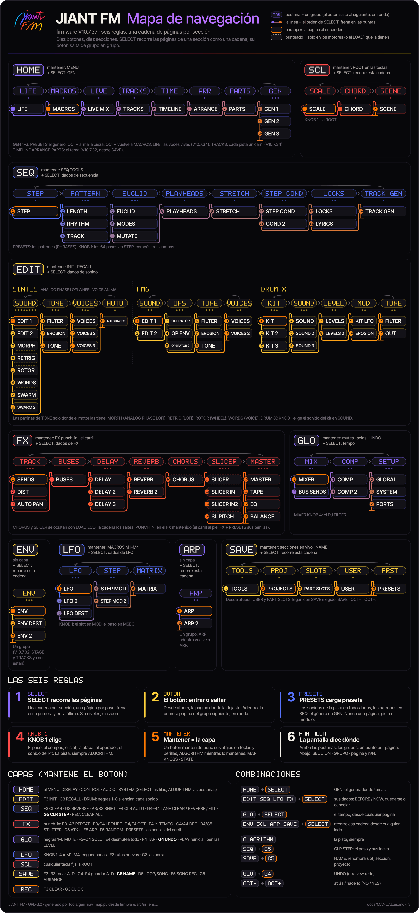

# JIANT FM — Manual de usuario

**JIANT FM V10.8.72 para el M-VAVE FM-1** (versión pública; lo que cambió desde la V10.8.48, la última versión
pública, está en [Lo nuevo en V10.8.72](#lo-nuevo-en-v10872-desde-v10848))

> *English version: [MANUAL.md](MANUAL.md).*

Este manual es para músicos que acaban de instalar JIANT FM y quieren saber cómo tocarlo, cómo armar temas con él
y, sobre todo, **cómo guardar su trabajo sin perder nada**. Sigue el firmware tal como está en esa versión: cada
botón, perilla y mensaje aparece nombrado exactamente como lo muestra el equipo.

> *¿Nunca usaste un sintetizador ni un secuenciador? Empezá por [Primeros pasos](FIRST-STEPS.es.md): seis recorridos cortos, botón por botón.*

Si vas a leer un solo capítulo, leé [12. Guardar y cargar](#12-guardar-y-cargar). Si venís de la V10.6c (la última
versión pública) o de antes: [Qué hay de nuevo en esta versión](#qué-hay-de-nuevo-en-esta-versión).

## Contenido

- [Qué hay de nuevo en esta versión](#qué-hay-de-nuevo-en-esta-versión)
0. [Inicio rápido](#0-inicio-rápido)
1. [El panel](#1-el-panel)
2. [La pantalla](#2-la-pantalla)
3. [Páginas y capas](#3-páginas-y-capas)
4. [Motores](#4-motores)
5. [DRUM-X](#5-drum-x)
6. [El secuenciador](#6-el-secuenciador)
7. [ARRANGE: canciones, secciones y escenas](#7-arrange-canciones-secciones-y-escenas)
8. [Dados y UNDO](#8-dados-y-undo)
9. [Efectos y master](#9-efectos-y-master)
10. [Modulación y macros](#10-modulación-y-macros)
11. [Tocar en vivo](#11-tocar-en-vivo)
12. [Guardar y cargar](#12-guardar-y-cargar)
13. [Sistema: TRACKS, LOAD y el MENU](#13-sistema-tracks-load-y-el-menu)
14. [MIDI y USB](#14-midi-y-usb)
15. [Herramientas web: emulador, instalador, editor, backup](#15-herramientas-web-emulador-instalador-editor-backup)
16. [Problemas y preguntas frecuentes](#16-problemas-y-preguntas-frecuentes)

---

## Qué hay de nuevo en esta versión

### Lo nuevo en V10.8.72 (desde V10.8.48)

Las versiones V10.8.49 a V10.8.72 en una lista. Donde un capítulo de abajo todavía describe la pantalla anterior, vale esta lista.

**Secuenciador**
- **SEQ EDIT** (V10.8.49–V10.8.53): mantené **SEQ** en una página de SEQ. Reemplaza a SEQ TOOLS. KNOB 1 / KNOB 2
  eligen los pasos, KNOB 3 la ACTION, KNOB 4 cuánto, **D5** u **OCT+** la hace, **F#5** es UNDO / REDO. Son 25
  acciones: STRETCH, SQUEEZE, REPEAT, NUDGE, ROTATE, SHIFT, REVERSE, DUP, TRANSP, OCTAVE, INVERT, STUTTER, ARP, MUTATE,
  GEN, RANDOM y más. Sin selección: toda la pista. Ver [SEQ EDIT](#seq-edit-seq-mantenido-v10853).
- **Pasos con las teclas** (V10.8.50–V10.8.51): dos o más teclas de paso mantenidas seleccionan esos pasos (**SEL
  5-8**); teclas de paso + **EDIT** los borran; COPY, PASTE, DUP y CLEAR dicen qué pasos (**COPY 5-8**). Ver
  [Copiar, pegar y duplicar](#copiar-pegar-y-duplicar).
- **REC con el transporte parado solo arma** la pista: PLAY arranca el transporte (en el roll de STEP arma la
  grabación por pasos).

**Guardar**
- **OVERWRITE A?** (V10.8.52): SAVE + C4–F4 o SAVE + OCT+ sobre una parte con música pregunta antes (OCT+ sí, OCT− no),
  una vez por parte. **GLO + G4** devuelve la parte como estaba. Ver [Guardado rápido](#guardado-rápido-mientras-suena-capa-save).
- **Un borrador del generador guardado es un proyecto** (V10.8.52): SAVE › PROJECTS › SAVE dice **SAVED SONG n** y ese
  proyecto queda abierto desde ahí; RESTORE LAST lo trae de vuelta. El OCT+ de ARRANGE dice **ROW DUPLICATED**.
- **Proyectos viejos** (V10.8.51): un proyecto de antes de la V10.7 dice **OLD PROJECT: OPEN IN STUDIO** y nunca se
  borra. Los primeros ajustes de Felucca (PER1, PER2) ya no se leen (V10.8.59). Ver
  [Proyectos viejos y ajustes viejos](#proyectos-viejos-y-ajustes-viejos-v10851-v10859).
- **JIANT Studio** (V10.8.51, V10.8.54): una biblioteca de proyectos (listar, renombrar, copiar, mover y borrar desde el
  celular o la compu) y un conversor que abre los proyectos viejos.

**Sonido y generador**
- **OTT** (V10.8.71): un compresor de dos bandas en cada pista, **FX › TRACK › OTT** (DEPTH, TIME, UP/DN, X-OVER),
  tomado de JIANT BYTE. V10.8.72: su ley como la de JIANT BYTE (10:1 a −16 dB, hasta +30 dB, TIME 56).
- **El generador** (V10.8.68–V10.8.72): los planes de tema de JIANT BYTE (plantillas por género, de 2 a 5 minutos,
  fills), cada sección con su propia automatización (grich), vuelven la pregunta y respuesta y el corte de EXPLORE,
  vuelve la pegada de la batería, NEO CLASSIC sin batería. Ninguna pieza pasa de −1 dBFS antes del master (V10.8.51).
  V10.8.72: OTT en los géneros electrónicos.
- **MATH**: **WAVE SYNC** (V10.8.62) traba el ritmo de la fórmula al tempo, con el preset nuevo **BYTE SYNC**; **LOOP**
  (V10.8.66) lo repite cada 4 BAR … 1/32.
- **MOD AMOUNT** (V10.8.51): −200 … +198 %; 100 % recorre todo el rango.
- **DRUM-X** (V10.8.49): un solo GAIN, en LEVEL (se fue el KNOB 4 de KIT 2; los kits suenan como antes).
- **USB MIDI host** (V10.8.69): acepta más teclados y prueba la conexión tres veces.
- **RESOUND** (V10.8.54): **GLO + A4** le da un sonido nuevo a cada pista y el tema queda igual. Ver
  [RESOUND](#resound-glo-mantenido--a4-v10854).

**Pantalla**
- **Títulos grandes y el pie de la perilla** (V10.8.65): una página sin dibujo muestra su nombre grande; una perilla
  girada dice su página en el pie (**LFO RATE 1.24 HZ**). Ver
  [Títulos grandes, el pie de la perilla y los avisos](#títulos-grandes-el-pie-de-la-perilla-y-los-avisos-v10853v10865).
- **Ayudas de OCT+ y avisos** (V10.8.53–V10.8.54): una página con gestos de OCT+ los dice en su pie; RESTART, SD MUTED,
  LANE, REC GRID, PROJECT n, ALL UNMUTED, ROOT, QUANTIZE y A > B NEXT BAR aparecen en pantalla; la cuenta previa es una
  línea, **4 3 2 1**.
- **Vuelve HOME › MACROS** (V10.8.64), tercera página de ECO, con **DICE MACROS** (HOME + SELECT). **LIFE**: el KNOB 3
  es **STEREO** (era PUMP), y cada profundidad llega más lejos pasando 60. Ver [Las secciones](#las-secciones-y-sus-cadenas).
- **HOME › BEING › VISUAL** y **MENU › DISPLAY › SAVER** (V10.8.56–V10.8.67): dibujos hechos con los gráficos del
  propio FM que se mueven con la música, en toda la pantalla. V10.8.72: más fluido (menos trazos en vez de saltear
  cuadros). Ver [VISUAL y SAVER](#visual-y-saver-v10856v10867).
- **MENU › DISPLAY › PANEL** (V10.8.63): AUTO / A / B, para las pantallas de los equipos de fines de 2026. Ver
  [PANEL](#panel-las-pantallas-de-fines-de-2026-v10863).
- **SCL › CHORD** nombra la tríada de cada grado (**D-**, **E°**, **F**; V10.8.59). El DELAY de FX dibuja sus ecos
  como columnas (V10.8.53). Las criaturas se dibujan más parecidas a sus originales (V10.8.54–V10.8.55).
- **Se fueron por espacio**: las líneas AUDIO LOAD de ABOUT y la curva de RAMP de SEQ › STEP FX (V10.8.49), la curva
  del EQ de FX › MASTER (V10.8.53).
- **Menos CPU** (V10.8.60): más partes del sonido corren desde la RAM; el sonido es el mismo, bit por bit.

### Lo nuevo en V10.8.48 (desde V10.8.21)

Las versiones V10.8.22 a V10.8.48 en una lista. Donde un capítulo de abajo todavía describe la pantalla anterior, vale esta lista.

- **GATE en la reverb y en el delay** (V10.8.44): en **FX › REVERB** y **FX › DLY**, mantené **OCT+** y girá
  **KNOB 4**: su tarjeta dice **GATE** (0–127; 0 apagado). El retorno queda abierto mientras le llega algo y se cierra
  un rato después de que eso se calla (16: una 1/16, 64: una negra, 127: dos negras), y corta la cola: una sala con
  gate, ecos que paran con la frase. Se guarda con el proyecto. Ver [Delay](#delay) y [Reverb](#reverb-cinco-modelos).
- **Una página LEVEL en todos los motores** (V10.8.44): el primer grupo de EDIT termina en **LEVEL**: **GAIN** (0–12
  dB), **LEVEL**, **PAN** (en un kit, después de KIT 2). GAIN se fue de la página MORE de ANALOG y de PHASE; OCT+
  mantenido + KNOB 4 en EDIT 1 lo sigue alcanzando.
- **El ARP a tiempo** (V10.8.45): mientras suena el transporte un arpegio arranca en la grilla de su RATE y se queda
  ahí; grabado, cada una de sus notas cae en su propio paso. Ver [ARP](#arp).
- **La carga del encabezado es un número** (V10.8.45), 0–99, donde estaban las cinco barritas. **MENU › ABOUT** perdió
  las líneas del reloj y los rieles de la CPU (V10.8.45); **LAST CRASH** sigue (V10.8.46). El diagnóstico de velocidad
  salió del firmware: [VELOCITY_DIAG.es.md](VELOCITY_DIAG.es.md) es para versiones anteriores.
- **Las palabras del tema** (V10.8.47): el KNOB 2 de SAVE › PART SLOTS es **PLAY/EDIT** (era LOAD; mientras suena el
  loop la parte entra en el compás siguiente); STORE A–D de la capa SAVE son **SAVE A–D** (la pantalla dice **SAVED
  A**); el modo LOOP de PLAY es **PART** (PART / SONG); el END LOOP de un tema es **REPEAT** (el pie: **40 BARS · END
  REPEAT**); el cuadro de una parte sin nombre muestra sus compases en el tema (**12 BARS**) en vez de USED, y
  **PLAYING** en vez de NOW; la leyenda de las fichas dice **ARRANGE  PART+BARS**; en JAM y TAKE, SEQ es **PART** y
  CAMBIO es **SWITCH**.
- **GENERATOR** (V10.8.43–V10.8.48): deja **SCL › HARMONY** como lo pusiste (en ON, la pieza se apoya en la tónica de
  la tonalidad y HARMONY la mueve); secciones de la mitad de largo, y una sección que vuelve viene variada; el loop de
  RADIO cambia cada 16, 8 o 4 compases según el tempo, y un STOP en el último compás de la pieza para; cada parte se
  mueve (LFOs lentos y libres en el filtro y en la forma, el paneo), envolventes reales por rol (ninguna parte en
  sustain pleno salvo órganos y drones; los leads con poco sustain y un release largo), acordes, leads y arpegios con
  su propio tipo de filtro (BP, o HP con KEY TRK 100), el GAIN de la pista compensando el nivel; una parte de acordes
  sobre un sonido de lead sin su vibrato; PHONK siempre el drift; los hi-hats de JAZZ a la mitad. Ver
  [8](#8-dados-y-undo).
- **RADIO y MOOD** (V10.8.39–V10.8.41; HOME › GENERATOR 4): **KNOB 3 RADIO** ON / OFF: cuando termina la última fila
  del tema (un loop: a los 16 compases, 32 por encima de 110 BPM; desde V10.8.45 16, 8 o 4 compases) el generador arma solo la pieza siguiente y entra en
  la barra de compás, a la manera de ENTRY. Solo avanza mientras suena un borrador generado, no con FORM MY LOOP;
  apretá OCT+ una vez para arrancar. **KNOB 4 MOOD**, CALM … MID … DANCE: mueve la energía y la batería (CALM: el kit
  más liviano, hasta desaparecer cerca del final; DANCE: batería en todas las piezas, el bombo en los tiempos), con
  GENRE RANDOM también inclina los géneros según su tempo, y en EXPLORE mueve el tempo. Ninguno de los dos se guarda con
  el proyecto. Ver [8](#8-dados-y-undo).
- **GENERATOR** (V10.8.39–V10.8.42): cada género retocado (sus rasgos, riffs, batería y mezcla), el bombo afinado a
  la tonalidad, el género **FUGA** afuera (29 géneros), HARD BASS con un bajo DONK, los dos arreglos de DREAM POP, IDM
  AMBIENT desde 76 BPM.
- **A tiempo** (V10.8.40): el tempo es exacto y cada pista toma su lugar del transporte, así que después de un cambio
  de LEN o DIV, de EUCLID, de una mutación o de una variación de otro largo la pista vuelve con las demás en su paso
  siguiente. **RESYNC**: mantené **SEQ** y apretá **PLAY** mientras suena: todas las pistas desde su primer paso en el
  compás siguiente, sin parar (GLO + PLAY sigue siendo el RESTART inmediato).
- **DJ FILTER en MIXER** (V10.8.38): en GLO › MIXER un toque de **OCT+** pasa el KNOB 4 de **BPM** a **DJ FILT** y
  vuelta.
- **Volvió SEQ › NOTE** (V10.8.38), después de STEP: FOCUS, PITCH, MOVE, MICRO. **SEQ › BAR**, el cargador de
  patrones **PHRASES** y **GLO › SYSTEM 2** (MIDI) ya no están.
- **TRANS** (V10.8.38): el KNOB 4 de SCL › CHORD, la transposición de la pista (±24 semitonos).
- **GAIN en todos los motores** (V10.8.38): en la primera página EDIT del motor, **OCT+ mantenido + KNOB 4**: 0–12 dB (desde V10.8.44 también en la página LEVEL).
- **KEY TRK NOTE afinado** (V10.8.38): en LP y HP el pico de la resonancia cae en la nota.
- **SWARM** (V10.8.38): **WAVE** en el KNOB 4 de SWARM 2 (el seno, o una de ocho fórmulas FLOAT), una etiqueta en el
  dibujo que dice qué escucha (**ALONE**, **AIR n**, **PROX n**, **AIR OFF**), y **MODE >T1 … >T6**: las notas de SWARM
  tocan el motor de esa pista.
- **KEY TRK en FILTER** (V10.8.37): en EDIT › FILTER, **OCT+ mantenido + KNOB 2** (la de CUT) elige **OFF / 50 / 100 /
  NOTE**, con una etiqueta sobre la curva. En 50 y 100 el corte sigue a la tecla (100: un semitono por semitono,
  alrededor de C4), en todos los tipos, los peines también; NOTE es 100 con el corte final cuantizado a semitonos:
  MOD SEQ › CUT toca resonancias afinadas. Por pista, se guarda con el proyecto, OFF por defecto.
- **MUTATE sin página** (V10.8.37): EVERY es una etiqueta en el dibujo de EUCLID ("EVERY 4"); se cambia con **OCT+
  mantenido + KNOB 4** en EUCLID. OCT+ solo (al soltarlo) muta; OCT− vuelve al ancla.
- **Sonidos de fábrica retocados** (V10.8.37): envíos según el rol (bajos secos, leads con más delay que reverb, pads
  con más reverb), un vibrato tardío en los leads, las cuerdas punteadas más oscuras al tocar suave, y movimiento en
  los sonidos que no lo tenían (los kits, ANIMAL, los golpeados y los bajos de WEST).
- **FX › DIST, KNOB 4: NOISE** (V10.8.36; 0–127, por pista): un ruido que mueve la ganancia y el tono dentro de la
  distorsión: grano pegado a la nota, no un soplido sumado (el silencio sigue en silencio). No actúa en el tipo AMP.
- **FX › CHORUS, KNOB 4: MIX** (V10.8.36; 0–100 %, global): en 0 el chorus de siempre; hacia 100 el sonido seco de
  cada pista baja según su envío a CHORUS y queda una sola voz modulada, en el centro: con MIX 100 y el envío entero,
  un vibrato.
- **Reverb CLOUD** (V10.8.36): arranca con la nota (ya no suena como un delay atrasado); la mitad de los granos lee
  pegado al presente y los demás 1, 2 o 3 semicorcheas atrás, según el tempo; la cola, un poco más baja.
- **GENERATOR** (V10.8.36): la mezcla por género (el lead y el arpegio más arriba donde quedaban tapados, menos reverb
  en los stabs de club, el DUCK del bombo más marcado) y EXPLORE con el diálogo entre lead y arpegio.
- **DRONE CLAY, completo** (V10.8.27–V10.8.31; ver [DRONE CLAY](#drone-clay-seq--clay-v10821)): cada modulador tiene su
  propio **RATE** sobre la grilla del compás (1/64 … 4BAR, con puntillo, tresillos y polirritmos), el drone tiene
  **PITCH** (−24 … +36 semitonos), los golpes (KICK, SNARE, HAT…) son una batería en cualquier motor, y las páginas son
  cuatro: **DRONE CLAY · CLAY MOD · CLAY RHYTHM · CLAY TIME**. Debajo del osciloscopio, una barra fina por modulador
  muestra lo que suma ahora. Un modulador con **AMOUNT 0** no golpea nada, y con **RATE HOLD** el drone nunca se vuelve
  a atacar. **Las teclas tocan gestos** (las blancas) y **el grado del drone** (las últimas siete); **RUN** tiene
  cuatro valores: SONG, FREE, SONG NOKEY, FREE NOKEY.
- **WEST › DUST** (V10.8.28): de 1 a 95 es ruido blanco que entra al plegador junto con el núcleo (se pliega y pasa
  por la compuerta con él: queda dentro del timbre, no al lado); de 96 a 127 es **METAL**, un tono metálico en vez del
  ruido. Ya no crepita.
- **MUTATE volvió, compacto** (V10.8.35; sin página desde V10.8.37): el patrón de EUCLID muta solo cada **EVERY**
  compases (OFF, 1, 2, 4, 8). En EUCLID, **OCT+** muta y **OCT−** vuelve al ancla. Ver
  [MUTATE](#mutate-v1016-sin-página-desde-v10837).
- **LIVE volvió, compacto** (V10.8.35): en **SEQ › STEP FX**, las **teclas negras 1–9** modifican en vivo cómo camina
  la secuencia de la pista elegida: RATE x2, x3/2, x2/3, REVERSE, PING-PONG, RANDOM, THIN, GIRO − y GIRO +. Ver
  [Secuencias en vivo](#secuencias-en-vivo-las-teclas-negras-de-seq--step-fx-v10835).
- **EUCLID** (V10.8.35): en una pista melódica la **KNOB 4 es ROLE** (MELODY, CHORDS, BASS, ARP) y la página MODES se
  llama **MELODY** (CONTOUR, RANGE, MOTIF, VARY). El dibujo es un solo anillo de puntos.
- **FILTER** (V10.8.35): los tipos **MS20** y **LP24** ya no están (TYPE: LP, HP, BP, COMB, COMB-). Un proyecto o un
  preset de usuario que los usaba abre con LP.
- **ENV › STAGE** ya no está (V10.8.35): la cadena de ENV es ENV · ENV DEST · ENV 2. LOOP sigue en ENV DEST.
- **FX › PUNCH IN** (V10.8.27, V10.8.33): se fue la página PUNCH LANE y el dibujo del carril; el carril de punch-in
  sigue existiendo (lo graba REC y lo usa el generador).
- **MOD** (V10.8.22): al girar SRC o DEST de un slot la pantalla dice la ruta entera, con nombres completos
  ("LFO > FILTER CUTOFF"; E1–E8 con el nombre que les da el motor), también con HELP OFF.
- **DRUM-X** (V10.8.32): las fórmulas MATH usadas como moduladores de FM suenan limpias, sin escalones.
- **GENERATOR** (V10.8.34): doce progresiones más, la sección de contraste con su propia progresión y su propio
  registro, motivos con un salto característico, más pregunta y respuesta, y un diálogo entre el lead y el arpegio.
- **JIANT Studio y el editor** (V10.8.23–V10.8.26, V10.8.33): el espejo de la pantalla del FM-1 (manda solo las filas
  que cambiaron), y el FM-1 avisa en qué sección, página y capa estás, para la guía en vivo de Studio.

### Lo nuevo en V10.8.21 (desde V10.7.81)

Las betas V10.8.1 a V10.8.20 en una lista. Donde un capítulo de abajo todavía describe la pantalla anterior, vale esta lista.

- **Modo canción** (HOME › JAM · TAKE · ARRANGE): tocás en vivo las cuatro secuencias A–D de cada pista (F3–B3 eligen
  A–D en todas, OCT+ GO, OCT− STOP, CAMBIO dice cuándo entra el cambio). **REC** graba la toma; **K4 LOCK** la
  reproduce y lo que tocás encima queda marcado **YOU**; con una pista elegida, **REC** rehace esa pista una vuelta y
  **OCT−** la deshace. **TAKE** edita los cambios (K1 elegir, K2 mover, K3 secuencia, K4 compases, OCT+ nuevo, OCT−
  borrar). Una línea de ayuda en JAM y TAKE dice qué hacer (MENU › DISPLAY › HELP OFF la oculta). GLO › LIVE se fue: JAM
  toca las secuencias en vivo.
- **Componentes de paso que se tocan** (SEQ › STEP FX): el **knob PRESETS elige el paso**; las 16 teclas blancas tocan
  componentes mientras las mantenés — STUTTER, STUTTER /2, /4, RATCHET x2 x3 x4 x8, ARP UP / DOWN / UP-DOWN, OCTAVE UP /
  DOWN, RANDOM, TRANSPOSE +2, CHORD, MUTE — y con **REC** se escriben en el paso con su valor y su duración (en COMP, o
  en COMP 2 si COMP está ocupado). Un **cartel** grande dice qué tecla es y qué hace mientras la mantenés (también en los
  punch-ins del FX layer).
- **DRONE CLAY** (SEQ › CLAY, de JIANT BYTE): un secuenciador por pista — un drone muy grave con la voz de la pista (RATE
  lo vuelve a atacar con el transporte, o lo sostiene) y cuatro moduladores (forma, euclidiano, cantidad, caída, gestos)
  sobre cualquier parámetro de la pista; los gestos de nota (ARP, CHORD, HIT) tocan sobre la escala. En MONO / LEGATO
  cede la voz a los pasos; un punch-in de TIEMPO o PITCH lo reinicia desde su primer golpe.
- **Siempre sabés en qué pista estás**: una barra arriba dice **TRACK N / ENGINE** con el color de la pista (T1 amarillo,
  T2 naranja, T3 rojo, T4 magenta, T5 violeta, T6 azul); los mismos colores en el mixer, los seres, JAM y TAKE.
- **Macros como destinos**: LFO › MACROS — KNOB 1 elige la macro y sus destinos se suman (16 rutas en total); en la
  matriz MOD, M1–M4 son destinos, no fuentes.
- **Pantallas rediseñadas**: FX con estilo HUD (los ecos del DELAY como un túnel, REVERB en celdas, la órbita L/R del
  CHORUS, SLICER, MASTER, DIST); FX › SENDS en columnas; GLO › MIXER por canales; ENV en capas de las últimas notas; LFO
  como un satélite que escribe su onda; EDIT › FOCUS una barra térmica horizontal con el nombre completo del parámetro y
  su modulación; ARRANGE y GENERATOR como partitura viva (secciones tan anchas como sus compases, un carril por pista);
  SCL › KEY el nombre completo de la escala, sus notas y grados; SCL › CHORD el acorde que suena de verdad (D MIN7…),
  sus notas e intervalos y los acordes de los siete grados. Nombres completos donde entran (ECOSYSTEM, GENERATOR,
  MIXER, MODULATION…).
- **Encendido**: el inicio «Seis hilos» con la firma suavizada y la versión a la vista; se fue el **click al encender**
  (la salida se abre cuando el audio ya arrancó y sube de a poco).
- **Quitado para hacer lugar**: GLO › LIVE, SEQ › STRETCH, MUTATE, el dado de secuencia (SEQ + SELECT; el de sonido
  sigue), GLO › GLOBAL COMP, ENV › TRACKS y las ayudas de enseñanza de una sola vez. Los proyectos viejos abren: sus
  ajustes se conservan y se ignoran. (MUTATE y LIVE volvieron, compactos, en V10.8.35: ver arriba.)

### Lo nuevo en V10.7.81 (desde V10.7.16)

Las betas V10.7.17 a V10.7.80 en una lista. Donde un capítulo de abajo todavía describe la pantalla vieja, vale esta lista.

**Baterías**
- **DRUM-X en 8 páginas**: KIT (MORPH SNAP TONE DECAY), KIT 2 (NOISE BODY GLUE GAIN), SOUND (PITCH DECAY LEVEL),
  SOUND 2 (NOISE COLOR PMOD), SOUND 3 (WAVE FILTER P.ENV), SOUND 4 (SIDE SEND KEY MAP), CROSS MOD, FILTER. **BODY** es
  la resonancia del cuerpo; **GAIN** es limpia, de 0 a +12 dB.
- **Fórmulas MATH**: el WAVE de SOUND 3 sigue después de SINE FM METAL BELL con **F01–F48**, una fórmula de MATH como
  moduladora FM del sonido, tocada como wavetable y dibujada en pantalla (cuatro momentos, de frío a caliente).
  **RATIO** (¼ … 16, 24 valores) en la KNOB 4, **MOD AMT** en lugar de COLOR. Dos kits están hechos de fórmulas,
  **GLITCH FM** y **MATH LAB**; EDIT + SELECT (DICE) le da una fórmula propia a más o menos la mitad de los sonidos.

**Motores**
- **MATH MORPH**: ALGO B (donde estaba CHIP) y MORPH A → B (donde estaba BEND) pasan de una fórmula a otra.
- Todos los motores como el kit: FILTER (TYPE CUT RES IMAGE), PLAY (POLY GLIDE UNISON VEL), **GAIN** 0 … +12 dB limpia.
- Las páginas de EDIT con sus nombres, los extras en un solo **MORE**, ahora **antes de PLAY**; **FOCUS** en colores térmicos.

**Armonía y secuencias**
- **SCL › HARMONY**, su propia pestaña (KEY CHORD HARMONY SCENE): PROG LENGTH EVOLVE SKIP; cada secuencia melódica
  sigue la progresión, mostrada en números romanos en la tonalidad, con el acorde que suena encendido. Los sets de
  CHORD: POP JAZZ SOUL DREAM QUART.
- **EUCLID › MODES › ROLE** (MELODY CHORDS BASS ARP) escribe sobre la armonía que tocan las otras pistas; CONTOUR
  RANGE MOTIF le dan forma a la melodía.
- Step components: **RAMP** (END: BACK HOLD PING), **FILL** (donde estaba LOCK); STUT y RATCH en la grilla del tempo.

**Performance**
- Mantené **FX**: un mapa de **celdas con nombre** (los efectos por su nombre, M1–M4 arriba, los mutes T1–T6 abajo).
- **Editor de punch-in**: OCT+ en FX › PUNCH IN (o FX + OCT+). Cada tecla: WHAT (un efecto, o un parámetro: M1–M4,
  CUT, PITCH, TIMBRE, VOLUME, PAN, DIST, CHORUS, DELAY, REVERB, VIBRATO), HOW (HOLD LATCH QUANT, o RAMP UP / DN, SINE,
  STUTTER, S&H), AMOUNT (−100 … +100 %) y TIME (1/16 … 8 compases); dos slots, A y B. Efectos nuevos: REVERSE,
  FREEZE, TAPE STOP, PITCH UP / DOWN, STRETCH. Las perillas de FX › PUNCH IN son los macros M1–M4.
- **LIFE** (HOME › LIFE): las pistas se mueven entre sí (FILTER TIMBRE PUMP FX).
- SCENE toca solo en las pistas vivas; su **LEADER** pueden ser las teclas o las notas de una pista.

**Generador (GENE)**
- Las semillas se fusionan (A+B en el nombre), nunca la misma tirada dos veces; mientras suena espera al compás;
  GENE 4: KEY NEW / KEEP.
- DUBSTEP (el wobble, con su rate moviéndose; bajos MATH), SHOEGAZE, METALCORE, CUMBIA villera, ocho progresiones
  más (neo-soul, jazz, IDM, progresivo); cada género su FX STYLE; MATH, WEST y STRING más seguido.

**Pantallas y ajustes**
- Las páginas de la canción viven en HOME › SONG: TIMELINE ARRANGE PARTS CLIPS (SAVE guarda y carga).
- **MENU › DISPLAY › PRESETS**: SCROLL (la perilla recorre los sonidos) o MENU (la lista se abre al girar).
- **MENU › HELP**: el significado de una perilla en el encabezado cuando no es obvio. Osciloscopios en vez de barras decorativas.
- Valores de fábrica: LARGE apagado, CLICK en REC, COUNT-IN 1 BAR.
- **GLO mantenido + G4: UNDO.**

La **beta V10.8.1** rediseña el modo canción (cada pista con sus secuencias A–D, CAMBIO, una toma JAM con LOCK); no
está en esta versión. Ver el README.

### Desde V10.6c

Todo lo que cambió desde la V10.6c, la última versión pública, en una lista; cada punto lleva a su lugar en el manual.

**Antes de actualizar**
- **6 canciones, no 8** (V10.6p). Las canciones 7 y 8 ya no se abren: esa memoria queda para un banco de samples de
  batería. Pasalas a una entre 1 y 6, o hacé antes un backup completo (**Save backup** del editor, o el backup del
  instalador); el backup guarda las ocho, y al restaurarlo te dice qué canciones quedaron solo en el archivo.
- **Proyectos muy viejos retirados** (V10.6s): los proyectos guardados por JIANT antes de la 1.0.3 (FUN1 a FUN6) se
  rechazan sin tocarlos, y un sonido DIGITAL carga como el init de FM6. Si todavía los necesitás, abrilos en una
  versión anterior (V10.6c) y guardalos de nuevo ahí.
- **Proyectos más viejos retirados** (después de V10.7.13, lugar para FORM MY LOOP de GENE): los proyectos y backups
  guardados en los formatos FUN7 a FUNB (Felucca 1.0 / 1.1 y JIANT hasta 0.5) ya no se leen; al encender, un proyecto
  así muestra **OLD PROJECT: NOT READ** y su slot queda vacío (la flash lo conserva hasta que guardes encima). El editor
  web no los convierte: abrilos en V10.7.13 o anterior y guardalos de nuevo ahí (así quedan en el formato de hoy).
  También se fueron: las conversiones de presets de usuario viejos (SAMPLE PERC, TRIO, los chips de LOFI, valores de
  0.3 / 0.4: un preset así carga como estaba guardado, y si es de un motor retirado suena como ANALOG), la pista de un
  motor retirado en un proyecto ahora recibe el primer preset de ANALOG (no su sonido más parecido), y la criatura propia
  de ADD (ADD dibuja el ser, como los otros motores antes de 0.9.6).
- **FM-1 nuevos** (V10.6z): los FM-1 vendidos desde fines de 2026 (con el logo en el frente) traen otro chip de
  flash. Las versiones anteriores de JIANT andaban en esos equipos solo desde la RAM (sin guardar, sin GENE, sin
  actualizarse desde el equipo); esta versión guarda normalmente. Si el tuyo no conservaba tus canciones, actualizá.

**Canciones**
- SAVE abre en el tema: **TIMELINE**, **PARTS** y **CLIPS** (V10.6o, V10.6s), después SECTIONS. Ver
  [TIMELINE, PARTS y CLIPS](#timeline-parts-y-clips-save--song).
- **Un tema conserva los sonidos que cambiás mientras suena** (V10.6z8); EDIT > **RECALL** trae de vuelta el sonido de
  la sección en una pista.
- **SAVE SONG AS** copia un tema entero a otro proyecto (SAVE > PROJECT).

**Batería y generador**
- **DRUM-X**: una pasada de calidad (V10.6q), un cencerro CMOS clásico, el mapa de teclas **EXTENDED** por defecto con
  redobles de verdad y cada sonido cromático (V10.6r), ACOUST ya no está (V10.6o), y volvieron la pegada de los bombos y
  los hats brillantes (V10.6z9). Ver [Las teclas: EXTENDED](#las-teclas-extended-v106r).
- **GENE** (el generador de HOME, GEN hasta la V10.6m) toca los géneros que eligió el autor, entre ellos CUMBIA, EBM,
  BAILE FUNK, PHONK, HIP HOP (trap, drill, pluggnb, boom bap o lofi), JAZZ en cualquier tempo y TECHNO ROCK (rock o
  synth 80s). El rol DRUM de SCL > SCENE puede tomar un kit generado para el género (**SCENE DRUM GEN**).
- La **paleta térmica** en todos lados: cada nota con su calor, el piano roll coloreado por nota (V10.6w).

**Secuenciador**
- El componente **RAMP** reemplaza a JUMP (V10.6v): el lock de parámetro de un paso se desliza hasta su valor en 1–32
  pasos o 1–16 compases.
- **REC respeta cómo tocás** (V10.6z4): el largo de las notas, el legato como SLIDE, la velocidad tal cual. **GATE
  100 %** en las pistas nuevas.

**Tocar**
- **Velocidad y aftertouch en las teclas** (V10.6z7, a partir de *Velo* de Charles Vestal): F3..C5 sensibles, cada
  tecla se calibra mientras tocás; MENU > CONTROL > **VELOCITY**, **VEL MIN**, **AFTERTOUCH**, **VEL LEARN**. Ver
  [Velocidad y aftertouch](#velocidad-y-aftertouch-de-las-teclas-v106z7).
- **Teclas de expresión** (V10.6z4): una nota mantenida + OCT− un vibrato, + OCT+ un bend (MENU > AUDIO > **OCT BEND**).
- **SWARM** (el instrumento de Bluetooth de EXT): una melodía según qué tan cerca estás, el morph FAR / NEAR, la
  caminata por la escala y **CHAOS** (donde estaba la perilla SELF).
- La calibración FAR / NEAR ahora toma la mediana de 2,5 s (**HOLD STILL**) (V10.6z8).
- **VOICE** ya no satura con las vocales abiertas; WORDS tiene **CONS**, el largo de las consonantes (V10.6y).

**Conexiones**
- **NRPN** para todo parámetro automatizable, y las perillas salen como NRPN con MIDI OUT ALL (V10.6z3): [docs/NRPN.md](NRPN.md).
- El protocolo del editor es un contrato versionado (1.2): [web/EDITOR_PROTOCOL.md](../web/EDITOR_PROTOCOL.md).
- El segundo núcleo arranca solo con la alimentación de fábrica (después de un SAFE START: un núcleo) (V10.6z2).

---

## 0. Inicio rápido

### Instalación

1. Abrí el **instalador web** en Chrome o Edge en una computadora, o en Chrome en Android con un cable USB OTG
   (iPhone y iPad no tienen Web MIDI): <https://juanjiant-bit.github.io/JIANT/webapp/installer/>
2. Conectá el FM-1 **directamente** con un cable USB de datos.
3. **¿Venís de otro firmware custom (Felucca, Skiff, baudgirl o cualquier otro)?** Volvé primero al oficial con el
   botón **Volver al oficial** del instalador (que además guarda el backup de ese firmware). Escribir JIANT
   directamente encima de otro firmware custom ya dejó algún FM-1 sin poder arrancar.
4. Apretá **Instalar**. Primero revisa el firmware del FM-1 y solo escribe sobre el **V16 oficial**, el **V15 oficial**
   o JIANT (si encuentra otro, te manda a volver al oficial primero). No desenchufes el cable mientras escribe.

**Volver al oficial** acepta el `FM-1.fwsc` de M-VAVE del **V16** (718.196 bytes, el que ofrece hoy) o del **V15**
(699.956 bytes), descomprimido de la página de descargas de M-VAVE y verificado byte por byte. Primero guarda un
backup completo de JIANT; para volver, apretá Instalar y restaurá el backup con el editor.

JIANT no tiene samples de usuario: si venís de Felucca, sus samples de usuario (USR1–3) se pierden al instalar.
Guardá tus archivos WAV.

### Tu primer sonido (1 minuto)

1. Encendé el equipo. La firma se dibuja sola y después llegás a **HOME**: seis criaturas, una por pista. (V10.6e) Las
   pistas arrancan como una banda afinada: **T1 DRUM-X** (ACOUSTIC), **T2 ANALOG** (PLUCK), **T3 PHASE** (INIT SAW), **T4 FM6** (FM BASS), **T5 VOICE** (CHANT) y **T6 ANIMAL** (WHISTLE), cada una con el sonido de su
   preset, seco.
2. Girá **ALGORITHM** para elegir una pista (T1–T6). Con el valor por defecto, **TRACKS 4**, se detiene en T4: T5 y T6 aparecen solo con TRACKS 6 (ver
   [13](#13-sistema-tracks-load-y-el-menu)).
3. Girá **PRESETS** para recorrer sonidos. Tocá las teclas.
4. Girá **KNOB 1–4**: en HOME son los cuatro controles más útiles del motor de la pista.
5. ¿No te gusta? Mantené **EDIT** y girá **SELECT**: el sonido se tira a los dados y sale una variación nueva, que escuchás al
   instante. **OCT+ OK** la deja, **OCT− CANCEL** devuelve el sonido.

### Tu primer tema (5 minutos)

1. Mantené **HOME** y girá **SELECT** (o en HOME tocá **HOME** hasta su última pestaña, GENE). Se abre el **GENERATOR**
   en **EXPLORE** (ningún género, todas las reglas rotas): apretá **OCT+** así como está, o elegí antes RANDOM o un
   género con KNOB 1. Aparece una idea de tema entera: motores, sonidos, partes, escala, tempo y efectos. Apretá
   **PLAY**.
2. ¿No te convence? Apretá **OCT+** otra vez: otra semilla, otra pieza. ¿Demasiado cargado? Girá **SELECT** un paso a
   la derecha hasta GENERATOR 2 y bajá **DRUMS** o **ARP**, y OCT+: la misma pieza con eso cambiado. **OCT−** vuelve a
   ECOSYSTEM. Para volver a lo que había antes: mantené **GLO** y apretá **G4** (UNDO).
3. ¿Te gusta? **Pará** (PLAY), apretá **SAVE** y girá **SELECT** hasta **PART SLOTS** (la página anterior a PROJECTS,
   donde abre SAVE). Girá **KNOB 4** a la derecha para que su tarjeta diga **OCT+**, y apretá **OCT+**. Escribí un
   nombre con las teclas (o dejá el que te ofrece) y apretá **OCT+** otra vez. La pantalla dice **SAVED**.
4. Hacé una variación (cambiá algunos pasos, muteá una pista) y guardala en la sección **B**: en PART SLOTS girá
   **KNOB 1** hasta **B**, y KNOB 4 y OCT+ como antes.
5. Mantené **SAVE** y apretá **G5**: **ARRANGE** (las filas del tema; la pestaña SONG de HOME). Apretá **OCT+** para
   agregar una fila, elegí su sección con **KNOB 2** y su largo con **KNOB 3** (compases). Agregá una fila para A y
   otra para B. Apretá **PLAY**: el tema toca las filas en orden.

Ese es todo el ciclo: **hacer música → guardarla en una sección → encadenar secciones en ARRANGE**.

---

## 1. El panel

Los nombres de abajo son los que usa el firmware (la pantalla HARDWARE CALIBRATION los pide con estos nombres).

### Encoders y perillas

| Control | Qué hace |
| --- | --- |
| **SELECT** (encoder) | Solo (0.9.2): **recorre las páginas de la sección**, una página por paso, en una sola cadena, frenando en la primera y en la última (sin niveles, sin zoom; ver [Cómo funciona la navegación](#cómo-funciona-la-navegación-seis-reglas-092)). En el MENU: sus filas, las cuatro pestañas en una cadena. Con un botón mantenido: **HOME** + SELECT el **generador**, **EDIT** + SELECT el **dado de sonido**, **GLO** + SELECT el **tempo**, **SEQ / FX / ENV / LFO / SCL / ARP / SAVE** + SELECT recorren la cadena de esa sección desde donde estés (V10.7.66: los dados de LFO y de FX se fueron; V10.8.21: el de secuencia). Con teclas de paso mantenidas en SEQ: **COPY**. |
| **ALGORITHM** (encoder) | Elige la pista desde cualquier página: T1–T6 (T1–T4 con TRACKS 4). La pista es siempre de ALGORITHM (0.9.2: PRESETS ya no la elige en ENV, LFO, CHORD, ARP). En el MENU: la pestaña siguiente / anterior. Con una capa mantenida no hace nada (V10.7.66: la capa muestra solo su MAP). |
| **PRESETS** (encoder) | **Siempre presets** (0.9.2): los sonidos de la pista seleccionada (los presets de fábrica de cada motor y después tus presets de usuario) en todas las páginas, también en las del generador. En las páginas **SEQ** mueve el **cursor de pasos** (V10.7.60: girada despacio un paso, rápido un compás entero; el encabezado dice el compás y el paso). El GENRE del generador es el KNOB 1 de GENERATOR 1. En el MENU y con un botón mantenido no hace nada, salvo con **EDIT mantenido** (V10.7): salta al primer sonido del motor siguiente / anterior, con el nombre del motor en pantalla. Con MENU › DISPLAY › PRESETS en MENU abre SAVE › PRESETS en vez de cargar de una. |
| **KNOB 1–4** | Las cuatro tarjetas (columnas) de la pantalla. Una página que elige algo lo elige con **KNOB 1** (el slot, el operador, el sonido del kit, la fila, un modulador, una macro; en SEQ › STEP es SEQ, la secuencia A–D de la pista). Con una capa mantenida, las perillas propias de la capa. Girar rápido recorre todo el rango, despacio ajusta fino (MENU › CONTROL › KNOB ACCEL lo desactiva). En el MENU: KNOB n el ajuste de la tarjeta n. |
| **MASTER** | El volumen de salida. |

### Botones

| Botón | Toque | Mantener |
| --- | --- | --- |
| **HOME** | HOME (0.9.2, como el botón de cualquier sección): desde otra sección, la última página de HOME; en HOME la primera página del grupo siguiente, en ronda: **ECOSYSTEM → BEING → SONG → GENERATOR**, y de vuelta a ECOSYSTEM (SONG: JAM · TAKE · ARRANGE; GENERATOR: el generador de temas, GEN hasta la V10.6m). | Unos 0,7 s: abre el **MENU**. |
| **ENV** | La sección ENV: desde otro lado, la última página mostrada (al encender, ENV); adentro recorre sus páginas: **ENV → ENV DEST → ENV 2** (V10.8.35; TRACKS se fue en V10.8.16 y STAGE en V10.8.35). | (sin capa) |
| **LFO** | La sección LFO: desde otro lado, la última página mostrada (al encender, LFO); adentro **MODULATION → LFO → MOD SEQUENCE**, en ronda. | (sin capa desde V10.7.66: las macros son las perillas de la capa FX) |
| **FX** | La sección FX: desde otro lado, la última página mostrada; adentro, el módulo siguiente: **TRACK → BUSES → DELAY → REVERB → CHORUS → SLICER → PUNCH IN → MASTER** (PUNCH IN · MACROS; MASTER · TAPE · EQ), en ronda. | Capa de **FX punch-in**. |
| **SCL** | La sección SCL (0.9.2: propia, separada de ARP): **KEY → CHORD → HARMONY → SCENE**, en ronda. | Capa **SCL**: las teclas fijan la tónica. |
| **EDIT** | La sección EDIT: desde otro lado, la última página mostrada (una memoria para los sintes y una para FM6 y otra para DRUM); adentro el grupo siguiente: **SOUND → TONE → FOCUS → PLAY** (FM6: SOUND → TONE → OPERATOR → PLAY; DRUM: KIT → SOUND → TONE). Siempre EDIT (0.9.2: borrar un paso es SEQ + G5, renombrar SAVE + C5). Un paso mantenido + EDIT sigue borrando los locks de ese paso. | Capa **EDIT**: INIT, RECALL, mutes de los sonidos de DRUM-X, SELECT los dados de sonido. Mantenido + KNOB 1–4: **MOMENTARY** (la página de abajo, vuelve al soltar). |
| **GLO** | La sección GLO: desde otro lado, la última página mostrada; adentro **MIXER → SETUP**, en ronda (al prender MIXER; SETUP: GLOBAL · SYSTEM · KEY SPLIT · KEY SPLIT 2; V10.8.38: en MIXER un toque de OCT+ pasa el KNOB 4 de BPM a DJ FILT y vuelta). | Capa **GLO**: mutes, solos, niveles, tap tempo, UNDO. |
| **SAVE** | La sección SAVE: desde otro lado, la última página mostrada, y USER o PART SLOTS llegan con su **SAVE ya elegido** (SAVE, OCT+, OCT+ como antes); adentro **TOOLS → PROJECT → SOUND**, en ronda (al prender PROJECTS; las páginas del tema son de HOME desde V10.7.63). | Capa **SAVE**: tocar/guardar secciones en vivo; C5 NAME. |
| **ARP** | La sección ARP (ARP · ARP 2, un grupo): desde otro lado, la última página mostrada; adentro, vuelve a ARP. Un acorde mantenido + ARP al grabar por pasos lo sigue arpegiando. | (sin capa) |
| **SEQ** | La sección SEQ: desde otro lado, la última página mostrada (al encender STEP, el piano roll); adentro el grupo siguiente (V10.8.35): **STEP → PATTERN → EUCLID → PLAYHEADS → STEP FX → AUTO → TRACK GEN → DRONE CLAY**, en ronda. | **SEQ EDIT** (V10.8.53, en todas las páginas SEQ; antes SEQ TOOLS): los pasos seleccionados, una ACTION, OCT+ la hace; G5 CLR STEP. |
| **PLAY** | Arranca / para. Mantenido (~0,7 s): **PANIC**. | — |
| **REC** | Arma / desarma la grabación en la pista seleccionada. | Capa **REC**: CLEAR, CLICK. (V10.7) Mantenido más que HOLD y soltado sin tocar nada más: **UNDO** (otra vez: rehacer). |
| **OCT− / OCT+** | Octava del teclado (−3 a +3; los dos juntos: vuelve a 0; en una pista DRUM el kit queda en sus teclas: ratchets arriba, SHORT / GHOST / FLAM abajo, ver [5](#5-drum-x)). En páginas de acción y en diálogos: **OCT−** = atrás / NO, **OCT+** = hacerlo / YES. | — |

### Las teclas

27 teclas de **F3 a G5** (16 blancas, 11 negras). Tocan la pista seleccionada. Con una capa mantenida se convierten en
atajos de esa capa; en la grilla DRUM son pasos y carriles; en la pantalla NAME escriben.

### Combinaciones útiles

| Combinación | Resultado |
| --- | --- |
| **GLO** mantenido + **PLAY** | **RESTART**: desde el principio, de una, sin parar (clock interno). |
| **SEQ** mantenido + **PLAY** (sonando) | (V10.8.40) **RESYNC**: todas las pistas desde su primer paso en el compás siguiente, a tempo, sin parar. |
| **OCT+** tocado en GLO › MIXER | (V10.8.38) El KNOB 4 entre **BPM** y **DJ FILT**, el DJ FILTER del master. |
| **OCT+** mantenido + **KNOB 4** en la primera página EDIT de un motor | (V10.8.38) **GAIN**, 0–12 dB en la pista (también en EDIT › LEVEL, V10.8.44). En **FX › REVERB** y **FX › DLY** (V10.8.44): **GATE**. (En EUCLID: el EVERY de MUTATE; en FILTER, OCT+ mantenido + KNOB 2: KEY TRK.) |
| **PLAY** mantenido (~0,7 s) | **PANIC: ALL NOTES OFF**. Para el transporte y corta todo el sonido de una: las voces de todas las pistas, los acordes en LATCH, los arpegios, las repeticiones del punch-in y las notas que tiene MIDI IN (una tecla o nota MIDI que soltás después no hace nada; la siguiente suena como siempre). MIDI OUT manda el note-off de cada nota que mandó y All Notes Off (CC123) en los canales 1–6 de las pistas (no con MIDI OUT en OFF). Usalo si te queda una nota colgada, por ejemplo de un controlador que perdió su note-off; el CC120 / CC123 de MIDI IN sigue haciendo lo mismo en su canal. |
| **GLO** mantenido + **SELECT** | Tempo, desde cualquier página. |
| **GLO** mantenido + **G4** | **UNDO** del último cambio grande (otra vez: rehacer). También una parte guardada encima (V10.8.52) y un RESOUND. |
| **GLO** mantenido + **A4** | (V10.8.54) **RESOUND**: sonidos nuevos para todas las pistas, el tema queda igual (ver [RESOUND](#resound-glo-mantenido--a4-v10854)). |
| **SEQ** mantenido (en una página SEQ) | (V10.8.53) **SEQ EDIT** (ver [SEQ EDIT](#seq-edit-seq-mantenido-v10853)); **F#5** UNDO / REDO de la última edición. |
| **REC** mantenido solo, soltado | (V10.7) También **UNDO**: mantenido más que HOLD (~0,5 s) sin tocar tecla, perilla, botón ni OCT; otra vez: rehacer. Si usás otra cosa mientras lo mantenés, es la capa REC; un toque sigue armando la grabación. |
| **SEQ** mantenido + **REC** | **CLEAR ALL SEQUENCES?** — los pasos y la automatización de las seis pistas, y el carril de punch-in. |
| **REC** mantenido + **FX / EDIT / ENV / LFO / SCL / ARP / GLO** | Borra la automatización de esa parte en la pista seleccionada (GLO: la automatización de nivel y paneo de todas las pistas; FX: también el carril de punch-in). Sin diálogo. |
| **SAVE** mantenido + **OCT+** / **OCT−** | **SAVE**: guarda la música en la sección que está sonando / recupera esa sección tal como quedó guardada. |
| **HOME** mantenido + **SELECT** | **GEN**, el generador de temas (las últimas páginas de HOME; ver [8](#8-dados-y-undo)). En HOME › MACROS (V10.8.64): **DICE MACROS**. |
| **EDIT** mantenido + **SELECT** | El **dado de sonido** (ver [8](#8-dados-y-undo)). |
| **SEQ / FX / ENV / LFO / SCL / ARP / SAVE** mantenido + **SELECT** | Entra a esa sección y recorre su cadena, como SELECT adentro. (0.9.2: botón mantenido + **PRESETS** ya no recorre páginas.) |
| **EDIT** mantenido + **PRESETS** | (V10.7) El primer sonido del **motor** siguiente / anterior (su nombre en pantalla), en vez de recorrer los presets de a uno. No mientras hay un ajuste momentáneo en curso (EDIT mantenido + una perilla girada). |
| **SEQ** mantenido + **G5** | **CLR STEP**: borra el paso del cursor y sus locks (AUTO LIST: borra el registro). |
| **SAVE** mantenido + **C5** | **NAME**: renombra el slot en SAVE › USER, la parte o el proyecto en PART SLOTS / PROJECTS. |
| Un paso mantenido (SEQ > STEP) + **KNOB 1–4** | Un parameter lock en ese paso. |
| Teclas de paso mantenidas (SEQ, el roll / la grilla) + **SELECT** / una tecla de paso + **REC** | **COPIAR** esos pasos / **PEGARLOS** desde ese paso (ver [Copiar, pegar y duplicar](#copiar-pegar-y-duplicar)). Dos o más mantenidas: quedan seleccionados (**SEL 5-8**, V10.8.51); + **EDIT**: se borran (V10.8.50). |
| **OCT− + OCT+** mantenidos al encender | HARDWARE CALIBRATION. |
| **OCT− + SAVE** mantenidos al encender | (V10.8.63) Esta vez la pantalla arranca con PANEL A (ver [PANEL](#panel-las-pantallas-de-fines-de-2026-v10863)). |
| **OCT− + OCT+** mantenidos 5 s con el equipo funcionando | Modo de actualización (UBOOT), con una cuenta regresiva desde los 2 s; soltá para cancelar. |
| Una nota mantenida + **OCT−** / **OCT+** (V10.6z4) | **Teclas de expresión**: OCT− mantenido hace entrar un vibrato como al subir una rueda de modulación (~200 ms), OCT+ mantenido dobla la nota hacia arriba con una curva suave fija (~300 ms) hasta el rango de MENU > AUDIO > **OCT BEND** (2 semitonos por defecto); al soltar vuelven solas. Sin ninguna nota mantenida, OCT− / OCT+ cambian la octava como siempre (OCT BEND OFF: siempre). Se graban como automatización al grabar (REC + EDIT la borra); con MIDI OUT ALL salen como CC1 y pitch bend (poné el rango de bend del receptor igual al de OCT BEND). Las dos mantenidas sobre una nota nunca inician UBOOT. |

### Velocidad y aftertouch de las teclas (V10.6z7)

Las teclas F3..C5 del FM-1 apoyan sobre una pastilla de carbón cuya resistencia baja cuanto más apretás (el método es
de Charles Vestal, *Velo*, github.com/charlesvestal/fm1-velocity, GPL-3.0). JIANT la lee en cada toque:

- **Velocidad**: qué tan fuerte llega la tecla, en los primeros milisegundos después de tocar. Es continua (1..127:
  cada toque entre suave y fuerte da un valor intermedio), y después pasa por la curva de MENU > CONTROL >
  **VELOCITY** y el piso de **VEL MIN**. En una pista de sintetizador una nota espera su golpe como mucho 2,2 ms (V10.7.10: un límite fijo, aunque se pierda una lectura de la tecla), por debajo de lo que se nota; en una pista **DRUM** (la elegida, o la mitad de KEY SPLIT que va a una) no espera nada: suena enseguida con el golpe leído hasta ahí, o el promedio reciente de la tecla. Llega a todo lo que toca una tecla: el sonido (los motores y el VEL de la matriz), los
  acordes y el strum, el arpegiador, la grabación (solo 127 se graba como acento) y el MIDI OUT. VELOCITY **OFF**:
  todas las teclas 100, como antes.
- **La fila de arriba (C#5..G5)** no tiene sensor (el FM-1 no puede leer la presión de esas siete teclas), así que toca con el
  **promedio de tus golpes recientes** (100 hasta que toques las otras). No tiene aftertouch (un acorde con teclas
  sensadas conserva el de ellas).
- **Calibración**: cada tecla es distinta, y cada una aprende tus toques suave, normal y fuerte mientras tocás (VEL
  LEARN ON, por defecto: se mueve despacio, un toque raro no la desarma). Empieza de la calibración de fábrica (medida
  en el FM-1 del dueño) y se guarda en la configuración, medio minuto después de que dejás de tocar. **VEL LEARN
  RESET** vuelve a la de fábrica. Para verla: la página <https://juanjiant-bit.github.io/JIANT/webapp/vel/> (*En vivo*, Chrome, por el cable USB del editor) muestra la velocidad de cada nota y
  la calibración de cada tecla.
- **Aftertouch**: con una tecla abajo, apretala más: su presión (0..127) es la fuente **AT** de la matriz (EDIT > MOD:
  cualquier destino: filtro, profundidad del vibrato, nivel ...). Los sonidos nuevos (INIT SOUND, un proyecto nuevo)
  la mandan al filtro (ranura 4, AT -> CUT +20) si esa ranura está libre; los proyectos y presets guardados mantienen su
  propia matriz. Un dedo apoyado no hace nada (una zona muerta), el valor se desliza (sin escalones) y al soltar la
  tecla vuelve a 0. MENU > CONTROL > **AFTERTOUCH** elige la sensibilidad (LOW, MID, HIGH) o lo apaga (OFF). Funciona
  también con OCT− / OCT+ mantenidos; se graba como automatización junto con las teclas de expresión y sale como
  aftertouch de canal con MIDI OUT ALL.
- **El VEL de un sonido** (EDIT > VOICE 2, KNOB 3; 0..100 %, todos los motores menos DRUM): cuánta velocidad le llega
  a *este* sonido. **100 %** (todo proyecto, preset y canción de antes) toca cada nota tan fuerte como se tocó; menos
  acerca la velocidad de cada nota a 100 (50 %: un toque de 60 suena 80, uno de 120 suena 110); **0 %** toca todas las
  notas a 100, como VELOCITY OFF, pero solo en esta pista. Vale para todas las fuentes: las teclas, los pasos del
  secuenciador, el arpegiador, las repeticiones del punch-in y el MIDI de entrada; el **VEL** de la matriz lee el mismo
  valor. El **ACENTO** de un paso sigue sonando 127, y HUMAN y el DECAY de un RATCHET siguen variando las notas. La grabación guarda la velocidad que tocaste: si después subís VEL,
  vuelve la dinámica. Los presets de **bajo** de fábrica cargan en **0 %** (un bajo queda mejor parejo), el bajo de GENE
  en **75 %** (sus notas fantasma compuestas siguen más suaves); los demás presets en 100 %. Se guarda con el sonido (proyectos,
  presets de usuario, canciones); NRPN 80, y el grupo VOICE del editor web.

---

## 2. La pantalla

### Pieles: AIR, COLORS, BOTTOM, HUD (0.8.9, AIR 0.9.7)

**MENU > DISPLAY > SKIN** elige cómo se visten las lentes (la maqueta aprobada "skin aireado", opciones 1, 3 y 4; 0.9.7:
AIR, la opción aprobada); en todas las páginas, todas las paletas, FLAT y LINE. El menú las recorre AIR, COLORS, BOTTOM,
HUD:

- **AIR** (0.9.7; la de fábrica de los ajustes nuevos: un FM-1 nuevo o con sus ajustes borrados; los ajustes guardados
  antes conservan la piel que tenían): el aspecto de HUD en **todas** las páginas, con la **fila de perillas arriba**,
  justo debajo de las pestañas: sin cartas ni caja de panel, el texto claro con un borde oscuro de 2 px, el medio de la
  pantalla libre para el dibujo y el pie solo la miga de pan. En HOME los seres nadan por la pantalla entera debajo del
  encabezado, las pestañas, la fila de perillas y la miga, como en HUD (la fila de perillas se apaga ahí unos segundos
  después de la última vuelta); todas las capas, diálogos y el menú con la misma ropa. La palabra del grupo va
  subrayada con una rayita.
- **COLORS** (los ajustes guardados antes de 0.9.7 sin otra piel elegida cargan con ella): la estructura LENTE con los **colores de la 0.6**.
  Negro, cartas casi negras redondeadas con una marquita y el nombre de la perilla, **cada perilla con su color** en el
  valor y en la barra (JIANT, 0.9.5 como la 0.6: el color propio de cada parámetro **se mueve con su cantidad**, como
  calor, violeta si es poco, amarillo y crema si es mucho; uno centrado como PAN o DETUNE frío en el medio y caliente en
  los dos extremos; las otras paletas sus cuatro colores de perilla), la carta de
  la perilla que girás enmarcada en su color; la pestaña del grupo rellena de violeta; el número de la pista en una
  cajita naranja, un ▶ violeta y el BPM grande en violeta en el encabezado; un panel casi negro redondeado; los seres con
  el calor de la 0.6 (púas violetas, anillos rojo y naranja, núcleos crema).
- **BOTTOM**: las pestañas son las palabras de los grupos (la del grupo en el que estás con una pastillita debajo, un punto por página), sin cartas ni caja de panel: el
  medio de la pantalla es el dibujo, de borde a borde (los seres de HOME tienen todo el lugar), y las cuatro perillas
  son una fila fina sobre la miga de pan (marca y nombre, el valor en su color, una barra finita).
- **HUD**: como BOTTOM, pero en HOME los seres nadan **debajo de todo, por la pantalla entera**: el encabezado, las
  pestañas, las perillas y la miga flotan encima como texto claro con un borde oscuro de 2 px (0.9.0). Ahí la fila de
  perillas se apaga a un quinto unos segundos después de la última vuelta de perilla y vuelve con la siguiente o al
  cambiar de página; en las demás páginas queda encendida. La palabra del grupo va subrayada con una rayita.

Los valores (cartas, el BPM del encabezado) vuelven a una sans redondeada (Inter Tight SemiBold), como en la 0.6; los
nombres, las pestañas y la miga siguen con las letras de píxel de 5 x 7. **MENU > LARGE** deja sus cartas grandes arriba
en todas las pieles (la piel conserva sus pestañas y sus colores; en AIR quedan donde va su fila de perillas, debajo de
las pestañas), así LARGE se lee igual en cualquiera.

Desde la 0.8.5 todas las páginas llevan la piel del diseño que aprobó el dueño (la maqueta HTML "LENTE"):

- **Encabezado (arriba)**: una sola línea tranquila sobre una regla fina. A la izquierda el estado de reproducción (un
  cuadrado gris parado, un triángulo naranja sonando, violeta durante la cuenta) y los **BPM** (violeta; naranja
  mientras cambian), después el candado de BPM LOCK y el punto de REC (lleno: la pista seleccionada armada; un aro:
  otra pista). Al medio de qué es la página: **T1 · ANALOG ACID** (la pista, su motor y su sonido); en las páginas del
  tema (SAVE, ARRANGE, TOOLS, GLOBAL) **P1 NOMBRE** (el proyecto); en FX **T1** en naranja. A la derecha la octava
  (**OCT +2**, o la fila del tema mientras suena un tema), la **carga** (V10.8.45: un número violeta, 0–99, la
  parte del tiempo de audio que ocupa el sonido; se mueve cuando la carga cambia 3 o más; antes cinco barritas) y la
  batería (violeta cuando la alimenta el USB). Los mensajes aparecen
  al medio ("SAVED", "T1 CLEARED"...), a veces con una segunda línea.
- **Tarjetas**: las cuatro cajas debajo del encabezado son KNOB 1–4: el nombre chico y gris arriba, el valor debajo en
  blanco y una barra violeta fina debajo del valor. La que estás girando se enciende en naranja, así es el único color
  en las tarjetas. Un valor automatizado o con lock tiene el nombre en violeta; una tarjeta apagada significa "acá
  ahora no hay nada". Una acción armada (SAVE, LOAD, ERASE, CLEAR...) es una tarjeta teñida de violeta, con el nombre
  violeta y **OCT+** como valor. Desde la 0.8.5 las tarjetas no llevan íconos, ni nada más (las tarjetas de MENU > LARGE:
  un punto violeta para un valor que se mueve solo; el encabezado: "!" antes de un mensaje NO FILE, un candado y un
  disco dibujados).
- **Nombre de página**: al cambiar de página (o de pista) a mano, el nombre de la página aparece un momento sobre el pie
  de la pantalla, con la pista y su motor a la derecha; en HOME el motor de la pista, y "T1 HOME" en chico (en una
  página de lente se enciende su miga de pan). La barra de arriba, las tarjetas y el gráfico quedan a la vista.
- **Gránulos**: unos puntitos flotan detrás del gráfico del panel, como en HOME (LOAD FULL con ANIM ON). Se mueven solo cuando
  el panel se redibuja igual (una perilla, el LFO, la envolvente), así que no gastan CPU.
- **Panel (al medio)**: el gráfico de la página — la criatura del motor, una envolvente, el LFO en movimiento, la
  grilla de pasos, una lista...
- **Pie**: las barras de pasos del compás que editás (de a cuatro debajo de cada tarjeta) o ayudas de teclas, y debajo
  una **miga de pan** chica y gris: **SECCIÓN · GRUPO · página** y a la derecha el lugar de la página en la cadena de
  la sección (0.9.2; p. ej. **FX · DELAY · DLY 2  7/20**, **ENV · ENV · ENV DEST  2/3**).
- **Las pestañas** (0.9.2): debajo del encabezado, los **grupos** de la sección (FX: TRK · BUS · DLY · REV · CHO · SLC ·
  PCH · MST; SEQ: STEP · PAT · EUCL · HEAD · SFX · AUTO · GEN · CLAY), encendido el del grupo en el que estás (COLORS: relleno violeta;
  BOTTOM: una pastillita; HUD y AIR: una rayita), y **un punto por página** debajo de cada uno, encendido el de la página que
  se ve. Las tarjetas debajo, un panel más alto, y el pie es solo la miga de pan.

- **Las letras chicas** (desde la 0.8.5): los nombres de las tarjetas, las pestañas, la miga de pan, las
  palabras del medio del encabezado y los rótulos y fichas chicas de los paneles van en una letra de píxeles de 5 x 7,
  nítida, las mayúsculas mono chicas de la maqueta; los valores siguen en la letra redondeada más grande.

Los **colores** funcionan como una cámara térmica: frío (índigo, violeta) es poco, caliente (rojo, naranja, crema, blanco; 0.8.9: la escala de la 0.6) es
mucho. Violeta es lo seleccionado, naranja lo activo.

**HOME** es el ecosistema: una criatura por pista, su especie según su motor, su forma según sus cuatro perillas, que
se hincha y se calienta con su propio audio (0.8.8: nadando libres por toda la pantalla, solas, como antes de 0.8.5; ver
[las secciones](#las-secciones-y-sus-cadenas)). (0.9.7) Cada ser lleva una **carita**: cierra los ojos con un golpe y abre
la boca con su nivel. La pista seleccionada se dibuja más grande, su número en violeta, una muteada se **duerme** (un
contorno apagado, los ojos cerrados), una pista dormida (TRACKS 4) se dibuja como muteada. En el **MIXER**, las pistas dormidas aparecen en gris y dicen OFF.

Los **diálogos** preguntan antes de cualquier cosa destructiva: **OCT− NO**, **OCT+ YES**. (0.8.5, como la maqueta)
Llevan las pestañas **NOTICE · DICE · NAME**: una pregunta es una tarjeta bajo una regla violeta con sus dos botones
(YES en el acento); el dado de sonido (EDIT + SELECT) muestra **BEFORE** y **NOW** lado a lado (el ser del sonido antes y ahora) sobre una franja **KEEP DICED …? ·
SELECT: DICE AGAIN · OCT− CANCEL · OCT+ OK**; NAME tiene sus tarjetas CURSOR, CHAR, LEN y OCT+ SAVE / WRITE sobre el
nombre, las letras de las teclas y las funciones de las teclas negras. (0.9.5) La tarjeta de una pregunta solo tapa su
propio recuadro, sus pestañas y su ruta: la página sigue a la vista alrededor, en movimiento.

**Mensajes** (0.9.5): un mensaje en una página con lente aparece como una pequeña píldora cerca del pie del panel, sobre
la página, que sigue dibujándose y moviéndose detrás (el encabezado también lo dice; no sobre los seres de HOME ni el
mapa de una capa); nada se oscurece. La píldora no tapa el texto de la página: si el pie está escrito (las filas de
AUTO LIST) se pone en las filas libres más cercanas, y en una página sin filas libres no aparece y
lo dice solo el encabezado. La **ayuda** de una página (V10.6: la de EUCLID "TURN A KNOB: A PATTERN", la de MOTION y PUNCH
"REC + PLAY ...") aparece solo si te quedás en la página unos 0,8 s, nunca mientras SELECT pasa por ella, y cada una
como mucho dos veces en total (se cuentan con los ajustes: tampoco vuelven tras reiniciar). SAVE › TOOLS › INIT SYSTEM
las reinicia. Tocar un botón de capa no dice nada (ya no están las ayudas "HOLD [X] QUICK"): mantenelo y su capa se
muestra sola.

### Títulos grandes, el pie de la perilla y los avisos (V10.8.53–V10.8.65)

- **Títulos grandes** (V10.8.65): una página que no tiene dibujo propio muestra su **nombre en grande**, con lo que
  necesita abajo: GLO › GLOBAL, KEY SPLIT y KEY SPLIT 2, EDIT › LEVEL (el osciloscopio más abajo, bajo el nombre), FX ›
  PUNCH IN, y SEQ › DRONE CLAY, CLAY MOD, CLAY RHYTHM y CLAY TIME. HOME › LIFE dice **LIFE** en grande con **ON** u
  **OFF** abajo, y HOME › MACROS dice **MACROS** con **HOME+SELECT DICE** (V10.8.64). Las páginas con dibujo quedan como
  estaban.
- **El pie de la perilla** (V10.8.65): girás una perilla y el pie la dice entera un momento, primero el nombre de la
  página: **LIFE STEREO 100 %**, **LFO RATE 1.24 HZ**, **GLOBAL BPM 121 BPM**. Las tarjetas conservan sus etiquetas
  cortas. No pasa con un paso mantenido, en el MENU ni en un diálogo.
- **Ayudas de OCT+** (V10.8.54): una página con gestos de OCT+ los dice en su pie, con la tecla OCT+, durante 1,5 s al
  llegar y mientras mantenés OCT+: la primera página de EDIT de un motor **HOLD: K4 GAIN**, FILTER **HOLD: K2 KEY TRK**,
  REVERB y DLY **HOLD: K4 GATE**, EUCLID **MUTATE · HOLD: K4 EVERY**, PRESETS **KEEP**, SCENE **DICE**, PUNCH IN
  **EDITOR**, TRACK GEN **MAKE**, ARRANGE **ADD ROW**, TAKE **GO**, SYSTEM **OPEN**, HOME › VISUAL **NEW FIGURE**.
- **La cuenta previa** (V10.8.53) es una línea de números, **4 3 2 1**, con el tiempo actual encendido (con 2 BARS:
  **BAR 1 OF 2**).

**Avisos** (V10.8.53–V10.8.54): cada combinación dice lo que hizo.

| Hacés | La pantalla dice |
| --- | --- |
| GLO + PLAY mientras suena | **RESTART** |
| GLO + teclas negras 1–6 / 7–10 | **T3 MUTED** / **T3 ON**, **KICK MUTED** / **KICK ON** |
| GLO + E4 | **ALL UNMUTED** |
| GLO + A4 | **RESOUND #1234** |
| EDIT + teclas negras 1–8 en una pista DRUM | **SD MUTED** / **SD ON** |
| SEQ + teclas negras 1–8 en una pista DRUM | **LANE SD** |
| SCL + una tecla | **ROOT D** |
| REC + B3 | **QUANTIZE ON** / **QUANTIZE OFF** |
| REC + KNOB 2 | **REC GRID 75%** |
| SAVE + KNOB 1 | **PROJECT 3**, y abajo **LET GO: OPEN** |
| SAVE + F3–B3 mientras suena | **B NEXT BAR**, o **A > B NEXT BAR** si está sonando A |
| OCT+ en GLO › MIXER | **KNOB 4: DJ FILTER** / **KNOB 4: BPM** |

### VISUAL y SAVER (V10.8.56–V10.8.67)

**HOME › VISUAL** es la segunda página de BEING (donde estaba ROUTES hasta la V10.7.66): un dibujo que se mueve con la
música, en **toda la pantalla** (sin encabezado, pestañas, tarjetas ni pie). Está hecho con los gráficos del propio
JIANT FM: los dibujos de DELAY, REVERB, CHORUS, DIST y MASTER de FX, la curva de la envolvente, el LFO, el ecosistema de
HOME, el ser de una pista y la criatura de ANIMAL cambiando de forma (V10.8.67). Aparecen **deformados** (torcidos,
retorcidos, plegados), **repetidos** (caleidoscopio, estelas, mosaicos) y **rotos** (franjas, huecos, cortes). Un bombo
desparrama las piezas y se vuelven a juntar, un redoblante gira las copias, los hats tiemblan y una nota manda una onda
por las filas. Cada tema elige sus propios dibujos (con la semilla, el género, el MOOD y la energía del generador, o con
los sonidos del proyecto); una sección nueva, doce bombos o diez segundos traen el dibujo siguiente.

| KNOB 1 | KNOB 2 | KNOB 3 | KNOB 4 |
| --- | --- | --- | --- |
| DENSITY | WOBBLE | PALETTE (MIXED, THERMAL, ORG/BLUE, GRN/RED, AMBER, MONO) | REACT (cuánto sigue al sonido) |

- Una perilla girada muestra su nombre y su valor en una línea abajo, un momento. **OCT+**: una figura nueva
  (**VISUAL #n**). Cualquier otro botón sale de la página como siempre. Las perillas no se guardan.
- Es liviano: un presupuesto fijo de puntos, y cede cuando el sonido está cargado. Fuera de su página no corre nada de
  él (V10.8.68). V10.8.72: cuando el sonido está cargado dibuja menos trazos en vez de saltear cuadros, así que se mueve
  más fluido.

**MENU › DISPLAY › SAVER** (V10.8.56): **OFF**, **1 MIN**, **3 MIN** (de fábrica), **5 MIN**, **10 MIN**. Después de
ese tiempo sin tocar el panel, la pantalla muestra una figura de VISUAL, nueva, en toda la pantalla, moviéndose con la
música. El primer botón, tecla o giro de perilla solo trae la página de vuelta (no hace nada más). No arranca con el
MENU abierto. Si SCREEN OFF llega después, la pantalla igual se apaga a su hora.

### PANEL: las pantallas de fines de 2026 (V10.8.63)

Algunos FM-1 vendidos desde fines de 2026 pueden traer otra pantalla de 1,3", y con los ajustes de siempre sus colores
se ven lavados. **MENU › DISPLAY › PANEL** elige cómo se configura la pantalla:

- **AUTO** (de fábrica): **B** en los equipos con el chip de flash nuevo, **A** en los demás.
- **A**: la pantalla como fue siempre.
- **B**: lo mismo y después los ajustes del panel más nuevo.

El cambio vale al instante, sin reiniciar (la pantalla dice **PANEL A** o **PANEL B**). **B no está probado en los
equipos nuevos.** Si la pantalla queda negra o se ve mal: apagá, y mantené **OCT− + SAVE** mientras prendés. Ese
arranque usa A; volvé a poner PANEL en el MENU. (OCT− + OCT+ al encender sigue siendo la calibración.)

---

## 3. Páginas y capas

*Todo el sinte en una página: el botón de cada sección, sus grupos (las pestañas de la pantalla) y sus páginas en el
orden en que las recorre SELECT (el número de cada punto es la n del n/N del pie; en naranja, la página al encender;
punteada, una página que solo tienen algunos motores o LOADs), con las seis reglas, las capas y las combinaciones.
Hacé clic para abrir el SVG, con zoom ([in English](navigation-map.svg)). Se genera desde las tablas de cadenas del
firmware (`tools/gen_nav_map.py`).*

### Cómo funciona la navegación: seis reglas (0.9.2)

Desde la 0.9.2 todas las secciones se manejan igual (el diseño que aprobó el dueño, la maqueta "navegación"): lo
aprendés una vez y ya conocés todas. Hasta la 0.9.1 cada parte era una lente de tres niveles con juegos de perillas; las
páginas, sus perillas, sus dibujos y todas las funciones son las mismas, solo cambió el camino entre ellas.

1. **SELECT recorre las páginas.** Girar SELECT pasa por todas las páginas de la sección, en una sola cadena, una
   página por paso, y frena en la primera y en la última. Sin niveles, sin zoom. FX: SENDS → DIST → AUTO PAN → OTT → BUSES →
   DLY → DLY 2 → DLY 3 → REVERB → … → EQ.
2. **El botón de la sección: entrar o saltar.** Desde otra sección te devuelve a la última página donde estabas ahí. Si
   ya estás adentro, salta a la **primera página del grupo siguiente** (y da la vuelta). En FX › DLY 2, FX va a REVERB;
   en EDIT › FILTER, EDIT va a FOCUS.
3. **PRESETS carga presets.** Los sonidos de la pista en todas las secciones, también en las páginas del generador.
   En las páginas **SEQ** mueve el cursor de pasos (V10.7.60: girada despacio un paso, rápido un compás entero). El
   **género** es el KNOB 1 de GENERATOR 1. En el MENU no hace nada; con MENU › DISPLAY › PRESETS en MENU abre SAVE ›
   PRESETS.
4. **KNOB 1 elige.** Si una página elige algo (un slot, un operador, el sonido del kit, una fila, un modulador, una
   macro), KNOB 1 es la que lo elige. La pista, siempre **ALGORITHM**. Una excepción (V10.8): en SEQ › STEP el KNOB 1
   es **SEQ**, la secuencia A–D de la pista; el cursor de pasos es de PRESETS y de las teclas de paso.
5. **Mantener = la capa.** Mantener un botón abre su capa de atajos, como antes (más allá del tiempo HOLD, MENU >
   HOLD, 0,4 s por defecto: las teclas y perillas cambian de función mientras lo mantenés, un mapa muestra qué hace
   cada tecla; una tecla o una perilla la abre al instante; soltá y volvés). Mantenido + SELECT: **HOME** el generador, **EDIT** el dado de sonido, **GLO** el tempo, las demás secciones recorren su cadena (V10.7.66: los dados de LFO y de FX se fueron). (Mantenido + PRESETS ya
   no recorre páginas: regla 3; V10.7: EDIT mantenido + PRESETS salta de motor en motor.)
6. **La pantalla dice dónde estás.** Arriba, las pestañas son los **grupos** de la sección, el actual encendido y un
   puntito por cada una de sus páginas. Abajo: **SECCIÓN · GRUPO · página** y **n/N**, el lugar de la página en la
   cadena: **FX · DELAY · DLY 2  7/20**. Igual en AIR, COLORS, BOTTOM y HUD, con todas las paletas.

- Cada sección recuerda la página donde la dejaste (EDIT una para los sintes y una para FM6 y otra para DRUM); al
  encender SEQ abre en STEP, ENV en ENV, LFO en LFO, SAVE en PROJECTS, las demás en su primera página.
- **SCL y ARP son dos secciones** (hasta la 0.9.1 una lente): SCL es KEY · CHORD · HARMONY · SCENE, ARP es ARP · ARP 2 (un grupo: un
  toque de ARP adentro vuelve a ARP).
- **El generador son cuatro páginas de HOME** (GENERATOR 1–4, el último grupo de HOME), ya no una pantalla aparte: los botones de
  sección funcionan ahí, OCT+ arma la pieza, OCT− vuelve a ECO. HOME + SELECT lo sigue abriendo desde cualquier lado.
- **SAVE desde afuera** vuelve a la página de SAVE que dejaste; **USER** y **PART SLOTS** llegan con su SAVE ya elegido,
  así SAVE, OCT+, OCT+ sigue guardando el sonido (o la sección).
- **EDIT es siempre EDIT**: borrar un paso pasó a la capa SEQ (**SEQ + G5**, CLR STEP; en AUTO LIST borra el
  registro; llevar TIME a REST también borra la nota) y renombrar a la capa SAVE (**SAVE + C5**, NAME).
- **El MENU** (mantené HOME): SELECT recorre todas las filas (DISPLAY → CONTROL → AUDIO → SYSTEM), ALGORITHM salta de
  pestaña, una perilla cambia el valor, HOME lo cierra.
- Algunas páginas solo aparecen cuando corresponden: las páginas de operadores de FM6 en una pista FM6, las de DRUM-X
  en una pista DRUM, MORE en ANALOG, PHASE, MATH y WHEEL, WORDS y LYRIC STEP en VOICE, las páginas de SWARM en una pista EXT con SWARM, y con **LOAD ECO** se ocultan las páginas SLICER y CHORUS; la cadena
  las saltea.

### Las secciones y sus cadenas

SELECT recorre cada fila de izquierda a derecha; el botón salta a la primera página del grupo siguiente. Cada página es
la misma de la 0.9.1, con sus perillas y su dibujo (los que dibujaban las lentes de la 0.8.5).

| Sección | Grupos (el botón) · páginas (SELECT) | Páginas |
| --- | --- | --- |
| **HOME** | **ECOSYSTEM**: ECOSYSTEM · LIFE · MACROS (V10.8.64) — **BEING**: BEING · VISUAL (V10.8.56) — **SONG**: JAM · TAKE · ARRANGE — **GENERATOR**: GENERATOR 1 · GENERATOR 2 · GENERATOR 3 · GENERATOR 4 | 12 |
| **EDIT** (un sinte) | **SOUND**: las dos páginas del motor, con su propio nombre (WAVES · SHAPE, FORMULA · MOTION …, ver [4](#4-motores); ANALOG tiene una, OSC) · **LEVEL** (V10.8.44) — **TONE**: FILTER · WORDS (VOICE) · SWARM · SWARM 2 (EXT con SOURCE SWARM) — **FOCUS**: FOCUS (no en EXT) — **PLAY**: MORE (ANALOG, PHASE, MATH, WHEEL) · PLAY | 5 a 7 |
| **EDIT** (FM6) | **SOUND**: ALGO · PATCH · LEVEL — **TONE**: FILTER — **OPERATOR**: OPERATOR · OP ENV · OPERATOR 2 — **PLAY**: PLAY | 8 |
| **EDIT** (DRUM) | **KIT**: KIT · KIT 2 · LEVEL — **SOUND**: SOUND · SOUND 2 · SOUND 3 · SOUND 4 — **TONE**: CROSS MOD · FILTER | 9 |
| **SEQ** | (V10.8.38) **STEP**: STEP · NOTE — **PATTERN**: LENGTH · RHYTHM · TRACK — **EUCLID**: EUCLID · MODES (en una pista melódica: MELODY) — **PLAYHEADS**: PLAYHEADS — **STEP FX**: STEP FX · STEP FX 2 — **AUTO**: AUTOMATION · AUTO LIST · LYRIC STEP (VOICE) — **TRACK GEN**: TRACK GEN (no en EXT) — **DRONE CLAY**: DRONE CLAY · CLAY MOD · CLAY RHYTHM · CLAY TIME | hasta 18 |
| **FX** | **TRACK**: SENDS · DIST · AUTO PAN · OTT (V10.8.71) — **BUSES**: BUSES — **DELAY**: DLY · DLY 2 · DLY 3 — **REVERB**: REVERB · REVERB 2 — **CHORUS**: CHORUS — **SLICER**: SLICER · SL BUS · SL BUS 2 · SL PITCH — **PUNCH IN**: PUNCH IN · MACROS — **MASTER**: MASTER · TAPE · EQ | 20 |
| **GLO** | **MIXER**: MIXER · SENDS — **SETUP**: GLOBAL · SYSTEM · KEY SPLIT · KEY SPLIT 2 | 6 |
| **ENV** | (V10.8.35) **ENV**: ENV · ENV DEST · ENV 2 | 3 |
| **LFO** | **MODULATION**: MOD — **LFO**: LFO · LFO 2 · LFO DEST — **MOD SEQUENCE**: MOD SEQ · MOD SEQ 2 | 6 |
| **SCL** | **KEY**: KEY — **CHORD**: CHORD — **HARMONY**: HARMONY — **SCENE**: SCENE | 4 |
| **ARP** | **ARP**: ARP · ARP 2 | 2 |
| **SAVE** | **TOOLS**: TOOLS — **PROJECT**: PART SLOTS · PROJECTS — **SOUND**: USER · PRESETS | 5 |

Un grupo cuyo nombre no entra en su pestaña se acorta ahí: ECO, GENE (HOME); OPS (FM6); PAT, EUCL, HEAD, SFX, GEN, CLAY
(SEQ); TRK, BUS, DLY, REV, CHO, SLC, PCH, MST (FX); MIX (GLO); MOD, MOD SEQ (LFO); PROG (el HARMONY de SCL). Al
encender cada sección abre en su primera página, salvo LFO en LFO y SAVE en PROJECTS.

Páginas que salieron de las cadenas: ROUTES de HOME (las rutas de las macros están en FX › MACROS; MACROS de HOME volvió
en V10.8.64, y VISUAL ocupó el lugar de ROUTES en V10.8.56); TRACKS, TRACKS
DEST y STAGE de ENV; LIVE (MANO, RIELES), COMPS y SYSTEM 2 (MIDI) de GLO; MORPH, RETRIG y ROTOR de EDIT (una página **MORE** por motor),
STEREO, VOICE y VOICE 2 (ahora **PLAY**); KIT 3, KIT 4, LEVELS y STEREO del kit DRUM (sus perillas en KIT 2, SOUND,
SOUND 4 y FILTER); STRETCH, BAR, PHRASES y MUTATE de SEQ (NOTE volvió en V10.8.38); TIMELINE, PARTS, CLIPS y SAVE SONG AS de SAVE (el tema es HOME › SONG:
JAM, TAKE, ARRANGE).

- **ECO**: los seres de las seis pistas nadando libres por todo el panel, solos (0.8.8: como antes de 0.8.5), cada
  uno hinchándose con su sonido (un golpe lo empuja), su número debajo; el seleccionado más grande, su número violeta.
  (0.9.7, "hoy con carita") Cada ser es el contorno con púas de su especie (las púas según suena) en **tres isotermas**,
  coloreadas por **su propio nivel** como una cámara térmica (bajito: cian y azul; fuerte: rojo, naranja y amarillo; las
  de adentro más calientes), y donde estaban sus núcleos una **carita**: dos ojos que **se cierran con un golpe** y una
  boca que **se abre con el nivel**. El ser de una pista muteada duerme (un contorno apagado, los ojos cerrados). (V10.6: la
  mirada para arriba y el anillo se fueron con MUTATE.) Detrás derivan los gránulos del citoplasma (los dibuja solo la pantalla: nada del
  tiempo del sonido). **LIFE** (V10.7.62, donde estaba MACROS hasta la V10.8.64): KNOB 1–4 son FILTER, TIMBRE,
  **STEREO** (V10.8.64; antes PUMP) y FX, cuánto se mueven las pistas entre sí; arriba dice **LIFE** en grande y abajo
  **ON** u **OFF**. **STEREO** empuja cada pista por el campo estéreo según el sonido de sus vecinas (un corrimiento
  sobre su propio PAN), una pista sí y otra no para el otro lado, así dos pistas suenan separadas; en silencio, la pista
  vuelve a su PAN. El valor viejo de PUMP de un proyecto ahora es su STEREO. (V10.8.64) Cada profundidad de LIFE
  funciona como antes hasta 60 y después sube en curva: en 100, unas 2,5 veces más (STEREO en 100: todo a la izquierda
  y a la derecha). **MACROS** (V10.8.64, tercera página de ECO): KNOB 1–4 son las macros **M1–M4**, las mismas cuatro
  que las perillas de la capa FX (un solo valor cada una, compartido). **HOME + SELECT** ahí es **DICE MACROS**: rutas
  nuevas para las macros en las pistas que suenan y valores nuevos para las cuatro; un punto de UNDO (GLO + G4).
- **BEING**: el ser de la pista grande, sus cuatro perillas de HOME como órganos en las esquinas (un medidor cada una,
  su valor, una vena hasta el cuerpo), el nombre del sonido debajo. (0.9.4) Una pista VOICE muestra ahí su **cabeza**, una ANIMAL su
  **criatura**, una DRUM-X su **batería de bichitos** (ver [sus dibujos](#tres-motores-dibujan-su-propia-criatura-094)); (0.9.6) los otros
  seis motores los suyos ([una célula, una colonia, gusanos, un enjambre, un caracol, una oruga](#seis-motores-más-dibujan-su-propia-criatura-096)). (ROUTES se fue en V10.7.66: las rutas de las macros están en FX › PUNCH IN › MACROS.)
  **VISUAL** (V10.8.56, segunda página de BEING): un dibujo de la música en toda la pantalla; ver
  [VISUAL y SAVER](#visual-y-saver-v10856v10867).
- **ENV** › **TRACKS** / **TRACKS DEST**: las envolventes de las seis pistas como mosaicos (la seleccionada teñida, con su nivel actual
  como punto; DEST: FILTER, PITCH y SHAPE como barras debajo de cada una); las perillas son de la pista seleccionada —
  **ALGORITHM** elige la pista. **ENV**: la envolvente grande / las columnas de ENV DEST, como antes.
  (TRACKS y TRACKS DEST se fueron en V10.8.16; **STAGE** en V10.8.35: LOOP está en ENV DEST.)
- **GLO** › **LIVE** (0.9.11; MANO y RIELES) se fue en V10.8.3; sus modificadores en vivo están desde V10.8.35 en las
  teclas negras de SEQ › STEP FX ([11](#secuencias-en-vivo-las-teclas-negras-de-seq--step-fx-v10835)).
- **GLO** › **MIX**: las seis pistas como tiras (MIXER: LEVEL con el vúmetro, PAN, MUTE, y en el KNOB 4 el tempo o, con un toque de OCT+, el DJ FILTER; **SENDS**: los envíos de cada pista como barras, las perillas son CHORUS, DLY y REV de la pista seleccionada). **GLOBAL**: el compás de
  semicorcheas, como antes. **SYSTEM**: las pistas que suenan como fichas, los tres ajustes de LOAD (encendido el
  elegido), la ruta MIDI, la carga de CPU de los últimos segundos como una línea.
- **SCL · ARP** › **KEY**: las doce notas en un círculo (C arriba), las de la escala encendidas y unidas, ROOT en el
  acento con el nombre de la escala en el medio, QUANT y ALL TRK a la derecha, la escala en un teclado debajo; KNOB 1
  fija ROOT. **CHORD**: el acorde que toca ahora cada grado de la tonalidad (I–VII, como lo tocaría una tecla: una nota
  si CHORD está en OFF o la voz no es POLY). (V10.8.59) La etiqueta de cada grado nombra su **tríada**, como lo hace
  PROG en HARMONY (**D-**, **E°**, **F**), sea cual sea el tipo de CHORD; TYPE y VOICING quedan solo en las tarjetas;
  con CHORD apagado el nombre dice **CHORD OFF**. **ARP** / **ARP 2**: "MODE · RATE · OCT" y el patrón que toca sobre una
  tríada (GATE el largo de las celdas, SWING los contratiempos tarde, PROB algunas fuera); en OFF lo dice.
- **LFO · MOD** › **MOD**: la matriz como red — las fuentes a la izquierda (encendidas las que lee un slot), una curva
  de la fuente de cada slot a su caja **D1–D4** a la derecha (DEST, AMT como barra), el slot elegido con KNOB 1
  enmarcado con un pulso que corre por su curva. **LFO**: la onda bajo "RATE · WAVE" / **LFO
  DEST**: el LFO chico a la izquierda, los cuatro montos como filas encendidas por lo que el LFO manda ahora.
  **MOD SEQ** / **MOD SEQ 2**: los dieciséis pasos bajo su leyenda; KNOB 1 el paso.
- **EDIT** › **SOUND**: la criatura del motor a la izquierda (0.9.4 / 0.9.6: cada motor la suya, ver abajo; vivo con el sonido, el nombre de la página arriba, el del
  sonido abajo), el osciloscopio en un pozo y los ocho parámetros E como fichas a la derecha, encendidas las cuatro de
  la página. **TONE**: **FILTER** dibuja la respuesta de TYPE en CUT con su pico de RES (LP, HP, BP, COMB), CUT una línea; **PLAY** (VOICE y VOICE 2 hasta V10.7.64) las voces una por fila, tan llenas como suenan, con POLY, GLIDE, UNISON y VEL; las demás conservan su dibujo. **FOCUS** (nueva): un parámetro E
  grande como medidor — KNOB 1 lo elige (E1–E8), KNOB 2 lo ajusta, KNOB 3 la **fuente** del slot de MOD que apunta a
  él (subida desde OFF la toma un slot libre, con ese parámetro como DEST; de vuelta a OFF lo libera), KNOB 4 el
  **AMT** de ese slot; E1–E8 como pestañas abajo.
- **GENERATOR 1–4** son el generador (como HOME mantenido + SELECT, desde cualquier página): **SELECT** cambia la página (a la izquierda de GENERATOR 1: ARRANGE), el **KNOB 1** de GENERATOR 1 el GENRE, **OCT+** arma la pieza, **OCT−** vuelve a ECO, un toque de
  **HOME** sigue a ECO.

### Cada página y sus cuatro perillas

"—" significa una tarjeta vacía. Una tarjeta de "acción" elegida (girá la perilla a la derecha) queda teñida de
violeta, con el nombre violeta, y dice **OCT+**; apretá OCT+ para ejecutarla.

**HOME**

| Página | KNOB 1 | KNOB 2 | KNOB 3 | KNOB 4 |
| --- | --- | --- | --- | --- |
| ECOSYSTEM, BEING | las cuatro perillas de HOME de la pista seleccionada (las de su motor, ver [4](#4-motores)) | | | |
| LIFE (V10.7.62) | FILTER | TIMBRE | STEREO (V10.8.64; era PUMP) | FX (0–100 % cada una, de todo el proyecto) |
| MACROS (V10.8.64) | M1 | M2 | M3 | M4 (las macros de la capa FX; HOME + SELECT: DICE MACROS) |
| VISUAL (V10.8.56) | DENSITY | WOBBLE | PALETTE | REACT (no se guardan; OCT+ una figura nueva) |
| JAM | TRACK | PART (A–D; SEQ hasta V10.8.47) | SWITCH (AT ONCE, 1/16, 1/8, 1/4, 1/2, BAR; CAMBIO hasta V10.8.47) | TAKE (FREE / LOCK; ARM, REC) |
| TAKE (V10.8.2) | CHANGE | WHEN | PART | BARS |
| ARRANGE | ROW | PART (en END: STOP / x2–x8 / REPEAT) | BARS | SCENE |
| GENERATOR 1 | GENRE | SEED | ENERGY | FORM (LOOP, PARTS, SONG, MY LOOP) |
| GENERATOR 2 | DRUMS | BASS | CHORDS | ARP |
| GENERATOR 3 | LEAD | COMPLEX | SWING | HUMAN |
| GENERATOR 4 | KEY (NEW / KEEP) | ENTRY (ALL / BUILD) | RADIO (OFF / ON, V10.8.39) | MOOD (CALM … MID … DANCE, V10.8.39) |

**ENV** (por pista)

| Página | KNOB 1 | KNOB 2 | KNOB 3 | KNOB 4 |
| --- | --- | --- | --- | --- |
| ENV | ATK | DEC | SUS | REL |
| ENV DEST | FILTER | PITCH | SHAPE | LOOP |
| ENV 2 (V10.22) | ATK | DEC | SUS | REL |

**LFO** (por pista)

| Página | KNOB 1 | KNOB 2 | KNOB 3 | KNOB 4 |
| --- | --- | --- | --- | --- |
| MOD | SLOT (1–4) | SRC | DEST (su tarjeta dice TRACK, VOICE o MASTER, de quién es el destino) | AMT (−200 … +198 %, V10.8.51) |
| LFO | RATE | WAVE | MODE (TRIG / FREE) | FADE |
| LFO 2 (0.9.18) | PHASE (la de TRIG; atenuada en FREE) | — | — | — |
| LFO DEST | PITCH | FILTER | SHAPE | AMP |
| MOD SEQ | STEP (1–16) | LEVEL | LEN | SLEW |
| MOD SEQ 2 | DIV | — | — | — |

**MODE** del LFO: **TRIG** reinicia el LFO (en PHASE) y su FADE en cada frase nueva; **FREE** sigue corriendo entre
notas y golpes, nunca se reinicia (su FADE una vez, al cargar un proyecto o al pasar MODE a FREE). Se guarda como
PHASE −1, como desde 0.6.51: todo proyecto abre como estaba.

**FX** (las páginas TRACK son por pista; el resto son globales)

| Página | KNOB 1 | KNOB 2 | KNOB 3 | KNOB 4 |
| --- | --- | --- | --- | --- |
| SENDS | CHORUS (envío) | DLY (envío) | REV (envío) | DIST |
| DIST | DIST | TYPE | TONE | NOISE (V10.8.36) |
| AUTO PAN | DEPTH | RATE | SYNC | WAVE |
| OTT (V10.8.71) | DEPTH (0–100 %; 0 = apagado) | TIME | UP/DN | X-OVER |
| BUSES (0.8.5) | DLY (el MIX del delay) | REV (el SIZE de la reverb) | CHO (el DEPTH del chorus) | SLC (el DEPTH del SLICER) |
| DLY | TIME | FEEDBK | TONE | MIX (con OCT+ mantenido: **GATE**, V10.8.44) |
| DLY 2 | WIDE | PITCH | SCATTER | MOD |
| DLY 3 | TYPE (ANALOG / DIGITAL / REVERS, V10.6h) | PING (OFF / ON) | DRIVE | RIGHT (V10.49: el tiempo propio del eco derecho) |
| REVERB | TYPE | SIZE | DAMP (RESO: FOLLOW) | PRE (SHIMMER/CLOUD: AIR; RESO: PITCH); con OCT+ mantenido: **GATE** (V10.8.44) |
| REVERB 2 | MOD | RATE | FILT | WIDE |
| CHORUS | RATE | DEPTH | STEREO | MIX (V10.8.36) |
| SLICER | MODE | PAT | RATE | DEPTH |
| SL BUS | T1 | T2 | T3 | T4 |
| SL BUS 2 | T5 | T6 | FX | — |
| SL PITCH | STEP | PITCH | LEN | QUANT |
| PUNCH IN | M1 | M2 | M3 | M4 (las macros, cada tarjeta con el nombre de su primera ruta: "M1 CUT"; OCT+ el editor de punch-in) |
| MACROS (V10.8.7) | MACRO (M1–M4) | DEST | AMOUNT (−200 … +198 %, V10.8.51) | DESTS (cuántos mueve esa macro) |
| MASTER | CLIP | PUNCH | DUCK | REL |
| TAPE | TAPE | WOW | — | — |
| EQ | LOW | LO MID | HI MID | HIGH |

**SCL**

| Página | KNOB 1 | KNOB 2 | KNOB 3 | KNOB 4 |
| --- | --- | --- | --- | --- |
| KEY | ROOT | SCALE | QUANT | ALL TRK (0.7.6; antes TRANS, y SCL 2 tenía solo ALL TR) |
| CHORD (0.6.81) | CHORD | VOICING | STRUM | TRANS (V10.8.38: ±24 semitonos) |
| HARMONY (V10.7.66) | PROG | LENGTH | EVOLVE | SKIP (NONE, T1–T6) |
| SCENE (V10.24) | LEADER (OFF, KEYS, T1–T6, PRESS) | TRACK (T1–T6) | ROLE (KEEP CHORD ARP BASS LEAD; un kit: KEEP, DRUM) | CHORD (el acorde de esa pista; BASS y LEAD: PATTERN; DRUM: STYLE) |

**EDIT** (por pista; qué páginas aparecen depende del motor)

| Página | KNOB 1 | KNOB 2 | KNOB 3 | KNOB 4 | Aparece en |
| --- | --- | --- | --- | --- | --- |
| las dos páginas del motor (EDIT 1, EDIT 2) | E1 | E2 | E3 | E4, y después E5–E8 (V10.8.38: en la primera página, con OCT+ mantenido, el KNOB 4 es **GAIN**, 0–12 dB) | todos los motores, con su propio nombre (ver [4](#4-motores)); ANALOG, FM6 y el kit son distintos: abajo |
| OSC | WAVE | DETUNE | MIX | INT (SAW3 / PLS3: WAVE, INT, INT 3, DETUNE) | ANALOG (su única página acá: CUT y RES son de FILTER) |
| LEVEL (V10.8.44) | GAIN (0–12 dB, el de la pista) | LEVEL | PAN | — | todos los motores, después de las páginas del motor (DRUM: después de KIT 2) |
| ALGO | ALG | FEEDBK | MOD | RATIO | FM6 |
| PATCH | SLOT | MOD ENV | VEL MOD | SPREAD | FM6 |
| FILTER | TYPE | CUT | RES | IMAGE (EXT: —) | todos los motores |
| WORDS | LANG | LYRIC | CONS (V10.6y: el largo de las consonantes; POS pasa a la primera página con LANG prendido) | — (OCT+ TYPE: la letra) | VOICE (0.8.5, [palabras](#voice-palabras-y-letras-085)) |
| SWARM (V10.6z6) | SIDE (FAR / NEAR) | RATE | MOVE | TONE | EXT con SOURCE SWARM |
| SWARM 2 | SIDE (FAR / NEAR) | NOISE | MOD | WAVE (V10.8.38: 0 el seno, 1–8 una fórmula FLOAT) | EXT con SOURCE SWARM |
| FOCUS (0.8.5) | PARAM (E1–E8) | su valor | SRC (el slot de MOD sobre él) | AMT | los sintes (no FM6, DRUM, EXT) |
| MORE | MORPH | DRIFT | — (GAIN hasta V10.8.44: ahora en LEVEL) | — | ANALOG, PHASE |
| MORE | RESTART | — | — | — | MATH |
| MORE | DEPTH | DUST | — | — | WHEEL (los del rotor) |
| PLAY | POLY (POLY, MONO, LEG, UNI) | GLIDE | UNISON (su apertura) | VEL (cuánta velocidad le llega al sonido) | todos menos DRUM |
| OPERATOR | OP | COARSE | FINE | OUTPUT | FM6 |
| OP ENV | OP | STAGE | RATE | LEVEL | FM6 |
| OPERATOR 2 | OP | MODE (RATIO / FIXED) | DETUNE | KEY VEL | FM6 |
| KIT | MORPH | SNAP | TONE | DECAY | DRUM (todo el kit) |
| KIT 2 | NOISE | BODY | GLUE | — (V10.8.49: el GAIN propio del kit se fue; el único GAIN está en LEVEL) | DRUM (todo el kit) |
| SOUND | SOUND | PITCH | DECAY | LEVEL | DRUM (un sonido) |
| SOUND 2 | SOUND | NOISE | COLOR (con una fórmula: MOD AMT) | PMOD (el CLAP: HANDS; con el filtro GUIRO: SCRAPE) | DRUM (un sonido) |
| SOUND 3 | SOUND | WAVE (SINE, FM, METAL, BELL, F01–F48) | FILTER (LP, BP, HP, GUIRO; cada uno también SHORT) | P.ENV (con una fórmula: RATIO) | DRUM (un sonido) |
| SOUND 4 | SOUND | SIDE (A / B) | SEND (OFF, CHO, DLY, REV) | KEY MAP (BASIC, EXTRA, o un sonido cromático: KICK … BELL) | DRUM (un sonido; KEY MAP es del kit) |
| CROSS MOD | RATE | DEPTH | SHAPE | RAND | DRUM (todo el kit) |

**GLO** (MIXER y SENDS son por pista; las páginas de SETUP son globales)

| Página | KNOB 1 | KNOB 2 | KNOB 3 | KNOB 4 |
| --- | --- | --- | --- | --- |
| MIXER | LEVEL | PAN | MUTE | BPM, o DJ FILT (V10.8.38: un toque de OCT+ en esta página cambia entre los dos) |
| SENDS (0.8.5) | CHORUS | DLY | REV | — (los de la pista seleccionada, como FX › SENDS) |
| GLOBAL | BPM | SWING | CLOCK | TUNE |
| SYSTEM | TRACKS | LOAD | ROUTE | CPU (%) |

| KEY SPLIT | SPLIT | LOW TRK | HIGH TRK | KEY CUT |
| KEY SPLIT 2 | LOW OCT | HIGH OCT | MIDI CH | MIDI CUT |

**SAVE**

| Página | KNOB 1 | KNOB 2 | KNOB 3 | KNOB 4 |
| --- | --- | --- | --- | --- |
| TOOLS (V10.24) | TARGET (PROJECT, TRACK, SOUND, SONG, SYSTEM) | ACTION (PROJECT: CLEAR · TRACK: CLEAR · SOUND: INIT · SONG: DEL ROW, CLEAR · SYSTEM: CPU) | — | DO: **OCT+ mantenido** |
| PART SLOTS | PART (A–D) | PLAY/EDIT (acción, V10.8.47; era LOAD) | ERASE (acción, V10.17) | SAVE (acción) |
| PROJECTS | PROJECT (1–6) | LOAD (acción) | ERASE (acción) | SAVE (acción) |
| USER | SLOT (U01–U32) | LOAD (acción) | ERASE (acción) | SAVE (acción) |
| PRESETS | No. (el sonido; suena al pasar) | ENG (el motor) | FAV (marcar como favorito) | LIST (ALL / FAV / USER / un tipo de sonido, 0.9.12) — V10.24: **OCT+** se queda con el sonido, **OCT−** vuelve al de antes de buscar |

**ARP** (por pista)

| Página | KNOB 1 | KNOB 2 | KNOB 3 | KNOB 4 |
| --- | --- | --- | --- | --- |
| ARP | MODE | RATE | OCT | GATE |
| ARP 2 | SWING | PROB | HOLD | ORDER |

**SEQ** (por pista)

Las páginas SEQ son una cadena de ocho grupos (V10.8.35; ver [6](#cómo-moverse-la-cadena-de-seq)): **SELECT** las
recorre página por página, un toque de **SEQ** salta al grupo siguiente.

| Grupo (toque de SEQ) | Página (SELECT) | KNOB 1 | KNOB 2 | KNOB 3 | KNOB 4 |
| --- | --- | --- | --- | --- | --- |
| STEP | STEP (melódica: piano roll) | SEQ (V10.8: la secuencia A–D de la pista) | NOTE | TIME (REST ← TIE ← NOTE → 2 ST … 16 ST: la duración de la nota en pasos; REST borra el paso) | VEL (V10.8, antes FLAG: 1–127, después ACC / SLD / A+S) |
| STEP | STEP (DRUM: grilla) | SEQ | LANE | HIT | ACC |
| STEP | NOTE (V10.8.38, volvió) | FOCUS (el acorde o una de sus notas; un kit: STEP) | PITCH | MOVE (un paso a la izquierda / derecha) | MICRO (−32/64 … +31/64) |
| PATTERN | LENGTH | LEN | DIV | SWING | GATE |
| PATTERN | RHYTHM | SPAN (1–64) | FIT (OFF / ON) | — | — |
| PATTERN | TRACK | PITCH | CHANCE | HUMAN | REC GRID |
| EUCLID | EUCLID (V10.6) | HITS (DRUM-X con LANE ALL: DENSITY, V10.7) | STEPS (2–64) | ROTATE | LANE (DRUM-X: ALL, BD … CB) · ROLE (melódica, V10.8.35: MELODY, CHORDS, BASS, ARP) |
| EUCLID | MODES (DRUM-X) · MELODY (melódica) | ACCENT · CONTOUR | GHOST · RANGE | RATCHET · MOTIF | VARY · VARY |
| PLAYHEADS | PLAYHEADS | HEAD | RATE | DIR | INTVL |
| STEP FX | STEP FX | ACTION | LENGTH | COND | VALUE (el primer componente del paso) |
| STEP FX | STEP FX 2 | ACTION 2 | LENGTH | COND (ELSE: MONO) | VALUE (el segundo) |
| AUTO | AUTOMATION | PLAY (ON/OFF) | EVENT (cantidad) | LOCK (cantidad) | CLEAR (acción) |
| AUTO | AUTO LIST | ROW | STEP | PARAM | VALUE |
| AUTO | LYRIC STEP (VOICE) | STEP | WORD | SYLL | PLACE (acción) |
| TRACK GEN | TRACK GEN | GENRE | SEED | ROLE (un kit: BUSY) | ENERGY (OCT+: MAKE) |
| DRONE CLAY | DRONE CLAY (V10.8.21) | CLAY (OFF / ON) | DRONE (su octava sobre la ROOT) | PITCH (−24 … +36) | RATE |
| DRONE CLAY | CLAY MOD | MOD (1–4) | DEST | SHAPE | AMOUNT |
| DRONE CLAY | CLAY RHYTHM | MOD (1–4) | RATE | EUCLID | DECAY |
| DRONE CLAY | CLAY TIME | RUN (SONG, FREE, SONG NOKEY, FREE NOKEY) | SEED | — | — |

PRESETS en cualquier página SEQ mueve el cursor de pasos (V10.7.60: girada despacio un paso, rápido un compás entero;
el encabezado dice el compás y el paso).

### Las capas (mantené el botón)

Una capa mantenida muestra su **MAP** sobre la página (0.8.9): el teclado mismo, de F3 a G5, con el nombre de cada tecla
que hace algo escrito en vertical (claro en las blancas, teñido en las negras), la mantenida en naranja, el valor actual
en violeta, una pista muteada pálida, lo que ahora no se puede apretar atenuado, y la nota de cada tecla blanca debajo.
La capa FX muestra sus efectos como celdas con nombre (V10.7.77), y el punch-in mantenido en letras grandes. El
encabezado nombra la capa con palabras, **[GLO] SET**. Desde V10.7.66 el MAP es la única vista: KNOBS y STATE, y
ALGORITHM para pasar de una a otra, ya no están. Las capas son FX, GLO, SCL, EDIT, SEQ (en las páginas SEQ), REC y
SAVE; ENV, ARP y, desde V10.7.66, LFO no tienen.

**FX — efectos punch-in** (detalles en [11](#11-tocar-en-vivo))

| Teclas | Efecto |
| --- | --- |
| F3 G3 A3 | REPEAT 1/8, 1/16, 1/32 |
| B3 / C4 | REVERSE / FREEZE (V10.7.59) |
| D4 / E4 | OCT− / OCT+ |
| F4 | 1/2 TEMPO |
| G4 / A4 | DEC− / DEC+ |
| B4 / C5 | STUTTER 1/8 / 1/16 |
| D5 | ATK+ |
| E5 | ARP |
| F5 | RANDOM |
| G5 | borra el carril de punch-in |
| Teclas negras 1–6 (F#3 G#3 A#3 C#4 D#4 F#4) | mutean T1–T6 mientras las mantenés |
| G#4 | LOOP 3 |
| A#4 | TAPE STOP |
| C#5 / D#5 | PITCH UP / PITCH DOWN |
| F#5 | STRETCH |
| **Perillas** | los macros M1–M4 (V10.7.59) |

**GLO — mezcla**

| Teclas | Acción |
| --- | --- |
| Teclas negras 1–6 | MUTE T1–T6 (enganchado: apretá de nuevo para desmutear; la pantalla dice **T3 MUTED** / **T3 ON**) |
| Teclas negras 7–10 (G#4 A#4 C#5 D#5) | Mutes de grupo de DRUM-X: KICK, SNARE, HAT, PERC (**KICK MUTED** / **KICK ON**) |
| F3–D4 | SOLO T1–T6 mientras las mantenés |
| E4 | desmutea todo (pistas y grupos de batería): **ALL UNMUTED** |
| F4 | TAP tempo (desde el tercer toque; solo con clock interno) |
| G4 | **UNDO** (otra vez: rehacer) |
| A4 | **RESOUND** (V10.8.54): sonidos nuevos para todo el tema, con sus notas ([RESOUND](#resound-glo-mantenido--a4-v10854)) |
| PLAY | reinicia desde el principio |
| SELECT | tempo |
| **Perillas** | LEVEL T1–T4 (con T5 o T6 seleccionada: T3–T6) |

**SCL** — cualquier tecla fija la ROOT (tónica) en el nombre de su nota (la pantalla dice **ROOT D**, V10.8.53). Perillas: ROOT, SCALE, ROTATE (la secuencia de
la pista tocada esa cantidad de pasos más tarde, −32 … +32; esta capa es su única perilla desde que se fue SEQ ›
STRETCH) y PITCH (el de SEQ › TRACK).

**EDIT** — F3 **INIT** (el sonido de la pista vuelve a los valores por defecto de su motor (un INIT limpio, no un preset), seco: todos los envíos a efectos
en 0; en FM6 la voz init, solo OP1 a nivel máximo; en DRUM, también el kit
DRUM-X de fábrica), G3 **RECALL** (el sonido tal como lo guardó la sección actual; en DRUM, con su kit). Los dos
preguntan antes y no tocan los pasos. En una pista DRUM, las teclas negras 1–8 mutean cada sonido de DRUM-X (BD SD CP
CH OH TM RS CB; la pantalla dice **SD MUTED** / **SD ON**). **SELECT** (con EDIT mantenido): los **dados de sonido** (0.9.9-seq2f, como antes de seq2e: SELECT no es un parámetro
de sonido), con su diálogo KEEP / CANCEL. Las tarjetas muestran **ENG**, **No.** y **FAV**; los presets se recorren solo
en PRESETS (KNOB 2) y FAV se marca ahí (KNOB 3). Las perillas son **MOMENTARY** (abajo).

**Los tres gestos de EDIT** (0.9.9-seq2e):

1. **Tocá EDIT** (apretás y soltás, sin girar perillas): las páginas de EDIT, como siempre.
2. **Mantené EDIT** sin girar perillas: la capa EDIT de arriba (INIT, RECALL, los mutes de DRUM-X, SELECT los dados de sonido).
3. **Mantené EDIT y girá cualquiera de KNOB 1–4: MOMENTARY.** La perilla cambia su parámetro en la página que se veía
   cuando apretaste EDIT (cualquiera: HOME, una página FILTER, FX, DLY, ENV …), en vivo, como una edición normal. Podés
   girar varias. La pantalla se queda en esa página con los valores moviéndose y **MOMENTARY** en el encabezado; la capa
   no aparece. Al soltar EDIT, cada parámetro que tocaste vuelve con un glide corto (unos 30 ms, sin clic) al valor que
   tenía cuando lo tocaste por primera vez. Soltar nunca cambia de página. No queda nada: un guardado, un STORE de
   sección, un preset de usuario o el autoguardado hechos durante el gesto guardan los valores de antes, y no se graba
   nada en la automatización. Un giro decide en el acto, aunque la capa todavía no haya aparecido; un giro con la capa ya
   abierta la cierra y pasa a MOMENTARY. Hasta 16 parámetros por gesto. Las páginas cuyas perillas no son parámetros
   simples (pasos, los sonidos del kit, los operadores de FM6, listas, acciones) dicen **NOT MOMENTARY HERE**. SELECT con
   EDIT mantenido es siempre los dados de sonido, nunca MOMENTARY (una tirada durante MOMENTARY se queda, y los valores
   de esa pista no se devuelven).

**SEQ EDIT** (V10.8.53, en todas las páginas SEQ; reemplaza a SEQ TOOLS; el encabezado dice **[SEQ] EDIT**) — el roll
(en una pista DRUM, su grilla) con los pasos seleccionados marcados arriba. Las acciones trabajan sobre los **pasos
seleccionados**, o sobre toda la pista si no hay ninguno. Los detalles y todas las acciones:
[SEQ EDIT](#seq-edit-seq-mantenido-v10853).

| Teclas / perillas | Hace |
| --- | --- |
| **KNOB 1 / KNOB 2** | START / END de la selección (después de **A3**: MOVE / WIDTH) |
| **KNOB 3 / KNOB 4** | la ACTION / cuánto |
| **D5** u **OCT+** | hace la ACTION (en el pie: OCT+ DO IT) |
| **G3** u **OCT−** | sin selección: **ALL STEPS** |
| **B3 C4 D4 E4** | selecciona el compás 1, 2, 3, 4 |
| **F#5** | UNDO / REDO de la última edición |
| **F3** · **F4** · **C5** · **E5** · **F5** · **G5** | CLEAR · CLR AUTO · DUP · COPY · PASTE · CLR STEP (sobre la selección, o toda la pista) |
| **C#5 / D#5** | NUDGE < / > (4/64 de paso) |
| **G4 · A4 · B4** (DRUM) | CLEAR, REVERSE y FILL del carril; las negras 1–8 eligen el carril |
| **REC** / **PLAY** (sonando) | CLEAR ALL SEQUENCES? / **RESYNC** (V10.8.40) |

**G5 CLR STEP** es siempre el paso del cursor (en AUTO LIST borra el registro de la fila). Las perillas de PATTERN (LEN,
DIV, SWING, GATE) ya no están en esta capa: están en SEQ › LENGTH.

**REC** — F3 **CLEAR** borra los pasos y la automatización de la pista seleccionada (sin diálogo; UNDO lo puede
traer de vuelta), G3 **CLICK** (OFF / REC / ON), A3 **UNDO** (otra vez: rehacer), B3 **Q ON / Q OFF** (REC GRID en 100 %
o en 0 %; la pantalla dice **QUANTIZE ON** / **QUANTIZE OFF**). KNOB 1: CLICK; KNOB 2: **REC GRID**, cuánto se lleva a
la grilla lo que grabás (la pantalla dice **REC GRID 75%**). (V10.7) REC mantenido más
que HOLD y soltado **sin tocar nada más** es **UNDO** (solo otra vez: rehacer); si usás una tecla, una perilla, un botón
u OCT mientras lo mantenés, es la capa REC de siempre.

**SAVE — capa de tema** (detalles en [7](#7-arrange-canciones-secciones-y-escenas))

| Teclas | Acción |
| --- | --- |
| F3 G3 A3 B3 | tocar la sección A / B / C / D (en el compás siguiente si está sonando; al instante si está parado). Varias en una misma mantenida: una cadena rápida. |
| C4 D4 E4 F4 | SAVE A–D: guarda la música en A / B / C / D (STORE hasta V10.8.47; la pantalla dice SAVED A). Sobre una parte con música: antes **OVERWRITE A?** (V10.8.52) |
| D5 | PART / SONG: qué reproduce PLAY (LOOP / SONG hasta V10.8.47; la pantalla dice **PLAY: THE PART** / **PLAY: THE SONG**) |
| E5 | SONG REC en el mapa: graba la toma de JAM (V10.8; ver [7](#7-arrange-canciones-secciones-y-escenas)) |
| G5 | ir a la página ARRANGE |
| C5 | **NAME** (0.9.2; antes el toque de EDIT): renombra el slot en USER, la parte en PART SLOTS, el proyecto en PROJECTS (en otras páginas: NAME: ON USER OR PROJECT) |
| OCT+ / OCT− | SAVE: guardar en / RECALL: recuperar la sección que está sonando |
| **KNOB 1** | el proyecto (1–6); se aplica al soltar SAVE, solo con el transporte parado (la pantalla dice **PROJECT 3** y **LET GO: OPEN**) |

**LFO** — sin capa desde V10.7.66: mantener LFO y girar SELECT recorre las páginas de LFO. Las macros M1–M4 son las
perillas de la capa FX y las tarjetas de FX › PUNCH IN; sus rutas están en FX › PUNCH IN › MACROS.

---

## 4. Motores

Doce motores, todos de síntesis, sin samples: ANALOG, FM6, PHASE, **MATH** (LOFI hasta la V10.6e), VOICE, WHEEL,
**WEST** (en el lugar de NOISE desde V10.7.37), DRUM-X, ANIMAL, **STRING** (una cuerda pulsada, golpeada o frotada, y el feedback de guitarra), **ADD**
(aditiva) y **EXT** (señales externas: la entrada de audio USB, o SWARM, el Bluetooth de alrededor). Cualquier motor
puede ir en cualquier pista. Elegilos con **PRESETS**
(una sola lista con todos los motores) o con KNOB 2 (ENG) en SAVE > PRESETS. También figuran las cuatro perillas de
HOME de cada pista.

**El orden** (V10.6e): PRESETS, KNOB 2 (ENG) y las listas del editor web muestran los motores así: **DRUM-X, ANALOG,
PHASE, FM6, VOICE, ANIMAL** (las pistas al encender, T1–T6), y después MATH, WHEEL, WEST, STRING, ADD, EXT. Solo cambió el
orden que ves: los proyectos, presets de usuario, favoritos y backups nombran los motores por su número, que no cambia,
así que todo lo guardado antes carga igual. PROGRAM CHANGE conserva los números de la 0.9.8 (ver [14](#14-midi-y-usb)).

**Cambios suaves**: pasar una pista a otro motor apaga el anterior de a poco (unos 12 ms) y lo que estés sosteniendo
(teclas, o las notas que sostiene el secuenciador) sigue en el motor nuevo, entrando de a poco; no se corta nada.
Cambiar un valor de lista (WAVE, CHIP, un tipo) mientras suenan notas hace una pequeña bajada (unos 3 ms) en vez de un
click; las notas siguen.

| Motor | EDIT 1 (su nombre en pantalla) | EDIT 2 (su nombre en pantalla) | Perillas de HOME |
| --- | --- | --- | --- |
| **ANALOG** | **OSC**: WAVE, DETUNE, MIX, INT (SAW3 / PLS3: WAVE, INT, INT 3, DETUNE) | no tiene (V10.7.21): CUT y RES en FILTER, NOISE y DRIVE en FOCUS | CUT, RES, ATK, REL |
| **FM6** | **ALGO**: ALG, FEEDBK, MOD, RATIO | **PATCH**: SLOT, MOD ENV, VEL MOD, SPREAD | MOD, RATIO, MOD ENV, SLOT |
| **PHASE** | **WAVES**: WAVE, WAVE2, BRIGHT, ENV | **SHAPE**: DETUNE, LINE, SUB, FEEDBK | BRIGHT, ENV, DETUNE, REL |
| **MATH** (V10.6e) | **FORMULA**: CHIP (FLOAT: ALGO B), WAVE (BYTE / FLOAT / SYNC), ALGO, VARIANT | **MOTION**: MOTION, GRIT (FLOAT: FEEDBK), BEND (FLOAT: MORPH), LOOP (SYNC: OFF, 4 BAR … 1/32) | WAVE, ALGO, VARIANT, REL |
| **VOICE** | **VOWELS**: VOWEL, VOWEL2, TALK, SHIFT (con LANG: POS, THEME, ARTIC, SHIFT) | **SOURCE**: BUZZ, BREATH, RESO, RAND (con LANG: LOOP) | VOWEL, BUZZ, BREATH, TALK |
| **WHEEL** | **DRAWBARS**: BARS, SUB, BODY, TOP | **COLOR**: PERC, CLICK, GAIN (V10.7.64, en el lugar de DRIVE; DRIVE en FOCUS), SPEED | BARS, PERC, DRIVE, SPEED |
| **WEST** (V10.7.37) | FOLD, SKEW, MOD, RATIO | GATE, DECAY, RES, DUST | FOLD, MOD, DECAY, DUST |
| **DRUM** (DRUM-X) | **KIT**: MORPH, SNAP, TONE, DECAY | **KIT 2**: NOISE, BODY, GLUE (V10.8.49: sin GAIN; el único GAIN está en LEVEL) | MORPH, TUNE, TONE, DECAY |
| **ANIMAL** (0.8.3) | **CREATURE**: MODE, PRESS, CHAOS, SIZE | **HABITS**: SWEEP, RATE, GROUP, TEMP | PRESS, SWEEP, RATE, SIZE |
| **STRING** | **STRING**: EXCITE, DECAY, BRIGHT, POS (EXCITE FDBK: MOVE en el lugar de POS) | **BODY**: STRETCH, BODY, SIZE, BOW (EXCITE FDBK, el feedback de guitarra: GAIN, DIST, SPEAKR, BLOOM) | EXCITE, DECAY, BRIGHT, POS |
| **ADD** | **SPECTRUM**: MODE (diez espectros), MORPH, BRIGHT, PARTIAL | **MOTION**: SHIFT, COMB, DECAY, MOTION | MODE, PARTIAL, COMB, DECAY |
| **EXT** (V10.6d) | SOURCE (IN 1, IN 2, 1+2, STEREO, SWARM), GAIN, GATE, MODE (THRU, KEYS) | WIDTH, RING, BITS, RATE | (SWARM: los suyos, ver [EXT › SWARM](#ext--swarm-una-melodía-según-qué-tan-cerca-estás-v106z6)) |

- **GAIN en todos los motores** (V10.8.38): en la primera página EDIT del motor mantené **OCT+** y girá **KNOB 4**: su
  tarjeta dice **GAIN**, 0–12 dB limpios sobre el nivel de la pista. OCT+ soltado sin girar nada sigue siendo la octava de las
  teclas. (V10.8.44) El mismo GAIN es el KNOB 1 de la página **LEVEL**, la última del primer grupo de EDIT en todos los
  motores, con el **LEVEL** y el **PAN** de la pista (los del mixer) al lado. WHEEL lo tiene también en COLOR; el MORE
  de ANALOG y de PHASE ya no. (V10.8.49) El KIT 2 de DRUM-X ya no tiene un GAIN propio: el de LEVEL es el único. Un
  kit o un proyecto guardado con ese gain suena igual que antes.
- **ANALOG**: dos osciladores. WAVE: SAW, SQR, TRI, SIN, PWM, SYNC, RING, SAW3, **PLS3** (V10.22: tres pulsos, el oscilador 3 desafinado al revés;
  MORPH fija el ancho de pulso). Desde V10.7.21 tiene una sola página, **OSC**: WAVE, DETUNE, MIX e **INT**, el intervalo del oscilador 2 (±24 semitonos); en **SAW3** y **PLS3** (V10.7.22) la página es WAVE, INT, **INT 3** (el intervalo propio del oscilador 3, V10.39; sin ruido en esas dos formas de onda) y DETUNE. CUT y RES están en FILTER, NOISE, DRIVE (y MIX en SAW3 / PLS3) en FOCUS, MORPH y DRIFT en MORE, GAIN en LEVEL (V10.8.44). Una elección al azar (GEN, los dados) deja INT e INT 3 en
  0, cuarta, quinta u octava (V10.38). Su filtro es por voz.
- **FM6**: un motor FM de seis operadores (msfa, de Dexed), 32 algoritmos dibujados en pantalla, cuatro voces por
  pista. Las perillas de sus dos páginas, **ALGO** (ALG, FEEDBK, MOD, RATIO) y **PATCH** (SLOT, MOD ENV, VEL MOD, SPREAD), son macros sobre el patch. **SLOT**: los patches de fábrica F1–F8, OWN (un patch
  editado o importado) y B1–B32 (un banco DX7 de 32 voces enviado desde el editor web; los slots vacíos se saltean). Una voz del editor o de un
  slot B suena tal como viene en el archivo: los macros vuelven a cero (0.8.1).
  **OPERATOR / OP ENV / OPERATOR 2** editan cada uno de los seis operadores en el equipo (KNOB 1 elige el operador; después COARSE, FINE, OUTPUT / STAGE, RATE, LEVEL / MODE, DETUNE, KEY VEL);
  editar convierte el patch en propio de la pista (SLOT OWN), y se guarda con el proyecto. Una voz del banco que
  elegís se copia a la pista, así que los proyectos la conservan aunque después mandes otro banco. (0.9.6) Su panel es
  el algoritmo como una **colonia de operadores** (OP ENV: la envolvente con el operador recorriéndola), con todos los
  números que mostraban.
- **PHASE**: distorsión de fase. WAVE / WAVE2: SAW, SQR, PLS, DSIN, SPLS, RSAW, RTRI, RTRP. LINE: MIX o RING. **BRIGHT** es cuánto se dobla la fase, **FEEDBK** realimenta la salida hacia la fase. Sus páginas: WAVES, SHAPE.
- **MATH** (LOFI hasta la V10.6e, solo sus fórmulas): WAVE **BYTE** o **FLOAT**. Las ondas de chip (PLS TRI SAW NOIS
  WRAM) y la envolvente STEP ya no están: un sonido de chip guardado carga como el más parecido de ANALOG, con un
  oscilador. Todo sonido de MATH arranca quieto (MOTION 0) y con RESTART prendido, así una nota suena afinada; las cinco
  voces FLOAT MATH KEYS, BASS, PAD, LEAD y BELL tocan en la nota. Sus páginas: FORMULA y MOTION.
  - **BYTE** (bytebeat): **CHIP** la resolución (4BIT, 4B/2, 8BIT, 1BIT), **ALGO** la fórmula (B01–B48), **VARIANT** la
    muta; después **MOTION, GRIT, BEND, LOOP**. MOTION acelera o frena el ritmo de la fórmula (64 = tal como está
    escrita; pasado 127, SYNC: su ritmo al compás, la nota solo su altura), GRIT es un reductor de frecuencia de
    muestreo, BEND pliega el tiempo, LOOP repite un tramo mínimo (con LOOP alto el ruido se vuelve una nota afinada).
  - **FLOAT** (floatbeat): **ALGO** (F01–F48, fórmulas hechas de senos) y **VARIANT**; desde V10.7.69 la perilla de CHIP
    es **ALGO B**, una segunda fórmula, y la de BEND es **MORPH**, de ALGO a ALGO B; la de GRIT es **FEEDBK**. Mantené
    una tecla: la fórmula suena en esa tonalidad.
  - **SYNC** (V10.8.62), el tercer valor de WAVE: BYTE con su ritmo atado al tempo. La parte lenta de la fórmula (su
    ritmo, los pasos del arpegio) corre con el reloj del tema; la nota pone solo la altura. Así cada tecla toca el
    mismo patrón a tempo, nada más que transpuesto (en BYTE una tecla una octava arriba toca el ritmo al doble de
    rápido). A 120 BPM el ritmo es el que toca C4 en BYTE con MOTION 0; MOTION sigue marcando su velocidad. Con el
    transporte parado corre libre al BPM. El preset **BYTE SYNC** (BYTEBEAT en SYNC) viene justo después de BYTEBEAT
    en la lista. No tiene número de PROGRAM CHANGE (los 18 de MATH quedan como estaban); GEN no lo usa, y los dados
    de sonido tiran solo BYTE o FLOAT.
  - **LOOP con SYNC** (V10.8.66, KNOB 8, el KNOB 4 de MOTION): **OFF**, después **4 BAR, 2 BAR, 1 BAR, 1/2, 1/4, 1/8,
    1/16, 1/32**, y después las cantidades de LOOP de siempre. Una división reinicia la fórmula en cada ventana del
    compás, así el patrón se repite justo en el compás, empiece donde empiece la nota. LOOP OFF, y cualquier otro
    WAVE, suenan como antes.
  - Página **MORE** (RETRIG hasta V10.7.60): **RESTART ON** reinicia la fórmula desde el principio en cada nota.
- **MORPH** (EDIT › **MORE**, en ANALOG y PHASE; página propia hasta V10.7.60): la onda se desliza de forma
  continua hacia las siguientes (en ANALOG SAW > SQR > TRI > SIN, en PHASE hacia su forma siguiente). 0 = la
  onda tal como la elegiste. En ANALOG la modulación **SHAPE** también mueve el morph, así un LFO o una
  envolvente barren la onda. La página dibuja un ciclo de la onda resultante y dice qué dos ondas mezcla. La KNOB 2 es
  **DRIFT** (0–100 %, 0 = apagado): la afinación de cada voz (hasta unos ±27 cents) y su filtro derivan lento, cada una
  a su manera, como los osciladores analógicos viejos. Un acorde cobra vida; en valores altos se marea.
- **VOICE**: una voz por formantes (basada en klattsch): vocales, habla, aliento. Sus páginas: VOWELS (VOWEL, VOWEL2, TALK, SHIFT) y SOURCE (BUZZ, BREATH, RESO, RAND). Desde 0.8.5 también canta palabras y letras (LANG: ES, EN, JA, RU, DE, FR, ZH, PT, GN): ver [VOICE: palabras y letras](#voice-palabras-y-letras-085).
- **WHEEL**: un órgano de drawbars. DRAWBARS: **BARS** (dieciséis registraciones), SUB, BODY, TOP. COLOR: **PERC** (OFF,
  2ND, 3RD, 2SOFT, 3SOFT, 2SLOW, 3SLOW), CLICK (el click de tecla), **GAIN** (0–12 dB; el DRIVE al que reemplazó ahí
  está en FOCUS) y **SPEED**, la del rotor (OFF, SLOW, FAST). EDIT › **MORE** (ROTOR hasta V10.7.60): **DEPTH** (cuánto
  gira el parlante rotativo: 100 % como antes, 0 % quieto) y **DUST** (0–100 %: el crujido y el siseo de un órgano viejo
  mientras suena).
- **WEST** (V10.7.37, en el lugar de NOISE): síntesis de la costa oeste. Un oscilador complejo (un núcleo seno, o
  triángulo con los RATIO terminados en **T**) modulado en fase por un segundo oscilador (**MOD** la profundidad,
  **RATIO** su relación con la nota: 0.5 … 8), que entra a un plegador de onda (**FOLD** cuánto se pliega, **SKEW**
  pliegues asimétricos: armónicos pares) y de ahí a una compuerta pasabajos (**GATE**: 0 solo pasabajos, 64 las dos
  cosas, 127 solo volumen; **DECAY** cuánto tarda en apagarse el golpe, y arriba de 80 la nota mantenida se sostiene;
  **RES** la resonancia de la compuerta). Cada nota es un golpe: un pluck, un bongó, una campana.
  **DUST** (V10.8.28): **0** nada; **1–95** ruido blanco que entra al plegador junto con el núcleo, así se pliega y
  pasa por la compuerta con él (queda fundido en el timbre), y desde 48 una parte va también directo a la compuerta
  (aire); **96–127** es **METAL**: en vez del ruido, un tono metálico afinado a la nota (los registros META del NOISE
  de antes) que entra al plegador con el núcleo a la mitad. Un proyecto o preset de usuario hecho con NOISE abre como
  WEST en un sonido de DUST.
- **DRUM**: DRUM-X, ver [5](#5-drum-x).
- **ANIMAL**: cantos de animales con modelos físicos, ver [ANIMAL](#animal-083) más abajo.

### ANIMAL (0.8.3)

Cantos de animales hechos como los hacen los animales: **una fuente que se autooscila o golpea** (la siringe de un
pájaro, la lima y el raspador de un grillo, el tímbalo de una cigarra, la laringe de una rana, un ala) **excita uno o
dos resonadores** (el ala, el abdomen, el saco vocal, el tracto), con una capa lenta de **presión, tensión y ritmo**.
**MODE** elige la fuente; cada modo lee las ocho perillas a su manera y la pantalla les cambia el nombre. La tecla fija
la tensión (la altura, la portadora), la velocidad la presión; **una nota empieza un canto**, así que una secuencia de
notas es una secuencia de cantos, afinada con el resto de la música.

| MODE | EDIT 1 (KNOB 2..4) | EDIT 2 | Qué modela |
| --- | --- | --- | --- |
| **CMOS** | TOUCH, COUPLE, CAP | HYST, RATE, GROUP, FM | la "máquina de pájaros" con 40106 / 4093 (abajo) |
| **PULSE** | CLICK, Q, SIZE | DETUNE, RATE, GROUP, TEMP | grillos, esperanzas, cigarras, ranas y sapos |
| **WHSTL** | PRESS, CHAOS, SIZE | SWEEP, RATE, GROUP, TEMP | silbidos de pájaros (y un murciélago, transpuesto) |
| **WING** | BUZZ, DRIFT, SIZE | DOPPLR, RATE, GROUP, TEMP | mosquito, abeja, mosca |
| **GLOTT** | MOUTH, ROUGH, SIZE | SWEEP, RATE, GROUP, AIR | mamíferos: lobo, perro, rugido, ronroneo |

**El ritmo del canto** (todos los modos menos CMOS): **RATE** es la tasa de sílabas (0,05–40 por segundo); **GROUP**
cómo se agrupan: **HOLD** (una sílaba mientras dure la nota: un arrullo, un aullido, un zumbido), **TRILL** (sin pausas)
o *n*+*m* (*n* sílabas y después *m* en silencio: 3+9 es el chirrido de tres del grillo de campo); **TEMP** (°C, 22 como
está escrito) escala todas las tasas como lo hace la temperatura en insectos y ranas (ley de Dolbear: un grillo a 30 °C
chirría unas 2,4 veces más rápido que a 14 °C). **SIZE** mueve todo el animal hacia arriba o abajo desde la tecla, un
semitono por paso (64: como se toca; menos: más chico y más agudo; en GLOTT es el largo del tracto: todos los
formantes juntos, sin tocar la altura). **SWEEP** es el gesto de altura de cada sílaba: un gancho exponencial desde
abajo (+) o desde arriba (−) hacia la nota, hasta dos octavas; por encima de 16 sílabas por segundo se angosta, como el
trino de un pájaro, que no puede ser a la vez tan rápido y tan ancho (Podos).

- **CMOS**: el circuito de protoboard del dueño, un chip Schmitt 40106 / 4093, dos capacitores grandes, tres potes y una
  punta que se toca con la mano ("una máquina de cantos de pájaros, monos y bichos"). Un oscilador RC rápido (una
  octava sobre la tecla: C5 chirría a ~1,05 kHz, como en el video) carga y descarga su capacitor exponencialmente entre
  dos umbrales; su onda cuadrada se limita en banda en el flanco exacto. Uno lento lo compuertea (la NAND del 4093) y
  la tensión de su capacitor lo barre (la FM del 40106): la carga exponencial es el "gancho" que se oye al principio de
  cada chirrido. **RATE** el lento (chirridos por segundo), **CAP** cuánto carga contra cuánto descarga (pitidos cortos
  .. barridos largos), **HYST** su ventana de umbrales (la profundidad del gancho; + sube hacia la nota, − baja hacia
  ella), **FM** 0 solo la compuerta (pitidos), 20 compuerta y barrido (el pájaro), 40 solo el barrido (una sirena),
  **TOUCH** la mano en la punta (más rápido, menos regular), **COUPLE** un segundo oscilador rápido acoplado en los dos
  sentidos (enganche, después caos: bichos), **GROUP** un tercero, muy lento, que agrupa los chirridos en frases y
  acelera mientras carga (monos).
- **PULSE**: un escape de reloj. Cada diente de la lima de un grillo (cada costilla del tímbalo de una cigarra, cada
  pulso de la laringe de una rana) es un impulso hacia un resonador afinado a la tecla (el ala, el abdomen, el saco
  vocal). **CLICK** 100 %: un pulso por ciclo de la resonancia, el tono puro del grillo de relojería; menos, un pulso
  cada 2 .. 64 ciclos: clics que lo hacen sonar (el zumbido de una cigarra, el croar de una rana; en 1/2, los dos picos
  a una octava de la rana arborícola). **Q**: de banda ancha (el raspado de una esperanza) a puro (un grillo).
  **DETUNE**: los pulsos fuera de la resonancia (batidos, un canto "anómalo") y con jitter.
- **WHSTL**: una siringe como **oscilador de Hopf**: el tono nace cuando la **PRESS**ión del saco aéreo cruza un umbral
  y crece con ella (su nivel ~ la raíz de cuánto lo pasa: debajo del umbral no suena, sea cual sea la envolvente), así
  que cada sílaba tiene un ataque real; la altura sube un poco con el nivel. **CHAOS**: ruido en la presión y en la
  altura, y un segundo armónico.
- **WING**: un pulso limitado en banda al ritmo del aleteo con una **DRIFT** lenta y aleatoria de altura; **BUZZ** lo
  angosta (más brillante); cada sílaba es una pasada: más fuerte y brillante al acercarse, su altura corrida por
  **DOPPLR** (más aguda al venir, más grave al irse). HOLD: un vuelo quieto.
- **GLOTT**: un pulso glótico hacia dos formantes. **MOUTH** cerrada (u) a abierta (a), y de oscura a brillante;
  **ROUGH** en dos mitades de lo que hacen los mamíferos: duplicación de período (un subarmónico, F0/2) hasta 50 %,
  después un mapa logístico que mueve cada ciclo (caos determinista: un rugido); **AIR**: ruido de aliento. Un
  ronroneo: tocá grave (C1–C2), ROUGH baja la altura a la mitad.

**Presets** (24): CMOS BIRD, CMOS TRILL, CMOS MONKEY, CMOS BUG · CRICKET, TREE CRICKT, KATYDID, CICADA, TREEFROG, TOAD,
BULLFROG · CANARY, CARDINAL, DOVE, OWL, PEEPER, BAT · MOSQUITO, BEE, FLY · WOLF, DOG BARK, ROAR, PURR. Están pensados
para sonar bien alrededor de C5 (los de ranas y mamíferos una o dos octavas más abajo: BULLFROG y OWL C4, WOLF G4,
ROAR C3, PURR C2).

En la 0.8.3 ANIMAL fue último en la lista de PRESETS, después de DRUM, para que cada sonido anterior conservara su lugar
y su número de PROGRAM CHANGE; desde la 0.9.9 la lista lo muestra tercero (DRUM-X, VOICE, ANIMAL …) y PROGRAM CHANGE lo
sigue numerando último. No usa RAM (el estado de cada voz entra en la voz), unos 7,6 KB de flash y, con ocho voces, como
mucho ~85 % de la CPU del motor más pesado (GLOTT; CMOS, PULSE, WHSTL y WING alrededor de la mitad): las ocho voces en
todos los modos.

### VOICE: palabras y letras (0.8.5)

VOICE canta: sílabas, palabras y letras enteras, en **castellano**, **inglés** y **japonés**. Se activa con
EDIT > **WORDS** > **LANG** (OFF, ES, EN, JA), o eligiendo un preset de palabras: **CANTOR ES**, **CANTORA ES**,
**SINGER EN**, **UTA JA**, **WORD CHOIR**, **SCAT EN**, **ROBOT EN**, **WHISPER JA**. Con LANG en OFF es el VOICE de
siempre (sus vocales), nota por nota igual que antes.

**Cómo canta.** Cada nota canta la sílaba siguiente de la letra. Si mantenés la nota, la vocal se sostiene; un TIE la
sigue sosteniendo; al soltar suenan las consonantes finales de la sílaba (la *s* de "es", la *n* de "son"). Las notas
en legato pasan de sílaba en sílaba deslizándose, y si una sílaba no llegó a cantar su final, lo canta rápido antes de
la siguiente. Con varias voces todas cantan la misma sílaba: un coro. Cuando la letra termina, vuelve a empezar.

**Cómo suena (0.9.8).** Como un cantante: el siseo de la *s*, la *sh* y la *f* entra y sale suave (filtrado en banda,
~6 kHz para la *s*, por debajo del nivel de la vocal), los formantes pasan de un sonido a otro sin esquinas, la vocal de
una nota sigue hasta la sílaba siguiente, las notas sostenidas toman un vibrato suave después de unos 0,3 s (cada voz
de un coro el suyo) y la voz nunca queda perfectamente quieta (un poco de jitter y shimmer). Un glide entre notas sale
despacio de la primera y llega despacio a la segunda (una curva en S, tan larga como dice GLIDE); cantando palabras,
las notas en legato se deslizan un poco (~60 ms) aun con GLIDE en 0.

**EDIT > WORDS** (solo en pistas VOICE): **LANG**, **LYRIC**, **POS**; **OCT+** (TYPE) abre la pantalla para escribir
la letra.

| LYRIC | canta |
| --- | --- |
| **TEXT** | tu letra (vacía: W1) |
| **W1–W16** | el dado: frases de palabras reales del banco del idioma (tema: THEME), cada una tan larga como las notas del patrón; cada número es una semilla, así que W3 siempre es la misma letra |
| **S1–S8** | scat: pseudopalabras hechas con las sílabas del idioma (*la, ta, ri* · *doo, bop, yeah* · *ra, shi, n*) |

Con LANG activo, las páginas EDIT dicen **POS THEME ARTIC SHIFT** | **BUZZ BREATH Q LOOP** (la pantalla las renombra):

| Perilla | Hace |
| --- | --- |
| **POS** | AUTO: cada nota, la sílaba siguiente. 1–127: la próxima nota canta esa sílaba de la letra, cada vez que POS cambia: ponelo como lock en un paso para empezar un verso ahí, o automatizalo |
| **THEME** | las palabras del dado (W): LOVE, NIGHT, SEA, SKY, ANY, ROAD, DREAM, FIRE (amor, noche, mar, cielo, cualquiera, camino, sueño, fuego) |
| **ARTIC** | las consonantes: 100 % nítidas (cierres, explosiones y siseos completos) .. 0 % arrastradas (un murmullo) |
| **SHIFT** | todos los formantes arriba o abajo (−: una voz más grande, +: más chica, femenina, de niño) |
| **BUZZ**, **BREATH**, **Q** | como en las vocales: brillo, aire (127: un susurro), qué tan marcados son los formantes. (0.9.8) Arriba de todo (~112–127) BUZZ además aquieta la voz: sin vibrato ni jitter, una máquina (ROBOT EN) |
| **LOOP** | FREE: sigue por toda la letra. 1, 2, 4, 8: vuelve al principio cada tantas vueltas del patrón (un estribillo) |

**Escribir una letra.** En el equipo: EDIT > WORDS, **OCT+**. Es la pantalla NAME con lugar para 63 caracteres (el
campo se desplaza con el cursor): las teclas escriben al estilo teléfono, **KNOB 3** tira el dado (una frase del
generador en el idioma y el tema de la pista, para editarla a gusto), **OCT+** la confirma (también mientras suena),
**OCT−** cancela. Desde la computadora: en la pestaña Sound del editor web aparece el recuadro **Lyric** en una pista
VOICE (LANG, LYRIC y el texto; convierte los acentos y la ñ a lo que el equipo lee). Cada pista tiene su propia letra,
que se guarda con la sección del proyecto.

**Reglas del texto.**
- El **castellano** se lee por reglas, tal como se escribe: seseo (*z* y *ce ci* como *s*), *ll* e *y* como *y*, *rr*
  y la *r* inicial vibrantes, *j* y *ge gi* como jota, *ch*, *qu*, *gu*; los diptongos como una sílaba (*bien*,
  *cuidado*). No hacen falta tildes; escribí la **ñ como NY** (NINYO).
- El **japonés** en romaji (Hepburn o kunrei), **una nota por mora**: *sakura* 3, *konnichiwa* 5 (ko-n-ni-chi-wa),
  *arigatou* 5 (la *ou* larga se canta o-o); una consonante doble (*kitto*) es una pausa corta, no una nota.
- El **inglés** sale de un diccionario de ~2100 palabras comunes (del CMU Pronouncing Dictionary) con sus sílabas; una
  palabra que no está se lee con reglas aproximadas de letras, que funcionan peor.
- Un **-** solo sostiene la vocal una nota más (un melisma: *A - MOR* es a, a, mor). **_** une dos palabras en una
  (*MI_AMOR*: mia-mor, la sinalefa). La puntuación y los dígitos solo separan palabras.

**La pantalla.** Las páginas EDIT de un VOICE que canta muestran el idioma y la fuente, las sílabas cantadas, la
palabra en grande, los fonemas de su sílaba (el que suena, iluminado), tu texto desde ahí, y un diagrama de vocales
cuyo punto se mueve con los formantes (F1 hacia abajo, F2 de lado: dónde está la lengua), con los niveles de voz y
ruido.

**Qué esperar.** Es síntesis por formantes, como un chip de voz antiguo que canta: las vocales, *s sh f*, *t k p*,
*ch*, *m n l* y las semivocales se entienden en contexto; *b d g*, *v z* y la *r* inglesa son aproximadas, y se
entiende menos con notas muy cortas (las consonantes de una sílaba toman 40–100 ms antes de su vocal). El castellano y
el japonés se leen mejor (su ortografía es regular); el inglés depende del diccionario.

**Costo.** Nada de estado por voz (la articulación es de la pista); ~1 KB de RAM para las seis letras y cantantes;
~42 KB de flash (casi todo es el diccionario inglés); alrededor de +9 % de CPU sobre las vocales de VOICE, así que
cuatro voces cantando siguen costando bastante menos que las ocho de ANALOG.

### Tres motores dibujan su propia criatura (0.9.4)

Donde cada motor muestra su ser (EDIT › SOUND a la izquierda, HOME › BEING grande), tres motores dibujan algo propio,
con el mismo dibujo de líneas térmico (cuanto más fría la línea, menos densa o más callada; el blanco es lo más
caliente), que se mueve solo mientras la pista suena y queda quieto en silencio:

- **VOICE: el tracto vocal, vivo** (0.9.9), visto de cerca, la boca y el cuello llenando el panel: el contorno de la
  cabeza es un fantasma tenue (la frente, la nariz, los labios, el mentón, la garganta) y el tracto vocal un tubo
  brillante de dos paredes, de los labios por el paladar y el velo, bajando por la faringe hasta la glotis, con la
  tráquea abajo. **Canta lo que se oye**: la lengua (el piso del tubo) sube y baja con el F1 de la vocal y va adelante y
  atrás con el F2, la mandíbula se abre hacia abajo con el F1, los labios se redondean en o, u, w y sh y se cierran en p,
  b, m, el labio de abajo toca los dientes en f y v, la punta, la lámina o el dorso de la lengua van al punto de cada
  consonante (t d n l r en los alvéolos, k g ng en el velo ..) y el tubo se angosta y se calienta ahí, con una marca
  caliente donde se cierra; en m, n y ng baja el velo y se abre una rama hacia la nariz. Cada pulso glótico es un
  abultamiento que sube por el tubo (por la nariz en m, n, ng), las cuerdas vocales se abren y cierran como una V con la
  sonoridad, y salen ondas de sonido por la boca (por la nariz en las nasales); sale un chorro de turbulencia de la
  constricción en s, sh, f, x y las explosiones, y sube aliento en la glotis con la h y BREATH. La cabeza cabecea un poco
  al empezar cada vocal y se balancea y respira despacio con el nivel. Con WORDS sigue la sílaba que canta (el fonema,
  sus formantes y ganancias); sin WORDS, VOWEL → VOWEL2 en TALK y BREATH (el cabeceo en cada nota).
- **ANIMAL: una criatura entre pájaro, bicho y mamífero.** Su contorno, patas, ala, antenas y ojo son los mismos puntos
  en los tres animales, mezclados: MODE elige el animal (CMOS y WHSTL un pájaro, PULSE y WING un insecto, GLOTT un
  mamífero) y la criatura **se metamorfosea** hacia él en medio segundo; **SIZE** la inclina por la línea insecto –
  pájaro – mamífero (más allá de los tamaños de los presets: PULSE subido se vuelve pájaro, GLOTT bajado un pájaro
  murciélago) y CHAOS la revuelve. Con cada llamada: se abre el pico o la boca y se hincha la garganta (siringe,
  laringe), salen arcos de canto, las alas del insecto vibran (PULSE: estridulando, frotando la pata; WING: aleteando
  borrosas) y laten los segmentos del abdomen, respiran las costillas del mamífero.
- **DRUM-X: la batería como bichitos ("BICHOS")**, en **EDIT › KIT** (la primera página de KIT: arriba a la derecha
  el nombre del último sonido que sonó), en **EDIT › SOUND 1–4** (encendido y nombrado el sonido que se edita) y en
  **HOME › BEING**; KIT 2, KIT 3 y X-MOD conservan la colonia (un ser por sonido en dos filas). Cada tambor es un ser
  chiquito con ojos y boca, parados como una batería: el **bombo** grande en el medio (su núcleo naranja caliente), el
  **redoblante** chato en su soporte, los **toms** con patitas (el de piso con patas más largas), el **hi-hat** dos
  conchas en su pie (juntas en CH, la de arriba se levanta con la boca abierta en OH), el **crash** en un tallo largo y
  el **cencerro** una cabecita sobre el bombo (los dos BELL), el **clap** dos bichitos que se chocan, el **aro** (RS)
  una chispa en el borde del redoblante. Con cada golpe el ser de ese tambor **se aplasta, cierra los ojos y grita**
  (abre la boca), tan fuerte como suena el golpe (la envolvente de su carril: la velocidad, el acento) y se recupera
  a medida que el sonido decae (DECAY); un **GHOST** se aplasta poco, un **FLAM** dos veces (su golpe por venir, una
  sombra bajo el tambor), un **ratchet** (x2 x4 x8) una y otra vez.

Cuestan más o menos lo que cuesta dibujar un ser (en el host: el panel de EDIT ~113 µs contra ~122 µs del ser de
ANALOG; la pantalla de KIT entera con los bichos ~167 µs, como la de EDIT de ANALOG) y ~10 KB de flash los tres, 160
bytes de RAM; nada en el sonido.

### Seis motores más dibujan su propia criatura (0.9.6)

Con 0.9.6 cada motor tiene su propio dibujo: ANALOG, FM6, WHEEL, NOISE, PHASE y MATH (entonces LOFI) dibujan el suyo en **EDIT › SOUND**
(a la izquierda; el osciloscopio y las fichas a la derecha como antes; 0.9.7: con **MENU › DISPLAY › SCOPE** en ON — en OFF,
el de fábrica, la criatura tiene todo el panel, centrada, el nombre del sonido un rótulo chiquito en una esquina) y en **HOME › BEING** (el ecosistema de HOME
conserva sus seres), con el mismo dibujo térmico, la cara de los bichitos compartida con los de DRUM-X, y se mueven
solo mientras la pista suena:

- **ANALOG: una célula.** Su membrana (tres isotermas, la de afuera fría) son dos ciclos de los osciladores a través
  del filtro y el drive, dados vuelta en círculo: WAVE (y MORPH), DETUNE, MIX, NOISE e INT le dan forma, el CUT sobre la
  nota la suaviza, la RES la hace sonar; un SAW la vuelve un molinete, un SQR almenas. Donde el **DRIVE** recorta la onda
  le salen púas; un anillo en el **CUT** brilla y se repite tanto como la **RES**; NOISE le pone cilios; los dos
  osciladores giran adentro al batido del DETUNE; la cara grita con el nivel y parpadea con cada nota.
- **FM6: una colonia de operadores.** Los seis operadores son bichitos cableados como el algoritmo (las celdas y rutas
  de los 32 gráficos: los portadores parados sobre el piso de la salida, los moduladores arriba, un pulso por cada
  cable tan rápido como el RATIO de su modulador). Cada uno es tan grande y caliente como su **LEVEL por su envolvente
  de ahora**, tiene tantas púas como su **RATIO**, y el operador con realimentación enrosca una cola tan larga como el
  **FB**. En **OPERATOR** y **OPERATOR 2** la colonia ocupa el panel con el operador elegido encendido (el DETUNE lo hace
  titilar), "ALG 05 PAT" a la izquierda y su frecuencia ("OP3 x1.50") a la derecha, las tarjetas como antes; en
  **OP ENV** la envolvente como la tiene el patch (encendida la etapa que editan KNOB 3 / 4) y el bichito del operador
  **la recorre** donde está su envolvente ahora: sube el ataque, sigue el sostenido, baja el release.
- **WHEEL: nueve gusanos de tubo**, uno por tirante, tan altos como su nivel (los dígitos de la registración debajo),
  cada uno con una corona de tantos tentáculos como su armónico; el **rotor es una corriente** que los dobla (SLOW, FAST,
  su DEPTH), PERC hace saltar y gritar a su gusano, CLICK les saca burbujas por la boca, DUST deja motas.
- **NOISE: un enjambre** de protozoos alrededor de una reina: **COLOR** es cómo caminan (blanco: tiemblan en el lugar;
  marrón: derivan), **FREQ** cómo giran y qué tan ancho es el anillo que guardan, **PEAK** qué tan apretado; en DUST cada
  impulso hace que algunos se enciendan y salten; en LFSR y META marchan en columnas, una por bit del registro.
- **PHASE: un caracol.** Las cámaras de la caparazón están en la **fase doblada** (parejas con DCW en 0; al subir el DCW
  se amontonan donde la fase corre, que es lo que hace la distorsión de fase), coloreadas por la salida; **la suela del
  pie es la onda** (WAVE y WAVE2 alternando); FB deshilacha la espiral, SUB hace respirar la vuelta de afuera, los ojos
  en sus antenas se recogen con cada nota; con DETUNE o RING lo sigue un caracolito (RING: un hilo entre los dos).
- **MATH (LOFI): una oruga** cuyas dos pieles son las **últimas 256 muestras de la salida** (las del osciloscopio: no se le
  saca nada más al sonido), en escalones en BYTE, suaves en FLOAT. Sus 8 segmentos son los **bits del byte** (el más
  alto junto a la cabeza), cada uno encendido y levantando las patas con su bit; las antenas terminan en los dos más
  bajos; la cabeza es un bichito que grita con el nivel. En FLOAT y en las ondas de chip (PLS TRI SAW NOIS WRAM) la
  misma oruga, la piel la forma de onda y los segmentos encendidos por su nivel.

Cada uno se dibuja en el rectángulo que le den (el panel izquierdo de EDIT, el medio de HOME, el panel entero). Unos
14 KB de flash para los seis, 1,4 KB de RAM (el pool); cada página no cuesta más dibujarla que la de EDIT de ANALOG con
su ser; nada en el sonido.

### EXT › SWARM: una melodía según qué tan cerca estás (V10.6z6)

**EXT** (motor 15) toca una señal externa (la entrada de audio: ver [Audio de afuera](#audio-de-afuera-la-entrada-usb-y-el-motor-ext)); su **SOURCE** **SWARM** hace el sonido con el Bluetooth que rodea al FM-1 en
vez de la entrada de audio USB. Desde V10.6z6 SWARM es una **melodía**, no sólo un pedal: una voz **lead** toca notas
sobre la grilla del tempo, y **qué tan cerca está algo** decide qué toca y cómo suena. Los dispositivos que se oyen
alrededor (MENU › SYSTEM › BLUETOOTH **AIR**) siguen siendo voces propias por debajo, un colchón más bajo.

**De dónde sale la cercanía** (V10.8.38: una etiqueta en el dibujo dice de dónde, **PROX n** o **AIR n** con la cantidad de dispositivos que se oyen, **ALONE**, o **AIR OFF** si no se oye nada y BLUETOOTH no está en AIR; la barra de abajo es el morph):

| Fuente | Cuándo | Qué tan rápida |
| --- | --- | --- |
| **PROX** | BLUETOOTH **ON** con una central (un teléfono, una computadora) conectada: el RSSI del enlace, ~90–130 paquetes por segundo, como lo lee el PROX de la matriz (sus puntos FAR / NEAR y MIN / MAX / SPEED en MENU › SYSTEM › BLUETOOTH). Sin calibrar: su propio rango (el nivel más alto, lo más cerca). | rápida (~12 ms además del suavizado del propio PROX) |
| **AIR** | BLUETOOTH **AIR**: el dispositivo **más cercano** (el anuncio más fuerte), por los puntos FAR / NEAR de PROX si están guardados, si no por cuánto supera su nivel al del dispositivo más débil. | ~0,4 s (los anuncios llegan pocas veces por segundo) |
| **ALONE** (SELF hasta V10.8.37) | no se oye nada: SWARM camina solo de FAR a NEAR, así sigue sonando. | lenta |

PROX gana sobre AIR cuando los dos podrían darla. Calibrá PROX (FAR con el teléfono lejos, NEAR apoyado en el FM-1) y
SWARM sigue exactamente ese rango.

**Calibrar FAR / NEAR** (MENU › SYSTEM › BLUETOOTH, OCT+ en la fila con ON o AIR andando: la página PROX). (V10.6z8)
OCT− (FAR) u OCT+ (NEAR) ahora toman el punto durante **~2,5 s**: la pantalla dice **HOLD STILL…** y la página cuenta
**HOLD STILL: FAR 0–100 %**; dejá el teléfono quieto hasta **PROX FAR SET** / **PROX NEAR SET**. El punto es la mediana
de esos segundos, no una sola lectura: tomarlo dos veces en el mismo lugar da el mismo punto (el RSSI de los anuncios es
ruidoso: una lectura podía caer en cualquier lado). Si salís de la página mientras toma, no se guarda nada. Con **AIR**
el nivel que lee el PROX de la matriz además se suaviza cuatro veces más y solo se mueve cuando cambia más de un nivel y
medio (una histéresis): quieto donde estás, igual sigue a una mano que se acerca o se aleja en pocos segundos. (La
cercanía AIR propia de SWARM mantiene sus ~0,4 s.)

**FAR y NEAR.** Como los parches A y B de DRUM-X, SWARM guarda **dos estados** y toca entre ellos: la cercanía es el
morph, todo el tiempo, sola (FAR en 0, NEAR en 128, cada valor intermedio mezclado). EDIT › **SWARM** y **SWARM 2** los
editan: **PERILLA 1 SIDE** (FAR / NEAR), después los valores de ese lado:

| Valor | Qué hace | FAR de fábrica | NEAR de fábrica |
| --- | --- | --- | --- |
| **RATE** | la grilla en que toca el lead, a tiempo con el transporte (su propio reloj con todo parado): 1/1, 1/2, 1/4, 1/8, 1/16, 1/32. El largo de las notas la sigue (un pedal en 1/1, cortas en 1/32). | 1/2 | 1/16 |
| **MOVE** | cuánto hace la melodía por su cuenta: debajo de 24 un pedal (la misma nota, re-atacada suave); 24–63 una vecina y vuelta; desde 41 algunos silencios; desde 64 un **arpegio** de las notas del acorde (1 3 5 8 5 3) sobre la nota de la melodía; desde 81 saltos de octava. | 12 | 100 |
| **TONE** | seno → cuadrada, oscuro → abierto, pasado 90 un plegado; el índice de FM. | 24 | 100 |
| **NOISE** | ruido dentro del lead, coloreado por TONE (un aliento si está oscuro, un siseo si está abierto). | 30 | 12 |
| **MOD** | los moduladores: vibrato (profundidad y velocidad), la profundidad de la FM, y cuánto del CHAOS actúa. | 14 | 88 |

Los proyectos y presets de antes de V10.6z6 abren con el par de fábrica (los dos estados viven en lugares que ningún
sonido EXT usaba).

**La melodía.** En cada paso de la grilla el lead mira cómo cambió la cercanía desde el paso anterior: **si te acercás,
sube** por la escala; **si te alejás, baja**; un movimiento rápido salta dos grados; quieto, decide MOVE (pedal,
vecinas, el arpegio). Sus notas están en la **ROOT / SCALE** del track (página SCL), desde C3 a lo largo de dos octavas
(OCTAVE pasada la mitad: tres), rebotando en los extremos. Con **SCALE CHR** toca el **blues** (1 b3 3 4 b5 5 b7) y de
vez en cuando entra a b3, 3, b5, 5 y b7 deslizándose desde un semitono abajo. Los golpes propios de los dispositivos
también esperan al siguiente paso de la grilla: nada entra fuera de tiempo.

**Los dispositivos.** Cada dispositivo que se oye suma profundidad de modulación: uno, poca; ocho, extrema. **CHAOS**
es el techo: lo que actúa es CHAOS × esa profundidad (la cadena de voces, el plegado, el ring como antes), así que con
CHAOS 0 SWARM queda limpio por más teléfonos que haya. Los presets SWARM de fábrica ponen CHAOS 70–100. El timbre propio
de cada dispositivo (V10.6v) también tiñe al lead: el más cercano le da su relación y profundidad de FM.

**WAVE** (V10.8.38; el KNOB 4 de SWARM 2): **0** es el seno, como antes; **1–8** ponen en su lugar un ciclo de una de ocho fórmulas FLOAT (las de MATH), llevado al nivel del seno.

**MODE >T1 … >T6** (V10.8.38; en la página INPUT, después de THRU y KEYS): SWARM pasa a ser una **fuente de notas**. Sus propias voces quedan en silencio y cada golpe toca una nota en el motor de esa pista (una pista DRUM: sus pads), con la velocity según el nivel del dispositivo y el largo de PLUCK; la línea del lead también. PROX en la matriz MOD de esa pista puede mover su timbre.

**La pantalla.** EDIT 1 / 2 y las páginas SWARM muestran el enjambre (cada dispositivo un cuadrado en su nota, en su
lugar de la imagen) con una barra debajo: el morph, FAR a la izquierda, NEAR a la derecha.

### FILTER (todos los motores)

EDIT > **FILTER**: **TYPE** LP, HP, BP, **COMB** o **COMB-** (V10.8.35: MS20 y LP24 ya no están; un proyecto o preset que los usaba abre con LP. COMB y COMB- son un filtro peine afinado a la nota que tocás; CUT lo mueve, RES es
cuánto resuena), **CUT**, **RES**, y KNOB 4: en ANALOG su propio DRIVE, en todos los demás motores el DIST de la
pista. En ANALOG el filtro es por voz; en MATH la página de filtro maneja su filtro por voz; en los demás es un filtro
sobre la pista que sigue a LFO DEST / ENV DEST FILTER.

**KEY TRK** (V10.8.37): mantené **OCT+** y girá **KNOB 2** (la de CUT): **OFF, 50, 100 o NOTE**, con una etiqueta
sobre la curva. En 50 y 100 el corte sigue a la nota más nueva que suena (100: un semitono por cada semitono,
alrededor de C4), en todos los tipos de filtro, los peines incluidos. **NOTE** es 100 y además el corte, después de
toda su modulación, cae en los semitonos: con MOD SEQ sobre CUT tocás resonancias afinadas (V10.8.38: en LP y HP el pico de la resonancia cae en la nota, afinado). Es por pista, se guarda
con el proyecto y viene en OFF (en OFF el sonido es exactamente el de antes). OCT+ solo, en FILTER, sigue siendo la
octava del teclado, al soltarlo.

**COMB** y **COMB-** (0.9.9-snd1): el peine se afina a la nota más nueva (CUT 64 = la nota, ±32 semitonos a cada
lado) y se desliza cuando se mueven CUT o la nota (sin escalones). **RES** es cuánto resuena, lo mismo en cada nota:
desde un color corto (25 ms) hasta ~9 s, cerca de la auto-oscilación arriba de todo; un recorte suave dentro del lazo
mantiene la resonancia acotada y un pasabajos de amortiguación en el lazo (que se abre con RES) apaga primero los
agudos, como una cuerda. **COMB** (realimentación positiva) suena metálico, tipo flanger; **COMB-** (negativa) deja
solo los armónicos impares: hueco, tipo clarinete, a la misma altura.

El **CHORUS** (0.9.9-snd2) es más liviano: su LFO se lee cada 64 muestras (16, 8, 4 en los RATE más rápidos) y las
tres voces se deslizan entre esos puntos, en vez de tres senos por muestra; suena igual (-63 dB de diferencia con el de
antes en el valor por defecto).

**DELAY DRIVE** (0.9.9-snd2; DLY 3 KNOB 3, la perilla libre de la página; 0–100): una saturación suave dentro del lazo
de realimentación del delay. Una repetición suave vuelve como entró, una fuerte sale redondeada y aplastada, así que
cada pasada queda un poco más sucia y un poco más baja, como una cinta o un BBD manejados fuerte; con FEEDBK pasado
100 sostiene el desborde más abajo. En 0 el delay es exactamente el de antes (un proyecto viejo abre con DRIVE 0).

### VOICE (todos los motores)

EDIT > **VOICE**: **VOICE** POLY, MONO, LEG (legato), UNI (unísono); **GLIDE**; **MODE** RATE o TIME (cómo se mide el
glide); **PRIO** LAST, LOW, HIGH. Las seis pistas comparten un presupuesto de 8 voces; FM6 toca como máximo cuatro por
pista. (0.9.8) VOICE hace el glide como un cantante: una curva en S de la altura en el mismo tiempo (los
demás motores: una recta, como antes).

---

## 5. DRUM-X

DRUM-X es un kit sintetizado de ocho sonidos, **BD SD CP CH OH TM RS CB**, generados en tiempo real.

- (0.7.2) **Once kits como presets del motor DRUM**: DRUM-X (el kit de fábrica), 909 CLUB, 808 BOOM, LOFI DUST,
  INDUSTRIAL, ACOUSTIC, DUB ROOTS, TECHNO RAW, BREAKS, HIP HOP (V10.34: boom bap, sugiere el patrón BOOM BAP), LATIN
  PERC (V10.7.8: bombo, timbal, llamador, un **GÜIRO** en el hi-hat cerrado, maracas, conga, clave, cencerro). Recorrer uno (PRESETS en HOME, el editor, un PROGRAM CHANGE)
  carga el kit completo en la sección: los lados A y B de los ocho sonidos, sus LAYER y SEND, y las perillas KIT de la
  pista. Cambiar de motor, INIT SOUND, cargar un proyecto y GEN dejan el kit de la sección como está; DRUM-X devuelve el
  de fábrica. Editá cualquiera en EDIT > SOUND; la sección guarda el resultado.

- Cada sonido tiene dos lados, **A** y **B**. **MORPH** (KIT, KNOB 1, también en HOME) mueve todo el kit entre ellos:
  la perilla para tocar en vivo.
- Las páginas van **primero todo el kit, después un sonido, al final los volúmenes y el estéreo** (0.6.58):
  - **KIT** (EDIT 1): MORPH, TUNE, TONE, DECAY. **KIT 2** (EDIT 2): NOISE, **FM ENV** (FM golpeada con cada golpe que se
    va en pocos milisegundos: un parche, un click, un filo metálico en el ataque, la cola limpia), **FOLD** (un
    wavefolder después de la envolvente: ataque brillante, cola limpia), DRIVE.
    (0.9.9-snd1) **FM ENV** y **FEEDBK** (el de KIT 3 y el de SOUND 4) van sobre curvas: casi todo el recorrido es
    musical (un parche, goma, metal, el filo de una sierra creciendo sobre un seno; transitorios limpios), el ruido
    áspero solo en los últimos pasos (FM ENV pasado el ~90 %, FEEDBK 14–15). El índice de FM es el mismo en todo el
    teclado pero se suaviza en los golpes muy agudos para que nunca se pliegue en siseo; FEEDBK realimenta el promedio
    de las dos últimas muestras (sin fritura). Los valores guardados conservan la posición de la perilla, así que un
    kit con FM ENV o FEEDBK arriba suena más limpio que antes.
  - **KIT 3**: **BP**, un pasa-banda sobre los sonidos de metal (hi-hats, rim, cowbell), OFF o 15 centros de 1,5 a 9 kHz
    aprox.; **FEEDBK**, el oscilador de cada sonido realimentado sobre sí mismo (OFF, 1–15: cálido, gruñido, arena,
    ruido); **HANDS** (OFF, 1–15): más gente aplaudiendo en el CLAP. Cada mano extra golpea unos milisegundos después de
    la primera (3 a 45 ms), en su propio momento y nivel, sorteados de nuevo en cada golpe: nunca a tempo. OFF es el clap
    como antes; unas pocas, un grupo chico; 15, una multitud. **GLUE** (0.9.9-snd1; OFF, 1–15): una perilla de
    compresión / limitador sobre el bus del kit, después de su DRV: OFF es el kit exactamente como antes; el medio, una
    compresión suave (más o menos 2:1, ataque rápido, ~90 ms de release) que pega los golpes; arriba de todo, un límite
    duro con ganancia de compensación y un recorte suave (fuerte y denso, los picos sujetos). Se guarda con el proyecto
    (un proyecto de antes abre con GLUE en OFF).
  - **X-MOD**: **RATE** (OFF, 4BAR … 1/32, a tempo), **DEPTH** (cuánto oscila MORPH), **SHAPE** (SINE, TRI, SAW, RAMP,
    S&H), **RAND** (cada golpe con su propio MORPH y un poco de afinación).
  - **FILTER**: el del kit.
  - **SOUND 1–4**, un sonido cada una: la KNOB 1 es siempre **SOUND** (cuál; tocar una tecla también lo elige).
    - **SOUND**: SIDE (A / B), PITCH, PMOD (cuánto cae la afinación; con el filtro GR, **SCRAPE**: abajo).
    - **SOUND 2**: DECAY, NOISE, COLOR, del lado elegido en SOUND (la KNOB 1 lo muestra: "SD B").
    - **SOUND 3**: **MODE** (onda SIN / FM / MTL / BEL, filtro de ruido LP / BP / HP / GR, "+" para snap), **PM.TYPE** (cómo
      se mueve la afinación: DECAY, LONG, NOISE, SINE), **DRIVE** (ON / OFF).
      (V10.7.8) **GR**, el güiro: un pasabanda cuyo golpe es una pasada por las estrías de un güiro, ticks a 24–64 Hz
      (PITCH da la velocidad). El PMOD de SOUND pasa a ser **SCRAPE**, el largo de la pasada (0–173 ms), y la velocidad
      del golpe elige larga o corta: un acento (127) toca la pasada entera, "rrrrip", un golpe suave solo su comienzo,
      "chk" (el largo va con la cuarta potencia de la velocidad). Cualquier sonido puede tenerlo (un tom raspado, un
      clap raspado); los kits de antes nunca lo tuvieron, así que suenan como sonaban.
    - **SOUND 4**: **LAYER** (OFF, 1–15): un segundo oscilador en un intervalo desafinado, modulado en frecuencia por el
      sonido, más cuanto más alto: de un filo metálico a un golpe sin nota, así el sonido se funde en el ritmo y no
      molesta a la armonía (el kit de fábrica lo tiene en redoblante, hi-hats y cowbell); **FEEDBK** (OFF, 1–15): el de
      ese sonido (se suma al de KIT 3); **SEND**: ese golpe solo hacia un efecto, OFF y después CHO, DLY, REV con 16
      cantidades cada uno, en una sola perilla ("REV 75%"), además de los envíos de la pista (V10.7.10: todos los kits de fábrica vienen
      con los SEND en OFF, secos; un proyecto guardado conserva los suyos). Los dados (DICE ALL; los
      dados de sonido) mueven fuerte LAYER y FEEDBK. Cada sonido con LAYER usa un poco de CPU (como FEEDBK).
  - **LEVELS / LEVELS 2**: el nivel de cada sonido (KICK, SNARE, CLAP, HATCL, HATOP, TOM, RIM, BELL).
  - **STEREO**: **IMAGE** (automatizable) barre el kit por sus ubicaciones en el estéreo. 0 (MONO): todos al medio; los
    primeros pasos lo abren; desde ahí cada paso es otra ubicación (cada sonido por su propia curva), así que girala
    hasta que la imagen quede bien. El bombo queda cerca del medio. DRV, DIST y el FILTER trabajan sobre la suma del
    kit, así que con ellos la imagen se angosta (la página dibuja los sonidos en gris).
  - KIT 3, X-MOD, LAYER, FEEDBK y SEND se guardan con el kit de la sección.
- **Mutes**: GLO mantenido + teclas negras 7–10 mutean los grupos KICK, SNARE, HAT, PERC; EDIT mantenido + teclas
  negras 1–8 mutean cada sonido.
- **EDIT mantenido + SELECT** tira los dados del kit (0.9.9-seq2f, de nuevo; los presets de DRUM: PRESETS). **EDIT mantenido + F3 (INIT)** trae de
  vuelta el kit de fábrica.

### El kit en cada octava (0.8.5)

Las teclas tocan el kit en las mismas teclas en **cualquier OCT** (C el bombo, D la caja, F# el hi-hat cerrado …); OCT
ahora cambia **cómo** suenan, no qué sonido. La pantalla lo dice cuando apretás OCT en una pista DRUM:

| OCT | Qué hace una tecla | Se graba (REC) como el golpe y el modo de su sonido |
|---|---|---|
| **+3** | **RATCHET x2**: el golpe dos veces por paso mientras la mantenés | **x4** (0.9.18: el x4 de un sonido derrama dos golpes por paso sobre dos pasos, como se escuchó; antes x2) |
| **+2** | **REPEAT**: el golpe una vez por paso mientras la mantenés, un redoble al ritmo de los pasos | un golpe en cada paso mantenido (**ON**) |
| **+1** | **REPEAT 1/2**: el golpe cada dos pasos mientras la mantenés (0.9.17: cada OCT otra vez a la mitad; 0.9.13 ya las había bajado a la mitad) | un golpe cada dos pasos mantenidos (**ON**) |
| **0** | el kit como siempre | ninguno (**ON**) |
| **−1** | **SHORT**: la mitad del decay | **SHORT** |
| **−2** | **GHOST**: corto, más suave (~45 %), más oscuro: una nota fantasma | **GHOST** |
| **−3** | **FLAM**: un golpe de adorno suave y el golpe ~20 ms después (sea cual sea el tempo) | **FLAM** |

- Los ratchets van **a tempo**: con PLAY caen en la grilla del RATCH del paso (el comienzo de cada paso y cada paso/n,
  con swing); parado, cada paso/n del DIV de la pista desde que tocás. Al soltar se detienen.
- **Cada sonido tiene su propio modo en cada paso** (0.8.5): un redoble de hi-hat grabado sobre un paso con bombo hace
  ratchet solo del hi-hat, una caja fantasma deja el bombo como está. El modo vale para el golpe de ese sonido y para
  sus notas en el paso (un tom grave en TM); el último golpe que grabás en un sonido lo define.
- **La grabación en vivo guarda lo que tocaste**: el paso donde cae el golpe recibe el golpe y el modo de su sonido; si
  mantenés un ratchet varios pasos, cada paso en el que sigue apretado también se escribe (y lo toca el secuenciador,
  así la vuelta siguiente suena exactamente como lo escuchaste). Si soltás antes de la mitad del último, ese paso
  vuelve a como estaba, igual que con una nota sostenida de un sinte.
- **Verlo y editarlo** en SEQ > STEP (la grilla DRUM): KNOB 2 elige el sonido, **KNOB 3 HIT** recorre **--, ON, x2, x4,
  x8, SHORT, GHOST, FLAM** para él en el paso del cursor (volver a -- saca el golpe y su modo). Los x2 x4 x8 de un
  sonido se derraman sobre los pasos que siguen como RATCH (0.9.18: x2 un golpe por paso, x4 dos, x8 cuatro). El RATCH
  propio del paso (SEQ > COMP) repite sus otros sonidos: un sonido con su propio x2 / x4 / x8 o grabado ONCE queda afuera.
- **MIDI** (0.8.5): las notas 35–81 siguen tocando el mapa GM de batería exactamente como antes. Las notas alrededor,
  que antes sonaban como su octava de 36–47 sin más, ahora son estas octavas, por clase de altura: **23–34 SHORT, 11–22
  GHOST, 0–10 FLAM, 82–93 REPEAT 1/2, 94–105 REPEAT, 106–127 x2** (0.9.17; 84 el bombo cada dos pasos, 96 el bombo una vez por paso, 108
  el bombo x2, 24 el bombo SHORT, 114 el hi-hat cerrado x2). Las
  teclas mandan esas notas por MIDI OUT. **Una canción o un setup MIDI que mandaba notas de batería debajo de 35 o arriba
  de 81** (un bombo en 24, por ejemplo) ahora va a escuchar estas variaciones: movelas a 35–81 (36–47 para las del kit)
  para conservar el sonido de antes. Las notas guardadas en los pasos suenan como antes, sea cual sea su número.
- Con el ARP prendido las teclas alimentan el arpegio sin cambios (sin ratchet, SHORT, GHOST ni FLAM). Las teclas de carril de la
  grilla DRUM son siempre la octava central.

Un kit por sección, compartido por todas las pistas en DRUM: mientras otra pista toca DRUM-X, recorrer kits en una pista distinta deja ese kit como está ("KIT OF T4 KEPT", 0.8.1); cargá los kits en la pista de batería. El kit se guarda con cada sección de un proyecto (no con los presets de usuario — ver [12](#12-guardar-y-cargar)).

### Las teclas: EXTENDED (V10.6r)

(V10.6r) **EDIT › KIT 4**, KNOB 2 **KEY MAP**: **EXTENDED** (lo que trae una pista DRUM-X nueva; cargar un kit respeta
lo que elegiste) o **CLASSIC** (las octavas como se describen arriba). EXTENDED le da a cada octava un trabajo, con su
nombre en pantalla al cambiar OCT:

| OCT | EXTENDED |
| --- | --- |
| **+2 / +3** | **RATCH SETS**: los golpes con ratchet, como arriba |
| **+1** | **FILLS**: redobles de verdad, nueve clases (redobles de caja de corcheas a semicorcheas a fusas, bajadas de toms, flams, unísonos, 3-3-2…) en tres largos; un platillo en el tiempo fuerte siguiente |
| **0** | **DRUM-X KIT**: el kit de siempre |
| **−1** | **KICK / TOM**: el bombo (teclas de abajo) y el tom (teclas de arriba) **cromáticos**; o, con KEY MAP en un sonido (KICK … BELL), ese sonido cromático en las 27 teclas (**BELL** para melodías de cencerro) |
| **−2** | **FX KIT**: los sonidos como variantes (más largos, realimentados, plegados, con más ruido); V10.7.10: ya sin delay ni reverb propios (los SENDs del kit y los FX de la pista, como cualquier golpe) |
| **−3** | **FLAM** |

Una nota grabada en EXTENDED vuelve a sonar en el mismo sonido y a la misma altura. El sonido en sí: la V10.6q reescribió
el motor por calidad (sin perillas nuevas: ruido más limpio, FM sin aliasing, las ráfagas del clap 808, curvas más
suaves de FOLD / DRIVE / FEEDBK) e hizo del **cencerro uno CMOS clásico** (dos cuadradas a 1,47, pasabanda, un click y
una cola; COLOR lo mezcla, lo modula en anillo y en FM, siempre afinado); la V10.6z9 trajo de vuelta la pegada de los
bombos (su cuerpo de antes de la V10.6q, NOISE apagado por defecto en una curva cúbica, un golpe corto al subirlo) y los
hats brillantes. El ACOUST de KIT 4 ya no está (V10.6o).

---

## 6. El secuenciador

Cada pista tiene su propio patrón de **64 pasos** con su propio largo (LEN), división (DIV), swing y gate, así que
patrones de distinto largo giran unos contra otros.

### Cómo moverse: la cadena de SEQ

Las páginas del secuenciador son una cadena en ocho grupos, como todas las secciones: **SELECT** las recorre de a una
página por paso (sin dar la vuelta), un toque de **SEQ** salta a la primera página del grupo siguiente (en ronda), y las
**pestañas de arriba** son los grupos, **STEP · PAT · EUCL · HEAD · SFX · AUTO · GEN · CLAY**, encendido el actual con
un punto por cada una de sus páginas; el pie dice **SEQ · PATTERN · LENGTH  3/17** (18 en una pista VOICE).

(V10.8.38) La cadena es **STEP · NOTE · LENGTH · RHYTHM · TRACK · EUCLID · MODES (MELODY en una pista melódica) ·
PLAYHEADS · STEP FX · STEP FX 2 · AUTOMATION · AUTO LIST · LYRIC STEP · TRACK GEN · DRONE CLAY · CLAY MOD · CLAY RHYTHM ·
CLAY TIME**. LYRIC STEP aparece solo en una pista VOICE, TRACK GEN no en una pista EXT. Ya no están: STRETCH (V10.8.20),
la página de MUTATE (V10.8.37: EVERY está en EUCLID), BAR y el cargador de patrones PHRASES (V10.8.38). NOTE volvió en
V10.8.38.

| Grupo (pestaña) | Páginas | Qué hacen |
| --- | --- | --- |
| **STEP** | STEP · NOTE | **STEP**: el piano roll (una pista DRUM: la grilla); el KNOB 1 es SEQ, la secuencia A–D de la pista. **NOTE**: edita el paso del cursor: FOCUS (el acorde, o una de sus notas, dibujada en naranja), PITCH, MOVE (un paso a la izquierda o a la derecha) y MICRO (fuera de la grilla). |
| **PATTERN** (PAT) | LENGTH · RHYTHM · TRACK | **LENGTH** (LEN, DIV, SWING, GATE) dibuja las notas tan largas como las toca GATE y los pasos impares atrasados por SWING; los pasos más allá de LEN, oscuros. **RHYTHM**: SPAN y FIT. **TRACK** (PITCH, CHANCE, HUMAN, REC GRID) marca adónde mueve las notas PITCH. |
| **EUCLID** (EUCL) | EUCLID · MODES | Ver [EUCLID y MODES](#euclid-y-modes-v106). |
| **PLAYHEADS** (HEAD) | PLAYHEADS | Sus cabezales extra sobre el roll como líneas mientras tocan. |
| **STEP FX** (SFX) | STEP FX · STEP FX 2 | Los dos componentes del paso; las teclas blancas tocan componentes, las negras doblan la secuencia en vivo ([11](#secuencias-en-vivo-las-teclas-negras-de-seq--step-fx-v10835)). |
| **AUTO** | AUTOMATION · AUTO LIST · LYRIC STEP | Una marca debajo de cada paso con un registro (un lock naranja, automatización blanca); en AUTO LIST el registro elegido tiene su paso enmarcado, y las tarjetas dan su fila, paso, parámetro y valor. |
| **TRACK GEN** (GEN) | TRACK GEN | El generador para la pista seleccionada sola: GENRE, SEED, ROLE (un kit: BUSY), ENERGY; OCT+ la arma. |
| **DRONE CLAY** (CLAY) | DRONE CLAY · CLAY MOD · CLAY RHYTHM · CLAY TIME | Ver [DRONE CLAY](#drone-clay-seq--clay-v10821). |

**Un solo dibujo** (0.9.17) en las páginas que trabajan sobre los pasos: una tira con los compases del patrón, chica,
arriba (teñido el que editás) y debajo el **piano roll** del compás a todo el ancho: 30 semitonos, las filas de la
escala teñidas, el cursor un marco alrededor de su columna, el cabezal una línea naranja, un paso con componente una
marquita arriba, un lock una marca al pie, una tecla apretada en la pista una marca a la izquierda de su fila (una
pista DRUM: la **grilla**, con sus teclas). Las marcas propias de la página van encima. EUCLID, TRACK GEN y DRONE CLAY
tienen su propio dibujo.

- **SEQ desde otra página** vuelve a la página que dejaste; al encender, STEP, el piano roll.
- **PRESETS** en una página SEQ mueve el **cursor de pasos** (V10.7.60): girada despacio un paso, rápido un compás
  entero; el encabezado dice el compás y el paso. Las teclas de paso también lo mueven.
- **SEQ mantenido** abre SEQ TOOLS en todas las páginas (**G5 CLR STEP** borra el paso del cursor; en NOTE con una
  nota en foco, solo esa nota), **SEQ + REC** borra todo (pregunta antes), **SEQ + PLAY** mientras suena es **RESYNC**,
  un paso mantenido + una perilla es un lock (en STEP), teclas de paso mantenidas + SELECT copian y una tecla de paso +
  REC pega.
- **A tiempo** (V10.8.40): cada pista toma su lugar del transporte en cada paso al que entra, así que una pista a la
  que le cambió el LEN o el DIV (las perillas, los STEPS de EUCLID, una mutación, una variación o una secuencia de otro
  largo) vuelve a la grilla de las demás en su paso siguiente. Quedan libres a propósito: los cabezales de los
  modificadores en vivo (las negras de STEP FX), un JUMP, el reloj propio de FIT y un LEN impar con SWING. **RESYNC**
  (SEQ mantenido + PLAY, sonando) arranca todas las pistas desde su primer paso en el compás siguiente.

### Escribir pasos

- **SEQ > STEP** en una pista melódica es un **piano roll**. KNOB 1 es **SEQ**, la secuencia A–D de la pista (V10.8; el cursor de pasos es de PRESETS y de las teclas de paso), KNOB 2 transpone el paso,
  KNOB 3 es **TIME**, KNOB 4 es **VEL** (abajo). Un paso guarda hasta cuatro notas.
- **VEL** (KNOB 4, V10.8; antes era FLAG: – / ACC / SLD / A+S): **1–127** es la velocity del paso (un paso sin una
  grabada muestra **96**, que es como suena). Un giro frena en 127; más allá, de a un paso de perilla: **ACC** (acento,
  suena a 127), **SLD** (slide, conserva la velocity), **A+S** (los dos). Girando para atrás desde ACC volvés a VEL 127.
  (La grilla de DRUM: SEQ, LANE, HIT, ACC.)
- **La duración de una nota** (0.8.4): KNOB 3 (TIME) es un solo recorrido, REST ← TIE ← NOTE → 2 ST → … → 16 ST.
  Sobre una nota, girar a la derecha la **alarga**: los pasos que siguen se vuelven TIEs, uno por paso de perilla (la
  tarjeta dice **3 ST**, el piano roll dibuja la barra más larga); un acorde conserva todas sus notas. Girar a la
  izquierda la **acorta** (sus últimos TIEs pasan a REST) hasta NOTE; después el paso mismo pasa a TIE y luego a REST,
  como antes (un giro rápido se frena primero en NOTE). Solo se alarga sobre RESTs y pasos vacíos: **la nota siguiente
  la frena** (la pantalla dice NEXT NOTE; pasá ese paso a TIE o borralo con SEQ + G5 para seguir). Hasta 16 pasos o LEN;
  cerca del final del patrón da la vuelta al paso 1, como lo toca el secuenciador. Así cualquier nota, grabada o
  escrita, se alarga o se acorta después, sin REC. (En una pista DRUM no cambia nada: los golpes no tienen duración.)
- **Grabación por pasos**: en STEP, con el transporte **parado**, apretá **REC** (la pantalla dice KEYS WRITE STEPS).
  Tocá una nota o un acorde: entra en el paso del cursor y, cuando soltás, el cursor avanza. Sin armar, las teclas
  solo suenan.
  - **Duración**: con las teclas apretadas, girá **KNOB 1**: la nota o el acorde dura esa cantidad de pasos (1–16,
    con ties). Se escribe cuando soltás y el cursor salta al final. **SELECT** hace lo mismo (0.9.9-seq2c), y la barra
    de la nota crece en el roll mientras girás.
  - **Cursor** (0.9.9-seq2c): armado y parado, sin teclas apretadas, **SELECT** mueve el cursor un paso a la izquierda
    o a la derecha (dando la vuelta dentro de LEN) en vez de recorrer las páginas; sin armar recorre las páginas como en
    todos lados. La grilla de DRUM-X, igual que antes.
  - **Arpegio**: con las teclas apretadas, apretá **ARP**: el acorde se escribe arpegiado en el piano roll. KNOB 1 pasa
    a ser la resolución (1/16, 1/8, 1/8., 1/4: una nota cada 1–4 pasos), KNOB 2 el orden (UP, DOWN, UP-DN, RND) y
    KNOB 3 las octavas (1–3). La pantalla muestra lo elegido; al soltar se escribe y el cursor queda después. KNOB 4
    (y 2–3 sin ARP) sigue haciendo parameter locks en el paso.
- **SEQ mantenido + G5** (CLR STEP, 0.9.2; hasta la 0.9.1 un toque de EDIT) borra el paso del cursor y sus locks y
  corre el cursor; en NOTE con una nota en foco borra solo esa nota. Bajar TIME (KNOB 3) hasta **REST** también borra
  las notas del paso.
- En una pista **DRUM**, STEP es una **grilla**: las teclas blancas son los 16 pasos de la página, las teclas negras
  1–8 eligen el carril (y lo tocan), la tecla negra 9 mantenida es ACC (las teclas blancas entonces activan o
  desactivan acentos), las teclas negras 10 / 11 bajan / suben de página cuando LEN pasa de 16. Perillas: STEP,
  LANE, HIT, ACC.

### Grabación en vivo

Apretá **REC** en cualquier lado (no en STEP con el transporte parado): la pista queda armada; parado, el transporte no arranca:
lo arranca PLAY (con cuenta previa si COUNT-IN está prendido).
Lo que tocás se graba en el patrón, cuantizado a sus pasos, en overdub. Los movimientos de perilla en la pista
seleccionada se graban como **automatización**. MENU > AUDIO tiene el **CLICK** (OFF / REC / ON), **CLICK LEVEL** y
**COUNT-IN** (OFF, 1 BAR, 2 BARS).

También se graba cómo mantenés cada nota (V10.6z4): su **duración** va al paso donde termina (el LEN del paso, en 1/16
de paso; una nota mantenida hasta el final del paso, o ligada, toca el GATE de la pista), un **legato** (la tecla
siguiente apretada antes de soltar la anterior) en una pista LEGATO / UNISON graba un **SLIDE**, así vuelve como una sola
envolvente que se desliza, aunque la nota siguiente haya entrado tarde (MONO y POLY: las notas se tocan, con nuevo
ataque), y la **velocity** queda como la tocaste (solo 127 marca acento; 111–126 volvían como 127). REC GRID (100 % por
defecto) cuantiza dónde empiezan las notas, no cuánto duran; ponelo en 0 % (REC + B3) para conservar también tu
timing. Una nota tocada justo en el primer instante después de PLAY va al paso 1 (iba al último).

### Páginas de patrón

- **STEP FX** (step components v2, 0.9.9-seq2d; las páginas se llamaron COMP y COMP 2 hasta V10.7.59): hasta dos por paso, **STEP FX** el primero (C1), **STEP FX 2** el segundo (C2). Elegí el paso en el roll (PRESETS o una tecla de paso; una tecla en la grilla DRUM) y SELECT hasta STEP FX. Todo componente
  tiene los mismos cuatro campos: **KNOB 1 ACTION**, **KNOB 2 LENGTH** (1–32: los pasos que dura, desde el suyo, como
  los toca la pista), **KNOB 3 CONDITION** (en qué pasadas del patrón actúa), **KNOB 4 VALUE**. En el roll, un paso con
  componentes muestra arriba una marca chica por componente (violeta altura, naranja tiempo, gris flujo, blanco
  sonido) y una línea fina del mismo color sobre los pasos que cubre su LENGTH.
  - **ARP**: un arpegio durante su LENGTH, en lugar de esos pasos. VALUE: NOTES (el acorde del paso) o SCALE (desde su
    nota más grave), el rango, ORDER (UP DN UD RND: arriba, abajo, ida y vuelta, al azar) y al lado el RATE
    (16 = 1/16, 32T; x1 … x8 pasado 1/64, en el tiempo de la pista). (0.9.9-gen3) Las tarjetas muestran cada valor entero,
    en corto: STUT, TRANS, RAND; LENGTH "8 ST"; CONDITION "1:4", "!3:8", "50%", "1ST"; la etiqueta dice MONO / POLY.
  - **SEQ**: el caminante de notas. Cada pasada del patrón este paso toca la siguiente nota programada del patrón
    (pasada 1 su primera nota, pasada 2 la segunda…): las mismas notas que escribiste, recombinadas en el tiempo.
    VALUE: la nota desde la que arranca, LOOP o PING (ida y vuelta).
  - **OCT+ / OCT-**: los pasos de su LENGTH 1–3 octavas arriba / abajo, y vuelve.
  - **RATCH**: cada paso de su LENGTH partido en x2 … x8; DECAY FLAT, FADE (cada parte más suave) o RISE.
  - **STUT** (stutter): este paso otra vez en lugar de los siguientes (EVERY 1 … 4 pasos; los del medio, en silencio).
  - **MUTE**: su LENGTH de pasos en silencio (CUT: además corta lo que suena en la pista).
  - **TRIG** (el último de KNOB 1): una trig condition al estilo Elektron, un MUTE al revés: los pasos de su LENGTH
    suenan sólo en las pasadas en que su CONDITION da, y en las otras callan (sin CUT, sin VALUE). La tarjeta muestra
    la CONDITION como cualquiera: "4:4" suena en la pasada 4 de cada 4. Ejemplo: que suene sólo en la 4ª pasada:
    **TRIG 4:4**. Después de él, PRE lee su condición (da en las pasadas en que sonó); un C2 ELSE sobre un C1 TRIG
    actúa en las pasadas en que suena (no silenció), y un C2 TRIG ELSE suena en las pasadas en que C1 no actuó. Su
    marca es la de MUTE (gris). También está en GLO > COMPS. Se guarda como un MUTE con un VALUE propio: el firmware
    anterior a TRIG lo carga como un MUTE CUT con la condición tal cual (las pasadas opuestas).
  - **TRANS** (transponer): las notas se mueven MOVE grados (−7 … +7, en la escala). RANGE **FIX**: cada vez que su condición da;
    RANGE 2 … 16: suma un MOVE cada pasada en que su condición da, en una vuelta de RANGE lugares (vuelve a 0), y actúa
    en todas las pasadas.
  - **RAND**: cada nota sube o baja por la escala al azar, hasta 1–7 grados.
  - **LOCK**: los parameter locks del paso (paso sostenido y girar, ver Parameter locks) sólo cuando su condición da,
    sostenidos durante su LENGTH. VALUE muestra cuántos locks tiene el paso.
  - **RAMP** (V10.6v, en el lugar de JUMP: un JUMP de antes se descarta): el primer lock de parámetro del paso es el
    parámetro y su destino; el valor se desliza hasta ahí **FROM KNOB** (desde el valor de la perilla) u **OPP** (desde
    el otro extremo del rango), en 1–32 pasos o 1–16 compases, con una CURVE: LIN, EXP, LOG, S, STEPS, ZIGZAG. Mientras
    corre no se reinicia solo, y al final y con STOP vuelve deslizándose a la perilla. Sin lock en el paso: nada. No
    está en GLO > COMPS.
  - **SHIFT**: los pasos que siguen suenan desde otro lugar, en ronda dentro del patrón (un mapa de reproducción: los
    pasos no se mueven), en las pasadas que elige su condición. **CHORD**: la nota del paso suena como acorde.
  - **SOUND** (pista DRUM): golpes SHORT, GHOST o FLAM. **BEND** (queda de antes): la nota se desliza ±12 semitonos.
  - **CONDITION**: **ALWAYS**; **25 / 50 / 75 %**; **1ST** / **!1ST** (la primera pasada tras PLAY); **FILL** /
    **!FILL** (FX apretado); **PRE** / **!PRE** (la última condición de la pista dio / no dio); **NEI** / **!NEI** (lo
    mismo, la pista anterior); **N:M** / **!N:M** (la pasada N de cada M, M hasta 16). Las pasadas se cuentan por
    pista, por vuelta de su patrón.
  - **MONO / POLY**: la condición **ELSE** en C2 hace el paso MONO: actúa uno solo, C1 si su condición da, si no C2 (la
    tarjeta dice MONO). Cualquier otra condición en C2 es POLY: actúan los dos, C1 sobre el paso y C2 sobre el
    resultado.
  - Ejemplo: cuatro notas en los pasos 1 5 9 13, cada una con C1 MUTE en !1:4, !2:4, !3:4, !4:4 (una nota por compás),
    y en el paso 1 C2 TRANSP +1 RANGE 4 en 1:4, LENGTH 16: una melodía de 16 compases, todos distintos, y vuelve.
  - **Proyectos anteriores a 0.9.9-seq2d** cargan migrados: ARP NOTES / SCALE un ARP sobre los TIEs que lo siguen, ARP
    SEQ el caminante SEQ, TRIG un MUTE con la condición opuesta, FILL MUTE !FILL, EVERY la condición de cada
    componente, OCT OCT+ / OCT- (ALT: los dos lugares, 1:2 y 2:2), TONAL un TRANSP FIX hasta el fin del loop, WALK /
    CLIMB un TRANSP que suma, ECHO RATCH (DECAY DOWN; EVEN FLAT), PULSE STUTTER sobre los pasos vacíos, JUMP / REV JUMP,
    KILL MUTE CUT, TOUCH SOUND. No exactamente igual: el paso de un KILL ahora calla; ARP SEQ camina en vez de
    arpegiar; un EVERY junto a un TRIG, FILL, OCT alternado o WALK con RATE se pierde; OCT RND pasa a 50 %; WALK / CLIMB
    UP-DN y RND van UP, CLIMB mueve 7 grados (una octava en una escala de siete notas); JUMP x2 salta una vez por pasada.
    Guardado de nuevo, el proyecto queda v2 (el firmware anterior a seq2d lo rechaza). El **CHANCE** y el **RATCH**
    propios del paso siguen en la página CHANCE.
  - **Componentes globales** (0.9.9-seq2f; *se fueron en V10.8.21 con su página, GLO > COMPS; lo que sigue es cómo era*): **GLO > COMPS** (la tercera pestaña de GLO, después de MIX desde la V10.37) es un carril
    de 16 pasos sobre la 1/16 del transporte (un compás, en loop) cuyos componentes actúan sobre varias pistas a la
    vez. Las teclas blancas eligen su paso, **KNOB 1–4** son ACTION, LENGTH, CONDITION, VALUE como en COMP (acciones
    MUTE, TRIG, STUTTER, OCT+ / OCT−, RATCH, TRANSP, ARP sobre las notas de cada pista, RANDOM; condiciones como las de
    las pistas, sin NEI ni ELSE; las pasadas son los compases desde PLAY, el carril tiene su propio PRE y sus propios
    dados). Las teclas negras 1–6 prenden y apagan las pistas a las que aplica (el roll las muestra como marcas chicas
    bajo cada paso); **COMPS 2**: STEP, TRACK, esa pista ON / OFF y **MODE**: **POLY** (por defecto) el global
    transforma el paso primero y C1 / C2 de la pista corren sobre el resultado (el ARP de una pista dentro de un
    STUTTER global); **MONO** mientras un global actúa sobre una pista, los componentes propios de esa pista no. Un
    componente por paso; su LENGTH cuenta pasos globales. Un carril vacío no cambia nada. Ejemplo: paso 1 STUTTER
    LENGTH 2 en 4:4 en todas, paso 3 MUTE LENGTH 14 en 8:8 sólo en T1: cada cuarto compás tartamudea, el compás 8
    saca la batería. El carril se guarda con el proyecto (y en el slot de cada sección); los proyectos anteriores a
    seq2f cargan con el carril vacío.
- **Un slide de acordes largo** (0.6.83): el glide hacia un acorde dura lo que dura ese acorde, con sus TIEs; GLIDE
  fija cuánto de ese tramo (127: todo). Un acorde sostenido con TIEs en pasos lentos (p. ej. DIV 1/4 a 120 BPM: diez
  pasos, 5 s) se desliza así de lento y suave; las notas nuevas aparecen a medida que se deslizan.
- **LENGTH** (la primera página del grupo PATTERN; PATTERN hasta V10.7): LEN (1–64), DIV, SWING, GATE — el largo del patrón, la figura de su paso, su
  swing y la duración de todas las notas (la de un paso solo: el TIE de STEP, o MICRO para su entrada). GATE es **100 %**
  en las pistas nuevas (V10.6z4; INIT, proyecto nuevo, encendido; antes 50 %): las notas duran todo su paso y la siguiente
  vuelve a atacar (un SLIDE o un TIE las hace legato). Los proyectos y presets de usuario conservan el GATE con que se
  guardaron (uno guardado al 50 % carga al 50 %); borrar pasos no toca el GATE; GEN pone el suyo en cada parte.
- **Mover una nota o un acorde** que entró antes o después: **NOTE**, KNOB 1 FOCUS en el paso, KNOB 3 **MOVE** lo
  corre de a un paso a los costados (FOCUS ALL: el acorde entero con sus TIE; una nota enfocada: esa sola).
- **STRETCH** se fue en V10.8.20, con su REPEAT y su NUDGE. Su **ROTATE** (−32 … +32: la secuencia leída desde otro
  paso, sin mover los pasos) sigue siendo el KNOB 3 de la capa SCL (mantené SCL), y el micro timing de un paso es el MICRO
  de NOTE.
- **MICRO** (0.6.92, KNOB 4 de NOTE; era el OFFSET de la página TIMING): el lugar propio del paso enfocado fuera de la
  grilla, en **64avos de paso** (0.9.1; antes dieciseisavos), de −32/64 (medio paso antes) a +31/64 (después): un 64avo
  de un paso de 1/16 son unos 2 ms a 120 BPM. Un 64avo por paso de perilla (girada más rápido, más: aceleración); la
  tarjeta muestra **+5/64**; en 0 vuelve a la grilla. Los pasos adelantados suenan realmente antes: el paso
  anterior termina antes y la grilla se mantiene. El piano roll dibuja las notas donde suenan. Un acorde comparte el
  offset de su paso; mover, estirar o repetir pasos lo conserva; se guarda con el proyecto. **REC GRID** (KNOB 4 de TRACK)
  es la cuantización de grabación que lo escribe: en 100 % (por defecto) la grabación en vivo se ajusta a la grilla; más
  abajo, el paso guarda esa parte de dónde lo tocaste (0 %: todo, al 64avo más cercano), antes o después; 50 %: a mitad
  de camino de la grilla.
  Los proyectos anteriores a 0.9.1 suenan exactamente como antes (cada dieciseisavo son 4/64). Un proyecto guardado con
  64avos carga igual en un firmware anterior, que toca cada paso en el dieciseisavo en o antes de sus 64avos (hasta 3/64
  antes).
- **TRACK** (0.6.92; era SHIFT + HUMAN): los ajustes de toda la pista. **PITCH** (±24 semitonos; no en baterías).
  **CHANCE**: la probabilidad de toda la pista; 100 % toca cada paso como está escrito, menos lo va raleando (escala la
  probabilidad propia de cada paso, la de los dados o el editor). **HUMAN** (una sola cantidad, 0–100 %): la pista
  toca como una persona, cada nota un poco distinta en cada vuelta, con los pasos como están escritos — su velocity
  sube o baja al azar (hasta ±50 al 100 %), entra un poco tarde (hasta 40 ms, nunca más de un tercio del paso, nunca
  antes; las notas de un acorde siguen juntas y un STRUM mantiene su separación), dura más o menos (hasta ±40 %) y el
  DECAY y el RELEASE de su envolvente se alargan o acortan un poco (hasta ±20). En 0 % toca exactamente lo escrito
  (por defecto). Se mantiene al cambiar el sonido; se puede automatizar. Un proyecto guardado con los viejos VEL / TIME
  / GATE carga con el menor de los tres como HUMAN. **REC GRID**: ver MICRO. El viejo **C.LEN** (los componentes como un
  carril con su propio largo) ya no existe: los componentes viven en sus pasos y EVERY dice cada cuánto suenan.
- **AUTOMATION**: PLAY activa o desactiva la automatización de la pista, EVENT y LOCK cuentan los registros, CLEAR
  los borra (OCT+, con diálogo). La automatización es lo que grabás girando una perilla con REC encendido mientras la
  pista suena (un valor que se mueve a lo largo del patrón), más los parameter locks (un valor por paso, ver abajo):
  esta página muestra cuántos de cada uno tiene la pista y si suenan; la pista de ayuda de la página lo dice. En AUTO
  LIST se ven y se editan uno por uno.
- **AUTO LIST**: cada evento de automatización y cada lock en forma de lista. KNOB 1 la fila, 2 el paso, 3 el
  parámetro, 4 el valor. En **+ ADD LOCK**, OCT+ agrega un lock; sobre un registro, OCT+ lo alterna entre LOCK y AUTO;
  **SEQ + G5** (DEL REC; hasta la 0.9.1 EDIT) lo borra.
- **EUCLID** y **MODES** (V10.6): un patrón euclidiano escrito en vivo con
  cuatro perillas, y cuatro cantidades que le suman. Ver [EUCLID y MODES](#euclid-y-modes-v106) más abajo.
- **PLAYHEADS** (su propio grupo; antes FUGUE), a la Fugue Machine: tres **cabezales** más (2, 3 y 4) leen los mismos pasos que el
  secuenciador de la pista. KNOB 1 **HEAD** elige uno, KNOB 2 **RATE** (OFF, 1/4, 1/3, 1/2, 2/3, x1, 3/2, x2, x3, x4 del
  de la pista), KNOB 3 **DIR** (FWD, REV, PING, RND), KNOB 4 **INTVL**, su intervalo en grados de la escala (−14 a +14; una
  pista de batería mantiene sus carriles). Un cabezal toca las notas de cada paso con su velocidad, acento y probabilidad
  y el GATE de la pista (sin components, locks ni ratchets: esos son del secuenciador): cánones, contrapunto, patrones
  que se desfasan consigo mismos. La página dibuja los pasos, el cabezal del secuenciador y dónde va cada cabezal. Se
  guarda con la sección; los cabezales arrancan y paran con el transporte.

### EUCLID y MODES (V10.6)

Bajo la pestaña **EUCLID** (**EUCL**) de la cadena de SEQ, después de TRACK, hay tres páginas: **EUCLID** escribe el
patrón de la pista elegida como un ritmo euclidiano, **MODES** (en una pista melódica se llama **MELODY**) le suma
cosas. **MUTATE** (V10.8.35; sin página propia desde V10.8.37) lo hace cambiar solo cada tantos compases.

**EUCLID en un minuto**

Batería (una pista DRUM-X):

1. Elegí la pista con **ALGORITHM**, apretá **SEQ** y girá **SELECT** hasta **EUCLID** (o tocá SEQ hasta que se
   prenda la pestaña **EUCL**).
2. **KNOB 4 LANE** arranca en **ALL**: girá **KNOB 1 DENSITY** (1–8) para un kit entero, **KNOB 2 STEPS** y **KNOB 3
   ROTATE** para su largo y su groove.
3. Para retocar un sonido, **KNOB 4** a su carril (BD SD CP CH OH TM RS CB): HITS, STEPS y ROTATE escriben ahora solo
   ese carril.
4. **SELECT** un paso a la derecha, **MODES**: **ACCENT**, **GHOST**, **RATCHET**, **VARY**.
5. En MODES, **OCT+** una variación nueva, **OCT−** la de antes. En EUCLID (V10.8.35), **OCT+** muta el patrón ahora y
   **OCT−** vuelve a lo que marcaste con las perillas. Para deshacer: **GLO + G4**, o mantené **REC** solo y soltalo.

Melódica (cualquier otra pista):

1. Poné primero la tonalidad en **SCL** (ROOT, una SCALE que no sea CHR): la pantalla dice **SCL**. O dejalo: EUCLID
   encuentra la tonalidad de las otras pistas (**FROM T*n***), y si no, elige una (**NEW KEY**).
2. **SEQ › EUCLID**: **KNOB 1 HITS** (exactamente esa cantidad de notas), **KNOB 2 STEPS**, **KNOB 3 ROTATE**,
   **KNOB 4 ROLE** (V10.8.35): qué toca la pista, **MELODY**, **CHORDS**, **BASS** o **ARP**.
3. **MELODY** (la página MODES de una pista melódica): **CONTOUR** (la forma de la melodía: WALK, UP, DOWN, ARCH, WAVE,
   LEAP, RANDOM), **RANGE** (2–15 notas), **MOTIF** (OFF, 2, 3, 4, 8: un motivo que se repite como secuencia) y
   **VARY**.
4. OCT+ / OCT− y el deshacer, como arriba. Pará antes el tema: mientras suena un tema la página dice SONG PLAYS: STOP IT TO EDIT.

| Página | Pista | KNOB 1 | KNOB 2 | KNOB 3 | KNOB 4 |
| --- | --- | --- | --- | --- | --- |
| EUCLID | DRUM-X, LANE ALL (V10.7) | DENSITY (1–8) | STEPS (2–64) | ROTATE | LANE (ALL BD SD CP CH OH TM RS CB) |
| EUCLID | DRUM-X, un carril | HITS | STEPS (2–64) | ROTATE | LANE |
| EUCLID | melódica | HITS | STEPS (2–64) | ROTATE | ROLE (MELODY CHORDS BASS ARP; V10.8.35) |
| MODES | DRUM-X | ACCENT | GHOST | RATCHET | VARY |
| MELODY (MODES en una pista melódica) | melódica | CONTOUR (WALK UP DOWN ARCH WAVE LEAP RANDOM) | RANGE (2–15) | MOTIF (OFF 2 3 4 8) | VARY (0–100) |
| EUCLID, con OCT+ mantenido (V10.8.37) | todas | — | — | — | EVERY de MUTATE (OFF, 1, 2, 4, 8 compases) |

- **El dibujo** (V10.8.35): un solo anillo de puntos, el ciclo de STEPS de la vuelta que suena: los golpes en el color
  de la pista (un acento más grande), el paso que suena en blanco y la marca de ROTATE afuera de su primer paso. En
  DRUM-X muestra el carril elegido (con ALL, un paso que toca cualquier carril). Los anillos concéntricos, la lista de
  carriles, el roll y las vueltas de VARY del dibujo anterior ya no están.
- **HITS, STEPS, ROTATE**: los golpes se reparten tan parejo como dejan los pasos (un ritmo euclidiano) y ROTATE los
  gira. En DRUM-X **cada uno de los ocho sonidos tiene los suyos** HITS, STEPS y ROTATE (LANE elige cuál editan las
  perillas); el largo del patrón es el mínimo común de sus largos, hasta 64.
- **LANE en DRUM-X** (V10.7): nueve valores, **ALL** (el de arranque) y después BD SD CP CH OH TM RS CB. Girar LANE
  en sí no escribe nada.
  - **ALL**: KNOB 1 es **DENSITY** (1–8, por defecto 4) en vez de HITS, y DENSITY, STEPS y ROTATE escriben un kit
    entero que suena: un bombo, el redoblante en el backbeat (pasos 5 y 13 de 16), hats cerrados (el abierto
    corta al cerrado) y, a medida que sube la densidad, clap, hat abierto, tom, rim y campana más espaciados. ROTATE
    gira el bombo y la percusión (el groove); el redoblante y los hats quedan. Cada densidad fija los HITS / STEPS /
    ROTATE de cada carril, así que al elegir después un carril se ven esos valores.
  - **Un carril**: HITS, STEPS y ROTATE (y MODES, OCT+ / OCT−) escriben **solo ese carril**; los demás quedan
    exactamente como estaban (si los STEPS del carril alargan el patrón, mínimo común múltiplo hasta 64, los otros se
    repiten).
- **MODES**: cuatro cantidades (0 = apagado) que le suman a lo que se genera. DRUM-X: **ACCENT** (un segundo
  euclidiano, de acentos), **GHOST** (golpes suaves en el medio), **RATCHET** (algunos golpes x2 / x4), **VARY**.
  Melódica (la página se llama **MELODY**): **CONTOUR** (WALK, UP, DOWN, ARCH, WAVE, LEAP, RANDOM), **RANGE** (2–15
  notas), **MOTIF** (OFF, 2, 3, 4, 8: se repite como secuencia) y **VARY**.
- **ROLE** (V10.7.67; en la KNOB 4 de EUCLID desde V10.8.35): **MELODY**, **CHORDS**, **BASS** o **ARP**, sobre la
  armonía que tocan las otras pistas melódicas, compás por compás; si no, la de la tonalidad (SCL › HARMONY la mueve).
- **VARY** afloja la grilla pareja: algunos golpes se corren de uno a tres pasos (hacia el contratiempo, más en la
  segunda mitad, así le contesta a la primera); en una pista melódica, notas que se sostienen sobre el hueco que les
  sigue. (V10.7: VARY solo corre golpes, ya no agrega una anacrusa ni saca golpes, así que **HITS es exactamente la
  cantidad de golpes / notas que suenan**: HITS 3, tres golpes.)
- **VARY en vueltas** (V10.16): con VARY arriba de 0 el patrón son **cuatro vueltas** del ciclo (STEPS 16: 64 pasos;
  las que entren en 64), cada una variada de nuevo, **A A' A'' B**: la primera cerca de la grilla pareja, las del medio
  según VARY, la última la que más (en DRUM-X su final trae redobles en el redoblante y los hats). En una pista
  melódica las vueltas siguientes le contestan al motivo de la primera: algunas notas quedan, otras son nuevas, según
  VARY. HITS sigue exacto en cada vuelta. VARY 0: una sola vuelta, como antes.
- **VARY en dos mitades** (V10.28): de **0 a 50** varía la secuencia actual **sin agregar compases** (una sola
  vuelta; cada valor es una variación distinta, 50 la que más se mueve); de **51 a 100** aparecen las **cuatro
  partes A A' A'' B** y se van separando cada vez más hasta 100.
- **Todo en 0 por defecto** (V10.28): EUCLID arranca sin HITS (DRUM-X: DENSITY 0), con MODES y VARY en 0, para
  armar desde cero.
- **Si la pista ya tiene una secuencia** (grabada, editada o de una canción del generador; no un patrón de fábrica
  sin tocar), EUCLID **la transforma con las mismas notas**: VARY corre sus golpes y respeta sus notas largas. Girar HITS, STEPS o ROTATE pasa al ritmo euclidiano pero
  sigue usando tus notas (la pantalla dice **YOUR SEQ** / **YOUR NOTES**). En DRUM-X usa solo los carriles que
  tenía la secuencia.
- **EUCLID es reversible** (V10.31): guarda tu secuencia completa (notas, acordes, velocidades, componentes,
  microtiming) y la devuelve tal cual cuando volvés todo a reposo (VARY y MODES en 0, tu propio ritmo) o cuando
  ponés **HITS / DENSITY en 0** (aparece YOUR SEQUENCE BACK). La copia completa es la de la última pista que tomó
  EUCLID; de otra pista tomada antes vuelven su ritmo y sus notas.
- **Las notas de una pista melódica**: dentro del **SCL** de la pista (ROOT / SCALE) si está puesto (la pantalla dice
  **SCL**); si no, en la tonalidad donde mejor entran las notas de las otras pistas (**FROM T*n***); si no, una escala
  y una tónica nuevas (**NEW KEY**). La melodía se queda en el registro que tenía la pista al primer giro (una pista
  vacía: alrededor de C4).
- **En vivo**: girar una perilla vuelve a escribir todo el patrón de la pista, al instante (su automatización queda).
  Un gesto nuevo después de dos segundos es un punto de UNDO (**GLO + G4**). En **MODES / MELODY**, **OCT+** es una
  variación nueva (NEW VARIATION: los mismos ajustes, notas y detalles nuevos) y **OCT−** la de antes (VARIATION
  BEFORE). En **EUCLID** (V10.8.35), **OCT+** muta al soltarlo (MUTATED) y **OCT−** vuelve al ancla (ANCHOR).
  Mientras suena un tema la página dice **SONG PLAYS: STOP IT TO EDIT**.
- Los ajustes de EUCLID y MODES viven en la RAM durante la sesión; el patrón en sí se guarda con el proyecto como
  cualquier patrón.

### MUTATE (V10.16; sin página desde V10.8.37)

*MUTATE se sacó en V10.8.20, volvió compacto en V10.8.35 y desde V10.8.37 ya no tiene página propia: vive en EUCLID.*

En **SEQ › EUCLID**, mantené **OCT+** y girá **KNOB 4**: elegís **EVERY** — OFF, 1, 2, 4 u 8 compases. El dibujo de
EUCLID lo muestra como una etiqueta ("EVERY 4"; nada cuando está en OFF). Con EVERY prendido y el transporte sonando,
el patrón de EUCLID de esa pista **muta solo** cada tantos compases: el cambio se calcula en el último tiempo y el
patrón nuevo entra en el compás siguiente.

- **El ancla** es lo que marcaste con las perillas de EUCLID y MODES / MELODY (cada vez que girás una, el ancla es
  eso). Cada mutación parte **del ancla**, no de la mutación anterior: el patrón orbita alrededor de lo que armaste y
  nunca se va lejos.
- **Qué cambia**: siempre una semilla nueva (en una melodía, una parte de las notas del ancla cruzadas con notas
  nuevas), y según el azar HITS (DENSITY), ROTATE y las cantidades de MODES / MELODY. **Cuánto**: tanto como diga
  **VARY** (como mínimo un cuarto). En DRUM-X con un carril elegido en LANE, muta ese carril.
- **A mano**: en EUCLID, **OCT+** solo (al soltarlo) hace una mutación (MUTATED) y **OCT−** vuelve al ancla (ANCHOR).
- No muta mientras suena una canción (la cadena de ARRANGE); parado, arranca de nuevo desde el principio.
- Los ajustes de V10.16 que ya no están: AMOUNT, MODE y WHAT, y el dibujo de su página. Los proyectos viejos abren
  igual.

### DRONE CLAY (SEQ › CLAY, V10.8.21)

Un secuenciador por pista, traído de JIANT BYTE: un **drone** muy grave con la voz que tenga la pista, y **cuatro
moduladores** que golpean gestos sobre cualquier parámetro del sonido, cada uno a su propio ritmo. Son cuatro páginas
bajo la pestaña **CLAY** de SEQ (V10.8.27):

| Página | KNOB 1 | KNOB 2 | KNOB 3 | KNOB 4 |
| --- | --- | --- | --- | --- |
| DRONE CLAY | CLAY (OFF / ON) | DRONE (la nota: la tónica de la pista en la octava 0–3) | PITCH (−24 … +36 semitonos) | RATE (HOLD, 1/64 … 4BAR, con puntillo, tresillos, 1/5 1/10 1/20 1/7 1/14 1/28) |
| CLAY MOD | MOD (1–4) | DEST | SHAPE | AMOUNT |
| CLAY RHYTHM | MOD (1–4) | RATE (1/64 … 4BAR…) | EUCLID | DECAY |
| CLAY TIME | RUN (SONG, FREE, SONG NOKEY, FREE NOKEY) | SEED | — | — |

- **El drone**: una nota muy grave (de C0 a C3 sobre la ROOT de la pista) que se mantiene. **RATE HOLD** la sostiene
  sin volver a atacarla nunca (V10.8.30); cualquier otro RATE la vuelve a atacar en cada paso de esa figura, con el
  transporte. En una pista DRUM el drone es el bombo del kit.
- **Los moduladores**: KNOB 1 **MOD** elige cuál de los cuatro editan las otras perillas (el mismo en CLAY MOD y CLAY
  RHYTHM). **DEST** es a dónde va (OFF, PITCH, CUTOFF, SHAPE, VOLUME, PAN, DIST, CHORUS, DELAY, REVERB, LFO RATE,
  VIBRATO, las ocho perillas EDIT del motor por su nombre, VOICE CUT, LEVEL), **SHAPE** qué gesto golpea, **AMOUNT**
  cuánto. En CLAY RHYTHM, **RATE** es la grilla propia de ese modulador (V10.8.27), **EUCLID** en qué pasos de esa
  grilla golpea ("--" ninguno, FUSE dos ritmos sorteados con SEED y fundidos, 1/1 todos, y después 1/4 … 7/8, 3/16 …
  9/16, 5/12, 7/12 y los polirritmos 2/5 … 5/13) y **DECAY** cuánto dura cada golpe antes de soltarse.
- **Las formas (SHAPE)**: primero los **golpes** (KICK, SNARE, HAT, OPEN HAT, CLAP, RIM, TOM, ZAP, BITHAT, NOISE DN,
  SWELL, CRASH), después las **tablas** (SINE, S&H, DRIFT, SPRING, STAIRS, BOUNCE…), los **gestos** (RAMP UP, RAMP DN,
  TRI, GATE, ENV UP, ENV DN, RISER, STUTTER…), las **notas** (ARP UP / DN / UPDN / RND, CHORD m, CHORD M, SUS4, m7,
  CLUSTER, +OCT, +5TH, GLIDE DN: notas de verdad sobre la escala, dos octavas arriba del drone) y **FM x1/2 … x7**.
  Los golpes son una batería en cualquier motor (V10.8.27); en una pista DRUM tocan los pads del kit.
- **AMOUNT 0 no golpea** (V10.8.30): un modulador con AMOUNT en 0 no hace nada, tampoco vuelve a atacar el drone.
- **Las barras** (V10.8.29): debajo del osciloscopio, una barra fina por modulador va desde el centro hasta lo que
  suma en este momento; la del MOD que editan las perillas, en el color de la pista. Un modulador sin DEST no tiene
  barra.
- **RUN**: **SONG** corre mientras suena el transporte; **FREE** corre siempre, también parado. **SEED** cambia la
  variación (los ritmos FUSE).
- **Las teclas** (V10.8.31): con CLAY ON, mientras el drone corre, las **teclas blancas** (las doce primeras, de F3 a
  C5) no tocan notas: golpean un gesto sobre el MOD elegido, con la fuerza con que tocás, y dura lo que diga su
  DECAY. **OCT−** y **OCT+** eligen de qué grupo: 0 los golpes, +1 las tablas, +2 los gestos, −1 las notas, −2 las FM.
  Las **últimas siete teclas** (de C#5 a G5) eligen el **grado** del drone sobre la escala de la pista. Las demás
  teclas negras no hacen nada. En una pista DRUM las blancas son los pads del kit. Para que las teclas toquen notas
  como siempre, poné **RUN** en **SONG NOKEY** o **FREE NOKEY**.
- En MONO / LEGATO el drone le cede la voz a los pasos; un punch-in de tiempo o de afinación lo reinicia desde su
  primer golpe. Se guarda con el proyecto.

### Parameter locks

En **SEQ > STEP** (el grupo BAR), **mantené un paso** (una tecla de la grilla, o la nota que estás entrando en el roll) y girá una
perilla: ese paso recibe su propio valor del parámetro que esa perilla edita en la última página de sonido que
visitaste. Tocá EDIT mientras mantenés el paso para borrar sus locks. Los eventos de automatización y los locks
comparten **64 registros por sección** (todas las pistas juntas); cuando se acaban, la pantalla dice
**AUTOMATION FULL**. (V10.5) Lo que grabás se **ralea** para que entre mucho más: al parar (y mientras grabás, pasados
los 56) la curva de cada perilla se queda solo con los registros que necesita, dentro de 1/32 de su rango. Un tramo
donde el valor no cambia queda en un registro que lo **sostiene**; uno que se mueve parejo, en un registro **RAMP** que
se desliza paso a paso desde el anterior (SEQ › AUTO LIST lo muestra como RAMP; el componente RAMP es otra cosa, ver COMP).

### Copiar, pegar y duplicar

**Pasos** (0.9.9-seq2h). En las páginas de SEQ con el roll (STEP, NOTE, ..; también la grilla de una pista DRUM), parado o andando, **las 16 teclas
blancas son los pasos del compás que se ve** (el compás del cursor, como en la grilla y en COMP):

- **COPIAR un paso**: mantené su tecla y girá **SELECT** (alcanza con un paso del encoder).
- **COPIAR un rango**: mantené la primera y la última tecla y girá SELECT: todos los pasos entre ellas.
- **COPIAR el compás**: mantené las teclas **1 y 16** y girá SELECT.
- **PEGAR**: mantené una tecla de paso y **tocá REC**: el portapapeles cae desde ese paso, dando la vuelta dentro de LEN
  (4 pasos pegados en el 14 con LEN 16: 14 15 16 1).

La pantalla dice **COPIED n STEPS** / **PASTED n STEPS**, y el pie muestra **[n]** mientras el portapapeles tiene algo.
Qué se copia: cada paso entero (notas, largo / TIEs, acento, slide, ratchet, MICRO, chance, los dos componentes con su
LENGTH y N:M; en una pista DRUM los golpes, acentos y modos de sus carriles) y los parameter locks de esos pasos. El
portapapeles queda al cambiar de pista, compás o sección: elegí otra pista y pegá. **DRUM <-> melódico** se rechaza
(**DRUM <-> NOTES: NO**). **UNDO** (GLO + G4) deshace el último pegado.

REC tocado sin tecla de paso, o con el portapapeles vacío, arma / desarma como siempre. En una pista melódica **armada
para grabar** las teclas escriben (o graban) notas, así que copiar y pegar esperan a que REC esté apagado; en la grilla
DRUM las teclas blancas siguen siendo los pasos (una tecla apretada en un paso vacío para copiar o pegar no deja su golpe
ahí). En el roll las teclas mantenidas siguen sonando sus notas.

**Una secuencia entera**: mantené **SEQ** (SEQ TOOLS, en cualquier página de SEQ) y apretá **E5 COPY SEQ**: los pasos
1 a LEN de la pista van al mismo portapapeles. **F5 PASTE SEQ** (apagada mientras el portapapeles está vacío)
reemplaza toda la secuencia de la pista elegida por lo copiado, desde el paso 1, con el LEN de la copia (**NOTHING
COPIED** si no hay nada). Sirve en otra pista o después de cambiar de parte; DRUM ↔ melódico se rechaza como arriba;
UNDO lo deshace.

**Una parte en otra** (A → B): mantené **SAVE**, apretá **F3** (PLAY A; sonando entra en el compás siguiente) y,
cuando ya suena A, **D4** (**SAVE B**): B queda con lo que tenía A. Parado, SAVE › PART SLOTS lo hace con nombres:
PLAY/EDIT A y después SAVE en B ([12](#copiar)).

**Una fila de ARRANGE**: en HOME › ARRANGE, **KNOB 1** a la fila y **OCT+**: una copia justo después, elegida (16
filas como mucho).

| Para copiar | Gesto |
| --- | --- |
| Pasos (dos teclas: un rango; las teclas 1 y 16: el compás) | teclas de paso mantenidas + girar **SELECT**; pegar: un paso mantenido + **REC** |
| La secuencia entera de una pista | SEQ mantenido + **E5 COPY SEQ**; pegar: SEQ mantenido + **F5 PASTE SEQ** |
| La parte A en la parte B | SAVE mantenido + **F3** (PLAY A), después SAVE mantenido + **D4** (SAVE B) |
| Una fila de ARRANGE | **OCT+** en ARRANGE |

### Escala

**ROOT, SCALE y QUANT son globales**: una sola escala para todo el tema. En la pista que sea que los fijes (perilla,
capa SCL, MIDI, la carga de un proyecto), todas las pistas melódicas la siguen al instante; las pistas de batería no
tienen. Cada pista conserva su propio TRANS.

- SCALE: CHR, MAJ, MIN, DOR, MIX, PEN, MPEN, HARM, PHRY, LYD, LOC, MEL, BLUES, WHOLE, DIMHW, DIMWH.
- QUANT: OFF; SNAP (las teclas se ajustan a la escala); WHITE (las teclas blancas recorren la escala, las negras no
  suenan); SEQ (como SNAP, y además las notas del secuenciador se ajustan mientras suenan).
- **SCL > ALL TR**, KNOB 4 (0.7.6; hasta entonces en SCL 2; antes se llamaba STRN) mueve todas las secuencias hacia arriba o hacia abajo por la escala (±14
  grados), en todas las pistas a la vez. Es global y se guarda con el proyecto: si tus notas suenan más graves o más
  agudas de lo que muestra el piano roll, fijate acá. Cuando no está en 0 el piano roll muestra **ALL TR** y su valor, y
  al dar PLAY también lo avisa. 0 = apagado.
- La reverb RESO y los pasos de afinación del SLICER también siguen la escala.
- (0.8.3) **Cada sección guarda su tonalidad**: ROOT y SCALE se guardan con cada sección, así que un tema puede cambiar
  de tonalidad de una sección a otra (el PARTS de GEN lo hace en los géneros pop: la última sección un tono arriba).
  Cuando el tema entra a una sección, las teclas, CHORD, ALL TR y la reverb RESO siguen su tonalidad, también con una
  pista de batería seleccionada (entonces cuenta la de la primera pista melódica; hasta 0.8.3 una pista de batería
  seleccionada se quedaba con la tonalidad anterior).

### CHORD (0.6.81)

**SCL > CHORD** hace que una tecla toque un acorde en la pista (inspirado en el Omnichord y el Orchid):

- **CHORD**: OFF; en la escala (todos los acordes afinados, sin pensar): **TRIAD**, **7TH**, **ADD9**, **SUS2**,
  **SUS4**, armados sobre el grado de la tecla (una tecla fuera de la escala toma la nota de la escala de abajo; CHR: la
  escala mayor de ROOT); formas en cualquier tecla: **MAJ**, **MIN**, **7**, **MAJ7**, **MIN7**, **POWER**. En un modo
  de siete notas (MAJ MIN DOR MIX HARM PHRY LYD LOC MEL) el acorde es el propio del modo en ese grado (una nota de la
  escala sí, una no). (0.8.3) En las escalas de cinco, seis u ocho notas (PEN, MPEN, BLUES, WHOLE, DIMHW, DIMWH) saltear
  notas armaba pilas raras (la "tríada" de C pentatónica menor sobre C era C F Bb), así que ahora cada nota es el
  intervalo que pide el acorde donde la escala lo tiene, o si no el más cercano que ofrece: una tercera mayor o menor
  (si no hay: el acorde queda suspendido), una quinta justa (si no, disminuida sobre tercera menor, aumentada sobre
  mayor), una séptima menor o mayor (si no, una sexta), la novena. Todas las notas quedan en la escala: una tonalidad
  pentatónica da tríadas, acordes sus4 / sus2 y sextas (C pentatónica menor: Cm, Eb, Fsus4, Eb/G, Bbsus4; 7TH sobre F:
  F7sus4), la de tonos enteros acordes aumentados, las disminuidas acordes disminuidos y séptimas de dominante.
- **VOICING**: CLOSE (posición fundamental); **LEAD** (cada acorde toma la inversión más cercana al anterior: el voice
  leading, la suavidad del Orchid); OPEN (la segunda nota una octava arriba); +BASS (suma la fundamental una octava
  abajo).
- **STRUM**: 0 todas a la vez; desde ahí, las notas entran una tras otra de grave a agudo (hasta ~63 ms entre ellas),
  como un arpa.

Al soltar la tecla terminan todas las notas del acorde (las que faltaban del strum ya no entran). El acorde se graba en
el paso, en vivo y en la grabación por pasos (0.6.83: la grabación por pasos tomaba solo la nota de la tecla), y el ARP
lo arpegia. Se encienden las teclas de todas las notas que suenan, la forma completa del acorde también: sirve para ver
y aprender los acordes. Con **STRUM** (0.6.84) un acorde grabado entra entero en el paso donde bajaste la tecla (sus
notas siguientes ya no se van al paso de al lado), y el secuenciador rasguea cada paso con acorde de la misma manera,
de grave a agudo (dentro de la mitad del gate del paso). STRUM en 0: los acordes de los pasos como antes, todos juntos. Una pista de batería, MONO, LEGATO y UNISON tocan solo la fundamental. Las notas MIDI
suenan tal cual llegan.

### ARP

ARP: MODE, RATE, OCT (1–4), GATE. ARP 2: SWING, PROB, HOLD, ORDER (NOTE / PLAY). Modos: OFF, UP, DN, UPDN, RND, ORD,
REPEAT, DNUP, UP+8, CONV, DIVG, PINKY, THUMB, WALK, CHORD, **TRNS** (las teclas y el MIDI entrante transponen la
secuencia de la pista según su distancia a C4, sin tocar notas). **Latch de teclas**: con MODE OFF, **HOLD ON** deja
las notas sonando después de soltarlas; el acorde siguiente las reemplaza.

**A tiempo** (V10.8.45). Mientras suena el transporte (o la cuenta previa), el primer paso de un arpegio cae en la
grilla de su RATE en el transporte: una tecla que llega hasta 20 ms después de un paso arranca en ese paso de una, una
más tarde espera al paso siguiente, y desde ahí corre con el tiempo del secuenciador, así que se queda en la grilla.
Grabando nunca arranca tarde (sin los 20 ms de gracia: espera al paso siguiente), y cada nota arpegiada se escribe en
su propio paso (MICRO 0), sea cual sea REC GRID. Parado, el arpegio arranca desde la tecla, como antes.

### Borrar

| Para borrar | Hacé |
| --- | --- |
| Los pasos y la automatización de la pista seleccionada | **REC mantenido + F3**, o SAVE > TOOLS > CLEAR SEQ, o SEQ TOOLS F3 |
| Los pasos y la automatización de las seis pistas, y el carril de punch-in | **SEQ mantenido + REC**, después OCT+ |
| **Todo** (NEW PROJECT): cada pista con su sonido de encendido (V10.7.11: T1 DRUM-X ACOUSTIC, T2 ANALOG PLUCK, T3 PHASE INIT SAW, T4 FM6 FM BASS, T5 VOICE CHANT, T6 ANIMAL WHISTLE, seco), sin pasos ni automatización; mezcla, efectos, tempo y SLICER por defecto; el arreglo vacío, las macros en 0, el kit DRUM-X de fábrica. Quedan los proyectos guardados, los presets de usuario, el MENU, CLOCK, TUNE y MIDI | **MENU > SYSTEM > INIT SYSTEM** o **SAVE > TOOLS > 5 NEW PROJECT**, después OCT+ (UNDO devuelve la música) |
| *(no borra)* Una canción de prueba pesada, para medir la CPU en el equipo y escuchar si hay clics (cada pista viva con acordes de cuatro notas, dos componentes por paso y glides largos, el kit con todos los carriles, todos los FX, 160 BPM) | **SAVE > TOOLS > 6 CPU TEST**, OCT+, después PLAY (UNDO devuelve tu música) |
| Solo la automatización de una parte en la pista seleccionada | **REC mantenido + FX / EDIT / ENV / LFO / SCL / ARP / GLO** |
| La automatización de la pista, conservando los pasos | SEQ TOOLS **F4 CLR AUTO**, o SEQ > AUTOMATION > CLEAR |

Al borrar una pista aparece **T3 CLEARED** con **SEQ+REC: ALL TRACKS** debajo, como recordatorio de la combinación
para todas las pistas.

---

## 7. ARRANGE: canciones, secciones y escenas

### Las piezas

- Un **proyecto** es un tema. Hay **6 proyectos** (V10.6p: antes 8; los temas 7 y 8 ya no están, su flash queda
  reservada para un banco de samples de batería: pasalos a 1–6 o guardalos en un backup antes de actualizar).
- Cada proyecto tiene **4 secciones (partes), A–D**. Una sección es una foto completa de la música: el sonido, los pasos y
  la automatización de cada pista, el kit DRUM-X y sus mutes, el carril de punch-in, el SLICER, las macros, más el tempo
  y los efectos globales.
- Cada proyecto tiene un **arreglo**: hasta **16 filas**, cada una una sección tocada durante **1–64 compases**, con una
  **escena** opcional, y una regla de **END**.
- (V10.8) Cada proyecto tiene además una **toma de JAM**: cada pista tocando su propia secuencia A–D, con cada cambio
  escrito donde sonó.
- Las páginas del tema son el grupo **SONG** de HOME desde V10.7.63: **JAM · TAKE · ARRANGE** (HOME, tocado hasta la
  pestaña SONG; SAVE + G5 va directo a ARRANGE). SAVE se queda con lo que guarda y carga: TOOLS, PART SLOTS, PROJECTS,
  USER, PRESETS ([12](#12-guardar-y-cargar)).

Son 24 secciones en total (6 × 4).

### Tu primer tema, paso a paso

1. **Armá un loop**: grabalo (REC), escribí pasos, usá [EUCLID](#euclid-y-modes-v106) o el generador
   ([Tu primer tema (5 minutos)](#tu-primer-tema-5-minutos)).
2. **Guardalo como sección A**: mantené **SAVE** y apretá **C4** (SAVE A). La pantalla dice **SAVED A** (STORED A antes de V10.8.47). Funciona mientras
   suena. Para ponerle nombre, guardalo en SAVE › PART SLOTS ([12](#para-guardar-una-sección-de-un-proyecto)).
3. **Armá B, C, D**: cambiá la música (pasos, sonidos, una pista muteada…) y mantené SAVE + **D4** (SAVED B), después
   **E4** (C) y **F4** (D). SAVE + F3–B3 toca una sección para chequearla (sonando: en el compás siguiente).
4. **Abrí el tema**: pará (PLAY), tocá **HOME** hasta la pestaña **SONG** y girá **SELECT** hasta **ARRANGE** (o mantené
   SAVE y apretá **G5**). Sin filas dice **NO ROWS**.
5. **Agregá las filas**: **OCT+** agrega una fila (ROW ADDED): la primera es A, 4 compases; cada una de las siguientes
   es una copia de la fila elegida, después de ella (V10.6o). **KNOB 1** la fila, **KNOB 2** su PART A–D, **KNOB 3** sus
   BARS (1–64). Por ejemplo A 8 · B 8 · A 8 · C 4 · D 8.
6. **END y escenas**: **KNOB 1** más allá de la última fila es **+ ADD**, y después **END**: ahí **KNOB 2** elige
   **STOP** (una vez), **x2–x8** o **REPEAT** (LOOP hasta V10.8.47). Una escena: dejá los mutes (GLO mantenido + negras 1–6) y las macros como
   los querés, **KNOB 1** a la fila, **KNOB 4** a la derecha: **SCENE STORED** (a la izquierda: SCENE CLEARED).
7. **Tocalo**: parado, apretá **PLAY** en ARRANGE. El tema suena desde el principio; PLAY otra vez lo para y vuelve la
   música que tenías antes (**SONG END**). Desde cualquier otra página: mantené SAVE + **D5** (**PLAY: THE SONG**) y PLAY
   toca el tema; SAVE + D5 otra vez vuelve al modo **PART** de PLAY (en V10.8.48 el cartel todavía dice PLAY: THE LOOP). Sin filas dice **ADD A SONG ROW**; con una fila sobre
   una sección vacía el tema no arranca (**PART EMPTY**).
8. **Borrar una fila**: parado, en ARRANGE, **KNOB 1** a la fila, **OCT−**: **DELETE SONG ROW?**. **OCT+** la borra,
   OCT− la deja. No se puede deshacer.
9. **O tocalo en vez de escribir filas**: [JAM y TAKE](#jam-y-take-home--song).

### La página ARRANGE (HOME › ARRANGE)

ARRANGE es la tercera página del grupo SONG de HOME (JAM · TAKE · ARRANGE; hasta V10.7.63 era una página de SAVE; SAVE
+ G5 desde cualquier lado). (V10.8.14) Su panel es el tema como una partitura: las filas como bloques tan anchos como
sus compases, un carril por pista; sin filas dice **NO ROWS**.

| Perilla | En una fila | En + ADD | En END |
| --- | --- | --- | --- |
| KNOB 1 (ROW) | elige la fila | | |
| KNOB 2 (PART) | su sección A–D; a la izquierda más allá de A: **DELETE SONG ROW?** | agrega una fila (la misma sección que la fila de arriba, 1 compás) | **STOP**, **x2 … x8**, **REPEAT** (LOOP hasta V10.8.47) |
| OCT+ | agrega una fila después de la elegida, copia de ella, y la selecciona (V10.6o; 16 como mucho: **16 ROWS**) | | |
| OCT− | (V10.4) **DELETE SONG ROW?** para la fila elegida: OCT+ la borra, OCT− la deja (parado) | | |
| KNOB 3 (BARS) | sus compases (1–64) | agrega una fila | |
| KNOB 4 (SCENE) | a la derecha: guarda una **escena** (SCENE STORED); a la izquierda: la borra (SCENE CLEARED) | | |

- **PLAY** en ARRANGE toca el tema desde el principio; otra vez: para. (Hasta la 0.8.4 OCT+ también; ahora agrega una
  fila.)
- Cuando el tema termina (o lo parás), vuelve la música que tenías antes de apretar PLAY (SONG END).
- (V10.6z8) **Un sonido que cambiás mientras suena un tema se queda.** Cambiá el preset de una pista, su motor, una
  perilla de sonido (EDIT, ENV, LFO, FX, MOD… todo lo que fija un preset), un patch de FM6 o el kit DRUM-X mientras suena
  un tema (o un tema generado, o una cadena rápida), y esa pista conserva tu sonido en todas las secciones que siguen:
  las secciones siguen trayendo sus pasos, su patrón (LEN, DIV, swing, gate), su arpegio, su escala, su mezcla (nivel,
  paneo) y sus mutes. Al parar vuelve la música que tenías antes de PLAY (SONG END, también lo que no habías guardado)
  con tus sonidos encima (V10.7.6), y PLAY otra vez los sigue sosteniendo. Vuelven a seguir a las secciones después de
  una tirada nueva del generador, de cargar un proyecto o una sección, de un salto de sección en vivo o, para una sola
  pista, del **RECALL** de la capa EDIT (G3; ahora funciona mientras suena un tema): vuelve el sonido guardado de la
  sección, y los de las siguientes después.
- END: **STOP** toca el tema una vez, **x2–x8** esa cantidad de veces, **REPEAT** para siempre. El pie dice el largo
  del tema y su final: **40 BARS · STOP**, **40 BARS · x2**, **40 BARS · END REPEAT**.
- Si una fila apunta a una sección vacía el tema no arranca: la pantalla dice **PART EMPTY**.
- Mientras suena un tema, editar pasos, el generador y EUCLID están bloqueados (**SONG PLAYS: STOP IT TO EDIT**).
- Para borrar una fila también podés usar SAVE › TOOLS (TARGET SONG, ACTION DEL ROW: la fila que ARRANGE tiene
  elegida). Para borrar todo el arreglo: TARGET SONG, ACTION CLEAR (**CLEAR SONG ORDER?**). Ninguna de las dos se puede
  deshacer.
- El arreglo se guarda solo (unos 2 segundos después de un cambio, parado). Ver [12](#12-guardar-y-cargar).
- El **FROM** y el **VAR** por pista de una fila (la página TIMELINE, de V10 a V10.7) ya no tienen página; un tema que
  los tiene los sigue tocando.

### JAM y TAKE (HOME › SONG)

(V10.8) **JAM** es el tema tocado a mano. Cada pista tiene su secuencia en cada una de las partes A–D; en JAM elegís,
pista por pista, cuál suena, mientras suena. El panel son seis pistas × cuatro partes: la celda que toca cada pista
enmarcada, una pedida que todavía no entró punteada, la celda a la que apuntan KNOB 1 y KNOB 2 con un marco blanco.

| | JAM | TAKE |
| --- | --- | --- |
| KNOB 1 | TRACK | CHANGE: el cambio de la toma que editás (n/N) |
| KNOB 2 | PART: la parte A–D (la celda; SEQ hasta V10.8.47) | WHEN: lo corre (compás.tiempo.semicorchea) |
| KNOB 3 | SWITCH: cuándo entra un cambio (AT ONCE, 1/16, 1/8, 1/4, 1/2, BAR; CAMBIO hasta V10.8.47) | PART: su secuencia A–D |
| KNOB 4 | TAKE: FREE o **LOCK** | BARS: el largo de la toma |
| OCT+ | GO: la pista elegida a la secuencia elegida, en el paso de SWITCH (parado: de una) | un cambio nuevo (TAKE FULL si no hay lugar) |
| OCT− | esa pista para en el compás siguiente; después de una vuelta en LOCK: deshace la vuelta (ROUND UNDONE) | borra el cambio |
| F3–B3 | la parte A–D en todas las pistas (sonando: en el compás siguiente; **PART EMPTY** si no hay nada guardado ahí) | — |
| REC | graba la toma | — |

- **La toma**: apretá **REC** en JAM (**JAM REC NEXT BAR**; parado: **JAM REC: PLAY**). Desde la próxima barra de
  compás escribe las secuencias de las pistas como están y después cada cambio donde suena, exacto a la semicorchea.
  REC otra vez o parar la termina en una barra de compás. Reemplaza la toma que había; parado, queda guardada con el
  proyecto (**JAM TAKE KEPT**). Mantener SAVE y apretar **E5** hace lo mismo desde cualquier página (el mapa sigue
  diciendo SONG REC).
- **LOCK** (KNOB 4 a la derecha, con una toma): la toma suena en ronda y vos tocás encima; una pista que moviste vos
  se dibuja en blanco y dice **YOU** hasta el próximo cambio de la toma en esa pista.
- **Una pista de nuevo**: en LOCK, elegí una pista y apretá **REC** (**REC TRACK**): desde el compás siguiente se graban
  los cambios de esa pista durante una vuelta de la toma y reemplazan los que tenía (**TRACK DONE**). **OCT−** después
  trae la toma como estaba (ROUND UNDONE).
- **TAKE** muestra la toma entera, el cambio elegido con un marco y su pista encendida; sin toma las tarjetas dicen
  **--** y las perillas dicen NO TAKE.
- Elegir una secuencia en JAM (o con el KNOB 1 de SEQ › STEP, que es el mismo cambio para la pista seleccionada) termina
  el tema o la cadena rápida que estuviera sonando y deja PLAY en PART (el loop).

### TIMELINE, PARTS y CLIPS (SAVE › SONG)

*Se fueron en V10.8: el modo canción de arriba, **HOME › JAM · TAKE · ARRANGE**, ocupó su lugar.*

### SAVE SONG AS (SAVE › PROJECT)

*La página se fue en V10.7.20; lo hace **SAVE › PROJECTS**.* **KNOB 1** elige el proyecto de destino (1–6; no se abre),
**KNOB 4** a la derecha arma SAVE, **OCT+**. Un destino usado pregunta **OVERWRITE PROJECT n?**; después la pantalla
NAME, donde **KNOB 3** dice si se escribe el **SONG** entero o solo el **LOOP**. Copia el tema entero: las secciones A–D
(con lo que no guardaste de la que suena), el tempo y los globales, las filas, los compases, END y las escenas, y PART
/ SONG. Pará antes (**STOP TO SAVE**). El proyecto del que copiaste queda abierto y sin cambios; abrí la copia con el
LOAD de PROJECTS.

### Escenas

Una escena se guarda por fila y recupera, cuando empieza esa fila: los mutes de pista (T1–T6), los mutes de grupo de
DRUM-X, las macros M1–M4 y los efectos de nota de punch-in que estén mantenidos. Sigue vigente en las filas siguientes
que no tengan una. Las escenas se aplican cuando suena un tema, no en una cadena rápida.

### Tocar secciones en vivo (capa SAVE)

Mantené **SAVE**:

- **F3–B3**: tocar la sección A–D. Sonando, entra en el **compás siguiente**; parado, carga de una.
- Tocá **dos o más** de F3–B3 en una misma mantenida: una **cadena rápida** — suenan por turno, cada una el largo de su
  patrón más largo, en ronda, desde el compás siguiente (parado: de una).
- **C4–F4**: **SAVE A–D** (STORE A–D hasta V10.8.47), guardar la música de ahora en A–D; la pantalla dice **SAVED A**
  (funciona sonando; ver en [12](#12-guardar-y-cargar) cuándo llega a la flash). F3 y después D4 copia la parte A en B.
- **OCT+**: **SAVE** en la sección que suena (PLAY A PART FIRST si no hay). **OCT−**: **RECALL**, recuperarla como
  estaba guardada.
- **D5**: **PART / SONG** (LOOP / SONG hasta V10.8.47) — en modo SONG, PLAY desde cualquier página toca el arreglo.
- **E5**: graba la **toma de JAM** (V10.8; la tecla sigue diciendo SONG REC), como REC en JAM: ver
  [JAM y TAKE](#jam-y-take-home--song). Antes de V10.8 escribía en las filas del arreglo las secciones que tocabas.
- **G5**: saltar a ARRANGE.
- **C5**: NAME, en SAVE › USER, PART SLOTS o PROJECTS.
- **KNOB 1**: elegir otro proyecto; cambia al soltar SAVE (solo parado) y **carga su sección A**.

---

## 8. Dados y UNDO

### GEN — el generador de temas (HOME + SELECT)

Mantené **HOME** y girá **SELECT**, desde cualquier página, o en HOME recorré la cadena con **SELECT** (ECOSYSTEM · LIFE
· BEING · JAM · TAKE · ARRANGE · **GENERATOR 1 · 2 · 3 · 4**) o tocá HOME hasta su grupo siguiente (ECOSYSTEM → BEING →
SONG → GENERATOR). El **GENERATOR** es el último grupo de HOME, cuatro páginas comunes: **SELECT** cambia de página,
**KNOB 1–4** fijan los cuatro valores que se ven (PRESETS carga ahí los sonidos de la pista, como en todos lados),
**OCT+** arma la pieza y **OCT−** vuelve a ECOSYSTEM (la pieza queda; **UNDO**, GLO + G4, devuelve lo que había antes);
todos los botones de sección funcionan desde ahí. En GENERATOR 1–3 el panel muestra el tema como lo dibuja ARRANGE (si
todavía no hay tema: las secciones) y una línea de estado (**READY**, **PLAYING**, **SONG READY**, o **DRAFT · SAVE
KEEPS · OCT+ NEW**); en GENERATOR 4, una radio. **PLAY** arranca y para el transporte sin salir de la pantalla (0.6.97).

**El generador no puede armar una pieza mientras suena un tema** (modo SONG, SAVE + D5, el PLAY de ARRANGE, o una
cadena rápida): OCT+ dice **SONG PLAYS: STOP IT TO EDIT**. Pará el tema, o apagá el modo SONG con **SAVE + D5** para que
PLAY toque el loop. (RADIO, abajo, es la excepción: cambia la pieza sola en la barra de compás.)

**Una parte en OFF queda apagada** (V10.8). La pieza siempre tiene al menos dos partes melódicas, pero para eso solo
se completan las partes que quedaron en **AUTO** (primero BASS, después CHORDS). **El GENRE se conserva** entre visitas
(V10.8); al encender y con NEW PROJECT arranca en EXPLORE.

| Página | KNOB 1 | KNOB 2 | KNOB 3 | KNOB 4 |
|---|---|---|---|---|
| GENERATOR 1 | **GENRE**: **EXPLORE** (ningún género, todas las reglas rotas, ver abajo), RANDOM (la mitad de sus tiradas son mutantes de dos géneros, con nombre A+B) o uno de los 29 géneros (abajo), en ese orden | **SEED** 0000–9999 | **ENERGY** 0–100 % | **FORM**: LOOP, PARTS, SONG, MY LOOP |
| GENERATOR 2 | **DRUMS** | **BASS** | **CHORDS** | **ARP** — cada una OFF, 10–100 %, o **AUTO** (la del género); OFF queda apagada (V10.8) |
| GENERATOR 3 | **LEAD** (igual) | **COMPLEX** 0–100 % | **SWING** AUTO o 0–100 % | **HUMAN** 0–100 % |
| GENERATOR 4 | **KEY**: NEW o KEEP | **ENTRY**: ALL o BUILD | **RADIO**: OFF u ON (V10.8.39) | **MOOD**: CALM … MID … DANCE (V10.8.39) |

**RADIO** (V10.8.39; GENERATOR 4, KNOB 3). En ON el generador sigue solo: en el último compás de la pieza (un tema: el
último compás de su última fila; un loop: cada 16 compases por encima de 110 BPM, 8 por encima de 74 BPM, 4 más lento;
V10.8.45, eran 32 / 16; desde V10.8.68, con MOOD en −15 o menos, la mitad) tira una semilla nueva y arma la pieza siguiente, que entra en la barra de compás como con un
OCT+, a la manera de ENTRY. (V10.8.43) Un **STOP** en ese último compás para: la pieza siguiente se arma recién cuando
el compás terminó de sonar, o cuando el tema llegó a su propio END. Solo avanza mientras suena como
**borrador** (todavía sin guardar) una pieza que armó el generador, nunca sobre un tema guardado, y no con FORM MY LOOP.
Apretá **OCT+** una vez para armar la primera pieza y PLAY. El panel de GENERATOR 4 es una radio: su parlante late con
el tiempo mientras RADIO está en ON y suena, la aguja del dial es MOOD, y **RADIO n** cuenta las piezas que lleva
armadas. No se guarda con el proyecto.

**MOOD** (V10.8.39–V10.8.41; GENERATOR 4, KNOB 4), de **CALM** pasando por **MID** (el medio: no cambia nada) a
**DANCE**, de a 5 entre −50 y +50:
- **la energía**: se suma a ENERGY (hasta ±60).
- **la batería**, con cualquier GENRE: hacia CALM el kit baja, primero el bombo, más corto y más oscuro (una mano
  liviana hasta −25; cerca de −50 queda solo un hat cerrado suave); hacia DANCE el bombo va entero y suben el
  redoblante, el clap y los hats, más largos y con drive, con un bombo en el primer y el tercer tiempo del compás desde
  +25 y en todos los tiempos desde +40. Un género cuya batería no es un four on the floor (half-time, breaks, electro,
  jazz) conserva los lugares de su propio bombo.
- **el género**, con GENRE **RANDOM**: de unos pocos géneros sorteados, el de tempo más cercano al mood (unos 80 BPM
  calm … 150 dance); cuanto más lejos de MID, más inclina.
- **el tempo**, en **EXPLORE**: tira hacia unos 72 BPM (CALM) o 138 (DANCE). Con RADIO en ON y MOOD del lado DANCE, la
  pieza siguiente toma el tempo de su rango más cercano al de la pieza anterior.
- **el sonido y la forma, hacia CALM** (V10.8.68): ataques y releases más largos (los de un pad y una textura los que
  más, los de un arpegio los que menos), una envolvente de filtro más suave, envíos más húmedos (la reverb de los pads
  y la textura, el delay de las líneas). Desde −25, los acordes que un género tocaría picados quedan sostenidos o
  entran de a poco. Un tema se planea más corto (cuatro minutos como mucho en −50) y después sus filas se recortan
  (a más o menos el 40 % en −50; el build recién desde −25). El barrido del DJ FILTER del build (abajo) nunca suena
  desde −15.
- **hacia DANCE** (V10.8.68): el pump del bombo (el DUCK del master) más hondo, entre 40 y 60. Toda pieza DANCE tiene
  batería, salvo las de NEO CLASSIC.
No se guarda con el proyecto.

**Lo que V10.8.43–V10.8.48 cambiaron en cada pieza:**
- **SCL › HARMONY es tuyo** (V10.8.43): una tirada ya no toca sus cuatro valores. Con HARMONY en ON, la pieza y cada
  una de sus secciones se apoyan en el acorde de tónica de la tonalidad (sin progresión de contraste, sin break en la
  subdominante) y la progresión de HARMONY las mueve; apagado, como antes.
- **Secciones más cortas** (V10.8.45): las filas de PARTS y de SONG duran la mitad que antes, ninguna mucho más de 24
  segundos (más cortas a tempos lentos); las de MY LOOP como estaban. (Desde V10.8.69 SONG y PARTS toman sus filas y
  sus largos de un plan de tema, abajo.) Cada fila tiene sus propios valores de macros, un
  paso chico desde la fila anterior (un arco, V10.8.46), y una sección que vuelve toca su lead, su arpegio y las líneas
  libres de la batería como el VAR 1 / 2 de ARRANGE: nunca vuelve idéntica.
- **Partes que se mueven** (V10.8.46): una parte melódica sin vibrato recibe un LFO lento, libre de las notas (de 5 a
  20 s, cada parte su propio período), en el filtro y en la forma (el bajo: solo su filtro), y pasea por el estéreo en
  dos o cuatro compases (el bajo queda al medio); las notas de un lead y de un arpegio también mueven la forma con su
  envolvente.
- **Envolventes por rol** (V10.8.45–V10.8.48): decaimientos y colas de verdad; ninguna parte queda en sustain pleno
  salvo los órganos y drones sostenidos. Un lead tiene un decay largo, poco sustain (37 % como mucho, más o menos) y un
  release largo; un lead punteado y el arpegio son cortos; los acordes picados entran rápido y caen; los acordes
  sostenidos entran de a poco, sostienen (75 % como mucho, más o menos) y se van largo; el bajo entra firme. Hacia
  MOOD CALM los ataques son más suaves y los releases más largos.
- **Un tipo de filtro cada uno** (V10.8.48): en ANALOG y PHASE los acordes, el lead, el arpegio y la textura toman su
  propio TYPE de filtro (LP, BP o HP), nunca la misma banda que la parte anterior; BP y HP con **KEY TRK 100** (la
  etiqueta de FILTER dice 100), así la banda sigue a las notas. El bajo conserva su filtro; las partes de FM6, STRING y
  MATH, el acid y el dub conservan el de su sonido; nunca un COMB.
- **GAIN compensa el nivel** (V10.8.48): el GAIN de la pista (EDIT › LEVEL) es el de la pieza, así que lo que se lleva
  un sustain bajo o una banda se compensa (un lead o un arpegio hasta +8 dB, los acordes y el bajo la mitad).
- **Detalles**: una parte de acordes, pad o textura sobre un sonido de lead pierde el vibrato rápido de ese sonido
  (V10.8.43); en MOOD DANCE los decays de la batería un poco más cortos y el pump más hondo; el high-pass del build sube
  parejo en su último compás (V10.8.46; desde V10.8.68 un barrido low-pass, abajo); PHONK siempre toma el mapa drift
  (V10.8.46); los hi-hats y el ride de JAZZ a más o menos la mitad del nivel (V10.8.47).

**Lo que V10.8.51–V10.8.72 cambiaron en cada pieza:**
- **Planes de tema** (V10.8.69, de JIANT BYTE): **SONG** y **PARTS** arman ARRANGE con un plan de la familia del
  género. Los planes del club (el clásico, el del DJ con entrada y salida largas, drop tras drop, el del groove), los
  de la canción (la canción pop, el de banda, uno corto), los del hip hop (primero el hook, o primero la estrofa) y los
  del arco (las capas que entran hasta un clímax, primero una capa sola, dos crestas). Una semilla elige un plan y tira
  sus filas: algunas suenan en la mitad de las semillas, otras según ENERGY (un segundo drop, el último estribillo otra
  vez). Una fila es una intro, un groove, un break, un build, un drop o un outro, y la toca una de las secciones de la
  pieza. ENERGY marca los largos: alta, drops más largos; baja, intros, breaks y outros más largos. Después el plan se
  ajusta a **dos a cinco minutos**, y los **fills** de batería se ponen al final de las filas, primero los que van a un
  break, un build o un drop. PARTS toca su plan a la mitad del largo. El tope de 24 segundos de V10.8.45 ya no está.
- **El timbre se mueve** (V10.8.69): en cada sección el timbre de cada parte melódica (la perilla E6 del motor) sube a
  lo largo de su loop, más con COMPLEX; en el break vuelve a bajar.
- **Cada sección con su automatización** (V10.8.70, la de JIANT BYTE): el TONE del kit sube a lo largo del build; su
  DECAY sube hacia el cambio (solo para arriba, así el kit no pierde pegada); un redoble del redoblante se mutea antes
  del cambio; con COMPLEX por encima de 55 los contratiempos de los hats tienen 80 % de chance; el delay se lanza en la
  última nota del lead; el filtro del arpegio sube en rampa a lo largo del build; un acorde stab cae en una parte
  melódica (en los géneros que pican sus acordes, no en EXPLORE); los pads del break tienen un ataque más lento y un
  release más largo. No con FORM MY LOOP.
- **Pregunta y respuesta** y **el corte de EXPLORE** siguen (V10.8.70): en una pieza de cada dos, donde habla el lead
  (dos notas o más en medio compás) el arpegio calla, y contesta en los huecos del lead; en casi la mitad de las piezas
  EXPLORE el último tiempo o los dos últimos del ciclo se cortan: en silencio salvo la batería y una pista rara.
- **La mezcla** (V10.8.68–V10.8.69): la batería conserva su pegada (el DECAY y el DRIVE del kit, el DIST de los kits
  pesados, CLIP 60–85 con un kit pesado, si no 35–65); el 808 de PHONK y de BAILE FUNK 3 dB más bajo; el delay hace
  ping-pong en tres piezas de cada cuatro.
- **Sin saturar** (V10.8.51): cada género tiene su propio margen. Todas las partes bajan lo mismo, así ninguna pista
  ni la mezcla de una pieza pasa de **−1 dBFS** antes del master (antes, hasta +13 dBFS). El nivelador del master
  devuelve el volumen.
- **El DJ FILTER del build** (V10.8.68): en un tercio de las piezas el build termina con un barrido **low-pass** suave
  que se abre hacia el drop (un tercio de esas baja y se vuelve a abrir). Antes era un high-pass. Nunca hacia CALM.
- **NEO CLASSIC nunca tiene batería** (V10.8.68), ni siquiera con MOOD DANCE.
- **EXPLORE** (V10.8.68): acordes en todas las piezas, el arpegio y el lead en cuatro de cada cinco; más húmedo, y el
  delay en ping-pong; más pads, cuerdas y drones en los acordes (ni stab, ni hoover, ni guitarra) y un drone en vez de
  ruido en la textura, los pads y las texturas muchas veces entrando de a poco; ningún lead chip ni hoover (un piano
  eléctrico en su lugar); un rol con un motor al azar la mitad de veces que antes; locrio pocas veces; menos rarezas
  por pieza; los componentes de paso sobre todo arpegios y ecos (RAND y BEND pocas veces).
- **OTT** (V10.8.72): las piezas de los géneros electrónicos ponen **FX › OTT** en sus pistas (ver
  [OTT](#ott-fx--track-v10871)).

La pieza es **determinista**: los mismos ajustes dan siempre la misma pieza, así que una semilla que te gustó se
puede volver a marcar. **OCT+ con los ajustes sin tocar tira una semilla nueva** (otra pieza); girá una perilla y
apretá OCT+ y tenés la **misma pieza con esa sola cosa cambiada** — cada parte saca sus números al azar de su propia
corriente, así que mover BASS deja la batería y el lead como estaban. El nombre de la última pieza es su género y su
semilla (**HOUSE 0421**).

**Las tiradas de un género son distintas** (V10.6z10). Cada tirada de un género trae su **bajo** (uno de los tres
arquetipos del género, con algunos pasos movidos), su **groove** (los bombos extra del género en uno o dos lugares de su
idioma, los hats y la percusión de los pools del género donde no son su identidad: el güiro de la cumbia, el 3 + 3 + 2
del dembow, el ride del jazz se quedan; a veces un euclídeo en un carril de percusión; los breaks del IDM, uno de
cuatro), su **progresión** (la del género un tercio de las veces, si no una que escribe la gramática de su armonía), sus
**sonidos** (un tercio de las veces otro preset del motor del mismo tipo) y un **tempo** alrededor del lugar de ENERGY en
el rango del género. En PARTS y SONG **las secciones se desarrollan**: su bajo, acordes y arpegio son una variación de
los de A, el motivo del lead se desarrolla de otra manera, y en una pieza de un solo acorde las secciones son más densas
o más ralas, más agudas o más graves. Y **OCT+ nunca tira el núcleo** (progresión, bajo, mapa, groove) **de una de las
últimas ocho tiradas del género**: prueba otras semillas antes. Una semilla sigue siendo su canción.

Los géneros, en el orden en que los gira KNOB 1 después de EXPLORE y RANDOM (V10.6n: la lista del dueño, en su orden):
MINIMAL TECHNO, HARD TECHNO, HARD BASS, HOUSE, DEEP HOUSE, TECH HOUSE, TRIBAL, CUMBIA, REGGAETON, DEMBOW, ELECTRO,
BREAKBEAT, DRUM & BASS, IDM GLITCH, IDM AMBIENT, IDM WEIRD, KRAUT, EBM, NEO CLASSIC, ELECTRO METAL, TECHNO ROCK,
DREAM POP, PHONK, BAILE FUNK, JAZZ, HIP HOP, DUBSTEP, SHOEGAZE, METALCORE — 29 desde V10.8.41, cuando se fue FUGA
(V10.6w: cada tirada de HIP HOP es trap, drill, pluggnb, boom bap o
lofi; la de TECHNO ROCK, techno rock, rock o synth 80s; JAZZ en corcheas swing, su BPM la mitad del tempo sentido). Cada uno sabe su rango de
tempo, sus escalas y progresiones, su mapa de batería y su kit, sus arquetipos de bajo y su registro, cómo hablan sus
acordes, su arpegio y su lead, qué receta de sonido toma cada rol, qué tan humano toca y su espacio (tipo de reverb,
tipo y tiempo del delay, cuánta humedad).

(V10.7.8, pedido del dueño) El güiro de **CUMBIA** es un güiro: el filtro GR de DRUM-X en el hi-hat cerrado (el de
LATIN PERC, con su llamador, maracas, conga y clave), una pasada larga en la "e" de cada tiempo y una corta en su "y",
otra corta en la "a" del 2 y del 4 que lleva al tiempo siguiente (la digital lo mantiene en el tiempo), los acentos
las pasadas largas; la villera es ahora **RKT** (la referencia del dueño, al estilo de MC Caco, ~92 BPM): un bombo corto
y el clap en cada negra, la pasada del güiro en el tiempo y un "chk" en su "a" adelantado ~28 ms (MICRO: el tirón del
tresillo), la conga en las "y", el bajo y los teclados bajos debajo de la batería. **REGGAETON** es más duro y tiene más aire: el kit y el 808 saturados (el romántico limpio),
el 808 más corto, el arpegio punteado un riff menor al frente, el pad y el hook debajo, la conga y la clave de LATIN
PERC. **BAILE FUNK** es ultra mínimo: el "tum tcha" del tamborzão en 3, 6 y 12 son dos tom shots (grave en el tom,
agudo en el lane del clap), la respuesta del cencerro, sin redoblante, clap, hi-hats ni acordes, el 808 corto, seco y
deslizándose hacia arriba al final del compás, los cortes del canto escasos.

**Una base limpia** (0.9.9-gen1): cada pieza arranca del **estado de NEW PROJECT** — los parámetros, el sonido, los
pasos, los componentes, los p-locks y la automatización de cada pista, MUTATE, los globales del tema (salvo el reloj,
la afinación, MIDI y el ruteo), los carriles de punch-in y de componentes globales, el kit de DRUM-X (GLUE, octavas,
envíos, capas), los cabezales de FUGUE, el modo SONG de PLAY — así que nada de la pieza anterior, ni de lo que
editaste, se cuela: **los mismos ajustes y la misma semilla dan el mismo proyecto, haya lo que haya antes**. Se
conservan: el tempo con **BPM LOCK**, el nombre del proyecto y tus propias secciones (PARTS nunca las pisa); **UNDO**
devuelve la música de antes.

**Arquetipos de sonido y gramática de patrones** (0.9.9-gen1). Cada rol de un género toca un **arquetipo de sonido**
fijado en los parámetros reales del motor: el motor y su preset de fábrica (un bajo siempre en el motor del
arquetipo), la onda del oscilador, el tipo de filtro, su corte, resonancia y envolvente, la envolvente de amplitud,
glide, drive y chorus, un LFO sobre el filtro, cada uno con un rango chico al azar para que dos semillas difieran sin
dejar de ser ese sonido. Algunos:

| Arquetipo | Dónde (los géneros de V10.8.72) | El sonido |
|---|---|---|
| **ACID** (la 303) | BREAKBEAT | (0.9.9-gen2, según el Open303 de X0X) ANALOG sierra (o cuadrada), un oscilador, sin ruido; LP bajo (~400 Hz en reposo), RES 104–120 (alta, nunca sonando sola), la envolvente alta sobre él (~2 kHz en el pico) con un decay corto (400–900 ms) sobre un sustain (el cuerpo de la nota: la única envolvente de ANALOG es también la del nivel); un **ACCENT** abre el filtro ~2 octavas más y suena más fuerte; LEGATO, así que un **SLIDE** sostiene el gate y la nota siguiente se desliza (MODE TIME, ~55 ms sea cual sea el intervalo) **sin redisparar** la envolvente; DIST después |
| **TECH BASS** | HARD TECHNO, TECH HOUSE, TRIBAL, TECHNO ROCK | ANALOG sierra o cuadrada, corto, LP resonante, envolvente, drive |
| **EBM BASS** | EBM, ELECTRO METAL | ANALOG cuadrada por el filtro **LP** con resonancia (V10.8.35; antes el MS20), corto, envolvente, drive |
| **808** | REGGAETON, DEMBOW, PHONK, BAILE FUNK, HIP HOP | el bum largo de un seno, glide 30+, con drive |
| **WOBBLE** | DUBSTEP | sierras gordas, LP resonante movido por un LFO **a tempo** (1/8) |
| **REESE** | DRUM & BASS | SAW3 desafinada, un LFO lento en el filtro, chorus |
| **BAJO DE OCTAVAS** | ELECTRO | ANALOG sierra o cuadrada pulsada por la envolvente del filtro |
| **CONTRABAJO** | JAZZ | un triángulo, corto y pulsado |
| **SUB** | MINIMAL TECHNO, DEEP HOUSE, IDM AMBIENT, DREAM POP | un seno, LP bajo |
| **DONK** (V10.8.42, en el lugar de SUPERSAW) | HARD BASS | PHASE (RESO DROPS / FB BASS), mono, con drive, un SUB debajo |
| **FM BASS** | HOUSE, CUMBIA, IDM GLITCH, IDM WEIRD | FM6 FM BASS / HARD BASS |

Sobre el mapa de batería, los arquetipos de bajo, el toque de los acordes, el arpegio y el lead del género, una
**gramática de patrones** por género agrega: en el bajo, ACCENTs fuera del bombo, SLIDEs hacia la nota siguiente (su
glide), saltos de octava en las semicorcheas a contratiempo (cada uno 0–3 según el género: ELECTRO es el que más salta, REGGAETON,
DRUM & BASS, PHONK, HIP HOP y DUBSTEP ligan, EBM y HARD TECHNO acentúan; el bajo ácido sigue las reglas de la 303, según el TB-3PO de X0X (0.9.9-gen2):
una línea de 16 pasos, ~68 % de los pasos una nota (el primero del compás siempre), los grados del modo sobre el acorde
(la raíz la que más), una octava arriba un tercio de las veces y abajo de vez en cuando, ACCENTs en ~30 % de las notas,
SLIDEs en ~25 % (nunca hacia un silencio), de vez en cuando un TIE, un compás sí y otro no unas notas re-sorteadas); **GLUE de DRUM-X** donde el género comprime el bus (la familia
techno, EBM, DnB, dubstep); de vez en cuando el hat cerrado **redoblado en la última semicorchea del tiempo, una vuelta
sí y otra no** (HARD TECHNO, REGGAETON, DEMBOW, ELECTRO, BREAKBEAT, DRUM & BASS, IDM GLITCH, IDM WEIRD, TECHNO ROCK, PHONK, HIP HOP); El sonido de un rol es siempre su arquetipo (ya no se cambia por una receta vecina).

**Leads y batería** (0.9.9-gen2). El vibrato de un lead es el de un cantante, no el de una sirena: LFO PITCH 1 (~19
cents), 5,1–6,3 Hz, con fundido de entrada de 160–450 ms para que el ataque quede limpio y el LFO del filtro apagado
debajo; si no, nada de LFO de afinación, sólo uno lento y sutil en el filtro. Los pads nunca tienen más que una deriva
de afinación chica y lenta (EXPLORE incluido). La batería deja lugar al bajo y al lead: el DECAY de cada carril más
corto (la cola del bombo, el clap, los hats, los toms los que más; los bombos 808 y DUB también), los offsets de barrido
de afinación, FM y drive de los kits a la mitad, el FEEDBK del redoblante 2–4, MORPH moviéndose menos, GLUE 8 como mucho,
el LEVEL de la pista de batería 94 (era 106) y envíos más secos.

**EXPLORE** (0.8.6), la primera opción y donde la pantalla siempre abre (al encender, después de NEW PROJECT, cada vez
que abrís GEN), no sigue **ningún género** y rompe sus reglas a propósito, así que cada semilla es una pieza muy
distinta (**LAST: EXPLORE 0421**):
- **Tempo** entre 76 y 154 BPM, y cada tanto un extremo (60–76 o 168–180); MOOD lo mueve (arriba); **cualquier mapa de batería** (también el procedural de IDM) y kit, con sus
  sonidos lejos de los del kit; tres arquetipos de bajo cualesquiera contra cualquier regla del bombo; cualquier forma
  de tocar los acordes, voicing, arpegio y lead; un rol puede tomar el tipo de sonido de otro (un bajo punteado, un
  lead de campana, una textura de órgano).
- **La tonalidad**: un modo de siete de la página SCALE, los exóticos más probables (frigio, lidio, menor armónica y
  melódica; **locrio** también, pero pocas veces desde V10.8.68), el lead sobre una pentatónica, hexatónica o escala con huecos encima. **Armonía**: de uno a
  cuatro acordes sobre cualquier grado en cualquier orden (movimientos no funcionales), cualquier calidad, cada tanto
  un acorde prestado, secundario o del lado bemol (las notas fuera de la tonalidad), la familia y los colores también
  tirados; la última sección de un PARTS puede ir a cualquier lado (un semitono, un tritono ..), no solo un tono arriba.
- **Tiempo**: un acorde de 8 a 48 pasos, el loop de 8 a 64 (compases impares: 3/4, 5/4, 7/8 ..); **cada pista su
  propio LEN y DIV** (1/8, 1/32, 8T, 16T: polirritmia), el swing propio de una pista, golpes de batería fuera de la
  grilla.
- **Sonido**: **cualquier motor en cualquier rol**, ANIMAL y VOICE incluidos (VOICE cantando palabras en ES / EN / JA,
  una frase o scat), FM6, ANIMAL y VOICE en dos pistas como mucho; las octavas de DRUM-X por sonido en los pasos (x2 x4
  x8, SHORT, GHOST, FLAM); paneos amplios, glides, vibratos, detune, tipos de distorsión (V10.8: glide, vibrato y
  detune menos seguido y más suaves: menos vaivén de afinación).
- **Movimiento**: componentes de paso desparramados (RAND, OCT, BEND, ECHO, PULSE, WALK, CLIMB, ARP, TONAL,
  algunos cada dos vueltas), **PLAYHEADS** en una o dos pistas; el pitch (V10.8: una pieza de cada diez, una
  octava arriba o abajo) y el spray de granos del delay, ping-pong, cualquier reverb.
- Lo que respeta: siempre suena (al menos dos partes melódicas, de las que están en AUTO; los niveles de los géneros, el presupuesto de voces
  compartido, el delay sin llegar a auto-oscilar), la **página SCALE** y la **página CHORD** dicen la tonalidad y los
  acordes que toca, y cada nota está en esa tonalidad salvo las propias de los acordes coloreados y las aproximaciones.
  La misma semilla es la misma pieza; las piezas de los géneros no cambian por él; la de un género después de una
  pieza EXPLORE arranca de la base limpia (DIV 1/16, sin PLAYHEADS).

De qué está hecha una pieza:

- **Batería** a partir de un **mapa de prioridades** (como el Grids de Mutable Instruments): cada paso de cada carril
  tiene un nivel, y suena donde el nivel supera la densidad que fija DRUMS; al bajarla se van primero los ghosts y al
  final las anclas del bombo. Después los ghost notes del redoblante en las mejores posiciones (primero la
  semicorchea antes del 2 y del 4), la célula de acentos de los hats (house, funk, garage, máquina), una pequeña
  variación en los compases pares (COMPLEX), el **fill** del género en el último compás de la frase (redoble, corrida
  de toms, el bombo que se va, redoble de hats, fill lineal de funk, los bombos en semicorcheas de Blue Monday, un rim
  de dub, un corte antes del uno) y el redoblante atrasado donde el género toca atrás (TIMING). ENERGY y las
  cantidades deciden cuánto suena; el bombo nunca se cae del uno.
- **La tonalidad** (0.8.3): un modo de siete notas para cada género (de su lista: mayor, menor, dórico, mixolidio,
  frigio, lidio, menor armónica y melódica), **escrito en la página SCALE** (ROOT, SCALE, y QUANT SNAP salvo que hayas
  elegido otro QUANT) en todas las pistas, así que las teclas que toques después, la página CHORD, ALL TR y la reverb
  RESO están en la tonalidad de la pieza. Un género que canta en pentatónica o blues (en V10.8.72:
  DEEP HOUSE) recibe el modo que la contiene (dórico o eólico; mayor para la pentatónica mayor) y su **lead** se queda
  en las notas de la pentatónica: los acordes siguen siendo acordes de verdad y todas las notas siguen en la escala de
  la página SCALE. La **página CHORD** de la pista de acordes queda con los acordes de la pieza (TRIAD, 7TH, ADD9, SUS2
  o SUS4, según cómo esté coloreada su progresión), VOICING LEAD, un strum donde los toca una guitarra; CHORD queda
  apagado en las demás pistas.
- **Armonía** (0.8.3): cada género tiene una familia (loops modales; loops de séptimas; pop funcional; colores
  lavados; cine; jazz) y progresiones escritas como grados del modo, cada loop terminando en el acorde que vuelve al
  primero (IV–I, bVII–i, V–i, bII–i ..): i bVII, i iv7, i bII (frigio), I V vi IV, vi IV I V, I vi IV V, i bVI bIII
  bVII, la andaluza i bVII bVI V, la eólica bVI bVII i, i7 bIIImaj7 bVII7 iv7, ii7 V7 Imaj7, Imaj7 vi7 ii7 V7, la de
  bossa Imaj7 II7 ii7 V7, I bVII IV I .. Un modo que volvería disminuido uno de sus acordes (el vi del dórico, el #iv
  del lidio) nunca toma esa progresión: la siguiente del género, si no el loop propio del modo. Después las cadencias y
  colores que el género permite: la **dominante de la tonalidad menor subida antes de su tónica** (la sensible: HARD BASS,
  CUMBIA, NEO CLASSIC, JAZZ, HIP HOP), el **turnaround del jazz** (ii–V en el último compás), una **dominante secundaria** en
  la segunda mitad del acorde anterior a su destino (V/vi, V/ii, V/IV: NEO CLASSIC, JAZZ; con COMPLEX), el **IV
  que se vuelve menor** antes del I en mayor (mixtura: KRAUT, NEO CLASSIC), el lado bemol prestado en
  mayor (bVII, bVI: KRAUT, NEO CLASSIC). Ritmo armónico por género: un acorde por compás, cada dos o cuatro
  compases, o un solo acorde para todo el loop. Los acordes son tríadas, séptimas, novenas (nunca una b9), add9, sus2 /
  sus4 (solo con cuarta justa), sextas, pilas cuartales, power chords, recoloreados por el género (simples, ricos,
  suspendidos, cuartales, power, paralelos).
- **Bajo** a partir de unos cincuenta **arquetipos escritos contra el bombo**: offbeat y bounce de house, walking de
  semicorcheas deep, semicorcheas rodantes y rebote de octava de techno, Detroit, EBM, italo, psy, UK garage,
  Jamerson, alrededor del bombo, on the one, slap, Good Times, walking y two-feel de jazz, boogie, country, ska,
  tumbao, bossa, corcheas de rock, semicorcheas punk, McCartney, Peter Hook, motorik, post punk angular, indie, one
  drop, steppers, rockers, dub, boom bap, 808 de trap, DnB, jungle, wobble, pedal, quintas, Suicide, Kraftwerk; y
  **acid** con las reglas de la 303 (acentos en 3–5 pasos, slides en 2–3, un salto de octava después de un slide, los
  acentos variando por compás). **La raíz en cada cambio de acorde** (un acorde que entra a mitad de compás tiene su raíz
  ahí), la tercera, la quinta y la séptima del arquetipo las del acorde (también las de un acorde prestado o con la
  sensible), aproximaciones por semitono a la raíz siguiente en un tiempo débil (siempre resuelven: un bajo más fino
  nunca deja una colgada), un pickup al final del cuarto compás; el bombo **doblado**, **respondido** (el bajo no pisa
  los pasos del bombo), **entrelazado** (y una nota justo después) o sostenido debajo, según el género.
- **Acordes voiceados** (0.8.3): de las inversiones y aperturas de cada acorde, la más cercana al acorde anterior, voz
  por voz (las notas comunes sostenidas, el menor movimiento: unos 4,6 semitonos por cambio en total, contra 5,5 antes),
  en C3..G5, sin segundas debajo de G3 ni una tercera cerrada en el fondo; cerrados en la mano para stabs y comping,
  **abiertos** (drop 2) para los colores lavados y el cine, **sin fundamental** (3 5 7 9) donde el jazz y el deep house
  tienen el bajo en la raíz, movidos en paralelo para el techno y el impresionismo; tocados sostenidos, creciendo, en
  stabs a contratiempo, pulsados, dubeados por el delay, en skank, comping, con empuje, como drone, escasos, broken (UK
  garage) o con gate de trance, cada uno sostenido hasta el final de su acorde.
- **Arpegio**: un orden sobre el acorde voiceado — arriba, arriba y abajo, abajo, Alberti, los grupos de Glass, un
  pulso de Reich, un secuenciador, una caminata, ciclos de 3 o 5 contra el compás (polimetría), un gate de trance,
  octavas — en semicorcheas o corcheas, con huecos (ARP), en D3..D5; la figura de cada acorde desde su primera nota;
  solo las notas del acorde.
- **Lead** (0.8.3: compuesto, no caminado): un **motivo** de un compás — una célula rítmica (una nota larga y dos cortas,
  un tresillo, un pickup al tres, un empuje con puntillo ..) y un contorno de pasos (una tercera de vez en cuando, un
  salto devuelto por un paso, un arco, una caída, una subida o una onda) — desarrollado en la **frase** de cuatro
  compases por una plantilla: un **período** (antecedente que cierra abierto en la 2.ª o la 5.ª, consecuente que cierra
  en la tónica), una **oración** (el motivo, su secuencia, una continuación que sube al clímax a dos tercios, la
  cadencia), **A A B A'**, **pregunta y respuesta** (la respuesta con el contorno de la pregunta dado vuelta), el **hook**
  de techno A A A A', o la del dub con un compás de aire; un operador en un compás variado (su última nota omitida, su
  final movido, una bordadura hacia su última nota). El motivo pasa al acorde de cada compás por conducción de voces
  (su primera nota la nota del acorde a un paso de la última; el mismo acorde: el motivo como era). Las reglas de todo
  lead: **una nota del acorde en los tiempos 1 y 3**, en el 2 y el 4 una nota del acorde o una de paso que se mueve por
  pasos, notas de paso y bordaduras entre medio, **mayormente pasos** (el 60 % de sus movimientos), nunca más de una
  octava, un salto mayor que una cuarta seguido de un paso de vuelta, un ámbito de una décima más o menos, la frase
  **cerrando en un grado estable** (la tónica, la tercera o la quinta sobre una nota del acorde) y sostenida, ni novena
  menor ni tritono sobre la raíz del acorde, ninguna nota a evitar sostenida (una cuarta sobre una tercera mayor), las
  notas de un acorde prestado o con la sensible respetadas (la b7 de la tonalidad menor se vuelve sensible sobre su V).
  O si no: un **ostinato** hipnótico sobre un euclidiano (las notas de su célula en el acorde en los tiempos), una figura
  de máquina que se mueve con el acorde, **notas largas** como una línea de notas guía (cada una la nota del acorde a un
  paso o una tercera, de vez en cuando una figura corta que entra por pasos), una línea **tintinnabuli** (por pasos, una
  nota del acorde en cada nota larga, una de paso entre medio). Nunca por encima de A5 (B5 en una sección subida un
  tono); los agudos más suaves. Cada lead, figura y patrón de batería es propio del género para una semilla (la misma
  semilla en dos géneros: dos temas).
- **Sonidos** por **receta** según el rol: sub, acid, Reese, bajo FM, bajo de rock, el bajo con chorus de Hook, wow
  bass; pad, cuerdas, coro, órgano (WHEEL), piano eléctrico, stab, acorde de dub, pluck, campana, lead, lead vocal,
  chip, teclas, drone, ruido, textura, hoover, un muro shoegaze, una guitarra con trémolo. Una receta elige un motor,
  un sonido de fábrica cuyo nombre encaja, mueve un poco sus parámetros, da forma a la envolvente, al filtro (tipo,
  corte, resonancia, la envolvente sobre él), un LFO lento, saturación, chorus, glide, el modo de voz. El **kit** es
  uno de siete (el de fábrica tal cual, 909, 808, click, industrial, suave, breaks; el kit dub no existe desde V10.6p) escrito sobre el kit DRUM-X de fábrica, con el TONE,
  DECAY, NOISE y DRIVE de la pista de batería.
- **Mezcla**: nivel, paneo y envíos por rol y según la humedad del género; **HUMAN** fija el HUMAN de SEQ > TRACK en cada pista
  según el rol (hats y leads más, el bombo nada) escalado por qué tan humano es el género (una banda más que una
  máquina); SWING el del género salvo que lo fijes; DUCK, CLIP y PUNCH en el master; el TYPE, PING-PONG y TIME del
  delay y el tipo de reverb, los del género.
- Con **TRACKS 6** la sexta pista es una **textura** (un drone, ruido, un coro, un órgano, cuerdas) en notas largas.
- **FORM**: **LOOP** escribe un loop (2 o 4 compases). **PARTS** además guarda las secciones **A** (la pieza), **B**
  (un break: sin batería ni bajo) y **C** (un drop: la batería más densa) y llena ARRANGE (PLAY toca el
  tema, como hacía el DICE ALL de 0.6.81); desde V10.8.69 sus filas salen de un plan de tema a la mitad del largo
  (arriba; era A B A C). (0.8.3) Las secciones son una misma pieza en una tonalidad: B empieza el
  loop en su predominante (los mismos acordes rotados: IV–I–V–vi para I–V–vi–IV; un loop de un acorde va a su
  subdominante y vuelve), el motivo y las figuras los mismos, llevados a esos acordes; donde el género sube (en V10.8.72 ninguno de los 29;
  EXPLORE más o menos una vez de cada tres) **C está un tono arriba**, un cambio de tonalidad real guardado en la sección con su página SCALE (el
  último estribillo del pop). Los loops modales (MINIMAL TECHNO, TECH HOUSE, EBM, KRAUT ..) conservan su loop en todas las secciones.
  **SONG** escribe una forma de club: **A** el drop, **B** la intro (batería y
  bajo), **C** el build (entran los acordes, su filtro se abre a lo largo del loop, un redoble al final, el delay
  lanzado en el último paso) y **D** el break (sin batería ni bajo, los acordes más húmedos; 0.8.3: en su predominante,
  salvo en los loops modales). Desde V10.8.69 las filas de ARRANGE salen de un plan de tema de dos a cinco minutos
  (arriba; hasta V10.8.68 B C A D C A, ninguna fila de más de ~24 s). Los géneros escritos como arco (IDM GLITCH, IDM AMBIENT, IDM WEIRD, KRAUT,
  NEO CLASSIC, DREAM POP, SHOEGAZE; y EXPLORE) reciben un arco (fino, entra, ápice: en su predominante). Las secciones tuyas (guardadas por vos, no por GEN) nunca se pisan: entonces la pieza queda en un loop.

Cada pieza reemplaza los pasos, sonidos, kit, mezcla y automatización de todas las pistas. Los mutes quedan como
estaban. Los roles que suenan van en las primeras pistas (la batería en la pista DRUM), así que con TRACKS 4 escuchás
los más importantes.

#### FORM MY LOOP: tu loop hecho tema

Poné **FORM** en **MY LOOP** y apretá **OCT+**: GEN convierte el loop que estás tocando en un tema entero, con las
reglas del **GENRE** que elegiste. De tu loop no cambia nada: sus pistas, pasos, sonidos y mezcla quedan como están, y
son la sección **A**, el pico del tema (su drop). Las demás secciones son del género, tocadas con tus sonidos. GEN:

- **escucha tu loop**: su tonalidad y su modo (mayor, menor, dórico, mixolidio, frigio o menor armónico; cada nota pesa
  por su duración, su velocity y si cae en el tiempo; el bajo, las notas más graves, dicen cuál es la tónica). Cuando
  tu loop no define (un riff de quintas sin tercera, un 808 en la fundamental y la quinta), GEN toma el modo propio del
  género, después el menor, y el más oscuro si tu loop está distorsionado (el DIST de una pista) o el género es pesado:
  un loop oscuro sigue oscuro, un riff de E-F es E frigio. DRUM-X también cuenta cuando toca una altura: un carril con
  poco ruido y que suena largo (un 808, un tom afinado) y las notas de la escala cromática de un kit EXTENDED (KICK / TOM
  o el CHROM de un carril). Un loop de batería sola no tiene tonalidad: se usan la tonalidad y la progresión propias de
  GEN para el género.
- **lo rearmoniza con cada semilla**: un acorde por compás (medio compás en un loop de un compás) que **contiene las
  notas de tu loop ahí** (su fundamental, tercera y quinta lo que más suena, la nota del bajo una de ellas, casi nada tuyo a
  un semitono de ellas; una séptima donde tu loop la toca; acordes de quinta en los géneros que los usan). Un cuarto de
  las semillas se queda con los acordes que escuchó en el loop; las demás eligen el acorde de cada compás según qué tan
  bien calza, con más chances los acordes propios del género y, en un loop oscuro, los menores: otra progresión debajo
  del mismo loop, siempre en su tonalidad y su modo.
- **agrega las partes que le faltan a tu loop, solo en pistas vacías** (sin notas; nunca en las tuyas), según **BASS**,
  **CHORDS** y **ARP** de GENERATOR 2 (AUTO: las del género; OFF: ninguna): un bajo si tu loop no tiene, acordes sobre la
  progresión de esa semilla si no tiene, y en la pista del arp una **contramelodía hecha con tu melodía**: las mismas
  notas corridas una corchea o un tiempo, su primera mitad respondida, dada vuelta alrededor de su primera nota o solo
  en los tiempos, a una octava, en tu tonalidad (si el loop no tiene melodía: un arpegio de los acordes). Sus sonidos y
  su mezcla son los del género. Sin pistas vacías no se agrega nada y la pantalla dice **NO EMPTY TRACK: ARRANGED** (las
  otras secciones igual son del género, con tus sonidos).
- **mete el género en el tema** alrededor del drop: **B**, la estrofa, toca la batería del género (su propio patrón: el
  dembow de REGGAETON, los bombos de HARD BASS, ...) con tu kit, y el bajo, los acordes, el arp y la melodía del género
  con los sonidos de tus pistas, sobre la progresión propia del género en tu tonalidad (con sus acordes prestados y sus
  colores); **C**, el build, las partes del género sobre los acordes del drop, su batería la de la estrofa o la de tu
  loop (la mitad de las semillas) en cuatro compases con un redoble en el snare, clap o rim cada vez más rápido y más
  fuerte, el bombo afuera al final, en un tercio de las semillas el barrido low-pass del DJ FILTER abriéndose hacia el drop (V10.8.68; antes un pasaaltos), el filtro de los acordes subiendo, un stutter
  hacia el drop; **D**, el break, sin batería ni bajo, sobre los acordes del género o los del drop desde su
  predominante, más húmedo, los synths una octava arriba en su último compás.
- **lo arma** con las filas de SONG, cada semilla las suyas: el plan de club o un arco (más seguido un arco en los
  géneros que lo usan), la estrofa en el groove y en algunas intros y outros, el largo de las filas, la energía de cada
  sección (qué tan cargados van el arp, la melodía, el pulso de los acordes); la intro y el outro con la batería raleada
  (afuera las semicorcheas a contratiempo) y pocas capas, las capas que entran según las prioridades del género,
  rellenos al final de las frases (el FILL de ARRANGE), y cada fila de drop tu loop entero tal cual. **RANDOM** elige el
  género según tu tempo y tu batería (cuatro bombos por compás desde 100 BPM HOUSE, pasando 138 BPM HARD TECHNO, si no
  KRAUT desde 110 BPM, DREAM POP abajo de eso); **EXPLORE** elige otro género en cada semilla, uno con un tempo cerca
  del de tu loop, y rearmoniza más libre. Las pistas tuyas que estaban muteadas siguen muteadas. El tempo y el swing
  siguen siendo los de tu loop.

Es un SONG como los de GEN: **PLAY** lo toca (ARRANGE muestra sus filas), **SAVE** lo guarda (todas sus
partes y sus filas, como cualquier tema de GEN: es un borrador hasta que lo guardás). **OCT+** otra vez tira otra
semilla: otro tema con el mismo loop (las partes que agregó se hacen de nuevo). **UNDO** (GLO + G4) te devuelve tu loop
como estaba, en modo PART (LOOP antes de V10.8.47), sin el tema (si venías de un tema guardado, abrilo de nuevo desde SAVE > PROJECT: sigue
ahí). Con un loop vacío: **THE LOOP IS EMPTY**, no se hace nada.

### Dados de sonido (EDIT + SELECT)

(0.9.9-seq2f: **EDIT + SELECT** vuelve a ser los dados de sonido; seq2e se lo había dado a los presets, que quedan en
PRESETS.) Los dados de sonido: la pista seleccionada carga un preset de fábrica al azar de su motor y cada
parámetro del motor se mueve hasta un cuarto de su rango. En DRUM, los dos lados de cada sonido del kit se tiran
alrededor del kit de fábrica. Lo escuchás al instante bajo **KEEP DICED SOUND?** (DRUM: **KEEP DICED KIT?**): girá
SELECT otra vez para otra tirada, **OCT+ OK** la deja, **OCT− CANCEL** devuelve el sonido que tenías antes de la
primera tirada (solo el sonido de esa pista: la música sigue). Después de OK, **GLO mantenido + G4** también lo deshace.

### Dados de secuencia, LFO y FX (ya no están)

Estos dados se fueron: los del LFO y de los FX (LFO + SELECT, FX + SELECT) en V10.7.66 y el de secuencia (SEQ + SELECT)
en V10.8.21. El dado de sonido (EDIT + SELECT) sigue; SEQ, LFO y FX mantenidos + SELECT ahora recorren las páginas de
su sección.

### Dados de macros

La capa LFO se fue en V10.7.66, y con ella **F3** (rutas nuevas) y **G3** (borrarlas). Las rutas de macro al azar se
siguen tirando al encender en cada pista que no tiene ninguna (dos por pista, nunca a PITCH), y las tira el generador en
cada pista que no esté muteada. Ver [10](#10-modulación-y-macros).

### UNDO (GLO mantenido + G4)

Un paso atrás sobre el **último cambio grande**. Apretarlo otra vez va hacia adelante (rehacer). El transporte sigue
sonando. G4 "respira" en el mapa de GLO cuando hay algo para deshacer; si no hay nada, dice **NOTHING TO UNDO**.
(V10.7) **REC mantenido solo** hace lo mismo: mantené REC más que HOLD (~0,5 s) y soltalo sin tocar nada más (ni
tecla, ni perilla, ni botón, ni OCT): UNDO; mantenelo solo otra vez: rehacer. Usado con cualquier otra cosa sigue
siendo la capa REC (CLICK, REC Q, A3 …), y un toque de REC sigue armando la grabación. GLO + G4 sigue andando.

**UNDO cubre**: DICE ALL, un sonido tirado a los dados, una pista borrada (REC F3, TOOLS CLEAR SEQ), CLEAR ALL
SEQUENCES (SEQ + REC), NEW PROJECT, INIT y RECALL (capa EDIT o TOOLS), borrar la automatización
(SEQ > AUTOMATION) y una sección cargada con **SAVE › PART SLOTS › LOAD**. Restaura la música tal como estaba: sonidos,
pasos, automatización, el kit, el carril de punch-in, las macros, el tempo y los efectos globales.

**UNDO no cubre**: saltos de sección, cadenas rápidas y RECALL desde la capa SAVE, cambiar de proyecto con KNOB 1 de
la capa SAVE, CLEAR SONG, borrar una fila, SONG REC, nada de lo guardado (secciones, presets de usuario), cargas de
presets de usuario, sonidos elegidos con PRESETS, acciones de SEQ TOOLS, ni giros comunes de perilla. No está
disponible mientras suena un tema (**SONG PLAYS: STOP IT TO EDIT**). Guarda un solo paso, en RAM: se pierde al apagar.

---

## 9. Efectos y master

### La cadena de FX: TRACK · BUSES · DELAY · REVERB · CHORUS · SLICER · PUNCH IN · MASTER

(0.9.2; 0.9.9-snd2: MASTER al final de la cadena) FX es una sola cadena plana de 20 páginas en ocho grupos (19 hasta que llegó OTT en V10.8.71), con las
pestañas **TRK · BUS · DLY · REV · CHO · SLC · PCH · MST**: **SELECT** recorre todas las páginas (SENDS → DIST → AUTO PAN
→ OTT → BUSES → DLY → DLY 2 → DLY 3 → REVERB → REVERB 2 → CHORUS → SLICER → SL BUS → SL BUS 2 → SL PITCH → PUNCH IN → MACROS →
MASTER → TAPE → EQ), un toque de **FX** salta al módulo siguiente (en ronda), y ya no hay selector de módulo (hasta la
0.9.1 SELECT hacía zoom TRACK ↔ BUSES ↔ EFFECT, PRESETS elegía el módulo y el toque de FX su página). PRESETS carga los
sonidos de la pista, como en todos lados.

| Grupo | Páginas | Qué muestra la pantalla |
| --- | --- | --- |
| **TRACK** | SENDS (CHORUS DLY REV DIST) · DIST · AUTO PAN · OTT | Lo de la pista: su dibujo (los cuatro envíos como columnas, la curva de DIST con TYPE y TONE, el vaivén de AUTO PAN con WAVE y RATE; OTT: su nombre en grande y sus dos bandas, abajo). |
| **BUSES** | BUSES | Los módulos como mosaicos, cada uno con su dibujo chico; con LOAD ECO, CHORUS y SLICER quedan oscuros ("ECO"). Perillas: **DLY** (el MIX del delay), **REV** (el SIZE de la reverb), **CHO** (el DEPTH del chorus), **SLC** (el DEPTH del SLICER). |
| **DELAY · REVERB · CHORUS · SLICER · PUNCH IN · MASTER** | DLY · DLY 2 · DLY 3 — REVERB · REVERB 2 — CHORUS — SLICER · SL BUS · SL BUS 2 · SL PITCH — PUNCH IN · MACROS — MASTER · TAPE · EQ | El módulo en grande. PUNCH IN: las macros M1–M4 en sus cuatro tarjetas, OCT+ el editor de punch-in (V10.8.33: el dibujo del carril ya no está); MACROS: las rutas de las macros. Con LOAD ECO la cadena saltea CHORUS y SLICER. |

- **FX desde otra página** vuelve a la página FX que dejaste.
- El pie dice **FX · DELAY · DLY 2  7/20**; el encabezado muestra la pista, **T1**, en naranja.
- Los dibujos siguen a los valores (un giro los redibuja) y, mientras suena o reproduce, al sonido (0.8.5, FX en
  vivo): los ecos se inflan con el nivel y un pulso corre por ellos, la cola de la reverb se infla y una línea la
  recorre, las ondas del chorus corren a RATE, el slicer enmarca el paso que suena, el medidor de MASTER sigue la
  salida, el nivel de DIST es un punto en su curva, el punto de AUTO PAN oscila.
  Detenido y en silencio quedan quietos (los dibuja solo la pantalla; nada del tiempo del audio).

### Por pista

- **FX**: cantidad de DIST y los tres envíos (CHORUS, DLY, REV).
- **DIST**: cantidad, **TYPE** (SOFT, HARD, FOLD, CRUSH, RECT, **AMP**), **TONE** (más oscuro / más brillante). **AMP**
  es un amplificador de guitarra: dos etapas de válvula que saturan desparejo (DIST bajo limpio, después crunch, después
  lead), el bias respirando con el nivel, y un bafle con su pico de presencia; TONE mueve el brillo del bafle.
  **NOISE** (V10.8.36, KNOB 4, 0–127): un ruido filtrado mueve la ganancia de la distorsión y la esquina de TONE,
  así aparece grano alrededor de cada armónico de la nota; no suma nada (el silencio sigue en silencio y el nivel
  queda como estaba). En AMP no actúa.
- **AUTO PAN**: el paneo de la pista oscilando a izquierda y derecha alrededor de su PAN. **DEPTH** (0 = apagado),
  **RATE**, **SYNC** (BEAT: RATE en divisiones 4BAR … 1/32, sincronizado al compás; FREE: RATE en Hz), **WAVE** (SIN,
  TRI, SAW, SQR, S&H).
- **OTT** (V10.8.71): el compresor de dos bandas de la pista, abajo.
- **FILTER**: ver [4](#4-motores).

### OTT (FX › TRACK, V10.8.71)

Un compresor liviano de dos bandas en cada pista, que viene de JIANT BYTE. Sube las partes suaves y aprieta las
fuertes, en una banda grave y una aguda. Va después de DIST en la cadena de la pista. Es la cuarta página de TRACK,
después de AUTO PAN.

- **DEPTH** (0–100 %): cuánto. **0 = apagado**: la pista se saltea OTT entero, el sonido queda exactamente como sin
  él y no gasta CPU. La profundidad crece de a poco (va al cuadrado): 50 hace más o menos un cuarto de lo que hace 100.
- **Qué hace 100** (V10.8.72): las partes suaves suben hasta **+30 dB**, las fuertes por encima de **−16 dB** se
  aprietan más o menos **10:1**, y un limitador (8:1) sujeta los picos por encima de −3 dBFS. Lo muy suave (debajo de
  −60 dB) no se sube, así no trae ruido. (V10.8.71: hasta +28 dB debajo de −12 dBFS, más o menos 10:1 arriba de
  −15 dBFS.)
- **TIME** (8,8 ms … 1,41 s): qué tan rápido sigue el nivel de cada banda (el release; el ataque es mucho más
  rápido). El valor de fábrica es **56** (V10.8.72, unos 58 ms en la tarjeta; V10.8.71: 72, 185 ms).
- **UP/DN** (−100 … +98 %): el balance. A la izquierda, menos hacia arriba (las partes suaves suben menos); a la
  derecha, menos hacia abajo (las fuertes se aprietan menos). En 0: las dos enteras.
- **X-OVER** (63 Hz … 4,2 kHz, 187 Hz de fábrica): dónde termina la banda grave y empieza la aguda.
- **La página**: el nombre OTT en grande, **OFF** debajo con DEPTH en 0, y dos columnas, **LOW** y **HIGH**. En cada
  una, el nivel de la banda mientras suena (celdas grises tenues) y la ganancia que recibe en ese momento: una barra
  hacia arriba o hacia abajo desde la línea del medio con sus dB, con el color según cuánto (frío poco, caliente
  mucho).
- **HOME**: en ECO una pista con OTT prendido muestra una etiqueta **OTT** debajo de su número, del mismo color.
- **CPU**: con el guardián de sobrecarga OTT trabaja a la mitad de su profundidad; si la carga sigue por encima del
  90 %, se retira del todo. El sonido nunca se corta.
- **Se guarda** con el proyecto y con un preset de usuario (SAVE › USER): los cuatro valores, aunque DEPTH esté en 0.
  Los proyectos y presets de antes de V10.8.71 abren con OTT apagado. El editor web también lo alcanza (protocolo del
  editor 1.4).
- **GEN** (V10.8.72) prende OTT en las piezas de los géneros electrónicos (ver
  [GEN](#gen--el-generador-de-temas-home--select)).

### SLICER (uno solo, en un bus)

- **SLICER**: **MODE** OFF, GATE, STUT; **PAT** 1–16; **RATE** 1/8 … 32T; **DEPTH**.
- **SL BUS / SL BUS 2**: ON / OFF para lo que entra: **T1–T6** y **FX** (los retornos de delay, reverb y chorus).
  Con todo en ON corta toda la mezcla después de los efectos; con FX en OFF las colas suenan libres.
- **SL PITCH**: las repeticiones siguen una secuencia de afinación de 16 pasos (±24 semitonos). KNOB 1 el paso,
  KNOB 2 su afinación, LEN, QUANT (CHR o SCL: la escala del tema).
- Cada sección conserva su propia configuración del SLICER. Con **LOAD ECO** no hay SLICER (sus pistas van directo a
  la mezcla).

### Delay

- **DLY**: **TIME** (divisiones sincronizadas 4BAR … 1/32, o tiempos libres de 5 ms a 2,95 s; V10.8: también las
  con puntillo **1/4D, 1/8D, 1/16D**, ubicadas por largo: 4BAR, 2BAR, 1/1, 1/2, 1/4D, 1/4, 1/8D, 1/8, 1/16D, 8T, 1/16,
  16T, 1/32; los proyectos guardados conservan sus tiempos), **FEEDBK**, **TONE**
  (por debajo del centro más oscuro, por encima más fino), **MIX**. FEEDBK se comporta como el de un delay analógico
  (una cinta, un PT2399; 0.6.86, 0.6.89): con **TONE al centro (50 %)** cada repetición es una copia de lo que entró;
  en **100 %** los ecos mantienen su volumen mucho tiempo (bajan muy de a poco y nunca se cortan), y **pasado 100 %**
  se realimentan y se sostienen, saturando suave en vez de recortar (bajalo para que se apaguen). Hasta 80 % es igual
  que antes. **TONE** es resonante: del centro hacia abajo un pasabajos que barre de ~8 kHz a ~250 Hz, del centro
  hacia arriba un corte de graves que barre de ~70 Hz a ~3 kHz, los dos con un pico en el corte: las repeticiones se
  oscurecen o afinan y se angostan a una banda en cada pasada (estilo dub), y en los extremos con FEEDBK alto el lazo
  autooscila en esa banda.
- **Tiempos largos** (0.8.4): cada división suena con su largo real hasta **2,97 s**, el máximo (antes todo lo que
  pasaba de 1,49 s se cortaba a 1,49 s: 1/2 por debajo de 81 BPM, 1/1 por debajo de 162 BPM, 2BAR, 4BAR). Para que
  entren, la línea del delay corre a tres velocidades, que elige el TIME solo:

  | TIME | Línea | Agudos de las repeticiones |
  | --- | --- | --- |
  | hasta 0,74 s | velocidad completa | todo el rango, como antes |
  | 0,74 s – 1,49 s | media velocidad | planos hasta ~9,5 kHz, -3 dB en ~10,4 kHz |
  | 1,49 s – 2,97 s | un cuarto | planos hasta ~4,7 kHz, -3 dB en ~5,2 kHz |

  Así, cuanto más largo el tiempo, más oscura la cola, como en un delay de cinta o de BBD. Solo se pierden agudos:
  no hay suciedad ni aliasing (lo que se repliega queda más de 70 dB abajo) ni ruido de más. La velocidad se aplica
  una sola vez, así que las repeticiones no se oscurecen en cada pasada (eso lo hacen solo TONE y FEEDBK). MOD, el
  delay GRAIN, PING, WIDE, TYPE y TONE funcionan igual en todas las velocidades. En las dos velocidades más lentas el
  primer eco llega ~1 ms (media) o ~4 ms (un cuarto) tarde; las repeticiones siguen exactamente a TIME entre sí.
  Cuando TIME cruza 0,74 s o 1,49 s (perilla, tempo, automatización, carga de proyecto o sección, reloj externo) el
  delay se apaga en 3 ms y vuelve a empezar vacío. Queda un hueco corto: los ecos que había en la línea se pierden,
  pero no hay clic. Un reloj que oscila alrededor de un límite no lo reinicia una y otra vez. Los ecos largos vuelven
  a pleno volumen aunque no suene nada más.
- **DLY 2**: **WIDE** (el eco derecho más tarde), y el delay **GRAIN**: **PITCH** (±12 semitonos por repetición) y
  **SPRAY**. Con LOAD LITE o ECO el delay GRAIN suena como un delay común (la tarjeta dice LITE / ECO). **MOD**
  (0.6.86): la deriva de la cinta, WOW lento y FLUTTER rápido sobre las repeticiones (0, por defecto: nada, copias
  exactas; ~20 como una cinta; hasta un chorus mareado); las repeticiones siguen brillantes mientras derivan (0.6.89);
  se guarda con el proyecto.
- **DLY 3** (0.6.90): **TYPE**: **ANALOG** (por defecto: la saturación suave, el TONE resonante, FEEDBK pasado 100 %
  autooscila) o **DIGITAL** (repeticiones limpias, TONE un filtro común, FEEDBK 100 % como máximo: pasado eso las
  repeticiones se mantienen, nunca crecen). **PING**: **ON** manda las repeticiones izquierda, derecha, izquierda … por
  el estéreo, cada una FEEDBK más suave (TIME hasta 1,49 s desde 0.8.4, el lado derecho al doble de TIME; sin WIDE ni el delay GRAIN). Se guarda con el proyecto.
- **GATE** (V10.8.44): en **DLY**, mantené **OCT+** y girá **KNOB 4** (su tarjeta dice GATE mientras OCT+ está
  mantenido; MIX conserva su valor; OCT+ solo sigue siendo la octava). 0 (por defecto): apagado, el delay exactamente
  como sin él. Arriba de 0 el delay escucha lo que le mandan: abierto mientras eso suena más fuerte que unos −36 dB,
  sostenido **GATE / 64 de negra** después de que cae (16: una 1/16, 64: una negra, 127: dos negras), y después MIX y
  FEEDBK se deslizan a 0 (unos 12 ms): las repeticiones paran con la frase, y la línea arranca vacía cuando el gate se
  vuelve a abrir. Se guarda con el proyecto.

### Reverb (cinco modelos)

**REVERB > TYPE** elige el modelo; **SIZE** es el decaimiento en todos los modelos. KNOB 3 y 4 cambian de significado
según el tipo:

| TYPE | Qué es | KNOB 3 | KNOB 4 |
| --- | --- | --- | --- |
| **ROOM** | Sala clásica | DAMP | PRE (pre-delay, ms) |
| **SPRING** | Tanque de resortes de amplificador | DAMP | PRE |
| **SHIMR** (shimmer) | Sube una octava en cada pasada | DAMP | **AIR** (±24 st: más oscuro y grave / más aireado y agudo) |
| **RESO** | Cuatro cuerdas afinadas a la escala del tema | **FOLLOW** (OFF / T1–T6: el acorde sigue la nota más grave que toca esa pista) | **PITCH** (el acorde 0–14 grados hacia arriba en la escala) |
| **CLOUD** | Nube granular que arranca con la nota (V10.8.36: la mitad de los granos pegados al presente, los demás 1, 2 o 3 semicorcheas atrás); SIZE al máximo la congela | DAMP | **AIR** |

**REVERB 2**: **MOD** (profundidad de modulación), **RATE**, **FILT** (tono de entrada: más oscuro / más brillante;
0.6.86 resonante, una banda en el corte para tallar el lugar del espacio), **WIDE**.

**GATE** (V10.8.44): en **REVERB**, mantené **OCT+** y girá **KNOB 4** (su tarjeta dice GATE mientras OCT+ está
mantenido; PRE conserva su valor). 0 (por defecto): apagado. Arriba de 0 el retorno de la reverb queda abierto mientras
lo que le mandan suena más fuerte que unos −36 dB, sostenido **GATE / 64 de negra** después de que cae (16: una 1/16,
64: una negra, 127: dos negras), y después se corta en unos 6 ms: el redoblante con gate de los 80, o una cola que nunca
tapa el golpe siguiente. Funciona en todos los TYPE. Se guarda con el proyecto.

Con **LOAD LITE**, SHIMMER y CLOUD suenan como ROOM y RESO como SPRING; con **LOAD ECO** todas las reverbs suenan como
SPRING. La configuración se conserva; la tarjeta TYPE muestra LITE o ECO debajo de su valor.

Cambiar el modelo (la perilla, la automatización o el motion, un proyecto o una sección de canción, MIDI, el editor, o
LOAD pasando a LITE / ECO y de vuelta) corta la cola del modelo anterior con un fundido breve (menos de un milisegundo,
sin clic) y el nuevo empieza en silencio. Desde 0.8.4, volver a **CLOUD** empieza con la nube vacía, también una
congelada (antes retomaba la nube que había quedado).

### Chorus

**CHORUS**: RATE, DEPTH, **STEREO** (0 como siempre, hacia abajo hasta mono, hacia arriba hasta casi el doble de
ancho) y **MIX** (V10.8.36, KNOB 4, 0–100 %): en 0 el chorus de siempre; hacia 100 el seco de cada pista baja según
su envío a CHORUS y las tres voces pasan a ser una sola, en el centro: con MIX 100 y el envío entero queda un vibrato.
Se oculta con LOAD ECO (la tarjeta de envío de chorus de una pista dice entonces ECO).

### MASTER

- **CLIP**: saturación que agrega carácter, no volumen.
- **PUNCH**: engorda las pistas DRUM.
- **DUCK**: el bombo baja todo lo demás; **REL** es su release.

### DJ FILTER (0.9.1; el KNOB 4 de GLO › MIXER con un toque de OCT+, V10.8.38)

En **GLO › MIXER**, el KNOB 4 es el tempo (BPM) o el DJ FILTER: un toque corto de **OCT+** en esa página lo pasa de uno
al otro, y la etiqueta de la tarjeta dice cuál, **BPM** o **DJ FILT** (con una nota mantenida OCT+ es la tecla de
expresión, como en todos lados). Desde V10.8.54 la pantalla también lo dice: **KNOB 4: DJ FILTER** o **KNOB 4: BPM**.
De V10.8.3 a V10.8.37 no tuvo perilla en el equipo (GLO › LIVE, adonde había ido en
V10.37, se sacó); MIDI, el editor web y la automatización lo siguen alcanzando.

Una perilla sobre toda la mezcla, justo antes de CLIP y del nivelador. **En el medio (OFF) queda fuera de la cadena**:
no se procesa nada y el sonido es exactamente el de sin él. Hacia la izquierda es un **pasa-bajos** que baja (más
oscuro: de ~15 kHz a un paso del medio hasta ~70 Hz al final); hacia la derecha un **pasa-altos** que sube (más fino:
de ~30 Hz a ~6 kHz). El barrido sigue al oído (cada paso, el mismo intervalo musical), con una resonancia suave que
crece un poco hacia los extremos. La tarjeta muestra el corte y el lado (**1.2k LP**, **400 HP**, **OFF**) y una
pequeña curva de respuesta donde iría la barra.
- Se desliza: el corte sigue a la perilla en ~6 ms, sin escalones; al entrar en la cadena, al salir y al pasar de un
  lado al otro hace un fundido (~6 ms), así que cruzar el medio nunca hace clic. Al girarla, se detiene una vez en el
  medio.
- **Automatización**: armada y en marcha, girarla la graba en la pista seleccionada (SEQ › AUTOMATION; AUTO LIST muestra
  filas **DJ FILT**; solo automatización, sin lock); un stop o la vuelta del loop devuelven la perilla a donde estaba.
  El editor también puede fijarla y grabarla.
- Se guarda con el proyecto (en el lugar de un global que nunca se usó: todo proyecto anterior carga con el filtro en
  OFF). Un firmware anterior a 0.9.1 carga un proyecto nuevo sin su DJ FILTER ni su automatización.
- Costo: nada en el medio; encendido, unas 200 instrucciones por muestra en el FM-1 (la canción CPU TEST +1,7 % en el
  host).

---

## 10. Modulación y macros

- **ENV DEST**: la envolvente hacia FILTER, PITCH, SHAPE; **LOOP ON**: con la nota mantenida, la envolvente vuelve al
  ataque cuando llega al sustain (un LFO con forma de ADSR).
- **ENV 2** (V10.22, después de ENV DEST): un segundo ADSR por voz que no va a ningún lado solo: elegí **SRC ENV2** en
  un slot de MOD y mandalo a cualquier DEST, como el LFO.
- **LFO**: RATE, WAVE (SIN, TRI, SAW, SQR, S&H, **DRIFT**: V10.36, un random suave que deriva, para drones y pads que respiran; con RATE 4BAR … 16BAR se mueve lento), MODE, FADE; **LFO 2**: PHASE. **LFO DEST**: PITCH, FILTER, SHAPE, AMP.
  - **RATE** es libre en Hz; girándolo a la izquierda pasado el más lento queda **a tempo** (16BAR y 8BAR, V10.27, después 4BAR, 2BAR, 1BAR, 1/2,
    1/4, 1/8D, 1/4T, 1/8, 1/8T, 1/16, 1/16T, 1/32), enganchado al compás mientras el transporte toca (en TRIG, PHASE es
    su desfase), en cualquier MODE: ahí ninguna nota lo mueve.
  - **MODE TRIG**: una frase nueva (una nota sin otra mantenida) reinicia el LFO en **PHASE** (LFO 2) y lo vuelve a
    hacer entrar en **FADE**; una nota tocada en legato sobre otra no. **MODE FREE**: ninguna nota reinicia nada: el
    LFO corre libre, y FADE lo hace entrar una sola vez, al cargar el proyecto o al girar MODE a FREE. En FREE, PHASE
    se ve atenuada: la fase que tenía TRIG se guarda para cuando vuelvas a TRIG. (Hasta 0.9.18 FREE era PHASE girada a
    la izquierda pasado 0, y FREE igual volvía a entrar con el FADE en cada frase; los proyectos conservan su modo:
    PHASE FREE abre como MODE FREE.)
- **Matriz MOD**: 4 slots por pista (KNOB 1 elige el slot).
  - Fuentes: OFF, LFO, ENV, VEL, KEY, RAND, MODW (MIDI CC1), AT (aftertouch), EXPR (CC11), **M1–M4**, **STEP** (MSEQ), **NOISE** (un vagar aleatorio suave, un valor nuevo cada
    ~46 ms: un temblor vivo sobre el filtro, el paneo, un envío), PROX (V10.14), **ENV2** (V10.22), **IN ENV** (V10.54: el
    volumen de lo que entra por la entrada de audio, ver [Audio de afuera](#audio-de-afuera-la-entrada-usb-y-el-motor-ext)),
    **T1 ENV – T6 ENV** (el volumen de otra pista) y **OCT+ / OCT−** (V10.7.22: las teclas de expresión).
  - Destinos: PITCH, CUT, SHP, AMP, PAN, DIST, CHO, DLY, REV, RATE (velocidad del LFO), VIB, **E1–E8** (las perillas
    EDIT propias del motor, mostradas por nombre), **CLIP** y **PNCH** (el master), y (0.7.0) los buses de FX: **D.TIM D.FB
    D.TON D.MIX** (DELAY TIME, FDBK, TONE, MIX), **R.SIZ R.DMP** (REVERB SIZE, DAMP), **C.RAT C.DEP** (CHORUS RATE,
    DEPTH). AMT 64 con la fuente a tope = todo el rango del parámetro; los slots de todas las pistas sobre el mismo bus se
    suman. Una fuente STEP (la secuencia de modulación) sobre D.TIM secuencia el tiempo del delay.
  - **AMT** (V10.8.51): **−200 … +198 %** (era −100 … +98 %). El 100 % es la cantidad entera de antes, así que un slot
    ahora empuja el doble. Las rutas de las macros (FX › PUNCH IN › MACROS, AMOUNT) llegan igual de lejos. Los
    proyectos, presets y rutas guardados antes cargan como estaban.
- **MSEQ**: un secuenciador de modulación de 16 pasos por pista, como un secuenciador de CV. KNOB 1 elige el paso,
  KNOB 2 fija su nivel, LEN y SLEW; DIV en MSEQ 2. Usalo desde MOD con SRC **STEP**.

### Macros M1–M4

- **Mantené LFO**: KNOB 1–4 pasan a ser M1–M4, y el mapa muestra a dónde va cada una ("NO ROUTE: MOD SRC" si no van a
  ningún lado).
- Soltá: quedan **enganchadas** — KNOB 1–4 siguen moviendo las macros en cualquier página — hasta que apretás LFO de
  nuevo.
- Cada encendido arranca con rutas al azar (dos por pista) en las pistas que no tienen ninguna. **F3**
  tira rutas nuevas en las pistas que están sonando; **G3** las borra. (V10.8) Las rutas al azar (al encender, F3, GEN,
  los dados) nunca apuntan a **PITCH**: una macro moviendo la afinación desafinaba pistas enteras. Una ruta a PITCH se
  arma a mano en LFO > MOD.
- Las rutas son slots MOD comunes (SRC M1–M4): editalas a mano en LFO > MOD. Los valores de las macros se guardan con
  cada sección.

---

## 11. Tocar en vivo

### Secuencias en vivo: las teclas negras de SEQ › STEP FX (V10.8.35)

*GLO › LIVE (0.9.11) se sacó en V10.8.3; sus modificadores volvieron en V10.8.35, compactos, a las teclas negras de
SEQ › STEP FX. Las cuatro secuencias A–D de cada pista se tocan desde **HOME › JAM**.*

En **SEQ › STEP FX** (y STEP FX 2) las teclas blancas mantienen componentes de paso; las **teclas negras 1 a 9**,
contadas desde la izquierda, cambian **cómo camina el secuenciador** de la pista elegida, nunca los pasos:

| Tecla negra | Qué hace | Cómo |
| --- | --- | --- |
| 1 | **RATE x2** (el doble de rápido) | mantenida |
| 2 | **RATE x3/2** | mantenida |
| 3 | **RATE x2/3** | mantenida |
| 4 | **REVERSE** (para atrás) | mantenida |
| 5 | **PING-PONG** (ida y vuelta) | mantenida |
| 6 | **RANDOM** (pasos al azar) | mantenida |
| 7 | **THIN** (la mitad de los pasos en silencio) | mantenida |
| 8 | **GIRO −** (el cabezal un paso atrás) | un toque |
| 9 | **GIRO +** (el cabezal un paso adelante) | un toque |

- Las mantenidas entran en el próximo 1/16 y, al soltar, la pista **vuelve en fase**: cae donde habría estado si no
  hubieras tocado nada. Varias a la vez se suman (vale el último RATE y la última dirección).
- **GIRO** queda puesto: la otra tecla lo deshace, o PLAY otra vez.
- Nada de esto se guarda ni cambia la secuencia escrita. Un cartel dice el nombre de cada una al apretarla.
- Las teclas negras 10 y 11 siguen siendo página anterior / siguiente.

### FX punch-in (mantené FX)

Efectos que actúan mientras mantenés su tecla y vuelven exactamente atrás cuando la soltás. Los del audio trabajan
sobre el master: toda la mezcla, también lo que entra por una pista EXT. Este es el mapa de fábrica (V10.7.59); el
**editor de punch-in** (OCT+ en **FX › PUNCH IN**) deja cambiar qué hace cada tecla.

- **Sobre el audio** (teclas blancas de la izquierda): **REPEAT 1/8, 1/16, 1/32** (F3 G3 A3): un stutter de lo último
  que sonó; **REVERSE** (B3): cada tramo, el anterior al revés; **FREEZE** (C4): la reverb queda congelada (no le entra
  nada nuevo y su SIZE va al máximo). En las negras: **TAPE STOP** (A#4): la mezcla se frena como una cinta hasta el
  silencio; **PITCH UP / PITCH DOWN** (C#5 D#5): la afinación de la mezcla sube o baja 12 semitonos a lo largo de un
  compás y se queda ahí; **STRETCH** (F#5): graba medio tiempo y lo toca el doble de lento a la misma altura, en
  ronda. REPEAT, REVERSE, TAPE STOP y STRETCH entran en la siguiente 1/16 mientras suena; de los que usan el buffer
  suena el último que apretaste. Por debajo de unos 81 BPM, REPEAT 1/8 graba con menos calidad (lo-fi), y muy lento
  aparece atenuado.
- **Sobre las notas**: OCT− / OCT+ (D4 E4), 1/2 TEMPO (F4), DEC− (corto, punteado) / DEC+ (largo) (G4 A4), STUTTER
  1/8 / 1/16 (B4 C5), ATK+ (ataques lentos, baterías incluidas) (D5), ARP (E5; en una pista DRUM, un fill nuevo en cada
  pulsación), RANDOM (F5). Entran en la siguiente 1/16 y actúan sobre todas las pistas. **G#4 LOOP 3**: cada pista
  repite sus últimos 3 pasos mientras lo mantenés; al soltar vuelve a donde habría estado.
- **Perillas** con FX mantenido (V10.7.59): los cuatro **macros M1–M4**, que mueven lo que les hayas ruteado en
  **FX › MACROS**. Parten del valor que tenían y, al soltar FX, vuelven ahí (con FX LATCH se quedan; OCT− ALL OFF
  los devuelve). Las perillas de antes (FILTER, CRUSH, THROW, DEPTH) ya no están: para tirar una pista al delay,
  ruteá un macro a DLY (mueve el envío de delay de todas las pistas).
- **Teclas negras 1–6**: mutean T1–T6 mientras las mantenés (no se guarda).
- **G5 CLR AUTO**: FX + G5 vacía el carril de punch-in (su automatización) y nada más, parado o tocando; grabando,
  borra solo donde pasa el cabezal.

**El carril de punch-in**: cada sección tiene un carril, de 64 pasos de 1/16 (4 compases) por defecto; LEN y RES
conservan el valor del proyecto y ya no se editan en el equipo. Con **REC armado y sonando**
(no durante un tema), los **efectos de nota (D4–F5)** que mantenés se graban en él, uno por paso (los del audio y los
mutes no se graban). Mantené **FX + G5** mientras suena para borrar por donde pasa el cabezal; parado, FX + G5
borra todo el carril. **REC mantenido + FX** también lo borra (junto con la automatización de FX de la pista). Se
guarda con la sección. La página que lo dibujaba (FX › PUNCH, con LEN, RES y las celdas del carril) ya no está
(V10.8.27, V10.8.33): **FX › PUNCH IN** tiene en sus perillas los macros M1–M4 y abre el editor con OCT+.

**Traba**: mantené FX hasta que se abra su mapa y soltalo sin tocar nada: la capa FX queda abierta (**[FX] LOCKED**),
como las macros con LFO; las teclas tocan los efectos (momentáneos: apretada suena, soltada se apaga), las perillas son
las macros del FX y OCT− es ALL OFF, con las dos manos libres. Apretá **FX** otra vez para destrabar (los efectos
trabados que dejaste prendidos siguen). Si lo mantenés tocando teclas o perillas, FX funciona como siempre y se cierra al soltar.

**FX LATCH** (MENU > CONTROL > FX LATCH, **OFF por defecto**; ON por defecto de 0.6.44 a 0.6.63): en ON, una tecla
apretada con FX activa y desactiva su efecto, las macros de las perillas conservan sus valores, **FX + OCT−** apaga
todo (FX ALL OFF). Los efectos trabados no se graban en el carril.

### Mutes y solos

- **GLO mantenido**: las teclas negras 1–6 mutean T1–T6 (enganchado, se guarda con el proyecto y en las escenas);
  F3–D4 hacen solo mientras las mantenés; las teclas negras 7–10 mutean los grupos de DRUM-X; E4 desmutea todo.
- El KNOB 3 del MIXER es el MUTE de la pista seleccionada; el KNOB 4 es BPM o, con un toque de OCT+, el DJ FILTER (V10.8.38).
- **EDIT mantenido** en una pista DRUM: las teclas negras 1–8 mutean cada sonido de DRUM-X.
- **FX mantenido**: las teclas negras 1–6 mutean mientras las mantenés.

### Capas en vivo y el tema

La capa SAVE (saltos de sección en el compás, cadenas rápidas, guardar, recuperar, el REC de la toma de JAM) está descripta en
[7](#7-arrange-canciones-secciones-y-escenas). GLO + PLAY reinicia desde el principio, de una, sin parar; SEQ + PLAY (V10.8.40) es **RESYNC**: todas las pistas desde su primer paso en el compás siguiente.

---

## 12. Guardar y cargar

Este es el capítulo para leer con atención. JIANT guarda varios tipos de datos en lugares distintos y de maneras
distintas.

### El panorama general

- **La música** es lo que está sonando ahora, en RAM: los sonidos y pasos de las seis pistas, la automatización, los
  efectos, el tempo.
- Las **secciones** (A–D de cada uno de los 6 proyectos) son donde **guardás** la música de forma permanente, en
  flash.
- El **arreglo** (filas, END, escenas) pertenece al proyecto y se guarda solo.
- Los **presets de usuario** (32 slots) guardan sonidos sueltos.
- La **configuración** (el MENU, TRACKS, LOAD) se guarda sola.
- El **autoguardado** (autosave) es una copia de seguridad de la música, para que la vuelvas a encontrar después de
  apagar. **No es un guardado en una sección**, y no ocurre al apagar.

### Qué se guarda dónde

| Qué | Dónde vive | Cómo se guarda | ¿Sobrevive al apagado? |
| --- | --- | --- | --- |
| La música actual (sonidos, pasos, automatización, tempo, efectos, kit, macros, carril de punch-in, SLICER) | RAM | No se guarda sola — guardala en una sección. El **autoguardado** conserva una copia. | Solo a través del autoguardado |
| Una **sección** (A–D de un proyecto) | Flash | **SAVE › PART SLOTS › SAVE** (parado), o **capa SAVE C4–F4 / OCT+** | Sí (guardados desde la capa: una vez que parás) |
| El **arreglo** (filas, compases, END, escenas) de cada proyecto | Flash (índice de temas) | Automáticamente, ~2 s después de un cambio con el transporte parado | Sí |
| **Presets de usuario** U01–U32 (un sonido + un patrón de 16 pasos) | Flash | **SAVE > USER > SAVE** (parado) | Sí |
| **Configuración** (MENU, TRACKS, LOAD, favoritos) | Flash | Automáticamente (MENU: al cerrarlo; mientras suena: después de parar) | Sí |
| El **autoguardado** | Flash, en su propio lugar | 10 s después del último cambio, parado y sin actividad, como máximo una vez por minuto | Sí (se restaura al encender si RESTORE LAST está en ON) |
| El **banco de voces FM6** B1–B32 | Flash, en su propio lugar | Se envía desde el editor web | Sí (no está en el backup: guardá el .syx) |
| **UNDO** | RAM | — | No |

### Cómo funciona realmente el autoguardado

- Escribe una copia de la música **después de 10 segundos sin cambios**, solo cuando el transporte está **parado**,
  no hay ninguna tecla ni botón mantenido y no está sonando nada, y **como máximo una vez por minuto**.
- **No** guarda cuando apagás. Si cambiás algo y apagás dentro de esos segundos, ese último cambio se pierde. Para ir
  a lo seguro: **pará, esperá ~10 s**, o mejor, guardá en una sección.
- Al encender, el equipo arranca en cero, como lo deja **NEW PROJECT** (V10.6e: T1 DRUM-X, T2 ANALOG, T3 PHASE, T4 FM6,
  T5 VOICE, T6 ANIMAL, cada una con el sonido de su preset, seco; sin pasos). Con **MENU > SYSTEM > RESTORE LAST ON** el autoguardado pasa a ser la música (la pantalla dice
  **RESTORED**). Desde 0.6.40 RESTORE LAST viene en **OFF**: sin autoguardado.
- Después de un crash, un cuelgue o un arranque fallido, el autoguardado no se restaura (la música que estaba sonando
  podría ser lo que causó el crash).

### La cadena de SAVE: TOOLS · PROJECT · SOUND

SAVE es una cadena de cinco páginas en tres grupos, como todas las secciones: **SELECT** recorre TOOLS → PART SLOTS →
PROJECTS → USER → PRESETS, un toque de **SAVE** salta al grupo siguiente (en ronda). Al encender SAVE abre en
**PROJECTS**. (Las páginas del tema, JAM · TAKE · ARRANGE, son de HOME desde V10.7.63; hasta la 0.9.1 SELECT hacía zoom
LIBRARY ↔ PROJECT ↔ SOUND.)

| Grupo | Páginas | Qué muestra la pantalla | Perillas |
| --- | --- | --- | --- |
| **TOOLS** | TOOLS | Las herramientas como lista. | TARGET, ACTION, —, DO (OCT+ mantenido) |
| **PROJECT** | PART SLOTS · PROJECTS | PART SLOTS: las cuatro partes del proyecto abierto en grande, cada una con su nombre (sin nombre: sus compases en el tema, **12 BARS**, **0 BARS** si no está en ninguna fila; USED hasta V10.8.47; o EMPTY), la que suena marcada **PLAYING** (NOW hasta V10.8.47); debajo las filas del tema como fichas, **ARRANGE  PART+BARS** (A8 = la parte A, 8 compases). / PROJECTS: los seis proyectos como mosaicos: el número, el nombre (el de su parte A), las cuatro partes A–D como fichas (guardada: en el color de la parte; vacía: oscura); el proyecto abierto teñido y enmarcado en violeta. | PART, PLAY/EDIT (V10.8.47; era LOAD), ERASE (V10.17), SAVE / PROJECT, LOAD, ERASE, SAVE |
| **SOUND** | USER · PRESETS | El ser de la pista (la criatura de su motor, viva con su sonido), la pista y su sonido debajo; a la derecha los 32 slots de usuario (uno guardado: la criatura de su motor en chico y su nombre) o los sonidos de fábrica. | SLOT, LOAD, ERASE, SAVE / No., ENG, FAV, LIST |

- **SAVE desde otra página** vuelve a la página de SAVE que dejaste; **USER** y **PART SLOTS** llegan con su SAVE ya
  elegido: SAVE, OCT+, OCT+ guarda el sonido (o la parte), como antes. Si llegás desde adentro, SAVE no queda elegido
  (KNOB 4 a la derecha).
- Los mosaicos de los otros proyectos se leen de la flash de a un proyecto por cuadro (solo los encabezados: no carga
  nada, el audio no lo nota) y quedan hasta que se guarda, se carga o se renombra un proyecto.
- El pie dice **SAVE · PROJECT · PROJECTS  3/5**. Las ayudas OCT+ / OCT− no se dibujan en estas páginas: la tarjeta
  armada dice OCT+.

### Para guardar una sección de un proyecto

1. **Pará** el transporte (para guardar tiene que estar parado: si no, **STOP TO SAVE**).
2. Apretá **SAVE** y girá **SELECT** hasta **PART SLOTS** (la primera página del grupo PROJECT).
3. **KNOB 1**: la parte A–D, dibujada en grande con su nombre (o sus compases en el tema, o EMPTY).
4. **KNOB 4** a la derecha: queda elegido SAVE ([OCT+]). Apretá **OCT+**.
5. Si la parte ya tiene algo: **OVERWRITE PROJECT A?** (con su nombre). OCT+ YES.
6. Se abre la pantalla **NAME** con un nombre listo. Editalo o no, y **OCT+** escribe. **OCT−** cancela y no escribe
   nada.
7. La pantalla dice **SAVED**.

Una sección guarda la música **con el tempo y los efectos globales**. El **nombre del proyecto** es el de su sección A.
PART SLOTS trabaja siempre sobre el proyecto abierto. Para escribir en otro proyecto, ver [Copiar](#copiar).

### Para borrar una sección (V10.17)

1. Pará la música. **SAVE › PART SLOTS**, **KNOB 1** a la parte.
2. **KNOB 3** a la derecha: queda elegido **ERASE**. Apretá **OCT+**: **ERASE PART B?** (con su nombre).
3. **OCT+** la borra (**OCT−** cancela): la parte vuelve a estar **EMPTY**, también en la flash (su ficha se apaga en
   PROJECTS). La música que estás escuchando queda como está.

Un proyecto entero: SAVE › PROJECTS, **KNOB 1** el proyecto, **KNOB 3** ERASE, OCT+: **ERASE PROJECT n?**.

### Para cargar una sección

1. **SAVE › PART SLOTS**, **KNOB 1** la parte.
2. **KNOB 2** a la derecha (**PLAY/EDIT**; LOAD hasta V10.8.47; el pie dice OCT+ PLAY), apretá **OCT+**.

Mientras suena el loop (o una cadena rápida), la parte entra **en el compás siguiente**, como con SAVE + F3–B3
(V10.8.47; antes entraba de golpe). Parado, o mientras suena un tema, carga como antes: **para la reproducción** y
reemplaza la música: los sonidos, los pasos, la automatización, el kit, el carril de
punch-in, las macros, y el **tempo, los efectos, el ruteo MIDI y los ajustes de clock** guardados con ella. El arreglo
queda. Si no era lo que querías, **GLO + G4** (UNDO) te devuelve lo que tenías.

### Guardado rápido mientras suena (capa SAVE)

Mantené SAVE y apretá **C4–F4** (**SAVE A–D**; la pantalla dice **SAVED A**) para guardar la música en la sección A–D
del proyecto actual, u **OCT+** (SAVE) para guardar en la sección que está sonando. Esto funciona **mientras suena**, sin poner nombre. El guardado queda en **RAM al
instante y pasa a la flash cuando parás**. Si apagás antes de parar, se pierde — así que pará antes de apagar.

### Copiar

- **Una sección a otra letra**: abrila con PLAY/EDIT y guardala (SAVE) en la otra letra (SAVE › PART SLOTS); o,
  sonando, mantené SAVE y apretá F3 (PLAY A) y después D4 (SAVE B). Ver [Copiar, pegar y duplicar](#copiar-pegar-y-duplicar).
- **El tema entero a otro proyecto** ("guardar como"): parado, SAVE › PROJECTS, **KNOB 1** al otro proyecto (no se
  abre), **KNOB 4** SAVE, **OCT+** (ver [SAVE SONG AS](#save-song-as-save--project)). En la pantalla NAME, **KNOB 3**
  elige SONG (todo) o LOOP (solo la música de ahora).

### Cambiar de proyecto

- En **SAVE › PROJECTS, KNOB 1** solo elige un proyecto (V10.7.20): no se abre nada. **KNOB 2** LOAD + OCT+ lo abre,
  **KNOB 4** SAVE + OCT+ escribe ahí el tema que tenés, **KNOB 3** ERASE + OCT+ lo vacía.
- Con **KNOB 1 de la capa SAVE** (mantené SAVE, girá, soltá) cambia el proyecto **y su sección A pasa a ser la
  música** (si tiene una). La música anterior se reemplaza y **UNDO no la puede traer de vuelta** — guardala antes.
- Las dos cosas necesitan el transporte parado (**STOP TO CHANGE PROJECT** / **STOP TO CHANGE SONG**). Las secciones
  guardadas con la capa SAVE se escriben en la flash antes del cambio.

### Poner nombres (la pantalla NAME)

Se abre cuando guardás una sección o un preset de usuario, y con **SAVE mantenido + C5** (NAME, 0.9.2; hasta la 0.9.1
un toque de EDIT) en SAVE › USER, PART SLOTS o PROJECTS (renombra el slot, la parte o el proyecto elegido; solo se
escribe el nombre). Hasta 12 caracteres, en mayúsculas.

| Control | Hace |
| --- | --- |
| Teclas blancas | Letras al estilo teléfono: AB, CD, EF, GH, IJK, LM, NO, PQ, RS, TU, VW, XYZ, después 123, 456, 789, 0-. — tocá de nuevo dentro de 0,8 s para el siguiente carácter |
| Teclas negras (por nombre) | **F#** cursor a la izquierda, **G#** espacio, **A#** cursor a la derecha, **C#** borrar, **D#** alternar ABC / 123 (dígitos y símbolos, uno por tecla) |
| KNOB 1 | mover el cursor |
| KNOB 2 | cambiar el carácter en el cursor |
| OCT+ / OCT− | escribir / cancelar |

Un nombre vacío: una sección de proyecto queda sin nombre, un preset de usuario recibe uno automático.

La misma pantalla sirve para escribir la **letra** de una pista VOICE (EDIT > WORDS, OCT+): hasta 63 caracteres, el
campo se desplaza con el cursor, **KNOB 3** tira el dado y OCT+ la confirma aunque esté sonando (no escribe en la
flash).

### Presets de usuario (SAVE > USER)

32 slots para sonidos sueltos. **SAVE** vuelve a esta página con SAVE ya elegido (si dejaste SAVE en ella, como al
encender), así que **SAVE, OCT+, OCT+** guarda el sonido de la pista seleccionada con el nombre que te ofrece.

- **KNOB 1**: el slot (U01–U32). **KNOB 2** LOAD, **KNOB 3** ERASE (pregunta antes), **KNOB 4** SAVE (pregunta antes
  de sobrescribir, después NAME). Girá la perilla a la derecha para elegir, **OCT+** para ejecutar. Guardar y borrar
  necesitan el transporte parado.
- Un preset de usuario guarda el **motor, sus parámetros de sonido y un patrón de 16 pasos**; un sonido FM6 conserva
  su patch.
- **No** guarda el **kit DRUM-X** (ese vive en las secciones del proyecto).
- Cargar uno carga solo el sonido.
- Tus presets de usuario también aparecen al recorrer con PRESETS, después de los sonidos de fábrica.

### Preguntas frecuentes sobre guardar

**Apagué y se perdieron mis últimos cambios.** El autoguardado solo escribe después de 10 s sin cambios con el
transporte parado, como máximo una vez por minuto, nunca al apagar. Pará y esperá un momento, o guardá en una sección.

**Dice STOP TO SAVE.** Guardar en una sección o en un preset de usuario escribe la flash, lo que pausa el audio un
instante, así que solo se hace con el transporte parado. Apretá PLAY para parar y probá de nuevo (la pantalla NAME
queda abierta; PLAY ahí solo para).

**Dice SAVED (NO FLASH).** No se detectó el chip de flash, así que el guardado quedó solo en RAM. Sobrevive a un
reset, no a un apagado. Reiniciá el equipo; si lo sigue diciendo, ver [16](#16-problemas-y-preguntas-frecuentes).

**Dice SECTION 90% FULL / TOO FULL TO SAVE / SECTION FULL.** Una sección tiene un tamaño fijo. Una música muy cargada
(seis pistas de acordes en los 64 pasos más mucha automatización) puede no entrar. Guardar una sección que no entra
dice SECTION FULL y deja intacta la que estaba guardada. Acortá patrones, borrá pasos o automatización que no uses.

**Guardé con la capa SAVE mientras sonaba y lo perdí.** Lo guardado desde la capa llega a la flash cuando parás. Pará
antes de apagar.

**¿Mi arreglo se guarda?** Sí, automáticamente, un par de segundos después de cada cambio con el transporte parado.

**¿Dónde está mi kit de batería en un preset de usuario?** Los presets de usuario no guardan el kit DRUM-X; guardá la
sección del proyecto.

**¿Puedo hacer un backup de todo?** Sí: el backup completo del editor web incluye los 6 proyectos (un backup hecho
antes de la V10.6p tiene 8: al restaurarlo vuelven del 1 al 6 y te dice cuáles quedaron en el archivo) con sus secciones,
arreglos y escenas, los presets de usuario y la configuración. Ver
[15](#15-herramientas-web-emulador-instalador-editor-backup).

---

## 13. Sistema: TRACKS, LOAD y el MENU

### TRACKS (GLO > SYSTEM, KNOB 1 — también MENU > AUDIO > TRACKS)

- **4** (por defecto): suenan T1–T4; **T5 y T6 están dormidas**. Conservan su sonido, sus pasos y su mezcla, y no
  consumen nada. Si se le manda una nota a una pista dormida (una tecla, MIDI, sus pasos) o PLAY arranca con pasos en
  ellas, la pantalla dice **T5-T6 ASLEEP** y **GLO>SYSTEM>TRACKS 6**. Las pistas dormidas aparecen tenues en el mapa
  de GLO y en gris en HOME y en el MIXER.
- **6**: suenan las seis pistas. Vigilá la carga del encabezado.

### LOAD (GLO > SYSTEM, KNOB 2 — también MENU > AUDIO > LOAD (SYSTEM hasta la 0.9.11))

Cuán pesado puede ponerse el sonido.

| LOAD | Qué cambia mientras suena |
| --- | --- |
| **FULL** (por defecto) | Todo tal como está configurado. |
| **LITE** | Las reverbs SHIMMER y CLOUD suenan como ROOM, RESO como SPRING; el delay GRAIN suena común; FM6 toca dos voces. La pantalla se dibuja más liviana: los seres y gráficos se animan a unos 20 cuadros por segundo con contornos más simples, y los valores cambian al instante (sin dígitos que ruedan). |
| **ECO** | LITE, más: todas las reverbs suenan como un SPRING liviano, **sin SLICER** (sus pistas van directo a la mezcla), **sin chorus** (sus páginas se ocultan), como máximo **4 voces** por pista de sinte y **6 voces** entre todas las pistas (8 si no, 12 con los dos núcleos; la batería también cuenta). Cuando la carga sube, las colas casi en silencio se sueltan antes. La pantalla a unos 14 cuadros por segundo, los seres aún más simples. |

LOAD solo cambia cómo se renderizan las cosas: **los proyectos conservan su configuración** y suenan como se guardaron
en FULL (o en otro FM-1). Las tarjetas de los efectos sustituidos dicen LITE o ECO. LOAD libera **CPU**, no RAM: el
firmware reserva toda su memoria al arrancar. La tarjeta **CPU** (KNOB 4 en SYSTEM) y la carga del
encabezado (un número 0–99 desde V10.8.45) muestran la carga de audio. TRACKS y LOAD son configuraciones del equipo, no forman parte de un proyecto.

### SYSTEM 2 (GLO > SYSTEM 2)

*Se fue en V10.8.38.* Era una página de estado (USB, TRS IN, BT) sin nada para editar. El Bluetooth se configura en el MENU
(mantené HOME, pestaña SYSTEM, fila BLUETOOTH; OCT+ ahí abre la página PROX). El grupo SETUP de GLO ahora es GLOBAL · SYSTEM ·
KEY SPLIT · KEY SPLIT 2.

### ROUTE (GLO > SYSTEM, KNOB 3)

**CH1-6**: los canales MIDI 1–6 tocan las pistas 1–6, los canales 7–16 se ignoran. **SEL**: todos los canales tocan
la pista seleccionada.

### GLOBAL (GLO > GLOBAL)

**BPM** (40–240), **SWING**, **CLOCK** (INT, USB +BT, TRS: sigue el clock MIDI y el start/stop de esa entrada; USB +BT es USB o Bluetooth), **TUNE**
(±50).

### El MENU (mantené HOME)

**SELECT** recorre todas las filas (0.9.2), las cuatro pestañas en una sola cadena (DISPLAY → CONTROL → AUDIO →
SYSTEM; frena en la primera y en la última), **ALGORITHM** salta a la pestaña siguiente / anterior (a su primera fila),
**cualquier perilla** u **OCT+ / OCT−** cambia el valor; PRESETS acá no hace nada. HOME lo cierra (en ese momento se
guarda la configuración). La pantalla muestra las filas de la pestaña, las cuatro de la fila elegida como tarjetas
(ROWS 1–4 / ROWS 5–6; DISPLAY: ROWS 5–8; CONTROL también ROWS 9–12, las cuatro de las teclas) con el número de su perilla; las pestañas arriba, el pie **MENU · DISPLAY ·
SKIN  2/26**. El encabezado dice MENU · DISPLAY.

| Pestaña | Fila | Valores |
| --- | --- | --- |
| DISPLAY | COLOR | GREY, GREEN, AMBER, ICE, VIOLET, ROSE, PAPER, HI-CON, NIGHT, MONO, **JIANT** (por defecto) |
| DISPLAY | SKIN | **AIR** (de fábrica en los ajustes nuevos), COLORS, BOTTOM, HUD — (0.8.9; AIR 0.9.7) ver [Pieles](#pieles-air-colors-bottom-hud-089-air-097) |
| DISPLAY | SCOPE | **OFF** (de fábrica), ON — (0.9.7) las páginas EDIT de un motor: OFF la criatura en todo el panel, centrada, el nombre de la página y el del sonido chiquitos en sus esquinas; ON la criatura a la izquierda, la carta SCOPE y las fichas como antes. Los ajustes guardados antes de 0.9.7 cargan OFF |
| DISPLAY | STYLE | FLAT, LINE |
| DISPLAY | LARGE | OFF, ON (etiquetas y valores grandes) |
| DISPLAY | ANIM | ON, OFF (los valores saltan directo; la firma de encendido aparece entera) |
| DISPLAY | LEDS | OFF, DIM LO, **DIM HI** (por defecto), INV — (0.7.3) los LEDs del brillo de reposo se turnan cuadro a cuadro, así el brillo ya no zumba por el parlante cuando la música para |
| DISPLAY | SCREEN OFF | **NEVER** (por defecto), 5 MIN, 15 MIN, 30 MIN, 60 MIN |
| CONTROL | HOLD | 0.3 s, **0.4 s** (por defecto), 0.5 s, 0.6 s — cuánto tarda un botón mantenido en abrir su capa |
| CONTROL | KNOB ACCEL | **ON** (por defecto), OFF |
| CONTROL | FX LATCH | **OFF** (por defecto desde 0.6.64), ON |
| CONTROL | BPM LOCK | OFF, ON — DICE ALL conserva el tempo (el tempo es GLO + SELECT, F4 TAP de GLO o el BPM de GLOBAL) |
| CONTROL | SCALE LEDS | OFF, ON — las teclas de la escala se iluminan, la tónica más brillante |
| CONTROL | MIDI OUT | **KEYS**, CLOCK, ALL, OFF — qué sale por MIDI USB (y Bluetooth; ver [14](#14-midi-y-usb)) |
| CONTROL | MIDI MAP | **FACTORY** (el mapa de CC estándar), CUSTOM ADD (el mapa y tus CC aprendidos), CUSTOM (solo tus CC aprendidos) — ver [MIDI LEARN](#midi-learn-0912) |
| CONTROL | LEARN | **OFF**, SEL TRACK, FIXED TRK, CLEAR ALL — arma el MIDI LEARN al cerrar el MENU; no se guarda |
| CONTROL | VELOCITY | OFF, SOFT, **NORMAL** (por defecto), HARD — las teclas suenan tan fuerte como las tocás (F3..C5; la fila de arriba C#5..G5 no tiene sensor y sigue tu dinámica reciente). La curva: SOFT más fuerte con menos, HARD pide más. OFF: todas las teclas 100, exactamente como antes. Ver [Velocidad y aftertouch de las teclas](#velocidad-y-aftertouch-de-las-teclas-v106z7) |
| CONTROL | VEL MIN | 1, 10, **20** (por defecto), 30, 40, 50, 64, 80 — la velocidad del toque más suave (el rango se escala, sin saltos) |
| CONTROL | AFTERTOUCH | OFF, LOW, **MID** (por defecto), HIGH — apretar más una tecla ya abajo: la fuente **AT** de la matriz (los sonidos nuevos la mandan al filtro, CUT +20), se graba y sale como aftertouch de canal con MIDI OUT ALL |
| CONTROL | VEL LEARN | **ON** (por defecto), OFF, RESET — cada tecla aprende tus toques suave, normal y fuerte mientras tocás (queda en la configuración); RESET vuelve a la calibración de fábrica y sigue aprendiendo |
| AUDIO | SPEAKER EQ | FLAT, LOWCUT, BASS+ (un EQ en el master para el parlante chico; también llega a las salidas y al USB) |
| AUDIO | USB LEVEL | MASTER (el USB sigue a la perilla MASTER), FIXED (USB a nivel completo), −6 / −12 / −18 / −24 dB (USB fijo y atenuado: para un celular o una computadora cuya entrada satura a nivel completo) |
| AUDIO | CLICK | OFF, REC (mientras una pista está armada y sonando), ON |
| AUDIO | CLICK LEVEL | LOW, MID, HIGH |
| AUDIO | COUNT-IN | OFF, 1 BAR, 2 BARS |
| AUDIO | TRACKS | **4** (por defecto), 6 |
| AUDIO | LOAD | ECO, LITE, **FULL** (por defecto) — lo mismo que GLO › SYSTEM KNOB 2 |
| AUDIO | OCT BEND | OFF, 1, **2** (por defecto), 3, 4, 5, 7, 12 ST — (V10.6z4) las teclas de expresión: OCT+ mantenido sobre una nota dobla hasta acá, OCT− un vibrato; OFF: OCT es la octava aunque haya una nota mantenida (ver Combinaciones útiles) |
| SYSTEM | USB | AUDIO (audio USB estéreo y MIDI, por defecto; hasta la V10.6d era CONSOLE, cuando se fue la consola serie), STEREO (solo audio + MIDI, clase 0; era OFF: ayuda a que macOS 13–15 vea la entrada de audio USB), STEMS (0.7.1: entrada de audio de 8 canales, ver "Stems" más abajo), IN+OUT (0.7.5: audio estéreo en los dos sentidos, ver "Entrada de audio USB" más abajo), STEMS+IN (0.8.0: los stems con la salida de audio también, ver "Stems con una voz" más abajo) |
| SYSTEM | RESTORE LAST | **OFF** (por defecto: sin autoguardado, el encendido arranca en cero), ON (la última sesión vuelve al encender) |
| SYSTEM | CPU CORES | 1 CORE, **2 CORES** (por defecto) — desde el próximo arranque; (V10.6z2) el segundo núcleo arranca solo con la alimentación de fábrica (no después de un SAFE START) |
| SYSTEM | CPU CLOCK | **360 MHZ** (por defecto), 320 MHZ — desde el próximo arranque |
| SYSTEM | BLUETOOTH | **OFF**, ON (MIDI por Bluetooth: ADV, después CONN), AIR (solo escucha: PROX y SWARM) — OCT+ en la fila abre la página PROX (FAR / NEAR); ver [Bluetooth](#midi-por-bluetooth-y-prox-v1013v1020) |
| SYSTEM | CALIBRATION | OCT+ abre HARDWARE CALIBRATION (enseñarle cada botón y perilla) |
| SYSTEM | INIT SYSTEM | OCT+ pregunta, y después todo vuelve a cero para una canción nueva (como SAVE > TOOLS > NEW PROJECT; UNDO devuelve la música) |
| SYSTEM | ABOUT | OCT+ abre: versión, código QR, AUDIO LOAD (NOW, PEAK, LATE, SHED desde el encendido, los núcleos, las voces y el tiempo de cada pista), **LAST CRASH** (se conserva al apagar) y créditos (se desplaza con SELECT, OCT− vuelve). V10.8.45 sacó las líneas del reloj y los rieles de la CPU y las líneas hexadecimales de un cuelgue desde el encendido |

Si escuchás clicks, abrí ABOUT y mirá **LATE** (bloques de audio que llegaron tarde) y **SHED** (voces que la
protección desvaneció): una foto de esa pantalla ayuda cuando reportás un problema.

---

## 14. MIDI y USB

**Una guía práctica** (tocar desde un teclado, CC, clock, una receta con el Circuit Tracks, lo que no puede hacer): [docs/MIDI.es.md](MIDI.es.md).

- **USB** es MIDI y audio class-compliant: la salida master le llega a la computadora como una entrada de audio USB.
- **MIDI IN** por USB y por el jack **TRS**. **ROUTE** decide qué pista toca cada canal (ver
  [13](#13-sistema-tracks-load-y-el-menu)). Las notas entrantes en una pista armada se graban igual que las teclas.
- **MIDI OUT** (por USB; MENU > CONTROL > **MIDI OUT**, 0.6.72), cada pista por su canal (T1 = canal 1 … T6 =
  canal 6):
  - **KEYS** (por defecto): las teclas mandan sus notas, como siempre.
  - **CLOCK**: y además el clock (24 por negra) con **START / STOP**, mientras el tempo es el del FM-1 (CLOCK INT): una
    caja de ritmos o un DAW lo siguen. El clock corre también parado, así el que sigue conoce el tempo antes del PLAY.
  - **ALL**: y además todas las notas que toca el FM-1: el secuenciador, el arpegiador, PLAYHEADS y las repeticiones de
    los punch-in, con el OCT− / OCT+ y el RANDOM de los punch-in aplicados; cada nota tiene su note-off, y STOP, un
    pánico o un cambio del ajuste apagan lo que quede sonando. Grabá la música del FM-1 en un DAW como MIDI, o tocá
    otros sintes con él.
  - **OFF**: nada.
- **PROGRAM CHANGE** (0.6.72): el programa *n* en el canal que toca una pista carga en esa pista el sonido número
  *n* + 1 de la lista de PRESETS (los presets de cada motor en su orden, después los presets de usuario); la pista
  seleccionada no cambia. (0.9.9) Los motores en el orden de la 0.9.8, ANALOG, FM6, PHASE, MATH (el número de LOFI, V10.6h), VOICE, WHEEL, NOISE,
  DRUM, ANIMAL, muestre lo que muestre la página PRESETS (que ahora empieza por DRUM-X): los números de programa de un
  equipo MIDI siguen cargando los sonidos de antes. Los programas llegan a los primeros 128 sonidos de la lista: desde 0.8.3 eso termina dentro
  de los presets de ANIMAL (va último), así que los presets de usuario que vienen después se eligen en el equipo o
  desde el editor.
- **Secciones y proyectos** (0.6.80): el **canal 16** es el de la canción: su PROGRAM CHANGE nunca carga un sonido
  (con cualquier ROUTE). Los programas **0–3** saltan a la sección **A–D** del proyecto (sonando: en el compás
  siguiente, como las teclas de la capa de la canción; parado: en el momento; si está vacía, lo avisa); los programas
  **16–21** cargan el proyecto **1–6** con su sección A (solo parado, como el LOAD de SAVE › PROJECTS). Un pedal MIDI o un DAW
  pueden llevar un set entero.
- **No es posible**: MIDI OUT por el jack **TRS** (el jack del FM-1 es solo de entrada: no le llega ninguna línea de
  salida). El MIDI por Bluetooth funciona desde la V10.12: ver [MIDI por Bluetooth y PROX](#midi-por-bluetooth-y-prox-v1013v1020).
- **Clock**: GLO > GLOBAL > CLOCK **USB** o **TRS** sigue el clock y los Start / Continue / Stop de esa entrada. Con un
  clock externo, TAP y el reinicio con GLO + PLAY quedan desactivados.
- **Controladores** (en la pista que toca el canal): CC5 glide, CC7 nivel, CC10 paneo, CC71 resonancia y CC74 cutoff
  (los propios del motor, donde los tiene), CC72 release, CC73 attack, CC75 decay, CC91 envío de reverb, CC93 envío
  de chorus, CC94 envío de delay; **CC16–23** los ocho valores propios del motor (las perillas de EDIT 1 / EDIT 2,
  E1–E8, sea cual sea el motor: CC16 es el KNOB 1 de EDIT 1), **CC102 / CC103** cutoff / resonancia del filtro post,
  **CC104** drive, **CC105** sustain (0.6.96). CC1 (rueda de modulación), CC11 (expresión) y el aftertouch de canal son fuentes de
  la matriz MOD (MODW, EXPR, AT). Funcionan el pitch bend, el sustain (CC64), All Sound Off (CC120) y All Notes Off
  (CC123). Un CC se graba como automatización igual que un movimiento de perilla.
- **NRPN** (V10.6z3): todos los parámetros que la automatización puede grabar (el sonido, la mezcla, los efectos, E1–E8
  de cualquier motor) y los globales (tempo, swing, los buses, el SLICER, el DJ FILTER ..; no el clock, el ruteo, las
  cargas ni el cambio de motor) tienen un NRPN, con hasta 14 bits de resolución. **CC99 0** + **CC98** el número del
  parámetro en el canal que toca la pista (el canal 16 también con ROUTE CH1-6: la pista seleccionada); **CC99 1** +
  CC98 el número del global, en el canal 16 (o cualquier canal que el FM-1 escuche); después **CC6** (y **CC38** para
  la parte fina) el valor, sobre todo el rango del parámetro. Los números y rangos: [docs/NRPN.md](NRPN.md) (hecho a
  partir del propio firmware). Los CC de arriba quedan como estaban. Con **MIDI OUT ALL**, girar una perilla del panel
  manda su NRPN (el de una pista por su canal, el de un global por el canal 16): un DAW graba los movimientos y se los
  devuelve al FM-1.
- **Para apps** (V10.6z3): el protocolo del editor (SysEx, web/EDITOR_PROTOCOL.md) es un contrato con versión (1.0)
  que solo crece; una app puede seguir además el transporte, los punch-in y cada MUTATE en el momento, sin ningún
  ajuste de MIDI OUT.
- Nombre USB MIDI y audio: **"FM-1"** (desde la V10, 30/10/2026, para que lo encuentren las apps hechas para el FM-1;
  de 0.9.12 a V9 "JIANT", de 0.7.0 a 0.9.11 "JIANT FM"; "FM-1 Update" mientras se instala un paquete). En un DAW el
  puerto MIDI es "FM-1": Ableton Live y los demás programas de Windows muestran "FM-1" (un segundo, "2- FM-1"), macOS
  el dispositivo "FM-1" y su puerto "FM-1", Linux "FM-1 MIDI 1". Hasta 0.9.11 Windows
  podía seguir mostrando "Felucca" (se quedaba con el primer nombre que vio); desde 0.9.12 lo vuelve a leer. Si macOS
  sigue mostrando un nombre viejo, abrí Configuración de Audio MIDI > Estudio MIDI con el FM-1 desenchufado, borrá su
  entrada vieja y volvé a enchufarlo. El editor web y el instalador aceptan también un equipo que todavía se llame
  "JIANT FM" o "Felucca".

### SCENE: una tecla toca toda la banda (V10.24)

SCL › **SCENE** (SCL, y SCL de nuevo hasta SCENE, o SELECT). Cada pista tiene un **rol**; con **SCENE ON** cada tecla
que tocás llega a la vez a todas las pistas con rol, cada una a su manera, todo desde esa nota y la tonalidad (SCL):

| Rol | Qué toca la tecla en esa pista |
| --- | --- |
| **KEEP** | nada: la pista sigue con su propia secuencia (un kit es siempre KEEP) |
| **CHORD** | el acorde de la tecla en la escala (el tipo de CHORD de la pista; OFF: una tríada); la voz pasa a POLY |
| **ARP** | ese acorde en el arpegiador de la pista (se prende, UP, si estaba apagado) |
| **BASS** | la tecla una octava abajo |
| **LEAD** | la tecla una octava arriba |
| **DRUM** | (un kit) la tecla escribe un ritmo propio (V10.6j; KNOB 4 STYLE: FOUR, BREAK, HALF, SPARSE, o **GEN**, V10.6r: el kit y el ritmo que GENE escribe para el último género, cada tecla BASE, DENSE, BREAK o FILL) |

- **KNOB 1** SCENE OFF / ON, **KNOB 2** la pista (TRACK), **KNOB 3** su ROLE, **KNOB 4** el tipo de CHORD de esa pista;
  en BASS y LEAD su **PATTERN** sobre el acorde de la tecla (V10.6j; BASS: ROOT PUMP OCTAVE R-5 WALK ROLL BOUNCE ACID;
  LEAD: HOOK ARC RISE STEPS SPARSE BOUNCE CONVRG RANDOM; V10.6m: **GEN**, una línea al estilo del último género de
  GENE), en DRUM su STYLE.
- Al encender SCENE está en OFF y todas las pistas en KEEP (V10.26). **OCT+** en esta página **tira el dado** de los roles:
  cada rol va a una sola pista, así nunca hay dos pistas haciendo lo mismo ni dos tocando acordes (cuida la polifonía);
  el kit queda en KEEP. **OCT−** pone todas en KEEP. Si lo prendés sin roles, SCENE tira el dado solo. Darle a una pista
  (KNOB 3) un rol que ya tiene otra pasa esa otra a KEEP. T5 y T6 necesitan **6 TRACKS** (MENU).
- Con **REC** armado y sonando: cada pista con rol graba lo que tocó en sus propios pasos (los acordes en un paso, el
  arpegio sus notas), así una toma escribe toda la escena; las pistas en KEEP no se tocan.
- La página muestra las seis pistas, sus roles y las notas que hizo la última tecla en cada una.
- SCENE y los roles son de la sesión: al encender arrancan en OFF.

### MIDI por Bluetooth y PROX (V10.13–V10.20)

- **Conectar**: MENU › SYSTEM › **BLUETOOTH** en ON (la primera vez, con la música parada). La fila dice **ADV** (esperando)
  y **CONN** cuando una app se conecta. Conectate desde una app de MIDI Bluetooth del celular o la compu (aparece como
  **JIANT FM-1**); dejá la app en primer plano, los celulares cortan el Bluetooth de las apps en segundo plano.
- **MIDI de entrada**: lo que manda la app toca el FM-1 igual que por USB-MIDI (notas, CC, program change, bend,
  clock con CLOCK USB +BT, MIDI LEARN y MAP). **MIDI de salida**: lo que deja salir MENU › CONTROL › MIDI OUT (KEYS / CLOCK / ALL)
  también va a la app. Sin SysEx (el editor y las actualizaciones siguen por USB).
- **PROX**: una fuente de modulación según **qué tan cerca está el celular conectado** (su señal Bluetooth,
  filtrada). Sigue al celular, no a la mano. En la fila BLUETOOTH (CONN) apretá **OCT+**: la página PROX. Celular lejos (a un
  metro, más o menos): **OCT−** (FAR). Celular apoyado en el FM-1, arriba a la izquierda: **OCT+** (NEAR). Después, en
  la página MOD de una pista, elegí **SRC PROX** (por ejemplo DEST CUT). Vuelve a 0 cuando el celular se desconecta.
  La página también muestra la conexión (L1, paquetes leídos / recibidos) y las palabras crudas de la señal.
- **AIR** (V10.35, experimental): el tercer valor de la fila BLUETOOTH. La radio deja de anunciarse (sin MIDI) y solo
  **escucha** a todos los dispositivos Bluetooth de alrededor: celulares, relojes, auriculares, televisores. PROX
  sigue entonces con qué fuerza se los oye, y un cuerpo o una mano cerca de la antena (atrás, arriba a la izquierda)
  los tapa: no hace falta tener un celular en la mano. En la fila BLUETOOTH (AIR) apretá **OCT+** y calibrá FAR (lejos) y
  NEAR (la mano encima) como arriba. Necesita algunos dispositivos Bluetooth cerca; sin ninguno queda en 0.

### USB HOST: un teclado o una interfaz de audio enchufados directo (V10.41, experimental)

MENU › SYSTEM › USB › **HOST** y cerrá el MENU: el puerto USB del FM-1 pasa a ser el host de un teclado o controlador
USB-MIDI class compliant (sin computadora en el medio), solo o detrás de un hub. Lo que toca le llega al FM-1 igual que
por USB-MIDI: notas, CC, program change, bend, el clock y start / stop (CLOCK USB +BT), MIDI LEARN y MAP.
- **Alimentación**: el FM-1 no alimenta el puerto. Usá un teclado con su propia fuente, o poné un **hub USB
  alimentado** entre los dos.
- **Una interfaz de audio** (V10.53): si lo que enchufás es una interfaz de audio USB class compliant (audio class
  1.0, 16 bits, 44,1 kHz o, desde V10.57, 48 kHz), su entrada es la entrada de audio del FM-1: la toma una pista con
  el motor **EXT** (ver [Audio de afuera](#audio-de-afuera-la-entrada-usb-y-el-motor-ext)).
- Mensajes: USB HOST: PLUG A MIDI KEYBOARD, USB MIDI KEYBOARD READY, USB AUDIO IN READY: USE INPUT (una interfaz de
  audio), NOT USB MIDI OR AUDIO 16BIT 44.1-48K (un dispositivo que no sirve para ninguna de las dos cosas), LOW SPEED:
  NOT SUPPORTED, USB DEVICE LOST (se reconecta solo).
- **Más teclados** (V10.8.69): el FM-1 ahora acepta teclados cuya descripción USB antes rechazaba: una interfaz MIDI
  de solo salida listada antes de la que tiene la entrada, una entrada interrupt que pide que la consulten en cada
  frame (intervalo 0), y cualquier tamaño de paquete de 4 a 64 bytes. Además prueba un teclado **tres veces** (con un
  reset del bus cada vez y una pausa más larga después) y le da más tiempo después de darle su dirección, así un
  teclado que tarda en contestar ya no queda como **NOT USB MIDI**. Si igual lo dice, desenchufá el teclado, volvé a
  enchufarlo y revisá su alimentación.
- Con HOST activo no hay USB hacia la computadora: ni editor, ni stems, ni MIDI a la compu. Cualquier otro valor de USB
  lo apaga. HOST nunca se guarda: el FM-1 siempre prende como dispositivo USB, así el instalador y el editor siempre
  funcionan.
- Solo entrada: no se le manda nada al teclado. Su código vive en la zona Bluetooth de la flash (una instalación rota
  dice USB HOST: INSTALL AGAIN). De Melodee (Kerem Kilic; la enumeración USB host de recursivefieldinstruments).

### MIDI LEARN (0.9.12)

Cualquier perilla del sonido de una pista a cualquier CC de tu controlador, en el equipo (del MIDI LEARN de Felucca 1.5):

1. **MENU › CONTROL › LEARN**: **SEL TRACK** (el CC sigue a la pista que esté elegida cuando llega) o **FIXED TRK** (el
   CC queda en la pista donde lo aprendiste). Mantené HOME, ALGORITHM hasta la pestaña CONTROL, SELECT hasta LEARN, y
   después HOME para cerrar el menú: empieza el aprendizaje.
2. **Girá una perilla** en cualquier página que edite un parámetro de una pista (HOME, EDIT, ENV, LFO, FX, el MIXER,
   los niveles de GLO): la pantalla dice **LEARN T2 CUT: SEND A CC** (o su CC si ya tiene uno).
3. **Mové la perilla del controlador** (mandá el CC): **CC21 > T2 CUT**. Desde ahí ese CC mueve el CUT de T2 como la
   perilla (0–127 sobre su rango, grabado como automatización igual que una perilla), en **cualquier canal** y por
   **USB o el jack TRS**.
4. Girá la próxima perilla, mandá el próximo CC … **LEARN OFF** cuando termines (con LEARN prendido, las perillas
   siguen eligiendo).

- Un CC mueve un parámetro y un parámetro tiene un CC: aprenderlo de nuevo reemplaza el anterior. Como máximo **diez**
  (**LEARN FULL**: liberá uno aprendiendo su CC en otra perilla, o todos con LEARN **CLEAR ALL**).
- **Nunca se aprenden** (**CC7 RESERVED**, y siguen haciendo lo suyo): CC0 / 32 (bank select), CC1 (rueda de
  modulación), CC6 / 38 / 96–101 (data entry, RPN), CC11 (expresión), CC64 (sustain), CC120–127 (modos de canal). Los CC del mapa
  estándar (CC5 7 10 16–23 71–75 91 93 94 102–105) sí se aprenden: con MIDI MAP en CUSTOM ADD, el CC aprendido le gana
  al significado que ese número tiene en el mapa.
- **Se guarda con la configuración** (no en un proyecto; un backup de la configuración lo lleva); **MENU › CONTROL ›
  LEARN CLEAR ALL** (al cerrar el MENU) los olvida todos. ROUTE sigue decidiendo qué canales se escuchan (CH1-6 ignora los canales 7–16).
- **MENU › CONTROL › MIDI MAP** decide qué hacen los CC: **FACTORY** solo el mapa estándar, **CUSTOM ADD** el mapa y
  tus CC aprendidos (aprender con FACTORY pasa a este), **CUSTOM** solo tus CC aprendidos. Los CC aprendidos andan
  por USB, el jack TRS y Bluetooth.

### Stems (0.7.1)

Dos maneras de sacar cada pista por separado, para procesarlas de a una en un DAW:

- **Por USB, en vivo: MENU > SYSTEM > USB > STEMS.** El equipo se vuelve a enumerar como una entrada de audio USB de 8
  canales a 44.1 kHz, 16 bits (en el DAW, la entrada del equipo con 8 canales): los canales 1–6 son las seis pistas, cada
  una en mono con su LEVEL, DIST, ruteo al SLICER y mutes incluidos y sin su PAN (lo que suma a la mezcla, L + R a la
  mitad); los canales 7–8 son el retorno de FX en estéreo (los buses DELAY, REVERB y CHORUS, y el del SLICER cuando está
  encendido). Todo antes del master: sin leveler, limiter, CLIP ni perilla MASTER, así la suma de los ocho es la mezcla
  tal como la oyen los buses. USB LEVEL a −6 dB o menos deja margen. La consola serie queda apagada en este modo; el
  USB-MIDI, el editor y el instalador siguen funcionando. El parlante y los auriculares tocan el master como siempre.

  **0.9.8: stems limpios.** Hasta la 0.9.7 el endpoint de 8 canales decía 720 bytes (45 frames) mientras el FM-1 manda
  46 frames cada vez que su reloj se adelanta (seguido: anda apenas rápido): el host descartaba cada uno de esos paquetes
  y se frenaba, el anillo del FM-1 se llenaba y se perdían bloques enteros de 32 frames, unas cien veces por segundo, en
  todos los canales a la vez: clics y un sonido entrecortado, "separado por IA", en cada stem (los modos de mezcla estéreo
  no tenían el problema). Ahora son 736 bytes; además el anillo guarda un milisegundo más en STEMS y STEMS+IN, y un frame
  repetido tras un faltante se recupera repartido en un paquete en vez de saltearse. **Actualizá el FM-1 y la app (JIANT
  Stems 1.1) y volvé a grabar**: una toma hecha con la 0.9.7 no se puede arreglar después. Una pista que pasa por el
  **SLICER** tiene ahora en su stem su propio sonido tal como el SLICER lo dejó pasar (sus repeticiones en el stem de la
  primera de esas pistas, o con el FX ON del SLICER en el retorno de FX), así los ocho siguen sumando la mezcla (hasta la
  0.9.7 esa pista estaba seca en su stem y otra vez, recortada, en el retorno de FX).
  Qué es un stem: exactamente lo que la pista suma a la mezcla en esa toma, así que se anula contra la pista renderizada
  sola en la misma toma. Lo que hace que una pista dependa de las otras está en él, como en la mezcla: el **DUCK** (el
  bombeo del bombo sobre las otras pistas) y las **voces compartidas** (8 entre todas las pistas; con **LOAD ECO**: 6, 4
  por pista, y con el presupuesto de carga ajustado se recortan las colas que ya están bajo −50 dB): una nota a la que otra
  pista le sacó la voz termina antes (un fundido de 6 ms). En la mezcla eso se disimula; en solo, un tema denso puede sonar
  como con gate. Para stems, grabá en **LOAD FULL** si la CPU lo permite y mantené la polifonía del tema dentro del
  presupuesto.
- **Desde un backup, fuera de línea: "Stems" en la página del emulador.** Hacé un backup del FM-1 ("Back up" en el
  editor o el instalador), abrí la página del emulador, desplegá "Stems", cargá el archivo, elegí una canción (sus filas
  se tocan una vez; una canción en LOOP, una vuelta) o la sección en vivo con una cantidad de compases, y apretá Render.
  Cada pista se renderiza sola con su propia parte de DELAY, REVERB y CHORUS (sin los envíos de las otras), más la mezcla
  completa MIX (el master tal como lo toca el FM-1), todas del mismo largo, estéreo 16 bits 44.1 kHz, en un ZIP: T1.wav ..
  T6.wav y MIX.wav (una pista en silencio no se incluye). Más rápido que el tiempo real, sin límites del USB y sin tocar
  el equipo.

### Audio de afuera: la entrada USB y el motor EXT

El FM-1 no solo suena: también escucha. Una voz, una guitarra, otro sinte o un loop de la computadora entran como una
pista más y pasan por todo lo que hace JIANT: filtro, peines, lo-fi, SLICER, punch-ins, efectos, y además pueden
modular a las otras pistas.

**1. Cómo entra el audio.** Hay tres caminos; en los tres la entrada es estéreo (IN 1 la izquierda, IN 2 la derecha).

- **Desde la computadora o el celular: MENU › SYSTEM › USB › IN+OUT** (0.7.5). El FM-1 se vuelve a enumerar (la
  consola serie se apaga) y el host ve "JIANT FM" además como **parlante** USB, estéreo, 16 bits, 44,1 kHz. Elegí el
  FM-1 como salida en la configuración de sonido del host (o en el DAW o la app), poné 44,1 kHz y reproducí. El FM-1
  sigue el reloj del host (~3,6 ms de retardo); si el host deja de mandar, la entrada se apaga suave y vuelve cuando
  retoma. Algunos sistemas ponen como salida por defecto al dispositivo USB recién conectado: por eso IN+OUT es una
  opción aparte y no viene activada.
- **Desde una interfaz de audio USB enchufada al FM-1: MENU › SYSTEM › USB › HOST** (V10.53). Una interfaz class
  compliant de 16 bits a 44,1 kHz (o 48 kHz desde V10.57: el FM-1 la convierte), con una o dos entradas. La pantalla
  dice **USB AUDIO IN READY: USE INPUT**. El FM-1 no alimenta el puerto: la interfaz necesita su propia fuente o un hub
  alimentado. Mientras HOST está activo no hay USB hacia la computadora (ni editor, ni grabación por USB), y HOST no
  se guarda: al encender hay que volver a elegirlo.
- **Con STEMS+IN** (ver más abajo): el audio que manda el host entra y vuelve grabado en un stem propio.

**2. Una pista EXT la hace sonar.** Desde V10.56 la entrada **solo suena donde una pista con el motor EXT la toma**
(antes entraba sola por la última pista; se cambió porque una app que monitorea lo que graba devolvía la salida del
FM-1 y se armaba un lazo). Elegí una pista, y con **PRESETS** andá a los sonidos de EXT: **IN 1, IN 2, IN 1+2, STEREO
IN, MIC GATE, SPACE IN, TRANCE GATE, RING IN, CRUSH IN**. Sus dos páginas de EDIT se llaman **INPUT** y **COLOR**:

| Página | KNOB 1 | KNOB 2 | KNOB 3 | KNOB 4 |
| --- | --- | --- | --- | --- |
| INPUT | **SOURCE**: IN 1, IN 2, 1+2 (las dos sumadas, mono), STEREO (la imagen entera), SWARM | **GAIN**: 64 = como llega, 127 = +12 dB | **GATE**: compuerta de ruido (0 apagada) | **MODE**: THRU o KEYS |
| COLOR | **WIDTH**: el ancho del estéreo (SOURCE STEREO, MODE THRU) | **RING**: modulación en anillo (MODE KEYS) | **BITS**: menos resolución | **RATE**: muestras sostenidas, de 1 a 32 |

- La pantalla muestra las dos entradas como medidores (encendidas las que toma SOURCE), el nivel de GATE cruzándolos
  y, entre ellos, el nivel de IN ENV.
- **GATE** abre cuando la entrada supera su nivel y cierra cuando baja de tres cuartos de él: saca el ruido de fondo
  entre frases.
- **Dos pistas EXT** pueden tomar IN 1 y IN 2 cada una, con su propia cadena: un micrófono y una guitarra, por
  ejemplo.
- Después, como cualquier pista: **FILTER, DIST, LEVEL, PAN, los envíos, MUTE y la matriz MOD**. En STEREO, el DIST
  además angosta un poco la imagen.
- SOURCE **SWARM** no es la entrada de audio: es el instrumento de Bluetooth (ver
  [EXT › SWARM](#ext--swarm-una-melodía-según-qué-tan-cerca-estás-v106z6)). SWARM y una entrada USB en otra pista
  pueden sonar juntas.

**3. THRU y KEYS; RING.** Con **MODE THRU** la entrada suena siempre. Con **MODE KEYS** solo suena mientras suena una
nota, con la envolvente de la pista (ENV: ATK, DEC, SUS, REL): las teclas y los pasos del secuenciador la abren y la
cierran. Programá pasos de 1/16 con DEC corto y un pad sostenido que entra se vuelve un trance gate al tempo; una voz
se vuelve percusión. En KEYS, **RING** multiplica la entrada por un seno afinado a la nota que tocás: modulación en
anillo que sigue las teclas, de metálica a robótica. (En KEYS la entrada suena en mono.)

**4. FILTER y los peines.** EDIT › FILTER de la pista EXT filtra la entrada: **LP, HP, BP** con CUT y RES, y **COMB /
COMB-**, un peine con realimentación afinado a la nota más nueva que tocó la pista (ver
[FILTER](#filter-todos-los-motores)). Con COMB y RES alta, un ruido o una voz resuenan como una cuerda en la nota
que toques; COMB- suena más hueco. Mové CUT con el LFO, la envolvente o IN ENV para que el filtro respire.

**5. Lo-fi: BITS, RATE, DIST.** BITS baja la resolución (grano, ruido de cuantización); RATE sostiene cada muestra
hasta 32 veces (aliasing, el sonido de un sampler viejo); el DIST de la pista (FX › DIST) satura.

**6. Stutter: el SLICER.** En **FX › SL BUS** prendé la pista EXT (y FX si querés cortar también los retornos) para
que pase por el [SLICER](#slicer-uno-solo-en-un-bus). **MODE GATE** la corta en patrones (PAT 1–16); **MODE STUT**
graba los pasos que suenan y repite el último en los otros: un stutter al tempo, con **RATE** de 1/8 a 32T y **DEPTH**
el nivel de la repetición. **SL PITCH** afina cada repetición con una secuencia de 16 pasos. Con LOAD ECO no hay
SLICER.

**7. Punch-in de audio.** Mantené **FX** y tocá las teclas: REPEAT, REVERSE, FREEZE, TAPE STOP, PITCH UP / DOWN y
STRETCH actúan sobre toda la mezcla, tu entrada incluida, y al soltar vuelve todo. Con FX mantenido las perillas son
los macros M1–M4. Ver [FX punch-in](#fx-punch-in-mantené-fx).

**8. Los envíos.** Los envíos de la pista EXT (FX › SENDS) mandan la entrada a CHORUS, DELAY y REVERB, los mismos
buses que usan los sintes. Para tirarla al eco en el momento justo, como en el dub, ruteá un macro a DLY en **FX ›
MACROS** y giralo con FX mantenido: sube el envío de delay de todas las pistas, la entrada incluida, y al soltar FX
vuelve a donde estaba.

**9. La entrada como modulador: IN ENV.** En la matriz (LFO › MOD), la fuente **IN ENV** es el volumen de lo que entra
(sube al instante, baja en unos 50 ms; mira las dos entradas). Mandala a cualquier destino de cualquier pista: CUT,
PITCH, AMP, PAN, un envío. Funciona aunque ninguna pista esté sonando la entrada: puede ser solo un controlador. Con
cantidad negativa hace ducking: los sintes bajan cuando hablás. (En JIANT Studio se llama FOLLOW.) Las fuentes **T1 ENV – T6 ENV** hacen lo mismo con el volumen de otra pista.

**10. Grabar.** Lo que se graba por USB incluye la entrada tal como la mezcló su pista: **IN+OUT** manda al host el
master estéreo; **STEMS+IN** manda cada pista por separado, el retorno de efectos y la voz en dos canales propios
(ver abajo). Con una interfaz en el puerto HOST no hay audio USB hacia la computadora: grabá por la salida de audio.

### Stems con una voz (0.8.0, versión de prueba)

**MENU > SYSTEM > USB > STEMS+IN** es STEMS e IN+OUT juntos, para la app del celular: el micrófono del celular va al
FM-1, entra en la **última pista** (su LEVEL, PAN, MUTE y sus envíos de CHORUS, DELAY y
REVERB: tu voz por los efectos de esa pista; si alguna pista tiene el motor EXT, entra por esa en vez de la última) y vuelven **10 canales**: T1–T6, el retorno de efectos L R, después **la
voz como la mezcló la pista** y **la voz como llegó**. La voz tiene un canal propio (no está en el stem de la pista),
así la app la corre hacia atrás según la latencia de ida y vuelta y la voz cae a tiempo con lo que escuchaste; el
segundo canal de voz es la referencia contra la que la app mide esa latencia. La parte de la voz en el retorno de
efectos no se puede correr (está mezclada con la de todas las pistas): su reverb y sus delays quedan atrasados esa
latencia (~20–30 ms: en una reverb suena como pre-delay). La app lee y escribe el FM-1 con su propio driver USB
(Android pasa a las apps solo algunos canales de un dispositivo USB). Versión de prueba: por ahora la app es JIANT
Probe (su prueba 7).

---

## 15. Herramientas web: emulador, instalador, editor, backup

Las tres funcionan en el navegador y se actualizan solas con cada cambio del firmware.

### Emulador — <https://juanjiant-bit.github.io/JIANT/emu/>

El mismo código que el FM-1, con sonido, en el navegador. Tocalo con el mouse o con el teclado de la computadora: las
filas **Z–'** y **Q–O** son las teclas, **1** a **=** los botones de FX a REC, **[ ]** OCT− / OCT+, **↑ ↓** SELECT,
**← →** ALGORITHM; **Shift-clic** mantiene un botón. Ideal para aprender las capas sin el equipo.

### Instalador — <https://juanjiant-bit.github.io/JIANT/webapp/installer/>

Chrome o Edge en una computadora, o Chrome en Android (USB OTG), con el FM-1 conectado directo.

- **Instalar**: instala el JIANT actual (primero revisa el FM-1: solo sobre el V16 oficial, el V15 oficial o JIANT).
  **Hacé backup antes** si actualizás desde la V10.6o o anterior: esta versión guarda 6 canciones (antes 8), y los
  proyectos muy viejos (antes de la 1.0.3) ya no se abren. Las versiones anteriores siguen en la lista.
- **Volver al oficial**: dale el **FM-1.fwsc** original sin modificar de M-VAVE del **V16** o del **V15** (se verifica
  localmente en el navegador). Primero guarda un backup completo (música actual, música guardada, bancos de sonido y
  configuración). Usalo antes de instalar JIANT si tu FM-1 tiene **otro firmware custom** (Felucca, Skiff,
  baudgirl…), y siempre que quieras volver al firmware de fábrica. El firmware oficial no puede abrir música de JIANT;
  para restaurar el backup más adelante, reinstalá JIANT y usá el editor.

### Vista de velocidad — <https://juanjiant-bit.github.io/JIANT/webapp/vel/>

(V10.6z5, V10.6z7) La velocidad de cada nota y la calibración de cada tecla, en vivo, por USB (Chrome o Edge;
protocolo 1.1 o posterior). Desde V10.8.45 el firmware no tiene el diagnóstico de velocidad: la página conecta pero
no muestra pulsaciones ni capturas (la velocidad y la presión de las teclas funcionan igual). Ver [Velocidad y aftertouch](#velocidad-y-aftertouch-de-las-teclas-v106z7). El
diagnóstico de velocidad (los toques que capturaba) salió del firmware en V10.8.45: la prueba paso a paso de
[VELOCITY_DIAG.es.md](VELOCITY_DIAG.es.md) es para versiones anteriores.

### Editor — <https://juanjiant-bit.github.io/JIANT/webapp/editor/>

Todos los parámetros desde la computadora, por USB. Pestañas: Sound, 6-OP FM, Sequencer, Tracks, Library, Projects,
Settings.

- **6-OP FM**: editá patches FM6, importá .syx y **Send to the device's voice bank (B1–B32)** (enviá al banco de voces
  del equipo).
- **Projects**: los slots de proyecto y el **Complete backup**: **Save backup** y **Restore backup**.
- **Sound**, en una pista VOICE (0.8.5): el recuadro **Lyric**: LANG, LYRIC y el texto de la letra; **Send** la
  escribe en la pista (convierte acentos y ñ).

### El backup completo

**Save backup** descarga un único archivo con: la música actual, **los 6 proyectos con sus 4 secciones cada uno**, los
arreglos y las escenas, los 32 presets de usuario (con sus patches FM6) y la configuración. **Restore backup**
reemplaza todo eso en el equipo (mantené el USB conectado). El **banco de voces FM6 (B1–B32) no está incluido**:
guardá tus archivos .syx.

Hacé un backup antes de actualizar, antes de volver al firmware de fábrica, y cada vez que terminás algo que te
encanta.

### Studio › Proyectos — <https://juanjiant-bit.github.io/JIANT/studio/>

La página **Proyectos** de JIANT Studio (Chrome o Edge, el FM-1 por USB) guarda backups en el navegador y tiene dos
herramientas para los proyectos del FM-1.

**Biblioteca de proyectos** (V10.8.54; necesita JIANT FM V10.8.54 o posterior). **Leer los proyectos** lista los
seis proyectos: el nombre de cada uno y qué partes A–D tiene, el abierto marcado **ABIERTO** y un borrador de GEN
**GEN**.
- **Renombrar**: escribí un nombre (hasta 12 caracteres, en mayúsculas) y tocá Enter; cambia en el FM-1 al instante.
  **Nombrar partes** les pone nombre a B, C o D (el nombre de A es el del proyecto).
- **Copiar a…** y **Mover a…** otro proyecto (1–6), y **Borrar**. **Exportar** baja un proyecto como archivo;
  **Importar acá** escribe en ese lugar un archivo que exportó Studio.
- Antes de pisar o borrar algo, Studio pregunta y baja una copia de lo que había.
- El proyecto abierto no se puede pisar, mover, borrar ni importar encima. Mientras el FM-1 suena no se hace nada:
  apretá STOP y probá de nuevo.

**Proyectos viejos (antes de V10.7)**. Desde V10.8.51 el FM-1 ya no convierte al cargarlos los proyectos guardados
antes de V10.7: dice **OLD PROJECT: OPEN IN STUDIO** y deja el lugar como estaba. Los convierte Studio:
- **Revisar y convertir el FM-1** primero guarda un **backup completo** del FM-1 en este navegador ("Antes de
  convertir"). Después busca los proyectos viejos y convierte **solo esos**. Te los lista y pregunta antes de
  escribirlos en el FM-1. Después abrilos en el FM-1 (SAVE › PROJECTS).
- **Convertir un archivo de backup…** hace lo mismo con un archivo de backup viejo: la copia convertida se baja como
  un archivo nuevo (su nombre termina en "-converted").

---

## 16. Problemas y preguntas frecuentes

### No me deja instalar: qué hacer

Instalador: <https://juanjiant-bit.github.io/JIANT/webapp/installer/>

**Antes que nada:** si algo falla, el instalador muestra un recuadro **«Qué hacer»** con los pasos para ese error. Si
con eso no alcanza, apretá **COPIAR INFORME** y pegá el texto en tu mensaje: dice qué navegador usás, qué puertos MIDI
vio, qué firmware tiene tu FM-1 y en qué paso se cortó.

**«Este navegador no tiene WebMIDI» / no pasa nada al apretar Instalar.**
Usá **Chrome o Edge en una computadora** (Windows, Mac, Linux o Chromebook). En **iPhone y iPad no se puede** con
ningún navegador (Apple no permite WebMIDI). Safari no sirve; Firefox no es recomendable. En Android, Chrome con un
cable OTG puede andar, pero la computadora es más segura.

**«No se permitió el acceso a MIDI» / «MIDI está bloqueado».**
Hacé clic en el ícono a la izquierda de la dirección → *Configuración del sitio* → *Dispositivos MIDI* → **Permitir**.
Recargá la página. En Brave, desactivá los Shields para el sitio.

**«No se encontró el FM-1».**
- El FM-1 tiene que estar **prendido**.
- Usá un **cable USB de datos**: muchos cables solo cargan. Probá con otro.
- Conectalo **directo a la computadora**, sin hub ni adaptador.
- Si sigue igual, apretá **«¿Está en modo boot (WL80UBOOT)?»** en el instalador.

**«Otro programa está usando su puerto MIDI».**
En Windows solo un programa a la vez puede usar el FM-1. **Cerrá la app de M-VAVE, tu DAW** (Ableton, FL Studio,
Reaper…), MIDI-OX y **las otras pestañas** con el editor de JIANT. Desconectá y volvé a conectar el FM-1, recargá la
página y apretá Instalar.

**«Este FM-1 tiene un firmware oficial más viejo» (V14, V13…).**
Abrí **«Volver al oficial»**, elegí el archivo **FM-1.fwsc** del V16 (o del V15) y apretá su botón (no hace falta backup).
Cuando diga *Listo*, apretá **Instalar**.

**«Este FM-1 tiene Felucca / Skiff / otro firmware».**
No se puede instalar JIANT directo encima de otro firmware custom (puede dejar el FM-1 sin arrancar). Usá
**«Volver al oficial»**: primero guarda un archivo de backup (Felucca: con los samples; Skiff: su propio formato,
que solo restaura el editor de Skiff) y después escribe el oficial. Si ese firmware no puede hacer backup, la página te
pregunta antes de seguir sin él. Después apretá **Instalar**.

**¿De dónde saco el FM-1.fwsc?**
De la página de descargas de **M-VAVE** (<https://www.m-vave.com/download>): buscá el FM-1, bajá el **firmware V16**
(el que ofrece hoy), **descomprimí el ZIP** y elegí el archivo **FM-1.fwsc** (718.196 bytes; el del V15, si lo
guardaste, pesa 699.956 bytes). No lo podemos subir nosotros: es de M-VAVE.
Si elegís el ZIP, otra versión o un archivo de JIANT, el instalador te dice cuál elegiste y qué falta.

**Se cortó a mitad de camino («No se encontró el FM-1 en modo de actualización», «Se detuvo», «Se perdió la conexión»).**
**No apagues el FM-1.** Volvé a conectar el cable (si podés en otro puerto) y apretá **el mismo botón** otra vez:
sigue donde estaba. En Windows, la primera vez puede tardar un minuto en instalar el driver del modo de actualización:
esperá y apretá de nuevo.

**La pantalla quedó negra.**
Conectalo y apretá Instalar de nuevo. Si la computadora lo ve como **WL80UBOOT**, está en el modo boot del chip:
probá otro cable directo a la computadora; si no vuelve, se recupera con
[FM-1 Transporter](https://github.com/kurogedelic/FM-1-transporter).

**«Page not found» / la página no existe.**
Usá exactamente <https://juanjiant-bit.github.io/JIANT/webapp/installer/> (sin nada pegado al final). Los enlaces
viejos (`/JIANT/installer/`, `/JIANT/webapp/`…) ahora te redirigen solos.

**¿Qué versión elijo?**
La que dice **(la última)** es la versión estable aprobada. Las de abajo son anteriores (para volver atrás). El
instalador *preview* (enlace al pie) tiene la próxima versión sin aprobar: solo para probar.

### El firmware

**MENU › SYSTEM › BLUETOOTH dice MISSING (antes NO SEG), o "BLUETOOTH PART MISSING: REINSTALL: JIANT INSTALLER".** La
parte Bluetooth de JIANT (que también tiene GEN, el guardado de canciones, USB HOST y más) no se instaló: reinstalá
con el instalador web (arriba). Otras herramientas de flasheo escriben solo el firmware principal.

**Mis canciones no quedan guardadas al apagar (un FM-1 nuevo).** Los FM-1 vendidos desde fines de 2026 (con el logo en
el frente) traen otro chip de flash (JEDEC 0xB36014). JIANT antes de la V10.6z no lo conocía y andaba solo desde la RAM:
no guardaba nada, faltaba GENE y el equipo no podía actualizarse solo. Instalá la versión actual (el instalador escribe
desde la computadora, así que funciona en esos equipos): desde ahí guarda normalmente.

**No están las canciones 7 y 8.** Desde la V10.6p JIANT guarda 6 canciones (proyectos; la memoria de la 7 y la 8 queda
para un banco de samples de batería). Un FM-1 que quedó en la canción 7 u 8 abre en la 6, con un aviso único si tenían
música. Un backup hecho antes de actualizar todavía las tiene: pasá lo que necesites a 1–6 con una versión anterior, o
guardá el archivo.

**Dice SAFE START.** Un arranque que se colgó se reinició, y este arranque se salteó el ajuste de alimentación (V10.46).
Así toca con un núcleo (V10.6z2: el segundo arranca solo con la alimentación de fábrica); el próximo encendido normal
vuelve a dos.

**T5 o T6 no suenan.** TRACKS está en 4 (el valor por defecto): T5 y T6 están dormidas. GLO > SYSTEM > TRACKS **6** (o
MENU > AUDIO > TRACKS). La pantalla te avisa cuando tocás en una pista dormida.

**Después de borrar una secuencia, seguían sonando notas en todas las pistas.** Esto se corrigió en la v0.6.28: ahora
un borrado termina las repeticiones del carril de punch-in (STUTTER, ARP), una pista DRUM sin pasos no recibe fill de
ARP, y se cancela un salto de sección o una cadena rápida que estaba esperando el compás. Si algo sigue sonando
después de un borrado, puede ser el **carril de punch-in**: mantené **REC y apretá FX** para borrarlo (o
**SEQ + REC** para borrar todo).

**Dos núcleos (0.6.71) y MENU › SYSTEM › CPU CORES (0.9.12).** El segundo núcleo calcula algunas pistas de sinte; MENU ›
SYSTEM › ABOUT dice **CORES 2**, o **CORES 1** y por qué. Desde la 0.9.12, **MENU › SYSTEM › CPU CORES** elige **2 CORES** (por
defecto) o **1 CORE**; se guarda con los ajustes y vale desde el próximo arranque. Si el FM-1 se cuelga o crashea con
los dos núcleos trabajando, o el segundo núcleo lee mal, deja de responder o falla, **apaga los 2 núcleos para
siempre** y lo avisa (**2 CORES OFF AFTER A CRASH** / **CORE 2 FAILED: 1 CORE**, y luego MENU › SYSTEM › CPU CORES); ABOUT
dice entonces **CORES 1 (AFTER A CRASH)**. Volvé a poner 2 CORES solo si querés probarlo. Mantener **REC** al prender
da un núcleo solo en esa sesión.
Con los dos núcleos andando las pistas comparten **12 voces** en vez de 8 (cada pista sigue con 8 como máximo); con un
núcleo (1 CORE, después de un crash, REC al prender) son 8, y si el segundo núcleo se detiene el presupuesto vuelve a 8
desde la próxima nota.

**Se cuelga: pantalla roja "JIANT CRASH" (o "FELUCCA CRASH" antes de la 0.7.0) con números.** Sacale una foto y
decinos la versión (MENU › SYSTEM › ABOUT). Cómo leerla:

- Desde la 0.9.12: la versión, **CORE 0 OF 2** (el núcleo que falló, de cuántos andaban), **CODE xx-nn** (la causa y
  el vector, abajo), y después **VEC, PC, EMU, DBG, RETS**.
- Antes de la 0.9.12 salían esos mismos cinco números sin nombre, en ese orden de arriba abajo: VEC (1 = la excepción
  de la CPU), PC (dónde falló), EMU y DBG (los bits de la causa), RETS (quién llamó a la función que falló).
- El código: **IL** instrucción ilegal, **MA** acceso desalineado, **DZ** división por cero, **ST** desborde de pila,
  **PC** un salto fuera del código, **WR** una escritura en una zona protegida, **MM** la unidad de memoria, **BU** un
  acceso a memoria que no existe (un puntero malo), **WD** un cuelgue (lo reinició el watchdog: sin pantalla roja),
  **??** ninguna de esas.
- El FM-1 se reinicia solo a los 4 s. El último crash queda guardado en los ajustes, aunque lo apagues: **MENU ›
  SYSTEM › ABOUT › LAST CRASH** lo muestra en una línea (`IL01 2C 0.9.12 0201ABCD 0201ABCD`: código y vector, núcleos,
  versión, PC, RETS). El backup de ajustes del editor también lo lleva.
- Para desarrolladores: `tools/crash_decode.py VEC PC EMU DBG RETS` dice la función, con el ELF de la versión que
  falló.

**Qué probar si se cuelga de vez en cuando (aunque no hagas nada).** En este orden, unas horas cada cosa:
1. **MENU › SYSTEM › CPU CORES 1 CORE** (la 0.9.12 lo hace sola después del primer crash con dos núcleos; antes de la
   0.9.12, mantené REC en cada encendido).
2. **MENU › SYSTEM › CPU CLOCK 320 MHZ**: el chip al reloj que JieLi garantiza en vez de los 360 MHz que pone el
   arranque del FM-1 (se aplica en el próximo encendido; hasta V10.8.44 ABOUT decía **CPU 320 MHZ**, desde V10.8.45
   no tiene la línea del reloj). Es ~11 % menos de CPU: una canción pesada puede soltar voces antes (LOAD LITE ayuda).
   Si el FM-1 no puede (su reloj está configurado de otra forma), sigue a 360 MHz.
3. Si sigue colgándose: la foto, la versión y LAST CRASH, por favor.

**Clicks, cortes, la carga del encabezado cerca de 99.** Dejá TRACKS en 4, probá **LOAD LITE** o **ECO**, usá menos voces (MONO,
menos pistas FM6), reverbs más livianas (CLOUD y SHIMMER son las más pesadas). Revisá MENU > SYSTEM > ABOUT >
AUDIO LOAD.

**SELECT no cambia el tempo.** Desde 0.6.67 SELECT solo recorre las páginas; el tempo es **GLO mantenido + SELECT**
(o F4 TAP de GLO, o la perilla BPM de GLO > GLOBAL).

**Las perillas controlan M1–M4 en lugar de la página.** Las macros están enganchadas (el encabezado dice [LFO] LATCH).
Apretá LFO.

**Un tema no arranca: "PART EMPTY" / "ADD A SONG ROW".** Una fila apunta a una sección vacía, o no hay filas.
Guardá música en esa sección, o cambiá la fila.

**Dice SONG PLAYS: STOP IT TO EDIT.** Está sonando un tema (modo SONG, SAVE + D5, o el PLAY de ARRANGE) o una
cadena rápida; paralo para editar pasos, usar GEN, EUCLID, herramientas o UNDO (o apagá el modo SONG con SAVE + D5
para que PLAY toque el loop).

**Las teclas parecen invertidas / un botón hace otra cosa.** Corré HARDWARE CALIBRATION: mantené OCT− y OCT+ mientras
encendés (o MENU > SYSTEM > CALIBRATION) y enseñale cada botón y perilla. Una tecla del piano cancela.

**El nuevo modo USB no aparece en el teléfono o la computadora.** Desde la 0.9.10 el FM-1 sale del bus medio segundo
cuando cambia MENU › SYSTEM › USB (volvía a los ~25 ms y algunos teléfonos y hubs no notaban que se había ido, así que
seguían con el modo anterior); aparece más o menos un segundo después de cerrar el menú. Con firmware anterior: cambiá
de nuevo o desenchufá.

**SAVED (NO FLASH).** No se detectó el chip de flash; lo guardado queda solo en RAM. Apagá y prendé el equipo. Si
persiste, hacé un backup de lo que puedas con el editor y reinstalá.

**El FM-1 queda en negro después de una actualización interrumpida.** Fijate si la computadora lo ve como
**WL80UBOOT** (un dispositivo USB 4C4A:8057): ese es el modo de arranque del chip y el instalador lo puede volver a
escribir (probá con otro cable). Para entrar a propósito al modo de actualización desde un equipo funcionando, mantené
**OCT− + OCT+** durante 5 segundos. Si eso no alcanza,
[FM-1 Transporter](https://github.com/kurogedelic/FM-1-transporter) lee y escribe la flash con una Seeed XIAO RP2040.

**Quiero volver al firmware de fábrica.** Usá la sección **Volver al oficial** del instalador con el V16 o el V15 de
M-VAVE (hace un backup antes).

**Vengo de baudgirl / Felucca / Skiff. ¿Puedo instalar directamente?** No: primero volvé al oficial con el instalador y
después instalá JIANT. Pasar directamente desde otro firmware custom ya brickeó algún FM-1.

**¿Adónde fueron mis samples de Felucca?** JIANT no tiene samples de usuario; esa flash ahora guarda los temas.

---

Si mi trabajo resuena con vos, considerá apoyarme en Ko-fi (https://ko-fi.com/juanjiant) — en Argentina: Cafecito (https://cafecito.app/juanjiant).
