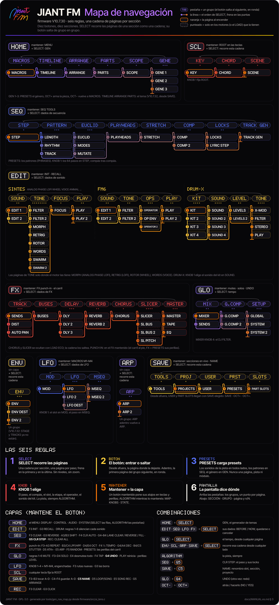

# JIANT FM — Manual de usuario

**JIANT FM V10.7.25 para el M-VAVE FM-1**

> *English version: [MANUAL.md](MANUAL.md).*

Este manual es para músicos que acaban de instalar JIANT FM y quieren saber cómo tocarlo, cómo armar temas con él
y, sobre todo, **cómo guardar su trabajo sin perder nada**. Sigue el firmware tal como está en esa versión: cada
botón, perilla y mensaje aparece nombrado exactamente como lo muestra el equipo.

Si vas a leer un solo capítulo, leé [12. Guardar y cargar](#12-guardar-y-cargar). Si venís de la V10.6c (la última
versión pública) o de antes: [Qué hay de nuevo en esta versión](#qué-hay-de-nuevo-en-esta-versión).

## Contenido

- [Qué hay de nuevo en esta versión](#qué-hay-de-nuevo-en-esta-versión)
0. [Inicio rápido](#0-inicio-rápido)
1. [El panel](#1-el-panel)
2. [La pantalla](#2-la-pantalla)
3. [Páginas y capas](#3-páginas-y-capas)
4. [Motores](#4-motores)
5. [DRUM-X](#5-drum-x)
6. [El secuenciador](#6-el-secuenciador)
7. [ARRANGE: canciones, secciones y escenas](#7-arrange-canciones-secciones-y-escenas)
8. [Dados y UNDO](#8-dados-y-undo)
9. [Efectos y master](#9-efectos-y-master)
10. [Modulación y macros](#10-modulación-y-macros)
11. [Tocar en vivo](#11-tocar-en-vivo)
12. [Guardar y cargar](#12-guardar-y-cargar)
13. [Sistema: TRACKS, LOAD y el MENU](#13-sistema-tracks-load-y-el-menu)
14. [MIDI y USB](#14-midi-y-usb)
15. [Herramientas web: emulador, instalador, editor, backup](#15-herramientas-web-emulador-instalador-editor-backup)
16. [Problemas y preguntas frecuentes](#16-problemas-y-preguntas-frecuentes)

---

## Qué hay de nuevo en esta versión

Todo lo que cambió desde la V10.6c, la última versión pública, en una lista; cada punto lleva a su lugar en el manual.

**Antes de actualizar**
- **6 canciones, no 8** (V10.6p). Las canciones 7 y 8 ya no se abren: esa memoria queda para un banco de samples de
  batería. Pasalas a una entre 1 y 6, o hacé antes un backup completo (**Save backup** del editor, o el backup del
  instalador); el backup guarda las ocho, y al restaurarlo te dice qué canciones quedaron solo en el archivo.
- **Proyectos muy viejos retirados** (V10.6s): los proyectos guardados por JIANT antes de la 1.0.3 (FUN1 a FUN6) se
  rechazan sin tocarlos, y un sonido DIGITAL carga como el init de FM6. Si todavía los necesitás, abrilos en una
  versión anterior (V10.6c) y guardalos de nuevo ahí.
- **Proyectos más viejos retirados** (después de V10.7.13, lugar para FORM MY LOOP de GENE): los proyectos y backups
  guardados en los formatos FUN7 a FUNB (Felucca 1.0 / 1.1 y JIANT hasta 0.5) ya no se leen; al encender, un proyecto
  así muestra **OLD PROJECT: NOT READ** y su slot queda vacío (la flash lo conserva hasta que guardes encima). El editor
  web no los convierte: abrilos en V10.7.13 o anterior y guardalos de nuevo ahí (así quedan en el formato de hoy).
  También se fueron: las conversiones de presets de usuario viejos (SAMPLE PERC, TRIO, los chips de LOFI, valores de
  0.3 / 0.4: un preset así carga como estaba guardado, y si es de un motor retirado suena como ANALOG), la pista de un
  motor retirado en un proyecto ahora recibe el primer preset de ANALOG (no su sonido más parecido), y la criatura propia
  de ADD (ADD dibuja el ser, como los otros motores antes de 0.9.6).
- **FM-1 nuevos** (V10.6z): los FM-1 vendidos desde fines de 2026 (con el logo en el frente) traen otro chip de
  flash. Las versiones anteriores de JIANT andaban en esos equipos solo desde la RAM (sin guardar, sin GENE, sin
  actualizarse desde el equipo); esta versión guarda normalmente. Si el tuyo no conservaba tus canciones, actualizá.

**Canciones**
- SAVE abre en el tema: **TIMELINE**, **PARTS** y **CLIPS** (V10.6o, V10.6s), después ARRANGE; PART SLOTS (las partes guardadas) y PROJECTS son el grupo PROJECT (codex/coherence). Ver
  [TIMELINE, PARTS y CLIPS](#timeline-parts-y-clips-save--song).
- **Un tema conserva los sonidos que cambiás mientras suena** (V10.6z8); EDIT > **RECALL** trae de vuelta el sonido de
  la sección en una pista.
- **Guardar un tema** se hace en SAVE > PROJECT > **PROJECTS**: KNOB 1 elige el proyecto (no lo abre), SAVE le pone
  nombre y en la pantalla NAME el KNOB 3 elige el tema entero (SONG) o solo el LOOP (la página SAVE SONG AS ya no está).

**Batería y generador**
- **DRUM-X**: una pasada de calidad (V10.6q), un cencerro CMOS clásico, el mapa de teclas **EXTENDED** por defecto con
  redobles de verdad y cada sonido cromático (V10.6r), ACOUST ya no está (V10.6o), y volvieron la pegada de los bombos y
  los hats brillantes (V10.6z9). Ver [Las teclas: EXTENDED](#las-teclas-extended-v106r).
- **GENE** (el generador de HOME, GEN hasta la V10.6m) toca los géneros que eligió el autor, entre ellos CUMBIA, EBM,
  BAILE FUNK, PHONK, HIP HOP (trap, drill, pluggnb, boom bap o lofi), JAZZ en cualquier tempo y TECHNO ROCK (rock o
  synth 80s). El rol DRUM de SCL > SCENE puede tomar un kit generado para el género (**SCENE DRUM GEN**).
- La **paleta térmica** en todos lados: cada nota con su calor, el piano roll coloreado por nota (V10.6w).
- **Siete paletas, todas propias de JIANT** (MENU > DISPLAY > COLOR): **JIANT** (como estaba, la que viene por
  defecto), **SELVA** (verdes), **CONTRAST** (accesible: negro y blanco puros, grises más claros, sin tinte en el
  panel), **BRASA** (cálida), **ABISAL** (fría), **HUESO** (blanco hueso y un solo acento naranja) y **NEON** (magenta y
  cian). La rampa térmica (los seres, las notas, las barras) está en las siete; las cartas de las perillas toman cuatro
  colores propios de cada paleta (JIANT: el calor de cada valor, como antes). Reemplazan a
  GREY, GREEN, AMBER, ICE, VIOLET, ROSE, PAPER, HI-CON, NIGHT y MONO; si tenías guardada una de esas, quedás en la más
  parecida (GREY, MONO, NIGHT → HUESO; GREEN → SELVA; AMBER, ROSE → BRASA; ICE → ABISAL; VIOLET → JIANT; PAPER,
  HI-CON → CONTRAST).
- **Dos pieles**: MENU > DISPLAY > SKIN es **AIR** o **COLORS**. BOTTOM y HUD ya no están (si tenías guardada alguna,
  cargás con COLORS).
- **Sin la fila STYLE**: el aspecto relleno (FLAT) es el único estilo; LINE ya no está (si lo tenías guardado, cargás
  con FLAT) y el menú tiene una fila menos.
- **Letras chicas más grandes**: los nombres, las pestañas, las palabras del encabezado, la miga y los rótulos de los
  paneles tienen mayúsculas de 9 px (eran letras de píxel de 7 px). Las ocho pestañas de SEQ y de FX se ven de a cinco;
  el menú lista ocho filas por vez; se fueron algunos datos que repetían una carta (QUANT y ALL TR a la derecha de la
  rueda de SCL, los números adentro de los anillos de BEING).
- **Valores más grandes**: el número de una carta va en cifras de 14 px (eran de 11) cuando entra con su unidad, y gira
  como antes; los nombres y las palabras siguen en la letra de 11 px. El medio del encabezado dice el motor y el sonido
  sin "T1 ·" (el número de la pista está en su cajita); se fueron la línea "FX · T1" de FX y los nombres de la página y
  del sonido adentro del panel de EDIT (los dicen el encabezado y la miga).
- **MENU > LARGE** en las páginas de SEQ, SAVE y FX: las cartas altas que ya tenían HOME y EDIT (el piano roll, la
  grilla de batería y las listas conservan su panel, con las cartas normales).

**Secuenciador**
- El componente **RAMP** reemplaza a JUMP (V10.6v): el lock de parámetro de un paso se desliza hasta su valor en 1–32
  pasos o 1–16 compases.
- **REC respeta cómo tocás** (V10.6z4): el largo de las notas, el legato como SLIDE, la velocidad tal cual. **GATE
  100 %** en las pistas nuevas.

**Tocar**
- **Velocidad y aftertouch en las teclas** (V10.6z7, a partir de *Velo* de Charles Vestal): F3..C5 sensibles, cada
  tecla se calibra mientras tocás; MENU > CONTROL > **VELOCITY**, **VEL MIN**, **AFTERTOUCH**, **VEL LEARN**. Ver
  [Velocidad y aftertouch](#velocidad-y-aftertouch-de-las-teclas-v106z7).
- **Teclas de expresión** (V10.6z4): una nota mantenida + OCT− un vibrato, + OCT+ un bend (MENU > AUDIO > **OCT BEND**).
- **SWARM** (el instrumento de Bluetooth de EXT): una melodía según qué tan cerca estás, el morph FAR / NEAR, la
  caminata por la escala y **CHAOS** (donde estaba la perilla SELF).
- La calibración FAR / NEAR ahora toma la mediana de 2,5 s (**HOLD STILL**) (V10.6z8).
- **VOICE** ya no satura con las vocales abiertas; WORDS tiene **CONS**, el largo de las consonantes (V10.6y).

**Conexiones**
- **NRPN** para todo parámetro automatizable, y las perillas salen como NRPN con MIDI OUT ALL (V10.6z3): [docs/NRPN.md](NRPN.md).
- El protocolo del editor es un contrato versionado (1.2): [web/EDITOR_PROTOCOL.md](../web/EDITOR_PROTOCOL.md).
- El segundo núcleo arranca solo con la alimentación de fábrica (después de un SAFE START: un núcleo) (V10.6z2).

---

## 0. Inicio rápido

### Instalación

1. Abrí el **instalador web** en Chrome o Edge en una computadora, o en Chrome en Android con un cable USB OTG
   (iPhone y iPad no tienen Web MIDI): <https://juanjiant-bit.github.io/JIANT/webapp/installer/>
2. Conectá el FM-1 **directamente** con un cable USB de datos.
3. **¿Venís de otro firmware custom (Felucca, Skiff, baudgirl o cualquier otro)?** Volvé primero al oficial con el
   botón **Volver al oficial** del instalador (que además guarda el backup de ese firmware). Escribir JIANT
   directamente encima de otro firmware custom ya dejó algún FM-1 sin poder arrancar.
4. Apretá **Instalar**. Primero revisa el firmware del FM-1 y solo escribe sobre el **V16 oficial**, el **V15 oficial**
   o JIANT (si encuentra otro, te manda a volver al oficial primero). No desenchufes el cable mientras escribe.

**Volver al oficial** acepta el `FM-1.fwsc` de M-VAVE del **V16** (718.196 bytes, el que ofrece hoy) o del **V15**
(699.956 bytes), descomprimido de la página de descargas de M-VAVE y verificado byte por byte. Primero guarda un
backup completo de JIANT; para volver, apretá Instalar y restaurá el backup con el editor.

JIANT no tiene samples de usuario: si venís de Felucca, sus samples de usuario (USR1–3) se pierden al instalar.
Guardá tus archivos WAV.

### Tu primer sonido (1 minuto)

1. Encendé el equipo. La firma se dibuja sola y después llegás a **HOME**: seis criaturas, una por pista. (V10.6e) Las
   pistas arrancan como una banda afinada: **T1 DRUM-X** (ACOUSTIC), **T2 ANALOG** (PLUCK), **T3 PHASE** (INIT SAW), **T4 FM6** (FM BASS), **T5 VOICE** (CHANT) y **T6 ANIMAL** (WHISTLE), cada una con el sonido de su
   preset, seco.
2. Girá **ALGORITHM** para elegir una pista (T1–T6). Con el valor por defecto, **TRACKS 4**, se detiene en T4: T5 y T6 aparecen solo con TRACKS 6 (ver
   [13](#13-sistema-tracks-load-y-el-menu)).
3. Girá **PRESETS** para recorrer sonidos. Tocá las teclas.
4. Girá **KNOB 1–4**: en EDIT 1 y EDIT 2 son el motor de la pista. (V10.7.24) En HOME son las macros **M1–M4** (HOME › MACROS)
   y, una página más allá (**SELECT**), **FILTER · SPACE · DRIVE · DUCK** sobre toda la mezcla (HOME › SCOPE).
5. ¿No te gusta? Mantené **EDIT** y girá **SELECT**: el sonido se tira a los dados y sale una variación nueva, que escuchás al
   instante. **OCT+ OK** la deja, **OCT− CANCEL** devuelve el sonido.

### Tu primer tema (5 minutos)

1. Mantené **HOME** y girá **SELECT** (o en HOME tocá **HOME** dos veces: MACROS → SCOPE → **GEN**). Se abre el **GENERATOR** en
   **EXPLORE** (ningún género, todas las reglas rotas): apretá **OCT+** así, o antes elegí RANDOM o uno de los géneros
   con KNOB 1 o PRESETS. Aparece una idea de tema completa: motores, sonidos, partes, escala, tempo y efectos. Apretá
   **PLAY**.
2. ¿No te convence? Apretá **OCT+** otra vez: semilla nueva, pieza nueva. ¿Demasiado cargada? Girá **SELECT** un paso a la
   derecha para GEN 2 y bajá **DRUMS** o **ARP**, después OCT+: la misma pieza con eso cambiado. **OCT−** vuelve a MACROS. Para volver a lo que había antes: mantené **GLO** y apretá **G4** (UNDO).
3. ¿Te gusta? **Pará** (PLAY), apretá **SAVE** (abre TIMELINE, el tema) y girá **SELECT** tres pasos a la derecha
   (pasando ARRANGE, PARTS y CLIPS): **PART SLOTS**, las cuatro partes del proyecto. Girá **KNOB 4** a la derecha para que su tarjeta diga
   **OCT+** y apretá **OCT+**. Escribí un nombre con las teclas (o dejá el que te ofrece) y apretá **OCT+** otra vez. La
   pantalla dice **SAVED**.
4. Hacé una variación (cambiá algunos pasos, muteá una pista) y guardala en la parte **B**: en PART SLOTS girá
   **KNOB 1** hasta **B** y después KNOB 4 y OCT+ como antes.
5. Girá **SELECT** dos pasos a la derecha (pasando PROJECTS): **ARRANGE** (las filas del tema). Apretá **OCT+** para agregar una fila,
   elegí su sección con **KNOB 2** y su largo con **KNOB 3** (compases). Agregá una fila para A y otra para B. Apretá
   **PLAY**: el tema reproduce las filas en orden.

Ese es todo el ciclo: **hacer música → guardarla en una sección → encadenar secciones en ARRANGE**.

---

## 1. El panel

Los nombres de abajo son los que usa el firmware (la pantalla HARDWARE CALIBRATION los pide con estos nombres).

### Encoders y perillas

| Control | Qué hace |
| --- | --- |
| **SELECT** (encoder) | Solo (0.9.2): **recorre las páginas de la sección**, una página por paso, en una sola cadena, frenando en la primera y en la última (sin niveles, sin zoom; ver [Cómo funciona la navegación](#cómo-funciona-la-navegación-seis-reglas-092)). En el MENU: sus filas, las cuatro pestañas en una cadena. Con un botón mantenido: **HOME** + SELECT **GEN**, **EDIT / SEQ / LFO / FX** + SELECT los **dados** de esa parte, **GLO** + SELECT el **tempo**, **ENV / SCL / ARP / SAVE** + SELECT recorren la cadena de esa sección desde donde estés. |
| **ALGORITHM** (encoder) | Elige la pista desde cualquier página: T1–T6 (T1–T4 con TRACKS 4). La pista es siempre de ALGORITHM (0.9.2: PRESETS ya no la elige en ENV, LFO, CHORD, ARP). En el MENU: la pestaña siguiente / anterior. Con una capa mantenida: su vista, MAP ↔ KNOBS ↔ STATE. |
| **PRESETS** (encoder) | **Siempre presets** (0.9.2): los sonidos de la pista seleccionada (los presets de fábrica de cada motor y después tus presets de usuario) en todas las páginas; en las páginas **SEQ** los **patrones** (abre el cargador PHRASES con el patrón siguiente elegido: OCT+ lo carga, OCT− vuelve a la página SEQ); en **GEN** también los sonidos (V10.7.22; su GENRE es la KNOB 1 de GEN 1). En el MENU y con un botón mantenido no hace nada, salvo con **EDIT mantenido** (V10.7): salta al primer sonido del motor siguiente / anterior, con el nombre del motor en pantalla. Nunca cambia de página, de pista, de módulo ni de fila. |
| **KNOB 1–4** | Las cuatro tarjetas (columnas) de la pantalla. Una página que elige algo lo elige con **KNOB 1** (el paso, el compás, el slot, la etapa, el operador, el sonido del kit, la fila). Con una capa mantenida, las perillas propias de la capa. Girar rápido recorre todo el rango, despacio ajusta fino (MENU › CONTROL › KNOB ACCEL lo desactiva). En el MENU: KNOB n el ajuste de la tarjeta n. |
| **MASTER** | El volumen de salida. |

### Botones

| Botón | Toque | Mantener |
| --- | --- | --- |
| **HOME** | HOME (0.9.2, como el botón de cualquier sección): desde otra sección, la última página de HOME; en HOME la primera página del grupo siguiente, en ronda: **MACROS → SCOPE → GENE → MACROS** (V10.7.24; GENE: el generador, GEN hasta la V10.6m). | Unos 0,7 s: abre el **MENU**. |
| **ENV** | La sección ENV: desde otro lado, la última página mostrada (al encender, ENV); adentro, el grupo siguiente: **TRACKS → ENV → STAGE**, en ronda. | (sin capa) |
| **LFO** | La sección LFO: desde otro lado, la última página mostrada (al encender, LFO); adentro **MOD → LFO → MSEQ**, en ronda. | Capa **MACRO**: KNOB 1–4 son M1–M4. |
| **FX** | La sección FX: desde otro lado, la última página mostrada; adentro, el módulo siguiente: **TRACK → BUSES → DELAY → REVERB → CHORUS → SLICER → PUNCH IN → MASTER** (MASTER · TAPE · EQ), en ronda. | Capa de **FX punch-in**. |
| **SCL** | La sección SCL (0.9.2: propia, separada de ARP): **KEY → CHORD → SCENE** (V10.24). | Capa **SCL**: las teclas fijan la tónica. |
| **EDIT** | La sección EDIT: desde otro lado, la última página mostrada (una memoria para los sintes y una para FM6 y otra para DRUM); adentro el grupo siguiente: **SOUND → TONE → FOCUS** (FM6: SOUND → TONE → OPERATOR; DRUM: KIT → SOUND → LEVELS → TONE). Siempre EDIT (0.9.2: borrar un paso es SEQ + G5, renombrar SAVE + C5). Un paso mantenido + EDIT sigue borrando los locks de ese paso. | Capa **EDIT**: INIT, RECALL, mutes de los sonidos de DRUM-X, SELECT los dados de sonido. Mantenido + KNOB 1–4: **MOMENTARY** (la página de abajo, vuelve al soltar). |
| **GLO** | La sección GLO: desde otro lado, la última página mostrada; adentro **LIVE → MIX → G.COMP → SETUP**, en ronda (al prender MIXER; LIVE, las secuencias en vivo, primero; V10.37: G.COMP después de MIX; codex/coherence: SETUP junta GLOBAL, SYSTEM, SYSTEM 2 y KEY SPLIT). | Capa **GLO**: mutes, solos, niveles, tap tempo, UNDO. |
| **SAVE** | La sección SAVE: desde otro lado, la última página mostrada, y USER o PART SLOTS llegan con su **SAVE ya elegido** (SAVE, OCT+, OCT+ como antes); adentro **TOOLS → SONG → PROJECT → SOUND**, en ronda (V10.2: primero el tema; al prender TIMELINE; V10.7.22: TOOLS, con CLEAR PROJECT, es la primera página, un paso de SELECT a la izquierda de TIMELINE). | Capa **SAVE**: tocar/guardar secciones en vivo; C5 NAME. |
| **ARP** | La sección ARP (ARP · ARP 2, un grupo): desde otro lado, la última página mostrada; adentro, vuelve a ARP. Un acorde mantenido + ARP al grabar por pasos lo sigue arpegiando. | (sin capa) |
| **SEQ** | La sección SEQ: desde otro lado, la última página mostrada (al encender STEP, el piano roll); adentro el grupo siguiente (V10.6): **STEP → PATTERN → EUCLID → PLAYHEADS → STRETCH → COMP → AUTO → TRACK GEN**, en ronda. | Capa **SEQ TOOLS** (en todas las páginas SEQ); G5 CLR STEP. |
| **PLAY** | Arranca / para. Mantenido (~0,7 s): **PANIC**. | — |
| **REC** | Arma / desarma la grabación en la pista seleccionada. | Capa **REC**: CLEAR, CLICK. (V10.7) Mantenido más que HOLD y soltado sin tocar nada más: **UNDO** (otra vez: rehacer). |
| **OCT− / OCT+** | Octava del teclado (−3 a +3; los dos juntos: vuelve a 0; en una pista DRUM el kit queda en sus teclas: ratchets arriba, SHORT / GHOST / FLAM abajo, ver [5](#5-drum-x)). En páginas de acción y en diálogos: **OCT−** = atrás / NO, **OCT+** = hacerlo / YES. | — |

### Las teclas

27 teclas de **F3 a G5** (16 blancas, 11 negras). Tocan la pista seleccionada. Con una capa mantenida se convierten en
atajos de esa capa; en la grilla DRUM son pasos y carriles; en la pantalla NAME escriben.

### Combinaciones útiles

| Combinación | Resultado |
| --- | --- |
| **GLO** mantenido + **PLAY** | Reinicia desde el principio sin parar (clock interno). |
| **PLAY** mantenido (~0,7 s) | **PANIC: ALL NOTES OFF**. Para el transporte y corta todo el sonido de una: las voces de todas las pistas, los acordes en LATCH, los arpegios, las repeticiones del punch-in y las notas que tiene MIDI IN (una tecla o nota MIDI que soltás después no hace nada; la siguiente suena como siempre). MIDI OUT manda el note-off de cada nota que mandó y All Notes Off (CC123) en los canales 1–6 de las pistas (no con MIDI OUT en OFF). Usalo si te queda una nota colgada, por ejemplo de un controlador que perdió su note-off; el CC120 / CC123 de MIDI IN sigue haciendo lo mismo en su canal. |
| **GLO** mantenido + **SELECT** | Tempo, desde cualquier página. |
| **GLO** mantenido + **G4** | **UNDO** del último cambio grande (otra vez: rehacer). |
| **REC** mantenido solo, soltado | (V10.7) También **UNDO**: mantenido más que HOLD (~0,5 s) sin tocar tecla, perilla, botón ni OCT; otra vez: rehacer. Si usás otra cosa mientras lo mantenés, es la capa REC; un toque sigue armando la grabación. |
| **SEQ** mantenido + **REC** | **CLEAR ALL SEQUENCES?** — los pasos y la automatización de las seis pistas, y el carril de punch-in. |
| **REC** mantenido + **FX / EDIT / ENV / LFO / SCL / ARP / GLO** | Borra la automatización de esa parte en la pista seleccionada (GLO: la automatización de nivel y paneo de todas las pistas; FX: también el carril de punch-in). Sin diálogo. |
| **SAVE** mantenido + **OCT+** / **OCT−** | Guarda la música en la sección que está sonando / recupera esa sección tal como quedó guardada. |
| **HOME** mantenido + **SELECT** | **GEN**, el generador de temas (las últimas páginas de HOME; ver [8](#8-dados-y-undo)). |
| **EDIT / SEQ / LFO / FX** mantenido + **SELECT** | Los dados: el sonido / la secuencia / el LFO / los efectos (ver [8](#8-dados-y-undo)). |
| **ENV / SCL / ARP / SAVE** mantenido + **SELECT** | Entra a esa sección y recorre su cadena, como SELECT adentro. (0.9.2: botón mantenido + **PRESETS** ya no recorre páginas.) |
| **EDIT** mantenido + **PRESETS** | (V10.7) El primer sonido del **motor** siguiente / anterior (su nombre en pantalla), en vez de recorrer los presets de a uno. No mientras hay un ajuste momentáneo en curso (EDIT mantenido + una perilla girada). |
| **SEQ** mantenido + **G5** | **CLR STEP**: borra el paso del cursor y sus locks (NOTE con una nota en foco: esa nota; AUTO LIST: borra el registro). |
| **SAVE** mantenido + **C5** | **NAME**: renombra el slot en SAVE > USER, la parte o el proyecto en PART SLOTS / PROJECTS. |
| Un paso mantenido (SEQ > STEP) + **KNOB 1–4** | Un parameter lock en ese paso. |
| Teclas de paso mantenidas (SEQ, el roll / la grilla) + **SELECT** / una tecla de paso + **REC** | **COPIAR** esos pasos / **PEGARLOS** desde ese paso (ver Copiar y pegar). |
| **OCT− + OCT+** mantenidos al encender | HARDWARE CALIBRATION. |
| **OCT− + OCT+** mantenidos 5 s con el equipo funcionando | Modo de actualización (UBOOT), con una cuenta regresiva desde los 2 s; soltá para cancelar. |
| Una nota mantenida + **OCT−** / **OCT+** (V10.6z4) | **Teclas de expresión**: OCT− mantenido hace entrar un vibrato como al subir una rueda de modulación (~200 ms), OCT+ mantenido dobla la nota hacia arriba con una curva suave fija (~300 ms) hasta el rango de MENU > AUDIO > **OCT BEND** (2 semitonos por defecto); al soltar vuelven solas. Sin ninguna nota mantenida, OCT− / OCT+ cambian la octava como siempre (OCT BEND OFF: siempre). Se graban como automatización al grabar (REC + EDIT la borra); con MIDI OUT ALL salen como CC1 y pitch bend (poné el rango de bend del receptor igual al de OCT BEND). Las dos mantenidas sobre una nota nunca inician UBOOT. (V10.7.22) También son las fuentes **OCT+** y **OCT-** de la matriz MOD: una pista con un slot de MOD que rutea OCT+ (SRC, DEST y AMT puestos) barre ese DEST con la misma curva en vez de doblar la nota (y no manda pitch bend); una que rutea OCT- recibe el mismo vibrato de 5,5 Hz, entrando de a poco, en ese DEST en vez de en la afinación (el CC1 sale igual). |

### Velocidad y aftertouch de las teclas (V10.6z7)

Las teclas F3..C5 del FM-1 apoyan sobre una pastilla de carbón cuya resistencia baja cuanto más apretás (el método es
de Charles Vestal, *Velo*, github.com/charlesvestal/fm1-velocity, GPL-3.0). JIANT la lee en cada toque:

- **Velocidad**: qué tan fuerte llega la tecla, en los primeros milisegundos después de tocar. Es continua (1..127:
  cada toque entre suave y fuerte da un valor intermedio), y después pasa por la curva de MENU > CONTROL >
  **VELOCITY** y el piso de **VEL MIN**. En una pista de sintetizador una nota espera su golpe como mucho 2,2 ms (V10.7.10: un límite fijo, aunque se pierda una lectura de la tecla), por debajo de lo que se nota; en una pista **DRUM** (la elegida, o la mitad de KEY SPLIT que va a una) no espera nada: suena enseguida con el golpe leído hasta ahí, o el promedio reciente de la tecla. Llega a todo lo que toca una tecla: el sonido (los motores y el VEL de la matriz), los
  acordes y el strum, el arpegiador, la grabación (solo 127 se graba como acento) y el MIDI OUT. VELOCITY **OFF**:
  todas las teclas 100, como antes.
- **La fila de arriba (C#5..G5)** no tiene sensor (el FM-1 no puede leer la presión de esas siete teclas), así que toca con el
  **promedio de tus golpes recientes** (100 hasta que toques las otras). No tiene aftertouch (un acorde con teclas
  sensadas conserva el de ellas).
- **Calibración**: cada tecla es distinta, y cada una aprende tus toques suave, normal y fuerte mientras tocás (VEL
  LEARN ON, por defecto: se mueve despacio, un toque raro no la desarma). Empieza de la calibración de fábrica (medida
  en el FM-1 del dueño) y se guarda en la configuración, medio minuto después de que dejás de tocar. **VEL LEARN
  RESET** vuelve a la de fábrica. Para verla: la página <https://juanjiant-bit.github.io/JIANT/webapp/vel/> (*En vivo*, Chrome, por el cable USB del editor) muestra la velocidad de cada nota y
  la calibración de cada tecla.
- **Aftertouch**: con una tecla abajo, apretala más: su presión (0..127) es la fuente **AT** de la matriz (EDIT > MOD:
  cualquier destino: filtro, profundidad del vibrato, nivel ...). Los sonidos nuevos (INIT SOUND, un proyecto nuevo)
  la mandan al filtro (ranura 4, AT -> CUT +20) si esa ranura está libre; los proyectos y presets guardados mantienen su
  propia matriz. Un dedo apoyado no hace nada (una zona muerta), el valor se desliza (sin escalones) y al soltar la
  tecla vuelve a 0. MENU > CONTROL > **AFTERTOUCH** elige la sensibilidad (LOW, MID, HIGH) o lo apaga (OFF). Funciona
  también con OCT− / OCT+ mantenidos; se graba como automatización junto con las teclas de expresión y sale como
  aftertouch de canal con MIDI OUT ALL.
- **El VEL de un sonido** (EDIT > PLAY 2, KNOB 3; 0..100 %, todos los motores menos DRUM): cuánta velocidad le llega
  a *este* sonido. **100 %** (todo proyecto, preset y canción de antes) toca cada nota tan fuerte como se tocó; menos
  acerca la velocidad de cada nota a 100 (50 %: un toque de 60 suena 80, uno de 120 suena 110); **0 %** toca todas las
  notas a 100, como VELOCITY OFF, pero solo en esta pista. Vale para todas las fuentes: las teclas, los pasos del
  secuenciador, el arpegiador, las repeticiones del punch-in y el MIDI de entrada; (V10.7.22) Es solo cuánta velocidad le llega al
  *sonido* (su nivel y la respuesta propia del motor): la fuente **VEL** de la matriz sigue siempre la velocidad tal como se tocó (las teclas, la de cada paso, el arpegiador, el MIDI de entrada, un teclado externo), sea cual sea VEL, 0 % incluido — VEL 0 % con VEL → CUT: todas las notas igual de fuertes y el filtro siguiendo cuán fuerte tocás. El **ACENTO** de un paso sigue sonando 127, y HUMAN y el DECAY de un RATCHET siguen variando las notas. La grabación guarda la velocidad que tocaste: si después subís VEL,
  vuelve la dinámica. Los presets de **bajo** de fábrica cargan en **0 %** (un bajo queda mejor parejo), el bajo de GENE
  en **75 %** (sus notas fantasma compuestas siguen más suaves); los demás presets en 100 %. Se guarda con el sonido (proyectos,
  presets de usuario, canciones); NRPN 80, y el grupo VOICE del editor web.

---

## 2. La pantalla

### El aspecto: COLORS

Las lentes tienen una sola piel, **COLORS** (MENU > DISPLAY > SKIN y AIR, su otra opción, ya no están desde la V10.7.23:
si tenías guardada AIR, o las viejas BOTTOM y HUD, cargás con COLORS): la estructura LENTE con los **colores de la 0.6**.
Las **cartas de las perillas no tienen caja**: cada una va sobre el fondo, con su forma dibujada como una **línea fina
del color de su valor**, así que la línea cambia con el valor (y con la paleta); la perilla que girás lleva la línea de
2 px. El nombre de la carta va en gris (MID), el valor y su barra en el **color de cada perilla** (JIANT: el color de
cada parámetro **se mueve con su cantidad**, como calor, violeta si es poco, amarillo y crema si es mucho; uno centrado
como PAN o DETUNE frío en el medio y caliente en los dos extremos; las otras seis paletas: cuatro colores propios, uno
por perilla); la pestaña del grupo rellena de violeta; el número de la pista en una cajita naranja, un ▶ violeta y el
BPM grande en violeta en el encabezado; los seres con el calor de la 0.6 (púas violetas, anillos rojo y naranja, núcleos
crema). El dibujo de abajo de las cartas va sobre el fondo (sin caja de panel). Las cartas de NOTICE y de NAME van
dibujadas igual, con su línea.

Los valores (cartas, el BPM del encabezado) vuelven a una sans redondeada (Inter Tight SemiBold), como en la 0.6; los
nombres, las pestañas y la miga van en Chakra Petch, con mayúsculas de 9 px (hasta la V10.7.18, letras de píxel de 5 x 7, de 7 px). **MENU > LARGE** deja sus cartas grandes arriba
en todas las pieles (la piel conserva sus pestañas y sus colores; en AIR quedan donde va su fila de perillas, debajo de
las pestañas), así LARGE se lee igual en cualquiera.

Desde la 0.8.5 todas las páginas llevan la piel del diseño que aprobó el dueño (la maqueta HTML "LENTE"):

- **Encabezado (arriba)**: una sola línea tranquila sobre una regla fina. A la izquierda el estado de reproducción (un
  cuadrado gris parado, un triángulo naranja sonando, violeta durante la cuenta) y los **BPM** (violeta; naranja
  mientras cambian), después el candado de BPM LOCK y el punto de REC (lleno: la pista seleccionada armada; un aro:
  otra pista). Al medio de qué es la página: **ANALOG ACID** (el motor de la pista y su sonido; el número de la pista está en la cajita naranja de la izquierda); en las páginas del
  tema (SAVE, ARRANGE, TOOLS, GLOBAL) **P1 NOMBRE** (el proyecto); en FX **T1** en naranja. A la derecha la octava
  (**OCT +2**, o la fila del tema mientras suena un tema), el **medidor de carga** (cinco barritas, violetas a medida
  que el sonido ocupa más del tiempo de audio) y la batería (violeta cuando la alimenta el USB). Los mensajes aparecen
  al medio ("SAVED", "T1 CLEARED"...), a veces con una segunda línea.
- **Tarjetas**: las cuatro cajas debajo del encabezado son KNOB 1–4: el nombre chico y gris arriba, el valor debajo en
  blanco y una barra violeta fina debajo del valor. La que estás girando se enciende en naranja, así es el único color
  en las tarjetas. Un valor automatizado o con lock tiene el nombre en violeta; una tarjeta apagada significa "acá
  ahora no hay nada". Una acción armada (SAVE, LOAD, ERASE, CLEAR...) es una tarjeta teñida de violeta, con el nombre
  violeta y **OCT+** como valor. Desde la 0.8.5 las tarjetas no llevan íconos, ni nada más (las tarjetas de MENU > LARGE:
  un punto violeta para un valor que se mueve solo; el encabezado: "!" antes de un mensaje NO FILE, un candado y un
  disco dibujados).
- **Nombre de página**: al cambiar de página (o de pista) a mano, el nombre de la página aparece un momento sobre el pie
  de la pantalla, con la pista y su motor a la derecha; en HOME el motor de la pista, y "T1 HOME" en chico (en una
  página de lente se enciende su miga de pan). La barra de arriba, las tarjetas y el gráfico quedan a la vista.
- **Gránulos**: unos puntitos flotan detrás del gráfico del panel, como en HOME (LOAD FULL con ANIM ON). Se mueven solo cuando
  el panel se redibuja igual (una perilla, el LFO, la envolvente), así que no gastan CPU.
- **Panel (al medio)**: el gráfico de la página — la criatura del motor, una envolvente, el LFO en movimiento, la
  grilla de pasos, una lista...
- **Pie**: las barras de pasos del compás que editás (de a cuatro debajo de cada tarjeta) o ayudas de teclas, y debajo
  una **miga de pan** chica y gris: **SECCIÓN · GRUPO · página** y a la derecha el lugar de la página en la cadena de
  la sección (0.9.2; p. ej. **FX · DELAY · DLY 2  6/16**, **ENV · STAGE · STAGE  4/5**).
- **Las pestañas** (0.9.2): debajo del encabezado, los **grupos** de la sección (FX: TRK · BUS · DLY · REV · CHO · SLC ·
  PCH · MST; SEQ: PATT · TRACK · BAR · STEP · AUTO), encendido el del grupo en el que estás (COLORS: relleno violeta;
  AIR: una rayita), y **un punto por página** debajo de cada uno, encendido el de la página que
  se ve. Las tarjetas debajo, un panel más alto, y el pie es solo la miga de pan.

- **Las letras chicas** (desde la 0.8.5): los nombres de las tarjetas, las pestañas, la miga de pan, las
  palabras del medio del encabezado y los rótulos y fichas chicas de los paneles iban en una letra de píxeles de 5 x 7;
  ahora van en Chakra Petch con mayúsculas de 9 px, más fáciles de leer; los valores siguen en la letra redondeada más
  grande. Si la sección tiene más de cinco grupos (SEQ, FX), las pestañas muestran los cinco de alrededor del que estás,
  con una marquita del lado donde hay más.

Los **colores** funcionan como una cámara térmica: frío (índigo, violeta) es poco, caliente (rojo, naranja, crema, blanco; 0.8.9: la escala de la 0.6) es
mucho. Violeta es lo seleccionado, naranja lo activo.

**HOME** (V10.7.24: su primera página, **MACROS**) es el ecosistema: una criatura por pista, su especie según su motor, su forma según sus cuatro perillas principales, que
se hincha y se calienta con su propio audio (0.8.8: nadando libres por toda la pantalla, solas, como antes de 0.8.5; ver
[las secciones](#las-secciones-y-sus-cadenas)). (0.9.7) Cada ser lleva una **carita**: cierra los ojos con un golpe y abre
la boca con su nivel. La pista seleccionada se dibuja más grande, su número en violeta, una muteada se **duerme** (un
contorno apagado, los ojos cerrados), una pista dormida (TRACKS 4) se dibuja como muteada. En el **MIXER**, las pistas dormidas aparecen en gris y dicen OFF.

Los **diálogos** preguntan antes de cualquier cosa destructiva: **OCT− NO**, **OCT+ YES**. (0.8.5, como la maqueta)
Llevan las pestañas **NOTICE · DICE · NAME**: una pregunta es una tarjeta bajo una regla violeta con sus dos botones
(YES en el acento); el dado de una parte (EDIT, SEQ, LFO, FX + SELECT) muestra **BEFORE** y **NOW** lado a lado (el
ser del sonido antes y ahora, los pasos, los valores del LFO o de los efectos) sobre una franja **KEEP DICED …? ·
SELECT: DICE AGAIN · OCT− CANCEL · OCT+ OK**; NAME tiene sus tarjetas CURSOR, CHAR, LEN y OCT+ SAVE / WRITE sobre el
nombre, las letras de las teclas y las funciones de las teclas negras. (0.9.5) La tarjeta de una pregunta solo tapa su
propio recuadro, sus pestañas y su ruta: la página sigue a la vista alrededor, en movimiento.

**Mensajes** (0.9.5): un mensaje en una página con lente aparece como una pequeña píldora cerca del pie del panel, sobre
la página, que sigue dibujándose y moviéndose detrás (el encabezado también lo dice; no sobre los seres de HOME ni el
mapa de una capa); nada se oscurece. La píldora no tapa el texto de la página: si el pie está escrito (las filas de
AUTO LIST) se pone en las filas libres más cercanas, y en una página sin filas libres no aparece y
lo dice solo el encabezado. La **ayuda** de una página (V10.6: la de EUCLID "TURN A KNOB: A PATTERN", la de MOTION y PUNCH IN
"REC + PLAY ...") aparece solo si te quedás en la página unos 0,8 s, nunca mientras SELECT pasa por ella, y cada una
como mucho dos veces en total (se cuentan con los ajustes: tampoco vuelven tras reiniciar). SAVE › TOOLS › CLEAR PROJECT
las reinicia. Tocar un botón de capa no dice nada (ya no están las ayudas "HOLD [X] QUICK"): mantenelo y su capa se
muestra sola.

---

## 3. Páginas y capas

*Todo el sinte en una página: el botón de cada sección, sus grupos (las pestañas de la pantalla) y sus páginas en el
orden en que las recorre SELECT (el número de cada punto es la n del n/N del pie; en naranja, la página al encender;
punteada, una página que solo tienen algunos motores o LOADs), con las seis reglas, las capas y las combinaciones.
Hacé clic para abrir el SVG, con zoom ([in English](navigation-map.svg)). Se genera desde las tablas de cadenas del
firmware (`tools/gen_nav_map.py`).*

### Cómo funciona la navegación: seis reglas (0.9.2)

Desde la 0.9.2 todas las secciones se manejan igual (el diseño que aprobó el dueño, la maqueta "navegación"): lo
aprendés una vez y ya conocés todas. Hasta la 0.9.1 cada parte era una lente de tres niveles con juegos de perillas; las
páginas, sus perillas, sus dibujos y todas las funciones son las mismas, solo cambió el camino entre ellas.

1. **SELECT recorre las páginas.** Girar SELECT pasa por todas las páginas de la sección, en una sola cadena, una
   página por paso, y frena en la primera y en la última. Sin niveles, sin zoom. FX: SENDS → DIST → AUTO PAN → BUSES →
   DLY → DLY 2 → DLY 3 → REVERB → … → PUNCH IN.
2. **El botón de la sección: entrar o saltar.** Desde otra sección te devuelve a la última página donde estabas ahí. Si
   ya estás adentro, salta a la **primera página del grupo siguiente** (y da la vuelta). En FX › DLY 2, FX va a REVERB;
   en EDIT › FILTER, EDIT va a FOCUS.
3. **PRESETS carga presets.** Siempre: los sonidos de la pista en todas las secciones, los **patrones** en SEQ (el
   cargador PHRASES), el **género** en GEN. Nunca cambia de página, de pista ni de módulo (en el MENU no hace nada).
4. **KNOB 1 elige.** Si una página elige algo (un paso, un compás, un slot, una etapa, un operador, el sonido del kit,
   una fila), KNOB 1 es la que lo elige. La pista, siempre **ALGORITHM**. SEQ › STEP: KNOB 1 recorre los 64 pasos,
   compás tras compás; la página nueva **SEQ › BAR**: KNOB 1 el compás.
5. **Mantener = la capa.** Mantener un botón abre su capa de atajos, como antes (más allá del tiempo HOLD, MENU >
   HOLD, 0,4 s por defecto: las teclas y perillas cambian de función mientras lo mantenés, un mapa muestra qué hace
   cada tecla; una tecla o una perilla la abre al instante; soltá y volvés). Mantenido + SELECT: **HOME** GEN, **EDIT /
   SEQ / LFO / FX** sus dados, **GLO** el tempo, **ENV / SCL / ARP / SAVE** recorren su cadena. (Mantenido + PRESETS ya
   no recorre páginas: regla 3; V10.7: EDIT mantenido + PRESETS salta de motor en motor.)
6. **La pantalla dice dónde estás.** Arriba, las pestañas son los **grupos** de la sección, el actual encendido y un
   puntito por cada una de sus páginas. Abajo: **SECCIÓN · GRUPO · página** y **n/N**, el lugar de la página en la
   cadena: **FX · DELAY · DLY 2  6/16**. Igual en AIR y COLORS, con todas las paletas.

- Cada sección recuerda la página donde la dejaste (EDIT una para los sintes y una para FM6 y otra para DRUM); al
  encender SEQ abre en STEP, ENV en ENV, LFO en LFO, las demás en su primera página.
- **SCL y ARP son dos secciones** (hasta la 0.9.1 una lente): SCL es KEY · CHORD, ARP es ARP · ARP 2 (un grupo: un
  toque de ARP adentro vuelve a ARP).
- **GEN son tres páginas de HOME** (GEN 1–3, el último grupo de HOME), ya no una pantalla aparte: los botones de
  sección funcionan ahí, OCT+ arma la pieza, OCT− vuelve a MACROS. HOME + SELECT lo sigue abriendo desde cualquier lado.
- **SAVE desde afuera** vuelve a la página de SAVE que dejaste; **USER** y **PART SLOTS** llegan con su SAVE ya elegido,
  así SAVE, OCT+, OCT+ sigue guardando el sonido (o la parte).
- **EDIT es siempre EDIT**: borrar un paso pasó a la capa SEQ (**SEQ + G5**, CLR STEP; en AUTO LIST borra el
  registro; llevar TIME a REST también borra la nota) y renombrar a la capa SAVE (**SAVE + C5**, NAME).
- **El MENU** (mantené HOME): SELECT recorre todas las filas (DISPLAY → CONTROL → AUDIO → SYSTEM), ALGORITHM salta de
  pestaña, una perilla cambia el valor, HOME lo cierra.
- Algunas páginas solo aparecen cuando corresponden: las páginas de operadores de FM6 en una pista FM6, las de DRUM-X
  en una pista DRUM, RETRIG en MATH, las páginas de SWARM en una pista EXT con SWARM, y con **LOAD ECO** se ocultan las páginas SLICER y CHORUS; la cadena
  las saltea.

### Las secciones y sus cadenas

SELECT recorre cada fila de izquierda a derecha; el botón salta a la primera página del grupo siguiente. Cada página es
la misma de la 0.9.1, con sus perillas y su dibujo (los que dibujaban las lentes de la 0.8.5).

| Sección | Grupos (el botón) · páginas (SELECT) | Páginas |
| --- | --- | --- |
| **HOME** | (V10.7.24) **MACROS**: MACROS — **SCOPE**: SCOPE — **GENE**: GENE 1 · GENE 2 · GENE 3 | 5 |
| **EDIT** (un sinte) | **SOUND**: EDIT 1 · EDIT 2 — **TONE**: FILTER · MORPH · RETRIG · ROTOR · WORDS · SWARM · SWARM 2 (las que tengan el motor y la pista) — **FOCUS**: FOCUS — **PLAY**: PLAY · PLAY 2 (codex/coherence: era VOICE; el IMAGE de STEREO pasó a PLAY 2) | hasta 11 |
| **EDIT** (FM6) | **SOUND**: EDIT 1 (ALGO) · EDIT 2 (PATCH) — **TONE**: FILTER — **OPERATOR**: OPERATOR · OP ENV · OPERATOR 2 — **PLAY**: PLAY · PLAY 2 | 8 |
| **EDIT** (DRUM) | **KIT**: KIT · KIT 2 · KIT 3 · KIT 4 — **SOUND**: SOUND · SOUND 2 · SOUND 3 · SOUND 4 — **LEVELS**: LEVELS · LEVELS 2 — **TONE**: X-MOD · FILTER · STEREO · PLAY | 14 |
| **SEQ** | (V10.6) **STEP**: STEP — **PATTERN**: LENGTH · RHYTHM · TRACK — **EUCLID**: EUCLID · MODES · MUTATE — **PLAYHEADS**: PLAYHEADS — **STRETCH**: STRETCH — **COMP**: COMP · COMP 2 — **AUTO**: AUTOMATION · AUTO LIST · LYRIC STEP (VOICE) — **TRACK GEN**: TRACK GEN | 15 |
| **FX** | **TRACK**: SENDS · DIST · AUTO PAN — **BUSES**: BUSES — **DELAY**: DLY · DLY 2 · DLY 3 — **REVERB**: REVERB · REVERB 2 — **CHORUS**: CHORUS — **SLICER**: SLICER · SL BUS · SL BUS 2 · SL PITCH — **PUNCH IN**: PUNCH IN — **MASTER**: MASTER · TAPE · EQ | 18 |
| **GLO** | **LIVE**: KEYS · RAILS — **MIX**: MIXER · SENDS — **G.COMP**: G.COMP · G.COMP 2 — **SETUP**: GLOBAL · SYSTEM · SYSTEM 2 · KEY SPLIT · KEY SPLIT 2 | 11 |
| **ENV** | **ENV**: ENV · ENV DEST · ENV 2 — **STAGE**: STAGE — **TRACKS**: TRACKS (codex/coherence: al final; TRACKS DEST, gemela de ENV DEST, ya no está) | 5 |
| **LFO** | **MOD**: MOD — **LFO**: LFO · LFO DEST — **MSEQ**: MSEQ · MSEQ 2 | 5 |
| **SCL** | **KEY**: SCL — **CHORD**: CHORD — **SCENE**: SCENE (V10.24) | 3 |
| **ARP** | **ARP**: ARP · ARP 2 | 2 |
| **SAVE** | **TOOLS**: TOOLS (primero CLEAR PROJECT) — **SONG**: TIMELINE · ARRANGE · PARTS · CLIPS — **PROJECT**: PART SLOTS · PROJECTS — **SOUND**: USER · PRESETS | 9 |

Dónde vivía cada página en la 0.9.1: las vistas de seis envolventes de ENV (el nivel TRACKS) ahora son una página propia,
**TRACKS** (la última), con las perillas de ENV (codex/coherence: TRACKS DEST, gemela de ENV DEST, ya no está); **NOTE** aparece una sola vez (el grupo BAR; su
dibujo del paso grande es el de COMP); el **SENDS** de FX es la página FX; la página PROJECT de SAVE es **PART SLOTS** (era SECTIONS; el
nivel PROJECT) y **PROJECTS** (el nivel LIBRARY); EDIT 1 / EDIT 2 del kit DRUM son **KIT** / **KIT 2**. La página nueva
**BAR** es el dibujo de los compases de PATTERN con KNOB 1 el compás y KNOB 2 LEN.

- **MACROS** (V10.7.24: la primera página de HOME, con el dibujo de ECO; ECO, BEING y ROUTES se fueron: las cuatro
  perillas del sonido viven en EDIT): **KNOB 1–4** son **M1–M4**, las macros del proyecto (como LFO mantenido; se guardan
  con el proyecto y las escenas del SONG como siempre), cada tarjeta apagada mientras ningún slot de MOD la nombre. Los
  seres de las seis pistas nadan libres por todo el panel, solos, cada uno hinchándose con su sonido (un golpe lo
  empuja), su número debajo; el seleccionado más grande, su número violeta. (0.9.7, "hoy con carita") Cada ser es el
  contorno con púas de su especie (las púas según suena) en **tres isotermas**, coloreadas por **su propio nivel** como
  una cámara térmica (bajito: cian y azul; fuerte: rojo, naranja y amarillo; las de adentro más calientes), y donde
  estaban sus núcleos una **carita**: dos ojos que **se cierran con un golpe** y una boca que **se abre con el nivel**.
  El ser de una pista muteada duerme (un contorno apagado, los ojos cerrados). Detrás derivan los gránulos del
  citoplasma (los dibuja solo la pantalla: nada del tiempo del sonido). Arriba a la izquierda, las rutas contadas;
  **girá una macro** y la línea dice adónde va (**M1 T2 CUT+62 T4 E1-31**, "NO ROUTE" si no va a ningún lado: armala en
  LFO › MOD, SRC M1–M4); LATCH a la derecha.
- **SCOPE** (V10.7.24): el **osciloscopio** de la mezcla en todo el panel (cada trazo tan caliente como fuerte suena), y
  cuatro modificadores **globales** sobre toda la mezcla para tocar en vivo, que se guardan con el proyecto como todo
  global (MIDI OUT ALL los manda como NRPN 1):
  - **KNOB 1 FILTER**: el **DJ FILTER** de la mezcla (el mismo que la KNOB 4 de GLO › KEYS): al centro apagado, a la
    izquierda un pasabajos que cierra, a la derecha un pasaaltos que abre; al cruzar se frena en el centro. Mientras
    una pista graba, queda grabado como automatización del DJ FILTER, igual que en KEYS.
  - **KNOB 2 SPACE**: cuánto delay y reverb tiene toda la mezcla: una perilla que mueve juntos el retorno del delay
    (el **MIX** de FX › DLY) y el **SIZE** de la reverb, lo mismo los dos (la tarjeta muestra su promedio); los envíos
    de las pistas quedan como están. Subiendo frena SIZE en 126 (127 es el FREEZE de CLOUD: eso se pone en REVERB).
  - **KNOB 3 DRIVE**: el **CLIP** del master (KNOB 1 de FX › MASTER): la mezcla empujada x1–x4 al recorte suave, con
    su nivel compensado.
  - **KNOB 4 DUCK**: cuánto bombea la mezcla con el bombo (el **DUCK** de FX › MASTER; su release es el REL de MASTER).
  Con **EDIT** mantenido: **MOMENTARY**, vuelven a donde estaban al soltar EDIT.
- **ENV** › **TRACKS**: las envolventes de las seis pistas como mosaicos (la seleccionada teñida, con su nivel actual
  como punto); las perillas son de la pista seleccionada —
  **ALGORITHM** elige la pista. **ENV**: la envolvente grande / las columnas de ENV DEST, como antes.
  **STAGE**: KNOB 1 elige la etapa (ATK DEC SUS REL), KNOB 2 la ajusta, KNOB 3 LOOP; la
  envolvente entera con la etapa sombreada sobre la curva propia de la etapa, grande, y su tiempo.
- **GLO** › **LIVE** (0.9.11): KEYS (era MANO), las teclas como botonera de modificadores en vivo sobre las seis secuencias, y
  RAILS (era RIELES), las seis secuencias como carriles con sus cabezales y fantasmas ([11](#secuencias-en-vivo-glo--live-0911)).
- **GLO** › **MIX**: las seis pistas como tiras (MIXER: LEVEL con el vúmetro, PAN, MUTE (codex/coherence; era REV); **SENDS**, nueva:
  CHORUS, DLY y REV de cada pista como tres barras, las perillas de la pista seleccionada). **GLOBAL**: el compás de
  semicorcheas, como antes. **SYSTEM**: las pistas que suenan como fichas, los tres ajustes de LOAD (encendido el
  elegido), la ruta MIDI, la carga de CPU de los últimos segundos como una línea.
- **SCL · ARP** › **KEY**: las doce notas en un círculo (C arriba), las de la escala encendidas y unidas, ROOT en el
  acento con el nombre de la escala en el medio, QUANT y ALL TR a la derecha, la escala en un teclado debajo; KNOB 1
  fija ROOT. **CHORD**: el acorde que toca ahora cada grado de la tonalidad (I–VII, como lo tocaría una tecla: una nota
  si CHORD está en OFF o la voz no es POLY). **ARP** / **ARP 2**: "MODE · RATE · OCT" y el patrón que toca sobre una
  tríada (GATE el largo de las celdas, SWING los contratiempos tarde, PROB algunas fuera); en OFF lo dice.
- **LFO · MOD** › **MOD**: la matriz como red — las fuentes a la izquierda (encendidas las que lee un slot), una curva
  de la fuente de cada slot a su caja **D1–D4** a la derecha (DEST, AMT como barra), el slot elegido con KNOB 1
  enmarcado con un pulso que corre por su curva. **LFO**: la onda bajo "RATE · WAVE" / **LFO
  DEST**: el LFO chico a la izquierda, los cuatro montos como filas encendidas por lo que el LFO manda ahora.
  **MSEQ** / **MSEQ 2**: los dieciséis pasos bajo su leyenda; KNOB 1 el paso.
- **EDIT** › **SOUND**: la criatura del motor a la izquierda (0.9.4 / 0.9.6: cada motor la suya, ver abajo; vivo con el sonido, el nombre de la página arriba, el del
  sonido abajo), el osciloscopio en un pozo y los ocho parámetros E como fichas a la derecha, encendidas las cuatro de
  la página. **TONE**: **FILTER** dibuja la respuesta de TYPE en CUT con su pico de RES (LP, HP, BP, COMB), CUT una
  línea, DRIVE / DIST una fila de celdas; **PLAY** / **PLAY 2** (eran VOICE / VOICE 2) las voces una por fila, tan llenas como suenan,
  POLY y PRIO (PLAY 2: ALLOC), la curva de GLIDE; las demás conservan su dibujo. **FOCUS** (nueva): un parámetro E
  grande como medidor — KNOB 1 lo elige (E1–E8), KNOB 2 lo ajusta, KNOB 3 la **fuente** del slot de MOD que apunta a
  él (subida desde OFF la toma un slot libre, con ese parámetro como DEST; de vuelta a OFF lo libera), KNOB 4 el
  **AMT** de ese slot; E1–E8 como pestañas abajo.
- **GEN 1–3** son el generador (como HOME mantenido + SELECT, desde cualquier página): **SELECT** cambia la página (a
  la izquierda de GEN 1: SCOPE), **KNOB 1** el GENRE (V10.7.22; PRESETS el sonido, como en todos lados), **OCT+** arma la pieza, **OCT−** vuelve a MACROS, un toque de
  **HOME** sigue a MACROS.

### Cada página y sus cuatro perillas

"—" significa una tarjeta vacía. Una tarjeta de "acción" elegida (girá la perilla a la derecha) queda teñida de
violeta, con el nombre violeta, y dice **OCT+**; apretá OCT+ para ejecutarla.

**ENV** (por pista)

| Página | KNOB 1 | KNOB 2 | KNOB 3 | KNOB 4 |
| --- | --- | --- | --- | --- |
| ENV | ATK | DEC | SUS | REL |
| ENV DEST | FILTER | PITCH | SHAPE | LOOP |
| ENV 2 (V10.22) | ATK | DEC | SUS | REL |
| STAGE (0.8.5) | STAGE (ATK DEC SUS REL) | su valor | — (LOOP: el de ENV DEST) | — |

**LFO** (por pista)

| Página | KNOB 1 | KNOB 2 | KNOB 3 | KNOB 4 |
| --- | --- | --- | --- | --- |
| LFO | RATE | WAVE | MODE (TRIG / FREE) | FADE |
| LFO 2 (0.9.18) | PHASE (la de TRIG; atenuada en FREE) | — | — | — |
| LFO DEST | PITCH | FILTER | SHAPE | AMP |
| MOD | SLOT (1–4) | SRC | DEST | AMT |
| MSEQ | STEP (1–16) | LEVEL | LEN | SLEW |
| MSEQ 2 | DIV | — | — | — |

**MODE** del LFO: **TRIG** reinicia el LFO (en PHASE) y su FADE en cada frase nueva; **FREE** sigue corriendo entre
notas y golpes, nunca se reinicia (su FADE una vez, al cargar un proyecto o al pasar MODE a FREE). Se guarda como
PHASE −1, como desde 0.6.51: todo proyecto abre como estaba.

**FX** (las páginas TRACK son por pista; el resto son globales)

| Página | KNOB 1 | KNOB 2 | KNOB 3 | KNOB 4 |
| --- | --- | --- | --- | --- |
| FX (SENDS) | CHORUS (envío) | DLY (envío) | REV (envío) | — (codex/coherence: solo los envíos; DIST en DIST) |
| DIST | DIST | TYPE | TONE | — |
| AUTO PAN | DEPTH | RATE | SYNC | WAVE |
| BUSES (0.8.5) | DLY (el MIX del delay) | REV (el SIZE de la reverb) | CHO (el DEPTH del chorus) | SLC (el DEPTH del SLICER) |
| SLICER | MODE | PAT | RATE | DEPTH |
| SL BUS | T1 | T2 | T3 | T4 |
| SL BUS 2 | T5 | T6 | FX | — |
| SL PITCH | STEP | PITCH | LEN | QUANT |
| DLY | TIME | FEEDBK | TONE | MIX |
| DLY 2 | WIDE | PITCH | SPRAY | MOD |
| DLY 3 | TYPE (ANALOG / DIGITAL / REVERS, V10.6h) | PING (OFF / ON) | DRIVE | R TIME (V10.49: el tiempo propio del eco derecho) |
| REVERB | TYPE | SIZE | DAMP (RESO: FOLLOW) | PRE (SHIMMER/CLOUD: AIR; RESO: PITCH) |
| REVERB 2 | MOD | RATE | FILT | WIDE |
| CHORUS | RATE | DEPTH | STEREO | — |
| MASTER | CLIP | PUNCH | DUCK | REL |

**SCL**

| Página | KNOB 1 | KNOB 2 | KNOB 3 | KNOB 4 |
| --- | --- | --- | --- | --- |
| SCL | ROOT | SCALE | QUANT | ALL TR (0.7.6; antes TRANS, y SCL 2 tenía solo ALL TR) |
| SCENE (V10.24) | SCENE (OFF / ON) | TRACK (T1–T6) | ROLE (KEEP CHORD ARP BASS LEAD DRUM) | CHORD (el acorde de esa pista) |

**EDIT** (por pista; qué páginas aparecen depende del motor)

| Página | KNOB 1 | KNOB 2 | KNOB 3 | KNOB 4 | Aparece en |
| --- | --- | --- | --- | --- | --- |
| EDIT 1 | E1 | E2 | E3 | E4 | todos los motores (ver [4](#4-motores)) |
| EDIT 2 | E5 | E6 | E7 | E8 | todos los motores |
| WORDS | LANG | LYRIC | CONS (V10.6y: el largo de las consonantes, 50–400 %; POS pasa a EDIT 1 con LANG prendido) | (OCT+ TYPE: la letra) | VOICE (0.8.5, [palabras](#voice-palabras-y-letras-085)) |
| RETRIG | RTRG | — | — | — | MATH (BYTE, FLOAT) |
| MORPH | MORPH | — | — | — | ANALOG (SAW..SIN), PHASE |
| OPERATOR | OP | COARSE (la relación, o los Hz fijos; era RATIO / FIXED) | FINE | OUTPUT (el nivel del operador; era LEVEL) | FM6 |
| OP ENV | OP | STAGE | RATE | LEVEL | FM6 |
| OPERATOR 2 | OP | MODE | DETUNE | KEY VEL (la velocidad del operador; era VEL) | FM6 |
| FILTER | TYPE | CUT | RES | DRIVE (ANALOG) / DIST (los demás) | todos los motores |
| KIT 3 | BP | FEEDBK | HANDS | GLUE | DRUM (todo el kit) |
| KIT 4 (V10.6r) | KEY MAP (CLASSIC, EXTENDED, o EXTENDED con un sonido cromático; V10.6o: ACOUST ya no está; codex/coherence: en la KNOB 1) | — | — | — | DRUM (todo el kit) |
| X-MOD | RATE | DEPTH | SHAPE | RAND | DRUM (todo el kit) |
| STEREO | IMAGE | — | — | — | DRUM (todo el kit) |
| SOUND | SOUND | SIDE | PITCH | PMOD | DRUM (un sonido) |
| SOUND 2 | SOUND | DECAY | NOISE | COLOR | DRUM (un sonido) |
| SOUND 3 | SOUND | MODE | PM.TYPE | DRIVE | DRUM (un sonido) |
| SOUND 4 | SOUND | LAYER | FEEDBK | SEND | DRUM (un sonido) |
| LEVELS | KICK | SNARE | CLAP | HATCL | DRUM |
| LEVELS 2 | HATOP | TOM | RIM | BELL | DRUM |
| PLAY (era VOICE) | POLY (POLY MONO LEG UNI; era VOICE) | GLIDE | GL MODE (RATE / TIME del glide; era MODE) | PRIO | todos los motores |
| PLAY 2 (0.8.5; era VOICE 2) | ALLOC | UNISON (cuánto se abren las voces de UNI, 0..100 %; era DETUNE) | VEL (cuánta velocidad le llega al sonido, 0..100 %) | IMAGE (las voces repartidas, POLY; era la página STEREO; no en EXT) | todos menos DRUM |
| SWARM, SWARM 2 (V10.6z6) | SIDE (FAR / NEAR) | los RATE, MOVE, TONE / NOISE, MOD de ese lado | | (SWARM 2: NOW, el morph y su fuente) | EXT con SOURCE SWARM |
| FOCUS (0.8.5) | PARAM (E1–E8) | su valor | SRC (el slot de MOD sobre él) | AMT | los sintes (no FM6, DRUM) |

**GLO** (KEYS y RAILS van a las pistas elegidas; MIXER es por pista; GLOBAL y SYSTEM son globales)

| Página | KNOB 1 | KNOB 2 | KNOB 3 | KNOB 4 |
| --- | --- | --- | --- | --- |
| KEYS (0.9.11; era MANO) | RATE | LOOP | DENS (solo más rala) | DJ FILT (el DJ FILTER del master; las teclas: los modificadores en vivo) |
| RAILS (0.9.11; era RIELES) | TARGET (ALL, T1 … T6, SYN, DRM; era PISTAS) | RATE | LOOP (era CORTE) | DENS |
| MIXER | LEVEL | PAN | MUTE (codex/coherence; era REV, que está en SENDS al lado) | BPM (V10.37; antes el DJ FILTER, ahora en el KNOB 4 de KEYS) |
| SENDS (0.8.5) | CHORUS | DLY | REV | — (los de la pista seleccionada, como FX > SENDS) |
| GLOBAL | BPM | SWING | CLOCK | TUNE |
| SYSTEM | TRACKS | LOAD | ROUTE | CPU (%) |

**SAVE**

| Página | KNOB 1 | KNOB 2 | KNOB 3 | KNOB 4 |
| --- | --- | --- | --- | --- |
| PRESETS | No. (el sonido; suena al pasar) | ENG (el motor) | FAV (marcar como favorito) | LIST (ALL / FAV / **USER** (V10.7.22: solo tus presets, un banco propio sin pasar por los de fábrica; se conserva al apagar) / un tipo de sonido: BASS LEAD PAD KEYS PLUCK BELL VOX DRUM FX, 0.9.12; V10.7.19: un tipo de sonido vuelve a ALL al encender, FAV y USER se conservan) — V10.24: **OCT+** se queda con el sonido, **OCT−** vuelve al de antes de buscar |
| USER | SLOT (U01–U32) | LOAD (acción) | ERASE (acción) | SAVE (acción) |
| TIMELINE (V10.6o) | ROW | PART (la parte A–D de la fila; era SECT) | BARS (1–64) | VAR (la variación de la pista de ALGORITHM en la fila) |
| PARTS (V10.6o) | PART (A–D) | ROW (las filas del tema de esa parte) | — | LOOP / SONG (qué toca PLAY) |
| CLIPS (V10.6s) | TRACK (T1–T6) | PART (A–D) | — | — |
| PROJECTS / PART SLOTS (la página PROJECT) | PROJECT (1–6: lo elige, no lo abre; en PART SLOTS: PART A–D) | LOAD (acción: abre el proyecto elegido; en PART SLOTS, la parte) | ERASE (acción) | SAVE (acción: después NAME, KNOB 3 SONG / LOOP) |
| ARRANGE | ROW ("2/6") | PART (en END: STOP / x2–x8 / LOOP) | BARS | SCENE |
| TOOLS (V10.24; V10.7.22 la primera página de SAVE) | TARGET (PROJECT, TRACK, SOUND, SONG, SYSTEM; era SCOPE) | ACTION (CLEAR PROJECT · CLEAR SEQ · INIT SOUND · DELETE ROW, CLEAR SONG · CPU TEST) | — | DO: **OCT+ mantenido un segundo** (CLEAR PROJECT: OCT+ pregunta, OCT+ otra vez lo hace) |

**ARP** (por pista)

| Página | KNOB 1 | KNOB 2 | KNOB 3 | KNOB 4 |
| --- | --- | --- | --- | --- |
| ARP | MODE | RATE | OCT | GATE |
| ARP 2 | SWING | PROB | HOLD | ORDER |

**SEQ** (por pista)

Las páginas SEQ son una cadena de cinco grupos (0.9.2; ver [6](#cómo-moverse-la-cadena-de-seq)): **SELECT** las
recorre página por página, un toque de **SEQ** salta al grupo siguiente.

| Grupo (toque de SEQ) | Página (SELECT) | KNOB 1 | KNOB 2 | KNOB 3 | KNOB 4 |
| --- | --- | --- | --- | --- | --- |
| PATTERN | LENGTH | LEN | DIV | SWING | GATE |
| PATTERN | RHYTHM (codex/coherence: solo SPAN FIT; LEN y DIV están en LENGTH) | SPAN (1–64: las unidades de DIV que llenan los LEN pasos) | FIT (OFF / ON) | — | — |
| PATTERN | STRETCH | STRETCH (/8 … /2, x1, x2 … x8) | REPEAT (OFF, x2 … x8, TO 64) | NUDGE (OCT− la secuencia, OCT+ el MICRO del paso, OCT+ otra vez el paso) | ROTATE (−32 … +32) |
| PATTERN | PLAYHEADS | HEAD | RATE | DIR | INTERVAL |
| TRACK | TRACK | PITCH | CHANCE | HUMAN | REC Q |
| EUCLID | EUCLID (V10.6) | HITS (DRUM-X con LANE ALL: DENSITY, V10.7) | STEPS (2–64) | ROTATE | LANE (DRUM-X: ALL, BD … CB) · VARY (melódica) |
| EUCLID | MODES (V10.6) | ACCENT · MOTION | GHOST · HARMONY | RATCHET · OCTAVE | VARY · SLIDE |
| EUCLID | MUTATE (V10.16) | EVERY (OFF, 1–16 compases) | AMOUNT | MODE (ORBIT DRIFT PULSE) | WHAT (GROOVE RHYTHM FEEL ALL) |
| BAR | BAR (0.9.2) | BAR (el compás que editás) | LEN | — | — |
| BAR | STEP (melódica: piano roll) | STEP (los 64, compás tras compás) | NOTE | TIME (REST ← TIE ← NOTE → 2 ST … 16 ST: la duración de la nota en pasos; REST borra el paso) | VEL (V10.8, antes FLAG: 1–127, después ACC / SLD / A+S) |
| BAR | STEP (DRUM: grilla) | STEP | LANE | HIT | ACC |
| BAR | NOTE | FOCUS | PITCH | MOVE | MICRO (−32/64 … +31/64; 0.9.1) |
| STEP | COMP | ACTION | LENGTH | CONDITION | VALUE (0.9.9-seq2d: C1) |
| STEP | COMP 2 | ACTION | LENGTH | CONDITION (ELSE: MONO) | VALUE (C2) |
| AUTO | AUTOMATION | PLAY (ON/OFF) | EVENT (cantidad) | LOCK (cantidad) | CLEAR (acción) |
| AUTO | AUTO LIST | ROW | STEP | PARAM | VALUE |

PRESETS en cualquier página SEQ carga un patrón (PHRASES); el compás es el KNOB 1 de BAR, el paso el de STEP (0.9.2;
hasta la 0.9.1 PRESETS hacía las dos cosas).

### Las capas (mantené el botón)

(0.8.5) Una capa mantenida también es una lente, como la maqueta: **girá ALGORITHM mientras mantenés el botón** para
ir **MAP · KNOBS · STATE** (recuerda el nivel; SELECT conserva sus combinaciones: GLO + SELECT el tempo, los dados).
(0.8.9, en las pieles) **MAP** es el teclado mismo, de F3 a G5: cada tecla que hace algo lleva su nombre parado encima
(clara en las blancas, teñida en las negras), la mantenida encendida en naranja, el valor actual en violeta, una pista
muteada pálida, lo que ahora no se puede apagado, y la nota de cada blanca debajo; **KNOBS**: las cuatro como medidores
en el color de su perilla (JIANT: el calor de su valor), con las palabras de las teclas de la capa debajo (p. ej. **PLAY RESTART · GLO DONE**);
**STATE**: lo que está activo, como fichas (FX: el bloqueo, las pistas, el latch, los efectos mantenidos; GLO: cada
pista ON / MUTE, los grupos de batería, UNDO, MUTATE; LFO: el latch y las rutas de cada macro; REC, SAVE, SCL, EDIT y
SEQ las suyas). El encabezado nombra la capa en palabras, **[GLO] SET**. El pie es la miga de pan, **FX · MAP**. Las teclas y las perillas hacen exactamente lo mismo que antes.

**FX — efectos punch-in** (detalles en [11](#11-tocar-en-vivo))

| Teclas | Efecto |
| --- | --- |
| F3 G3 A3 | REPEAT 1/8, 1/16, 1/32 |
| B3 / C4 | LPF / HPF |
| D4 / E4 | OCT− / OCT+ |
| F4 | 1/2 TEMPO |
| G4 / A4 | DEC− / DEC+ |
| B4 / C5 | STUTTER 1/8 / 1/16 |
| D5 | ATK+ |
| E5 | ARP |
| F5 | RANDOM |
| G5 | borra el carril de punch-in |
| Teclas negras 1–6 (F#3 G#3 A#3 C#4 D#4 F#4) | mutean T1–T6 mientras las mantenés |
| A#4 | a qué pistas afectan los efectos de nota: ALL / SYN / DRM |
| **Perillas** | FILTER, CRUSH, THROW, DEPTH |

**GLO — mezcla**

| Teclas | Acción |
| --- | --- |
| Teclas negras 1–6 | MUTE T1–T6 (enganchado: apretá de nuevo para desmutear) |
| Teclas negras 7–10 (G#4 A#4 C#5 D#5) | Mutes de grupo de DRUM-X: KICK, SNARE, HAT, PERC |
| F3–D4 | SOLO T1–T6 mientras las mantenés |
| E4 | desmutea todo (pistas y grupos de batería) |
| F4 | TAP tempo (desde el tercer toque; solo con clock interno) |
| G4 | **UNDO** (otra vez: rehacer) |
| PLAY | reinicia desde el principio |
| SELECT | tempo |
| **Perillas** | LEVEL T1–T4 (con T5 o T6 seleccionada: T3–T6) |

**SCL** — cualquier tecla fija la ROOT (tónica) en el nombre de su nota. Perillas: ROOT, SCALE, ROTATE, PITCH (las dos
últimas son el ROTATE de SEQ > STRETCH y el PITCH de SEQ > TRACK).

**EDIT** — F3 **INIT** (el sonido de la pista vuelve a los valores por defecto de su motor (un INIT limpio, no un preset), seco: todos los envíos a efectos
en 0; en FM6 la voz init, solo OP1 a nivel máximo; en DRUM, también el kit
DRUM-X de fábrica), G3 **RECALL** (el sonido tal como lo guardó la sección actual; en DRUM, con su kit). Los dos
preguntan antes y no tocan los pasos. En una pista DRUM, las teclas negras 1–8 mutean cada sonido de DRUM-X (BD SD CP
CH OH TM RS CB). **SELECT** (con EDIT mantenido): los **dados de sonido** (0.9.9-seq2f, como antes de seq2e: SELECT no es un parámetro
de sonido), con su diálogo KEEP / CANCEL. Las tarjetas muestran **ENG**, **No.** y **FAV**; los presets se recorren solo
en PRESETS (KNOB 2) y FAV se marca ahí (KNOB 3). Las perillas son **MOMENTARY** (abajo).

**Los tres gestos de EDIT** (0.9.9-seq2e):

1. **Tocá EDIT** (apretás y soltás, sin girar perillas): las páginas de EDIT, como siempre.
2. **Mantené EDIT** sin girar perillas: la capa EDIT de arriba (INIT, RECALL, los mutes de DRUM-X, SELECT los dados de sonido).
3. **Mantené EDIT y girá cualquiera de KNOB 1–4: MOMENTARY.** La perilla cambia su parámetro en la página que se veía
   cuando apretaste EDIT (cualquiera: HOME, una página FILTER, FX, DLY, ENV …), en vivo, como una edición normal. Podés
   girar varias. La pantalla se queda en esa página con los valores moviéndose y **MOMENTARY** en el encabezado; la capa
   no aparece. Al soltar EDIT, cada parámetro que tocaste vuelve con un glide corto (unos 30 ms, sin clic) al valor que
   tenía cuando lo tocaste por primera vez. Soltar nunca cambia de página. No queda nada: un guardado, un STORE de
   sección, un preset de usuario o el autoguardado hechos durante el gesto guardan los valores de antes, y no se graba
   nada en la automatización. Un giro decide en el acto, aunque la capa todavía no haya aparecido; un giro con la capa ya
   abierta la cierra y pasa a MOMENTARY. Hasta 16 parámetros por gesto. Las páginas cuyas perillas no son parámetros
   simples (pasos, los sonidos del kit, los operadores de FM6, listas, acciones) dicen **NOT MOMENTARY HERE**. SELECT con
   EDIT mantenido es siempre los dados de sonido, nunca MOMENTARY (una tirada durante MOMENTARY se queda, y los valores
   de esa pista no se devuelven).

**SEQ TOOLS** (en todas las páginas SEQ) — F3 CLEAR, G3 REVERSE, A3 / B3 SHIFT a la izquierda /
derecha, F4 CLR AUTO (la automatización y los locks de la pista; los pasos quedan).
En una pista DRUM, las herramientas de carril: G4 CLR, A4 REV, B4 FILL sobre el carril elegido con las teclas
negras 1–8. (V10.6: C4 RANDOM, D4 COOK, E4 BEAT y C5, el RANDOM del carril, ya no están; los patrones los escribe SEQ ›
EUCLID, y SEQ + SELECT sigue tirando los dados.) **G5 CLR STEP** (0.9.2; antes el toque de EDIT): borra el paso del cursor y sus locks, y el cursor pasa al
siguiente (en NOTE con una nota en foco: solo esa nota; en AUTO LIST, **DEL REC**: borra el registro de la fila).
**REC** (con SEQ mantenido): CLEAR ALL. Perillas: LEN, DIV, SWING, GATE. Estas herramientas no tienen
UNDO.

**REC** — F3 **CLEAR** borra los pasos y la automatización de la pista seleccionada (sin diálogo; UNDO lo puede
recuperar), G3 **CLICK** (OFF / REC / ON). KNOB 1: CLICK. (V10.7) REC mantenido más que HOLD y soltado **sin tocar
nada más** es **UNDO** (solo otra vez: rehacer); si mientras lo mantenés usás una tecla, perilla, botón u OCT, es la
capa REC como siempre.

**SAVE — capa de tema** (detalles en [7](#7-arrange-canciones-secciones-y-escenas))

| Teclas | Acción |
| --- | --- |
| F3 G3 A3 B3 | tocar la parte A / B / C / D (en el compás siguiente si está sonando; al instante si está parado). Varias en una misma mantenida: una cadena rápida. |
| C4 D4 E4 F4 | STORE: guarda la música en A / B / C / D |
| D5 | LOOP / SONG: qué reproduce PLAY |
| E5 | SONG REC |
| G5 | ir a la página ARRANGE |
| C5 | **NAME** (0.9.2; antes el toque de EDIT): renombra el slot en USER, la parte en PART SLOTS, el proyecto en PROJECTS (en otras páginas, apagada) |
| OCT+ / OCT− | guardar en / recuperar la sección que está sonando |
| **KNOB 1** | el proyecto (1–6); se aplica al soltar SAVE, solo con el transporte parado |

**LFO — macros**: KNOB 1–4 son M1–M4. Soltá y quedan **enganchadas** (el encabezado dice [LFO] LATCH, y KNOB 1–4
siguen controlando las macros en todas las páginas) hasta que apretás LFO de nuevo. F3 tira rutas nuevas, G3 las
borra. (LFO + SELECT tira el LFO de la pista, con KEEP / CANCEL: ver los dados.)

---

## 4. Motores

Doce motores, todos de síntesis, sin samples: ANALOG, FM6, PHASE, **MATH** (LOFI hasta la V10.6e), VOICE, WHEEL,
NOISE, DRUM-X, ANIMAL, **STRING** (una cuerda pulsada, golpeada o frotada, y el feedback de guitarra), **ADD**
(aditiva) y **EXT** (señales externas: la entrada de audio USB, o SWARM, el Bluetooth de alrededor). Cualquier motor
puede ir en cualquier pista. Elegilos con **PRESETS**
(una sola lista con todos los motores) o con KNOB 2 (ENG) en SAVE > PRESETS. También figuran las cuatro perillas
principales de cada motor (las que sigue la forma de su ser; en HOME hasta la V10.7.23, ahora en EDIT).

**El orden** (V10.6e): PRESETS, KNOB 2 (ENG) y las listas del editor web muestran los motores así: **DRUM-X, ANALOG,
PHASE, FM6, VOICE, ANIMAL** (las pistas al encender, T1–T6), y después MATH, WHEEL, NOISE, STRING, ADD, EXT. Solo cambió el
orden que ves: los proyectos, presets de usuario, favoritos y backups nombran los motores por su número, que no cambia,
así que todo lo guardado antes carga igual. PROGRAM CHANGE conserva los números de la 0.9.8 (ver [14](#14-midi-y-usb)).

**Cambios suaves**: pasar una pista a otro motor apaga el anterior de a poco (unos 12 ms) y lo que estés sosteniendo
(teclas, o las notas que sostiene el secuenciador) sigue en el motor nuevo, entrando de a poco; no se corta nada.
Cambiar un valor de lista (WAVE, CHIP, un tipo) mientras suenan notas hace una pequeña bajada (unos 3 ms) en vez de un
click; las notas siguen.

| Motor | EDIT 1 | EDIT 2 | Perillas principales |
| --- | --- | --- | --- |
| **ANALOG** | WAVE, DETUNE, MIX, INT (V10.7.21; NOISE en FOCUS); con SAW3 / PLS3: WAVE, INT, INT 3, DETUNE (V10.7.22: los intervalos de los tres osciladores juntos; MIX en FOCUS) | — (su página FILTER: TYPE, CUT, RES, DRIVE) | CUT, RES, ATK, REL |
| **FM6** | ALGO: ALG, FB, MOD, RATIO | PATCH: SLOT, MEG, VMOD, SPREAD (codex/coherence: SLOT en la KNOB 1; SPREAD, las portadoras separadas, era DETUNE) | MOD, RATIO, MEG, SLOT |
| **PHASE** | WAVE, WAVE2, DCW, ENV | DETUNE, LINE, SUB, FB | DCW, ENV, DETUNE, REL |
| **MATH** (V10.6e) | CHIP, WAVE (BYTE / FLOAT), ALGO, VAR | MOTION, GRIT (FLOAT: FEEDBK), BEND, LOOP | ALGO, VAR, MOTION, REL |
| **VOICE** | VOWEL, VOWEL2, TALK, SHIFT | SOURCE (era TONE): BUZZ, BREATH, Q, RAND | VOWEL, BUZZ, BREATH, TALK |
| **WHEEL** | REG, SUB, BODY, TOP | COLOR (era TONE): PERC, CLICK, DRIVE, SPEED (la del rotor; era ROTOR) | REG, PERC, DRIVE, SPEED |
| **NOISE** | MODE, COLOR, FREQ, PEAK | TRK, DENSE, DRIFT, CRUSH | FREQ, PEAK, COLOR, REL |
| **DRUM** (DRUM-X) | MORPH, TUNE, TONE, DECAY | NOISE, FM ENV, FOLD, DRIVE | MORPH, TUNE, TONE, DECAY |
| **ANIMAL** (0.8.3) | MODE, PRESS, CHAOS, SIZE | SWEEP, RATE, GROUP, TEMP | PRESS, SWEEP, RATE, SIZE |
| **STRING** | EXCITE, DECAY, BRIGHT, POS | STRETCH, BODY, SIZE, BOW | (EXCITE FDBK: el feedback de guitarra, MOVE, GAIN, DIST, SPEAKR, BLOOM) |
| **ADD** | MODE (diez espectros), MORPH, BRIGHT, PARTIAL | SHIFT, COMB, DECAY, MOTION | |
| **EXT** (V10.6d) | SOURCE (IN 1, IN 2, 1+2, STEREO, SWARM), GAIN, GATE, MODE (THRU / KEYS; era PLAY) | WIDTH, RING, BITS, RATE | (SWARM: los suyos, ver [EXT › SWARM](#ext--swarm-una-melodía-según-qué-tan-cerca-estás-v106z6)) |

- **ANALOG**: dos osciladores. WAVE: SAW, SQR, TRI, SIN, PWM, SYNC, RING, SAW3, **PLS3** (V10.22: tres pulsos, el oscilador 3 desafinado al revés;
  MORPH fija el ancho de pulso). **INT** fija el intervalo del
  oscilador 2 (±24 semitonos). En **SAW3** y **PLS3** la perilla NOISE pasa a ser **INT 3**, el intervalo propio del
  oscilador 3 (V10.39; sin ruido en esas dos formas de onda). Una elección al azar (GEN, los dados) deja INT e INT 3 en
  0, cuarta, quinta u octava (V10.38). Su filtro es por voz.
- **FM6**: un motor FM de seis operadores (msfa, de Dexed), 32 algoritmos dibujados en pantalla, cuatro voces por
  pista. Las perillas de EDIT 1/2 son macros sobre el patch. **SLOT**: los patches de fábrica F1–F8, OWN (un patch
  editado o importado) y B1–B32 (un banco DX7 de 32 voces enviado desde el editor web; los slots vacíos se saltean). Una voz del editor o de un
  slot B suena tal como viene en el archivo: los macros vuelven a cero (0.8.1).
  **OPERATOR / OP ENV / OPERATOR 2** editan cada uno de los seis operadores en el equipo (KNOB 1 elige el operador);
  editar convierte el patch en propio de la pista (SLOT OWN), y se guarda con el proyecto. Una voz del banco que
  elegís se copia a la pista, así que los proyectos la conservan aunque después mandes otro banco. (0.9.6) Su panel es
  el algoritmo como una **colonia de operadores** (OP ENV: la envolvente con el operador recorriéndola), con todos los
  números que mostraban.
- **PHASE**: distorsión de fase. WAVE / WAVE2: SAW, SQR, PLS, DSIN, SPLS, RSAW, RTRI, RTRP. LINE: MIX o RING.
  **FB** realimenta la salida hacia la fase.
- **MATH** (LOFI hasta la V10.6e, solo sus fórmulas): WAVE **BYTE** o **FLOAT**; CHIP 4BIT, 4B/2, 8BIT (en FLOAT:
  FULL), 1BIT. Las ondas de chip (PLS TRI SAW NOIS WRAM) y la envolvente STEP ya no están: un sonido de chip guardado
  carga como el más parecido de ANALOG, con un oscilador. Todo sonido de MATH arranca quieto (MOTION 0) y con RTRG
  prendido, así una nota suena afinada; las cinco voces FLOAT MATH KEYS, BASS, PAD, LEAD y BELL tocan en la nota. (Lo
  que sigue es de la época de LOFI: BYTE y FLOAT funcionan así.)
  - **BYTE** (bytebeat): KNOB 3 pasa a ser **ALGO** (32 fórmulas), KNOB 4 **VAR** (muta la fórmula); EDIT 2 pasa a
    ser **MOTION, GRIT, BEND, LOOP**. MOTION acelera o frena el ritmo de la fórmula (64 = tal como está escrita),
    GRIT es un reductor de frecuencia de muestreo, BEND pliega el tiempo, LOOP repite un tramo mínimo (con LOOP alto
    el ruido se vuelve una nota afinada).
  - **FLOAT** (floatbeat): CHIP pasa a ser la resolución (4BIT, 4B/2, FULL, 1BIT), KNOB 3 **ALGO** (32 fórmulas
    hechas de senos), KNOB 4 **VAR**; EDIT 2: **MOTION, FEEDBK, BEND, LOOP**. Mantené una tecla: la fórmula suena en
    esa tonalidad.
  - Página **RETRIG** (BYTE / FLOAT): **RTRG ON** reinicia la fórmula desde el principio en cada nota.
- **MORPH** (EDIT > MORPH, en ANALOG y PHASE; el de LOFI se fue con sus ondas de chip): la onda se desliza de forma
  continua hacia las siguientes (en ANALOG SAW > SQR > TRI > SIN, en PHASE hacia su forma siguiente). 0 = la
  onda tal como la elegiste. En ANALOG la modulación **SHAPE** también mueve el morph, así un LFO o una
  envolvente barren la onda. La página dibuja un ciclo de la onda resultante y dice qué dos ondas mezcla. La KNOB 2 es
  **DRIFT** (0–100 %, 0 = apagado): la afinación de cada voz (hasta unos ±27 cents) y su filtro derivan lento, cada una
  a su manera, como los osciladores analógicos viejos. Un acorde cobra vida; en valores altos se marea.
- **VOICE**: una voz por formantes (basada en klattsch): vocales, habla, aliento. Desde 0.8.5 también canta palabras
  y letras en castellano, inglés y japonés: ver [VOICE: palabras y letras](#voice-palabras-y-letras-085).
- **WHEEL**: un órgano de drawbars: registraciones (REG), percusión (PERC: OFF, 2ND, 3RD, 2SOFT, 3SOFT, 2SLOW,
  3SLOW), click de tecla, drive, SPEED (la del rotor: OFF, SLOW, FAST). EDIT > **ROTOR** (solo WHEEL): **DEPTH** (cuánto gira el
  parlante rotativo: 100 % como antes, 0 % quieto) y **DUST** (0–100 %: el crujido y el siseo de un órgano viejo mientras
  suena).
- **NOISE**: ruido coloreado y metálico. MODE: ANLG, DUST, LFSR, META (DUST es solo el crepitar: con DENS en 0 igual crepita suave). PEAK es su propia resonancia.
- **DRUM**: DRUM-X, ver [5](#5-drum-x).
- **ANIMAL**: cantos de animales con modelos físicos, ver [ANIMAL](#animal-083) más abajo.

### ANIMAL (0.8.3)

Cantos de animales hechos como los hacen los animales: **una fuente que se autooscila o golpea** (la siringe de un
pájaro, la lima y el raspador de un grillo, el tímbalo de una cigarra, la laringe de una rana, un ala) **excita uno o
dos resonadores** (el ala, el abdomen, el saco vocal, el tracto), con una capa lenta de **presión, tensión y ritmo**.
**MODE** elige la fuente; cada modo lee las ocho perillas a su manera y la pantalla les cambia el nombre. La tecla fija
la tensión (la altura, la portadora), la velocidad la presión; **una nota empieza un canto**, así que una secuencia de
notas es una secuencia de cantos, afinada con el resto de la música.

| MODE | EDIT 1 (KNOB 2..4) | EDIT 2 | Qué modela |
| --- | --- | --- | --- |
| **CMOS** | TOUCH, COUPLE, CAP | HYST, RATE, GROUP, FM | la "máquina de pájaros" con 40106 / 4093 (abajo) |
| **PULSE** | CLICK, Q, SIZE | DETUNE, RATE, GROUP, TEMP | grillos, esperanzas, cigarras, ranas y sapos |
| **WHSTL** | PRESS, CHAOS, SIZE | SWEEP, RATE, GROUP, TEMP | silbidos de pájaros (y un murciélago, transpuesto) |
| **WING** | BUZZ, DRIFT, SIZE | DOPPLR, RATE, GROUP, TEMP | mosquito, abeja, mosca |
| **GLOTT** | MOUTH, ROUGH, SIZE | SWEEP, RATE, GROUP, AIR | mamíferos: lobo, perro, rugido, ronroneo |

**El ritmo del canto** (todos los modos menos CMOS): **RATE** es la tasa de sílabas (0,05–40 por segundo); **GROUP**
cómo se agrupan: **HOLD** (una sílaba mientras dure la nota: un arrullo, un aullido, un zumbido), **TRILL** (sin pausas)
o *n*+*m* (*n* sílabas y después *m* en silencio: 3+9 es el chirrido de tres del grillo de campo); **TEMP** (°C, 22 como
está escrito) escala todas las tasas como lo hace la temperatura en insectos y ranas (ley de Dolbear: un grillo a 30 °C
chirría unas 2,4 veces más rápido que a 14 °C). **SIZE** mueve todo el animal hacia arriba o abajo desde la tecla, un
semitono por paso (64: como se toca; menos: más chico y más agudo; en GLOTT es el largo del tracto: todos los
formantes juntos, sin tocar la altura). **SWEEP** es el gesto de altura de cada sílaba: un gancho exponencial desde
abajo (+) o desde arriba (−) hacia la nota, hasta dos octavas; por encima de 16 sílabas por segundo se angosta, como el
trino de un pájaro, que no puede ser a la vez tan rápido y tan ancho (Podos).

- **CMOS**: el circuito de protoboard del dueño, un chip Schmitt 40106 / 4093, dos capacitores grandes, tres potes y una
  punta que se toca con la mano ("una máquina de cantos de pájaros, monos y bichos"). Un oscilador RC rápido (una
  octava sobre la tecla: C5 chirría a ~1,05 kHz, como en el video) carga y descarga su capacitor exponencialmente entre
  dos umbrales; su onda cuadrada se limita en banda en el flanco exacto. Uno lento lo compuertea (la NAND del 4093) y
  la tensión de su capacitor lo barre (la FM del 40106): la carga exponencial es el "gancho" que se oye al principio de
  cada chirrido. **RATE** el lento (chirridos por segundo), **CAP** cuánto carga contra cuánto descarga (pitidos cortos
  .. barridos largos), **HYST** su ventana de umbrales (la profundidad del gancho; + sube hacia la nota, − baja hacia
  ella), **FM** 0 solo la compuerta (pitidos), 20 compuerta y barrido (el pájaro), 40 solo el barrido (una sirena),
  **TOUCH** la mano en la punta (más rápido, menos regular), **COUPLE** un segundo oscilador rápido acoplado en los dos
  sentidos (enganche, después caos: bichos), **GROUP** un tercero, muy lento, que agrupa los chirridos en frases y
  acelera mientras carga (monos).
- **PULSE**: un escape de reloj. Cada diente de la lima de un grillo (cada costilla del tímbalo de una cigarra, cada
  pulso de la laringe de una rana) es un impulso hacia un resonador afinado a la tecla (el ala, el abdomen, el saco
  vocal). **CLICK** 100 %: un pulso por ciclo de la resonancia, el tono puro del grillo de relojería; menos, un pulso
  cada 2 .. 64 ciclos: clics que lo hacen sonar (el zumbido de una cigarra, el croar de una rana; en 1/2, los dos picos
  a una octava de la rana arborícola). **Q**: de banda ancha (el raspado de una esperanza) a puro (un grillo).
  **DETUNE**: los pulsos fuera de la resonancia (batidos, un canto "anómalo") y con jitter.
- **WHSTL**: una siringe como **oscilador de Hopf**: el tono nace cuando la **PRESS**ión del saco aéreo cruza un umbral
  y crece con ella (su nivel ~ la raíz de cuánto lo pasa: debajo del umbral no suena, sea cual sea la envolvente), así
  que cada sílaba tiene un ataque real; la altura sube un poco con el nivel. **CHAOS**: ruido en la presión y en la
  altura, y un segundo armónico.
- **WING**: un pulso limitado en banda al ritmo del aleteo con una **DRIFT** lenta y aleatoria de altura; **BUZZ** lo
  angosta (más brillante); cada sílaba es una pasada: más fuerte y brillante al acercarse, su altura corrida por
  **DOPPLR** (más aguda al venir, más grave al irse). HOLD: un vuelo quieto.
- **GLOTT**: un pulso glótico hacia dos formantes. **MOUTH** cerrada (u) a abierta (a), y de oscura a brillante;
  **ROUGH** en dos mitades de lo que hacen los mamíferos: duplicación de período (un subarmónico, F0/2) hasta 50 %,
  después un mapa logístico que mueve cada ciclo (caos determinista: un rugido); **AIR**: ruido de aliento. Un
  ronroneo: tocá grave (C1–C2), ROUGH baja la altura a la mitad.

**Presets** (24): CMOS BIRD, CMOS TRILL, CMOS MONKEY, CMOS BUG · CRICKET, TREE CRICKT, KATYDID, CICADA, TREEFROG, TOAD,
BULLFROG · CANARY, CARDINAL, DOVE, OWL, PEEPER, BAT · MOSQUITO, BEE, FLY · WOLF, DOG BARK, ROAR, PURR. Están pensados
para sonar bien alrededor de C5 (los de ranas y mamíferos una o dos octavas más abajo: BULLFROG y OWL C4, WOLF G4,
ROAR C3, PURR C2).

En la 0.8.3 ANIMAL fue último en la lista de PRESETS, después de DRUM, para que cada sonido anterior conservara su lugar
y su número de PROGRAM CHANGE; desde la 0.9.9 la lista lo muestra tercero (DRUM-X, VOICE, ANIMAL …) y PROGRAM CHANGE lo
sigue numerando último. No usa RAM (el estado de cada voz entra en la voz), unos 7,6 KB de flash y, con ocho voces, como
mucho ~85 % de la CPU del motor más pesado (GLOTT; CMOS, PULSE, WHSTL y WING alrededor de la mitad): las ocho voces en
todos los modos.

### VOICE: palabras y letras (0.8.5)

VOICE canta: sílabas, palabras y letras enteras, en **castellano**, **inglés** y **japonés**. Se activa con
EDIT > **WORDS** > **LANG** (OFF, ES, EN, JA), o eligiendo un preset de palabras: **CANTOR ES**, **CANTORA ES**,
**SINGER EN**, **UTA JA**, **WORD CHOIR**, **SCAT EN**, **ROBOT EN**, **WHISPER JA**. Con LANG en OFF es el VOICE de
siempre (sus vocales), nota por nota igual que antes.

**Cómo canta.** Cada nota canta la sílaba siguiente de la letra. Si mantenés la nota, la vocal se sostiene; un TIE la
sigue sosteniendo; al soltar suenan las consonantes finales de la sílaba (la *s* de "es", la *n* de "son"). Las notas
en legato pasan de sílaba en sílaba deslizándose, y si una sílaba no llegó a cantar su final, lo canta rápido antes de
la siguiente. Con varias voces todas cantan la misma sílaba: un coro. Cuando la letra termina, vuelve a empezar.

**Cómo suena (0.9.8).** Como un cantante: el siseo de la *s*, la *sh* y la *f* entra y sale suave (filtrado en banda,
~6 kHz para la *s*, por debajo del nivel de la vocal), los formantes pasan de un sonido a otro sin esquinas, la vocal de
una nota sigue hasta la sílaba siguiente, las notas sostenidas toman un vibrato suave después de unos 0,3 s (cada voz
de un coro el suyo) y la voz nunca queda perfectamente quieta (un poco de jitter y shimmer). Un glide entre notas sale
despacio de la primera y llega despacio a la segunda (una curva en S, tan larga como dice GLIDE); cantando palabras,
las notas en legato se deslizan un poco (~60 ms) aun con GLIDE en 0.

**A tiempo (voice2).** La **vocal** de una nota cantada cae en el tiempo de la nota, no su consonante. Tocando desde el
secuenciador, VOICE lee de antemano la sílaba de la nota siguiente y arranca ese paso antes, tanto como duran sus
consonantes (como mucho la mitad del paso anterior): "vai", "toma", "sa" cantan en el tiempo con las consonantes antes,
como lo hace un cantante, sin microtiming negativo. **Los pasos de una pista VOICE que adelantaste con MICRO para
compensar las consonantes tienen que volver a 0** (ahora cantarían adelantados en esa medida). Las teclas, el MIDI y las
notas siguientes de un ARP o un RATCHET no se pueden leer de antemano: sus consonantes se cantan en ~10 ms, el siseo o la
explosión montados sobre el comienzo de la vocal, y la vocal llega a ~10 ms de la tecla. La fuente sigue al nivel (más
suave y con más aire cuando la nota entra y se apaga), la altura de cada sílaba sube apenas hasta su nota, y una frase
soltada termina con un crujido suave y parejo (vocal fry; nada con BUZZ al máximo). LANG OFF (VOWEL / VOWEL2 / TALK)
suena como antes.

**Como un cantante (V10.7.25).** Medido sobre una voz masculina real: la afinación nunca está quieta (se mueve lento unos ±10 cents), una nota entra un poco corrida y se acomoda en ~40 ms (desde abajo o desde arriba), una nota ligada llega a la siguiente pasándose un poco (~90 ms), el **vibrato** (~5,6 Hz, ±20 cents) crece después de ~200 ms y solo en notas de medio segundo o más (en las cortas no), cada nota crece y decae un poco como al cantar, los picos de una frase bajan de a poco, y la mitad de los finales de frase raspan. Consonantes: **N, M, Ñ** un murmullo nasal suave cuyo paso a la vocal dice cuál es; la **R** castellana un golpecito corto, la **RR** dos o tres; la **r** inglesa un deslizamiento oscuro. Una nota MONO que el secuenciador vuelve a disparar (GATE 127, ligaduras) canta una sílaba, no dos (la V10.7.24 perdía una por nota). Los modos VOWEL / TALK (LANG OFF) suenan como antes.

**EDIT > WORDS** (solo en pistas VOICE): **LANG**, **LYRIC**, **POS**; **OCT+** (TYPE) abre la pantalla para escribir
la letra.

| LYRIC | canta |
| --- | --- |
| **TEXT** | tu letra (vacía: W1) |
| **W1–W16** | el dado: frases de palabras reales del banco del idioma (tema: THEME), cada una tan larga como las notas del patrón; cada número es una semilla, así que W3 siempre es la misma letra |
| **S1–S8** | scat: pseudopalabras hechas con las sílabas del idioma (*la, ta, ri* · *doo, bop, yeah* · *ra, shi, n*) |

Con LANG activo, las páginas EDIT dicen **POS THEME ARTIC SHIFT** | **BUZZ BREATH Q LOOP** (la pantalla las renombra):

| Perilla | Hace |
| --- | --- |
| **POS** | AUTO: cada nota, la sílaba siguiente. 1–127: la próxima nota canta esa sílaba de la letra, cada vez que POS cambia: ponelo como lock en un paso para empezar un verso ahí, o automatizalo |
| **THEME** | las palabras del dado (W): LOVE, NIGHT, SEA, SKY, ANY, ROAD, DREAM, FIRE (amor, noche, mar, cielo, cualquiera, camino, sueño, fuego) |
| **ARTIC** | las consonantes: 100 % nítidas (cierres, explosiones y siseos completos) .. 0 % arrastradas (un murmullo) |
| **SHIFT** | todos los formantes arriba o abajo (−: una voz más grande, +: más chica, femenina, de niño) |
| **BUZZ**, **BREATH**, **Q** | como en las vocales: brillo, aire (127: un susurro), qué tan marcados son los formantes. (0.9.8) Arriba de todo (~112–127) BUZZ además aquieta la voz: sin vibrato ni jitter, una máquina (ROBOT EN) |
| **LOOP** | FREE: sigue por toda la letra. 1, 2, 4, 8: vuelve al principio cada tantas vueltas del patrón (un estribillo) |

**Escribir una letra.** En el equipo: EDIT > WORDS, **OCT+**. Es la pantalla NAME con lugar para 63 caracteres (el
campo se desplaza con el cursor): las teclas escriben al estilo teléfono, **KNOB 3** tira el dado (una frase del
generador en el idioma y el tema de la pista, para editarla a gusto), **OCT+** la confirma (también mientras suena),
**OCT−** cancela. Desde la computadora: en la pestaña Sound del editor web aparece el recuadro **Lyric** en una pista
VOICE (LANG, LYRIC y el texto; convierte los acentos y la ñ a lo que el equipo lee). Cada pista tiene su propia letra,
que se guarda con la sección del proyecto.

**Reglas del texto.**
- El **castellano** se lee por reglas, tal como se escribe: seseo (*z* y *ce ci* como *s*), *ll* e *y* como *y*, *rr*
  y la *r* inicial vibrantes, *j* y *ge gi* como jota, *ch*, *qu*, *gu*; los diptongos como una sílaba (*bien*,
  *cuidado*). No hacen falta tildes; escribí la **ñ como NY** (NINYO).
- El **japonés** en romaji (Hepburn o kunrei), **una nota por mora**: *sakura* 3, *konnichiwa* 5 (ko-n-ni-chi-wa),
  *arigatou* 5 (la *ou* larga se canta o-o); una consonante doble (*kitto*) es una pausa corta, no una nota.
- El **inglés** sale de un diccionario de ~2100 palabras comunes (del CMU Pronouncing Dictionary) con sus sílabas; una
  palabra que no está se lee con reglas aproximadas de letras, que funcionan peor.
- Un **-** solo sostiene la vocal una nota más (un melisma: *A - MOR* es a, a, mor). **_** une dos palabras en una
  (*MI_AMOR*: mia-mor, la sinalefa). La puntuación y los dígitos solo separan palabras.

**La pantalla.** Las páginas EDIT de un VOICE que canta muestran el idioma y la fuente, las sílabas cantadas, la
palabra en grande, los fonemas de su sílaba (el que suena, iluminado), tu texto desde ahí, y un diagrama de vocales
cuyo punto se mueve con los formantes (F1 hacia abajo, F2 de lado: dónde está la lengua), con los niveles de voz y
ruido.

**Qué esperar.** Es síntesis por formantes, como un chip de voz antiguo que canta: las vocales, *s sh f*, *t k p*,
*ch*, *m n l* y las semivocales se entienden en contexto; *b d g*, *v z* y la *r* inglesa son aproximadas, y se
entiende menos con notas muy cortas (las consonantes de una sílaba toman 40–100 ms antes de su vocal). El castellano y
el japonés se leen mejor (su ortografía es regular); el inglés depende del diccionario.

**Costo.** Nada de estado por voz (la articulación es de la pista); ~1 KB de RAM para las seis letras y cantantes;
~42 KB de flash (casi todo es el diccionario inglés); alrededor de +9 % de CPU sobre las vocales de VOICE, así que
cuatro voces cantando siguen costando bastante menos que las ocho de ANALOG.

### Tres motores dibujan su propia criatura (0.9.4)

Donde cada motor muestra su ser (EDIT › SOUND a la izquierda; HOME › BEING grande hasta la V10.7.23), tres motores dibujan algo propio,
con el mismo dibujo de líneas térmico (cuanto más fría la línea, menos densa o más callada; el blanco es lo más
caliente), que se mueve solo mientras la pista suena y queda quieto en silencio:

- **VOICE: el tracto vocal, vivo** (0.9.9), visto de cerca, la boca y el cuello llenando el panel: el contorno de la
  cabeza es un fantasma tenue (la frente, la nariz, los labios, el mentón, la garganta) y el tracto vocal un tubo
  brillante de dos paredes, de los labios por el paladar y el velo, bajando por la faringe hasta la glotis, con la
  tráquea abajo. **Canta lo que se oye**: la lengua (el piso del tubo) sube y baja con el F1 de la vocal y va adelante y
  atrás con el F2, la mandíbula se abre hacia abajo con el F1, los labios se redondean en o, u, w y sh y se cierran en p,
  b, m, el labio de abajo toca los dientes en f y v, la punta, la lámina o el dorso de la lengua van al punto de cada
  consonante (t d n l r en los alvéolos, k g ng en el velo ..) y el tubo se angosta y se calienta ahí, con una marca
  caliente donde se cierra; en m, n y ng baja el velo y se abre una rama hacia la nariz. Cada pulso glótico es un
  abultamiento que sube por el tubo (por la nariz en m, n, ng), las cuerdas vocales se abren y cierran como una V con la
  sonoridad, y salen ondas de sonido por la boca (por la nariz en las nasales); sale un chorro de turbulencia de la
  constricción en s, sh, f, x y las explosiones, y sube aliento en la glotis con la h y BREATH. La cabeza cabecea un poco
  al empezar cada vocal y se balancea y respira despacio con el nivel. Con WORDS sigue la sílaba que canta (el fonema,
  sus formantes y ganancias); sin WORDS, VOWEL → VOWEL2 en TALK y BREATH (el cabeceo en cada nota).
- **ANIMAL: una criatura entre pájaro, bicho y mamífero.** Su contorno, patas, ala, antenas y ojo son los mismos puntos
  en los tres animales, mezclados: MODE elige el animal (CMOS y WHSTL un pájaro, PULSE y WING un insecto, GLOTT un
  mamífero) y la criatura **se metamorfosea** hacia él en medio segundo; **SIZE** la inclina por la línea insecto –
  pájaro – mamífero (más allá de los tamaños de los presets: PULSE subido se vuelve pájaro, GLOTT bajado un pájaro
  murciélago) y CHAOS la revuelve. Con cada llamada: se abre el pico o la boca y se hincha la garganta (siringe,
  laringe), salen arcos de canto, las alas del insecto vibran (PULSE: estridulando, frotando la pata; WING: aleteando
  borrosas) y laten los segmentos del abdomen, respiran las costillas del mamífero.
- **DRUM-X: la batería como bichitos ("BICHOS")**, en **EDIT › KIT** (la primera página de KIT: arriba a la derecha
  el nombre del último sonido que sonó) y en **EDIT › SOUND 1–4** (encendido y nombrado el sonido que se edita); KIT 2, KIT 3 y X-MOD conservan la colonia (un ser por sonido en dos filas). Cada tambor es un ser
  chiquito con ojos y boca, parados como una batería: el **bombo** grande en el medio (su núcleo naranja caliente), el
  **redoblante** chato en su soporte, los **toms** con patitas (el de piso con patas más largas), el **hi-hat** dos
  conchas en su pie (juntas en CH, la de arriba se levanta con la boca abierta en OH), el **crash** en un tallo largo y
  el **cencerro** una cabecita sobre el bombo (los dos BELL), el **clap** dos bichitos que se chocan, el **aro** (RS)
  una chispa en el borde del redoblante. Con cada golpe el ser de ese tambor **se aplasta, cierra los ojos y grita**
  (abre la boca), tan fuerte como suena el golpe (la envolvente de su carril: la velocidad, el acento) y se recupera
  a medida que el sonido decae (DECAY); un **GHOST** se aplasta poco, un **FLAM** dos veces (su golpe por venir, una
  sombra bajo el tambor), un **ratchet** (x2 x4 x8) una y otra vez.

Cuestan más o menos lo que cuesta dibujar un ser (en el host: el panel de EDIT ~113 µs contra ~122 µs del ser de
ANALOG; la pantalla de KIT entera con los bichos ~167 µs, como la de EDIT de ANALOG) y ~10 KB de flash los tres, 160
bytes de RAM; nada en el sonido.

### Seis motores más dibujan su propia criatura (0.9.6)

Con 0.9.6 cada motor tiene su propio dibujo: ANALOG, FM6, WHEEL, NOISE, PHASE y MATH (entonces LOFI) dibujan el suyo en **EDIT › SOUND**
(a la izquierda; el osciloscopio y las fichas a la derecha como antes; 0.9.7: con **MENU › DISPLAY › SCOPE** en ON — en OFF,
el de fábrica, la criatura tiene todo el panel, centrada, el nombre del sonido un rótulo chiquito en una esquina; HOME › BEING, que la mostraba grande, se fue con la V10.7.24), con el mismo dibujo térmico, la cara de los bichitos compartida con los de DRUM-X, y se mueven
solo mientras la pista suena:

- **ANALOG: una célula.** Su membrana (tres isotermas, la de afuera fría) son dos ciclos de los osciladores a través
  del filtro y el drive, dados vuelta en círculo: WAVE (y MORPH), DETUNE, MIX, NOISE e INT le dan forma, el CUT sobre la
  nota la suaviza, la RES la hace sonar; un SAW la vuelve un molinete, un SQR almenas. Donde el **DRIVE** recorta la onda
  le salen púas; un anillo en el **CUT** brilla y se repite tanto como la **RES**; NOISE le pone cilios; los dos
  osciladores giran adentro al batido del DETUNE; la cara grita con el nivel y parpadea con cada nota.
- **FM6: una colonia de operadores.** Los seis operadores son bichitos cableados como el algoritmo (las celdas y rutas
  de los 32 gráficos: los portadores parados sobre el piso de la salida, los moduladores arriba, un pulso por cada
  cable tan rápido como el RATIO de su modulador). Cada uno es tan grande y caliente como su **LEVEL por su envolvente
  de ahora**, tiene tantas púas como su **RATIO**, y el operador con realimentación enrosca una cola tan larga como el
  **FB**. En **OPERATOR** y **OPERATOR 2** la colonia ocupa el panel con el operador elegido encendido (el DETUNE lo hace
  titilar), "ALG 05 PAT" a la izquierda y su frecuencia ("OP3 x1.50") a la derecha, las tarjetas como antes; en
  **OP ENV** la envolvente como la tiene el patch (encendida la etapa que editan KNOB 3 / 4) y el bichito del operador
  **la recorre** donde está su envolvente ahora: sube el ataque, sigue el sostenido, baja el release.
- **WHEEL: nueve gusanos de tubo**, uno por tirante, tan altos como su nivel (los dígitos de la registración debajo),
  cada uno con una corona de tantos tentáculos como su armónico; el **rotor es una corriente** que los dobla (SLOW, FAST,
  su DEPTH), PERC hace saltar y gritar a su gusano, CLICK les saca burbujas por la boca, DUST deja motas.
- **NOISE: un enjambre** de protozoos alrededor de una reina: **COLOR** es cómo caminan (blanco: tiemblan en el lugar;
  marrón: derivan), **FREQ** cómo giran y qué tan ancho es el anillo que guardan, **PEAK** qué tan apretado; en DUST cada
  impulso hace que algunos se enciendan y salten; en LFSR y META marchan en columnas, una por bit del registro.
- **PHASE: un caracol.** Las cámaras de la caparazón están en la **fase doblada** (parejas con DCW en 0; al subir el DCW
  se amontonan donde la fase corre, que es lo que hace la distorsión de fase), coloreadas por la salida; **la suela del
  pie es la onda** (WAVE y WAVE2 alternando); FB deshilacha la espiral, SUB hace respirar la vuelta de afuera, los ojos
  en sus antenas se recogen con cada nota; con DETUNE o RING lo sigue un caracolito (RING: un hilo entre los dos).
- **MATH (LOFI): una oruga** cuyas dos pieles son las **últimas 256 muestras de la salida** (las del osciloscopio: no se le
  saca nada más al sonido), en escalones en BYTE, suaves en FLOAT. Sus 8 segmentos son los **bits del byte** (el más
  alto junto a la cabeza), cada uno encendido y levantando las patas con su bit; las antenas terminan en los dos más
  bajos; la cabeza es un bichito que grita con el nivel. En FLOAT y en las ondas de chip (PLS TRI SAW NOIS WRAM) la
  misma oruga, la piel la forma de onda y los segmentos encendidos por su nivel.

Cada uno se dibuja en el rectángulo que le den (el panel izquierdo de EDIT, el medio de HOME, el panel entero). Unos
14 KB de flash para los seis, 1,4 KB de RAM (el pool); cada página no cuesta más dibujarla que la de EDIT de ANALOG con
su ser; nada en el sonido.

### EXT › SWARM: una melodía según qué tan cerca estás (V10.6z6)

**EXT** (motor 15) toca una señal externa; su **SOURCE** **SWARM** hace el sonido con el Bluetooth que rodea al FM-1 en
vez de la entrada de audio USB. Desde V10.6z6 SWARM es una **melodía**, no sólo un pedal: una voz **lead** toca notas
sobre la grilla del tempo, y **qué tan cerca está algo** decide qué toca y cómo suena. Los dispositivos que se oyen
alrededor (MENU › SYSTEM › BLUETOOTH **AIR**) siguen siendo voces propias por debajo, un colchón más bajo.

**De dónde sale la cercanía** (EDIT › SWARM 2, la PERILLA 4 dice de dónde, y el morph 0–128):

| Fuente | Cuándo | Qué tan rápida |
| --- | --- | --- |
| **PROX** | BLUETOOTH **ON** con una central (un teléfono, una computadora) conectada: el RSSI del enlace, ~90–130 paquetes por segundo, como lo lee el PROX de la matriz (sus puntos FAR / NEAR y MIN / MAX / SPEED en MENU › SYSTEM › BLUETOOTH). Sin calibrar: su propio rango (el nivel más alto, lo más cerca). | rápida (~12 ms además del suavizado del propio PROX) |
| **AIR** | BLUETOOTH **AIR**: el dispositivo **más cercano** (el anuncio más fuerte), por los puntos FAR / NEAR de PROX si están guardados, si no por cuánto supera su nivel al del dispositivo más débil. | ~0,4 s (los anuncios llegan pocas veces por segundo) |
| **SELF** | no se oye nada: una caminata lenta, casi siempre lejos, para que SWARM siga sonando (es solo el nombre de una fuente: la perilla SELF es CHAOS desde la V10.6v). | lenta |

PROX gana sobre AIR cuando los dos podrían darla. Calibrá PROX (FAR con el teléfono lejos, NEAR apoyado en el FM-1) y
SWARM sigue exactamente ese rango.

**Calibrar FAR / NEAR** (MENU › SYSTEM › BLUETOOTH, OCT+ en la fila con ON o AIR andando: la página PROX). (V10.6z8)
OCT− (FAR) u OCT+ (NEAR) ahora toman el punto durante **~2,5 s**: la pantalla dice **HOLD STILL…** y la página cuenta
**HOLD STILL: FAR 0–100 %**; dejá el teléfono quieto hasta **PROX FAR SET** / **PROX NEAR SET**. El punto es la mediana
de esos segundos, no una sola lectura: tomarlo dos veces en el mismo lugar da el mismo punto (el RSSI de los anuncios es
ruidoso: una lectura podía caer en cualquier lado). Si salís de la página mientras toma, no se guarda nada. Con **AIR**
el nivel que lee el PROX de la matriz además se suaviza cuatro veces más y solo se mueve cuando cambia más de un nivel y
medio (una histéresis): quieto donde estás, igual sigue a una mano que se acerca o se aleja en pocos segundos. (La
cercanía AIR propia de SWARM mantiene sus ~0,4 s.)

**FAR y NEAR.** Como los parches A y B de DRUM-X, SWARM guarda **dos estados** y toca entre ellos: la cercanía es el
morph, todo el tiempo, sola (FAR en 0, NEAR en 128, cada valor intermedio mezclado). EDIT › **SWARM** y **SWARM 2** los
editan: **PERILLA 1 SIDE** (FAR / NEAR), después los valores de ese lado:

| Valor | Qué hace | FAR de fábrica | NEAR de fábrica |
| --- | --- | --- | --- |
| **RATE** | la grilla en que toca el lead, a tiempo con el transporte (su propio reloj con todo parado): 1/1, 1/2, 1/4, 1/8, 1/16, 1/32. El largo de las notas la sigue (un pedal en 1/1, cortas en 1/32). | 1/2 | 1/16 |
| **MOVE** | cuánto hace la melodía por su cuenta: debajo de 24 un pedal (la misma nota, re-atacada suave); 24–63 una vecina y vuelta; desde 41 algunos silencios; desde 64 un **arpegio** de las notas del acorde (1 3 5 8 5 3) sobre la nota de la melodía; desde 81 saltos de octava. | 12 | 100 |
| **TONE** | seno → cuadrada, oscuro → abierto, pasado 90 un plegado; el índice de FM. | 24 | 100 |
| **NOISE** | ruido dentro del lead, coloreado por TONE (un aliento si está oscuro, un siseo si está abierto). | 30 | 12 |
| **MOD** | los moduladores: vibrato (profundidad y velocidad), la profundidad de la FM, y cuánto del CHAOS actúa. | 14 | 88 |

Los proyectos y presets de antes de V10.6z6 abren con el par de fábrica (los dos estados viven en lugares que ningún
sonido EXT usaba).

**La melodía.** En cada paso de la grilla el lead mira cómo cambió la cercanía desde el paso anterior: **si te acercás,
sube** por la escala; **si te alejás, baja**; un movimiento rápido salta dos grados; quieto, decide MOVE (pedal,
vecinas, el arpegio). Sus notas están en la **ROOT / SCALE** del track (página SCL), desde C3 a lo largo de dos octavas
(OCTAVE pasada la mitad: tres), rebotando en los extremos. Con **SCALE CHR** toca el **blues** (1 b3 3 4 b5 5 b7) y de
vez en cuando entra a b3, 3, b5, 5 y b7 deslizándose desde un semitono abajo. Los golpes propios de los dispositivos
también esperan al siguiente paso de la grilla: nada entra fuera de tiempo.

**Los dispositivos.** Cada dispositivo que se oye suma profundidad de modulación: uno, poca; ocho, extrema. **CHAOS**
es el techo: lo que actúa es CHAOS × esa profundidad (la cadena de voces, el plegado, el ring como antes), así que con
CHAOS 0 SWARM queda limpio por más teléfonos que haya. Los presets SWARM de fábrica ponen CHAOS 70–100. El timbre propio
de cada dispositivo (V10.6v) también tiñe al lead: el más cercano le da su relación y profundidad de FM.

**La pantalla.** EDIT 1 / 2 y las páginas SWARM muestran el enjambre (cada dispositivo un cuadrado en su nota, en su
lugar de la imagen) con una barra debajo: el morph, FAR a la izquierda, NEAR a la derecha.

### FILTER (todos los motores)

EDIT > **FILTER**: **TYPE** LP, HP, BP, **COMB**, **COMB-**, **MS20** o **LP24** (V10.22: un pasabajos de 24 dB/oct, dos etapas en serie, RES en la segunda). COMB y COMB- son un filtro peine afinado a la nota que tocás; CUT lo mueve, RES es
cuánto resuena), **CUT**, **RES**, y KNOB 4: en ANALOG su propio DRIVE, en todos los demás motores el DIST de la
pista. En ANALOG el filtro es por voz; en MATH la página de filtro maneja su filtro por voz; en los demás es un filtro
sobre la pista que sigue a LFO DEST / ENV DEST FILTER.

**COMB** y **COMB-** (0.9.9-snd1): el peine se afina a la nota más nueva (CUT 64 = la nota, ±32 semitonos a cada
lado) y se desliza cuando se mueven CUT o la nota (sin escalones). **RES** es cuánto resuena, lo mismo en cada nota:
desde un color corto (25 ms) hasta ~9 s, cerca de la auto-oscilación arriba de todo; un recorte suave dentro del lazo
mantiene la resonancia acotada y un pasabajos de amortiguación en el lazo (que se abre con RES) apaga primero los
agudos, como una cuerda. **COMB** (realimentación positiva) suena metálico, tipo flanger; **COMB-** (negativa) deja
solo los armónicos impares: hueco, tipo clarinete, a la misma altura.

**MS20** (0.9.9-snd1): un pasabajos de 2 polos agresivo, a la manera del Korg MS-20: su resonancia vuelve por un
recorte tipo diodo, así que grita con RES alto pero queda controlado (el recorte fija cuán fuerte puede sonar, y una
entrada caliente gruñe en vez de reventar); RES es exponencial (suave en 0, muy filoso en el último tramo, y la
resonancia igual se apaga cuando la parte queda en silencio). Las mismas perillas: CUT (con LFO / ENV DEST FILTER),
RES y el drive de la KNOB 4. En ANALOG y MATH el MS20 (como los peines) es el filtro de la pista después de las voces:
su propio filtro se abre. LP, HP y BP suenan exactamente igual que antes.

El **CHORUS** (0.9.9-snd2) es más liviano: su LFO se lee cada 64 muestras (16, 8, 4 en los RATE más rápidos) y las
tres voces se deslizan entre esos puntos, en vez de tres senos por muestra; suena igual (-63 dB de diferencia con el de
antes en el valor por defecto).

**DELAY DRIVE** (0.9.9-snd2; DLY 3 KNOB 3, la perilla libre de la página; 0–100): una saturación suave dentro del lazo
de realimentación del delay. Una repetición suave vuelve como entró, una fuerte sale redondeada y aplastada, así que
cada pasada queda un poco más sucia y un poco más baja, como una cinta o un BBD manejados fuerte; con FEEDBK pasado
100 sostiene el desborde más abajo. En 0 el delay es exactamente el de antes (un proyecto viejo abre con DRIVE 0).

### VOICE (todos los motores)

EDIT > **PLAY** (era VOICE, que es también el nombre del motor VOICE): **POLY** POLY, MONO, LEG (legato), UNI (unísono);
**GLIDE**; **GL MODE** RATE o TIME (cómo se mide el glide); **PRIO** LAST, LOW, HIGH. **PLAY 2**: **ALLOC** (ROT / REUSE),
**UNISON** (cuánto se abren las voces de UNI, 0..100 %; era DETUNE, un número pelado), **VEL**, **IMAGE** (las voces
repartidas en el estéreo en POLY; era su propia página STEREO; no en EXT). Las seis pistas comparten un presupuesto de 8 voces; FM6 toca como máximo cuatro por
pista. (0.9.8) VOICE hace el glide como un cantante: una curva en S de la altura en el mismo tiempo (los
demás motores: una recta, como antes).

---

## 5. DRUM-X

DRUM-X es un kit sintetizado de ocho sonidos, **BD SD CP CH OH TM RS CB**, generados en tiempo real.

- (0.7.2) **Once kits como presets del motor DRUM**: DRUM-X (el kit de fábrica), 909 CLUB, 808 BOOM, LOFI DUST,
  INDUSTRIAL, ACOUSTIC, DUB ROOTS, TECHNO RAW, BREAKS, HIP HOP (V10.34: boom bap, sugiere el patrón BOOM BAP), LATIN
  PERC (V10.7.8: bombo, timbal, llamador, un **GÜIRO** en el hi-hat cerrado, maracas, conga, clave, cencerro). Recorrer uno (PRESETS en HOME, el editor, un PROGRAM CHANGE)
  carga el kit completo en la sección: los lados A y B de los ocho sonidos, sus LAYER y SEND, y las perillas KIT de la
  pista. Cambiar de motor, INIT SOUND, cargar un proyecto y GEN dejan el kit de la sección como está; DRUM-X devuelve el
  de fábrica. Editá cualquiera en EDIT > SOUND; la sección guarda el resultado.

- Cada sonido tiene dos lados, **A** y **B**. **MORPH** (KIT, KNOB 1) mueve todo el kit entre ellos:
  la perilla para tocar en vivo.
- Las páginas van **primero todo el kit, después un sonido, al final los volúmenes y el estéreo** (0.6.58):
  - **KIT** (EDIT 1): MORPH, TUNE, TONE, DECAY. **KIT 2** (EDIT 2): NOISE, **FM ENV** (FM golpeada con cada golpe que se
    va en pocos milisegundos: un parche, un click, un filo metálico en el ataque, la cola limpia), **FOLD** (un
    wavefolder después de la envolvente: ataque brillante, cola limpia), DRIVE.
    (0.9.9-snd1) **FM ENV** y **FEEDBK** (el de KIT 3 y el de SOUND 4) van sobre curvas: casi todo el recorrido es
    musical (un parche, goma, metal, el filo de una sierra creciendo sobre un seno; transitorios limpios), el ruido
    áspero solo en los últimos pasos (FM ENV pasado el ~90 %, FEEDBK 14–15). El índice de FM es el mismo en todo el
    teclado pero se suaviza en los golpes muy agudos para que nunca se pliegue en siseo; FEEDBK realimenta el promedio
    de las dos últimas muestras (sin fritura). Los valores guardados conservan la posición de la perilla, así que un
    kit con FM ENV o FEEDBK arriba suena más limpio que antes.
  - **KIT 3**: **BP**, un pasa-banda sobre los sonidos de metal (hi-hats, rim, cowbell), OFF o 15 centros de 1,5 a 9 kHz
    aprox.; **FEEDBK**, el oscilador de cada sonido realimentado sobre sí mismo (OFF, 1–15: cálido, gruñido, arena,
    ruido); **HANDS** (OFF, 1–15): más gente aplaudiendo en el CLAP. Cada mano extra golpea unos milisegundos después de
    la primera (3 a 45 ms), en su propio momento y nivel, sorteados de nuevo en cada golpe: nunca a tempo. OFF es el clap
    como antes; unas pocas, un grupo chico; 15, una multitud. **GLUE** (0.9.9-snd1; OFF, 1–15): una perilla de
    compresión / limitador sobre el bus del kit, después de su DRV: OFF es el kit exactamente como antes; el medio, una
    compresión suave (más o menos 2:1, ataque rápido, ~90 ms de release) que pega los golpes; arriba de todo, un límite
    duro con ganancia de compensación y un recorte suave (fuerte y denso, los picos sujetos). Se guarda con el proyecto
    (un proyecto de antes abre con GLUE en OFF).
  - **X-MOD**: **RATE** (OFF, 4BAR … 1/32, a tempo), **DEPTH** (cuánto oscila MORPH), **SHAPE** (SINE, TRI, SAW, RAMP,
    S&H), **RAND** (cada golpe con su propio MORPH y un poco de afinación).
  - **FILTER**: el del kit.
  - **SOUND 1–4**, un sonido cada una: la KNOB 1 es siempre **SOUND** (cuál; tocar una tecla también lo elige).
    - **SOUND**: SIDE (A / B), PITCH, PMOD (cuánto cae la afinación; con el filtro GR, **SCRAPE**: abajo).
    - **SOUND 2**: DECAY, NOISE, COLOR, del lado elegido en SOUND (la KNOB 1 lo muestra: "SD B").
    - **SOUND 3**: **MODE** (onda SIN / FM / MTL / BEL, filtro de ruido LP / BP / HP / GR, "+" para snap), **PM.TYPE** (cómo
      se mueve la afinación: DECAY, LONG, NOISE, SINE), **DRIVE** (ON / OFF).
      (V10.7.8) **GR**, el güiro: un pasabanda cuyo golpe es una pasada por las estrías de un güiro, ticks a 24–64 Hz
      (PITCH da la velocidad). El PMOD de SOUND pasa a ser **SCRAPE**, el largo de la pasada (0–173 ms), y la velocidad
      del golpe elige larga o corta: un acento (127) toca la pasada entera, "rrrrip", un golpe suave solo su comienzo,
      "chk" (el largo va con la cuarta potencia de la velocidad). Cualquier sonido puede tenerlo (un tom raspado, un
      clap raspado); los kits de antes nunca lo tuvieron, así que suenan como sonaban.
    - **SOUND 4**: **LAYER** (OFF, 1–15): un segundo oscilador en un intervalo desafinado, modulado en frecuencia por el
      sonido, más cuanto más alto: de un filo metálico a un golpe sin nota, así el sonido se funde en el ritmo y no
      molesta a la armonía (el kit de fábrica lo tiene en redoblante, hi-hats y cowbell); **FEEDBK** (OFF, 1–15): el de
      ese sonido (se suma al de KIT 3); **SEND**: ese golpe solo hacia un efecto, OFF y después CHO, DLY, REV con 16
      cantidades cada uno, en una sola perilla ("REV 75%"), además de los envíos de la pista (V10.7.10: todos los kits de fábrica vienen
      con los SEND en OFF, secos; un proyecto guardado conserva los suyos). Los dados (DICE ALL; los
      dados de sonido) mueven fuerte LAYER y FEEDBK. Cada sonido con LAYER usa un poco de CPU (como FEEDBK).
  - **LEVELS / LEVELS 2**: el nivel de cada sonido (KICK, SNARE, CLAP, HATCL, HATOP, TOM, RIM, BELL).
  - **STEREO**: **IMAGE** (automatizable) barre el kit por sus ubicaciones en el estéreo. 0 (MONO): todos al medio; los
    primeros pasos lo abren; desde ahí cada paso es otra ubicación (cada sonido por su propia curva), así que girala
    hasta que la imagen quede bien. El bombo queda cerca del medio. DRV, DIST y el FILTER trabajan sobre la suma del
    kit, así que con ellos la imagen se angosta (la página dibuja los sonidos en gris).
  - KIT 3, X-MOD, LAYER, FEEDBK y SEND se guardan con el kit de la sección.
- **Mutes**: GLO mantenido + teclas negras 7–10 mutean los grupos KICK, SNARE, HAT, PERC; EDIT mantenido + teclas
  negras 1–8 mutean cada sonido.
- **EDIT mantenido + SELECT** tira los dados del kit (0.9.9-seq2f, de nuevo; los presets de DRUM: PRESETS). **EDIT mantenido + F3 (INIT)** trae de
  vuelta el kit de fábrica.

### El kit en cada octava (0.8.5)

Las teclas tocan el kit en las mismas teclas en **cualquier OCT** (C el bombo, D la caja, F# el hi-hat cerrado …); OCT
ahora cambia **cómo** suenan, no qué sonido. La pantalla lo dice cuando apretás OCT en una pista DRUM:

| OCT | Qué hace una tecla | Se graba (REC) como el golpe y el modo de su sonido |
|---|---|---|
| **+3** | **RATCHET x2**: el golpe dos veces por paso mientras la mantenés | **x4** (0.9.18: el x4 de un sonido derrama dos golpes por paso sobre dos pasos, como se escuchó; antes x2) |
| **+2** | **REPEAT**: el golpe una vez por paso mientras la mantenés, un redoble al ritmo de los pasos | un golpe en cada paso mantenido (**ON**) |
| **+1** | **REPEAT 1/2**: el golpe cada dos pasos mientras la mantenés (0.9.17: cada OCT otra vez a la mitad; 0.9.13 ya las había bajado a la mitad) | un golpe cada dos pasos mantenidos (**ON**) |
| **0** | el kit como siempre | ninguno (**ON**) |
| **−1** | **SHORT**: la mitad del decay | **SHORT** |
| **−2** | **GHOST**: corto, más suave (~45 %), más oscuro: una nota fantasma | **GHOST** |
| **−3** | **FLAM**: un golpe de adorno suave y el golpe ~20 ms después (sea cual sea el tempo) | **FLAM** |

- Los ratchets van **a tempo**: con PLAY caen en la grilla del RATCH del paso (el comienzo de cada paso y cada paso/n,
  con swing); parado, cada paso/n del DIV de la pista desde que tocás. Al soltar se detienen.
- **Cada sonido tiene su propio modo en cada paso** (0.8.5): un redoble de hi-hat grabado sobre un paso con bombo hace
  ratchet solo del hi-hat, una caja fantasma deja el bombo como está. El modo vale para el golpe de ese sonido y para
  sus notas en el paso (un tom grave en TM); el último golpe que grabás en un sonido lo define.
- **La grabación en vivo guarda lo que tocaste**: el paso donde cae el golpe recibe el golpe y el modo de su sonido; si
  mantenés un ratchet varios pasos, cada paso en el que sigue apretado también se escribe (y lo toca el secuenciador,
  así la vuelta siguiente suena exactamente como lo escuchaste). Si soltás antes de la mitad del último, ese paso
  vuelve a como estaba, igual que con una nota sostenida de un sinte.
- **Verlo y editarlo** en SEQ > STEP (la grilla DRUM): KNOB 2 elige el sonido, **KNOB 3 HIT** recorre **--, ON, x2, x4,
  x8, SHORT, GHOST, FLAM** para él en el paso del cursor (volver a -- saca el golpe y su modo). Los x2 x4 x8 de un
  sonido se derraman sobre los pasos que siguen como RATCH (0.9.18: x2 un golpe por paso, x4 dos, x8 cuatro). El RATCH
  propio del paso (SEQ > COMP) repite sus otros sonidos: un sonido con su propio x2 / x4 / x8 o grabado ONCE queda afuera.
- **MIDI** (0.8.5): las notas 35–81 siguen tocando el mapa GM de batería exactamente como antes. Las notas alrededor,
  que antes sonaban como su octava de 36–47 sin más, ahora son estas octavas, por clase de altura: **23–34 SHORT, 11–22
  GHOST, 0–10 FLAM, 82–93 REPEAT 1/2, 94–105 REPEAT, 106–127 x2** (0.9.17; 84 el bombo cada dos pasos, 96 el bombo una vez por paso, 108
  el bombo x2, 24 el bombo SHORT, 114 el hi-hat cerrado x2). Las
  teclas mandan esas notas por MIDI OUT. **Una canción o un setup MIDI que mandaba notas de batería debajo de 35 o arriba
  de 81** (un bombo en 24, por ejemplo) ahora va a escuchar estas variaciones: movelas a 35–81 (36–47 para las del kit)
  para conservar el sonido de antes. Las notas guardadas en los pasos suenan como antes, sea cual sea su número.
- Con el ARP prendido las teclas alimentan el arpegio sin cambios (sin ratchet, SHORT, GHOST ni FLAM). Las teclas de carril de la
  grilla DRUM son siempre la octava central.

Un kit por sección, compartido por todas las pistas en DRUM: mientras otra pista toca DRUM-X, recorrer kits en una pista distinta deja ese kit como está ("KIT OF T4 KEPT", 0.8.1); cargá los kits en la pista de batería. El kit se guarda con cada sección de un proyecto (no con los presets de usuario — ver [12](#12-guardar-y-cargar)).

### Las teclas: EXTENDED (V10.6r)

(V10.6r) **EDIT › KIT 4**, KNOB 1 **KEY MAP**: **EXTENDED** (lo que trae una pista DRUM-X nueva; cargar un kit respeta
lo que elegiste) o **CLASSIC** (las octavas como se describen arriba). EXTENDED le da a cada octava un trabajo, con su
nombre en pantalla al cambiar OCT:

| OCT | EXTENDED |
| --- | --- |
| **+2 / +3** | **RATCH SETS**: los golpes con ratchet, como arriba |
| **+1** | **FILLS**: redobles de verdad, nueve clases (redobles de caja de corcheas a semicorcheas a fusas, bajadas de toms, flams, unísonos, 3-3-2…) en tres largos; un platillo en el tiempo fuerte siguiente |
| **0** | **DRUM-X KIT**: el kit de siempre |
| **−1** | **KICK / TOM**: el bombo (teclas de abajo) y el tom (teclas de arriba) **cromáticos**; o, con KEY MAP en un sonido (KICK … BELL), ese sonido cromático en las 27 teclas (**BELL** para melodías de cencerro) |
| **−2** | **FX KIT**: los sonidos como variantes (más largos, realimentados, plegados, con más ruido); V10.7.10: ya sin delay ni reverb propios (los SENDs del kit y los FX de la pista, como cualquier golpe) |
| **−3** | **FLAM** |

Una nota grabada en EXTENDED vuelve a sonar en el mismo sonido y a la misma altura. El sonido en sí: la V10.6q reescribió
el motor por calidad (sin perillas nuevas: ruido más limpio, FM sin aliasing, las ráfagas del clap 808, curvas más
suaves de FOLD / DRIVE / FEEDBK) e hizo del **cencerro uno CMOS clásico** (dos cuadradas a 1,47, pasabanda, un click y
una cola; COLOR lo mezcla, lo modula en anillo y en FM, siempre afinado); la V10.6z9 trajo de vuelta la pegada de los
bombos (su cuerpo de antes de la V10.6q, NOISE apagado por defecto en una curva cúbica, un golpe corto al subirlo) y los
hats brillantes. El ACOUST de KIT 4 ya no está (V10.6o).

---

## 6. El secuenciador

Cada pista tiene su propio patrón de **64 pasos** con su propio largo (LEN), división (DIV), swing y gate, así que
patrones de distinto largo giran unos contra otros.

### Cómo moverse: la cadena de SEQ

(0.9.2) Las once páginas del secuenciador (0.9.18: la página BAR ya no está) son una cadena de cinco grupos, como en todas las secciones: **SELECT** las
recorre una página por paso (sin dar la vuelta), un toque de **SEQ** salta a la primera página del grupo siguiente (en
ronda), y las **pestañas de arriba** son los grupos, **PATT · TRACK · BAR · STEP · AUTO**, encendido el actual con un
punto por cada una de sus páginas; el pie dice **SEQ · BAR · STEP  6/11**. Hasta la 0.9.1 SELECT hacía zoom en tres
niveles (PATRÓN ↔ COMPÁS ↔ PASO, la LENTE de la 0.8.3) y el toque recorría los juegos de cada nivel: las páginas y sus
dibujos son los mismos, solo es nuevo el camino entre ellas. Los compases del patrón (hasta cuatro, con LEN 64) se
dibujan como celdas chicas: el que editás teñido de violeta con su número en violeta, el número del que suena en
naranja, un compás más allá de LEN oscuro.
(V10.6 y después) La cadena es **STEP · LENGTH · RHYTHM · TRACK · EUCLID · MODES · MUTATE · PLAYHEADS · STRETCH · COMP
· COMP 2 · AUTOMATION · AUTO LIST · LYRIC STEP · TRACK GEN**, en ocho pestañas (STEP · PAT · EUCL · HEAD · STR · COMP ·
AUTO · GEN): EUCLID y MODES, bajo **EUCL**, están donde estaban MUTATE y MUTATE 2 (MUTATE volvió dentro de EUCLID, V10.16).
LYRIC STEP aparece solo en una pista VOICE, TRACK GEN (era GENERATE) solo donde el generador de pista puede escribir la pista.

| Grupo | Páginas | Qué muestra la pantalla |
| --- | --- | --- |
| **PATTERN** | PATTERN · STRETCH · PLAYHEADS | (0.9.17) El roll, como toda página SEQ. **PATTERN** dibuja las notas tan largas como las toca **GATE** y los pasos impares atrasados según **SWING**; los pasos más allá de **LEN** oscuros (en la tira, los compases más allá). **PLAYHEADS** dibuja sus cabezales extra sobre el roll como líneas mientras suenan, cada uno tan caliente como su número (el que editás de 3 px). |
| **TRACK** | TRACK | **TRACK** contornea adónde lleva **PITCH** las notas (en gris, sobre las notas como están escritas). |
| **EUCLID** (V10.6) | EUCLID · MODES · MUTATE (V10.16) | Un anillo con los pasos del patrón y el cabezal; DRUM-X los ocho carriles como filas, melódica la tonalidad y un pequeño roll (ver [EUCLID y MODES](#euclid-y-modes-v106)). |
| **BAR** | STEP · NOTE | El KNOB 1 de STEP recorre **los 64 pasos** y entra solo en el compás siguiente (0.9.18: girado rápido avanza varios, KNOB ACCEL; la página BAR con su perilla del compás ya no está, LEN es de PATTERN); en NOTE la nota en foco en naranja. |
| **STEP** | COMP · COMP 2 | (0.9.18) El paso donde va el componente enmarcado en violeta con una lengüeta al pie (KNOB 1, al instante); una barra naranja arriba de cada paso con el mismo componente, una línea fina arriba de uno con otro. |
| **AUTO** | AUTOMATION · AUTO LIST | Una marca debajo de cada paso con un registro (un lock naranja, automatización blanca); en AUTO LIST el registro elegido tiene su paso enmarcado en violeta, y las tarjetas dicen su fila, paso, parámetro y valor. |

**Un solo dibujo para todo SEQ** (0.9.17, el pedido del dueño: "todas las páginas del secuenciador con el mismo piano
roll, y cada página hace algo distinto encima"): toda página muestra arriba una tira con los compases del patrón en
chiquito (el que editás teñido) y debajo el **piano roll** del compás a todo el ancho: 30 semitonos, las filas de la
escala teñidas, el cursor un marco alrededor de su columna, el cabezal una línea naranja, un paso con componente una
marquita arriba, un lock una marca al pie, una tecla apretada en la pista una marca a la izquierda de su fila (una
pista DRUM: la **grilla**, con sus teclas). Las marcas propias de la página van encima (la tabla). Hasta la 0.9.16 el
grupo PATTERN dibujaba los compases en miniaturas grandes con un roll "PLAYHEADS" debajo, COMP el paso grande con sus
fichas, PLAYHEADS tres carriles, MUTATE (que ya no está desde la V10.6) y AUTO LIST paneles propios.

Desde la 0.8.5 el roll ya no tiene la tira de teclado ni los nombres de las filas de C (como la maqueta): la tarjeta
PITCH dice la nota en foco.

- **SEQ desde otra página** vuelve a la página que dejaste; al encender, STEP, el piano roll.
- **PRESETS** en una página SEQ carga un **patrón**: abre el cargador PHRASES con el patrón siguiente elegido (KNOB 1
  también elige), **OCT+** lo carga en la pista, **OCT−** vuelve a la página SEQ de la que viniste.
- **SEQ mantenido** abre SEQ TOOLS en todas las páginas (**G5 CLR STEP**, nueva: borra el paso del cursor), **SEQ +
  SELECT** tira los dados de la secuencia, **SEQ + REC** borra todo, un paso mantenido + una perilla es un lock (en
  STEP), la grabación paso a paso funciona en STEP y NOTE.
- CHANCE (la probabilidad de un paso) se alcanza desde el código (los dados, el editor); se dibuja como el grupo STEP.

### Escribir pasos

- **SEQ > STEP** en una pista melódica es un **piano roll**. KNOB 1 mueve el cursor de paso, KNOB 2 transpone el paso,
  KNOB 3 es **TIME**, KNOB 4 es **VEL** (abajo). Un paso guarda hasta cuatro notas.
- **VEL** (KNOB 4, V10.8; antes era FLAG: – / ACC / SLD / A+S): **1–127** es la velocity del paso (un paso sin una
  grabada muestra **96**, que es como suena). Un giro frena en 127; más allá, de a un paso de perilla: **ACC** (acento,
  suena a 127), **SLD** (slide, conserva la velocity), **A+S** (los dos). Girando para atrás desde ACC volvés a VEL 127.
  (La grilla de DRUM no cambia: STEP, LANE, HIT, ACC.)
- **La duración de una nota** (0.8.4): KNOB 3 (TIME) es un solo recorrido, REST ← TIE ← NOTE → 2 ST → … → 16 ST.
  Sobre una nota, girar a la derecha la **alarga**: los pasos que siguen se vuelven TIEs, uno por paso de perilla (la
  tarjeta dice **3 ST**, el piano roll dibuja la barra más larga); un acorde conserva todas sus notas. Girar a la
  izquierda la **acorta** (sus últimos TIEs pasan a REST) hasta NOTE; después el paso mismo pasa a TIE y luego a REST,
  como antes (un giro rápido se frena primero en NOTE). Solo se alarga sobre RESTs y pasos vacíos: **la nota siguiente
  la frena** (la pantalla dice NEXT NOTE; pasá ese paso a TIE o borralo con SEQ + G5 para seguir). Hasta 16 pasos o LEN;
  cerca del final del patrón da la vuelta al paso 1, como lo toca el secuenciador. Así cualquier nota, grabada o
  escrita, se alarga o se acorta después, sin REC. (En una pista DRUM no cambia nada: los golpes no tienen duración.)
- **Grabación por pasos**: en STEP, con el transporte **parado**, apretá **REC** (la pantalla dice KEYS WRITE STEPS).
  Tocá una nota o un acorde: entra en el paso del cursor y, cuando soltás, el cursor avanza. Sin armar, las teclas
  solo suenan.
  - **Duración**: con las teclas apretadas, girá **KNOB 1**: la nota o el acorde dura esa cantidad de pasos (1–16,
    con ties). Se escribe cuando soltás y el cursor salta al final. **SELECT** hace lo mismo (0.9.9-seq2c), y la barra
    de la nota crece en el roll mientras girás.
  - **Cursor** (0.9.9-seq2c): armado y parado, sin teclas apretadas, **SELECT** mueve el cursor un paso a la izquierda
    o a la derecha (dando la vuelta dentro de LEN) en vez de recorrer las páginas; sin armar recorre las páginas como en
    todos lados. La grilla de DRUM-X, igual que antes.
  - **Arpegio**: con las teclas apretadas, apretá **ARP**: el acorde se escribe arpegiado en el piano roll. KNOB 1 pasa
    a ser la resolución (1/16, 1/8, 1/8., 1/4: una nota cada 1–4 pasos), KNOB 2 el orden (UP, DOWN, UP-DN, RND) y
    KNOB 3 las octavas (1–3). La pantalla muestra lo elegido; al soltar se escribe y el cursor queda después. KNOB 4
    (y 2–3 sin ARP) sigue haciendo parameter locks en el paso.
- **SEQ mantenido + G5** (CLR STEP, 0.9.2; hasta la 0.9.1 un toque de EDIT) borra el paso del cursor y sus locks y
  corre el cursor; en NOTE con una nota en foco borra solo esa nota. Bajar TIME (KNOB 3) hasta **REST** también borra
  las notas del paso.
- En una pista **DRUM**, STEP es una **grilla**: las teclas blancas son los 16 pasos de la página, las teclas negras
  1–8 eligen el carril (y lo tocan), la tecla negra 9 mantenida es ACC (las teclas blancas entonces activan o
  desactivan acentos), las teclas negras 10 / 11 bajan / suben de página cuando LEN pasa de 16. Perillas: STEP,
  LANE, HIT, ACC.

### Grabación en vivo

Apretá **REC** en cualquier lado (no en STEP con el transporte parado): la pista queda armada y arranca el transporte.
Lo que tocás se graba en el patrón, cuantizado a sus pasos, en overdub. Los movimientos de perilla en la pista
seleccionada se graban como **automatización**. MENU > AUDIO tiene el **CLICK** (OFF / REC / ON), **CLICK LEVEL** y
**COUNT-IN** (OFF, 1 BAR, 2 BARS).

También se graba cómo mantenés cada nota (V10.6z4): su **duración** va al paso donde termina (el LEN del paso, en 1/16
de paso; una nota mantenida hasta el final del paso, o ligada, toca el GATE de la pista), un **legato** (la tecla
siguiente apretada antes de soltar la anterior) en una pista LEGATO / UNISON graba un **SLIDE**, así vuelve como una sola
envolvente que se desliza, aunque la nota siguiente haya entrado tarde (MONO y POLY: las notas se tocan, con nuevo
ataque), y la **velocity** queda como la tocaste (solo 127 marca acento; 111–126 volvían como 127). REC Q (100 % por
defecto) cuantiza dónde empiezan las notas, no cuánto duran; ponelo en 0 % (REC + B3) para conservar también tu
timing. Una nota tocada justo en el primer instante después de PLAY va al paso 1 (iba al último).

### Páginas de patrón

- **COMP** (step components v2, 0.9.9-seq2d): hasta dos por paso, **COMP** el primero (C1), **COMP 2** el segundo
  (C2). Elegí el paso en el roll (KNOB 1 de STEP, o una tecla en la grilla DRUM) y SELECT hasta COMP. Todo componente
  tiene los mismos cuatro campos: **KNOB 1 ACTION**, **KNOB 2 LENGTH** (1–32: los pasos que dura, desde el suyo, como
  los toca la pista), **KNOB 3 CONDITION** (en qué pasadas del patrón actúa), **KNOB 4 VALUE**. En el roll, un paso con
  componentes muestra arriba una marca chica por componente (violeta altura, naranja tiempo, gris flujo, blanco
  sonido) y una línea fina del mismo color sobre los pasos que cubre su LENGTH.
  - **ARP**: un arpegio durante su LENGTH, en lugar de esos pasos. VALUE: NOTES (el acorde del paso) o SCALE (desde su
    nota más grave), el rango, ORDER (UP DN UD RND: arriba, abajo, ida y vuelta, al azar) y al lado el RATE
    (16 = 1/16, 32T; x1 … x8 pasado 1/64, en el tiempo de la pista). (0.9.9-gen3) Las tarjetas muestran cada valor entero,
    en corto: STUT, TRANS, RAND; LENGTH "8 ST"; CONDITION "1:4", "!3:8", "50%", "1ST"; la etiqueta dice MONO / POLY.
  - **SEQ**: el caminante de notas. Cada pasada del patrón este paso toca la siguiente nota programada del patrón
    (pasada 1 su primera nota, pasada 2 la segunda…): las mismas notas que escribiste, recombinadas en el tiempo.
    VALUE: la nota desde la que arranca, LOOP o PING (ida y vuelta).
  - **OCT+ / OCT-**: los pasos de su LENGTH 1–3 octavas arriba / abajo, y vuelve.
  - **RATCH**: cada paso de su LENGTH partido en x2 … x8; DECAY FLAT, FADE (cada parte más suave) o RISE.
  - **STUT** (stutter): este paso otra vez en lugar de los siguientes (EVERY 1 … 4 pasos; los del medio, en silencio).
  - **MUTE**: su LENGTH de pasos en silencio (CUT: además corta lo que suena en la pista).
  - **TRIG** (el último de KNOB 1): una trig condition al estilo Elektron, un MUTE al revés: los pasos de su LENGTH
    suenan sólo en las pasadas en que su CONDITION da, y en las otras callan (sin CUT, sin VALUE). La tarjeta muestra
    la CONDITION como cualquiera: "4:4" suena en la pasada 4 de cada 4. Ejemplo: que suene sólo en la 4ª pasada:
    **TRIG 4:4**. Después de él, PRE lee su condición (da en las pasadas en que sonó); un C2 ELSE sobre un C1 TRIG
    actúa en las pasadas en que suena (no silenció), y un C2 TRIG ELSE suena en las pasadas en que C1 no actuó. Su
    marca es la de MUTE (gris). También está en GLO > G.COMP. Se guarda como un MUTE con un VALUE propio: el firmware
    anterior a TRIG lo carga como un MUTE CUT con la condición tal cual (las pasadas opuestas).
  - **TRANS** (transponer): las notas se mueven MOVE grados (−7 … +7, en la escala). RANGE **FIX**: cada vez que su condición da;
    RANGE 2 … 16: suma un MOVE cada pasada en que su condición da, en una vuelta de RANGE lugares (vuelve a 0), y actúa
    en todas las pasadas.
  - **RAND**: cada nota sube o baja por la escala al azar, hasta 1–7 grados.
  - **LOCK**: los parameter locks del paso (paso sostenido y girar, ver Parameter locks) sólo cuando su condición da,
    sostenidos durante su LENGTH. VALUE muestra cuántos locks tiene el paso.
  - **RAMP** (V10.6v, en el lugar de JUMP: un JUMP de antes se descarta): el primer lock de parámetro del paso es el
    parámetro y su destino; el valor se desliza hasta ahí **FROM KNOB** (desde el valor de la perilla) u **OPP** (desde
    el otro extremo del rango), en 1–32 pasos o 1–16 compases, con una CURVE: LIN, EXP, LOG, S, STEPS, ZIGZAG. Mientras
    corre no se reinicia solo, y al final y con STOP vuelve deslizándose a la perilla. Sin lock en el paso: nada. No
    está en GLO > G.COMP.
  - **SHIFT**: los pasos que siguen suenan desde otro lugar, en ronda dentro del patrón (un mapa de reproducción: los
    pasos no se mueven), en las pasadas que elige su condición. **CHORD**: la nota del paso suena como acorde.
  - **SOUND** (pista DRUM): golpes SHORT, GHOST o FLAM. **BEND** (queda de antes): la nota se desliza ±12 semitonos.
  - **CONDITION**: **ALWAYS**; **25 / 50 / 75 %**; **1ST** / **!1ST** (la primera pasada tras PLAY); **FILL** /
    **!FILL** (FX apretado); **PRE** / **!PRE** (la última condición de la pista dio / no dio); **NEI** / **!NEI** (lo
    mismo, la pista anterior); **N:M** / **!N:M** (la pasada N de cada M, M hasta 16). Las pasadas se cuentan por
    pista, por vuelta de su patrón.
  - **MONO / POLY**: la condición **ELSE** en C2 hace el paso MONO: actúa uno solo, C1 si su condición da, si no C2 (la
    tarjeta dice MONO). Cualquier otra condición en C2 es POLY: actúan los dos, C1 sobre el paso y C2 sobre el
    resultado.
  - Ejemplo: cuatro notas en los pasos 1 5 9 13, cada una con C1 MUTE en !1:4, !2:4, !3:4, !4:4 (una nota por compás),
    y en el paso 1 C2 TRANSP +1 RANGE 4 en 1:4, LENGTH 16: una melodía de 16 compases, todos distintos, y vuelve.
  - **Proyectos anteriores a 0.9.9-seq2d** cargan migrados: ARP NOTES / SCALE un ARP sobre los TIEs que lo siguen, ARP
    SEQ el caminante SEQ, TRIG un MUTE con la condición opuesta, FILL MUTE !FILL, EVERY la condición de cada
    componente, OCT OCT+ / OCT- (ALT: los dos lugares, 1:2 y 2:2), TONAL un TRANSP FIX hasta el fin del loop, WALK /
    CLIMB un TRANSP que suma, ECHO RATCH (DECAY DOWN; EVEN FLAT), PULSE STUTTER sobre los pasos vacíos, JUMP / REV JUMP,
    KILL MUTE CUT, TOUCH SOUND. No exactamente igual: el paso de un KILL ahora calla; ARP SEQ camina en vez de
    arpegiar; un EVERY junto a un TRIG, FILL, OCT alternado o WALK con RATE se pierde; OCT RND pasa a 50 %; WALK / CLIMB
    UP-DN y RND van UP, CLIMB mueve 7 grados (una octava en una escala de siete notas); JUMP x2 salta una vez por pasada.
    Guardado de nuevo, el proyecto queda v2 (el firmware anterior a seq2d lo rechaza). El **CHANCE** y el **RATCH**
    propios del paso siguen en la página CHANCE.
  - **Componentes globales** (0.9.9-seq2f): **GLO > G.COMP** (era COMPS; la tercera pestaña de GLO, después de MIX desde la V10.37) es un carril
    de 16 pasos sobre la 1/16 del transporte (un compás, en loop) cuyos componentes actúan sobre varias pistas a la
    vez. Las teclas blancas eligen su paso, **KNOB 1–4** son ACTION, LENGTH, CONDITION, VALUE como en COMP (acciones
    MUTE, TRIG, STUTTER, OCT+ / OCT−, RATCH, TRANSP, ARP sobre las notas de cada pista, RANDOM; condiciones como las de
    las pistas, sin NEI ni ELSE; las pasadas son los compases desde PLAY, el carril tiene su propio PRE y sus propios
    dados). Las teclas negras 1–6 prenden y apagan las pistas a las que aplica (el roll las muestra como marcas chicas
    bajo cada paso); **G.COMP 2**: STEP, TRACK, esa pista ON / OFF y **MODE**: **POLY** (por defecto) el global
    transforma el paso primero y C1 / C2 de la pista corren sobre el resultado (el ARP de una pista dentro de un
    STUTTER global); **MONO** mientras un global actúa sobre una pista, los componentes propios de esa pista no. Un
    componente por paso; su LENGTH cuenta pasos globales. Un carril vacío no cambia nada. Ejemplo: paso 1 STUTTER
    LENGTH 2 en 4:4 en todas, paso 3 MUTE LENGTH 14 en 8:8 sólo en T1: cada cuarto compás tartamudea, el compás 8
    saca la batería. El carril se guarda con el proyecto (y en el slot de cada sección); los proyectos anteriores a
    seq2f cargan con el carril vacío.
- **Un slide de acordes largo** (0.6.83): el glide hacia un acorde dura lo que dura ese acorde, con sus TIEs; GLIDE
  fija cuánto de ese tramo (127: todo). Un acorde sostenido con TIEs en pasos lentos (p. ej. DIV 1/4 a 120 BPM: diez
  pasos, 5 s) se desliza así de lento y suave; las notas nuevas aparecen a medida que se deslizan.
- **PATTERN** (la primera página del grupo PATTERN): LEN (1–64), DIV, SWING, GATE — el largo del patrón, la figura de su paso, su
  swing y la duración de todas las notas (la de un paso solo: el TIE de STEP, o MICRO para su entrada). GATE es **100 %**
  en las pistas nuevas (V10.6z4; INIT, proyecto nuevo, encendido; antes 50 %): las notas duran todo su paso y la siguiente
  vuelve a atacar (un SLIDE o un TIE las hace legato). Los proyectos y presets de usuario conservan el GATE con que se
  guardaron (uno guardado al 50 % carga al 50 %); borrar pasos no toca el GATE; GEN pone el suyo en cada parte.
- **Mover una nota o un acorde** que entró antes o después: **NOTE**, KNOB 1 FOCUS en el paso, KNOB 3 **MOVE** lo
  corre de a un paso a los costados (FOCUS ALL: el acorde entero con sus TIE; una nota enfocada: esa sola).
- **STRETCH** (0.6.85; grupo PATTERN, después de PATTERN): cambia la forma de toda la secuencia de la pista elegida **mientras girás la
  perilla** (0.6.92; antes esperaba OCT+). Cada giro parte de la secuencia como estaba antes del primero (su base), así
  que x2 y después x4 es x4, no x8, y volver al medio es volver a donde empezaste; el cartel dice el LEN antes y
  después (LEN 4 > 16); **UNDO** (GLO + G4) lo deshace; si editás el resultado, pasa a ser la nueva base. La otra
  perilla toma el resultado como su base (0.6.96): REPEAT x2 y después STRETCH x2 estira las repeticiones.
  - **KNOB 1 STRETCH**: **x2 … x8** separa los pasos esa cantidad de veces (LEN 4 x4: 16); una nota sostenida sigue
    sostenida y las cortas quedan cortas; pasados los 64 pasos se corta el final. **/2 … /8** la comprime: de cada
    grupo de pasos queda el primero que suena (LEN 32 /2: 16). **x1** en el medio: como estaba. La automatización y los
    locks se mueven con sus pasos.
  - **KNOB 2 REPEAT**: copia los pasos 1..LEN detrás de sí mismos, **x2 … x8** veces o **TO 64** (todas las copias
    enteras que entren), con automatización y locks; **OFF** a la izquierda: como estaba. Cuatro notas pasan a ser una
    base de 64 pasos sobre la que grabar más notas (REC en vivo suma encima).
  - **KNOB 3 NUDGE** tiene tres modos (V10.25, V10.7.4), que se eligen con OCT− / OCT+ en esta página:
    - **OCT− (azul `< >`)**: toda la secuencia un paso a la derecha / izquierda, dando la vuelta dentro de LEN (como
      TOOLS A3 / B3).
    - **OCT+ (rojo, un número)**: el **microtiming del paso del cursor**, 1/64 de paso por detent (−32 … +31; unos 2 ms
      a 120 BPM), adelantado o atrasado, como lo graba REC Q. PRESETS mueve el cursor al paso; la tarjeta muestra el valor.
    - **OCT+ otra vez (rojo, S y el número del paso)** (V10.7.4): **el paso del cursor mismo**, un paso a la derecha / izquierda
      por detent (cambia de lugar con su vecino; una nota se mueve con sus TIE y cambia de lugar con la nota vecina
      entera; en el paso 1 y en LEN se queda); el cursor lo acompaña.
  - **KNOB 4 ROTATE** (−32 … +32; era el OFFSET de SHIFT): la secuencia leída desde otro paso, sin mover los pasos —
    una rotación en vivo, automatizable (también en el KNOB 3 de la capa SCL).
- **MICRO** (0.6.92, KNOB 4 de NOTE; era el OFFSET de la página TIMING): el lugar propio del paso enfocado fuera de la
  grilla, en **64avos de paso** (0.9.1; antes dieciseisavos), de −32/64 (medio paso antes) a +31/64 (después): un 64avo
  de un paso de 1/16 son unos 2 ms a 120 BPM. Un 64avo por paso de perilla (girada más rápido, más: aceleración); la
  tarjeta muestra **+5/64**; en 0 vuelve a la grilla. Los pasos adelantados suenan realmente antes: el paso
  anterior termina antes y la grilla se mantiene. El piano roll dibuja las notas donde suenan. Un acorde comparte el
  offset de su paso; mover, estirar o repetir pasos lo conserva; se guarda con el proyecto. **REC Q** (KNOB 4 de TRACK)
  es la cuantización de grabación que lo escribe: en 100 % (por defecto) la grabación en vivo se ajusta a la grilla; más
  abajo, el paso guarda esa parte de dónde lo tocaste (0 %: todo, al 64avo más cercano), antes o después; 50 %: a mitad
  de camino de la grilla.
  Los proyectos anteriores a 0.9.1 suenan exactamente como antes (cada dieciseisavo son 4/64). Un proyecto guardado con
  64avos carga igual en un firmware anterior, que toca cada paso en el dieciseisavo en o antes de sus 64avos (hasta 3/64
  antes).
- **TRACK** (0.6.92; era SHIFT + HUMAN): los ajustes de toda la pista. **PITCH** (±24 semitonos; no en baterías).
  **CHANCE**: la probabilidad de toda la pista; 100 % toca cada paso como está escrito, menos lo va raleando (escala la
  probabilidad propia de cada paso, la de los dados o el editor). **HUMAN** (una sola cantidad, 0–100 %): la pista
  toca como una persona, cada nota un poco distinta en cada vuelta, con los pasos como están escritos — su velocity
  sube o baja al azar (hasta ±50 al 100 %), entra un poco tarde (hasta 40 ms, nunca más de un tercio del paso, nunca
  antes; las notas de un acorde siguen juntas y un STRUM mantiene su separación), dura más o menos (hasta ±40 %) y el
  DECAY y el RELEASE de su envolvente se alargan o acortan un poco (hasta ±20). En 0 % toca exactamente lo escrito
  (por defecto). Se mantiene al cambiar el sonido; se puede automatizar. Un proyecto guardado con los viejos VEL / TIME
  / GATE carga con el menor de los tres como HUMAN. **REC Q**: ver MICRO. El viejo **C.LEN** (los componentes como un
  carril con su propio largo) ya no existe: los componentes viven en sus pasos y EVERY dice cada cuánto suenan.
- **AUTOMATION**: PLAY activa o desactiva la automatización de la pista, EVENT y LOCK cuentan los registros, CLEAR
  los borra (OCT+, con diálogo). La automatización es lo que grabás girando una perilla con REC encendido mientras la
  pista suena (un valor que se mueve a lo largo del patrón), más los parameter locks (un valor por paso, ver abajo):
  esta página muestra cuántos de cada uno tiene la pista y si suenan; la pista de ayuda de la página lo dice. En AUTO
  LIST se ven y se editan uno por uno.
- **AUTO LIST**: cada evento de automatización y cada lock en forma de lista. KNOB 1 la fila, 2 el paso, 3 el
  parámetro, 4 el valor. En **+ ADD LOCK**, OCT+ agrega un lock; sobre un registro, OCT+ lo alterna entre LOCK y AUTO;
  **SEQ + G5** (DEL REC; hasta la 0.9.1 EDIT) lo borra.
- **EUCLID** y **MODES** (V10.6, donde estaba MUTATE; MUTATE ya no está): un patrón euclidiano escrito en vivo con
  cuatro perillas, y cuatro cantidades que le suman. Ver [EUCLID y MODES](#euclid-y-modes-v106) más abajo.
- **PLAYHEADS** (grupo PATTERN; antes FUGUE), a la Fugue Machine: tres **cabezales** más (2, 3 y 4) leen los mismos pasos que el
  secuenciador de la pista. KNOB 1 **HEAD** elige uno, KNOB 2 **RATE** (OFF, 1/4, 1/3, 1/2, 2/3, x1, 3/2, x2, x3, x4 del
  de la pista), KNOB 3 **DIR** (FWD, REV, PING, RND), KNOB 4 **INTVL**, su intervalo en grados de la escala (−14 a +14; una
  pista de batería mantiene sus carriles). Un cabezal toca las notas de cada paso con su velocidad, acento y probabilidad
  y el GATE de la pista (sin components, locks ni ratchets: esos son del secuenciador): cánones, contrapunto, patrones
  que se desfasan consigo mismos. La página dibuja los pasos, el cabezal del secuenciador y dónde va cada cabezal. Se
  guarda con la sección; los cabezales arrancan y paran con el transporte.

### EUCLID y MODES (V10.6)

(V10.6) **MUTATE ya no está** (sus páginas MUTATE y MUTATE 2, los cambios cada N compases, ORBIT / DRIFT, KEEP y el
ancla, REVERT y **BACK TO BEFORE MUTATE?**, GLO + A4 FREEZE, GLO + B4 REVERT ALL, SEQ + D5 REVERT, la mirada para
arriba y el anillo de HOME). En su lugar en la cadena de SEQ, después de TRACK, hay dos páginas con su propia pestaña,
**EUCLID** (**EUCL**): **EUCLID** escribe el patrón de la pista elegida como un ritmo euclidiano y **MODES** le suma
cosas. La ayuda de la página: **TURN A KNOB: A PATTERN** · **OCT+ NEW  OCT− BEFORE**.

**EUCLID en un minuto**

Batería (una pista DRUM-X):

1. Elegí la pista con **ALGORITHM**, apretá **SEQ** y girá **SELECT** hasta **EUCLID** (o tocá SEQ hasta que se
   prenda la pestaña **EUCL**).
2. **KNOB 4 LANE** arranca en **ALL**: girá **KNOB 1 DENSITY** (1–8) para un kit entero, **KNOB 2 STEPS** y **KNOB 3
   ROTATE** para su largo y su groove.
3. Para retocar un sonido, **KNOB 4** a su carril (BD SD CP CH OH TM RS CB): HITS, STEPS y ROTATE escriben ahora solo
   ese carril.
4. **SELECT** un paso a la derecha, **MODES**: **ACCENT**, **GHOST**, **RATCHET**, **VARY**.
5. **OCT+** una variación nueva, **OCT−** la de antes. Para deshacer: **GLO + G4**, o mantené **REC** solo y soltalo.

Melódica (cualquier otra pista):

1. Poné primero la tonalidad en **SCL** (ROOT, una SCALE que no sea CHR): la pantalla dice **SCL**. O dejalo: EUCLID
   encuentra la tonalidad de las otras pistas (**FROM T*n***), y si no, elige una (**NEW KEY**).
2. **SEQ › EUCLID**: **KNOB 1 HITS** (exactamente esa cantidad de notas), **KNOB 2 STEPS**, **KNOB 3 ROTATE**,
   **KNOB 4 VARY**.
3. **MODES**: **MOTION** (0 una nota pedal, más alto saltos más grandes), **HARMONY** (acordes en los tiempos fuertes),
   OCTAVE, SLIDE.
4. OCT+ / OCT− y el deshacer, como arriba. Pará antes el tema: mientras suena un tema la página dice SONG PLAYS: STOP IT TO EDIT.

| Página | Pista | KNOB 1 | KNOB 2 | KNOB 3 | KNOB 4 |
| --- | --- | --- | --- | --- | --- |
| EUCLID | DRUM-X, LANE ALL (V10.7) | DENSITY (1–8) | STEPS (2–64) | ROTATE | LANE (ALL BD SD CP CH OH TM RS CB) |
| EUCLID | DRUM-X, un carril | HITS | STEPS (2–64) | ROTATE | LANE |
| EUCLID | melódica | HITS | STEPS (2–64) | ROTATE | VARY (0–100) |
| MODES | DRUM-X | ACCENT | GHOST | RATCHET | VARY |
| MODES | melódica | MOTION | HARMONY | OCTAVE | SLIDE |

- **El dibujo** (V10.24): en DRUM-X cada carril es un anillo (BD afuera), sus golpes en su color de calor (pocos
  violeta, muchos amarillo); el carril elegido brilla, los otros quedan apagados (ALL: todos). Debajo del anillo, las
  vueltas de VARY (A A′ A″ B), la que suena subrayada.
- **HITS, STEPS, ROTATE**: los golpes se reparten tan parejo como dejan los pasos (un ritmo euclidiano) y ROTATE los
  gira. En DRUM-X **cada uno de los ocho sonidos tiene los suyos** HITS, STEPS y ROTATE (LANE elige cuál editan las
  perillas); el largo del patrón es el mínimo común de sus largos, hasta 64.
- **LANE en DRUM-X** (V10.7): nueve valores, **ALL** (el de arranque) y después BD SD CP CH OH TM RS CB. Girar LANE
  en sí no escribe nada.
  - **ALL**: KNOB 1 es **DENSITY** (1–8, por defecto 4) en vez de HITS, y DENSITY, STEPS y ROTATE escriben un kit
    entero que suena: un bombo, el redoblante en el backbeat (pasos 5 y 13 de 16), hats cerrados (el abierto
    corta al cerrado) y, a medida que sube la densidad, clap, hat abierto, tom, rim y campana más espaciados. ROTATE
    gira el bombo y la percusión (el groove); el redoblante y los hats quedan. Cada densidad fija los HITS / STEPS /
    ROTATE de cada carril, así que al elegir después un carril se ven esos valores.
  - **Un carril**: HITS, STEPS y ROTATE (y MODES, OCT+ / OCT−) escriben **solo ese carril**; los demás quedan
    exactamente como estaban (si los STEPS del carril alargan el patrón, mínimo común múltiplo hasta 64, los otros se
    repiten).
- **MODES**: cuatro cantidades (0 = apagado) que le suman a lo que se genera. DRUM-X: **ACCENT** (un segundo
  euclidiano, de acentos), **GHOST** (golpes suaves en el medio), **RATCHET** (algunos golpes x2 / x4), **VARY**.
  Melódica: **MOTION** (cuánto se mueve la melodía: 0 una nota pedal, más alto saltos más grandes), **HARMONY**
  (acordes de la escala en los tiempos fuertes), **OCTAVE** (saltos de octava), **SLIDE** (slides).
- **VARY** afloja la grilla pareja: algunos golpes se corren de uno a tres pasos (hacia el contratiempo, más en la
  segunda mitad, así le contesta a la primera); en una pista melódica, notas que se sostienen sobre el hueco que les
  sigue. (V10.7: VARY solo corre golpes, ya no agrega una anacrusa ni saca golpes, así que **HITS es exactamente la
  cantidad de golpes / notas que suenan**: HITS 3, tres golpes.)
- **VARY en vueltas** (V10.16): con VARY arriba de 0 el patrón son **cuatro vueltas** del ciclo (STEPS 16: 64 pasos;
  las que entren en 64), cada una variada de nuevo, **A A' A'' B**: la primera cerca de la grilla pareja, las del medio
  según VARY, la última la que más (en DRUM-X su final trae redobles en el redoblante y los hats). En una pista
  melódica las vueltas siguientes le contestan al motivo de la primera: algunas notas quedan, otras son nuevas, según
  VARY. HITS sigue exacto en cada vuelta. VARY 0: una sola vuelta, como antes.
- **VARY en dos mitades** (V10.28): de **0 a 50** varía la secuencia actual **sin agregar compases** (una sola
  vuelta; cada valor es una variación distinta, 50 la que más se mueve); de **51 a 100** aparecen las **cuatro
  partes A A' A'' B** y se van separando cada vez más hasta 100.
- **Todo en 0 por defecto** (V10.28): EUCLID arranca sin HITS (DRUM-X: DENSITY 0), con MODES y VARY en 0, para
  armar desde cero.
- **Si la pista ya tiene una secuencia** (grabada, editada o de una canción del generador; no un patrón de fábrica
  sin tocar), EUCLID **la transforma con las mismas notas**: VARY corre sus golpes y respeta sus notas largas; MOTION
  cambia el orden de sus notas, OCTAVE las salta de octava. Girar HITS, STEPS o ROTATE pasa al ritmo euclidiano pero
  sigue usando tus notas (la pantalla dice **YOUR SEQ** / **YOUR NOTES**). En DRUM-X usa solo los carriles que
  tenía la secuencia.
- **EUCLID es reversible** (V10.31): guarda tu secuencia completa (notas, acordes, velocidades, componentes,
  microtiming) y la devuelve tal cual cuando volvés todo a reposo (VARY y MODES en 0, tu propio ritmo) o cuando
  ponés **HITS / DENSITY en 0** (aparece YOUR SEQUENCE BACK). La copia completa es la de la última pista que tomó
  EUCLID; de otra pista tomada antes vuelven su ritmo y sus notas.
- **Las notas de una pista melódica**: dentro del **SCL** de la pista (ROOT / SCALE) si está puesto (la pantalla dice
  **SCL**); si no, en la tonalidad donde mejor entran las notas de las otras pistas (**FROM T*n***); si no, una escala
  y una tónica nuevas (**NEW KEY**). La melodía se queda en el registro que tenía la pista al primer giro (una pista
  vacía: alrededor de C4).
- **En vivo**: girar una perilla vuelve a escribir todo el patrón de la pista, al instante (su automatización queda).
  Un gesto nuevo después de dos segundos es un punto de UNDO (**GLO + G4**). **OCT+** una variación nueva (los mismos
  ajustes de ritmo, notas y detalles nuevos), **OCT−** la variación de antes. Mientras suena un tema la página dice
  **SONG PLAYS: STOP IT TO EDIT**.
- **La pantalla**: un anillo con los pasos del patrón (DRUM-X: el carril elegido; los golpes encendidos, los acentos
  más grandes, los ghosts chiquitos, los ratchets enmarcados) y el cabezal dando la vuelta. DRUM-X: los ocho carriles
  como filas, con sus HITS / STEPS a la derecha; melódica: la tonalidad (tónica y escala) adentro del anillo y las
  notas como un pequeño roll a la derecha, con de dónde salió la tonalidad. MODES muestra el mismo patrón, así ves
  cómo lo cambia cada cantidad.
- Los ajustes de EUCLID y MODES viven en la RAM durante la sesión; el patrón en sí se guarda con el proyecto como
  cualquier patrón.

### MUTATE (V10.16)

La tercera página bajo la pestaña **EUCL** (EUCLID · MODES · **MUTATE**): cambia el patrón de EUCLID solo mientras
suena, en el compás, alrededor de lo que marcaste (el **ancla**). Trae de vuelta lo que hacía MUTATE antes de V10.6,
pero adentro de EUCLID: el patrón siempre es de EUCLID, en la tonalidad, con HITS exacto.

| KNOB 1 | KNOB 2 | KNOB 3 | KNOB 4 |
| --- | --- | --- | --- |
| **EVERY** OFF · 1 · 2 · 4 · 8 · 16 BARS | **AMOUNT** 0–100 (50 de fábrica) | **MODE** ORBIT · DRIFT · PULSE | **WHAT** GROOVE · RHYTHM · FEEL · ALL |

- **EVERY**: cada cuántos compases muta, mientras suena. El patrón nuevo arranca en el compás siguiente (se escribe en
  el último tiempo del compás). No mientras suena un tema (modo SONG, PLAY en ARRANGE / TIMELINE).
- **AMOUNT**: cuánto cambia cada mutación.
- **MODE**: **ORBIT** cada mutación desde el ancla (se aleja y vuelve); **DRIFT** cada una desde la anterior (se va
  alejando; OCT− la trae de vuelta); **PULSE** una mutación y el ancla, de a turnos (pregunta y respuesta).
- **WHAT**: **GROOVE** solo una variación nueva (dónde caen los golpes, las notas); **RHYTHM** además HITS (DENSITY en
  ALL) y ROTATE; **FEEL** además los cuatro MODES y VARY; **ALL** todo.
- **El ancla** es lo que marcás: girar cualquier perilla de EUCLID o MODES, OCT+ / OCT− en esas páginas, o prender
  EVERY la fija.
- **En MUTATE**: **OCT+** muta ya (también parado), **OCT−** vuelve al ancla.
- DRUM-X: con un LANE elegido muta solo ese carril, los otros quedan; con ALL, todo el kit.
- **La página MUTATE** (V10.24): arriba el patrón del ancla (gris), abajo el que suena, con los pasos que cambió una
  mutación en el color de acento; a la derecha un arco se llena hasta la próxima mutación (NEXT *n*: los compases que faltan).
- En EUCLID la esquina del anillo muestra **MUT *n***: los compases que faltan para la próxima mutación. Las mutaciones no hacen
  puntos de UNDO; GLO + G4 deshace el último gesto de perilla.

**MUTATE en un minuto**: armá un patrón en EUCLID, SELECT hasta MUTATE, KNOB 1 en 2 BARS, PLAY. Girá AMOUNT, probá los
MODE; OCT− cuando quieras volver al original.

### Parameter locks

En **SEQ > STEP** (el grupo BAR), **mantené un paso** (una tecla de la grilla, o la nota que estás entrando en el roll) y girá una
perilla: ese paso recibe su propio valor del parámetro que esa perilla edita en la última página de sonido que
visitaste. Tocá EDIT mientras mantenés el paso para borrar sus locks. Los eventos de automatización y los locks
comparten **64 registros por sección** (todas las pistas juntas); cuando se acaban, la pantalla dice
**AUTOMATION FULL**. (V10.5) Lo que grabás se **ralea** para que entre mucho más: al parar (y mientras grabás, pasados
los 56) la curva de cada perilla se queda solo con los registros que necesita, dentro de 1/32 de su rango. Un tramo
donde el valor no cambia queda en un registro que lo **sostiene**; uno que se mueve parejo, en un registro **RAMP** que
se desliza paso a paso desde el anterior (SEQ › AUTO LIST lo muestra como RAMP; el componente RAMP es otra cosa, ver COMP).

### Copiar y pegar (0.9.9-seq2h)

En las páginas de SEQ con el roll (STEP, NOTE, ..; también la grilla de una pista DRUM), parado o andando, **las 16 teclas
blancas son los pasos del compás que se ve** (el compás del cursor, como en la grilla y en COMP):

- **COPIAR un paso**: mantené su tecla y girá **SELECT** (alcanza con un paso del encoder).
- **COPIAR un rango**: mantené la primera y la última tecla y girá SELECT: todos los pasos entre ellas.
- **COPIAR el compás**: mantené las teclas **1 y 16** y girá SELECT.
- **PEGAR**: mantené una tecla de paso y **tocá REC**: el portapapeles cae desde ese paso, dando la vuelta dentro de LEN
  (4 pasos pegados en el 14 con LEN 16: 14 15 16 1).

La pantalla dice **COPIED n STEPS** / **PASTED n STEPS**, y el pie muestra **[n]** mientras el portapapeles tiene algo.
Qué se copia: cada paso entero (notas, largo / TIEs, acento, slide, ratchet, MICRO, chance, los dos componentes con su
LENGTH y N:M; en una pista DRUM los golpes, acentos y modos de sus carriles) y los parameter locks de esos pasos. El
portapapeles queda al cambiar de pista, compás o sección: elegí otra pista y pegá. **DRUM <-> melódico** se rechaza
(**DRUM <-> NOTES: NO**). **UNDO** (GLO + G4) deshace el último pegado.

REC tocado sin tecla de paso, o con el portapapeles vacío, arma / desarma como siempre. En una pista melódica **armada
para grabar** las teclas escriben (o graban) notas, así que copiar y pegar esperan a que REC esté apagado; en la grilla
DRUM las teclas blancas siguen siendo los pasos (una tecla apretada en un paso vacío para copiar o pegar no deja su golpe
ahí). En el roll las teclas mantenidas siguen sonando sus notas.

### Escala

**ROOT, SCALE y QUANT son globales**: una sola escala para todo el tema. En la pista que sea que los fijes (perilla,
capa SCL, MIDI, la carga de un proyecto), todas las pistas melódicas la siguen al instante; las pistas de batería no
tienen. Cada pista conserva su propio TRANS.

- SCALE: CHR, MAJ, MIN, DOR, MIX, PEN, MPEN, HARM, PHRY, LYD, LOC, MEL, BLUES, WHOLE, DIMHW, DIMWH.
- QUANT: OFF; SNAP (las teclas se ajustan a la escala); WHITE (las teclas blancas recorren la escala, las negras no
  suenan); SEQ (como SNAP, y además las notas del secuenciador se ajustan mientras suenan).
- **SCL > ALL TR**, KNOB 4 (0.7.6; hasta entonces en SCL 2; antes se llamaba STRN) mueve todas las secuencias hacia arriba o hacia abajo por la escala (±14
  grados), en todas las pistas a la vez. Es global y se guarda con el proyecto: si tus notas suenan más graves o más
  agudas de lo que muestra el piano roll, fijate acá. Cuando no está en 0 el piano roll muestra **ALL TR** y su valor, y
  al dar PLAY también lo avisa. 0 = apagado.
- La reverb RESO y los pasos de afinación del SLICER también siguen la escala.
- (0.8.3) **Cada sección guarda su tonalidad**: ROOT y SCALE se guardan con cada sección, así que un tema puede cambiar
  de tonalidad de una sección a otra (el PARTS de GEN lo hace en los géneros pop: la última sección un tono arriba).
  Cuando el tema entra a una sección, las teclas, CHORD, ALL TR y la reverb RESO siguen su tonalidad, también con una
  pista de batería seleccionada (entonces cuenta la de la primera pista melódica; hasta 0.8.3 una pista de batería
  seleccionada se quedaba con la tonalidad anterior).

### CHORD (0.6.81)

**SCL > CHORD** hace que una tecla toque un acorde en la pista (inspirado en el Omnichord y el Orchid):

- **CHORD**: OFF; en la escala (todos los acordes afinados, sin pensar): **TRIAD**, **7TH**, **ADD9**, **SUS2**,
  **SUS4**, armados sobre el grado de la tecla (una tecla fuera de la escala toma la nota de la escala de abajo; CHR: la
  escala mayor de ROOT); formas en cualquier tecla: **MAJ**, **MIN**, **7**, **MAJ7**, **MIN7**, **POWER**. En un modo
  de siete notas (MAJ MIN DOR MIX HARM PHRY LYD LOC MEL) el acorde es el propio del modo en ese grado (una nota de la
  escala sí, una no). (0.8.3) En las escalas de cinco, seis u ocho notas (PEN, MPEN, BLUES, WHOLE, DIMHW, DIMWH) saltear
  notas armaba pilas raras (la "tríada" de C pentatónica menor sobre C era C F Bb), así que ahora cada nota es el
  intervalo que pide el acorde donde la escala lo tiene, o si no el más cercano que ofrece: una tercera mayor o menor
  (si no hay: el acorde queda suspendido), una quinta justa (si no, disminuida sobre tercera menor, aumentada sobre
  mayor), una séptima menor o mayor (si no, una sexta), la novena. Todas las notas quedan en la escala: una tonalidad
  pentatónica da tríadas, acordes sus4 / sus2 y sextas (C pentatónica menor: Cm, Eb, Fsus4, Eb/G, Bbsus4; 7TH sobre F:
  F7sus4), la de tonos enteros acordes aumentados, las disminuidas acordes disminuidos y séptimas de dominante.
- **VOICING**: CLOSE (posición fundamental); **LEAD** (cada acorde toma la inversión más cercana al anterior: el voice
  leading, la suavidad del Orchid); OPEN (la segunda nota una octava arriba); +BASS (suma la fundamental una octava
  abajo).
- **STRUM**: 0 todas a la vez; desde ahí, las notas entran una tras otra de grave a agudo (hasta ~63 ms entre ellas),
  como un arpa.

Al soltar la tecla terminan todas las notas del acorde (las que faltaban del strum ya no entran). El acorde se graba en
el paso, en vivo y en la grabación por pasos (0.6.83: la grabación por pasos tomaba solo la nota de la tecla), y el ARP
lo arpegia. Se encienden las teclas de todas las notas que suenan, la forma completa del acorde también: sirve para ver
y aprender los acordes. Con **STRUM** (0.6.84) un acorde grabado entra entero en el paso donde bajaste la tecla (sus
notas siguientes ya no se van al paso de al lado), y el secuenciador rasguea cada paso con acorde de la misma manera,
de grave a agudo (dentro de la mitad del gate del paso). STRUM en 0: los acordes de los pasos como antes, todos juntos. Una pista de batería, MONO, LEGATO y UNISON tocan solo la fundamental. Las notas MIDI
suenan tal cual llegan.

### ARP

ARP: MODE, RATE, OCT (1–4), GATE. ARP 2: SWING, PROB, HOLD, ORDER (NOTE / PLAY). Modos: OFF, UP, DN, UPDN, RND, ORD,
REPEAT, DNUP, UP+8, CONV, DIVG, PINKY, THUMB, WALK, CHORD, **TRNS** (las teclas y el MIDI entrante transponen la
secuencia de la pista según su distancia a C4, sin tocar notas). **Latch de teclas**: con MODE OFF, **HOLD ON** deja
las notas sonando después de soltarlas; el acorde siguiente las reemplaza.

### Borrar

| Para borrar | Hacé |
| --- | --- |
| Los pasos y la automatización de la pista seleccionada | **REC mantenido + F3**, o SAVE > TOOLS > CLEAR SEQ, o SEQ TOOLS F3 |
| Los pasos y la automatización de las seis pistas, y el carril de punch-in | **SEQ mantenido + REC**, después OCT+ |
| **Todo** (CLEAR PROJECT, V10.7.22; era NEW PROJECT): la música como al encender: cada pista con su sonido de encendido (V10.7.11: T1 DRUM-X ACOUSTIC, T2 ANALOG PLUCK, T3 PHASE INIT SAW, T4 FM6 FM BASS, T5 VOICE CHANT, T6 ANIMAL WHISTLE, seco), sin pasos, largos ni automatización; mezcla, efectos, EQ / TAPE del master, tempo y SLICER por defecto; las filas del tema y las partes A–D vacías, sin nombre, las macros en 0, sin letras, el kit DRUM-X de fábrica, GEN en EXPLORE. Solo parado (**STOP TO CLEAR**). El proyecto **guardado** no se toca: la música borrada queda como borrador (como el de GEN) hasta que la guardás en PROJECTS; PROJECTS > LOAD trae de vuelta la guardada. Quedan los presets de usuario, el MENU, CLOCK, TUNE y MIDI | **SAVE > TOOLS** (la primera página de SAVE; KNOB 1 elige **CLEAR PROJECT**, la primera acción) (codex/coherence: el INIT SYSTEM del MENU, el mismo diálogo, ya no está): **CLEAR PROJECT?** OCT+ sí, OCT− no (UNDO devuelve la música, no las filas ni A–D) |
| *(no borra)* Una canción de prueba pesada, para medir la CPU en el equipo y escuchar si hay clics (cada pista viva con acordes de cuatro notas, dos componentes por paso y glides largos, el kit con todos los carriles, todos los FX, 160 BPM) | **SAVE > TOOLS > 6 CPU TEST**, OCT+, después PLAY (UNDO devuelve tu música) |
| Solo la automatización de una parte en la pista seleccionada | **REC mantenido + FX / EDIT / ENV / LFO / SCL / ARP / GLO** |
| La automatización de la pista, conservando los pasos | SEQ TOOLS **F4 CLR AUTO**, o SEQ > AUTOMATION > CLEAR |

Al borrar una pista aparece **T3 CLEARED** con **SEQ+REC: ALL TRACKS** debajo, como recordatorio de la combinación
para todas las pistas.

---

## 7. ARRANGE: canciones, secciones y escenas

### Las piezas

- Un **proyecto** es un tema. Hay **6 proyectos** (V10.6p: antes 8; las canciones 7 y 8 ya no están, su flash
  queda para un banco de samples de batería: pasalas a 1–6 o guardalas en un backup antes de actualizar).
- Cada proyecto tiene **4 partes, A–D**. Una parte es una foto completa de la música: el sonido, los pasos y la
  automatización de cada pista, el kit DRUM-X y sus mutes, el carril de punch-in, el SLICER, las macros, más el tempo
  y los efectos globales.
- Cada proyecto tiene un **arreglo**: hasta **16 filas**, cada una una parte que suena durante **1–64 compases**,
  opcionalmente con una **escena**, y una regla de **END** (final).
- (V10) En una fila, cada **pista** puede tocar su pista de otra parte (**FROM**) y una **variación** (**VAR**):
  ver [La página TIMELINE](#timeline-parts-y-clips-save--song).

Son 24 partes en total (6 × 4).

### Tu primer tema, paso a paso

1. **Hacé un loop**: grabalo (REC), escribí pasos, usá [EUCLID](#euclid-y-modes-v106) o GEN
   ([Tu primer tema (5 minutos)](#tu-primer-tema-5-minutos)).
2. **Guardalo como parte A**: mantené **SAVE** y apretá **C4**. La pantalla dice **STORED A**. Funciona sonando; lo
   guardado llega a la flash cuando parás (pará antes de apagar). Para ponerle nombre, guardalo en SAVE › PART SLOTS
   ([12](#para-guardar-una-sección-de-un-proyecto)).
3. **Hacé B, C, D**: cambiá la música (pasos, sonidos, una pista muteada…) y mantené SAVE + **D4** (STORED B), después
   **E4** (C) y **F4** (D). SAVE + F3–B3 vuelve a tocar una sección para chequearla (sonando: en el compás siguiente).
4. **Abrí el tema**: pará (PLAY) y apretá **SAVE**. Al encender abre en **TIMELINE**, la primera página del tema; si
   vuelve a otra página de SAVE, girá **SELECT** a la izquierda hasta TIMELINE (una más a la izquierda: TOOLS). Sin filas dice **NO ROWS: OCT+ ADDS ONE**.
5. **Agregá las filas**: **OCT+** agrega una fila (ROW ADDED): la primera es A, 4 compases; cada una nueva es una copia
   de la fila elegida, después de ella (V10.6o). **KNOB 1** la fila, **KNOB 2** su parte A–D, **KNOB 3** sus compases
   (1–64). Por ejemplo A 8 · B 8 · A 8 · C 4 · D 8.
6. **Por pista (opcional)**: elegí la pista con **ALGORITHM**. **F4–B4** hacen que toque la parte A–D en esta fila
   (**FROM**; la letra de su fila otra vez: vuelve), **KNOB 4** su **VAR** (MUTE, THIN, FILL, HALF, REV, SHIFT, OCT+ /
   OCT−, VAR 1–4, solo en esta fila); **F3–D4** mutean T1–T6 en la fila ([La página TIMELINE](#timeline-parts-y-clips-save--song)).
7. **END y escenas en ARRANGE**: girá **SELECT** a la derecha desde TIMELINE hasta **ARRANGE**, la página siguiente (o SAVE +
   **G5**). **KNOB 1** más allá de la última fila es **+ ADD**, y después **END**: ahí **KNOB 2** elige **STOP** (una
   vez), **x2–x8** o **LOOP**. Una escena: dejá los mutes (GLO mantenido + negras 1–6) y las macros como los querés,
   **KNOB 1** a la fila, **KNOB 4** a la derecha: **SCENE STORED** (a la izquierda la borra).
8. **Tocalo**: parado, apretá **PLAY** en ARRANGE. El tema suena desde el principio (una línea blanca marca
   por dónde va; en TIMELINE, PLAY pone en loop la fila elegida y PLAY otra vez deja seguir el tema desde ahí, V10.6o); PLAY otra vez lo para y vuelve la música que tenías antes. Desde cualquier otra página: mantené SAVE
   + **D5** (**PLAY: THE SONG**) y PLAY toca el tema; SAVE + D5 otra vez vuelve a **PLAY: THE LOOP**. Una fila sobre
   una sección vacía: el tema no arranca (**PATTERN A EMPTY**).
9. **Borrá una fila**: parado, en ARRANGE o TIMELINE, **KNOB 1** a la fila, **OCT−**: **DELETE SONG ROW?**. **OCT+** la
   borra, OCT− la deja. No se puede deshacer.
10. **O grabalo en vivo: SONG REC.** Tocá una sección (SAVE + F3), mantené SAVE + **E5** (**SONG REC NEXT BAR**;
    parado: **SONG REC: PLAY**) y tocá las secciones por turno con SAVE + F3–B3: cada una queda como una fila con los
    compases que sonó y una escena. SAVE + E5 otra vez (o parar) termina. Reemplaza las filas que había.

### La página ARRANGE (SAVE > ARRANGE)

ARRANGE es la segunda página del grupo SONG de SAVE (codex/coherence: al lado de TIMELINE; la cadena de SAVE es TOOLS → TIMELINE →
ARRANGE → PARTS → CLIPS → PART SLOTS → PROJECTS → USER → PRESETS; SELECT desde TIMELINE, o SAVE + G5 desde cualquier lado): arriba las cuatro partes del proyecto en grande
(guardadas: en su color, la que suena dice **NOW**), después **ARRANGE**: las filas del tema como fichas (**A16**: la
sección y sus compases, en el color de la sección; una escena: un punto blanco; la fila en la que estás encendida y
enmarcada), y debajo todo el tema como una sola tira (sus filas según su largo, una línea blanca donde suena) con su
largo y su END (**120 BARS · LOOP**).

| Perilla | Sobre una fila | Sobre + ADD | Sobre END |
| --- | --- | --- | --- |
| KNOB 1 | elige la fila | | |
| KNOB 2 | su parte A–D; girada a la izquierda más allá de A: **DELETE SONG ROW?** | agrega una fila (misma parte que la fila de arriba, 1 compás) | **STOP**, **x2 … x8**, **LOOP** |
| OCT+ | agrega una fila después de la última (su sección y sus compases) y la elige (0.8.5) | | |
| OCT− | (V10.4) **DELETE SONG ROW?** para la fila elegida: OCT+ la borra, OCT− la deja (parado; también en TIMELINE) | | |
| KNOB 3 | sus compases (1–64) | agrega una fila | |
| KNOB 4 | derecha: guarda una **escena** (SCENE STORED); izquierda: la borra | | |

- **PLAY** en ARRANGE reproduce el tema desde el principio; otra vez: para. (Hasta la 0.8.4 OCT+ también; ahora agrega una fila.)
- Cuando el tema termina (o lo parás), vuelve la música que tenías antes de apretar PLAY (SONG END).
- (V10.6z8) **Un sonido que cambiás mientras suena un tema se queda.** Cambiá el preset de una pista, su motor, una
  perilla de sonido (EDIT, ENV, LFO, FX, MOD… todo lo que fija un preset), un parche FM6 o el kit de DRUM-X mientras
  suena un tema (o un tema de GENE, o una cadena rápida) y esa pista conserva tu sonido en todas las secciones que
  siguen: las secciones siguen trayendo sus pasos, el patrón (LEN, DIV, swing, gate), el arpegio, la escala, la mezcla
  (nivel, paneo) y los mutes. Al parar vuelve la música de antes de PLAY (SONG END, también lo no guardado) con
  tus sonidos encima (V10.7.6), y PLAY de nuevo los sigue manteniendo. Vuelven a seguir las secciones con una nueva tirada de GENE, al cargar un proyecto o una sección, con un
  salto de sección en vivo o un lanzamiento de CLIPS, o, para una pista, con **RECALL** de la capa EDIT (G3; ahora
  funciona con el tema sonando): el sonido guardado de la sección, y después el de las secciones siguientes.
- END: **STOP** reproduce el tema una vez, **x2–x8** esa cantidad de veces, **LOOP** para siempre.
- Si una fila apunta a una sección vacía, el tema no arranca: la pantalla dice **PATTERN A EMPTY** (o B, C, D).
- Mientras suena un tema, la edición de pasos, GEN y EUCLID están bloqueados (**SONG PLAYS: STOP IT TO EDIT**).
- Para borrar una fila también podés usar SAVE > TOOLS > DELETE ROW (la fila que tiene seleccionada ARRANGE). Para
  borrar todo el arreglo: TOOLS > CLEAR SONG (**CLEAR SONG ORDER?**). Ninguna de las dos cosas se puede deshacer.
- El arreglo se guarda automáticamente (unos 2 segundos después de un cambio, con el transporte parado). Ver
  [12](#12-guardar-y-cargar).

### TIMELINE, PARTS y CLIPS (SAVE › SONG)

(V10.6o, V10.6s) El primer grupo de SAVE, **SONG**, es donde se arma el tema: **TIMELINE**, **PARTS** y **CLIPS**, y
después **ARRANGE**. Al encender SAVE abre en TIMELINE; después vuelve a la página de SAVE que dejaste. En las tres el
tema se dibuja como una tira de **bloques**, cada fila tan ancha como sus compases y del color de su parte; mientras
suena, una línea marca por dónde va. (Una **parte** es una de las cuatro secciones del proyecto, A–D.)

**TIMELINE**: el tema en bloques, la fila elegida enmarcada, y debajo **esa fila abierta pista por pista**: la barra de
cada pista en el color de su propia parte (calmo), en el color de otra parte con su letra cuando toca esa parte
(**FROM**), oscura si está muteada, `--` si no suena en su parte; su variación (**VAR**) a la derecha; la pista de
ALGORITHM encendida.

| Control | En TIMELINE |
| --- | --- |
| KNOB 1 | la fila |
| KNOB 2 | la parte de la fila (A–D) |
| KNOB 3 | los compases de la fila (1–64) |
| KNOB 4 | la **VAR** de la pista de ALGORITHM en esta fila |
| F3 … D4 | mutear / desmutear T1 … T6 en esta fila (se guarda como la escena de la fila; la fila que suena: al instante) |
| F4 … B4 | el **FROM** de la pista de ALGORITHM en esta fila: la parte A … D (su propia letra otra vez: vuelve a la parte de la fila) |
| OCT+ | una copia de la fila elegida, después de ella (con su escena, FROM y VAR), elegida |
| OCT− | **DELETE SONG ROW?** (OCT+ la borra, OCT− la deja) |
| PLAY | parado: **la fila elegida en loop** (LOOP ROW); PLAY sobre ella mientras está en loop: **THE SONG GOES ON** desde ahí |

Una pista tomada de otra parte trae el sonido, los pasos, el patch de FM6 y la automatización de esa parte (una pista
DRUM también su kit); todo lo demás (el carril de punch-in, el SLICER) es de la parte de la fila. **VAR** cambia la pista
**solo en esta fila**, nunca la parte guardada:

| VAR | Qué toca la pista |
| --- | --- |
| -- | sus pasos tal cual |
| MUTE | nada (por encima de la escena de la fila) |
| THIN | sin las semicorcheas de contratiempo |
| FILL | el último tiempo lleno: suenan todos los pasos (un redoble hacia la fila siguiente) |
| HALF | su primera mitad dos veces |
| REV | al revés |
| SHIFT | una corchea tarde, en ronda dentro de su largo |
| OCT+ / OCT− | una octava arriba / abajo (pistas melódicas) |
| VAR 1–4 | mutaciones, cada una más fuerte: golpes y notas movidos, sacados y agregados; la misma fila suena siempre igual |

**PARTS**: las cuatro partes como tarjetas (2 × 2, sus colores): la letra, el nombre, sus compases en el tema y las
pistas que suenan en ella; debajo el tema, con las filas de la parte elegida encendidas. **KNOB 1** (o **F3 … B3**)
elige la parte, **KNOB 2** una de sus filas en el tema, **KNOB 4** qué toca PLAY (**LOOP** o **SONG**; el D5 de la capa
SAVE, a la vista). **OCT+** pone la parte en loop (sonando: desde el compás siguiente, cortando el tema; parado: ya, con
PLAY); **OCT−** vuelve a **THE SONG** desde la fila que eligió KNOB 2. Es la forma más rápida de escuchar una parte sola.

**CLIPS** (V10.6s): las seis pistas × las cuatro partes como una grilla, cada celda el patrón de una pista en una parte
(con su color donde suena, gris donde no suena o está vacía). La parte que está sonando en cada pista va enmarcada; una
celda pedida queda enmarcada con línea cortada hasta el compás siguiente. **KNOB 1** la pista, **KNOB 2** la parte;
**OCT+** lanza esa celda **en el compás siguiente** (solo esa pista), **OCT−** para la pista en el compás siguiente,
**F3 … B3** lanzan una parte entera (todas las pistas). Con **REC** armado, cada lanzamiento se escribe como una **fila
del tema** (FROM por pista, una pista parada en los mutes de la fila): tocás los clips y el tema queda escrito.

- Las cadenas rápidas y los saltos en vivo (la capa SAVE) tocan secciones enteras, sin FROM ni VAR. Las filas
  agregadas, borradas o grabadas con SONG REC mantienen las pistas en orden; CLEAR SONG también las borra.
- (V10.6z8) **Un sonido que cambiás mientras suena el tema se queda** en las secciones siguientes (ver la página
  ARRANGE arriba); un lanzamiento de CLIPS, una carga o una tirada nueva de GENE hacen que las secciones vuelvan a traer
  sus sonidos.

### Guardar un tema entero o un loop (SAVE › PROJECT › PROJECTS)

**PROJECTS** es donde se guarda un tema (la página SAVE SONG AS de las V10.6c–V10.7.19 ya no está). **KNOB 1** elige un
proyecto (1–6); elegirlo no lo abre ni cambia la música. Sobre el proyecto elegido: **KNOB 2 ERASE**, **KNOB 3 LOAD**
(lo abre: sus secciones, sus filas, su A como música) y **KNOB 4 SAVE**, cada una se hace con **OCT+**.

**ERASE** (**ERASE PROJECT n?**, OCT+) borra el proyecto de la flash: sus partes A–D y su arreglo. Sobre el proyecto
abierto (V10.7.22: también si la música es un borrador de GEN) se va también la música, como la deja **CLEAR PROJECT**:
no quedan pasos, filas ni secciones. Para borrar la música y conservar la copia guardada: SAVE > TOOLS > CLEAR PROJECT.

**SAVE** pregunta **OVERWRITE PROJECT n?** si el destino ya tiene algo (OCT+ sigue, OCT− cancela) y después abre la
pantalla **NAME**. Ahí **KNOB 3** elige qué se escribe (lo dice el título, **SAVE SONG TO PROJECT n** o **SAVE LOOP TO
PROJECT n**; arranca siempre en SONG):

- **SONG** (izquierda): el **tema entero**: las partes A–D (con los cambios sin guardar de la que suena), el tempo
  y los globales, las filas, compases, END, escenas, FROM y VAR, y LOOP / SONG.
- **LOOP** (derecha): solo la música de ahora, en la **A** del destino; se **borran sus B–D y su arreglo**. Así
  ponés un loop encima de un proyecto que tenía un tema entero.

Escribí un nombre, **OCT+** guarda, OCT− cancela y no escribe nada. Pará antes. Si guardás en otro proyecto, el de
origen queda abierto y sin cambios; la copia se abre con LOAD en PROJECTS.

### Escenas

Una escena se guarda por fila y, cuando esa fila arranca, recupera: los mutes de pista (T1–T6), los mutes de grupo de
DRUM-X, las macros M1–M4 y los efectos de nota punch-in que estén mantenidos. Sigue vigente durante las filas
siguientes que no tengan escena. Las escenas se aplican cuando suena un tema, no en una cadena rápida. SONG REC también
guarda una por fila a medida que empieza cada una.

### Tocar secciones en vivo (capa SAVE)

Mantené **SAVE**:

- **F3–B3**: tocar la parte A–D. Si está sonando, entra en el **compás siguiente**; si está parado, se carga al
  instante.
- Tocá **dos o más** de F3–B3 en una misma mantenida: una **cadena rápida** — suenan por turno, cada una durante el
  largo de su patrón más largo, una y otra vez, empezando en el compás siguiente (parado: al instante).
- **C4–F4**: **guardar** la música actual en A–D (funciona mientras suena; ver [12](#12-guardar-y-cargar) para saber
  cuándo llega a la flash).
- **OCT+**: guardar en la parte que está sonando (PLAY A PART FIRST si no hay ninguna). **OCT−**: recuperarla tal
  como quedó guardada.
- **D5**: **LOOP / SONG** — en modo SONG, PLAY desde cualquier página reproduce el arreglo.
- **E5**: **SONG REC** — las secciones que tocás en vivo (y sus compases) se escriben en las filas del arreglo, con
  una escena cada una. Reemplaza las filas actuales.
- **G5**: saltar a ARRANGE.
- **KNOB 1**: elegir otro proyecto; cambia al soltar SAVE (solo parado) y **carga su parte A**.

---

## 8. Dados y UNDO

### GEN — el generador de temas (HOME + SELECT)

Mantené **HOME** y girá **SELECT**, desde cualquier página, o en HOME recorré la cadena con **SELECT** (MACROS · SCOPE ·
**GEN 1 · GEN 2 · GEN 3**) o tocá HOME hasta su grupo siguiente (MACROS → SCOPE → GEN). (0.9.2) El
**GENERATOR** es el último grupo de HOME, tres páginas comunes, ya no una pantalla aparte: **SELECT** cambia de página,
**KNOB 1–4** fijan los cuatro valores que se ven (V10.7.22: **PRESETS** carga sonidos también acá, como en todas las páginas menos las de SEQ), **OCT+** arma la
pieza y **OCT−** vuelve a MACROS (la pieza queda; **UNDO**, GLO + G4, devuelve lo que había antes); todos los botones de
sección funcionan desde ahí. El panel muestra las cinco partes como filas
(las que pesan las perillas de la página, encendidas) con un adelanto de su densidad y su calor, las secciones de la
FORM como fichas de colores, la última pieza y **OCT+ MAKE**. **PLAY** arranca y para el transporte sin salir de la
pantalla (0.6.97).

**GEN no puede generar mientras suena un tema** (modo SONG, SAVE + D5, PLAY de ARRANGE / TIMELINE, o una cadena
rápida): OCT+ dice **SONG PLAYS: STOP IT TO EDIT**. Pará el tema, o apagá el modo SONG con **SAVE + D5** para que PLAY
toque el loop.

**Una parte en OFF queda apagada** (V10.8). La pieza siempre tiene al menos dos partes melódicas, pero para eso solo
se completan las que dejaste en **AUTO** (primero BASS, después CHORDS); antes de V10.8 BASS y CHORDS volvían a
prenderse aunque los pusieras en OFF. **El GENRE queda** entre visitas (V10.8; antes volvía a EXPLORE cada vez que
abrías GEN); al encender y con CLEAR PROJECT arranca en EXPLORE.

| Página | KNOB 1 | KNOB 2 | KNOB 3 | KNOB 4 |
|---|---|---|---|---|
| 1/3 | **GENRE**: **EXPLORE** (al encender y con CLEAR PROJECT arranca ahí; V10.8: GEN conserva el que elegiste entre visitas; ningún género, todas las reglas rotas, ver abajo), RANDOM (la mitad de sus tiradas son mutantes de dos géneros, con nombre A+B) o uno de los géneros (abajo), en ese orden | **SEED** 0000–9999 | **ENERGY** 0–100 % | **FORM**: LOOP, PARTS, SONG, MY LOOP |
| 2/3 | **DRUMS** | **BASS** | **CHORDS** | **ARP** — cada uno OFF, 10–100 %, o **AUTO** (lo que pide el género); OFF queda apagado (V10.8) |
| 3/3 | **LEAD** (igual) | **COMPLEX** 0–100 % | **SWING** AUTO o 0–100 % | **HUMAN** 0–100 % |

La pieza es **determinista**: los mismos ajustes dan siempre la misma pieza, así que una semilla que te gustó se
puede volver a marcar. **OCT+ con los ajustes sin tocar tira una semilla nueva** (otra pieza); girá una perilla y
apretá OCT+ y tenés **la misma pieza con esa sola cosa cambiada**: cada parte saca sus números al azar de su propio
flujo, así que mover BASS deja la batería y el lead como estaban. La pantalla muestra **LAST: HOUSE 0421** (el género
y la semilla).

**Las tiradas de un género son distintas** (V10.6z10). Cada tirada de un género trae su **bajo** (uno de los tres
arquetipos del género, con algunos pasos movidos), su **groove** (los bombos extra del género en uno o dos lugares de su
idioma, los hats y la percusión de los pools del género donde no son su identidad: el güiro de la cumbia, el 3 + 3 + 2
del dembow, el ride del jazz se quedan; a veces un euclídeo en un carril de percusión; los breaks del IDM, uno de
cuatro), su **progresión** (la del género un tercio de las veces, si no una que escribe la gramática de su armonía), sus
**sonidos** (un tercio de las veces otro preset del motor del mismo tipo) y un **tempo** alrededor del lugar de ENERGY en
el rango del género. En PARTS y SONG **las secciones se desarrollan**: su bajo, acordes y arpegio son una variación de
los de A, el motivo del lead se desarrolla de otra manera, y en una pieza de un solo acorde las secciones son más densas
o más ralas, más agudas o más graves. Y **OCT+ nunca tira el núcleo** (progresión, bajo, mapa, groove) **de una de las
últimas ocho tiradas del género**: prueba otras semillas antes. Una semilla sigue siendo su canción.

Los géneros, en el orden en que los gira KNOB 1 después de EXPLORE y RANDOM (V10.6n: la lista del dueño, en su orden):
MINIMAL TECHNO, HARD TECHNO, HARD BASS, HOUSE, DEEP HOUSE, TECH HOUSE, TRIBAL, CUMBIA, REGGAETON, DEMBOW, ELECTRO,
BREAKBEAT, DRUM & BASS, IDM GLITCH, IDM AMBIENT, IDM WEIRD, KRAUT, EBM, NEO CLASSIC, FUGA, ELECTRO METAL, TECHNO ROCK,
DREAM POP, PHONK, BAILE FUNK, JAZZ, HIP HOP (V10.6w: cada tirada de HIP HOP es trap, drill, pluggnb, boom bap o
lofi; la de TECHNO ROCK, techno rock, rock o synth 80s; JAZZ en corcheas swing, su BPM la mitad del tempo sentido). Cada uno sabe su rango de
tempo, sus escalas y progresiones, su mapa de batería y su kit, sus arquetipos de bajo y su registro, cómo hablan sus
acordes, su arpegio y su lead, qué receta de sonido toma cada rol, qué tan humano toca y su espacio (tipo de reverb,
tipo y tiempo del delay, cuánta humedad).

(V10.7.8, pedido del dueño) El güiro de **CUMBIA** es un güiro: el filtro GR de DRUM-X en el hi-hat cerrado (el de
LATIN PERC, con su llamador, maracas, conga y clave), una pasada larga en la "e" de cada tiempo y una corta en su "y",
otra corta en la "a" del 2 y del 4 que lleva al tiempo siguiente (la digital lo mantiene en el tiempo), los acentos
las pasadas largas; la villera es ahora **RKT** (la referencia del dueño, al estilo de MC Caco, ~92 BPM): un bombo corto
y el clap en cada negra, la pasada del güiro en el tiempo y un "chk" en su "a" adelantado ~28 ms (MICRO: el tirón del
tresillo), la conga en las "y", el bajo y los teclados bajos debajo de la batería. **REGGAETON** es más duro y tiene más aire: el kit y el 808 saturados (el romántico limpio),
el 808 más corto, el arpegio punteado un riff menor al frente, el pad y el hook debajo, la conga y la clave de LATIN
PERC. **BAILE FUNK** es ultra mínimo: el "tum tcha" del tamborzão en 3, 6 y 12 son dos tom shots (grave en el tom,
agudo en el lane del clap), la respuesta del cencerro, sin redoblante, clap, hi-hats ni acordes, el 808 corto, seco y
deslizándose hacia arriba al final del compás, los cortes del canto escasos.

**Una base limpia** (0.9.9-gen1): cada pieza arranca del **estado de CLEAR PROJECT** — los parámetros, el sonido, los
pasos, los componentes, los p-locks y la automatización de cada pista, MUTATE, los globales del tema (salvo el reloj,
la afinación, MIDI y el ruteo), los carriles de punch-in y de componentes globales, el kit de DRUM-X (GLUE, octavas,
envíos, capas), los cabezales de FUGUE, el modo SONG de PLAY — así que nada de la pieza anterior, ni de lo que
editaste, se cuela: **los mismos ajustes y la misma semilla dan el mismo proyecto, haya lo que haya antes**. Se
conservan: el tempo con **BPM LOCK**, el nombre del proyecto y tus propias secciones (PARTS nunca las pisa); **UNDO**
devuelve la música de antes.

**Arquetipos de sonido y gramática de patrones** (0.9.9-gen1). Cada rol de un género toca un **arquetipo de sonido**
fijado en los parámetros reales del motor: el motor y su preset de fábrica (un bajo siempre en el motor del
arquetipo), la onda del oscilador, el tipo de filtro, su corte, resonancia y envolvente, la envolvente de amplitud,
glide, drive y chorus, un LFO sobre el filtro, cada uno con un rango chico al azar para que dos semillas difieran sin
dejar de ser ese sonido. Algunos:

| Arquetipo | Géneros | El sonido |
|---|---|---|
| **ACID** (la 303) | ACID HOUSE, BREAKS | (0.9.9-gen2, según el Open303 de X0X) ANALOG sierra (o cuadrada), un oscilador, sin ruido; LP bajo (~400 Hz en reposo), RES 104–120 (alta, nunca sonando sola), la envolvente alta sobre él (~2 kHz en el pico) con un decay corto (400–900 ms) sobre un sustain (el cuerpo de la nota: la única envolvente de ANALOG es también la del nivel); un **ACCENT** abre el filtro ~2 octavas más y suena más fuerte; LEGATO, así que un **SLIDE** sostiene el gate y la nota siguiente se desliza (MODE TIME, ~55 ms sea cual sea el intervalo) **sin redisparar** la envolvente; DIST después |
| **TECH BASS** | TECHNO, TECH HOUSE, HARD TECHNO, HYPNOTIC | ANALOG sierra o cuadrada, corto, LP resonante, envolvente, drive |
| **EBM BASS** | EBM, DARKWAVE, MINIMAL SYNTH | ANALOG cuadrada por el filtro **MS20**, corto, envolvente, drive |
| **808** | TRAP | el bum largo de un seno, glide 30+, con drive |
| **WOBBLE** | DUBSTEP | sierras gordas, LP resonante movido por un LFO **a tempo** (1/8) |
| **REESE** | DRUM & BASS, UK GARAGE | SAW3 desafinada, un LFO lento en el filtro, chorus |
| **BAJO DE OCTAVAS** | ITALO, SYNTH POP, ELECTRO, DETROIT, TRANCE | ANALOG sierra o cuadrada pulsada por la envolvente del filtro |
| **CONTRABAJO** | JAZZ, BOSSA, BOOM BAP | un triángulo, corto y pulsado |
| **SUB** | DEEP HOUSE, DUB, STEPPERS, DUB TECHNO, AMBIENT, SOUNDTRACK | un seno, LP bajo |
| **SUPERSAW** | TRANCE (acordes, lead) | ANALOG SAW3 con chorus |
| **FM BASS** | HOUSE, MICRO HOUSE, FUNK, MAN MACHINE, IDM, BROKEN | FM6 FM BASS / HARD BASS |

Sobre el mapa de batería, los arquetipos de bajo, el toque de los acordes, el arpegio y el lead del género, una
**gramática de patrones** por género agrega: en el bajo, ACCENTs fuera del bombo, SLIDEs hacia la nota siguiente (su
glide), saltos de octava en las semicorcheas a contratiempo (cada uno 0–3 según el género: FUNK y DISCO saltan, TRAP y
DUBSTEP ligan, EBM y HARD TECHNO acentúan; el bajo ácido sigue las reglas de la 303, según el TB-3PO de X0X (0.9.9-gen2):
una línea de 16 pasos, ~68 % de los pasos una nota (el primero del compás siempre), los grados del modo sobre el acorde
(la raíz la que más), una octava arriba un tercio de las veces y abajo de vez en cuando, ACCENTs en ~30 % de las notas,
SLIDEs en ~25 % (nunca hacia un silencio), de vez en cuando un TIE, un compás sí y otro no unas notas re-sorteadas); **GLUE de DRUM-X** donde el género comprime el bus (la familia
techno, EBM, DnB, dubstep); de vez en cuando el hat cerrado **redoblado en la última semicorchea del tiempo, una vuelta
sí y otra no** (TRAP, DnB, UK GARAGE, BREAKS, ELECTRO, HARD TECHNO, IDM); **MUTATE** (WHAT PATTERN, LOOP 4, ORBIT) en el
arpegio o los acordes donde el género orbita (MICRO HOUSE, DUB TECHNO, HYPNOTIC, MINIMAL SYNTH, MAN MACHINE, MOTORIK,
AMBIENT, SOUNDTRACK, IDM). El sonido de un rol es siempre su arquetipo (ya no se cambia por una receta vecina).

**Leads y batería** (0.9.9-gen2). El vibrato de un lead es el de un cantante, no el de una sirena: LFO PITCH 1 (~19
cents), 5,1–6,3 Hz, con fundido de entrada de 160–450 ms para que el ataque quede limpio y el LFO del filtro apagado
debajo; si no, nada de LFO de afinación, sólo uno lento y sutil en el filtro. Los pads nunca tienen más que una deriva
de afinación chica y lenta (EXPLORE incluido). La batería deja lugar al bajo y al lead: el DECAY de cada carril más
corto (la cola del bombo, el clap, los hats, los toms los que más; los bombos 808 y DUB también), los offsets de barrido
de afinación, FM y drive de los kits a la mitad, el FEEDBK del redoblante 2–4, MORPH moviéndose menos, GLUE 8 como mucho,
el LEVEL de la pista de batería 94 (era 106) y envíos más secos: en los 43 géneros la batería pasó del 74 % de la
energía de la mezcla al 48 %.

**EXPLORE** (0.8.6), la primera opción y donde la pantalla siempre abre (al encender, después de CLEAR PROJECT, cada vez
que abrís GEN), no sigue **ningún género** y rompe sus reglas a propósito, así que cada semilla es una pieza muy
distinta (**LAST: EXPLORE 0421**):
- **Tempo** cualquiera entre 56 y 200 BPM; **cualquier mapa de batería** (también el procedural de IDM) y kit, con sus
  sonidos lejos de los del kit; tres arquetipos de bajo cualesquiera contra cualquier regla del bombo; cualquier forma
  de tocar los acordes, voicing, arpegio y lead; un rol puede tomar el tipo de sonido de otro (un bajo punteado, un
  lead de campana, una textura de órgano).
- **La tonalidad**: un modo de siete de la página SCALE, los exóticos más probables (frigio, lidio, menor armónica y
  melódica, **locrio**), el lead sobre una pentatónica, hexatónica o escala con huecos encima. **Armonía**: de uno a
  cuatro acordes sobre cualquier grado en cualquier orden (movimientos no funcionales), cualquier calidad, cada tanto
  un acorde prestado, secundario o del lado bemol (las notas fuera de la tonalidad), la familia y los colores también
  tirados; la última sección de un PARTS puede ir a cualquier lado (un semitono, un tritono ..), no solo un tono arriba.
- **Tiempo**: un acorde de 8 a 48 pasos, el loop de 8 a 64 (compases impares: 3/4, 5/4, 7/8 ..); **cada pista su
  propio LEN y DIV** (1/8, 1/32, 8T, 16T: polirritmia), el swing propio de una pista, golpes de batería fuera de la
  grilla.
- **Sonido**: **cualquier motor en cualquier rol**, ANIMAL y VOICE incluidos (VOICE cantando palabras en ES / EN / JA,
  una frase o scat), FM6, ANIMAL y VOICE en dos pistas como mucho; las octavas de DRUM-X por sonido en los pasos (x2 x4
  x8, SHORT, GHOST, FLAM); paneos amplios, glides, vibratos, detune, tipos de distorsión (V10.8: glide, vibrato y
  detune menos seguido y más suaves: menos vaivén de afinación).
- **Movimiento**: componentes de paso desparramados (RAND, OCT, BEND, ECHO, PULSE, WALK, CLIMB, ARP, TONAL,
  algunos cada dos vueltas), **PLAYHEADS** en una o dos pistas; el pitch (V10.8: una pieza de cada diez, una
  octava arriba o abajo) y el spray de granos del delay, ping-pong, cualquier reverb.
- Lo que respeta: siempre suena (al menos dos partes melódicas, de las que están en AUTO; los niveles de los géneros, el presupuesto de voces
  compartido, el delay sin llegar a auto-oscilar), la **página SCALE** y la **página CHORD** dicen la tonalidad y los
  acordes que toca, y cada nota está en esa tonalidad salvo las propias de los acordes coloreados y las aproximaciones.
  La misma semilla es la misma pieza; las piezas de los géneros no cambian por él; la de un género después de una
  pieza EXPLORE arranca de la base limpia (DIV 1/16, sin PLAYHEADS).

De qué está hecha una pieza:

- **Batería** a partir de un **mapa de prioridades** (como el Grids de Mutable Instruments): cada paso de cada carril
  tiene un nivel, y suena donde el nivel supera la densidad que fija DRUMS; al bajarla se van primero los ghosts y al
  final las anclas del bombo. Después los ghost notes del redoblante en las mejores posiciones (primero la
  semicorchea antes del 2 y del 4), la célula de acentos de los hats (house, funk, garage, máquina), una pequeña
  variación en los compases pares (COMPLEX), el **fill** del género en el último compás de la frase (redoble, corrida
  de toms, el bombo que se va, redoble de hats, fill lineal de funk, los bombos en semicorcheas de Blue Monday, un rim
  de dub, un corte antes del uno) y el redoblante atrasado donde el género toca atrás (TIMING). ENERGY y las
  cantidades deciden cuánto suena; el bombo nunca se cae del uno.
- **La tonalidad** (0.8.3): un modo de siete notas para cada género (de su lista: mayor, menor, dórico, mixolidio,
  frigio, lidio, menor armónica y melódica), **escrito en la página SCALE** (ROOT, SCALE, y QUANT SNAP salvo que hayas
  elegido otro QUANT) en todas las pistas, así que las teclas que toques después, la página CHORD, ALL TR y la reverb
  RESO están en la tonalidad de la pieza. Un género que canta en pentatónica o blues (deep house, funk, boom bap, D&B,
  afrobeat ..) recibe el modo que la contiene (dórico o eólico; mayor para la pentatónica mayor) y su **lead** se queda
  en las notas de la pentatónica: los acordes siguen siendo acordes de verdad y todas las notas siguen en la escala de
  la página SCALE. La **página CHORD** de la pista de acordes queda con los acordes de la pieza (TRIAD, 7TH, ADD9, SUS2
  o SUS4, según cómo esté coloreada su progresión), VOICING LEAD, un strum donde los toca una guitarra; CHORD queda
  apagado en las demás pistas.
- **Armonía** (0.8.3): cada género tiene una familia (loops modales; loops de séptimas; pop funcional; colores
  lavados; cine; jazz) y progresiones escritas como grados del modo, cada loop terminando en el acorde que vuelve al
  primero (IV–I, bVII–i, V–i, bII–i ..): i bVII, i iv7, i bII (frigio), I V vi IV, vi IV I V, I vi IV V, i bVI bIII
  bVII, la andaluza i bVII bVI V, la eólica bVI bVII i, i7 bIIImaj7 bVII7 iv7, ii7 V7 Imaj7, Imaj7 vi7 ii7 V7, la de
  bossa Imaj7 II7 ii7 V7, I bVII IV I .. Un modo que volvería disminuido uno de sus acordes (el vi del dórico, el #iv
  del lidio) nunca toma esa progresión: la siguiente del género, si no el loop propio del modo. Después las cadencias y
  colores que el género permite: la **dominante de la tonalidad menor subida antes de su tónica** (la sensible: trance,
  italo, synth pop, cine, jazz), el **turnaround del jazz** (ii–V en el último compás), una **dominante secundaria** en
  la segunda mitad del acorde anterior a su destino (V/vi, V/ii, V/IV: indie, disco, jazz, cine; con COMPLEX), el **IV
  que se vuelve menor** antes del I en mayor (mixtura: synth pop, indie, shoegaze, cine), el lado bemol prestado en
  mayor (bVII, bVI: motorik, indie, soundtrack). Ritmo armónico por género: un acorde por compás, cada dos o cuatro
  compases, o un solo acorde para todo el loop. Los acordes son tríadas, séptimas, novenas (nunca una b9), add9, sus2 /
  sus4 (solo con cuarta justa), sextas, pilas cuartales, power chords, recoloreados por el género (simples, ricos,
  suspendidos, cuartales, power, paralelos).
- **Bajo** a partir de unos cincuenta **arquetipos escritos contra el bombo**: offbeat y bounce de house, walking de
  semicorcheas deep, semicorcheas rodantes y rebote de octava de techno, Detroit, EBM, italo, psy, UK garage,
  Jamerson, alrededor del bombo, on the one, slap, Good Times, walking y two-feel de jazz, boogie, country, ska,
  tumbao, bossa, corcheas de rock, semicorcheas punk, McCartney, Peter Hook, motorik, post punk angular, indie, one
  drop, steppers, rockers, dub, boom bap, 808 de trap, DnB, jungle, wobble, pedal, quintas, Suicide, Kraftwerk; y
  **acid** con las reglas de la 303 (acentos en 3–5 pasos, slides en 2–3, un salto de octava después de un slide, los
  acentos variando por compás). **La raíz en cada cambio de acorde** (un acorde que entra a mitad de compás tiene su raíz
  ahí), la tercera, la quinta y la séptima del arquetipo las del acorde (también las de un acorde prestado o con la
  sensible), aproximaciones por semitono a la raíz siguiente en un tiempo débil (siempre resuelven: un bajo más fino
  nunca deja una colgada), un pickup al final del cuarto compás; el bombo **doblado**, **respondido** (el bajo no pisa
  los pasos del bombo), **entrelazado** (y una nota justo después) o sostenido debajo, según el género.
- **Acordes voiceados** (0.8.3): de las inversiones y aperturas de cada acorde, la más cercana al acorde anterior, voz
  por voz (las notas comunes sostenidas, el menor movimiento: unos 4,6 semitonos por cambio en total, contra 5,5 antes),
  en C3..G5, sin segundas debajo de G3 ni una tercera cerrada en el fondo; cerrados en la mano para stabs y comping,
  **abiertos** (drop 2) para los colores lavados y el cine, **sin fundamental** (3 5 7 9) donde el jazz y el deep house
  tienen el bajo en la raíz, movidos en paralelo para el techno y el impresionismo; tocados sostenidos, creciendo, en
  stabs a contratiempo, pulsados, dubeados por el delay, en skank, comping, con empuje, como drone, escasos, broken (UK
  garage) o con gate de trance, cada uno sostenido hasta el final de su acorde.
- **Arpegio**: un orden sobre el acorde voiceado — arriba, arriba y abajo, abajo, Alberti, los grupos de Glass, un
  pulso de Reich, un secuenciador, una caminata, ciclos de 3 o 5 contra el compás (polimetría), un gate de trance,
  octavas — en semicorcheas o corcheas, con huecos (ARP), en D3..D5; la figura de cada acorde desde su primera nota;
  solo las notas del acorde.
- **Lead** (0.8.3: compuesto, no caminado): un **motivo** de un compás — una célula rítmica (una nota larga y dos cortas,
  un tresillo, un pickup al tres, un empuje con puntillo ..) y un contorno de pasos (una tercera de vez en cuando, un
  salto devuelto por un paso, un arco, una caída, una subida o una onda) — desarrollado en la **frase** de cuatro
  compases por una plantilla: un **período** (antecedente que cierra abierto en la 2.ª o la 5.ª, consecuente que cierra
  en la tónica), una **oración** (el motivo, su secuencia, una continuación que sube al clímax a dos tercios, la
  cadencia), **A A B A'**, **pregunta y respuesta** (la respuesta con el contorno de la pregunta dado vuelta), el **hook**
  de techno A A A A', o la del dub con un compás de aire; un operador en un compás variado (su última nota omitida, su
  final movido, una bordadura hacia su última nota). El motivo pasa al acorde de cada compás por conducción de voces
  (su primera nota la nota del acorde a un paso de la última; el mismo acorde: el motivo como era). Las reglas de todo
  lead: **una nota del acorde en los tiempos 1 y 3**, en el 2 y el 4 una nota del acorde o una de paso que se mueve por
  pasos, notas de paso y bordaduras entre medio, **mayormente pasos** (el 60 % de sus movimientos), nunca más de una
  octava, un salto mayor que una cuarta seguido de un paso de vuelta, un ámbito de una décima más o menos, la frase
  **cerrando en un grado estable** (la tónica, la tercera o la quinta sobre una nota del acorde) y sostenida, ni novena
  menor ni tritono sobre la raíz del acorde, ninguna nota a evitar sostenida (una cuarta sobre una tercera mayor), las
  notas de un acorde prestado o con la sensible respetadas (la b7 de la tonalidad menor se vuelve sensible sobre su V).
  O si no: un **ostinato** hipnótico sobre un euclidiano (las notas de su célula en el acorde en los tiempos), una figura
  de máquina que se mueve con el acorde, **notas largas** como una línea de notas guía (cada una la nota del acorde a un
  paso o una tercera, de vez en cuando una figura corta que entra por pasos), una línea **tintinnabuli** (por pasos, una
  nota del acorde en cada nota larga, una de paso entre medio). Nunca por encima de A5 (B5 en una sección subida un
  tono); los agudos más suaves. Cada lead, figura y patrón de batería es propio del género para una semilla (la misma
  semilla en dos géneros: dos temas).
- **Sonidos** por **receta** según el rol: sub, acid, Reese, bajo FM, bajo de rock, el bajo con chorus de Hook, wow
  bass; pad, cuerdas, coro, órgano (WHEEL), piano eléctrico, stab, acorde de dub, pluck, campana, lead, lead vocal,
  chip, teclas, drone, ruido, textura, hoover, un muro shoegaze, una guitarra con trémolo. Una receta elige un motor,
  un sonido de fábrica cuyo nombre encaja, mueve un poco sus parámetros, da forma a la envolvente, al filtro (tipo,
  corte, resonancia, la envolvente sobre él), un LFO lento, saturación, chorus, glide, el modo de voz. El **kit** es
  uno de siete (909, 808, click, industrial, suave, dub, breaks) escrito sobre el kit DRUM-X de fábrica, con el TONE,
  DECAY, NOISE y DRIVE de la pista de batería.
- **Mezcla**: nivel, paneo y envíos por rol y según la humedad del género; **HUMAN** fija el HUMAN de SEQ > TRACK en cada pista
  según el rol (hats y leads más, el bombo nada) escalado por qué tan humano es el género (una banda más que una
  máquina); SWING el del género salvo que lo fijes; DUCK, CLIP y PUNCH en el master; el TYPE, PING-PONG y TIME del
  delay y el tipo de reverb, los del género.
- Con **TRACKS 6** la sexta pista es una **textura** (un drone, ruido, un coro, un órgano, cuerdas) en notas largas.
- **FORM**: **LOOP** escribe un loop (2 o 4 compases). **PARTS** además guarda las partes **A** (la pieza), **B**
  (un break: sin batería ni bajo) y **C** (un drop: la batería más densa) y llena ARRANGE con A B A C (PLAY toca el
  tema, como hacía el DICE ALL de 0.6.81). (0.8.3) Las secciones son una misma pieza en una tonalidad: B empieza el
  loop en su predominante (los mismos acordes rotados: IV–I–V–vi para I–V–vi–IV; un loop de un acorde va a su
  subdominante y vuelve), el motivo y las figuras los mismos, llevados a esos acordes; en los géneros pop (ITALO, SYNTH
  POP, INDIE, DISCO) **C está un tono arriba**, un cambio de tonalidad real guardado en la sección con su página SCALE (el
  último estribillo del pop). Los loops modales (techno, house minimal, dub ..) conservan su loop en todas las secciones.
  **SONG** escribe las secciones de un tema de club: **A** la pieza, **B** el primer loop del drop (A con un crash
  en el uno), **C** el build (cuatro compases: el redoble cada vez más rápido, el filtro de los acordes abriéndose, un
  riser, el delay lanzado en el último paso) y **D** el break (sin batería ni bajo, los acordes más húmedos; 0.8.3: en
  su predominante, salvo en los loops modales); los géneros de arco, las del arco (B fino, C entra la batería sin el
  lead, D el ápice). (V10.7.26) ARRANGE recibe **una estructura propia en cada semilla**, de las plantillas de la
  familia del género, cada fila una escena (qué capas suenan), los fills al final de las filas:
  - **club** (techno, house, electro, drum & bass ..; EBM, breakbeat, techno rock la mitad de las semillas): la
    clásica (intro, groove, break, build, drop, un segundo break-build-drop, outro), la de DJ (intro y outro largas, un
    drop largo), drop tras drop (el build desde la intro, dos o tres drops), la del groove (grooves, un breakdown, el
    drop con o sin build); la intro con o sin bombo;
  - **canción** (cumbia, metal, techno rock, jazz ..): estrofa (un groove), pre-estribillo (un build), estribillo (un
    drop, con su crash), estrofa 2, estribillo, puente (un break), el último estribillo (dos veces con ENERGY alta), un
    outro o un final seco;
  - **hip hop** (hip hop, reggaeton, dembow, phonk, baile funk): el hook primero o la estrofa primero, estrofas de 16 o
    32 compases, una tercera estrofa y hook con ENERGY alta;
  - **arco** (IDM, kraut, ambient, dream pop, neo classic, EXPLORE): las capas entrando, el clímax, el break, el clímax
    otra vez con ENERGY alta, la salida; FUGA: sus voces una a una, el stretto, el episodio, la coda.
  El largo de cada fila sale de su par razonable (4 u 8, 8 o 16, 16 o 32 compases; el build 4), las filas opcionales
  según la semilla. **ENERGY** le da forma: baja, intros, breaks y outros más largos y menos drops; alta, drops más
  largos y más drops. Cada tema dura de 2 a 5 minutos a su tempo (las filas más largas a la mitad, las más cortas al
  doble) y entra en las 16 filas; la misma semilla y los mismos ajustes, el mismo tema. PARTS, LOOP y MY LOOP arman
  como antes. Las secciones tuyas (guardadas por vos, no por GEN) nunca se pisan: entonces la pieza queda en un loop.

Cada pieza reemplaza los pasos, sonidos, kit, mezcla y automatización de todas las pistas. Los mutes quedan como
estaban. Los roles que suenan van en las primeras pistas (la batería en la pista DRUM), así que con TRACKS 4 escuchás
los más importantes.

#### FORM MY LOOP: tu loop hecho tema

Poné **FORM** en **MY LOOP** y apretá **OCT+**: GEN convierte el loop que estás tocando en un tema entero, con las
reglas del **GENRE** que elegiste. De tu loop no cambia nada: sus pistas, pasos, sonidos y mezcla quedan como están, y
son la parte **A**, el pico del tema (su drop). Las demás partes son del género, tocadas con tus sonidos. GEN:

- **escucha tu loop**: su tonalidad y su modo (mayor, menor, dórico, mixolidio, frigio o menor armónico; cada nota pesa
  por su duración, su velocity y si cae en el tiempo; el bajo, las notas más graves, dicen cuál es la tónica). Cuando
  tu loop no define (un riff de quintas sin tercera, un 808 en la fundamental y la quinta), GEN toma el modo propio del
  género, después el menor, y el más oscuro si tu loop está distorsionado (el DIST de una pista) o el género es pesado:
  un loop oscuro sigue oscuro, un riff de E-F es E frigio. DRUM-X también cuenta cuando toca una altura: un carril con
  poco ruido y que suena largo (un 808, un tom afinado) y las notas de la escala cromática de un kit EXTENDED (KICK / TOM
  o el CHROM de un carril). Un loop de batería sola no tiene tonalidad: se usan la tonalidad y la progresión propias de
  GEN para el género.
- **lo rearmoniza con cada semilla**: un acorde por compás (medio compás en un loop de un compás) que **contiene las
  notas de tu loop ahí** (su fundamental, tercera y quinta lo que más suena, la nota del bajo una de ellas, casi nada tuyo a
  un semitono de ellas; una séptima donde tu loop la toca; acordes de quinta en los géneros que los usan). Un cuarto de
  las semillas se queda con los acordes que escuchó en el loop; las demás eligen el acorde de cada compás según qué tan
  bien calza, con más chances los acordes propios del género y, en un loop oscuro, los menores: otra progresión debajo
  del mismo loop, siempre en su tonalidad y su modo.
- **agrega las partes que le faltan a tu loop, solo en pistas vacías** (sin notas; nunca en las tuyas), según **BASS**,
  **CHORDS** y **ARP** de GENE 2 (AUTO: las del género; OFF: ninguna): un bajo si tu loop no tiene, acordes sobre la
  progresión de esa semilla si no tiene, y en la pista del arp una **contramelodía hecha con tu melodía**: las mismas
  notas corridas una corchea o un tiempo, su primera mitad respondida, dada vuelta alrededor de su primera nota o solo
  en los tiempos, a una octava, en tu tonalidad (si el loop no tiene melodía: un arpegio de los acordes). Sus sonidos y
  su mezcla son los del género. Sin pistas vacías no se agrega nada y la pantalla dice **NO EMPTY TRACK: ARRANGED** (las
  otras secciones igual son del género, con tus sonidos).
- **mete el género en el tema** alrededor del drop: **B**, la estrofa, toca la batería del género (su propio patrón: el
  dembow de REGGAETON, los bombos de HARD BASS, ...) con tu kit, y el bajo, los acordes, el arp y la melodía del género
  con los sonidos de tus pistas, sobre la progresión propia del género en tu tonalidad (con sus acordes prestados y sus
  colores); **C**, el build, las partes del género sobre los acordes del drop, su batería la de la estrofa o la de tu
  loop (la mitad de las semillas) en cuatro compases con un redoble en el snare, clap o rim cada vez más rápido y más
  fuerte, el bombo afuera al final, el pasaaltos del master abriéndose, el filtro de los acordes subiendo, un stutter
  hacia el drop; **D**, el break, sin batería ni bajo, sobre los acordes del género o los del drop desde su
  predominante, más húmedo, los synths una octava arriba en su último compás.
- **lo arma** con las filas de SONG, cada semilla las suyas: el plan de club o un arco (más seguido un arco en los
  géneros que lo usan), la estrofa en el groove y en algunas intros y outros, el largo de las filas, la energía de cada
  sección (qué tan cargados van el arp, la melodía, el pulso de los acordes); la intro y el outro con la batería raleada
  (afuera las semicorcheas a contratiempo) y pocas capas, las capas que entran según las prioridades del género,
  rellenos al final de las frases (el FILL de ARRANGE), y cada fila de drop tu loop entero tal cual. **RANDOM** elige el
  género según tu tempo y tu batería (cuatro bombos por compás desde 100 BPM HOUSE, pasando 138 BPM HARD TECHNO, si no
  KRAUT desde 110 BPM, DREAM POP abajo de eso); **EXPLORE** elige otro género en cada semilla, uno con un tempo cerca
  del de tu loop, y rearmoniza más libre. Las pistas tuyas que estaban muteadas siguen muteadas. El tempo y el swing
  siguen siendo los de tu loop.

Es un SONG como los de GEN: **PLAY** lo toca (TIMELINE y ARRANGE muestran sus filas), **SAVE** lo guarda (todas sus
partes y sus filas, como cualquier tema de GEN: es un borrador hasta que lo guardás). **OCT+** otra vez tira otra
semilla: otro tema con el mismo loop (las partes que agregó se hacen de nuevo). **UNDO** (GLO + G4) te devuelve tu loop
como estaba, en modo LOOP, sin el tema (si venías de un tema guardado, abrilo de nuevo desde SAVE > PROJECT: sigue
ahí). Con un loop vacío: **THE LOOP IS EMPTY**, no se hace nada.

### Dados de sonido (EDIT + SELECT)

(0.9.9-seq2f: **EDIT + SELECT** vuelve a ser los dados de sonido; seq2e se lo había dado a los presets, que quedan en
PRESETS.) Los dados de sonido: la pista seleccionada carga un preset de fábrica al azar de su motor y cada
parámetro del motor se mueve hasta un cuarto de su rango. En DRUM, los dos lados de cada sonido del kit se tiran
alrededor del kit de fábrica. Lo escuchás al instante bajo **KEEP DICED SOUND?** (DRUM: **KEEP DICED KIT?**): girá
SELECT otra vez para otra tirada, **OCT+ OK** la deja, **OCT− CANCEL** devuelve el sonido que tenías antes de la
primera tirada (solo el sonido de esa pista: la música sigue). Después de OK, **GLO mantenido + G4** también lo deshace.

### Dados de secuencia, LFO y FX (SEQ / LFO / FX + SELECT)

La misma idea para las otras partes de la pista seleccionada, cada una se escucha al instante bajo su diálogo **KEEP
DICED …?** (SELECT otra vez: otra tirada, **OCT+ OK** la deja, **OCT− CANCEL** devuelve lo que había, el resto sigue
sonando):

- **SEQ + SELECT** (0.9.17): una secuencia nueva, la parte que escribiría el generador de GEN para la pista: sobre la
  armonía de la canción si GEN hizo la pieza (su plan, su género y el rol de la pista), así encaja con las otras; si
  no, en la tonalidad de la pista, con un género inventado para ella. Batería en una pista DRUM; si no, el rol al que
  suenan sus pasos (notas graves: un bajo, acordes: un pad, si no una lead o un arpegio). Nunca la misma parte dos
  veces seguidas. Su sonido, su mezcla y su automatización quedan. (V10.7) En una pista DRUM-X siempre suena un
  ritmo: antes un género sin batería (NEO CLASSIC) o el mapa ralo de AMBIENT daban un patrón vacío o casi vacío;
  ahora un patrón de kit que sale casi sin golpes se vuelve a tirar.
- **LFO + SELECT**: el LFO de la pista: un rate en el medio del rango, cualquier onda, MODE FREE o TRIG (mitad y
  mitad; TRIG con cualquier fase), a veces un fade, apuntado
  sobre todo al filtro, un poco a la forma, rara vez al pitch o al volumen.
- **FX + SELECT**: el drive de la pista (la mitad de las veces nada), sus envíos de chorus, delay y reverb, un AUTO PAN
  una vez de cada tres, y el tipo, tamaño y damping del reverb compartido y el tiempo y feedback del delay (con pitch una
  vez de cada diez, una octava arriba o abajo; V10.8, antes una de cada cinco, con quintas y cuartas).

### Dados de macros

Con las macros abiertas (LFO mantenido) o enganchadas: **F3** tira rutas de macro nuevas en las pistas que están
sonando; G3 las borra. Ver [10](#10-modulación-y-macros).

### UNDO (GLO mantenido + G4)

Un paso atrás sobre el **último cambio grande**. Apretarlo otra vez va hacia adelante (rehacer). El transporte sigue
sonando. G4 "respira" en el mapa de GLO cuando hay algo para deshacer; si no hay nada, dice **NOTHING TO UNDO**.
(V10.7) **REC mantenido solo** hace lo mismo: mantené REC más que HOLD (~0,5 s) y soltalo sin tocar nada más (ni
tecla, ni perilla, ni botón, ni OCT): UNDO; mantenelo solo otra vez: rehacer. Usado con cualquier otra cosa sigue
siendo la capa REC (CLICK, REC Q, A3 …), y un toque de REC sigue armando la grabación. GLO + G4 sigue andando.

**UNDO cubre**: DICE ALL, un sonido tirado a los dados, una pista borrada (REC F3, TOOLS CLEAR SEQ), CLEAR ALL
SEQUENCES (SEQ + REC), CLEAR PROJECT, INIT y RECALL (capa EDIT o TOOLS), borrar la automatización
(SEQ > AUTOMATION) y una parte cargada con **SAVE > PART SLOTS > LOAD**. Restaura la música tal como estaba: sonidos,
pasos, automatización, el kit, el carril de punch-in, las macros, el tempo y los efectos globales.

**UNDO no cubre**: saltos de sección, cadenas rápidas y RECALL desde la capa SAVE, cambiar de proyecto con KNOB 1 de
la capa SAVE, CLEAR SONG, borrar una fila, SONG REC, nada de lo guardado (secciones, presets de usuario), cargas de
presets de usuario, sonidos elegidos con PRESETS, acciones de SEQ TOOLS, ni giros comunes de perilla. No está
disponible mientras suena un tema (**SONG PLAYS: STOP IT TO EDIT**). Guarda un solo paso, en RAM: se pierde al apagar.

---

## 9. Efectos y master

### La cadena de FX: TRACK · BUSES · DELAY · REVERB · CHORUS · SLICER · PUNCH IN · MASTER

(0.9.9-snd2) MASTER pasó al final de la cadena, después de PUNCH IN (codex/coherence: era PUNCH, el nombre de la perilla de MASTER).

(0.9.2) FX es una sola cadena plana de 16 páginas en ocho grupos, con las pestañas **TRK · BUS · DLY · REV · CHO · SLC ·
MST · PCH**: **SELECT** recorre todas las páginas (SENDS → DIST → AUTO PAN → BUSES → DLY → DLY 2 → DLY 3 → REVERB →
REVERB 2 → CHORUS → SLICER → SL BUS → SL BUS 2 → SL PITCH → PUNCH IN → MASTER), un toque de **FX** salta al módulo
siguiente (en ronda), y ya no hay selector de módulo (hasta la 0.9.1 SELECT hacía zoom TRACK ↔ BUSES ↔ EFFECT, PRESETS
elegía el módulo y el toque de FX su página). PRESETS carga los sonidos de la pista, como en todos lados. Las páginas,
sus perillas y sus dibujos son los mismos.

| Grupo | Páginas | Qué muestra la pantalla |
| --- | --- | --- |
| **TRACK** | SENDS (la página FX: DIST CHORUS DLY REV) · DIST · AUTO PAN | El juego de la pista: su dibujo (los cuatro envíos como barras, la curva de DIST con TYPE y TONE, el vaivén de AUTO PAN con WAVE y RATE) y la curva de DIST en chiquito debajo. |
| **BUSES** | BUSES | Los seis módulos como fichas, cada uno con su dibujo en chiquito: **DELAY** (sus ecos), **REVERB** (su caída), **CHORUS** (tres ondas), **SLICER** (sus 16 pasos, el que suena enmarcado), **MASTER** (la salida ahora, la curva del duck), **PUNCH IN** (el carril); con LOAD ECO CHORUS y SLICER quedan oscuros ("ECO"). Perillas: **DLY MIX, REV SIZE, CHORUS DEPTH, SLICER DEPTH**, cada tarjeta con el nombre de su bus (DLY REV CHO SLC; codex/coherence: eran MIX SIZE DEPTH DEPTH). |
| **DELAY · REVERB · CHORUS · SLICER · PUNCH IN · MASTER** | DLY · DLY 2 · DLY 3 — REVERB · REVERB 2 — CHORUS — SLICER · SL BUS · SL BUS 2 · SL PITCH — PUNCH IN — MASTER | El módulo en grande: su dibujo, "DELAY 2/3" (su página) en el título. Con LOAD ECO la cadena saltea CHORUS y SLICER. |

- **FX desde otra página** vuelve a la página FX que dejaste.
- El pie dice **FX · DELAY · DLY 2  6/16**; el encabezado muestra la pista, **T1**, en naranja.
- Los dibujos siguen a los valores (un giro los redibuja) y, mientras suena o reproduce, al sonido (0.8.5, FX en
  vivo): los ecos se inflan con el nivel y un pulso corre por ellos, la cola de la reverb se infla y una línea la
  recorre, las ondas del chorus corren a RATE, el slicer enmarca el paso que suena, el medidor de MASTER sigue la
  salida, el cabezal de PUNCH IN recorre el carril, el nivel de DIST es un punto en su curva, el punto de AUTO PAN oscila.
  Detenido y en silencio quedan quietos (los dibuja solo la pantalla; nada del tiempo del audio).

### Por pista

- **FX**: cantidad de DIST y los tres envíos (CHORUS, DLY, REV).
- **DIST**: cantidad, **TYPE** (SOFT, HARD, FOLD, CRUSH, RECT, **AMP**), **TONE** (más oscuro / más brillante). **AMP**
  es un amplificador de guitarra: dos etapas de válvula que saturan desparejo (DIST bajo limpio, después crunch, después
  lead), el bias respirando con el nivel, y un bafle con su pico de presencia; TONE mueve el brillo del bafle.
- **AUTO PAN**: el paneo de la pista oscilando a izquierda y derecha alrededor de su PAN. **DEPTH** (0 = apagado),
  **RATE**, **SYNC** (BEAT: RATE en divisiones 4BAR … 1/32, sincronizado al compás; FREE: RATE en Hz), **WAVE** (SIN,
  TRI, SAW, SQR, S&H).
- **FILTER**: ver [4](#4-motores).

### SLICER (uno solo, en un bus)

- **SLICER**: **MODE** OFF, GATE, STUT; **PAT** 1–16; **RATE** 1/8 … 32T; **DEPTH**.
- **SL BUS / SL BUS 2**: ON / OFF para lo que entra: **T1–T6** y **FX** (los retornos de delay, reverb y chorus).
  Con todo en ON corta toda la mezcla después de los efectos; con FX en OFF las colas suenan libres.
- **SL PITCH**: las repeticiones siguen una secuencia de afinación de 16 pasos (±24 semitonos). KNOB 1 el paso,
  KNOB 2 su afinación, LEN, QUANT (CHR o SCL: la escala del tema).
- Cada sección conserva su propia configuración del SLICER. Con **LOAD ECO** no hay SLICER (sus pistas van directo a
  la mezcla).

### Delay

- **DLY**: **TIME** (divisiones sincronizadas 4BAR … 1/32, o tiempos libres de 5 ms a 2,95 s; V10.8: también las
  con puntillo **1/4D, 1/8D, 1/16D**, ubicadas por largo: 4BAR, 2BAR, 1/1, 1/2, 1/4D, 1/4, 1/8D, 1/8, 1/16D, 8T, 1/16,
  16T, 1/32; los proyectos guardados conservan sus tiempos), **FEEDBK**, **TONE**
  (por debajo del centro más oscuro, por encima más fino), **MIX**. FEEDBK se comporta como el de un delay analógico
  (una cinta, un PT2399; 0.6.86, 0.6.89): con **TONE al centro (50 %)** cada repetición es una copia de lo que entró;
  en **100 %** los ecos mantienen su volumen mucho tiempo (bajan muy de a poco y nunca se cortan), y **pasado 100 %**
  se realimentan y se sostienen, saturando suave en vez de recortar (bajalo para que se apaguen). Hasta 80 % es igual
  que antes. **TONE** es resonante: del centro hacia abajo un pasabajos que barre de ~8 kHz a ~250 Hz, del centro
  hacia arriba un corte de graves que barre de ~70 Hz a ~3 kHz, los dos con un pico en el corte: las repeticiones se
  oscurecen o afinan y se angostan a una banda en cada pasada (estilo dub), y en los extremos con FEEDBK alto el lazo
  autooscila en esa banda.
- **Tiempos largos** (0.8.4): cada división suena con su largo real hasta **2,97 s**, el máximo (antes todo lo que
  pasaba de 1,49 s se cortaba a 1,49 s: 1/2 por debajo de 81 BPM, 1/1 por debajo de 162 BPM, 2BAR, 4BAR). Para que
  entren, la línea del delay corre a tres velocidades, que elige el TIME solo:

  | TIME | Línea | Agudos de las repeticiones |
  | --- | --- | --- |
  | hasta 0,74 s | velocidad completa | todo el rango, como antes |
  | 0,74 s – 1,49 s | media velocidad | planos hasta ~9,5 kHz, -3 dB en ~10,4 kHz |
  | 1,49 s – 2,97 s | un cuarto | planos hasta ~4,7 kHz, -3 dB en ~5,2 kHz |

  Así, cuanto más largo el tiempo, más oscura la cola, como en un delay de cinta o de BBD. Solo se pierden agudos:
  no hay suciedad ni aliasing (lo que se repliega queda más de 70 dB abajo) ni ruido de más. La velocidad se aplica
  una sola vez, así que las repeticiones no se oscurecen en cada pasada (eso lo hacen solo TONE y FEEDBK). MOD, el
  delay GRAIN, PING, WIDE, TYPE y TONE funcionan igual en todas las velocidades. En las dos velocidades más lentas el
  primer eco llega ~1 ms (media) o ~4 ms (un cuarto) tarde; las repeticiones siguen exactamente a TIME entre sí.
  Cuando TIME cruza 0,74 s o 1,49 s (perilla, tempo, automatización, carga de proyecto o sección, reloj externo) el
  delay se apaga en 3 ms y vuelve a empezar vacío. Queda un hueco corto: los ecos que había en la línea se pierden,
  pero no hay clic. Un reloj que oscila alrededor de un límite no lo reinicia una y otra vez. Los ecos largos vuelven
  a pleno volumen aunque no suene nada más.
- **DLY 2**: **WIDE** (el eco derecho más tarde), y el delay **GRAIN**: **PITCH** (±12 semitonos por repetición) y
  **SPRAY**. Con LOAD LITE o ECO el delay GRAIN suena como un delay común (la tarjeta dice LITE / ECO). **MOD**
  (0.6.86): la deriva de la cinta, WOW lento y FLUTTER rápido sobre las repeticiones (0, por defecto: nada, copias
  exactas; ~20 como una cinta; hasta un chorus mareado); las repeticiones siguen brillantes mientras derivan (0.6.89);
  se guarda con el proyecto.
- **DLY 3** (0.6.90): **TYPE**: **ANALOG** (por defecto: la saturación suave, el TONE resonante, FEEDBK pasado 100 %
  autooscila) o **DIGITAL** (repeticiones limpias, TONE un filtro común, FEEDBK 100 % como máximo: pasado eso las
  repeticiones se mantienen, nunca crecen). **PING**: **ON** manda las repeticiones izquierda, derecha, izquierda … por
  el estéreo, cada una FEEDBK más suave (TIME hasta 1,49 s desde 0.8.4, el lado derecho al doble de TIME; sin WIDE ni el delay GRAIN). Se guarda con el proyecto.

### Reverb (cinco modelos)

**REVERB > TYPE** elige el modelo; **SIZE** es el decaimiento en todos los modelos. KNOB 3 y 4 cambian de significado
según el tipo:

| TYPE | Qué es | KNOB 3 | KNOB 4 |
| --- | --- | --- | --- |
| **ROOM** | Sala clásica | DAMP | PRE (pre-delay, ms) |
| **SPRING** | Tanque de resortes de amplificador | DAMP | PRE |
| **SHIMR** (shimmer) | Sube una octava en cada pasada | DAMP | **AIR** (±24 st: más oscuro y grave / más aireado y agudo) |
| **RESO** | Cuatro cuerdas afinadas a la escala del tema | **FOLLOW** (OFF / T1–T6: el acorde sigue la nota más grave que toca esa pista) | **PITCH** (el acorde 0–14 grados hacia arriba en la escala) |
| **CLOUD** | Nube granular; SIZE al máximo la congela | DAMP | **AIR** |

**REVERB 2**: **MOD** (profundidad de modulación), **RATE**, **FILT** (tono de entrada: más oscuro / más brillante;
0.6.86 resonante, una banda en el corte para tallar el lugar del espacio), **WIDE**.

Con **LOAD LITE**, SHIMMER y CLOUD suenan como ROOM y RESO como SPRING; con **LOAD ECO** todas las reverbs suenan como
SPRING. La configuración se conserva; la tarjeta TYPE muestra LITE o ECO debajo de su valor.

Cambiar el modelo (la perilla, la automatización o el motion, un proyecto o una sección de canción, MIDI, el editor, o
LOAD pasando a LITE / ECO y de vuelta) corta la cola del modelo anterior con un fundido breve (menos de un milisegundo,
sin clic) y el nuevo empieza en silencio. Desde 0.8.4, volver a **CLOUD** empieza con la nube vacía, también una
congelada (antes retomaba la nube que había quedado).

### Chorus

**CHORUS**: RATE, DEPTH, **STEREO** (0 como siempre, hacia abajo hasta mono, hacia arriba hasta casi el doble de
ancho). Se oculta con LOAD ECO (la tarjeta de envío de chorus de una pista dice entonces ECO).

### MASTER

- **CLIP**: saturación que agrega carácter, no volumen.
- **PUNCH**: engorda las pistas DRUM.
- **DUCK**: el bombo baja todo lo demás; **REL** es su release.

### DJ FILTER (0.9.1, GLO › LIVE › KEYS KNOB 4; en MIXER hasta V10.36)

Una perilla sobre toda la mezcla, justo antes de CLIP y del nivelador. **En el medio (OFF) queda fuera de la cadena**:
no se procesa nada y el sonido es exactamente el de sin él. Hacia la izquierda es un **pasa-bajos** que baja (más
oscuro: de ~15 kHz a un paso del medio hasta ~70 Hz al final); hacia la derecha un **pasa-altos** que sube (más fino:
de ~30 Hz a ~6 kHz). El barrido sigue al oído (cada paso, el mismo intervalo musical), con una resonancia suave que
crece un poco hacia los extremos. La tarjeta muestra el corte y el lado (**1.2k LP**, **400 HP**, **OFF**) y una
pequeña curva de respuesta donde iría la barra.
- Se desliza: el corte sigue a la perilla en ~6 ms, sin escalones; al entrar en la cadena, al salir y al pasar de un
  lado al otro hace un fundido (~6 ms), así que cruzar el medio nunca hace clic. Al girarla, se detiene una vez en el
  medio.
- **Automatización**: armada y en marcha, girarla la graba en la pista seleccionada (SEQ › AUTOMATION; AUTO LIST muestra
  filas **DJ FILT**; solo automatización, sin lock); un stop o la vuelta del loop devuelven la perilla a donde estaba.
  El editor también puede fijarla y grabarla.
- Se guarda con el proyecto (en el lugar de un global que nunca se usó: todo proyecto anterior carga con el filtro en
  OFF). Un firmware anterior a 0.9.1 carga un proyecto nuevo sin su DJ FILTER ni su automatización.
- Costo: nada en el medio; encendido, unas 200 instrucciones por muestra en el FM-1 (la canción CPU TEST +1,7 % en el
  host).

---

## 10. Modulación y macros

- **ENV DEST**: la envolvente hacia FILTER, PITCH, SHAPE; **LOOP ON**: con la nota mantenida, la envolvente vuelve al
  ataque cuando llega al sustain (un LFO con forma de ADSR).
- **ENV 2** (V10.22, después de ENV DEST): un segundo ADSR por voz que no va a ningún lado solo: elegí **SRC ENV2** en
  un slot de MOD y mandalo a cualquier DEST, como el LFO.
- **LFO**: RATE, WAVE (SIN, TRI, SAW, SQR, S&H, **DRIFT**: V10.36, un random suave que deriva, para drones y pads que respiran; con RATE 4BAR … 16BAR se mueve lento), MODE, FADE; **LFO 2**: PHASE. **LFO DEST**: PITCH, FILTER, SHAPE, AMP.
  - **RATE** es libre en Hz; girándolo a la izquierda pasado el más lento queda **a tempo** (16BAR y 8BAR, V10.27, después 4BAR, 2BAR, 1BAR, 1/2,
    1/4, 1/8D, 1/4T, 1/8, 1/8T, 1/16, 1/16T, 1/32), enganchado al compás mientras el transporte toca (en TRIG, PHASE es
    su desfase), en cualquier MODE: ahí ninguna nota lo mueve.
  - **MODE TRIG**: una frase nueva (una nota sin otra mantenida) reinicia el LFO en **PHASE** (LFO 2) y lo vuelve a
    hacer entrar en **FADE**; una nota tocada en legato sobre otra no. **MODE FREE**: ninguna nota reinicia nada: el
    LFO corre libre, y FADE lo hace entrar una sola vez, al cargar el proyecto o al girar MODE a FREE. En FREE, PHASE
    se ve atenuada: la fase que tenía TRIG se guarda para cuando vuelvas a TRIG. (Hasta 0.9.18 FREE era PHASE girada a
    la izquierda pasado 0, y FREE igual volvía a entrar con el FADE en cada frase; los proyectos conservan su modo:
    PHASE FREE abre como MODE FREE.)
- **Matriz MOD**: 4 slots por pista (KNOB 1 elige el slot).
  - Fuentes: OFF, LFO, ENV, VEL, KEY, RAND, MODW (MIDI CC1), AT (aftertouch), EXPR (CC11), **M1–M4**, **STEP** (MSEQ), **NOISE** (un vagar aleatorio suave, un valor nuevo cada
    ~46 ms: un temblor vivo sobre el filtro, el paneo, un envío), PROX, ENV2, IN ENV, T1 ENV–T6 ENV y (V10.7.22) **OCT+** /
    **OCT-** (las teclas de expresión, una nota mantenida + OCT+ / OCT−: OCT+ la curva suave 0→1 del bend, OCT- el vibrato
    entrando; ruteadas, mueven el DEST en vez de la afinación; para un trémolo sobre AMP usá un AMT negativo).
  - Destinos: PITCH, CUT, SHP, AMP, PAN, DIST, CHO, DLY, REV, RATE (velocidad del LFO), VIB, **E1–E8** (las perillas
    EDIT propias del motor, mostradas por nombre), **CLIP** y **PNCH** (el master), y (0.7.0) los buses de FX: **D.TIM D.FB
    D.TON D.MIX** (DELAY TIME, FDBK, TONE, MIX), **R.SIZ R.DMP** (REVERB SIZE, DAMP), **C.RAT C.DEP** (CHORUS RATE,
    DEPTH). AMT 64 con la fuente a tope = todo el rango del parámetro; los slots de todas las pistas sobre el mismo bus se
    suman. Una fuente STEP (la secuencia de modulación) sobre D.TIM secuencia el tiempo del delay.
- **MSEQ**: un secuenciador de modulación de 16 pasos por pista, como un secuenciador de CV. KNOB 1 elige el paso,
  KNOB 2 fija su nivel, LEN y SLEW; DIV en MSEQ 2. Usalo desde MOD con SRC **STEP**.

### Macros M1–M4

- **Mantené LFO**: KNOB 1–4 pasan a ser M1–M4, y el mapa muestra a dónde va cada una ("NO ROUTE: MOD SRC" si no van a
  ningún lado).
- Soltá: quedan **enganchadas** — KNOB 1–4 siguen moviendo las macros en cualquier página — hasta que apretás LFO de
  nuevo.
- (V10.7.24) En **HOME › MACROS** KNOB 1–4 también son M1–M4, sin enganchar nada; al girar una, arriba se ven sus rutas.
- Cada encendido arranca con rutas al azar (dos por pista) en las pistas que no tienen ninguna. **F3**
  tira rutas nuevas en las pistas que están sonando; **G3** las borra. (V10.8) Las rutas al azar (al encender, F3, GEN,
  los dados) nunca apuntan a **PITCH**: una macro moviendo la afinación desafinaba pistas enteras. Una ruta a PITCH se
  arma a mano en LFO > MOD.
- Las rutas son slots MOD comunes (SRC M1–M4): editalas a mano en LFO > MOD. Los valores de las macros se guardan con
  cada sección.

---

## 11. Tocar en vivo

### Secuencias en vivo: GLO › LIVE (0.9.11)

Las seis secuencias una al lado de la otra y modificadores para tocar encima, como efectos MIDI sobre un master:
dividir, multiplicar, acortar, dar vuelta, ralear, repetir. Nunca tocan los pasos: cambian cómo el secuenciador los
recorre, y la pista siempre vuelve en fase. Dos páginas, el primer grupo de GLO (**LIVE · MIX · G.COMP · SETUP**, V10.37: primero las páginas para tocar): un
toque de GLO adentro recorre los grupos, SELECT a la izquierda de MIXER llega a ellas; al prender, GLO sigue abriendo
el MIXER.

**RAILS** (era RIELES): el loop de cada pista a lo ancho con su propio largo, su cabezal (naranja) a su propia velocidad, el
**fantasma** (puntos violeta: donde estaría la pista sin modificar) y la ventana de su LOOP enmarcada en violeta
(los pasos de afuera se apagan). Los números de la izquierda: la pista de ALGORITHM en la insignia naranja, las pistas
a las que van las perillas en violeta con una raya.

- **KNOB 1 TARGET** (era PISTAS): a qué pistas van las otras tres: **ALL**, después **T1 … T6** de a una, después **SYN** (los
  sintes) y **DRM** (las baterías). La pista que editás sigue siendo la de ALGORITHM.
- **KNOB 2 RATE**: /4 /3 /2 2/3 · x1 · 3/2 x2 x3 x4 (2/3 puntillo, 3/2 tresillo). Entra en el próximo tiempo.
- **KNOB 3 LOOP** (era CORTE): solo los primeros N pasos (32 … 1, OFF). En el próximo 1/16.
- **KNOB 4 DENS**: a la izquierda THIN (suena del 90 al 10 % de los pasos; los mismos pasos en la misma vuelta en cada
  PLAY), al centro todo, a la derecha RATCH (cada paso x2 … x4, nunca una parte de menos de ~1,4 ms). En el próximo 1/16.

**KEYS** (era MANO): las teclas pasan a ser una botonera; arriba los carriles chicos, abajo la botonera (mantenido: naranja;
enganchado: violeta).

- **Negras 1–6** (F#3 … F#4): mantenelas para elegir pistas (varias a la vez); ninguna, o **A#4**: todas.
- **Blancas**, activas mientras las mantenés, de vuelta en fase al soltarlas: **F3** /2, **G3** x2, **A3** TR (3/2),
  **B3** DT (2/3), **C4 … F4** LOOP 8 4 2 1 (los N pasos donde está el cabezal; gana el más corto), **G4** REV,
  **A4** PING, **B4 C5** RATCH x2 x3, **D5** THIN 50 %, **E5 F5** OCT+ OCT− (las notas de la secuencia una octava
  arriba / abajo), **G5** RETURN. Entran en el próximo 1/16 (las de velocidad también).
- **G#4 LATCH**: entonces una blanca enciende su modificador y otro toque lo apaga (para las pistas mantenidas en ese
  momento). **C#5 / D#5** GIRO: el cabezal un paso atrás / adelante (una rotación). **F#5** RND: los pasos en cualquier
  orden (encendido / apagado).
- **KNOB 1 RATE, 2 LOOP, 3 THIN** sobre las pistas mantenidas (ninguna: todas), enganchadas como cualquier perilla;
  **KNOB 4** el DJ FILTER del master.
- En KEYS las teclas no tocan notas; en cualquier otra página vuelven a tocar (una tecla todavía apretada sostiene su
  modificador hasta que la soltás).

**En las dos páginas**: **OCT− tocado** es RETURN: las pistas elegidas pierden todo modificador y caen sobre su
fantasma en el próximo tiempo. **OCT− mantenido** es BYPASS: el original mientras lo apretás, todas las pistas; al
soltar vuelven los modificadores. **OCT+** es COMMIT: pregunta (WRITE LIVE CHANGES?) y **OCT+ otra vez** escribe lo que
suena en las pistas: RATE en DIV cuando hay una que calza (x2 de 1/16 = 1/32, 3/2 = 16T, /2 = 1/8), si no STRETCH
(/2 /3 /4 más lento, x3 x4 más rápido); LOOP en LEN (los pasos de un LOOP pasan al principio); GIRO en ROTATE; THIN en
el CHANCE de la pista. REV, PING, RND, RATCH, OCT y una velocidad sin DIV ni STRETCH (2/3 de 1/16) siguen en vivo.
**UNDO: GLO + G4.**

**Cómo se combinan las dos páginas**: mueven los mismos modificadores, un juego por pista. Las perillas de las dos
páginas son una sola capa enganchada: RATE es el mismo valor en las dos; el LOOP de KEYS y el LOOP de RAILS son la
misma ventana (en KEYS cuenta desde donde está el cabezal, en RAILS desde el paso 1; gana la última que giraste); DENS
es la misma densidad en las dos (en KEYS solo más rala). Las teclas de KEYS van encima mientras están mantenidas o enganchadas: una tecla de velocidad
reemplaza la velocidad, una de LOOP achica la ventana (gana la más corta), THIN toma el más raleado, RATCH el mayor;
REV, PING y OCT son solo de las teclas. KEYS es la cara para tocar (momentánea, varias pistas a la vez), RAILS la
enganchada y visual.

**Grabar**: con REC armado, una nota tocada mientras su pista está modificada cae donde está el fantasma (donde está
el paso en el patrón escrito), así grabar sobre una pista modificada nunca la desordena; la automatización y los locks
siguen al paso que suena.

**Nunca se guardan**: los modificadores son estado de interpretación, como los FX punch-in; STOP no los borra, NEW
PROJECT sí. Lo que queda es lo que hacés COMMIT. No cuestan nada en el render de audio; en el secuenciador, unas pocas
instrucciones por pista.

**1/2 TEMPO y los LOOP 3 / 5 / 7 de la capa FX** son estos mismos modificadores: 1/2 TEMPO es RATE /2 (o más lento, si
LIVE ya tiene la pista más lenta), un LOOP los últimos N pasos (el que suena, el último de ellos), entran enseguida en
el 1/16 en que empieza el punch-in, y al soltarlos la pista cae en su fantasma, donde habría estado. Con un RATE más
lento (o 1/2 TEMPO) los PLAYHEADS (SEQ › PLAYHEADS) van más lentos con la pista y, de vuelta en fase, saltan lo que se
perdieron; uno más rápido los deja a tiempo.

### FX punch-in (mantené FX)

Efectos que actúan mientras mantenés su tecla y vuelven exactamente atrás cuando la soltás. **FX > PUNCH IN** (0.6.99; era PUNCH, el nombre de la perilla de MASTER)
es su secuenciador: el carril que los graba. **LEN** su largo, 1 … 64 pasos; **RES** el paso, 1/8, 1/16 o 1/32 de
tiempo (64 pasos de 1/16 son cuatro compases, de 1/32 dos, de 1/8 ocho); el KNOB 3 dice qué está haciendo (REC
mientras graba, PLAY mientras suena, si no cuántos pasos tienen un efecto); **CLEAR** (KNOB 4 y OCT+) lo vacía. La
página dibuja las celdas del carril con el color de cada efecto y el cabezal encima, el nombre del último efecto y
las pistas sobre las que actúa (ALL, SYN, DRM). Para grabar: REC armado y tocando (no en una canción), mantené FX y
la tecla del efecto; los pasos que pasa lo reciben; **G5** sostenido borra por donde pasa el cabezal. Se guarda con
la sección.

- **Sobre el audio**: REPEAT 1/8, 1/16, 1/32 (F3 G3 A3), LPF (B3), HPF (C4). REPEAT arranca en la siguiente 1/16
  mientras suena. Por debajo de unos 81 BPM, REPEAT 1/8 es demasiado largo para su buffer y aparece atenuado.
- **Sobre las notas**: OCT− / OCT+ (D4 E4), 1/2 TEMPO (F4), DEC− (corto, punteado) / DEC+ (largo) (G4 A4), STUTTER
  1/8 / 1/16 (B4 C5), ATK+ (ataques lentos, baterías incluidas) (D5), ARP (E5; en una pista DRUM, un fill nuevo en cada
  pulsación), RANDOM (F5). Entran en la siguiente 1/16. **A#4** elige a qué pistas afectan: ALL, SYN (sintes) o DRM
  (baterías); el encabezado lo muestra.
- **Perillas** con FX mantenido: **FILTER** (izquierda pasa-bajos, derecha pasa-altos), **CRUSH**, **THROW** (manda la
  mezcla seca al delay y la reverb), **DEPTH** (el nivel del REPEAT). (0.9.9-snd2) Mientras THROW manda, y 12 s
  después (su cola), las repeticiones del delay pasan por una banda, al estilo de un eco de cinta: un corte de graves en
  ~180 Hz y un pasabajos en ~4,8 kHz que se cierra hasta ~3 kHz cuanto más FEEDBK y más todavía (~1,8 kHz) en la cola:
  un loop de batería tirado al delay suena a ecos y no a una nube de ruido de hats y caja (cada pasada pierde el ruido
  mucho más rápido que las notas). El delay sin THROW queda como antes.
- **Teclas negras 1–6**: mutean T1–T6 mientras las mantenés (no se guarda).
- (0.9.9-snd2) **G5 CLR AUTO** (con su nombre en el mapa): FX + G5 vacía el carril de punch-in (su automatización) y
  nada más, parado o tocando; grabando, sigue borrando solo donde pasa el cursor. La KNOB 4 de FX > PUNCH IN también es
  **CLR AUTO** (lo mismo, con un diálogo), y la línea del carril en la página PUNCH IN va en letras grandes.
- (0.9.9-snd2) **G#4 LOOP 3**, **C#5 LOOP 5**, **D#5 LOOP 7**: mientras los mantenés, cada pista (de las que elige A#4)
  repite sus últimos 3, 5 o 7 pasos (desde el paso que suena cuando entra, en el próximo 1/16), sin alinearse al compás:
  loops impares que giran contra el 4/4. Al soltar, cada pista vuelve a donde habría estado. **F#5 GLITCH** (de la
  0.9.18): el master cortado en los 1/16, cada uno en vivo, repetido, al revés, una octava arriba o abajo, con gate,
  saltando o triturado, según su lugar en un ciclo de 2 compases (siempre igual, así que tiene groove); acá con sus
  valores por defecto.

**El carril de punch-in**: cada sección tiene un carril de 64 pasos de 1/16 (4 compases). Con **REC armado y sonando**
(no durante un tema), los **efectos de nota (D4–F5)** que mantenés se graban en él, uno por paso (REPEAT, LPF, HPF y
los mutes no se graban). Mantené **FX + G5** mientras suena para borrar por donde pasa el cabezal; parado, FX + G5
borra todo el carril. **REC mantenido + FX** también lo borra (junto con la automatización de FX de la pista).

**Traba**: mantené FX hasta que se abra su mapa y soltalo sin tocar nada: la capa FX queda abierta (**[FX] LOCKED**),
como las macros con LFO; las teclas tocan los efectos (momentáneos: apretada suena, soltada se apaga), las perillas son
las macros del FX y OCT− es ALL OFF, con las dos manos libres. Apretá **FX** otra vez para destrabar (los efectos
trabados que dejaste prendidos siguen). Si lo mantenés tocando teclas o perillas, FX funciona como siempre y se cierra al soltar.

**FX LATCH** (MENU > CONTROL > FX LATCH, **OFF por defecto**; ON por defecto de 0.6.44 a 0.6.63): en ON, una tecla
apretada con FX activa y desactiva su efecto, las macros de las perillas conservan sus valores, **FX + OCT−** apaga
todo (FX ALL OFF). Los efectos trabados no se graban en el carril.

### Mutes y solos

- **GLO mantenido**: las teclas negras 1–6 mutean T1–T6 (enganchado, se guarda con el proyecto y en las escenas);
  F3–D4 hacen solo mientras las mantenés; las teclas negras 7–10 mutean los grupos de DRUM-X; E4 desmutea todo.
- (0.9.1) El KNOB 4 del MIXER ahora es el DJ FILTER: una pista se silencia desde la capa GLO (arriba), como siempre; el
  MIXER sigue mostrando la insignia MUTE en una pista silenciada.
- **EDIT mantenido** en una pista DRUM: las teclas negras 1–8 mutean cada sonido de DRUM-X.
- **FX mantenido**: las teclas negras 1–6 mutean mientras las mantenés.

### Capas en vivo y el tema

La capa SAVE (saltos de sección en el compás, cadenas rápidas, guardar, recuperar, SONG REC) está descripta en
[7](#7-arrange-canciones-secciones-y-escenas). GLO + PLAY reinicia desde el principio sin parar.

---

## 12. Guardar y cargar

Este es el capítulo para leer con atención. JIANT guarda varios tipos de datos en lugares distintos y de maneras
distintas.

### El panorama general

- **La música** es lo que está sonando ahora, en RAM: los sonidos y pasos de las seis pistas, la automatización, los
  efectos, el tempo.
- Las **secciones** (A–D de cada uno de los 6 proyectos) son donde **guardás** la música de forma permanente, en
  flash.
- El **arreglo** (filas, END, escenas) pertenece al proyecto y se guarda solo.
- Los **presets de usuario** (32 slots) guardan sonidos sueltos.
- La **configuración** (el MENU, TRACKS, LOAD) se guarda sola.
- El **autoguardado** (autosave) es una copia de seguridad de la música, para que la vuelvas a encontrar después de
  apagar. **No es un guardado en una sección**, y no ocurre al apagar.

### Qué se guarda dónde

| Qué | Dónde vive | Cómo se guarda | ¿Sobrevive al apagado? |
| --- | --- | --- | --- |
| La música actual (sonidos, pasos, automatización, tempo, efectos, kit, macros, carril de punch-in, SLICER) | RAM | No se guarda sola — guardala en una sección. El **autoguardado** conserva una copia. | Solo a través del autoguardado |
| Una **parte** (A–D de un proyecto) | Flash | **SAVE > PART SLOTS > SAVE** (parado), o **capa SAVE C4–F4 / OCT+** | Sí (guardados desde la capa: una vez que parás) |
| El **arreglo** (filas, compases, END, escenas) de cada proyecto | Flash (índice de temas) | Automáticamente, ~2 s después de un cambio con el transporte parado | Sí |
| **Presets de usuario** U01–U32 (un sonido + un patrón de 16 pasos) | Flash | **SAVE > USER > SAVE** (parado) | Sí |
| **Configuración** (MENU, TRACKS, LOAD, favoritos) | Flash | Automáticamente (MENU: al cerrarlo; mientras suena: después de parar) | Sí |
| El **autoguardado** | Flash, en su propio lugar | 10 s después del último cambio, parado y sin actividad, como máximo una vez por minuto | Sí (se restaura al encender si RESTORE LAST está en ON) |
| El **banco de voces FM6** B1–B32 | Flash, en su propio lugar | Se envía desde el editor web | Sí (no está en el backup: guardá el .syx) |
| **UNDO** | RAM | — | No |

### Cómo funciona realmente el autoguardado

- Escribe una copia de la música **después de 10 segundos sin cambios**, solo cuando el transporte está **parado**,
  no hay ninguna tecla ni botón mantenido y no está sonando nada, y **como máximo una vez por minuto**.
- **No** guarda cuando apagás. Si cambiás algo y apagás dentro de esos segundos, ese último cambio se pierde. Para ir
  a lo seguro: **pará, esperá ~10 s**, o mejor, guardá en una sección.
- Al encender, el equipo arranca en cero, como lo deja **CLEAR PROJECT** (V10.6e: T1 DRUM-X, T2 ANALOG, T3 PHASE, T4 FM6,
  T5 VOICE, T6 ANIMAL, cada una con el sonido de su preset, seco; sin pasos). Con **MENU > SYSTEM > RESTORE LAST ON** el autoguardado pasa a ser la música (la pantalla dice
  **RESTORED**). Desde 0.6.40 RESTORE LAST viene en **OFF**: sin autoguardado.
- Después de un crash, un cuelgue o un arranque fallido, el autoguardado no se restaura (la música que estaba sonando
  podría ser lo que causó el crash).

### La cadena de SAVE: TOOLS · SONG · PROJECT · SOUND

(0.9.2; V10.2: primero componer; V10.7.22: TOOLS primero) SAVE es una cadena de nueve páginas en cuatro grupos, como
todas las secciones: **SELECT** recorre TOOLS → TIMELINE → ARRANGE → PARTS → CLIPS → PART SLOTS → PROJECTS → USER →
PRESETS, un toque de **SAVE** salta al grupo siguiente (en ronda). Al encender, SAVE abre **TIMELINE** (la música, no la
página que la borra); **TOOLS** está un paso de SELECT a la izquierda, con **CLEAR PROJECT** como primera acción. Las páginas, sus
perillas, OCT+, los diálogos y la pantalla NAME son los de siempre (hasta la 0.9.1 SELECT hacía zoom LIBRARY ↔ PROJECT
↔ SOUND y el toque cambiaba los dos juegos de cada nivel).

| Grupo | Páginas | Qué muestra la pantalla | Perillas |
| --- | --- | --- | --- |
| **TOOLS** | TOOLS | Las seis herramientas en lista, por alcance: PROJECT (**CLEAR PROJECT**), TRACK (CLEAR SEQ), SOUND (INIT SOUND), SONG (DELETE ROW, CLEAR SONG), SYSTEM (CPU TEST). | TARGET, ACTION, —, DO |
| **SONG** | TIMELINE · ARRANGE · PARTS · CLIPS | TIMELINE: el tema en carriles (ver [7](#7-arrange-canciones-secciones-y-escenas)); ARRANGE: sus filas como fichas; PARTS: las cuatro partes como tarjetas; CLIPS: seis pistas × cuatro partes. | ROW, PART, BARS, VAR / ROW, PART, BARS, SCENE (OCT+ agrega una fila, OCT− borra la elegida) / PART, ROW, —, LOOP·SONG / TRACK, PART |
| **PROJECT** | PART SLOTS · PROJECTS | PART SLOTS (era SECTIONS, en SONG): las cuatro partes del proyecto en grande, el tema como una tira. / Los seis proyectos como fichas: el número, el nombre (el de su parte A), sus cuatro partes A–D como chips (guardadas: en el color de la parte; vacías: oscuras); el proyecto abierto teñido y enmarcado en violeta, su parte elegida enmarcada en blanco. | PART, LOAD, ERASE (V10.17), SAVE / PROJECT, LOAD, ERASE, SAVE (codex/coherence: LOAD ERASE SAVE en las dos, como en USER) |
| **SOUND** | USER · PRESETS | El ser de la pista (la criatura de su motor, viva con su sonido), la pista y su sonido debajo; a la derecha los 32 lugares de usuario (uno guardado: la criatura de su motor en chiquito y su nombre) o los sonidos de fábrica. | SLOT, LOAD, ERASE, SAVE / No., ENG, FAV, LIST |

- **SAVE desde otra página** vuelve a la página de SAVE que dejaste; **USER** y **PART SLOTS** llegan con su SAVE ya
  elegido: SAVE, OCT+, OCT+ guarda el sonido (o la parte), como antes. Si dejaste SAVE en otra página, volvé a USER
  con SELECT (o con un toque de SAVE desde el grupo PROJECT); llegando desde adentro, SAVE no queda elegido (KNOB 4
  a la derecha).
- Las fichas de los otros proyectos se leen de la flash de a un proyecto por cuadro (solo los encabezados: no se carga
  nada, el audio no lo nota) y se guardan hasta que se guarda, carga o renombra un proyecto.
- El pie dice **SAVE · PROJECT · PROJECTS  6/9**. Las ayudas OCT+ / OCT− no se dibujan en estas páginas: la tarjeta
  armada dice OCT+.

### Para guardar una sección de un proyecto

1. **Pará** el transporte (guardar necesita el transporte parado: si no, **STOP TO SAVE**).
2. Apretá **SAVE** y girá **SELECT** hasta **PART SLOTS** (la primera página del grupo PROJECT), o tocá **SAVE** otra vez
   para **PROJECTS** (el grupo PROJECT).
3. En **PROJECTS**, **KNOB 1**: el proyecto (1–6), su ficha enmarcada; **KNOB 2** su sección. Girar KNOB 1
   **no** cambia la música que estás tocando — solo elige dónde guardar. (Cambia de proyecto, así que hacelo con el
   transporte parado.)
4. En **PART SLOTS**, **KNOB 1**: la parte A–D, dibujada en grande con su nombre (o USED / EMPTY) y **NOW**
   en la sección de la que vino la música (su nombre en la tarjeta grande).
5. **KNOB 4** a la derecha: SAVE queda elegido ([OCT+]). Apretá **OCT+**.
6. Si la sección ya tiene algo: **OVERWRITE PROJECT A?** (con su nombre). OCT+ YES.
7. Se abre la pantalla **NAME** con un nombre listo. Editalo o no, y después **OCT+** escribe. **OCT−** cancela y no
   escribe nada.
8. La pantalla dice **SAVED**.

Una sección guarda la música **incluyendo el tempo y los efectos globales**. El **nombre del proyecto** es el nombre
de su parte A.

### Para borrar una sección (V10.17)

1. Pará la música. **SAVE › PART SLOTS**, **KNOB 1** en la parte.
2. **KNOB 3** a la derecha: queda elegido **ERASE** (codex/coherence: LOAD ERASE SAVE, como en USER). Apretá **OCT+**: **ERASE PART B?** (con su nombre).
3. **OCT+** la borra (**OCT−** cancela): la sección vuelve a estar **EMPTY**, también en el flash (su ficha se apaga
   en PROJECTS). La música que estás escuchando queda como está; las filas de ARRANGE / TIMELINE que tocan esa
   sección siguen con la música como está hasta que guardes algo ahí de nuevo.

### Para cargar una sección

1. En SAVE > PROJECTS: **KNOB 1** el proyecto, **KNOB 2** la parte (o en PART SLOTS: **KNOB 1** la parte).
2. **KNOB 3** a la derecha (LOAD), apretá **OCT+**. La pantalla dice **LOADED**.

LOAD **detiene la reproducción** y reemplaza la música: sonidos, pasos, automatización, el kit, el carril de punch-in,
las macros, y el **tempo, los efectos, el ruteo MIDI y la configuración de clock** guardados con ella. El arreglo se
queda. Si no era lo que querías, **GLO + G4** (UNDO) trae de vuelta lo que tenías.

### Guardado rápido mientras suena (capa SAVE)

Mantené SAVE y apretá **C4–F4** para guardar la música en la parte A–D del proyecto actual, u **OCT+** para guardar
en la sección que está sonando. Esto funciona **mientras suena**, sin poner nombre. El guardado queda en **RAM al
instante y pasa a la flash cuando parás**. Si apagás antes de parar, se pierde — así que pará antes de apagar.

### Copiar

- **Una sección a otra letra**: cargala (LOAD) y después guardala (SAVE) en la otra letra.
- **Una sección a otro proyecto**: cargala, girá KNOB 1 hasta el otro proyecto (la música se queda) y guardá en una
  letra.
- **"Guardar como" un proyecto nuevo**: con tu música sonando, pará, andá a SAVE > PROJECTS, girá KNOB 1 hasta un
  proyecto vacío y guardá en A.

### Cambiar de proyecto

- En **SAVE > PROJECTS, KNOB 1** cambia de proyecto pero **conserva la música** (para guardarla ahí o cargar una de
  sus secciones).
- Con **KNOB 1 de la capa SAVE** (mantené SAVE, girá, soltá) cambia el proyecto **y su sección A pasa a ser la
  música** (si tiene una). La música anterior se reemplaza y **UNDO no la puede traer de vuelta** — guardala antes.
- Las dos cosas necesitan el transporte parado (**STOP TO CHANGE PROJECT** / **STOP TO CHANGE SONG**). Las secciones
  guardadas con la capa SAVE se escriben en la flash antes del cambio.

### Poner nombres (la pantalla NAME)

Se abre cuando guardás una sección o un preset de usuario, y con **SAVE mantenido + C5** (NAME, 0.9.2; hasta la 0.9.1
un toque de EDIT) en SAVE > USER, PART SLOTS o PROJECTS (renombra el slot, la parte o el proyecto elegido; solo se
escribe el nombre). Hasta 12 caracteres, en mayúsculas.

| Control | Hace |
| --- | --- |
| Teclas blancas | Letras al estilo teléfono: AB, CD, EF, GH, IJK, LM, NO, PQ, RS, TU, VW, XYZ, después 123, 456, 789, 0-. — tocá de nuevo dentro de 0,8 s para el siguiente carácter |
| Teclas negras (por nombre) | **F#** cursor a la izquierda, **G#** espacio, **A#** cursor a la derecha, **C#** borrar, **D#** alternar ABC / 123 (dígitos y símbolos, uno por tecla) |
| KNOB 1 | mover el cursor |
| KNOB 2 | cambiar el carácter en el cursor |
| OCT+ / OCT− | escribir / cancelar |

Un nombre vacío: una sección de proyecto queda sin nombre, un preset de usuario recibe uno automático.

La misma pantalla sirve para escribir la **letra** de una pista VOICE (EDIT > WORDS, OCT+): hasta 63 caracteres, el
campo se desplaza con el cursor, **KNOB 3** tira el dado y OCT+ la confirma aunque esté sonando (no escribe en la
flash).

### Presets de usuario (SAVE > USER)

32 slots para sonidos sueltos. **SAVE** vuelve a esta página con SAVE ya elegido (si dejaste SAVE en ella, como al
encender), así que **SAVE, OCT+, OCT+** guarda el sonido de la pista seleccionada con el nombre que te ofrece.

- **KNOB 1**: el slot (U01–U32). **KNOB 2** LOAD, **KNOB 3** ERASE (pregunta antes), **KNOB 4** SAVE (pregunta antes
  de sobrescribir, después NAME). Girá la perilla a la derecha para elegir, **OCT+** para ejecutar. Guardar y borrar
  necesitan el transporte parado.
- Un preset de usuario guarda el **motor, sus parámetros de sonido y un patrón de 16 pasos**; un sonido FM6 conserva
  su patch.
- **No** guarda el **kit DRUM-X** (ese vive en las secciones del proyecto).
- Cargar uno carga solo el sonido.
- Tus presets de usuario también aparecen al recorrer con PRESETS, después de los sonidos de fábrica.

### Preguntas frecuentes sobre guardar

**Apagué y se perdieron mis últimos cambios.** El autoguardado solo escribe después de 10 s sin cambios con el
transporte parado, como máximo una vez por minuto, nunca al apagar. Pará y esperá un momento, o guardá en una sección.

**Dice STOP TO SAVE.** Guardar en una sección o en un preset de usuario escribe la flash, lo que pausa el audio un
instante, así que solo se hace con el transporte parado. Apretá PLAY para parar y probá de nuevo (la pantalla NAME
queda abierta; PLAY ahí solo para).

**Dice SAVED (NO FLASH).** No se detectó el chip de flash, así que el guardado quedó solo en RAM. Sobrevive a un
reset, no a un apagado. Reiniciá el equipo; si lo sigue diciendo, ver [16](#16-problemas-y-preguntas-frecuentes).

**Dice PART 90% FULL / TOO FULL TO SAVE / PART FULL.** Una parte tiene un tamaño fijo. Una música muy cargada
(seis pistas de acordes en los 64 pasos más mucha automatización) puede no entrar. Guardar una parte que no entra
dice PART FULL y deja intacta la que estaba guardada. Acortá patrones, borrá pasos o automatización que no uses.

**Guardé con la capa SAVE mientras sonaba y lo perdí.** Lo guardado desde la capa llega a la flash cuando parás. Pará
antes de apagar.

**¿Mi arreglo se guarda?** Sí, automáticamente, un par de segundos después de cada cambio con el transporte parado.

**¿Dónde está mi kit de batería en un preset de usuario?** Los presets de usuario no guardan el kit DRUM-X; guardá la
sección del proyecto.

**¿Puedo hacer un backup de todo?** Sí: el backup completo del editor web incluye los 6 proyectos (un backup hecho
antes de la V10.6p tiene 8: al restaurarlo vuelven del 1 al 6 y te dice cuáles quedaron en el archivo) con sus secciones,
arreglos y escenas, los presets de usuario y la configuración. Ver
[15](#15-herramientas-web-emulador-instalador-editor-backup).

---

## 13. Sistema: TRACKS, LOAD y el MENU

### TRACKS (GLO > SYSTEM, KNOB 1 — también MENU > AUDIO > TRACKS)

- **4** (por defecto): suenan T1–T4; **T5 y T6 están dormidas**. Conservan su sonido, sus pasos y su mezcla, y no
  consumen nada. Si se le manda una nota a una pista dormida (una tecla, MIDI, sus pasos) o PLAY arranca con pasos en
  ellas, la pantalla dice **T5-T6 ASLEEP** y **GLO>SYSTEM>TRACKS 6**. Las pistas dormidas aparecen tenues en el mapa
  de GLO y en gris en HOME y en el MIXER.
- **6**: suenan las seis pistas. Vigilá el medidor de carga.

### LOAD (GLO > SYSTEM, KNOB 2 — también MENU > AUDIO > LOAD (SYSTEM hasta la 0.9.11))

Cuán pesado puede ponerse el sonido.

| LOAD | Qué cambia mientras suena |
| --- | --- |
| **FULL** (por defecto) | Todo tal como está configurado. |
| **LITE** | Las reverbs SHIMMER y CLOUD suenan como ROOM, RESO como SPRING; el delay GRAIN suena común; FM6 toca dos voces. La pantalla se dibuja más liviana: los seres y gráficos se animan a unos 20 cuadros por segundo con contornos más simples, y los valores cambian al instante (sin dígitos que ruedan). |
| **ECO** | LITE, más: todas las reverbs suenan como un SPRING liviano, **sin SLICER** (sus pistas van directo a la mezcla), **sin chorus** (sus páginas se ocultan), como máximo **4 voces** por pista de sinte y **6 voces** entre todas las pistas (8 si no, 12 con los dos núcleos; la batería también cuenta). Cuando la carga sube, las colas casi en silencio se sueltan antes. La pantalla a unos 14 cuadros por segundo, los seres aún más simples. |

LOAD solo cambia cómo se renderizan las cosas: **los proyectos conservan su configuración** y suenan como se guardaron
en FULL (o en otro FM-1). Las tarjetas de los efectos sustituidos dicen LITE o ECO. LOAD libera **CPU**, no RAM: el
firmware reserva toda su memoria al arrancar. La tarjeta **CPU** (KNOB 4 en SYSTEM) y el medidor de carga del
encabezado muestran la carga de audio. TRACKS y LOAD son configuraciones del equipo, no forman parte de un proyecto.

### SYSTEM 2 (GLO > SYSTEM 2)

Una página de estado: **USB** (OFF, WAIT, BUS, ENUM, MIDI), **TRS IN** (los mensajes MIDI que entran por el jack) y
**BT** (el estado del Bluetooth). Acá no se edita nada: (V10.6z8) girar una perilla dice **EDIT: MENU > SYSTEM > BLUETOOTH** — el
Bluetooth se configura en el MENU (mantené HOME, pestaña SYSTEM, fila BLUETOOTH; OCT+ ahí abre la página PROX).

### ROUTE (GLO > SYSTEM, KNOB 3)

**CH1-6**: los canales MIDI 1–6 tocan las pistas 1–6, los canales 7–16 se ignoran. **SEL**: todos los canales tocan
la pista seleccionada.

### GLOBAL (GLO > GLOBAL)

**BPM** (40–240), **SWING**, **CLOCK** (INT, USB +BT, TRS: sigue el clock MIDI y el start/stop de esa entrada; USB +BT es USB o Bluetooth), **TUNE**
(±50).

### El MENU (mantené HOME)

**SELECT** recorre todas las filas (0.9.2), las cuatro pestañas en una sola cadena (DISPLAY → CONTROL → AUDIO →
SYSTEM; frena en la primera y en la última), **ALGORITHM** salta a la pestaña siguiente / anterior (a su primera fila),
**cualquier perilla** u **OCT+ / OCT−** cambia el valor; PRESETS acá no hace nada. HOME lo cierra (en ese momento se
guarda la configuración). La pantalla muestra las filas de la pestaña, las cuatro de la fila elegida como tarjetas
(ROWS 1–4 / ROWS 5–6; DISPLAY: ROWS 5–7; CONTROL también ROWS 9–12, las cuatro de las teclas) con el número de su perilla; las pestañas arriba, el pie **MENU · DISPLAY ·
SCOPE  2/33**. El encabezado dice MENU · DISPLAY.

| Pestaña | Fila | Valores |
| --- | --- | --- |
| DISPLAY | COLOR | **JIANT** (por defecto), SELVA, CONTRAST, BRASA, ABISAL, HUESO, NEON — siete paletas de la misma familia, todas oscuras, todas con la rampa térmica, cada una con sus cuatro colores de perilla |
| DISPLAY | SCOPE | **OFF** (de fábrica), ON — (0.9.7) las páginas EDIT de un motor: OFF la criatura en todo el panel, centrada; ON la criatura a la izquierda, la carta SCOPE y las fichas como antes. Los ajustes guardados antes de 0.9.7 cargan OFF |
| DISPLAY | LARGE | OFF, ON (etiquetas y valores grandes) |
| DISPLAY | ANIM | ON, OFF (los valores saltan directo; la firma de encendido aparece entera) |
| DISPLAY | LEDS | OFF, DIM LO, **DIM HI** (por defecto), INV — (0.7.3) los LEDs del brillo de reposo se turnan cuadro a cuadro, así el brillo ya no zumba por el parlante cuando la música para |
| DISPLAY | SCREEN OFF | **NEVER** (por defecto), 5 MIN, 15 MIN, 30 MIN, 60 MIN |
| CONTROL | HOLD | 0.3 s, **0.4 s** (por defecto), 0.5 s, 0.6 s — cuánto tarda un botón mantenido en abrir su capa |
| CONTROL | KNOB ACCEL | **ON** (por defecto), OFF |
| CONTROL | FX LATCH | **OFF** (por defecto desde 0.6.64), ON |
| CONTROL | BPM LOCK | OFF, ON — DICE ALL conserva el tempo (el tempo es GLO + SELECT, F4 TAP de GLO o el BPM de GLOBAL) |
| CONTROL | SCALE LEDS | OFF, ON — las teclas de la escala se iluminan, la tónica más brillante |
| CONTROL | MIDI OUT | **KEYS**, CLOCK, ALL, OFF — qué sale por MIDI USB (y Bluetooth; ver [14](#14-midi-y-usb)) |
| CONTROL | MIDI MAP | **FACTORY** (el mapa de CC estándar), CUSTOM ADD (el mapa y tus CC aprendidos), CUSTOM (solo tus CC aprendidos) — ver [MIDI LEARN](#midi-learn-0912) |
| CONTROL | LEARN | **OFF**, SEL TRACK, FIXED TRK, CLEAR ALL — arma el MIDI LEARN al cerrar el MENU; no se guarda |
| CONTROL | VELOCITY | OFF, SOFT, **NORMAL** (por defecto), HARD — las teclas suenan tan fuerte como las tocás (F3..C5; la fila de arriba C#5..G5 no tiene sensor y sigue tu dinámica reciente). La curva: SOFT más fuerte con menos, HARD pide más. OFF: todas las teclas 100, exactamente como antes. Ver [Velocidad y aftertouch de las teclas](#velocidad-y-aftertouch-de-las-teclas-v106z7) |
| CONTROL | VEL MIN | 1, 10, **20** (por defecto), 30, 40, 50, 64, 80 — la velocidad del toque más suave (el rango se escala, sin saltos) |
| CONTROL | AFTERTOUCH | OFF, 1 … 10 (V10.7.23; **5** por defecto, los viejos LOW / MID / HIGH son 3 / 5 / 8: cuánta presión hace falta para llegar al aftertouch máximo, 1 apretando fuerte, 10 con un toque leve) — apretar más una tecla ya abajo: la fuente **AT** de la matriz (los sonidos nuevos la mandan al filtro, CUT +20), se graba y sale como aftertouch de canal con MIDI OUT ALL |
| CONTROL | VEL LEARN | **ON** (por defecto), OFF, RESET — cada tecla aprende tus toques suave, normal y fuerte mientras tocás (queda en la configuración); RESET vuelve a la calibración de fábrica y sigue aprendiendo |
| AUDIO | SPEAKER EQ | FLAT, LOWCUT, BASS+ (un EQ en el master para el parlante chico; también llega a las salidas y al USB) |
| AUDIO | USB LEVEL | MASTER (el USB sigue a la perilla MASTER), FIXED (USB a nivel completo), −6 / −12 / −18 / −24 dB (USB fijo y atenuado: para un celular o una computadora cuya entrada satura a nivel completo) |
| AUDIO | CLICK | OFF, REC (mientras una pista está armada y sonando), ON |
| AUDIO | CLICK LEVEL | LOW, MID, HIGH |
| AUDIO | COUNT-IN | OFF, 1 BAR, 2 BARS |
| AUDIO | TRACKS | **4** (por defecto), 6 |
| AUDIO | LOAD | ECO, LITE, **FULL** (por defecto) — lo mismo que GLO › SYSTEM KNOB 2 |
| AUDIO | OCT BEND | OFF, 1, **2** (por defecto), 3, 4, 5, 7, 12 ST — (V10.6z4) las teclas de expresión: OCT+ mantenido sobre una nota dobla hasta acá, OCT− un vibrato; OFF: OCT es la octava aunque haya una nota mantenida (ver Combinaciones útiles) |
| SYSTEM | USB | AUDIO (audio USB estéreo y MIDI, por defecto; hasta la V10.6d era CONSOLE, cuando se fue la consola serie), STEREO (solo audio + MIDI, clase 0; era OFF: ayuda a que macOS 13–15 vea la entrada de audio USB), STEMS (0.7.1: entrada de audio de 8 canales, ver "Stems" más abajo), IN+OUT (0.7.5: audio estéreo en los dos sentidos, ver "Entrada de audio USB" más abajo), STEMS+IN (0.8.0: los stems con la salida de audio también, ver "Stems con una voz" más abajo) |
| SYSTEM | RESTORE LAST | **OFF** (por defecto: sin autoguardado, el encendido arranca en cero), ON (la última sesión vuelve al encender) |
| SYSTEM | CPU CORES | 1 CORE, **2 CORES** (por defecto) — desde el próximo arranque; (V10.6z2) el segundo núcleo arranca solo con la alimentación de fábrica (no después de un SAFE START) |
| SYSTEM | CPU CLOCK | **360 MHZ** (por defecto), 320 MHZ — desde el próximo arranque |
| SYSTEM | BLUETOOTH | **OFF**, ON (MIDI por Bluetooth: ADV, después CONN), AIR (solo escucha: PROX y SWARM) — OCT+ en la fila abre la página PROX (FAR / NEAR); ver [Bluetooth](#midi-por-bluetooth-y-prox-v1013v1020) |
| SYSTEM | CALIBRATION | OCT+ abre HARDWARE CALIBRATION (enseñarle cada botón y perilla) |
| SYSTEM | ABOUT | OCT+ abre: versión, código QR, AUDIO LOAD (NOW, PEAK, LATE, SHED desde el encendido) y créditos (se desplaza con SELECT, OCT− vuelve) |

Si escuchás clicks, abrí ABOUT y mirá **LATE** (bloques de audio que llegaron tarde) y **SHED** (voces que la
protección desvaneció): una foto de esa pantalla ayuda cuando reportás un problema.

---

## 14. MIDI y USB

- **USB** es MIDI y audio class-compliant: la salida master le llega a la computadora como una entrada de audio USB.
- **MIDI IN** por USB y por el jack **TRS**. **ROUTE** decide qué pista toca cada canal (ver
  [13](#13-sistema-tracks-load-y-el-menu)). Las notas entrantes en una pista armada se graban igual que las teclas.
- **MIDI OUT** (por USB; MENU > CONTROL > **MIDI OUT**, 0.6.72), cada pista por su canal (T1 = canal 1 … T6 =
  canal 6):
  - **KEYS** (por defecto): las teclas mandan sus notas, como siempre.
  - **CLOCK**: y además el clock (24 por negra) con **START / STOP**, mientras el tempo es el del FM-1 (CLOCK INT): una
    caja de ritmos o un DAW lo siguen. El clock corre también parado, así el que sigue conoce el tempo antes del PLAY.
  - **ALL**: y además todas las notas que toca el FM-1: el secuenciador, el arpegiador, PLAYHEADS y las repeticiones de
    los punch-in, con el OCT− / OCT+ y el RANDOM de los punch-in aplicados; cada nota tiene su note-off, y STOP, un
    pánico o un cambio del ajuste apagan lo que quede sonando. Grabá la música del FM-1 en un DAW como MIDI, o tocá
    otros sintes con él.
  - **OFF**: nada.
- **PROGRAM CHANGE** (0.6.72): el programa *n* en el canal que toca una pista carga en esa pista el sonido número
  *n* + 1 de la lista de PRESETS (los presets de cada motor en su orden, después los presets de usuario); la pista
  seleccionada no cambia. (0.9.9) Los motores en el orden de la 0.9.8, ANALOG, FM6, PHASE, MATH (el número de LOFI, V10.6h), VOICE, WHEEL, NOISE,
  DRUM, ANIMAL, muestre lo que muestre la página PRESETS (que ahora empieza por DRUM-X): los números de programa de un
  equipo MIDI siguen cargando los sonidos de antes. Los programas llegan a los primeros 128 sonidos de la lista: desde 0.8.3 eso termina dentro
  de los presets de ANIMAL (va último), así que los presets de usuario que vienen después se eligen en el equipo o
  desde el editor.
- **Secciones y proyectos** (0.6.80): el **canal 16** es el de la canción: su PROGRAM CHANGE nunca carga un sonido
  (con cualquier ROUTE). Los programas **0–3** saltan a la parte **A–D** del proyecto (sonando: en el compás
  siguiente, como las teclas de la capa de la canción; parado: en el momento; si está vacía, lo avisa); los programas
  **16–21** cargan el proyecto **1–6** con su parte A (solo parado, como SAVE > PART SLOTS). Un pedal MIDI o un DAW
  pueden llevar un set entero.
- **No es posible**: MIDI OUT por el jack **TRS** (el jack del FM-1 es solo de entrada: no le llega ninguna línea de
  salida). El MIDI por Bluetooth funciona desde la V10.12: ver [MIDI por Bluetooth y PROX](#midi-por-bluetooth-y-prox-v1013v1020).
- **Clock**: GLO > GLOBAL > CLOCK **USB** o **TRS** sigue el clock y los Start / Continue / Stop de esa entrada. Con un
  clock externo, TAP y el reinicio con GLO + PLAY quedan desactivados.
- **Controladores** (en la pista que toca el canal): CC5 glide, CC7 nivel, CC10 paneo, CC71 resonancia y CC74 cutoff
  (los propios del motor, donde los tiene), CC72 release, CC73 attack, CC75 decay, CC91 envío de reverb, CC93 envío
  de chorus, CC94 envío de delay; **CC16–23** los ocho valores propios del motor (las perillas de EDIT 1 / EDIT 2,
  E1–E8, sea cual sea el motor: CC16 es el KNOB 1 de EDIT 1), **CC102 / CC103** cutoff / resonancia del filtro post,
  **CC104** drive, **CC105** sustain (0.6.96). CC1 (rueda de modulación), CC11 (expresión) y el aftertouch de canal son fuentes de
  la matriz MOD (MODW, EXPR, AT). Funcionan el pitch bend, el sustain (CC64), All Sound Off (CC120) y All Notes Off
  (CC123). Un CC se graba como automatización igual que un movimiento de perilla.
- **NRPN** (V10.6z3): todos los parámetros que la automatización puede grabar (el sonido, la mezcla, los efectos, E1–E8
  de cualquier motor) y los globales (tempo, swing, los buses, el SLICER, el DJ FILTER ..; no el clock, el ruteo, las
  cargas ni el cambio de motor) tienen un NRPN, con hasta 14 bits de resolución. **CC99 0** + **CC98** el número del
  parámetro en el canal que toca la pista (el canal 16 también con ROUTE CH1-6: la pista seleccionada); **CC99 1** +
  CC98 el número del global, en el canal 16 (o cualquier canal que el FM-1 escuche); después **CC6** (y **CC38** para
  la parte fina) el valor, sobre todo el rango del parámetro. Los números y rangos: [docs/NRPN.md](NRPN.md) (hecho a
  partir del propio firmware). Los CC de arriba quedan como estaban. Con **MIDI OUT ALL**, girar una perilla del panel
  manda su NRPN (el de una pista por su canal, el de un global por el canal 16): un DAW graba los movimientos y se los
  devuelve al FM-1.
- **Para apps** (V10.6z3): el protocolo del editor (SysEx, web/EDITOR_PROTOCOL.md) es un contrato con versión (1.0)
  que solo crece; una app puede seguir además el transporte, los punch-in y cada MUTATE en el momento, sin ningún
  ajuste de MIDI OUT.
- Nombre USB MIDI y audio: **"FM-1"** (desde la V10, 30/10/2026, para que lo encuentren las apps hechas para el FM-1;
  de 0.9.12 a V9 "JIANT", de 0.7.0 a 0.9.11 "JIANT FM"; "FM-1 Update" mientras se instala un paquete). En un DAW el
  puerto MIDI es "FM-1": Ableton Live y los demás programas de Windows muestran "FM-1" (un segundo, "2- FM-1"), macOS
  el dispositivo "FM-1" y su puerto "FM-1", Linux "FM-1 MIDI 1". Hasta 0.9.11 Windows
  podía seguir mostrando "Felucca" (se quedaba con el primer nombre que vio); desde 0.9.12 lo vuelve a leer. Si macOS
  sigue mostrando un nombre viejo, abrí Configuración de Audio MIDI > Estudio MIDI con el FM-1 desenchufado, borrá su
  entrada vieja y volvé a enchufarlo. El editor web y el instalador aceptan también un equipo que todavía se llame
  "JIANT FM" o "Felucca".

### SCENE: una tecla toca toda la banda (V10.24)

SCL › **SCENE** (SCL, y SCL de nuevo hasta SCENE, o SELECT). Cada pista tiene un **rol**; con **SCENE ON** cada tecla
que tocás llega a la vez a todas las pistas con rol, cada una a su manera, todo desde esa nota y la tonalidad (SCL):

| Rol | Qué toca la tecla en esa pista |
| --- | --- |
| **KEEP** | nada: la pista sigue con su propia secuencia (un kit es siempre KEEP) |
| **CHORD** | el acorde de la tecla en la escala (el tipo de CHORD de la pista; OFF: una tríada); la voz pasa a POLY |
| **ARP** | ese acorde en el arpegiador de la pista (se prende, UP, si estaba apagado) |
| **BASS** | la tecla una octava abajo |
| **LEAD** | la tecla una octava arriba |
| **DRUM** | (un kit) la tecla escribe un ritmo propio (V10.6j; KNOB 4 STYLE: FOUR, BREAK, HALF, SPARSE, o **GEN**, V10.6r: el kit y el ritmo que GENE escribe para el último género, cada tecla BASE, DENSE, BREAK o FILL) |

- **KNOB 1** SCENE OFF / ON, **KNOB 2** la pista (TRACK), **KNOB 3** su ROLE, **KNOB 4** el tipo de CHORD de esa pista;
  en BASS y LEAD su **PATTERN** sobre el acorde de la tecla (V10.6j; BASS: ROOT PUMP OCTAVE R-5 WALK ROLL BOUNCE ACID;
  LEAD: HOOK ARC RISE STEPS SPARSE BOUNCE CONVRG RANDOM; V10.6m: **GEN**, una línea al estilo del último género de
  GENE), en DRUM su STYLE.
- Al encender SCENE está en OFF y todas las pistas en KEEP (V10.26). **OCT+** en esta página **tira el dado** de los roles:
  cada rol va a una sola pista, así nunca hay dos pistas haciendo lo mismo ni dos tocando acordes (cuida la polifonía);
  el kit queda en KEEP. **OCT−** pone todas en KEEP. Si lo prendés sin roles, SCENE tira el dado solo. Darle a una pista
  (KNOB 3) un rol que ya tiene otra pasa esa otra a KEEP. T5 y T6 necesitan **6 TRACKS** (MENU).
- Con **REC** armado y sonando: cada pista con rol graba lo que tocó en sus propios pasos (los acordes en un paso, el
  arpegio sus notas), así una toma escribe toda la escena; las pistas en KEEP no se tocan.
- La página muestra las seis pistas, sus roles y las notas que hizo la última tecla en cada una.
- SCENE y los roles son de la sesión: al encender arrancan en OFF.

### MIDI por Bluetooth y PROX (V10.13–V10.20)

- **Conectar**: MENU › SYSTEM › **BLUETOOTH** en ON (la primera vez, con la música parada). La fila dice **ADV** (esperando)
  y **CONN** cuando una app se conecta. Conectate desde una app de MIDI Bluetooth del celular o la compu (aparece como
  **JIANT FM-1**); dejá la app en primer plano, los celulares cortan el Bluetooth de las apps en segundo plano.
- **MIDI de entrada**: lo que manda la app toca el FM-1 igual que por USB-MIDI (notas, CC, program change, bend,
  clock con CLOCK USB +BT, MIDI LEARN y MAP). **MIDI de salida**: lo que deja salir MENU › CONTROL › MIDI OUT (KEYS / CLOCK / ALL)
  también va a la app. Sin SysEx (el editor y las actualizaciones siguen por USB).
- **PROX**: una fuente de modulación según **qué tan cerca está el celular conectado** (su señal Bluetooth,
  filtrada). Sigue al celular, no a la mano. En la fila BLUETOOTH (CONN) apretá **OCT+**: la página PROX. Celular lejos (a un
  metro, más o menos): **OCT−** (FAR). Celular apoyado en el FM-1, arriba a la izquierda: **OCT+** (NEAR). Después, en
  la página MOD de una pista, elegí **SRC PROX** (por ejemplo DEST CUT). Vuelve a 0 cuando el celular se desconecta.
  La página también muestra la conexión (L1, paquetes leídos / recibidos) y las palabras crudas de la señal.
- **AIR** (V10.35, experimental): el tercer valor de la fila BLUETOOTH. La radio deja de anunciarse (sin MIDI) y solo
  **escucha** a todos los dispositivos Bluetooth de alrededor: celulares, relojes, auriculares, televisores. PROX
  sigue entonces con qué fuerza se los oye, y un cuerpo o una mano cerca de la antena (atrás, arriba a la izquierda)
  los tapa: no hace falta tener un celular en la mano. En la fila BLUETOOTH (AIR) apretá **OCT+** y calibrá FAR (lejos) y
  NEAR (la mano encima) como arriba. Necesita algunos dispositivos Bluetooth cerca; sin ninguno queda en 0.

### USB HOST: un teclado enchufado directo (V10.41, experimental)

MENU › SYSTEM › USB › **HOST** y cerrá el MENU: el puerto USB del FM-1 pasa a ser el host de un teclado o controlador
USB-MIDI class compliant (sin computadora en el medio), solo o detrás de un hub. Lo que toca le llega al FM-1 igual que
por USB-MIDI: notas, CC, program change, bend, el clock y start / stop (CLOCK USB +BT), MIDI LEARN y MAP.
- **Alimentación**: el FM-1 no alimenta el puerto. Usá un teclado con su propia fuente, o poné un **hub USB
  alimentado** entre los dos.
- Mensajes: USB HOST: PLUG A MIDI KEYBOARD, USB MIDI KEYBOARD READY, NOT A USB MIDI KEYBOARD (un dispositivo sin entrada
  MIDI para el FM-1), LOW SPEED: NOT SUPPORTED, USB KEYBOARD LOST (se reconecta solo).
- Con HOST activo no hay USB hacia la computadora: ni editor, ni stems, ni MIDI a la compu. Cualquier otro valor de USB
  lo apaga. HOST nunca se guarda: el FM-1 siempre prende como dispositivo USB, así el instalador y el editor siempre
  funcionan.
- Solo entrada: no se le manda nada al teclado. Su código vive en la zona Bluetooth de la flash (una instalación rota
  dice USB HOST: INSTALL AGAIN). De Melodee (Kerem Kilic; la enumeración USB host de recursivefieldinstruments).

### MIDI LEARN (0.9.12)

Cualquier perilla del sonido de una pista a cualquier CC de tu controlador, en el equipo (del MIDI LEARN de Felucca 1.5):

1. **MENU › CONTROL › LEARN**: **SEL TRACK** (el CC sigue a la pista que esté elegida cuando llega) o **FIXED TRK** (el
   CC queda en la pista donde lo aprendiste). Mantené HOME, ALGORITHM hasta la pestaña CONTROL, SELECT hasta LEARN, y
   después HOME para cerrar el menú: empieza el aprendizaje.
2. **Girá una perilla** en cualquier página que edite un parámetro de una pista (EDIT, ENV, LFO, FX, el MIXER,
   los niveles de GLO): la pantalla dice **LEARN T2 CUT: SEND A CC** (o su CC si ya tiene uno).
3. **Mové la perilla del controlador** (mandá el CC): **CC21 > T2 CUT**. Desde ahí ese CC mueve el CUT de T2 como la
   perilla (0–127 sobre su rango, grabado como automatización igual que una perilla), en **cualquier canal** y por
   **USB o el jack TRS**.
4. Girá la próxima perilla, mandá el próximo CC … **LEARN OFF** cuando termines (con LEARN prendido, las perillas
   siguen eligiendo).

- Un CC mueve un parámetro y un parámetro tiene un CC: aprenderlo de nuevo reemplaza el anterior. Como máximo **diez**
  (**LEARN FULL**: liberá uno aprendiendo su CC en otra perilla, o todos con LEARN **CLEAR ALL**).
- **Nunca se aprenden** (**CC7 RESERVED**, y siguen haciendo lo suyo): CC0 / 32 (bank select), CC1 (rueda de
  modulación), CC6 / 38 / 96–101 (data entry, RPN), CC11 (expresión), CC64 (sustain), CC120–127 (modos de canal) y
  todos los CC del mapa estándar de arriba (CC5 7 10 16–23 71–75 91 93 94 102–105). Así un CC aprendido y el mapa nunca
  se pisan.
- **Se guarda con la configuración** (no en un proyecto; un backup de la configuración lo lleva); **MENU › CONTROL ›
  LEARN CLEAR ALL** (al cerrar el MENU) los olvida todos. ROUTE sigue decidiendo qué canales se escuchan (CH1-6 ignora los canales 7–16).
- **MENU › CONTROL › MIDI MAP** decide qué hacen los CC: **FACTORY** solo el mapa estándar, **CUSTOM ADD** el mapa y
  tus CC aprendidos (aprender con FACTORY pasa a este), **CUSTOM** solo tus CC aprendidos. Los CC aprendidos andan
  por USB, el jack TRS y Bluetooth.

### Stems (0.7.1)

Dos maneras de sacar cada pista por separado, para procesarlas de a una en un DAW:

- **Por USB, en vivo: MENU > SYSTEM > USB > STEMS.** El equipo se vuelve a enumerar como una entrada de audio USB de 8
  canales a 44.1 kHz, 16 bits (en el DAW, la entrada del equipo con 8 canales): los canales 1–6 son las seis pistas, cada
  una en mono con su LEVEL, DIST, ruteo al SLICER y mutes incluidos y sin su PAN (lo que suma a la mezcla, L + R a la
  mitad); los canales 7–8 son el retorno de FX en estéreo (los buses DELAY, REVERB y CHORUS, y el del SLICER cuando está
  encendido). Todo antes del master: sin leveler, limiter, CLIP ni perilla MASTER, así la suma de los ocho es la mezcla
  tal como la oyen los buses. USB LEVEL a −6 dB o menos deja margen. La consola serie queda apagada en este modo; el
  USB-MIDI, el editor y el instalador siguen funcionando. El parlante y los auriculares tocan el master como siempre.

  **0.9.8: stems limpios.** Hasta la 0.9.7 el endpoint de 8 canales decía 720 bytes (45 frames) mientras el FM-1 manda
  46 frames cada vez que su reloj se adelanta (seguido: anda apenas rápido): el host descartaba cada uno de esos paquetes
  y se frenaba, el anillo del FM-1 se llenaba y se perdían bloques enteros de 32 frames, unas cien veces por segundo, en
  todos los canales a la vez: clics y un sonido entrecortado, "separado por IA", en cada stem (los modos de mezcla estéreo
  no tenían el problema). Ahora son 736 bytes; además el anillo guarda un milisegundo más en STEMS y STEMS+IN, y un frame
  repetido tras un faltante se recupera repartido en un paquete en vez de saltearse. **Actualizá el FM-1 y la app (JIANT
  Stems 1.1) y volvé a grabar**: una toma hecha con la 0.9.7 no se puede arreglar después. Una pista que pasa por el
  **SLICER** tiene ahora en su stem su propio sonido tal como el SLICER lo dejó pasar (sus repeticiones en el stem de la
  primera de esas pistas, o con el FX ON del SLICER en el retorno de FX), así los ocho siguen sumando la mezcla (hasta la
  0.9.7 esa pista estaba seca en su stem y otra vez, recortada, en el retorno de FX).
  Qué es un stem: exactamente lo que la pista suma a la mezcla en esa toma, así que se anula contra la pista renderizada
  sola en la misma toma. Lo que hace que una pista dependa de las otras está en él, como en la mezcla: el **DUCK** (el
  bombeo del bombo sobre las otras pistas) y las **voces compartidas** (8 entre todas las pistas; con **LOAD ECO**: 6, 4
  por pista, y con el presupuesto de carga ajustado se recortan las colas que ya están bajo −50 dB): una nota a la que otra
  pista le sacó la voz termina antes (un fundido de 6 ms). En la mezcla eso se disimula; en solo, un tema denso puede sonar
  como con gate. Para stems, grabá en **LOAD FULL** si la CPU lo permite y mantené la polifonía del tema dentro del
  presupuesto.
- **Desde un backup, fuera de línea: "Stems" en la página del emulador.** Hacé un backup del FM-1 ("Back up" en el
  editor o el instalador), abrí la página del emulador, desplegá "Stems", cargá el archivo, elegí una canción (sus filas
  se tocan una vez; una canción en LOOP, una vuelta) o la sección en vivo con una cantidad de compases, y apretá Render.
  Cada pista se renderiza sola con su propia parte de DELAY, REVERB y CHORUS (sin los envíos de las otras), más la mezcla
  completa MIX (el master tal como lo toca el FM-1), todas del mismo largo, estéreo 16 bits 44.1 kHz, en un ZIP: T1.wav ..
  T6.wav y MIX.wav (una pista en silencio no se incluye). Más rápido que el tiempo real, sin límites del USB y sin tocar
  el equipo.

### Entrada de audio USB (0.7.5, versión de prueba)

**MENU > SYSTEM > USB > IN+OUT** hace que el FM-1 sea, además de entrada, una salida de audio USB de la computadora o
el celular: el equipo se vuelve a enumerar (como con STEMS, la consola serie se apaga) y el host ve "JIANT FM" como
parlante, estéreo, 16 bits, 44.1 kHz. Lo que el host le mande entra por la **última pista** (T6, o T4 con TRACKS 4) y
se mezcla como el sonido de esa pista:

- su **LEVEL** fija el nivel de la entrada, su **PAN** funciona como balance, sus envíos de **CHORUS, DELAY y REVERB**
  llevan la entrada a los efectos (desde la suma de izquierda y derecha), el **DUCK** la atenúa, su **MUTE** y la capa
  de mutes la silencian;
- el motor propio de la pista sigue sonando (con el patrón vacío queda solo la entrada); su DIST y su filtro no se
  aplican a la entrada;
- lo que se graba por USB es el master estéreo, como con STEREO, con la entrada incluida.

Elegí el FM-1 como salida en la configuración de sonido del host (o en el DAW o la app), poné 44.1 kHz y reproducí.
El FM-1 sigue el reloj del host (lee el audio un poco más rápido o más lento, con ~3.6 ms de retardo); si el host deja
de mandar, la entrada se apaga suave y vuelve cuando retoma. Algunos sistemas ponen como salida por defecto al
dispositivo USB recién conectado: por eso IN+OUT es una opción aparte y no viene activada. Versión de prueba: contanos
cómo anda con tu computadora o tu celular.

### Stems con una voz (0.8.0, versión de prueba)

**MENU > SYSTEM > USB > STEMS+IN** es STEMS e IN+OUT juntos, para la app del celular: el micrófono del celular va al
FM-1, entra en la **última pista** como la entrada de IN+OUT (su LEVEL, PAN, MUTE y sus envíos de CHORUS, DELAY y
REVERB: tu voz por los efectos de esa pista) y vuelven **10 canales**: T1–T6, el retorno de efectos L R, después **la
voz como la mezcló la pista** y **la voz como llegó**. La voz tiene un canal propio (no está en el stem de la pista),
así la app la corre hacia atrás según la latencia de ida y vuelta y la voz cae a tiempo con lo que escuchaste; el
segundo canal de voz es la referencia contra la que la app mide esa latencia. La parte de la voz en el retorno de
efectos no se puede correr (está mezclada con la de todas las pistas): su reverb y sus delays quedan atrasados esa
latencia (~20–30 ms: en una reverb suena como pre-delay). La app lee y escribe el FM-1 con su propio driver USB
(Android pasa a las apps solo algunos canales de un dispositivo USB). Versión de prueba: por ahora la app es JIANT
Probe (su prueba 7).

---

## 15. Herramientas web: emulador, instalador, editor, backup

Las tres funcionan en el navegador y se actualizan solas con cada cambio del firmware.

### Emulador — <https://juanjiant-bit.github.io/JIANT/emu/>

El mismo código que el FM-1, con sonido, en el navegador. Tocalo con el mouse o con el teclado de la computadora: las
filas **Z–'** y **Q–O** son las teclas, **1** a **=** los botones de FX a REC, **[ ]** OCT− / OCT+, **↑ ↓** SELECT,
**← →** ALGORITHM; **Shift-clic** mantiene un botón. Ideal para aprender las capas sin el equipo.

### Instalador — <https://juanjiant-bit.github.io/JIANT/webapp/installer/>

Chrome o Edge en una computadora, o Chrome en Android (USB OTG), con el FM-1 conectado directo.

- **Instalar**: instala el JIANT actual (primero revisa el FM-1: solo sobre el V16 oficial, el V15 oficial o JIANT).
  **Hacé backup antes** si actualizás desde la V10.6o o anterior: esta versión guarda 6 canciones (antes 8), y los
  proyectos muy viejos (antes de la 1.0.3) ya no se abren. Las versiones anteriores siguen en la lista.
- **Volver al oficial**: dale el **FM-1.fwsc** original sin modificar de M-VAVE del **V16** o del **V15** (se verifica
  localmente en el navegador). Primero guarda un backup completo (música actual, música guardada, bancos de sonido y
  configuración). Usalo antes de instalar JIANT si tu FM-1 tiene **otro firmware custom** (Felucca, Skiff,
  baudgirl…), y siempre que quieras volver al firmware de fábrica. El firmware oficial no puede abrir música de JIANT;
  para restaurar el backup más adelante, reinstalá JIANT y usá el editor.

### Vista de velocidad — <https://juanjiant-bit.github.io/JIANT/webapp/vel/>

(V10.6z5, V10.6z7) La velocidad de cada nota y la calibración de cada tecla, en vivo, por USB (Chrome o Edge;
protocolo 1.1 o posterior). Ver [Velocidad y aftertouch](#velocidad-y-aftertouch-de-las-teclas-v106z7) y la prueba
paso a paso en [VELOCITY_DIAG.es.md](VELOCITY_DIAG.es.md).

### Editor — <https://juanjiant-bit.github.io/JIANT/webapp/editor/>

Todos los parámetros desde la computadora, por USB. Pestañas: Sound, 6-OP FM, Sequencer, Tracks, Library, Projects,
Settings.

- **6-OP FM**: editá patches FM6, importá .syx y **Send to the device's voice bank (B1–B32)** (enviá al banco de voces
  del equipo).
- **Projects**: los slots de proyecto y el **Complete backup**: **Save backup** y **Restore backup**.
- **Sound**, en una pista VOICE (0.8.5): el recuadro **Lyric**: LANG, LYRIC y el texto de la letra; **Send** la
  escribe en la pista (convierte acentos y ñ).

### El backup completo

**Save backup** descarga un único archivo con: la música actual, **los 6 proyectos con sus 4 partes cada uno**, los
arreglos y las escenas, los 32 presets de usuario (con sus patches FM6) y la configuración. **Restore backup**
reemplaza todo eso en el equipo (mantené el USB conectado). El **banco de voces FM6 (B1–B32) no está incluido**:
guardá tus archivos .syx.

Hacé un backup antes de actualizar, antes de volver al firmware de fábrica, y cada vez que terminás algo que te
encanta.

---

## 16. Problemas y preguntas frecuentes

### No me deja instalar: qué hacer

Instalador: <https://juanjiant-bit.github.io/JIANT/webapp/installer/>

**Antes que nada:** si algo falla, el instalador muestra un recuadro **«Qué hacer»** con los pasos para ese error. Si
con eso no alcanza, apretá **COPIAR INFORME** y pegá el texto en tu mensaje: dice qué navegador usás, qué puertos MIDI
vio, qué firmware tiene tu FM-1 y en qué paso se cortó.

**«Este navegador no tiene WebMIDI» / no pasa nada al apretar Instalar.**
Usá **Chrome o Edge en una computadora** (Windows, Mac, Linux o Chromebook). En **iPhone y iPad no se puede** con
ningún navegador (Apple no permite WebMIDI). Safari no sirve; Firefox no es recomendable. En Android, Chrome con un
cable OTG puede andar, pero la computadora es más segura.

**«No se permitió el acceso a MIDI» / «MIDI está bloqueado».**
Hacé clic en el ícono a la izquierda de la dirección → *Configuración del sitio* → *Dispositivos MIDI* → **Permitir**.
Recargá la página. En Brave, desactivá los Shields para el sitio.

**«No se encontró el FM-1».**
- El FM-1 tiene que estar **prendido**.
- Usá un **cable USB de datos**: muchos cables solo cargan. Probá con otro.
- Conectalo **directo a la computadora**, sin hub ni adaptador.
- Si sigue igual, apretá **«¿Está en modo boot (WL80UBOOT)?»** en el instalador.

**«Otro programa está usando su puerto MIDI».**
En Windows solo un programa a la vez puede usar el FM-1. **Cerrá la app de M-VAVE, tu DAW** (Ableton, FL Studio,
Reaper…), MIDI-OX y **las otras pestañas** con el editor de JIANT. Desconectá y volvé a conectar el FM-1, recargá la
página y apretá Instalar.

**«Este FM-1 tiene un firmware oficial más viejo» (V14, V13…).**
Abrí **«Volver al oficial»**, elegí el archivo **FM-1.fwsc** del V16 (o del V15) y apretá su botón (no hace falta backup).
Cuando diga *Listo*, apretá **Instalar**.

**«Este FM-1 tiene Felucca / Skiff / otro firmware».**
No se puede instalar JIANT directo encima de otro firmware custom (puede dejar el FM-1 sin arrancar). Usá
**«Volver al oficial»**: primero guarda un archivo de backup (Felucca: con los samples; Skiff: su propio formato,
que solo restaura el editor de Skiff) y después escribe el oficial. Si ese firmware no puede hacer backup, la página te
pregunta antes de seguir sin él. Después apretá **Instalar**.

**¿De dónde saco el FM-1.fwsc?**
De la página de descargas de **M-VAVE** (<https://www.m-vave.com/download>): buscá el FM-1, bajá el **firmware V16**
(el que ofrece hoy), **descomprimí el ZIP** y elegí el archivo **FM-1.fwsc** (718.196 bytes; el del V15, si lo
guardaste, pesa 699.956 bytes). No lo podemos subir nosotros: es de M-VAVE.
Si elegís el ZIP, otra versión o un archivo de JIANT, el instalador te dice cuál elegiste y qué falta.

**Se cortó a mitad de camino («No se encontró el FM-1 en modo de actualización», «Se detuvo», «Se perdió la conexión»).**
**No apagues el FM-1.** Volvé a conectar el cable (si podés en otro puerto) y apretá **el mismo botón** otra vez:
sigue donde estaba. En Windows, la primera vez puede tardar un minuto en instalar el driver del modo de actualización:
esperá y apretá de nuevo.

**La pantalla quedó negra.**
Conectalo y apretá Instalar de nuevo. Si la computadora lo ve como **WL80UBOOT**, está en el modo boot del chip:
probá otro cable directo a la computadora; si no vuelve, se recupera con
[FM-1 Transporter](https://github.com/kurogedelic/FM-1-transporter).

**«Page not found» / la página no existe.**
Usá exactamente <https://juanjiant-bit.github.io/JIANT/webapp/installer/> (sin nada pegado al final). Los enlaces
viejos (`/JIANT/installer/`, `/JIANT/webapp/`…) ahora te redirigen solos.

**¿Qué versión elijo?**
La que dice **(la última)** es la versión estable aprobada. Las de abajo son anteriores (para volver atrás). El
instalador *preview* (enlace al pie) tiene la próxima versión sin aprobar: solo para probar.

### El firmware

**MENU › SYSTEM › BLUETOOTH dice MISSING (antes NO SEG), o "BLUETOOTH PART MISSING: REINSTALL: JIANT INSTALLER".** La
parte Bluetooth de JIANT (que también tiene GEN, el guardado de canciones, USB HOST y más) no se instaló: reinstalá
con el instalador web (arriba). Otras herramientas de flasheo escriben solo el firmware principal.

**Al prender, la pantalla dice BLUETOOTH PART MISSING, "REINSTALL WITH THE JIANT WEB INSTALLER:
juanjiant-bit.github.io/JIANT", ANY KEY: CONTINUE (desde la V10.7.22).** Es el mismo caso, avisado una vez cada vez que
prendés. Tocá cualquier tecla (no hace nada más) y tocá como siempre: anda todo menos lo que vive en esa parte (GEN
muestra el mismo aviso en vez de sus tarjetas; guardar una canción, Bluetooth y USB HOST dicen BLUETOOTH PART MISSING).
Para arreglarlo, abrí el instalador, conectá y apretá **Instalar** (la misma versión sirve): escribe las dos partes. El
instalador revisa la parte Bluetooth después de reiniciar el FM-1 y, si falta, instala una vez más solo; si sigue
faltando, lo dice: ahí apretá **COPIAR INFORME** y mandalo. Si dice que el FM-1 está en modo de actualización con otro
programa de actualización (el oficial: se cortó una vuelta al oficial), terminá eso primero en **Volver al oficial** con
**Retomar una actualización interrumpida** marcado, y después apretá **Instalar**.

**Mis canciones no quedan guardadas al apagar (un FM-1 nuevo).** Los FM-1 vendidos desde fines de 2026 (con el logo en
el frente) traen otro chip de flash (JEDEC 0xB36014). JIANT antes de la V10.6z no lo conocía y andaba solo desde la RAM:
no guardaba nada, faltaba GENE y el equipo no podía actualizarse solo. Instalá la versión actual (el instalador escribe
desde la computadora, así que funciona en esos equipos): desde ahí guarda normalmente.

**No están las canciones 7 y 8.** Desde la V10.6p JIANT guarda 6 canciones (proyectos; la memoria de la 7 y la 8 queda
para un banco de samples de batería). Un FM-1 que quedó en la canción 7 u 8 abre en la 6, con un aviso único si tenían
música. Un backup hecho antes de actualizar todavía las tiene: pasá lo que necesites a 1–6 con una versión anterior, o
guardá el archivo.

**Dice SAFE START.** Un arranque que se colgó se reinició, y este arranque se salteó el ajuste de alimentación (V10.46).
Así toca con un núcleo (V10.6z2: el segundo arranca solo con la alimentación de fábrica); el próximo encendido normal
vuelve a dos.

**T5 o T6 no suenan.** TRACKS está en 4 (el valor por defecto): T5 y T6 están dormidas. GLO > SYSTEM > TRACKS **6** (o
MENU > AUDIO > TRACKS). La pantalla te avisa cuando tocás en una pista dormida.

**Después de borrar una secuencia, seguían sonando notas en todas las pistas.** Esto se corrigió en la v0.6.28: ahora
un borrado termina las repeticiones del carril de punch-in (STUTTER, ARP), una pista DRUM sin pasos no recibe fill de
ARP, y se cancela un salto de sección o una cadena rápida que estaba esperando el compás. Si algo sigue sonando
después de un borrado, puede ser el **carril de punch-in**: mantené **REC y apretá FX** para borrarlo (o
**SEQ + REC** para borrar todo).

**Dos núcleos (0.6.71) y MENU › SYSTEM › CPU CORES (0.9.12).** El segundo núcleo calcula algunas pistas de sinte; MENU ›
SYSTEM › ABOUT dice **CORES 2**, o **CORES 1** y por qué. Desde la 0.9.12, **MENU › SYSTEM › CPU CORES** elige **2 CORES** (por
defecto) o **1 CORE**; se guarda con los ajustes y vale desde el próximo arranque. Si el FM-1 se cuelga o crashea con
los dos núcleos trabajando, o el segundo núcleo lee mal, deja de responder o falla, **apaga los 2 núcleos para
siempre** y lo avisa (**2 CORES OFF AFTER A CRASH** / **CORE 2 FAILED: 1 CORE**, y luego MENU › SYSTEM › CPU CORES); ABOUT
dice entonces **CORES 1 (AFTER A CRASH)**. Volvé a poner 2 CORES solo si querés probarlo. Mantener **REC** al prender
da un núcleo solo en esa sesión.
Con los dos núcleos andando las pistas comparten **12 voces** en vez de 8 (cada pista sigue con 8 como máximo); con un
núcleo (1 CORE, después de un crash, REC al prender) son 8, y si el segundo núcleo se detiene el presupuesto vuelve a 8
desde la próxima nota.

**Se cuelga: pantalla roja "JIANT CRASH" (o "FELUCCA CRASH" antes de la 0.7.0) con números.** Sacale una foto y
decinos la versión (MENU › SYSTEM › ABOUT). Cómo leerla:

- Desde la 0.9.12: la versión, **CORE 0 OF 2** (el núcleo que falló, de cuántos andaban), **CODE xx-nn** (la causa y
  el vector, abajo), y después **VEC, PC, EMU, DBG, RETS**.
- Antes de la 0.9.12 salían esos mismos cinco números sin nombre, en ese orden de arriba abajo: VEC (1 = la excepción
  de la CPU), PC (dónde falló), EMU y DBG (los bits de la causa), RETS (quién llamó a la función que falló).
- El código: **IL** instrucción ilegal, **MA** acceso desalineado, **DZ** división por cero, **ST** desborde de pila,
  **PC** un salto fuera del código, **WR** una escritura en una zona protegida, **MM** la unidad de memoria, **BU** un
  acceso a memoria que no existe (un puntero malo), **WD** un cuelgue (lo reinició el watchdog: sin pantalla roja),
  **??** ninguna de esas.
- El FM-1 se reinicia solo a los 4 s. El último crash queda guardado en los ajustes, aunque lo apagues: **MENU ›
  SYSTEM › ABOUT › LAST CRASH** lo muestra en una línea (`IL01 2C 0.9.12 0201ABCD 0201ABCD`: código y vector, núcleos,
  versión, PC, RETS). El backup de ajustes del editor también lo lleva.
- Para desarrolladores: `tools/crash_decode.py VEC PC EMU DBG RETS` dice la función, con el ELF de la versión que
  falló.

**Qué probar si se cuelga de vez en cuando (aunque no hagas nada).** En este orden, unas horas cada cosa:
1. **MENU › SYSTEM › CPU CORES 1 CORE** (la 0.9.12 lo hace sola después del primer crash con dos núcleos; antes de la
   0.9.12, mantené REC en cada encendido).
2. **MENU › SYSTEM › CPU CLOCK 320 MHZ**: el chip al reloj que JieLi garantiza en vez de los 360 MHz que pone el
   arranque del FM-1 (se aplica en el próximo encendido; ABOUT dice **CPU 320 MHZ**). Es ~11 % menos de CPU: una
   canción pesada puede soltar voces antes (LOAD LITE ayuda). Si el FM-1 no puede (su reloj está configurado de otra
   forma), ABOUT sigue diciendo **CPU 360 MHZ**.
3. Si sigue colgándose: la foto, la versión y LAST CRASH, por favor.

**Clicks, cortes, el medidor de carga lleno.** Dejá TRACKS en 4, probá **LOAD LITE** o **ECO**, usá menos voces (MONO,
menos pistas FM6), reverbs más livianas (CLOUD y SHIMMER son las más pesadas). Revisá MENU > SYSTEM > ABOUT >
AUDIO LOAD.

**SELECT no cambia el tempo.** Desde 0.6.67 SELECT solo recorre las páginas; el tempo es **GLO mantenido + SELECT**
(o F4 TAP de GLO, o la perilla BPM de GLO > GLOBAL).

**Las perillas controlan M1–M4 en lugar de la página.** Las macros están enganchadas (el encabezado dice [LFO] LATCH).
Apretá LFO.

**Un tema no arranca: "PATTERN A EMPTY" / "ADD A SONG ROW".** Una fila apunta a una sección vacía, o no hay filas.
Guardá música en esa sección, o cambiá la fila.

**Dice SONG PLAYS: STOP IT TO EDIT.** Está sonando un tema (modo SONG, SAVE + D5, o PLAY de ARRANGE / TIMELINE) o una
cadena rápida; paralo para editar pasos, usar GEN, EUCLID, herramientas o UNDO (o apagá el modo SONG con SAVE + D5
para que PLAY toque el loop).

**Las teclas parecen invertidas / un botón hace otra cosa.** Corré HARDWARE CALIBRATION: mantené OCT− y OCT+ mientras
encendés (o MENU > SYSTEM > CALIBRATION) y enseñale cada botón y perilla. Una tecla del piano cancela.

**El nuevo modo USB no aparece en el teléfono o la computadora.** Desde la 0.9.10 el FM-1 sale del bus medio segundo
cuando cambia MENU › SYSTEM › USB (volvía a los ~25 ms y algunos teléfonos y hubs no notaban que se había ido, así que
seguían con el modo anterior); aparece más o menos un segundo después de cerrar el menú. Con firmware anterior: cambiá
de nuevo o desenchufá.

**SAVED (NO FLASH).** No se detectó el chip de flash; lo guardado queda solo en RAM. Apagá y prendé el equipo. Si
persiste, hacé un backup de lo que puedas con el editor y reinstalá.

**El FM-1 queda en negro después de una actualización interrumpida.** Fijate si la computadora lo ve como
**WL80UBOOT** (un dispositivo USB 4C4A:8057): ese es el modo de arranque del chip y el instalador lo puede volver a
escribir (probá con otro cable). Para entrar a propósito al modo de actualización desde un equipo funcionando, mantené
**OCT− + OCT+** durante 5 segundos. Si eso no alcanza,
[FM-1 Transporter](https://github.com/kurogedelic/FM-1-transporter) lee y escribe la flash con una Seeed XIAO RP2040.

**Quiero volver al firmware de fábrica.** Usá la sección **Volver al oficial** del instalador con el V16 o el V15 de
M-VAVE (hace un backup antes).

**Vengo de baudgirl / Felucca / Skiff. ¿Puedo instalar directamente?** No: primero volvé al oficial con el instalador y
después instalá JIANT. Pasar directamente desde otro firmware custom ya brickeó algún FM-1.

**¿Adónde fueron mis samples de Felucca?** JIANT no tiene samples de usuario; esa flash ahora guarda los temas.

---

Si mi trabajo resuena con vos, considerá apoyarme en Ko-fi (https://ko-fi.com/juanjiant) — en Argentina: Cafecito (https://cafecito.app/juanjiant).
