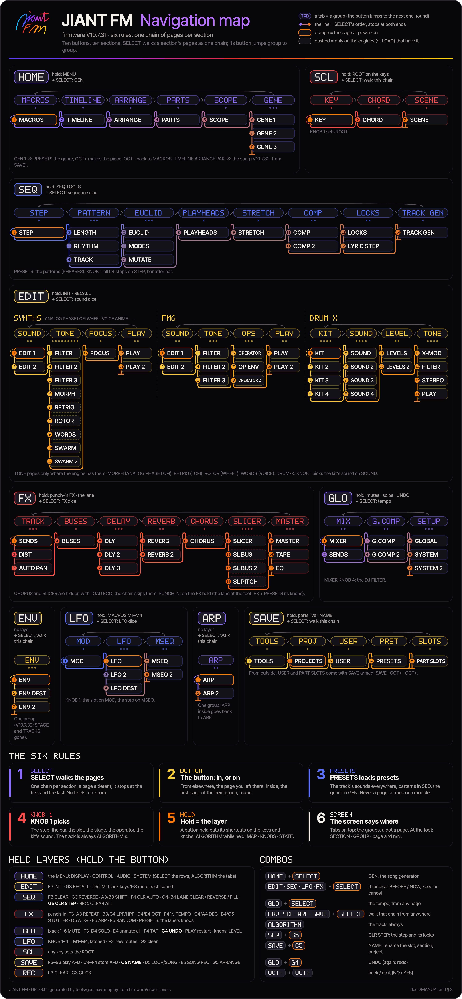

# JIANT FM — User Manual

**JIANT FM V10.7.29 for the M-VAVE FM-1**

> *Versión en español: [MANUAL.es.md](MANUAL.es.md).*

This manual is for musicians who have just installed JIANT FM and want to know how to play it, build songs with it
and, above all, **save their work without losing anything**. It follows the firmware as it is in that version: every
button, knob and message is named exactly as the device shows it.

If you only read one chapter, read [12. Saving and loading](#12-saving-and-loading). Coming from V10.6c (the last
public version) or earlier: [What's new in this version](#whats-new-in-this-version).

## Contents

- [What's new in this version](#whats-new-in-this-version)
0. [Quick start](#0-quick-start)
1. [The panel](#1-the-panel)
2. [The screen](#2-the-screen)
3. [Pages and layers](#3-pages-and-layers)
4. [Engines](#4-engines)
5. [DRUM-X](#5-drum-x)
6. [The sequencer](#6-the-sequencer)
7. [ARRANGE: songs, sections and scenes](#7-arrange-songs-sections-and-scenes)
8. [Dice and UNDO](#8-dice-and-undo)
9. [Effects and master](#9-effects-and-master)
10. [Modulation and macros](#10-modulation-and-macros)
11. [Performance](#11-performance)
12. [Saving and loading](#12-saving-and-loading)
13. [System: TRACKS, LOAD and the MENU](#13-system-tracks-load-and-the-menu)
14. [MIDI and USB](#14-midi-and-usb)
15. [Web tools: emulator, installer, editor, backup](#15-web-tools-emulator-installer-editor-backup)
16. [Troubleshooting and FAQ](#16-troubleshooting-and-faq)

---

## What's new in this version

Everything since V10.6c, the last public version, in one list; each item links to its place in the manual.

**Before you update**
- **6 songs, not 8** (V10.6p). Songs 7 and 8 no longer open: their flash is kept for a drum sample bank. Move them
  into 1–6, or save a complete backup first (the editor's **Save backup**, or the installer's backup); the backup keeps
  all eight, and a restore says which songs stayed only in the file.
- **Very old projects retired** (V10.6s): projects saved by JIANT before 1.0.3 (FUN1 to FUN6) are refused and left
  untouched, and a DIGITAL sound loads as FM6's init. Open them in an earlier version (V10.6c) and save them again there if you still need them.
- **Older projects retired** (after V10.7.13, room for GENE's FORM MY LOOP): projects and backups saved in the
  formats FUN7 to FUNB (Felucca 1.0 / 1.1 and JIANT up to 0.5) are no longer read; at power-on such a project shows
  **OLD PROJECT: NOT READ** and its slot is empty (the flash keeps it until you save over it). The web editor cannot
  convert them: open them in V10.7.13 or earlier and save them again there (that saves today's format). Also gone: the
  old user presets' conversions (SAMPLE PERC, TRIO, LOFI's chips, 0.3 / 0.4 values: such a preset loads as stored, a
  retired engine's playing as ANALOG), a retired engine's track in a project now gets ANALOG's first preset (not its
  nearest sound), and ADD's own creature (ADD draws the being, as the other engines did before 0.9.6).
- **Newer FM-1 units** (V10.6z): the FM-1s sold from late 2026 (logo on the front) have another flash chip. Older
  JIANT versions ran on them from RAM only (no saving, no GENE, no updates from the device); this version saves
  normally. If yours did not keep your songs, update.

**Songs**
- SAVE opens on the song: **TIMELINE**, **PARTS** and **CLIPS** (V10.6o, V10.6s), then ARRANGE; PART SLOTS (the parts stored) and PROJECTS are the PROJECT group (codex/coherence). See
  [TIMELINE, PARTS and CLIPS](#timeline-parts-and-clips-save--song).
- **A song keeps the sounds you change while it plays** (V10.6z8); EDIT > **RECALL** brings a track's section sound back.
- **Saving a song** is on SAVE > PROJECT > **PROJECTS**: KNOB 1 picks the project (it is not opened), SAVE names it, and
  the NAME screen's KNOB 3 chooses the whole SONG or the LOOP alone (the SAVE SONG AS page is gone).

**Drums and the generator**
- **DRUM-X**: a quality pass (V10.6q), a classic CMOS cowbell, the **EXTENDED** key map by default with real fills
  and every sound chromatic (V10.6r), ACOUST gone (V10.6o), the punchy kicks and bright hats back (V10.6z9). See
  [The keys in V10.6r: EXTENDED](#the-keys-extended-v106r).
- **GENE** (HOME's generator, GEN until V10.6m) plays the owner's curated genres, CUMBIA, EBM, BAILE FUNK, PHONK, HIP
  HOP (trap, drill, pluggnb, boom bap or lofi), JAZZ at every tempo and TECHNO ROCK (rock or synth 80s) among them.
  SCL > SCENE's DRUM role can take a kit generated for the genre (**SCENE DRUM GEN**).
- The **thermal palette** everywhere: every note its own heat, the piano roll coloured by pitch class (V10.6w).
- **Seven palettes, all JIANT's own** (MENU > DISPLAY > COLOR): **JIANT** (as it was, the default), **SELVA** (greens),
  **CONTRAST** (accessible: pure black and white, lighter greys, no panel tint), **BRASA** (warm), **ABISAL** (cold),
  **HUESO** (bone white, one orange accent) and **NEON** (magenta and cyan). The thermal ramp (beings, notes, bars) is
  in all seven; the knobs' cards take the palette's own four colours (JIANT: each value's heat, as before). They replace GREY, GREEN, AMBER, ICE, VIOLET, ROSE, PAPER, HI-CON, NIGHT and MONO; a
  palette saved before lands on the nearest one (GREY, MONO, NIGHT → HUESO; GREEN → SELVA; AMBER, ROSE → BRASA; ICE →
  ABISAL; VIOLET → JIANT; PAPER, HI-CON → CONTRAST).
- **Two skins**: MENU > DISPLAY > SKIN is **AIR** or **COLORS**. BOTTOM and HUD are gone (a saved one loads as COLORS).
- **No STYLE row**: the filled look (FLAT) is the one style; LINE is gone (a saved LINE loads as FLAT) and the menu has
  a row less.
- **Bigger small letters**: names, tabs, the header's words, the breadcrumb and the panels' captions have 9 px capitals
  (were 7 px pixel letters). SEQ's and FX's eight tabs show five at a time; the menu lists eight rows at a time; a few
  readouts that repeated a card are gone (SCL's QUANT and ALL TR at the wheel's right, the numbers inside BEING's rings).
- **Bigger values**: a card's number is set in 14 px figures (was 11) where it fits with its unit, and rolls as before;
  names and words keep the 11 px face. The header's middle says the engine and the sound without "T1 ·" (the track's
  number is in its box); FX's "FX · T1" line and EDIT's page and sound names inside the panel are gone (the header and
  the breadcrumb say them).
- **MENU > LARGE** on SEQ's, SAVE's and FX's pages: the tall cards HOME and EDIT have (the piano roll, the drum grid
  and the lists keep their panel, with the normal cards).

**Sequencer**
- Step component **RAMP** replaces JUMP (V10.6v): a step's parameter lock glides there over 1–32 steps or 1–16 bars.
- **REC keeps the feel** (V10.6z4): note lengths, legato as SLIDE, the velocity as played. **GATE 100 %** for new tracks.

**Playing**
- **Key velocity and aftertouch** (V10.6z7, after Charles Vestal's *Velo*): F3..C5 sensed, each key calibrated as you
  play; MENU > CONTROL > **VELOCITY**, **VEL MIN**, **AFTERTOUCH**, **VEL LEARN**. See
  [Key velocity and aftertouch](#key-velocity-and-aftertouch-v106z7).
- **Expression keys** (V10.6z4): a note held + OCT− a vibrato, + OCT+ a bend (MENU > AUDIO > **OCT BEND**).
- **SWARM** (EXT's Bluetooth instrument): a melody from how near you are, FAR / NEAR morph, the scale walk and
  **CHAOS** (in SELF's knob place). See [EXT › SWARM](#ext--swarm-a-melody-from-how-near-you-are-v106z6).
- FAR / NEAR calibration now takes the median of 2.5 s (**HOLD STILL**) (V10.6z8).
- **VOICE** no longer clips on open vowels; WORDS has **CONS**, the consonants' length (V10.6y).

**Connections**
- **NRPN** for every automatable parameter, knob moves sent as NRPN with MIDI OUT ALL (V10.6z3): [docs/NRPN.md](NRPN.md).
- The editor protocol is a versioned contract (1.2): [web/EDITOR_PROTOCOL.md](../web/EDITOR_PROTOCOL.md).
- The second core starts only on the stock power settings (after a SAFE START: one core) (V10.6z2).

---

## 0. Quick start

### Install

1. Open the **web installer** in Chrome or Edge on a computer, or Chrome on Android with a USB OTG cable (iPhone and
   iPad have no Web MIDI): <https://juanjiant-bit.github.io/JIANT/webapp/installer/>
2. Connect the FM-1 **directly** with a USB data cable.
3. **Coming from another custom firmware (Felucca, Skiff, baudgirl or any other)?** Return to official first, with
   the installer's **Return to official** button (it also saves that firmware's backup). Writing JIANT straight over
   another custom firmware has left an FM-1 unable to start.
4. Press **Install**. It first checks the FM-1's firmware and writes only over **official V16**, **official V15** or
   JIANT (anything else: it sends you to Return to official first). Don't unplug the cable while it writes.

**Return to official** takes M-VAVE's own `FM-1.fwsc` of **V16** (718,196 bytes, what M-VAVE offers now) or **V15**
(699,956 bytes), unzipped from M-VAVE's download page and checked byte for byte. It saves a complete JIANT backup
first; to come back, press Install and restore the backup with the editor.

JIANT has no user samples: if you come from Felucca, its user samples (USR1–3) are lost on install. Keep your WAV
files.

### Your first sound (1 minute)

1. Power on. The signature draws itself, then you land on **HOME**: six creatures, one per track. (V10.6e) The tracks
   start as a band in tune: **T1 DRUM-X** (ACOUSTIC), **T2 ANALOG** (PLUCK), **T3 PHASE** (INIT SAW), **T4 FM6**
   (FM BASS), **T5 VOICE** (CHANT) and **T6 ANIMAL** (WHISTLE), each its preset's sound, dry.
2. Turn **ALGORITHM** to pick a track (T1–T6). With the default **TRACKS 4** it stops at T4: T5 and T6 appear only with TRACKS 6 (see
   [13](#13-system-tracks-load-and-the-menu)).
3. Turn **PRESETS** to browse sounds. Play the keys.
4. Turn **KNOB 1–4**: on EDIT 1 and EDIT 2 they are the track's engine. (V10.7.24) On HOME they are the macros **M1–M4** (HOME › MACROS)
   and, one page on (**SELECT**), **FILTER · SPACE · DRIVE · DUCK** on the whole mix (HOME › SCOPE).
5. Don't like it? Hold **EDIT** and turn **SELECT**: the sound is rolled into a new variation and you hear it at once.
   **OCT+ OK** keeps it, **OCT− CANCEL** brings the sound back.

### Your first song (5 minutes)

1. Hold **HOME** and turn **SELECT** (or on HOME tap **HOME** twice: MACROS → SCOPE → **GEN**). The **GENERATOR** opens on
   **EXPLORE** (no genre, every rule broken): press **OCT+** as it is, or pick RANDOM or one of the genres with KNOB 1
   or PRESETS first. A whole song idea appears: engines, sounds, parts, scale, tempo and effects. Press **PLAY**.
2. Not your thing? Press **OCT+** again: a new seed, a new piece. Too busy? Turn **SELECT** one detent right for GEN 2 and lower
   **DRUMS** or **ARP**, then OCT+: the same piece with that changed. **OCT−** goes back to MACROS. To go back to what was there before: hold **GLO** and press **G4** (UNDO).
3. Like it? **Stop** (PLAY), then press **SAVE** (it opens TIMELINE, the song) and turn **SELECT** three detents right
   (past ARRANGE, PARTS and CLIPS): **PART SLOTS**, the project's four parts. Turn **KNOB 4** to the right so its card says **OCT+**, then press
   **OCT+**. Type a name with the keys (or keep the one offered) and press **OCT+** again. The screen says **SAVED**.
4. Make a variation (change some steps, mute a track) and save it into part **B**: on PART SLOTS turn **KNOB 1** to
   **B**, then KNOB 4 and OCT+ as before.
5. Turn **SELECT** two detents right (past PROJECTS): **ARRANGE** (the song's rows). Press **OCT+** to add a row, set its section with
   **KNOB 2** and its length with **KNOB 3** (bars). Add a row for A, one for B. Press **PLAY**: the song plays the
   rows in order.

That's the whole loop: **make music → save it into a section → chain sections in ARRANGE**.

---

## 1. The panel

The names below are the ones the firmware uses (the HARDWARE CALIBRATION screen asks for them by these names).

### Encoders and knobs

| Control | What it does |
| --- | --- |
| **SELECT** (encoder) | Alone (0.9.2): **walks the section's pages**, one page a detent, as one chain, stopping at its first and last page (no levels, no zoom; see [How navigation works](#how-navigation-works-six-rules-092)). In the MENU: its rows, all four tabs in one chain. With a button held: **HOME** + SELECT **GEN**, **EDIT / SEQ / LFO / FX** + SELECT that part's **dice**, **GLO** + SELECT the **tempo**, **ENV / SCL / ARP / SAVE** + SELECT walk that section's chain from wherever you are. |
| **ALGORITHM** (encoder) | Selects the track from any page: T1–T6 (T1–T4 with TRACKS 4). The track is always ALGORITHM's (0.9.2: PRESETS no longer picks it on ENV, LFO, CHORD, ARP). In the MENU: the next / previous tab. With a layer held: its view, MAP ↔ KNOBS ↔ STATE. |
| **PRESETS** (encoder) | **Always presets** (0.9.2): the selected track's sounds (every engine's factory presets, then your user presets) on every page; on the **SEQ** pages the **patterns** (it opens the PHRASES loader with the next pattern picked: OCT+ loads it, OCT− back to the SEQ page); on **GEN** the sounds too (V10.7.22; its GENRE is GEN 1's KNOB 1). In the MENU and with a button held it does nothing, except **EDIT held** (V10.7): it jumps to the first sound of the next / previous engine, the engine's name on screen. It never changes page, track, module or row. |
| **KNOB 1–4** | The four cards (columns) on screen. A page that picks something picks it with **KNOB 1** (the step, the bar, the slot, the stage, the operator, the kit's sound, the row). With a layer held, the layer's own knobs. Turning fast sweeps the whole range, slowly fine-tunes (MENU › CONTROL › KNOB ACCEL turns this off). In the MENU: KNOB n the setting on card n. |
| **MASTER** | The output volume. |

### Buttons

| Button | Tap | Hold |
| --- | --- | --- |
| **HOME** | HOME (0.9.2, as every section's button): from another section the HOME page last shown; on HOME the first page of the next group, round: **MACROS → SCOPE → GENE → MACROS** (V10.7.24; GENE: the generator, GEN until V10.6m). | About 0.7 s: opens the **MENU**. |
| **ENV** | The ENV section: from elsewhere the page last shown (at power-on ENV); inside, the next group: **TRACKS → ENV → STAGE**, round. | (no layer) |
| **LFO** | The LFO section: from elsewhere the page last shown (at power-on LFO); inside **MOD → LFO → MSEQ**, round. | **MACRO** layer: KNOB 1–4 are M1–M4. |
| **FX** | The FX section: from elsewhere the page last shown; inside, the next module: **TRACK → BUSES → DELAY → REVERB → CHORUS → SLICER → PUNCH IN → MASTER** (MASTER · TAPE · EQ · BALANCE), round. | **Punch-in FX** layer. |
| **SCL** | The SCL section (0.9.2: its own, ARP apart): **KEY → CHORD → SCENE** (V10.24). | **SCL** layer: keys set the root. |
| **EDIT** | The EDIT section: from elsewhere the page last shown (one memory for the synths, one each for FM6 and DRUM); inside the next group: **SOUND → TONE → FOCUS** (FM6: SOUND → TONE → OPERATOR; DRUM: KIT → SOUND → LEVELS → TONE). Always EDIT (0.9.2: clearing a step is SEQ + G5, renaming SAVE + C5). A step held + EDIT still clears that step's locks. | **EDIT** layer: INIT, RECALL, DRUM-X sound mutes, SELECT the sound dice. Held + KNOB 1–4: **MOMENTARY** (the page under, put back when let go). |
| **GLO** | The GLO section: from elsewhere the page last shown; inside **LIVE → MIX → G.COMP → SETUP**, round (at power-on MIXER; LIVE, the live sequences, first; V10.37 G.COMP after MIX; codex/coherence: SETUP holds GLOBAL, SYSTEM, SYSTEM 2 and KEY SPLIT). | **GLO** layer: mutes, solos, levels, tap tempo, UNDO. |
| **SAVE** | The SAVE section: from elsewhere the page last shown, and USER or PART SLOTS come with their **SAVE already picked** (SAVE, OCT+, OCT+ as before); inside **TOOLS → SONG → PROJECT → SOUND**, round (V10.2: the song first; at power-on TIMELINE; V10.7.22: TOOLS, with CLEAR PROJECT, the first page, one SELECT left of TIMELINE). | **SAVE** layer: play/store parts live; C5 NAME. |
| **ARP** | The ARP section (ARP · ARP 2, one group): from elsewhere the page last shown; inside, back to ARP. A chord held + ARP during step recording still arpeggiates it. | (no layer) |
| **SEQ** | The SEQ section: from elsewhere the page last shown (at power-on STEP, the piano roll); inside the next group (V10.6): **STEP → PATTERN → EUCLID → PLAYHEADS → STRETCH → COMP → AUTO → TRACK GEN**, round. | **SEQ TOOLS** layer (on every SEQ page); G5 CLR STEP. |
| **PLAY** | Start / stop. Held (~0.7 s): **PANIC**. | — |
| **REC** | Arms / disarms recording on the selected track. | **REC** layer: CLEAR, CLICK. (V10.7) Held past HOLD and let go with nothing else touched: **UNDO** (again: redo). |
| **OCT− / OCT+** | Keyboard octave (−3 to +3; both together: back to 0; on a DRUM track the kit stays on its keys: ratchets above, SHORT / GHOST / FLAM below, see [5](#5-drum-x)). On action pages and in dialogs: **OCT−** = back / NO, **OCT+** = do it / YES. | — |

### The keys

27 keys from **F3 to G5** (16 white, 11 black). They play the selected track. With a layer held they become that
layer's shortcuts; on the DRUM grid they are steps and lanes; on the NAME screen they type.

### Useful combinations

| Combination | Result |
| --- | --- |
| **GLO** held + **PLAY** | Restart from the top without stopping (internal clock). |
| **PLAY** held (~0.7 s) | **PANIC: ALL NOTES OFF**. The transport stops and every sound ends at once: every track's voices, latched chords, arpeggios, punch-in repeats and the notes MIDI IN holds (a key or MIDI note let go afterwards does nothing; the next one plays as usual). MIDI OUT sends the note-off of every note it sent and All Notes Off (CC123) on the tracks' channels 1–6 (not with MIDI OUT OFF). For a note left hanging by a controller that lost its note-off; MIDI IN's CC120 / CC123 still do the same for their channel. |
| **GLO** held + **SELECT** | Tempo, from any page. |
| **GLO** held + **G4** | **UNDO** the last big change (again: redo). |
| **REC** held alone, let go | (V10.7) **UNDO** too: held past HOLD (~0.5 s) with no key, knob, button or OCT touched; again: redo. Anything used while held keeps it the REC layer; a tap still arms recording. |
| **SEQ** held + **REC** | **CLEAR ALL SEQUENCES?** — all six tracks' steps and automation, and the punch-in lane. |
| **REC** held + **FX / EDIT / ENV / LFO / SCL / ARP / GLO** | Clears that part's automation on the selected track (GLO: the level and pan automation of all tracks; FX: also the punch-in lane). No dialog. |
| **SAVE** held + **OCT+** / **OCT−** | Store the music into the section playing / recall that section as stored. |
| **HOME** held + **SELECT** | **GEN**, the song generator (HOME's last pages; see [8](#8-dice-and-undo)). |
| **EDIT / SEQ / LFO / FX** held + **SELECT** | The dice: the sound / the sequence / the LFO / the effects (see [8](#8-dice-and-undo)). |
| **ENV / SCL / ARP / SAVE** held + **SELECT** | Into that section and along its chain, as SELECT inside it. (0.9.2: a button held + **PRESETS** no longer walks pages.) |
| **EDIT** held + **PRESETS** | (V10.7) The first sound of the next / previous **engine** (its name on screen), instead of every preset one by one. Not while a momentary tweak (EDIT held + a knob turned) is in progress. |
| **SEQ** held + **G5** | **CLR STEP**: clears the cursor step and its locks (NOTE with a note in focus: that note; AUTO LIST: deletes the record). |
| **SAVE** held + **C5** | **NAME**: renames the slot on SAVE > USER, the part or project on PART SLOTS / PROJECTS. |
| A step held (SEQ > STEP) + **KNOB 1–4** | A parameter lock on that step. |
| Step keys held (SEQ, the roll / grid) + **SELECT** / a step key + **REC** | **COPY** those steps / **PASTE** them from that step (see Copy and paste). |
| **OCT− + OCT+** held at power-on | HARDWARE CALIBRATION. |
| **OCT− + OCT+** held 5 s while running | Update mode (UBOOT), with a countdown from 2 s; let go to cancel. |
| A note held + **OCT−** / **OCT+** (V10.6z4) | **Expression keys**: OCT− held fades in a vibrato like raising a mod wheel (~200 ms), OCT+ held bends the note up along a fixed smooth curve (~300 ms) to MENU > AUDIO > **OCT BEND**'s range (default 2 semitones); both ease back when let go. With no note held, OCT− / OCT+ change the octave as ever (OCT BEND OFF: always). Recorded as automation while recording (REC + EDIT clears it); with MIDI OUT ALL sent as CC1 and pitch bend (set the receiver's bend range to OCT BEND's). Both held on a note never starts UBOOT. (V10.7.22) They are also the MOD matrix's sources **OCT+** and **OCT-**: a track whose MOD slot routes OCT+ (SRC, DEST and AMT set) sweeps that DEST along the same curve instead of bending (no pitch bend sent out either); one routing OCT- gets the same 5.5 Hz vibrato, faded in, on that DEST instead of on the pitch (CC1 still sent). |

### Key velocity and aftertouch (V10.6z7)

The FM-1's keys F3..C5 sit over a carbon pill whose resistance falls as you press harder (the method is Charles
Vestal's, *Velo*, github.com/charlesvestal/fm1-velocity, GPL-3.0). JIANT reads it on every strike:

- **Velocity**: how hard the key lands, in the first milliseconds after it touches. It is continuous (1..127: every
  strike between soft and hard gives a value between), then MENU > CONTROL > **VELOCITY**'s curve and **VEL MIN**'s
  floor. On a synth track a note waits for its strike at most 2.2 ms (V10.7.10: a hard limit, even when a reading of
  the key is lost), under what you can feel; on a **DRUM** track (the selected one, or KEY SPLIT's half that goes to
  one) it never waits: it plays at once with the strike as read so far, or the key's recent average. It reaches
  everything a key plays: the sound (the engines and the matrix's VEL), chords and strums, the arpeggiator, recording
  (only 127 records as an accent) and MIDI OUT. VELOCITY **OFF**: every key 100, as before.
- **The top row (C#5..G5)** has no sensor (the FM-1 cannot read those seven keys' pressure), so it plays the **average of
  your recent strikes** (100 until you play the others). It has no aftertouch (a chord with sensed keys keeps theirs).
- **Calibration**: every key is different, and each learns your own soft, normal and hard strikes as you play (VEL
  LEARN ON, the default: it moves slowly, a stray strike does not throw it). It starts from the factory calibration
  (measured on the owner's FM-1) and is kept in the settings, written half a minute after you stop playing. **VEL
  LEARN RESET** puts the factory calibration back. To see it at work: the page <https://juanjiant-bit.github.io/JIANT/webapp/vel/> (*En vivo*, Chrome, over the editor's USB link) shows each
  note's velocity and each key's calibration.
- **Aftertouch**: with a key held, press it further down: its pressure (0..127) is the matrix's **AT** source (EDIT >
  MOD: any destination: filter, vibrato depth, level ...). New sounds (INIT SOUND, a new project) route it to the
  filter (slot 4, AT -> CUT +20) when that slot is free; saved projects and presets keep their own matrix. A resting
  finger does nothing (a dead zone), the value glides (no zipper), and lifting the key ends it. MENU > CONTROL >
  **AFTERTOUCH** sets how sensitive it is (1 … 10, V10.7.23) or turns it OFF. It works with OCT− / OCT+ held too; it
  is recorded as automation with the expression keys and sent as channel aftertouch with MIDI OUT ALL.
- **A sound's VEL** (EDIT > PLAY 2, KNOB 3; 0..100 %, every engine but DRUM): how much velocity reaches *this* sound.
  **100 %** (every project, preset and song made before it) plays each note as hard as it was played; less brings every
  note's velocity toward 100 (50 %: a strike of 60 plays 80, one of 120 plays 110); **0 %** plays every note at 100,
  as VELOCITY OFF does, but for this track only. It applies to every source: the keys, the sequencer's steps, the arp,
  the punch-in repeats and MIDI in. (V10.7.22) It is only how much velocity reaches the *sound* (its level and the engine's own response): the matrix's **VEL** source always follows the velocity as played (the keys, a step's own, the arp, MIDI in, an external keyboard), whatever VEL is, 0 % included — VEL 0 % with VEL → CUT: every note as loud, the filter still following how hard you play. A step's **ACCENT** still plays 127, and HUMAN and a RATCHET's DECAY
  still vary the notes.
  Recording keeps the velocity you played, so turning VEL up later brings the dynamics back. The factory **bass**
  presets load at **0 %** (a bass is better even), GENE's bass at **75 %** (its composed ghost notes still softer); every other
  preset at 100 %. Kept with the sound (projects, user presets, songs); NRPN 80, and the web editor's PLAY group.

---

## 2. The screen

### The look: COLORS

The lenses wear one skin, **COLORS** (MENU > DISPLAY > SKIN and AIR, its other choice, are gone since V10.7.23: settings
saved with AIR, or with the older BOTTOM and HUD, load as COLORS): the LENTE layout in the **0.6 colours**. The **knobs'
cards have no box**: each sits on the background, its shape a **thin line in its value's colour**, so the line changes
with the value (and the palette); the knob you turn gets a 2 px line. The card's name is grey (MID), the value and its
bar in **each knob's colour** (JIANT: each parameter's colour **moves with its amount** as heat, violet when low to
yellow and cream when high, a centred one such as PAN or DETUNE cold in the middle and hot at either end; the other six
palettes: four colours of their own, one a knob); the group's tab filled violet; the selected track's number in an
orange box, a violet ▶ and a big violet BPM in the header; the beings in the 0.6 heat (violet spikes, red and orange
rings, cream nuclei). The picture under the cards sits on the background (no panel box). NOTICE's and NAME's cards are
outlined the same way.

Values (cards, the header's BPM) are set in a rounded sans again (Inter Tight SemiBold), as in 0.6; names, tabs and the
breadcrumb are in Chakra Petch, capitals 9 px (the 5 x 7 pixel letters, 7 px, until V10.7.18). **MENU > LARGE** keeps its big cards on top,
outlined as the small ones (the line in the value's colour).

Since 0.8.5 every page wears the skin of the design the owner approved (the HTML mock-up "LENTE"):

- **Header (top)**: one quiet line over a thin rule. At the left the play state (a grey square stopped, an orange
  triangle playing, violet while counting in) and the **BPM** (violet; orange while it changes), then BPM LOCK's lock
  and the REC dot (filled: the selected track armed; a ring: another track). In the middle what the page is of:
  **ANALOG ACID** (the track's engine and its sound; its number is in the orange box at the left); on the song's pages (SAVE, ARRANGE, TOOLS, GLOBAL)
  **P1 NAME** (the project); on FX **T1** in orange. At the right the octave (**OCT +2**, or the song row while a song
  plays), the **load meter** (five small bars, violet as the sound takes more of the audio time) and the battery
  (violet when USB powers it). Messages appear in the middle ("SAVED", "T1 CLEARED"...), sometimes with a second line.
- **Cards**: the four boxes under the header are KNOB 1–4: the name small and grey on top, the value under it in white,
  and a thin violet bar under the value. The one you are turning lights orange, so it is the only colour on the cards.
  A value that is automated or locked has its name in violet; a dim card means "nothing here now". An action armed
  (SAVE, LOAD, ERASE, CLEAR...) is a violet-tinted card with its name violet and **OCT+** as its value. The cards have
  no icons since 0.8.5, and nothing else does (MENU > LARGE's cards: a violet dot for a value that moves on its own;
  the header: "!" before a NO FILE message, a drawn lock and song disc).
- **Page name**: changing page (or track) by hand shows the page's name over the footer for a moment, with the track and
  its engine at the right; on HOME the track's engine, "T1 HOME" small (on a lens page its breadcrumb lights up instead).
  The header, the cards and the graph stay in sight.
- **Granules**: a few dots drift behind the panel's graph, as on HOME (LOAD FULL with ANIM ON). They move only when the panel redraws anyway
  (a knob, the LFO, the envelope), so they cost no CPU.
- **Panel (middle)**: the page's graph — the engine's creature, an envelope, the LFO running, the step grid, a list...
- **Footer**: the step bars of the bar you edit (four under each card) or key hints, and under them a small grey
  **breadcrumb**: **SECTION · GROUP · page** and the page's place in the section's chain at the right (0.9.2; e.g.
  **FX · DELAY · DLY 2  6/16**, **ENV · STAGE · STAGE  4/5**).
- **The tabs** (0.9.2): under the header, the section's **groups** (FX: TRK · BUS · DLY · REV · CHO · SLC · PCH · MST;
  SEQ: PATT · TRACK · BAR · STEP · AUTO), the one you are on lit (COLORS: filled violet; AIR:
  a dash), and **a dot a page** under each, the page shown lit. The cards under them, a taller panel, and the footer is
  the breadcrumb alone.

- **The small letters** (since 0.8.5): the cards' names, the tabs, the breadcrumb, the header's middle words and
  the panels' small captions and chips were set in a 5 x 7 pixel face; they are now Chakra Petch with 9 px capitals,
  easier to read; values stay in the larger rounded face. With more than five groups (SEQ, FX) the tabs show the five
  round the one you are on, a small mark at the side where more lie.

**Colours** work like a thermal camera: cold (indigo, violet) is little, hot (red, orange, cream, white) is a lot (0.8.9: the 0.6 ramp). Violet is
what's selected, orange what's active.

**HOME** (V10.7.24: its first page, **MACROS**) is the ecosystem: one creature per track, its species from its engine, its shape from its four main knobs, swelling
and heating up with its own audio (0.8.8: swimming free over the whole screen by themselves, as before 0.8.5; see
[the sections](#the-sections-and-their-chains)). (0.9.7) Each being wears a small **face**: its eyes shut on a hit, its
mouth opens with its level. The selected track is drawn bigger, its number in violet, a muted one falls **asleep** (a dim
outline, its eyes shut), a track asleep (TRACKS 4) is drawn as muted. On the **MIXER**, asleep tracks are greyed and say OFF.

**Dialogs** ask before anything destructive: **OCT− NO**, **OCT+ YES**. (0.8.5, as the mock-up) They carry the
tabs **NOTICE · DICE · NAME**: a question is a card under a violet rule with its two buttons (YES in the accent); a
part's dice (EDIT, SEQ, LFO, FX + SELECT) shows **BEFORE** and **NOW** side by side (the sound's being then and now,
the steps, the LFO's or the effects' values) over a strip **KEEP DICED …? · SELECT: DICE AGAIN · OCT− CANCEL ·
OCT+ OK**; NAME has its cards CURSOR, CHAR, LEN and OCT+ SAVE / WRITE over the name, the keys' letters and the black
keys' functions. (0.9.5) A question's card covers only itself, its tabs and its breadcrumb: the page stays in sight
around it, still moving.

**Messages** (0.9.5): a message on a lens page shows as a small pill near the foot of the panel, over the page, which
keeps drawing and moving behind it (the header says it as well; not over HOME's beings or a layer's map); nothing goes
dark. The pill keeps clear of the page's own words: where the foot is written (AUTO LIST's rows, MUTATE's lines) it
sits in the nearest free rows, and on a page with no free rows it is left out and the header alone says it. A page's
**hint** (V10.6: EUCLID's "TURN A KNOB: A PATTERN", MOTION's and PUNCH IN's "REC + PLAY ...") comes only once you stay on the
page for about 0.8 s, never while SELECT walks past it, and each one at most twice in all (counted with the settings,
so not again after a reboot). SAVE › TOOLS › CLEAR PROJECT starts them over. Tapping a layer button says nothing (the
"HOLD [X] QUICK" hints are gone): hold it and its layer shows itself.

---

## 3. Pages and layers

*The whole synth on one page: each section's button, its groups (the tabs on the screen) and its pages in the order
SELECT walks them (the number in each dot is the page's n of the footer's n/N; orange, the page at power-on; dashed,
a page only some engines or LOADs have), with the six rules, the held layers and the combos. Click it for the zoomable
SVG ([en español](navigation-map.es.svg)). It is generated from the firmware's chain tables (`tools/gen_nav_map.py`).*

### How navigation works: six rules (0.9.2)

Since 0.9.2 every section is driven the same way (the design the owner approved, the mock-up "navegación"): learn it
once and every section is known. Until 0.9.1 each part was a lens of three levels with sets of knobs; the pages, their
knobs, their pictures and every function are the same, only the way between them changed.

1. **SELECT walks the pages.** Turning SELECT goes through all the pages of the section, in one chain, a page a
   detent, and stops at the first and the last. No levels, no zoom. FX: SENDS → DIST → AUTO PAN → BUSES → DLY →
   DLY 2 → DLY 3 → REVERB → … → PUNCH IN.
2. **The section's button: in, or on.** From another section it brings you back to the page you were last on there.
   Already inside, it jumps to the **first page of the next group** (and goes round). On FX › DLY 2, FX goes to
   REVERB; on EDIT › FILTER, EDIT goes to FOCUS.
3. **PRESETS loads presets.** Always: the track's sounds in every section, the **patterns** in SEQ (the PHRASES
   loader), the **genre** in GEN. It never changes page, track or module (in the MENU it does nothing).
4. **KNOB 1 picks.** When a page picks something (a step, a bar, a slot, a stage, an operator, the kit's sound, a
   row) KNOB 1 is the one that picks it. The track is always **ALGORITHM**'s. SEQ › STEP: KNOB 1 walks all 64 steps,
   bar after bar; the new **SEQ › BAR** page: KNOB 1 the bar.
5. **Hold = the layer.** Holding a button opens its layer of shortcuts, as before (past the HOLD time, MENU > HOLD,
   0.4 s by default: the keys and knobs change function while you hold it, a map shows what each key does; a key or a
   knob opens it at once; let go and you are back). Held + SELECT: **HOME** GEN, **EDIT / SEQ / LFO / FX** their dice,
   **GLO** the tempo, **ENV / SCL / ARP / SAVE** walk their chain. (Held + PRESETS no longer walks pages: rule 3; V10.7:
   EDIT held + PRESETS jumps engine to engine.)
6. **The screen says where you are.** On top, the tabs are the section's **groups**, the one you are on lit and a dot
   for each of its pages. At the foot: **SECTION · GROUP · page** and **n/N**, the page's place in the chain:
   **FX · DELAY · DLY 2  6/16**. The same in every palette.

- Each section remembers the page it was left on (EDIT one for the synths and one each for FM6 and DRUM); at power-on
  SEQ opens on STEP, ENV on ENV, LFO on LFO, the others on their first page.
- **SCL and ARP are two sections** (until 0.9.1 one lens): SCL is KEY · CHORD, ARP is ARP · ARP 2 (one group: an ARP
  tap inside goes back to ARP).
- **GEN is three HOME pages** (GEN 1–3, HOME's last group), no longer a screen of its own: the section buttons work
  there, OCT+ makes the piece, OCT− goes back to MACROS. HOME + SELECT still opens it from anywhere.
- **SAVE from outside** comes back to the SAVE page you left; **USER** and **PART SLOTS** come with their SAVE already
  picked, so SAVE, OCT+, OCT+ still stores the sound (or the part).
- **EDIT is always EDIT**: clearing a step went to the SEQ layer (**SEQ + G5**, CLR STEP; on AUTO LIST it deletes the
  record; TIME turned to REST clears a note too) and renaming to the SAVE layer (**SAVE + C5**, NAME).
- **The MENU** (hold HOME): SELECT walks every row (DISPLAY → CONTROL → AUDIO → SYSTEM), ALGORITHM jumps tabs, a knob
  changes the value, HOME closes it.
- Some pages only appear when they apply: FM6's operator pages on an FM6 track, DRUM-X's pages on a DRUM track,
  RETRIG on MATH, SWARM's pages on an EXT track playing SWARM, and with **LOAD ECO** the SLICER and CHORUS pages are hidden; the chain skips them.

### The sections and their chains

SELECT goes down each row from left to right; the button jumps to the next group's first page. Every page is the one
it was in 0.9.1, with its knobs and its picture (the ones 0.8.5's lenses drew).

| Section | Groups (the button) · pages (SELECT) | Pages |
| --- | --- | --- |
| **HOME** | (V10.7.24) **MACROS**: MACROS — **SCOPE**: SCOPE — **GENE**: GENE 1 · GENE 2 · GENE 3 | 5 |
| **EDIT** (a synth) | **SOUND**: EDIT 1 · EDIT 2 — **TONE**: FILTER · MORPH · RETRIG · ROTOR · WORDS · SWARM · SWARM 2 (those the engine and the track have) — **FOCUS**: FOCUS — **PLAY**: PLAY · PLAY 2 (codex/coherence: was VOICE; STEREO's IMAGE on PLAY 2) | up to 11 |
| **EDIT** (FM6) | **SOUND**: EDIT 1 (ALGO) · EDIT 2 (PATCH) — **TONE**: FILTER — **OPERATOR**: OPERATOR · OP ENV · OPERATOR 2 — **PLAY**: PLAY · PLAY 2 | 8 |
| **EDIT** (DRUM) | **KIT**: KIT · KIT 2 · KIT 3 · KIT 4 — **SOUND**: SOUND · SOUND 2 · SOUND 3 · SOUND 4 — **LEVELS**: LEVELS · LEVELS 2 — **TONE**: X-MOD · FILTER · STEREO · PLAY | 14 |
| **SEQ** | (V10.6) **STEP**: STEP — **PATTERN**: LENGTH · RHYTHM · TRACK — **EUCLID**: EUCLID · MODES · MUTATE — **PLAYHEADS**: PLAYHEADS — **STRETCH**: STRETCH — **COMP**: COMP · COMP 2 — **AUTO**: AUTOMATION · AUTO LIST · LYRIC STEP (VOICE) — **TRACK GEN**: TRACK GEN | 15 |
| **FX** | **TRACK**: SENDS · DIST · AUTO PAN — **BUSES**: BUSES — **DELAY**: DLY · DLY 2 · DLY 3 — **REVERB**: REVERB · REVERB 2 — **CHORUS**: CHORUS — **SLICER**: SLICER · SL BUS · SL BUS 2 · SL PITCH — **PUNCH IN**: PUNCH IN — **MASTER**: MASTER · TAPE · EQ · BALANCE | 19 |
| **GLO** | **MIX**: MIXER · SENDS — **G.COMP**: G.COMP · G.COMP 2 — **SETUP**: GLOBAL · SYSTEM · SYSTEM 2 · KEY SPLIT · KEY SPLIT 2 | 9 |
| **ENV** | **ENV**: ENV · ENV DEST · ENV 2 — **STAGE**: STAGE — **TRACKS**: TRACKS (codex/coherence: last; TRACKS DEST gone, ENV DEST's twin) | 5 |
| **LFO** | **MOD**: MOD — **LFO**: LFO · LFO DEST — **MSEQ**: MSEQ · MSEQ 2 | 5 |
| **SCL** | **KEY**: SCL — **CHORD**: CHORD — **SCENE**: SCENE (V10.24) | 3 |
| **ARP** | **ARP**: ARP · ARP 2 | 2 |
| **SAVE** | **TOOLS**: TOOLS (CLEAR PROJECT first) — **SONG**: TIMELINE · ARRANGE · PARTS · CLIPS — **PROJECT**: PART SLOTS · PROJECTS — **SOUND**: USER · PRESETS | 9 |

Where a page lived in 0.9.1: ENV's six-envelope views (the TRACKS level) are now a page of its own, **TRACKS**
(the chain's last), with ENV's knobs (codex/coherence: TRACKS DEST, ENV DEST's twin, gone); **NOTE** appears once (the BAR group; its big-step picture is
COMP's); FX's **SENDS** is the FX page; SAVE's PROJECT page is **PART SLOTS** (the PROJECT level; was SECTIONS) and **PROJECTS** (the
LIBRARY level); the DRUM kit's EDIT 1 / EDIT 2 are **KIT** / **KIT 2**. The new **BAR** page is PATTERN's picture of
the bars with KNOB 1 the bar and KNOB 2 LEN.

- **MACROS** (V10.7.24: HOME's first page, ECO's picture; ECO, BEING and ROUTES went: the sound's four knobs live on
  EDIT): **KNOB 1–4** are **M1–M4**, the project's macros (as LFO held; kept with the project and the SONG's scenes as
  ever), each card dim while no MOD slot names it. The six tracks' beings swim free over the whole panel by themselves,
  each swelling with its sound (a hit kicks it on), its number under it; the selected one larger, its number violet.
  (0.9.7, "today's being with a face") Each being is its species' spiky outline (the spikes as it sounds) in **three
  isotherms**, coloured by **its own level** like a thermal camera (quiet: cyan and blue; loud: red, orange and
  yellow; the inner lines warmer), and where its nuclei were a **face**: two eyes that **shut on a hit**, a mouth that
  **opens with the level**. A muted track's being sleeps (a dim outline, its eyes shut). The cytoplasm's granules drift
  behind them (drawn by the screen alone: nothing of the sound's time). At the top left the routes counted; **turn a
  macro** and the line says where it goes (**M1 T2 CUT+62 T4 E1-31**, "NO ROUTE" if none: set one on LFO › MOD, SRC
  M1–M4); LATCH at the right.
- **SCOPE** (V10.7.24): the mix's **oscilloscope** over the whole panel (each stroke as hot as it is loud), and four
  **global** modifiers on the whole mix for playing live, kept with the project like every global (MIDI OUT ALL sends
  them as NRPN 1):
  - **KNOB 1 FILTER**: the mix's **DJ FILTER** (the same as GLO › KEYS' KNOB 4): the centre is off, left a low-pass
    closing, right a high-pass opening; it stops at the centre on its way across. While a track records it is recorded
    as the DJ FILTER's automation, as on KEYS.
  - **KNOB 2 SPACE**: how much delay and reverb the whole mix has: one knob moving the delay's return (**FX › DLY's
    MIX**) and the reverb's **SIZE** together, by the same amount (the card shows their mean); the tracks' sends stay as
    they are. Turned up it stops SIZE at 126 (127 is CLOUD's FREEZE: set that on REVERB).
  - **KNOB 3 DRIVE**: the master's **CLIP** (FX › MASTER KNOB 1): the mix driven x1–x4 into the soft clip, its level
    kept.
  - **KNOB 4 DUCK**: how much the mix pumps with the kick (FX › MASTER's **DUCK**; its release is MASTER's REL).
  Hold **EDIT** and turn them: **MOMENTARY**, back where they were when EDIT is let go.
- **ENV** › **TRACKS**: the six tracks' envelopes as tiles (the selected one tinted with its level now a dot), the knobs the selected track's — **ALGORITHM** picks the
  track. **ENV**: the envelope large / ENV DEST's columns, as before. **STAGE**: KNOB 1 picks the stage (ATK DEC
  SUS REL), KNOB 2 sets it, KNOB 3 LOOP; the whole envelope with the stage shaded over the stage's own
  curve, large, and its time.
- **GLO** › **LIVE** (0.9.11): KEYS (was MANO), the keys as a board of live modifiers over the six sequences, and RAILS (was RIELES), the six
  sequences as rails with their playheads and ghosts ([11](#live-sequences-glo--live-0911)).
- **GLO** › **MIX**: the six tracks as strips (MIXER: LEVEL with the meter, PAN, MUTE (codex/coherence; was REV); **SENDS**, new: each track's
  CHORUS, DLY and REV as three bars, the knobs the selected track's). **GLOBAL**: the bar of sixteenths, as before.
  **SYSTEM**: the tracks that play as chips, LOAD's three settings (the one set lit), MIDI's route, the CPU load over the
  last seconds as a line.
- **SCL · ARP** › **KEY**: the twelve notes round a circle (C on top), the scale's lit and joined, ROOT in the accent
  with the scale's name in the middle, QUANT and ALL TR at the right, the scale on a keyboard under it; KNOB 1 sets
  ROOT. **CHORD**: the chord each degree of the key plays now (I–VII, as a key would play it: one note while CHORD is
  OFF or the voice isn't POLY). **ARP** / **ARP 2**: "MODE · RATE · OCT" and the pattern it plays over a triad (GATE
  the cells' length, SWING the off-beats late, PROB some left out); OFF says so.
- **LFO · MOD** › **MOD**: the matrix as a net — the sources down the left (those a slot reads lit), a curve from each
  slot's source to its box **D1–D4** on the right (DEST, AMT as a bar), the slot KNOB 1 picked framed with a pulse
  running along its curve. **LFO**: the wave under "RATE · WAVE" / **LFO DEST**: the LFO small
  on the left, the four amounts as rows lit by what the LFO sends now. **MSEQ** / **MSEQ 2**: the
  sixteen steps under their caption; KNOB 1 the step.
- **EDIT** › **SOUND**: the engine's creature on the left (0.9.4 / 0.9.6: each engine its own, see below; alive with the sound, the page's name over it, the sound's
  under it), the scope in a well and all eight E parameters as chips on the right, the page's four lit. **TONE**:
  **FILTER** draws TYPE's response at CUT with its RES peak (LP, HP, BP, COMB), CUT a line, DRIVE / DIST a row of
  cells; **PLAY** / **PLAY 2** (were VOICE / VOICE 2) the voices one a row as full as they sound, POLY and PRIO (PLAY 2: ALLOC), GLIDE's
  curve; the others keep their pictures. **FOCUS** (new): one E parameter large as a gauge — KNOB 1 picks it (E1–E8),
  KNOB 2 sets it, KNOB 3 the **source** of the MOD slot aimed at it (turned up from OFF a free slot takes it, its DEST
  that parameter; back to OFF frees it), KNOB 4 that slot's **AMT**; E1–E8 as tabs under it.
- **GEN 1–3** are the generator (as HOME held + SELECT, from any page): **SELECT** turns its page (left of GEN 1:
  SCOPE), **KNOB 1** the GENRE (V10.7.22; PRESETS the sound, as everywhere), **OCT+** makes the piece, **OCT−** back to MACROS, a **HOME** tap on to MACROS.

### Every page and its four knobs

"—" means an empty card. An "action" card, picked (turn the knob right), is tinted violet with its name violet and says **OCT+**; press OCT+ to do it.

**ENV** (per track)

| Page | KNOB 1 | KNOB 2 | KNOB 3 | KNOB 4 |
| --- | --- | --- | --- | --- |
| ENV | ATK | DEC | SUS | REL |
| ENV DEST | FILTER | PITCH | SHAPE | LOOP |
| ENV 2 (V10.22) | ATK | DEC | SUS | REL |
| STAGE (0.8.5) | STAGE (ATK DEC SUS REL) | its value | — (LOOP: ENV DEST's) | — |

**LFO** (per track)

| Page | KNOB 1 | KNOB 2 | KNOB 3 | KNOB 4 |
| --- | --- | --- | --- | --- |
| LFO | RATE | WAVE | MODE (TRIG / FREE) | FADE |
| LFO 2 (0.9.18) | PHASE (TRIG's; dimmed in FREE) | — | — | — |
| LFO DEST | PITCH | FILTER | SHAPE | AMP |
| MOD | SLOT (1–4) | SRC | DEST | AMT |
| MSEQ | STEP (1–16) | LEVEL | LEN | SLEW |
| MSEQ 2 | DIV | — | — | — |

LFO **MODE**: **TRIG** restarts the LFO (at PHASE) and its FADE on each fresh phrase; **FREE** runs on across notes
and hits, never restarted (its FADE once, when a project loads or MODE is turned to FREE). Stored as PHASE −1, as
since 0.6.51: every project opens as it was.

**FX** (TRACK pages are per track; the rest are global)

| Page | KNOB 1 | KNOB 2 | KNOB 3 | KNOB 4 |
| --- | --- | --- | --- | --- |
| FX (SENDS) | CHORUS (send) | DLY (send) | REV (send) | — (codex/coherence: the sends only; DIST on DIST) |
| DIST | DIST | TYPE | TONE | — |
| AUTO PAN | DEPTH | RATE | SYNC | WAVE |
| BUSES (0.8.5) | DLY (the delay's MIX) | REV (the reverb's SIZE) | CHO (the chorus' DEPTH) | SLC (the SLICER's DEPTH) |
| SLICER | MODE | PAT | RATE | DEPTH |
| SL BUS | T1 | T2 | T3 | T4 |
| SL BUS 2 | T5 | T6 | FX | — |
| SL PITCH | STEP | PITCH | LEN | QUANT |
| DLY | TIME | FEEDBK | TONE | MIX |
| DLY 2 | WIDE | PITCH | SPRAY | MOD |
| DLY 3 | TYPE (ANALOG / DIGITAL / REVERS, V10.6h) | PING (OFF / ON) | DRIVE | R TIME (V10.49: the right echo's own time) |
| REVERB | TYPE | SIZE | DAMP (RESO: FOLLOW) | PRE (SHIMMER/CLOUD: AIR; RESO: PITCH) |
| REVERB 2 | MOD | RATE | FILT | WIDE |
| CHORUS | RATE | DEPTH | STEREO | — |
| MASTER | CLIP | PUNCH | DUCK | REL |

**SCL**

| Page | KNOB 1 | KNOB 2 | KNOB 3 | KNOB 4 |
| --- | --- | --- | --- | --- |
| SCL | ROOT | SCALE | QUANT | ALL TR (0.7.6; was TRANS, and SCL 2 held ALL TR alone) |
| SCENE (V10.24) | SCENE (OFF / ON) | TRACK (T1–T6) | ROLE (KEEP CHORD ARP BASS LEAD DRUM) | CHORD (that track's chord) |

**EDIT** (per track; which pages appear depends on the engine)

| Page | KNOB 1 | KNOB 2 | KNOB 3 | KNOB 4 | Shown on |
| --- | --- | --- | --- | --- | --- |
| EDIT 1 | E1 | E2 | E3 | E4 | every engine (see [4](#4-engines)) |
| EDIT 2 | E5 | E6 | E7 | E8 | every engine |
| WORDS | LANG | LYRIC | CONS (V10.6y: the consonants' length, 50–400 %; POS on EDIT 1 when LANG is on) | (OCT+ TYPE: the lyric) | VOICE (0.8.5, [words](#voice-words-and-lyrics-085)) |
| RETRIG | RTRG | — | — | — | MATH (BYTE, FLOAT) |
| MORPH | MORPH | — | — | — | ANALOG (SAW..SIN), PHASE |
| OPERATOR | OP | COARSE (the ratio, or the fixed Hz; was RATIO / FIXED) | FINE | OUTPUT (the operator's level; was LEVEL) | FM6 |
| OP ENV | OP | STAGE | RATE | LEVEL | FM6 |
| OPERATOR 2 | OP | MODE | DETUNE | KEY VEL (the operator's velocity; was VEL) | FM6 |
| FILTER | TYPE | CUT | RES | DRIVE (ANALOG) / DIST (others) | every engine |
| KIT 3 | BP | FEEDBK | HANDS | GLUE | DRUM (the whole kit) |
| KIT 4 (V10.6r) | KEY MAP (CLASSIC, EXTENDED, or EXTENDED with one sound chromatic; V10.6o: ACOUST gone; codex/coherence: on KNOB 1) | — | — | — | DRUM (the whole kit) |
| X-MOD | RATE | DEPTH | SHAPE | RAND | DRUM (the whole kit) |
| STEREO | IMAGE | — | — | — | DRUM (the whole kit) |
| SOUND | SOUND | SIDE | PITCH | PMOD | DRUM (one sound) |
| SOUND 2 | SOUND | DECAY | NOISE | COLOR | DRUM (one sound) |
| SOUND 3 | SOUND | MODE | PM.TYPE | DRIVE | DRUM (one sound) |
| SOUND 4 | SOUND | LAYER | FEEDBK | SEND | DRUM (one sound) |
| LEVELS | KICK | SNARE | CLAP | HATCL | DRUM |
| LEVELS 2 | HATOP | TOM | RIM | BELL | DRUM |
| PLAY (was VOICE) | POLY (POLY MONO LEG UNI; was VOICE) | GLIDE | GL MODE (the glide's RATE / TIME; was MODE) | PRIO | every engine |
| PLAY 2 (0.8.5; was VOICE 2) | ALLOC | UNISON (UNI's detune, 0..100 %; was DETUNE) | VEL (the sound's velocity amount, 0..100 %) | IMAGE (the voices across, POLY; was the STEREO page; not on EXT) | every engine but DRUM |
| SWARM, SWARM 2 (V10.6z6) | SIDE (FAR / NEAR) | that side's RATE, MOVE, TONE / NOISE, MOD | | (SWARM 2: NOW, the morph and its source) | EXT with SOURCE SWARM |
| FOCUS (0.8.5) | PARAM (E1–E8) | its value | SRC (the MOD slot on it) | AMT | the synths (not FM6, DRUM) |

**GLO** (KEYS and RAILS act on the tracks picked; MIXER is per track; GLOBAL and SYSTEM are global)

| Page | KNOB 1 | KNOB 2 | KNOB 3 | KNOB 4 |
| --- | --- | --- | --- | --- |
| KEYS (0.9.11; was MANO) | RATE | LOOP | DENS (thinner only) | DJ FILT (the master DJ FILTER; the keys: the live modifiers) |
| RAILS (0.9.11; was RIELES) | TARGET (ALL, T1 … T6, SYN, DRM; was PISTAS) | RATE | LOOP (was CORTE) | DENS |
| MIXER | LEVEL | PAN | MUTE (codex/coherence; was REV, on SENDS beside it) | BPM (V10.37; was the DJ FILTER, now on KEYS' KNOB 4) |
| SENDS (0.8.5) | CHORUS | DLY | REV | — (the selected track's, as FX > SENDS) |
| G.COMP, G.COMP 2 (were COMPS) | the global lane's step components (V10.37: right after MIX) | | | |
| GLOBAL | BPM | SWING | CLOCK | TUNE |
| SYSTEM | TRACKS | LOAD | ROUTE | CPU (%) |

**SAVE**

| Page | KNOB 1 | KNOB 2 | KNOB 3 | KNOB 4 |
| --- | --- | --- | --- | --- |
| PRESETS | No. (the sound; it plays as you pass it) | ENG (the engine) | FAV (mark a favourite) | LIST (ALL / FAV / **USER** (V10.7.22: your own presets alone, a bank of your own without scrolling past the factory ones; kept at power-off) / a sound type: BASS LEAD PAD KEYS PLUCK BELL VOX DRUM FX, 0.9.12; V10.7.19: a sound type goes back to ALL at power-on, FAV and USER are kept) — V10.24: **OCT+** keeps the sound, **OCT−** brings back the one before you browsed |
| USER | SLOT (U01–U32) | LOAD (action) | ERASE (action) | SAVE (action) |
| TIMELINE (V10.6o) | ROW | PART (the row's part A–D; was SECT) | BARS (1–64) | VAR (the ALGORITHM track's variation in the row) |
| PARTS (V10.6o) | PART (A–D) | ROW (the song's rows of that part) | — | LOOP / SONG (what PLAY plays) |
| CLIPS (V10.6s) | TRACK (T1–T6) | PART (A–D) | — | — |
| PROJECTS / PART SLOTS (the PROJECT page) | PROJECT (1–6: picks it, does not open it; on PART SLOTS: PART A–D) | LOAD (action: opens the picked project; PART SLOTS: the part) | ERASE (action) | SAVE (action: then NAME, KNOB 3 SONG / LOOP) |
| ARRANGE | ROW ("2/6") | PART (on END: STOP / x2–x8 / LOOP) | BARS | SCENE |
| TOOLS (V10.24; V10.7.22 SAVE's first page) | TARGET (PROJECT, TRACK, SOUND, SONG, SYSTEM; was SCOPE) | ACTION (CLEAR PROJECT · CLEAR SEQ · INIT SOUND · DELETE ROW, CLEAR SONG · CPU TEST) | — | DO: **OCT+ held a second** (CLEAR PROJECT: OCT+ asks, OCT+ again does it) |

**ARP** (per track)

| Page | KNOB 1 | KNOB 2 | KNOB 3 | KNOB 4 |
| --- | --- | --- | --- | --- |
| ARP | MODE | RATE | OCT | GATE |
| ARP 2 | SWING | PROB | HOLD | ORDER |

**SEQ** (per track)

The SEQ pages are one chain of five groups (0.9.2; see [6](#finding-your-way-the-seq-chain)): **SELECT** walks
them page by page, a **SEQ** tap jumps to the next group.

| Group (SEQ tap) | Page (SELECT) | KNOB 1 | KNOB 2 | KNOB 3 | KNOB 4 |
| --- | --- | --- | --- | --- | --- |
| PATTERN | LENGTH | LEN | DIV | SWING | GATE |
| PATTERN | RHYTHM (codex/coherence: SPAN FIT alone, LEN DIV on LENGTH) | SPAN (1–64: the DIV units LEN steps fill) | FIT (OFF / ON) | — | — |
| PATTERN | STRETCH | STRETCH (/8 … /2, x1, x2 … x8) | REPEAT (OFF, x2 … x8, TO 64) | NUDGE (OCT− the sequence, OCT+ the step's MICRO, OCT+ again the step) | ROTATE (−32 … +32) |
| PATTERN | PLAYHEADS | HEAD | RATE | DIR | INTERVAL |
| TRACK | TRACK | PITCH | CHANCE | HUMAN | REC Q |
| EUCLID | EUCLID (V10.6) | HITS (DRUM-X LANE ALL: DENSITY, V10.7) | STEPS (2–64) | ROTATE | LANE (DRUM-X: ALL, BD … CB) · VARY (melodic) |
| EUCLID | MODES (V10.6) | ACCENT · MOTION | GHOST · HARMONY | RATCHET · OCTAVE | VARY · SLIDE |
| EUCLID | MUTATE (V10.16) | EVERY (OFF, 1–16 bars) | AMOUNT | MODE (ORBIT DRIFT PULSE) | WHAT (GROOVE RHYTHM FEEL ALL) |
| BAR | BAR (0.9.2) | BAR (the bar you edit) | LEN | — | — |
| BAR | STEP (melodic: piano roll) | STEP (all 64, bar after bar) | NOTE | TIME (REST ← TIE ← NOTE → 2 ST … 16 ST: the note's length in steps; REST clears the step) | VEL (V10.8, was FLAG: 1–127, then ACC / SLD / A+S) |
| BAR | STEP (DRUM: grid) | STEP | LANE | HIT | ACC |
| BAR | NOTE | FOCUS | PITCH | MOVE | MICRO (−32/64 … +31/64; 0.9.1) |
| STEP | COMP | ACTION | LENGTH | CONDITION | VALUE (0.9.9-seq2d: C1) |
| STEP | COMP 2 | ACTION | LENGTH | CONDITION (ELSE: MONO) | VALUE (C2) |
| AUTO | AUTOMATION | PLAY (ON/OFF) | EVENT (count) | LOCK (count) | CLEAR (action) |
| AUTO | AUTO LIST | ROW | STEP | PARAM | VALUE |

PRESETS on any SEQ page loads a pattern (PHRASES); the bar is BAR's KNOB 1, the step STEP's (0.9.2; until 0.9.1
PRESETS did both).

### The layers (hold the button)

(0.8.5) A held layer is a lens too, as the mock-up: **turn ALGORITHM while you hold the button** to go **MAP ·
KNOBS · STATE** (it remembers the level; SELECT keeps its combos: GLO + SELECT the tempo, the dice). (0.8.9, in the
skins) **MAP** is the keyboard itself, F3 to G5: every key that does something is named upright on it (light on the
white keys, tinted on the black ones), the one held lit orange, the value now violet, a muted track pale, what cannot be
pressed now dim, and each white key's note under it; **KNOBS**: the four as gauges in their knobs' colours (JIANT: their values' heat), the layer's
key words under them (e.g. **PLAY RESTART · GLO DONE**); **STATE**: what is on, as chips (FX: the lock, the tracks, the
latch, the effects held; GLO: each track ON / MUTE, the drum groups, UNDO, MUTATE; LFO: the latch and each macro's
routes; REC, SAVE, SCL, EDIT, SEQ theirs). The header names the layer in words, **[GLO] SET**. The footer is the
breadcrumb, **FX · MAP**. The keys and knobs do exactly what they did.

**FX — punch-in effects** (details in [11](#11-performance))

| Keys | Effect |
| --- | --- |
| F3 G3 A3 | REPEAT 1/8, 1/16, 1/32 |
| B3 / C4 | LPF / HPF |
| D4 / E4 | OCT− / OCT+ |
| F4 | 1/2 TEMPO |
| G4 / A4 | DEC− / DEC+ |
| B4 / C5 | STUTTER 1/8 / 1/16 |
| D5 | ATK+ |
| E5 | ARP |
| F5 | RANDOM |
| G5 | erases the punch-in lane |
| Black keys 1–6 (F#3 G#3 A#3 C#4 D#4 F#4) | mute T1–T6 while held |
| A#4 | which tracks the note effects touch: ALL / SYN / DRM |
| **Knobs** | FILTER, CRUSH, THROW, DEPTH |

**GLO — mix**

| Keys | Action |
| --- | --- |
| Black keys 1–6 | MUTE T1–T6 (latched: press again to unmute) |
| Black keys 7–10 (G#4 A#4 C#5 D#5) | DRUM-X group mutes: KICK, SNARE, HAT, PERC |
| F3–D4 | SOLO T1–T6 while held |
| E4 | unmute everything (tracks and drum groups) |
| F4 | TAP tempo (from the third tap; internal clock only) |
| G4 | **UNDO** (again: redo) |
| PLAY | restart from the top |
| SELECT | tempo |
| **Knobs** | LEVEL T1–T4 (with T5 or T6 selected: T3–T6) |

**SCL** — any key sets the ROOT to its note name. Knobs: ROOT, SCALE, ROTATE, PITCH (the last two are SEQ > STRETCH's ROTATE and SEQ > TRACK's PITCH).

**EDIT** — F3 **INIT** (the track's sound back to its engine's own defaults (a plain INIT, not a preset), dry: every effect send at 0; FM6 the init
voice, OP1 alone at full level; on DRUM the factory DRUM-X kit too), G3 **RECALL** (the sound as the current section stored it; on DRUM with its kit). Both ask first and leave the
steps alone. On a DRUM track, black keys 1–8 mute each DRUM-X sound (BD SD CP CH OH TM RS CB). **SELECT** (while EDIT is
held): the **sound dice** (0.9.9-seq2f, as before seq2e: SELECT is no sound parameter), with its KEEP / CANCEL dialog. The
cards show **ENG**, **No.** and **FAV**; the presets themselves are browsed on PRESETS only (KNOB 2), FAV marked there (KNOB 3).
The knobs are **MOMENTARY** (below).

**EDIT's three gestures** (0.9.9-seq2e):

1. **Tap EDIT** (press and let go, no knob turned): the EDIT pages, as always.
2. **Hold EDIT**, no knob turned: the EDIT layer above (INIT, RECALL, the DRUM-X mutes, SELECT the sound dice).
3. **Hold EDIT and turn any of KNOB 1–4: MOMENTARY.** The knob edits its parameter on the page that was showing when
   you pressed EDIT (any page: HOME, a FILTER page, FX, DLY, ENV …), live, as a normal edit. Turn as many knobs as you
   like. The screen stays on that page with the values moving and **MOMENTARY** in the header; the layer never comes.
   Let go of EDIT and every parameter you touched glides back (about 30 ms, no click) to the value it had when you first
   touched it. Letting go never changes page. Nothing is kept: a save, a section store, a user preset or the autosave
   made during the hold stores the values from before, and nothing is recorded into the automation. A turn decides at
   once, even before the layer would show; a turn after the layer showed closes it and goes MOMENTARY. Up to 16
   parameters a hold. Pages whose knobs are not plain parameters (steps, the kit's sounds, FM6's operators, lists,
   actions) say **NOT MOMENTARY HERE**. SELECT with EDIT held is always the sound dice, never MOMENTARY (a dice rolled
   during MOMENTARY stays, and that track's values are not put back).

**SEQ TOOLS** (on every SEQ page) — F3 CLEAR, G3 REVERSE, A3 / B3 SHIFT left / right,
F4 CLR AUTO (the track's automation and locks; the steps stay). On a DRUM track the
lane tools: G4 CLR, A4 REV, B4 FILL on the lane picked with black keys 1–8. (V10.6: C4 RANDOM, D4 COOK, E4 BEAT and
C5, the lane's RANDOM, are gone; SEQ › EUCLID writes patterns, SEQ + SELECT still dices.) **G5 CLR STEP** (0.9.2; was
the EDIT tap): clears the cursor step and its locks, the cursor on to the next (on NOTE with a note in focus: that note
alone; on AUTO LIST, **DEL REC**: deletes the row's record). **REC** (while SEQ is held): CLEAR
ALL. Knobs: LEN, DIV, SWING, GATE. These tools have no undo.

**REC** — F3 **CLEAR** the selected track's steps and automation (no dialog; UNDO can bring it back), G3 **CLICK**
(OFF / REC / ON). KNOB 1: CLICK. (V10.7) REC held past HOLD and let go with **nothing else touched** is **UNDO** (held
alone again: redo); once a key, knob, button or OCT is used while it is held, it is the REC layer as before.

**SAVE — song layer** (details in [7](#7-arrange-songs-sections-and-scenes))

| Keys | Action |
| --- | --- |
| F3 G3 A3 B3 | play part A / B / C / D (next bar while playing; at once when stopped). Several in one hold: a quick chain. |
| C4 D4 E4 F4 | STORE the music into A / B / C / D |
| D5 | LOOP / SONG: what PLAY plays |
| E5 | SONG REC |
| G5 | go to the ARRANGE page |
| C5 | **NAME** (0.9.2; was the EDIT tap): rename the slot on USER, the part on PART SLOTS, the project on PROJECTS (elsewhere dim) |
| OCT+ / OCT− | store into / recall the section playing |
| **KNOB 1** | the project (1–6); applied when you let go of SAVE, stopped only |

**LFO — macros**: KNOB 1–4 are M1–M4. Let go and they stay **latched** (the header says [LFO] LATCH, and KNOB 1–4
keep controlling the macros on every page) until you press LFO again. F3 rolls new routes, G3 clears them.
(LFO + SELECT rolls the track's LFO, with KEEP / CANCEL: see the dice.)

---

## 4. Engines

Twelve engines, all synthesis, no samples: ANALOG, FM6, PHASE, **MATH** (LOFI until V10.6e), VOICE, WHEEL, NOISE,
DRUM-X, ANIMAL, **STRING** (a plucked, struck or bowed string, and guitar feedback), **ADD** (additive) and **EXT**
(external signals: the USB audio input, or SWARM, the Bluetooth around it). Any engine can go on any track. Pick them
with **PRESETS** (one list over every engine) or with KNOB 2 (ENG) on SAVE > PRESETS. Each engine's four main knobs (the
ones its being's shape follows; on HOME until V10.7.23, on EDIT now) are listed too.

**The order** (V10.6e): PRESETS, KNOB 2 (ENG) and the web editor's lists show the engines as **DRUM-X, ANALOG, PHASE,
FM6, VOICE, ANIMAL** (the tracks at power-on, T1–T6), then MATH, WHEEL, NOISE, STRING, ADD, EXT. Only the order you see
changed: projects, user presets, favourites and backups name engines by their numbers, which stay, so everything saved
before loads as it was. PROGRAM CHANGE keeps 0.9.8's numbers (see [14](#14-midi-and-usb)).

**Smooth changes**: switching a track to another engine fades the old one out (about 12 ms) and what you are holding
(keys, or the notes the sequencer holds) goes on in the new engine, fading in; nothing is cut. Changing a list value
(WAVE, CHIP, a type) while notes sound makes a short dip (about 3 ms) instead of a click; the notes go on.

| Engine | EDIT 1 | EDIT 2 | Main knobs |
| --- | --- | --- | --- |
| **ANALOG** | WAVE, DETUNE, MIX, INT (V10.7.21; NOISE on FOCUS); on SAW3 / PLS3: WAVE, INT, INT 3, DETUNE (V10.7.22: the three oscillators' intervals together; MIX on FOCUS) | — (its FILTER page: TYPE, CUT, RES, DRIVE) | CUT, RES, ATK, REL |
| **FM6** | ALGO: ALG, FB, MOD, RATIO | PATCH: SLOT, MEG, VMOD, SPREAD (codex/coherence: SLOT on KNOB 1; SPREAD, the carriers apart, was DETUNE) | MOD, RATIO, MEG, SLOT |
| **PHASE** | WAVE, WAVE2, DCW, ENV | DETUNE, LINE, SUB, FB | DCW, ENV, DETUNE, REL |
| **MATH** (V10.6e) | CHIP, WAVE (BYTE / FLOAT), ALGO, VAR | MOTION, GRIT (FLOAT: FEEDBK), BEND, LOOP | ALGO, VAR, MOTION, REL |
| **VOICE** | VOWEL, VOWEL2, TALK, SHIFT | BUZZ, BREATH, Q, RAND | VOWEL, BUZZ, BREATH, TALK |
| **WHEEL** | REG, SUB, BODY, TOP | COLOR: PERC, CLICK, DRIVE, SPEED (the rotor's; was ROTOR) | REG, PERC, DRIVE, SPEED |
| **NOISE** | MODE, COLOR, FREQ, PEAK | TRK, DENSE, DRIFT, CRUSH | FREQ, PEAK, COLOR, REL |
| **DRUM** (DRUM-X) | MORPH, TUNE, TONE, DECAY | NOISE, FM ENV, FOLD, DRIVE | MORPH, TUNE, TONE, DECAY |
| **ANIMAL** (0.8.3) | MODE, PRESS, CHAOS, SIZE | SWEEP, RATE, GROUP, TEMP | PRESS, SWEEP, RATE, SIZE |
| **STRING** | EXCITE, DECAY, BRIGHT, POS | STRETCH, BODY, SIZE, BOW | (EXCITE FDBK: the guitar feedback's MOVE, GAIN, DIST, SPEAKR, BLOOM) |
| **ADD** | MODE (ten spectra), MORPH, BRIGHT, PARTIAL | SHIFT, COMB, DECAY, MOTION | |
| **EXT** (V10.6d) | SOURCE (IN 1, IN 2, 1+2, STEREO, SWARM), GAIN, GATE, MODE (THRU / KEYS; was PLAY) | WIDTH, RING, BITS, RATE | (SWARM: its own, see [EXT › SWARM](#ext--swarm-a-melody-from-how-near-you-are-v106z6)) |

- **ANALOG**: two oscillators. WAVE: SAW, SQR, TRI, SIN, PWM, SYNC, RING, SAW3, **PLS3** (V10.22: three pulses, oscillator 3 detuned the other way;
  MORPH sets the pulse width). **INT** sets oscillator 2's interval
  (±24 semitones). In **SAW3** and **PLS3** the NOISE knob becomes **INT 3**, oscillator 3's own interval (V10.39; no
  noise in those two WAVEs). A random choice (GEN, the dice) keeps INT and INT 3 at 0, a fourth, a fifth or an octave
  (V10.38). Its filter is per voice.
- **FM6**: a six-operator FM engine (Dexed's msfa), 32 algorithms drawn on screen, four voices per track. The EDIT 1/2
  knobs are macros over the patch. **SLOT**: the factory patches F1–F8, OWN (an edited or imported patch) and B1–B32
  (a 32-voice DX7 bank sent from the web editor; empty slots are skipped). A voice from the editor or a B slot plays
  as its file has it: the macros go back to none (0.8.1). **OPERATOR / OP ENV / OPERATOR 2** edit each
  of the six operators on the device (KNOB 1 picks the operator); editing makes the patch the track's own (SLOT OWN),
  saved with the project. A bank voice you pick is copied into the track, so projects keep it even if you send
  another bank later. (0.9.6) Their panel is the algorithm as a **colony of operators** (OP ENV: the envelope with the
  operator riding it), every number they showed kept.
- **PHASE**: phase distortion. WAVE / WAVE2: SAW, SQR, PLS, DSIN, SPLS, RSAW, RTRI, RTRP. LINE: MIX or RING.
  **FB** feeds the output back into the phase.
- **MATH** (LOFI until V10.6e, its formulas alone): WAVE **BYTE** or **FLOAT**; CHIP 4BIT, 4B/2, 8BIT (FLOAT: FULL),
  1BIT. The chip waves (PLS TRI SAW NOIS WRAM) and the STEP envelope are gone: a stored chip sound loads as ANALOG's
  nearest, one oscillator. Every MATH sound starts still (MOTION 0) with RTRG on, so a note plays in tune; the five
  FLOAT voices MATH KEYS, BASS, PAD, LEAD and BELL play at the note. (The rest of this entry is from LOFI's time:
  BYTE and FLOAT work as described.)
  - **BYTE** (bytebeat): KNOB 3 becomes **ALGO** (32 formulas), KNOB 4 **VAR** (mutates the formula); EDIT 2 becomes
    **MOTION, GRIT, BEND, LOOP**. MOTION speeds the formula's rhythm up or down (64 = as written), GRIT is a rate
    crusher, BEND folds time, LOOP repeats a tiny stretch (high LOOP turns the noise into a tuned note).
  - **FLOAT** (floatbeat): CHIP becomes the resolution (4BIT, 4B/2, FULL, 1BIT), KNOB 3 **ALGO** (32 formulas made of
    sines), KNOB 4 **VAR**; EDIT 2: **MOTION, FEEDBK, BEND, LOOP**. Hold a key: the formula plays in that key.
  - **RETRIG** page (BYTE / FLOAT): **RTRG ON** restarts the formula from the top on every note.
- **MORPH** (EDIT > MORPH, on ANALOG and PHASE; LOFI's went with its chip waves): the wave slides continuously toward the next ones (on ANALOG
  SAW > SQR > TRI > SIN, on PHASE toward its next shape). 0 = the wave as
  chosen. On ANALOG the **SHAPE** modulation moves the morph too, so an LFO or envelope sweeps the wave. The
  page draws one cycle of the morphed wave and says which two waves it blends. KNOB 2 is **DRIFT** (0–100 %, 0 = off):
  each voice's pitch (up to about ±27 cents) and filter wander slowly, each in its own way, as old analog oscillators
  do. A chord comes alive; at high values it goes seasick.
- **VOICE**: a formant voice (after klattsch): vowels, talk, breath. Since 0.8.5 it also sings words and lyrics in
  Spanish, English and Japanese: see [VOICE: words and lyrics](#voice-words-and-lyrics-085).
- **WHEEL**: a drawbar organ: registrations (REG), percussion (PERC: OFF, 2ND, 3RD, 2SOFT, 3SOFT, 2SLOW, 3SLOW),
  key click, drive, SPEED (the rotor's: OFF, SLOW, FAST). EDIT > **ROTOR** (WHEEL only): **DEPTH** (how much the rotary speaker
  swirls: 100 % as before, 0 % a still speaker) and **DUST** (0–100 %: an old organ's crackle and hiss while it plays).
- **NOISE**: coloured and metallic noise. MODE: ANLG, DUST, LFSR, META (DUST is only the crackle: at DENS 0 it still crackles softly). PEAK is its own resonance.
- **DRUM**: DRUM-X, see [5](#5-drum-x).
- **ANIMAL**: animal calls from physical models, see [ANIMAL](#animal-083) below.
- **STRING**: a plucked, struck or bowed string (Karplus-Strong). EXCITE NOISE PLUCK PICK HAMMR STICK sets how it is
  set going, POS where, STRETCH a stiff, metallic string, BODY / SIZE its box; RELEASE is its damper (it rings past the
  step and dies when let go: low, a palm mute). (V10.7.27) Two of its modes are new:
  - **BOW** (any EXCITE, BOW above 0) is a bow: it grips the string and lets it slip once a period (a real bow's
    stick and slip, always on the note), with a little rosin noise. **BOW** is the bow's pressure (AT presses it in
    VIOLIN, VIOLA, CELLO), **ATTACK** its stroke (~80–200 ms in the presets; a harder note gets up to speed sooner,
    and only a hard, pressed one scratches at the start), **POS** where it bows (low: by the bridge, bright; high:
    over the fingerboard, sweet), **SIZE** the body (it also follows the register: a violin's high, a cello's low),
    **BODY** how much of it, **BRIGHT** the bridge's hill (~2–3 kHz; the highs above ~6–8 kHz rolled off),
    **DECAY** how long the string rings once the bow stops. The vibrato comes in late (the LFO's FADE). **BOWED** plays
    as a violin up high, a viola in the middle and a cello low; **VIOLIN**, **VIOLA** and **CELLO** (appended to the
    list: PROGRAM CHANGE reaches STRING's first 16, these by the list) are lines (LEGATO; the mod wheel adds vibrato).
  - **FDBK** is an electric guitar into an amp: a pick (harder and brighter with the velocity) on a steel string, a
    pickup a fifth along it, a tube (a soft, asymmetric clip that sags: a loud note compresses, a dying one blooms),
    a cab (no lows under ~55 Hz, a presence at ~4.4 kHz, nothing above ~6 kHz), and the amp's sound back into the
    string. EDIT 2 is the amp's: **GAIN** the feedback's amount, how close you stand (0: none; from 1 it holds, louder
    and stronger the higher, up to +6 dB past 64, under a soft limit that keeps every peak in; V10.7.29: the same in the lows
    and the highs), **DIST** the tube's drive (clean, crunch, saturated), **SPEAKR** where you stand
    from the speaker, the harmonic it blooms into (~0 and ~127 the note, ~64 its octave, ~80 the twelfth; around
    ~96 a dead spot, where it cancels and the note dies sooner), **BLOOM** how long the swell takes after the pick
    (low: at once; ~85: half a second; 127: many seconds; a harder pick blooms sooner). MOVE (POS's knob) sways the
    guitar. The feedback has its own ceiling: it never runs away nor clips, and a little hiss lets a dying string
    bloom again. Letting go mutes the string (RELEASE: low, a palm mute). **To play "walking up to the amp"**
    (FEEDBACK): hold a note and push the **mod wheel** (MODW → GAIN): it sustains, then turns into its octave,
    singing; pull back and it dies. **Aftertouch** moves SPEAKR (a step aside: the octave to the twelfth). In
    LEGATO, hammer-ons and pull-offs need no new pick, and bends keep the feedback in tune.

### ANIMAL (0.8.3)

Animal calls built the way animals make them: **a source that oscillates or strikes** (a bird's syrinx, a cricket's
file and scraper, a cicada's tymbal, a frog's larynx, a wing) **exciting one or two resonators** (the wing, the
abdomen, the vocal sac, the vocal tract), driven by a slow layer of **pressure, tension and rhythm**. **MODE** picks
the source; every mode reads the eight knobs its own way and the screen relabels them. The key sets the tension (the
pitch, the carrier), the velocity the pressure; **a note starts a call**, so a sequence of notes is a sequence of calls,
in tune with the rest of the music.

| MODE | EDIT 1 (KNOB 2..4) | EDIT 2 | What it models |
| --- | --- | --- | --- |
| **CMOS** | TOUCH, COUPLE, CAP | HYST, RATE, GROUP, FM | the 40106 / 4093 "bird machine" (below) |
| **PULSE** | CLICK, Q, SIZE | DETUNE, RATE, GROUP, TEMP | crickets, katydids, cicadas, frogs and toads |
| **WHSTL** | PRESS, CHAOS, SIZE | SWEEP, RATE, GROUP, TEMP | birds' whistles (and a bat, transposed) |
| **WING** | BUZZ, DRIFT, SIZE | DOPPLR, RATE, GROUP, TEMP | mosquito, bee, fly |
| **GLOTT** | MOUTH, ROUGH, SIZE | SWEEP, RATE, GROUP, AIR | mammals: wolf, dog, roar, purr |

**The call's rhythm** (every mode but CMOS): **RATE** is the syllable rate (0.05–40 a second); **GROUP** how they
group: **HOLD** (one syllable as long as the note: a coo, a howl, a drone), **TRILL** (no gaps) or *n*+*m* (*n*
syllables, then *m* silent ones: 3+9 is a field cricket's chirp of three); **TEMP** (°C, 22 as written) scales every
rate the way temperature does in insects and frogs (Dolbear's law: a cricket at 30 °C chirps about 2.4 times as fast
as at 14 °C). **SIZE** moves the whole animal up or down from the key, a semitone a step (64: as played, lower:
smaller and higher; GLOTT: the vocal tract's length instead, every formant together, the pitch left alone).
**SWEEP** is each syllable's pitch gesture: an exponential hook from below (+) or above (−) onto the note, up to two
octaves; above 16 syllables a second it narrows, as a bird's trill can only be that fast and that wide (Podos).

- **CMOS**: the owner's breadboard circuit, a 40106 / 4093 Schmitt-trigger chip, two big capacitors, three pots and a
  probe touched by hand ("a machine of bird, monkey and bug songs"). A fast RC oscillator (an octave above the key:
  C5 chirps at ~1.05 kHz, as in the video) charges and discharges its capacitor exponentially between two thresholds;
  its square wave is band-limited at the exact edge. A slow one gates it (the 4093's NAND) and its capacitor's voltage
  sweeps it (the 40106's FM): the exponential charge is the "hook" you hear at the start of each chirp. **RATE** the
  slow one (the chirps a second), **CAP** how long it charges against how long it discharges (short blips .. long
  sweeps), **HYST** its threshold window (the hook's depth; + rises onto the note, − falls onto it), **FM** 0 the gate
  alone (beeps), 20 gate and sweep (the bird), 40 the sweep alone (a siren), **TOUCH** the hand on the probe (faster,
  less regular), **COUPLE** a second fast oscillator coupled both ways (locking, then chaos: bugs), **GROUP** a third,
  very slow one that groups the chirps into phrases, speeding up as it goes (monkeys).
- **PULSE**: an escapement. Each tooth of a cricket's file (each rib of a cicada's tymbal, each pulse of a frog's
  larynx) is an impulse into a resonator tuned to the key (the wing, the abdomen, the vocal sac). **CLICK** 100 %:
  one pulse a cycle of the resonance, the clockwork cricket's pure tone; lower, one pulse every 2 .. 64 cycles: clicks
  ringing it (a cicada's buzz, a frog's croak; at 1/2 a treefrog's two peaks an octave apart). **Q**: broadband
  (a katydid's rasp) to pure (a cricket). **DETUNE**: the pulses off the resonance (beats, an "anomalous" song) and
  jittered.
- **WHSTL**: a syrinx as a **Hopf oscillator**: the tone is born when the air-sac **PRESS**ure crosses a threshold and
  grows with it (its level ~ the square root of how far past: below the threshold it is silent, whatever the
  envelope), so every syllable has a real onset; the pitch rises a little with the level. **CHAOS**: noise in the
  pressure and the pitch, and a second harmonic.
- **WING**: a band-limited pulse at the wingbeat with a slow random **DRIFT** of pitch; **BUZZ** narrows it (brighter);
  each syllable is a fly-by: louder and brighter as it comes, its pitch shifted by **DOPPLR** (higher coming, lower
  going). HOLD: a steady hover.
- **GLOTT**: a glottal pulse into two formants. **MOUTH** closed (oo) to open (aa), and darker to brighter; **ROUGH**
  in two halves of what mammals do: period doubling (a subharmonic, F0/2) up to 50 %, then a logistic map jittering each
  cycle (deterministic chaos: a roar); **AIR**: breath noise. A purr: play low (C1–C2), ROUGH halves the pitch.

**Presets** (24): CMOS BIRD, CMOS TRILL, CMOS MONKEY, CMOS BUG · CRICKET, TREE CRICKT, KATYDID, CICADA, TREEFROG, TOAD,
BULLFROG · CANARY, CARDINAL, DOVE, OWL, PEEPER, BAT · MOSQUITO, BEE, FLY · WOLF, DOG BARK, ROAR, PURR. They are set to
sound right around C5 (the frogs' and mammals' an octave or two lower: BULLFROG and OWL C4, WOLF G4, ROAR C3, PURR C2).

ANIMAL came last in the PRESETS list in 0.8.3, after DRUM, so every sound before it kept its place and its PROGRAM CHANGE
number; since 0.9.9 the list shows it third (DRUM-X, VOICE, ANIMAL …) and PROGRAM CHANGE still numbers it last. It costs no RAM (each voice's state fits the voice), about 7.6 KB of flash, and at most ~85 % of the heaviest
engine's CPU with eight voices (GLOTT; CMOS, PULSE, WHSTL and WING about half): all eight voices on every mode.

### VOICE: words and lyrics (0.8.5)

VOICE sings: syllables, words and whole lyrics, in **Spanish**, **English** and **Japanese**. Turn it on with
EDIT > **WORDS** > **LANG** (OFF, ES, EN, JA), or pick a word preset: **CANTOR ES**, **CANTORA ES**, **SINGER EN**,
**UTA JA**, **WORD CHOIR**, **SCAT EN**, **ROBOT EN**, **WHISPER JA**. LANG OFF is the VOICE you know (its vowels),
note for note as before.

**How it sings.** Every note sings the next syllable of the lyric. Hold the note and the vowel holds; a TIE holds it
on; at the release the syllable's last consonants sound (the *s* of "es", the *n* of "sun"). Legato notes glide from
syllable to syllable, and a syllable whose end was not sung yet gets it quickly before the next one. With several
voices every voice sings the same syllable: a choir. The lyric loops when it ends.

**How it sounds (0.9.8).** Like a singer: the hiss of *s*, *sh*, *f* comes in and goes softly (band-passed, ~6 kHz for
*s*, under the vowel's level), the formants glide from sound to sound without corners, a note's vowel carries into the
next syllable, held notes take a gentle vibrato after about 0.3 s (each voice of a choir its own), and the voice is
never perfectly still (a little jitter and shimmer). A glide between notes eases out of the first and into the second
(an S-curve, as long as GLIDE says); singing words, legato notes glide a little (~60 ms) even with GLIDE at 0.

**On time (voice2).** A sung note's **vowel** lands on the note's time, not its consonant. Playing from the sequencer,
VOICE reads the next note's syllable ahead and starts that step early by as long as its consonants take (at most half
of the step before it), so "vai", "toma", "sa" sing on the beat with the consonants before it, as a singer does: no
negative microtiming needed. **Steps of a VOICE track you moved early with MICRO to make up for the consonants should go
back to 0** (they would now sing early by that much). Keys, MIDI and an ARP's or a RATCHET's later notes cannot be read
ahead: their consonants are sung in ~10 ms, the hiss or the burst carried over the vowel's start, so the vowel comes
within ~10 ms of the key. The source follows the level (softer and breathier as a note comes in and fades), each
syllable's pitch scoops gently up into its note, and a let-go phrase ends with a soft, smooth creak (vocal fry; none
with BUZZ at its top). LANG OFF (VOWEL / VOWEL2 / TALK) sounds as before.

**Like a singer (V10.7.25).** Measured on a real male voice: the pitch is never still (a slow wander of about ±10 cents), a note enters slightly off and settles in ~40 ms (from below or above), a legato note lands on the next with a small overshoot (~90 ms), **vibrato** (~5.6 Hz, ±20 cents) grows in after ~200 ms and only on notes of about half a second or longer (none on short ones), each note swells in and fades a little as sung, a phrase's peaks fall gently, and about half the phrase ends creak. Consonants: **N, M, Ñ** a quiet nasal murmur whose glide into the vowel tells which one; Spanish **R** a short tap, **RR** a 2–3 tap trill; English **r** a dark glide. A MONO note retriggered by the sequencer (GATE 127, ties) sings one syllable, not two (V10.7.24 lost one per note). The VOWEL / TALK modes (LANG OFF) sound as before.

**EDIT > WORDS** (VOICE tracks only): **LANG**, **LYRIC**, **POS**; **OCT+** (TYPE) opens the lyric's typing screen.

| LYRIC | sings |
| --- | --- |
| **TEXT** | your lyric (empty: W1) |
| **W1–W16** | the dice: phrases of real words from the language's bank (theme: THEME), each as long as the pattern's notes; a seed each, so W3 is always the same lyric |
| **S1–S8** | scat: pseudo-words of the language's syllables (*la, ta, ri* · *doo, bop, yeah* · *ra, shi, n*) |

With LANG on the EDIT pages read **POS THEME ARTIC SHIFT** | **BUZZ BREATH Q LOOP** (the screen relabels them):

| Knob | Does |
| --- | --- |
| **POS** | AUTO: each note the next syllable. 1–127: the next note sings that syllable of the lyric, whenever POS changes: lock it on a step to start a line there, or automate it |
| **THEME** | the dice's words (W): LOVE, NIGHT, SEA, SKY, ANY, ROAD, DREAM, FIRE |
| **ARTIC** | the consonants: 100 % crisp (full closures, bursts, hiss) .. 0 % slurred (a mumble) |
| **SHIFT** | every formant up or down (−: a bigger voice, +: smaller, female, a child) |
| **BUZZ**, **BREATH**, **Q** | as for the vowels: brightness, air (127: a whisper), how sharp the formants are. (0.9.8) BUZZ's top (~112–127) also steadies the voice: no vibrato, no jitter, a machine (ROBOT EN) |
| **LOOP** | FREE: on through the lyric. 1, 2, 4, 8: back to its start every so many loops of the pattern (a chorus) |

**Writing a lyric.** On the device: EDIT > WORDS, **OCT+**. It is the NAME screen with room for 63 characters (the
field scrolls with the cursor): the keys type phone-style, **KNOB 3** throws the dice (a phrase of the generator in the
track's language and theme, to edit as you like), **OCT+** sets it (also while playing), **OCT−** cancels. From the
computer: the web editor's Sound tab shows a **Lyric** box on a VOICE track (LANG, LYRIC and the text; it turns
accents and ñ into what the device reads). Each track has its own lyric, saved with the project section.

**Text rules.**
- **Spanish** is read by rules, the way it is written: seseo (*z* and *ce ci* as *s*), *ll* and *y* as *y*, *rr* and
  an initial *r* trilled, *j* and *ge gi* as the jota, *ch*, *qu*, *gu*; diphthongs as one syllable (*bien*, *cuidado*).
  No accents needed; write **ñ as NY** (NINYO).
- **Japanese** in romaji (Hepburn or kunrei), **one note a mora**: *sakura* 3, *konnichiwa* 5 (ko-n-ni-chi-wa),
  *arigatou* 5 (a long *ou* sung o-o); a doubled consonant (*kitto*) is a short stop, not a note.
- **English** comes from a dictionary of ~2100 common words (from the CMU Pronouncing Dictionary) with their
  syllables; a word it lacks is read by rough letter rules, which work less well.
- A **-** on its own holds the vowel one more note (a melisma: *A - MOR* is a, a, mor). **_** joins two words into one
  (*MI_AMOR*: mia-mor, the Spanish *sinalefa*). Punctuation and digits only separate words.

**The screen.** A singing VOICE's EDIT pages show the language and the source, the syllables sung, the word in large,
its syllable's phonemes (the one sounding lit), your text from there on, and a vowel chart whose dot moves with the
formants (F1 down, F2 across: where the tongue is), with the voicing and noise levels.

**What to expect.** This is formant synthesis, like a vintage speech chip that sings: vowels, *s sh f*, *t k p*, *ch*,
*m n l* and the glides come through in context; *b d g*, *v z* and the English *r* are approximations, and
intelligibility drops at very short notes (a syllable's consonants take 40–100 ms before its vowel). Spanish and
Japanese read best (their spelling is regular); English depends on the dictionary.

**Cost.** No state per voice (the articulation is the track's); ~1 KB of RAM for the six lyrics and singers; ~42 KB
of flash (the English dictionary is most of it); about +9 % CPU over VOICE's vowels, so four voices singing still cost
well under ANALOG's eight.

### Three engines draw their own creature (0.9.4)

Where every engine shows its being (EDIT › SOUND on the left; HOME › BEING large until V10.7.23), three engines draw something of their
own, in the same thermal line art (the colder the line, the less dense or quieter; white is hottest), moving only
while the track sounds and resting in silence:

- **VOICE: the vocal tract, alive** (0.9.9), seen close, the mouth and the neck filling the panel: the head's outline is
  a faint ghost (the brow, the nose, the lips, the chin, the throat) and the vocal tract a glowing tube of two walls,
  from the lips over the palate and the velum down the pharynx to the glottis, the trachea under it. **It sings what you
  hear**: the tongue (the tube's floor) rises and falls with the vowel's F1 and moves forward and back with F2, the jaw
  opens downward with F1, the lips round for o, u, w and sh and close for p, b, m, the lower lip touches the teeth for f
  and v, the tongue's tip, blade or body goes to the place of each consonant (t d n l r at the ridge, k g ng on the
  velum ..) and the tube narrows and heats there, with a hot mark where it closes; for m, n and ng the velum drops and a
  branch to the nose opens. Each glottal pulse is a bulge travelling up the tube (through the nose for m, n, ng), the
  vocal folds open and shut as a V with the voicing, and sound waves leave the mouth (the nose for the nasals); a jet of
  turbulence comes out of the constriction for s, sh, f, x and the bursts, and breath rises at the glottis for h and
  BREATH. The head nods a little at each vowel's onset and sways and breathes slowly with the level. With WORDS on it
  follows the syllable being sung (the phoneme, its formants and gains); without, VOWEL → VOWEL2 over TALK and BREATH
  (the nod at each note).
- **ANIMAL: a creature between a bird, an insect and a mammal.** Its outline, legs, wing, antennae and eye are the same
  points in the three animals, mixed: MODE sets the animal (CMOS and WHSTL a bird, PULSE and WING an insect, GLOTT a
  mammal) and the creature **metamorphoses** to it in about half a second; **SIZE** leans it along insect – bird –
  mammal (well past the presets' sizes: PULSE turned up grows into a bird, GLOTT turned down into a bat-like bird),
  and CHAOS stirs it. With each call: the beak or jaw opens and the throat (syrinx, larynx) swells, song arcs leave the
  mouth, an insect's wings buzz (PULSE: stridulating, its hind leg rubbing; WING: flapping in a blur) and its abdomen's
  segments pulse, a mammal's ribs breathe.
- **DRUM-X: the kit as little beings ("BICHOS")**, on **EDIT › KIT** (the first KIT page: the sound last struck named
  at the top right) and on **EDIT › SOUND 1–4** (the sound being edited lit and named); KIT 2,
  KIT 3 and X-MOD keep the colony (a being per sound in two rows). Each drum is a small being with eyes and a mouth,
  standing as a kit does: the **kick** large in the middle (its core hot orange), the **snare** flat on its stand, the
  **toms** on little legs (the floor tom on longer ones), the **hi-hat** two shells on a stand (together on CH, the top
  one lifting with its mouth open on OH), the **crash** on a long stem and the **cowbell** a small head over the kick
  (both BELL), the **clap** two little ones that clap together, the **rim** (RS) a spark on the snare's edge. On each
  hit the drum's being **squashes, shuts its eyes and shouts** (its mouth opens), as hard as the hit sounds (the lane's
  own envelope: the velocity, the accent) and springing back as the sound decays (DECAY); a **GHOST** squashes a
  little, a **FLAM** twice (its hit to come a shadow under the drum), a **ratchet** (x2 x4 x8) over and over.

They cost about what a being costs to draw (host: the EDIT panel ~113 µs against ~122 µs for ANALOG's being; the
whole KIT screen with the kit's beings ~167 µs, as ANALOG's EDIT screen) and ~10 KB of flash for the three, 160 bytes
of RAM; nothing in the sound.

### Six more engines draw their own creature (0.9.6)

With 0.9.6 every engine has its own picture: ANALOG, FM6, WHEEL, NOISE, PHASE and MATH (LOFI then) draw theirs on **EDIT › SOUND**
(on the left; the scope and the chips on the right as before; 0.9.7: with **MENU › DISPLAY › SCOPE** ON — OFF, the default,
gives the creature the whole panel, centred, the sound's name a small caption in a corner; HOME › BEING, which showed it large, went
with V10.7.24), in the same thermal line art, the bichos' face shared with DRUM-X's beings, moving only while the track sounds:

- **ANALOG: a cell.** Its membrane (three isotherms, the outer cold) is two cycles of the oscillators through the
  filter and the drive, drawn round in polar form: WAVE (and MORPH), DETUNE, MIX, NOISE and INT shape it, CUT on the
  note softens it, RES rings it; a SAW turns it into a pinwheel, a SQR into battlements. Where **DRIVE** clips the wave
  short spikes come out; a ring at **CUT** glows and spreads as much as **RES**; NOISE grows cilia; the two oscillators
  orbit inside at DETUNE's beat; the face shouts with the level and blinks on each note.
- **FM6: a colony of operators.** The six operators are little beings wired as the algorithm (the 32 charts' cells and
  routes: carriers standing on the output's floor, modulators above, a pulse down each wire as fast as its modulator's
  RATIO). Each one is as big and hot as its **LEVEL times its envelope now**, has as many spikes as its **RATIO**, and
  the feedback operator curls a tail as long as **FB**. On **OPERATOR** and **OPERATOR 2** the colony fills the panel
  with the operator picked lit (DETUNE makes it shimmer), "ALG 05 PAT" on the left and its frequency ("OP3 x1.50") on
  the right, the cards as before; on **OP ENV** the envelope as the patch has it (the stage KNOB 3 / 4 edit lit) and the
  operator's bicho **rides it** where its envelope is now: up the attack, along the hold, down the release.
- **WHEEL: nine tube worms**, one per drawbar, as tall as its level (the registration's digits under them), each with a
  crown of as many tentacles as its harmonic; the **rotor is a current** that bends them (SLOW, FAST, its DEPTH), PERC
  makes its worm leap and shout, CLICK lets bubbles out of their mouths, DUST drifts motes.
- **NOISE: a swarm** of protozoa round a queen: **COLOR** is how they walk (white: jittering in place; brown: drifting),
  **FREQ** how they swirl and how wide a ring they keep, **PEAK** how tight; in DUST each impulse makes some flare and
  jump; in LFSR and META they march in columns, one per bit of the register.
- **PHASE: a snail.** The shell's chambers sit at the **bent phase** (even at DCW 0; as DCW rises they crowd where the
  phase rushes, which is what phase distortion does), coloured by the output; **the foot's sole is the wave** (WAVE and
  WAVE2 alternating); FB frays the spiral, SUB makes the outer whorl breathe, the eyestalks pull in on each note; with
  DETUNE or RING a little snail follows (RING: a thread between them).
- **MATH (LOFI): a caterpillar** whose two skins are the **last 256 samples out** (the scope's own: nothing more is taken from
  the sound), held steps on BYTE, smooth on FLOAT. Its 8 segments are the **byte's bits** (the highest next to the
  head), each lit and lifting its legs with its bit; the antennae are tipped by the two lowest; the head is a bicho
  shouting with the level. On FLOAT and the chip waves (PLS TRI SAW NOIS WRAM) the same caterpillar, its skin the
  waveform and its segments lit by the wave's level.

Each draws into whatever rectangle it is given (EDIT's left panel, HOME's middle, the whole panel). About 14 KB of flash
for the six, 1.4 KB of RAM (the pool); each page draws no dearer than ANALOG's EDIT page with its being did; nothing
in the sound.

### EXT › SWARM: a melody from how near you are (V10.6z6)

**EXT** (engine 15) plays an external signal; its **SOURCE** **SWARM** makes the sound out of the Bluetooth around the
FM-1 instead of the USB audio input. Since V10.6z6 SWARM is a **melody**, not only a drone: a **lead** voice plays notes
on the tempo's grid, and **how near something is** decides what it plays and how it sounds. The devices heard around
(MENU › SYSTEM › BLUETOOTH **AIR**) are still voices of their own underneath, a quieter bed.

**Where the closeness comes from** (EDIT › SWARM 2, KNOB 4 says which, and the morph 0–128):

| Source | When | How quick |
| --- | --- | --- |
| **PROX** | BLUETOOTH **ON** with a central (a phone, a computer) connected: the link's RSSI, ~90–130 packets a second, as the matrix's PROX reads it (its FAR / NEAR points and MIN / MAX / SPEED on MENU › SYSTEM › BLUETOOTH). Not calibrated: its own range (the highest level nearest). | fast (~12 ms on top of PROX's own smoothing) |
| **AIR** | BLUETOOTH **AIR**: the **nearest** device heard (the strongest advertisement), through PROX's FAR / NEAR points when they are stored, else by how far its level is over the weakest device heard. | ~0.4 s (advertisements come a few times a second) |
| **SELF** | nothing heard: a slow walk, mostly far, so SWARM still plays (only a source's name: the knob SELF is CHAOS since V10.6v). | slow |

PROX wins over AIR when both could give it. Calibrate PROX (FAR with the phone away, NEAR with it on the FM-1) and SWARM
follows exactly that range.

**Calibrating FAR / NEAR** (MENU › SYSTEM › BLUETOOTH, OCT+ on the row while ON or AIR runs: the PROX page). (V10.6z8)
OCT− (FAR) or OCT+ (NEAR) now takes the point over **~2.5 s**: the screen says **HOLD STILL…** and the page counts
**HOLD STILL: FAR 0–100 %**; keep the phone where it is until **PROX FAR SET** / **PROX NEAR SET**. The point is the
median of those seconds, not one reading, so taking it twice at the same place gives the same point (the RSSI of
advertisements is noisy: one reading could land anywhere). Leave the page while it takes and nothing is stored. With
**AIR** the level the matrix's PROX reads is also smoothed four times longer and moves only once it changes by more
than about a level and a half (a hysteresis): steady where you stand, it still follows a hand in or out within a few
seconds. (SWARM's own AIR closeness keeps its ~0.4 s.)

**FAR and NEAR.** Like DRUM-X's patches A and B, SWARM keeps **two states** and plays between them: the closeness is the
morph, all the time, by itself (FAR at 0, NEAR at 128, every value in between mixed). EDIT › **SWARM** and **SWARM 2**
edit them: **KNOB 1 SIDE** (FAR / NEAR), then that side's values:

| Value | What it does | Factory FAR | Factory NEAR |
| --- | --- | --- | --- |
| **RATE** | the grid the lead plays on, in time with the transport (its own clock when stopped): 1/1, 1/2, 1/4, 1/8, 1/16, 1/32. The notes' length follows it (a pedal at 1/1, short at 1/32). | 1/2 | 1/16 |
| **MOVE** | how much the melody does on its own: under 24 a pedal (the same note re-struck softly); 24–63 a neighbour and back; from 41 some rests; from 64 an **arpeggio** of the chord's tones (1 3 5 8 5 3) on the melody's note; from 81 octave jumps. | 12 | 100 |
| **TONE** | sine → square, dark → open, past 90 a fold; the FM index. | 24 | 100 |
| **NOISE** | noise into the lead, coloured by TONE (a breath when dark, a hiss when open). | 30 | 12 |
| **MOD** | the modulators: vibrato (depth and rate), the FM's depth, and how much of CHAOS acts. | 14 | 88 |

Projects and presets from before V10.6z6 open with the factory pair (the two states live in slots no EXT sound used).

**The melody.** On every step of the grid the lead looks at how the closeness changed since the last step:
**coming nearer, it goes up** the scale; **moving away, down**; quick moves two degrees at once; still, MOVE decides
(pedal, neighbours, the arpeggio). Its notes are in the track's **ROOT / SCALE** (SCL page), from C3 over two octaves
(OCTAVE past half: three), turning back at the ends. With **SCALE CHR** it plays the **blues** (1 b3 3 4 b5 5 b7) and
slides into b3, 3, b5, 5 and b7 from a semitone below now and then. The devices' own hits wait for the grid's next
step too, so nothing comes in off the beat.

**The devices.** Every device heard adds modulation depth: one device mild, eight extreme. **CHAOS** is the ceiling:
what acts is CHAOS × that depth (the chain of voices, the fold, the ring as before), so CHAOS 0 keeps SWARM clean
however many phones are around. The factory SWARM presets set CHAOS 70–100. A device's own timbre (V10.6v) colours the
lead too: the nearest one gives it its FM ratio and depth.

**The screen.** EDIT 1 / 2 and the SWARM pages show the swarm (each device a square at its note, its place in the
image) with a bar under it: the morph, FAR left, NEAR right.

### FILTER (every engine)

EDIT > **FILTER**: **TYPE** LP, HP, BP, **COMB**, **COMB-** or **LP24** (a 24 dB/oct low-pass, two poles in series, RES on the second). COMB and COMB- are a comb tuned to the note you play; CUT moves it, RES is how much
it rings), **CUT**, **RES**, and KNOB 4 **DRIVE**: on ANALOG its own DRIVE (each voice into the clip), on every other
engine the part into a soft clip before the filter, x1 .. x3 (DRUM-X and EXT keep the track's DIST there; DIST is
always on FX > DIST too). On ANALOG the filter is per voice; on MATH the filter page drives its per-voice filter; on
the others it is a filter on the track that follows LFO DEST / ENV DEST FILTER.

**COMB** and **COMB-** (0.9.9-snd1): the comb is tuned to the newest note (CUT 64 = the note, ±32 semitones either
side) and glides when CUT or the note moves (no zipper). **RES** is how long it rings, the same on every note: from a
short colour (25 ms) up to ~9 s near self-oscillation at the top; a soft clip inside the loop keeps the ring bounded
and a damping low-pass in the loop (opening with RES) lets the highs die first, like a string. **COMB** (positive
feedback) is metallic and flanger-like; **COMB-** (negative) keeps only the odd harmonics: hollow, clarinet-like, at
the same pitch.

**LP24** goes from clean to aggressive with **DRIVE**: at 0 it is the clean 4-pole low-pass it always was; turning
DRIVE up feeds its second stage's band-pass back into it through a soft clip (the diode loop of the classic Japanese
2-pole filters): at low RES a bump at CUT, in the middle a growl, at high RES a scream that the clip keeps under full
scale; a loud input squashes the ring instead of blowing up, and the ring still dies when the part goes silent. On
ANALOG and MATH LP24 (like the combs) is the track's filter after the voices: their own filter opens. LP, HP and BP
sound exactly as before.

**MS20 is gone** (codex/filters2): it sounded much like LP24 and little like the original. Its stored number
stays as a hidden twin of LP24: a project, a preset or a song that has TYPE MS20 loads and plays LP24 with DRIVE at
least 70 % (the closest to what it was), and shows LP24; the TYPE knob passes over it. GEN's EBM bass now asks for
LP24 with its DRIVE at 55 % or more.

### FILTER 2: KEY, NOISE, RATE, MODE (every engine but DRUM-X and EXT)

EDIT > **FILTER 2** (codex/filters2), after FILTER. All four at their stored default are off: every project
and preset of before sounds the same.

- **KEY**: keyboard tracking, 0 .. 100 %. The cutoff follows the note you play: at 100 % an octave up opens it an
  octave. On ANALOG it starts at 21 % (the fixed tracking its filter always had) and goes down to 0 % or up to 100 %;
  on the other engines it starts at 0 %. A per-voice filter (ANALOG, MATH) follows each voice's note; the track's filter
  follows the newest note.
- **NOISE**: how much the noise modulator acts, 0 .. 100 % (fine at the bottom, heavy at the top).
- **RATE**: how often the modulator picks a new random value, from ~0.4 Hz (a slow wander) to ~320 Hz (grit).
- **MODE**: what the modulator does.
  - **SOFT**: the value glides from one to the next and moves CUT (up to ±4.5 octaves at full NOISE): a drifting,
    breathing filter at low RATE, a rough flutter at high RATE.
  - **STEP**: the value is held until the next one (sample and hold) and moves CUT: stepped, broken filter jumps.
  - **METAL**: the part is ring-modulated before the filter by a triangle at an inharmonic ratio of the newest note
    (x1.19 .. x4.06); each new value picks another ratio, so RATE is how often the metal changes colour.
  - **BREAK**: the part is held for random lengths (up to ~1 ms at RATE 0, a couple of samples at the top: a jittered
    crush), and some holds are silent (up to a quarter at full NOISE): broken, glitchy.
  - **DUST**: noise at the part's own level (silence stays silent), sparse crackles at RATE 0 thickening to a hiss at
    the top, into the filter (RES makes it whistle).
  In METAL, BREAK and DUST, NOISE is the mix: at 100 % only the texture is heard. None of them is louder than the part.

With the track's filter fully open (LP, CUT 127, RES 0), SOFT and STEP lower CUT so the moving filter is heard, as
LFO DEST FILTER does.

**CHORUS** (0.9.9-snd2) is lighter: its LFO is read every 64 samples (16, 8, 4 at the fastest RATEs) and the three
voices glide between, instead of three sines every sample; it sounds the same (-63 dB from before at the default).

**DELAY DRIVE** (0.9.9-snd2; DLY 3 KNOB 3, the page's free knob; 0–100): a soft saturation inside the delay's
feedback loop. A quiet repeat comes back as it went, a loud one is rounded and pressed down, so every pass gets a little
grittier and a little quieter, like a tape or a BBD driven hard; with FEEDBK past 100 it holds the runaway lower. 0 is
the delay exactly as before (a project of before opens with DRIVE 0).

### PLAY (every engine)

EDIT > **PLAY** (was VOICE, the VOICE engine's name too): **POLY** POLY, MONO, LEG (legato), UNI (unison); **GLIDE**;
**GL MODE** RATE or TIME (how glide is measured); **PRIO** LAST, LOW, HIGH. **PLAY 2**: **ALLOC** (ROT / REUSE),
**UNISON** (how far apart UNI's voices are, 0..100 %; was DETUNE, a bare number), **VEL**, **IMAGE** (the voices across
the stereo field in POLY; was its own STEREO page; not on EXT). The six tracks share a budget of 8 voices; FM6 plays at most four per track. (0.9.8) VOICE glides as a singer: an S-curve in
pitch over the same time (the other engines: a straight line, as before).

---

## 5. DRUM-X

DRUM-X is a synthesized kit of eight sounds, **BD SD CP CH OH TM RS CB**, generated in real time.

- (0.7.2) **Eleven kits as the DRUM engine's presets**: DRUM-X (the factory kit), 909 CLUB, 808 BOOM, LOFI DUST,
  INDUSTRIAL, ACOUSTIC, DUB ROOTS, TECHNO RAW, BREAKS, HIP HOP (V10.34: boom bap, suggests the pattern BOOM BAP), LATIN
  PERC (V10.7.8: bombo, timbal, llamador, a **GUIRO** on the closed hat, maracas, conga, clave, cowbell). Browsing one (PRESETS on HOME, the editor, a PROGRAM CHANGE)
  loads the whole kit into the section: the eight sounds' A and B sides, their LAYERs and SENDs, and the track's KIT
  knobs. Switching engines, INIT SOUND, a project load and GEN leave the section's kit as it is; DRUM-X brings the
  factory kit back. Edit any of them in EDIT > SOUND; the section saves the result.

- Every sound has two sides, **A** and **B**. **MORPH** (KIT, KNOB 1) moves the whole kit between them:
  the knob to play live.
- The pages go **the whole kit first, then one sound, then the volumes and the stereo** (0.6.58):
  - **KIT** (EDIT 1): MORPH, TUNE, TONE, DECAY. **KIT 2** (EDIT 2): NOISE, **FM ENV** (FM struck with each hit and gone
    in a few milliseconds: a beater, a click, a metal edge on the attack, the tail clean), **FOLD** (a wavefolder after
    the envelope: a bright attack, a clean tail), DRIVE.
    (0.9.9-snd1) **FM ENV** and **FEEDBK** (KIT 3's and SOUND 4's) are on curves: most of the travel is musical (a
    beater, rubber, metal, a saw's edge growing on a sine; clean transients), the harsh noise only in the last steps
    (FM ENV past ~90 %, FEEDBK 14–15). The FM index is the same across the keyboard but eased on very high hits so it
    never folds into hiss; FEEDBK feeds back the mean of the last two samples (no fizz). Saved values keep their knob
    position, so a kit with FM ENV or FEEDBK up sounds cleaner than before.
  - **KIT 3**: **BP**, a band-pass on the metal sounds (the hats, the rim, the cowbell), OFF or 15 centres from about
    1.5 to 9 kHz; **FEEDBK**, every sound's oscillator fed back into itself (OFF, 1–15: warm, growl, grit, noise);
    **HANDS** (OFF, 1–15): more people clapping on the CLAP. Each extra hand strikes a few milliseconds after the first
    (3 to 45 ms), at its own moment and level, thrown again on every hit: never in time with the tempo. OFF is the clap
    as before; a few is a small group, 15 a crowd. **GLUE** (0.9.9-snd1; OFF, 1–15): one knob of glue / limiting on
    the kit's bus, after its DRV: OFF is the kit exactly as before; the middle a gentle compression (about 2:1, fast
    attack, ~90 ms release) that pulls the hits together; the top a hard limit with makeup and a soft clip (loud and
    dense, the peaks held). Saved with the project (a project of before opens with it OFF).
  - **X-MOD**: **RATE** (OFF, 4BAR … 1/32, in time), **DEPTH** (how far MORPH swings), **SHAPE** (SINE, TRI, SAW, RAMP,
    S&H), **RAND** (each hit gets its own MORPH and a little tune).
  - **FILTER**: the kit's.
  - **SOUND 1–4**, one sound each: KNOB 1 is always **SOUND** (which one; striking a key also picks it).
    - **SOUND**: SIDE (A / B), PITCH, PMOD (how far the pitch falls; with the filter GR, **SCRAPE**: below).
    - **SOUND 2**: DECAY, NOISE, COLOR, of the side picked on SOUND (KNOB 1 shows it: "SD B").
    - **SOUND 3**: **MODE** (wave SIN / FM / MTL / BEL, noise filter LP / BP / HP / GR, "+" for snap), **PM.TYPE** (how the
      pitch moves: DECAY, LONG, NOISE, SINE), **DRIVE** (ON / OFF).
      (V10.7.8) **GR**, the guiro: a band-pass whose hit is a stroke over a guiro's ridges, ticks at 24–64 Hz (PITCH sets
      the rate). SOUND's PMOD becomes **SCRAPE**, the stroke's length (0–173 ms), and the hit's velocity picks long or
      short: an accent (127) plays the whole stroke, "rrrrip", a soft hit only its start, "chk" (the length goes with the
      velocity's fourth power). Any sound can take it (a scraped tom, a scraped clap); the kits of before never had it,
      so they sound as they did.
    - **SOUND 4**: **LAYER** (OFF, 1–15): a second oscillator at an out-of-tune interval, frequency modulated by the
      sound, more as it goes up: from a metal edge to a clang with no note, so the sound melts into the rhythm and stays
      out of the harmony (the factory kit has it on the snare, the hats and the cowbell); **FEEDBK** (OFF, 1–15): that
      sound's own (added to KIT 3's); **SEND**: that hit alone into one effect, OFF then CHO, DLY, REV with 16 amounts
      each, on one knob ("REV 75%"), on top of the track's own sends (V10.7.10: every factory kit comes with all
      SENDs OFF, dry; a saved project keeps its own). The dice (DICE ALL; the sound dice) set
      LAYER and FEEDBK boldly. Each sound with a LAYER costs a little CPU (about as FEEDBK).
  - **LEVELS / LEVELS 2**: the level of each sound (KICK, SNARE, CLAP, HATCL, HATOP, TOM, RIM, BELL).
  - **STEREO**: **IMAGE** (automatable) sweeps the kit through its placings in the stereo field. 0 (MONO): every sound
    in the middle; the first turns open it; from there each step is another placing (each sound moves on its own
    curve), so turn it until the image sits right. The kick stays near the middle. DRV, DIST and the FILTER work on the
    kit's sum, so with them the image narrows (the page draws the sounds grey).
  - KIT 3, X-MOD, LAYER, FEEDBK and SEND are saved with the section's kit.
- **Mutes**: GLO held + black keys 7–10 mute the groups KICK, SNARE, HAT, PERC; EDIT held + black keys 1–8 mute each
  sound.
- **EDIT held + SELECT** rolls the kit dice (0.9.9-seq2f, again; DRUM's presets: PRESETS). **EDIT held + F3 (INIT)** brings the factory kit
  back.

### The kit in every octave (0.8.5)

The keys play the kit on the same keys at **every OCT** (C the kick, D the snare, F# the closed hat …); OCT now
changes **how** they play, not which sound. The screen says it when you press OCT on a DRUM track:

| OCT | What a key does | Recorded (REC) as the hit and its sound's mode |
|---|---|---|
| **+3** | **RATCHET x2**: the hit twice a step while held | **x4** (0.9.18: a sound's x4 spills two hits a step over two steps, as heard; was x2) |
| **+2** | **REPEAT**: the hit once a step while held, a roll at the step rate | a hit on every step held (**ON**) |
| **+1** | **REPEAT 1/2**: the hit every other step while held (0.9.17: every OCT half as fast again; 0.9.13 had already halved them) | a hit on every other step held (**ON**) |
| **0** | the kit as it always was | none (**ON**) |
| **−1** | **SHORT**: half the decay | **SHORT** |
| **−2** | **GHOST**: short, softer (~45 %), darker: a ghost note | **GHOST** |
| **−3** | **FLAM**: a soft grace hit, then the hit ~20 ms later (whatever the tempo) | **FLAM** |

- The ratchets are **in time**: playing, the hits fall on the step's RATCH grid (each step's start, then every step/n,
  swing included); stopped, every step/n of the track's DIV from the press. Letting go stops them.
- **Each sound has its own mode on each step** (0.8.5): a hi-hat roll recorded onto a step that has a kick ratchets
  the hi-hat only, a ghost snare leaves the kick as it is. The mode applies to that sound's hit and to its notes on the
  step (a low tom on TM); the last hit you record on a sound sets it.
- **Live recording keeps what you played**: the step you hit gets the hit and its sound's mode; hold a ratchet over
  several steps and every step it is held into is written too (and plays from the sequencer, so the next pass sounds
  exactly as you heard it). Let go before the middle of the last one and that step is put back, as with a held synth
  note.
- **See and edit it** on SEQ > STEP (the DRUM grid): KNOB 2 picks the sound, **KNOB 3 HIT** goes **--, ON, x2, x4, x8,
  SHORT, GHOST, FLAM** for it on the cursor step (left back to -- takes the hit and its mode away). A sound's x2 x4
  x8 spill over the steps after it as RATCH does (0.9.18: x2 a hit a step, x4 two, x8 four). The step's own RATCH
  (SEQ > COMP) repeats its other sounds: a sound with its own x2 / x4 / x8 or recorded ONCE is left out of it.
- **MIDI** (0.8.5): notes 35–81 still play the GM drum map exactly as before. The notes around it, which used to play
  their octave of 36–47 plain, are now these octaves, by pitch class: **23–34 SHORT, 11–22 GHOST, 0–10 FLAM, 82–93
  REPEAT 1/2, 94–105 REPEAT, 106–127 x2** (0.9.17; 84 the kick every other step, 96 the kick once a step, 108 the kick
  x2, 24 the kick SHORT, 114 the closed hat x2). The keys send those notes to
  MIDI OUT. **A song or MIDI setup that sent drum notes below 35 or above 81** (a kick on 24, say) will now hear these
  variations: move them into 35–81 (36–47 for the kit's own) to keep the old sound. Notes stored in the steps play as
  before, whatever their number.
- With the ARP on, the keys feed the arp plain (no ratchet, SHORT, GHOST or FLAM). The DRUM grid's lane keys are always the centre
  octave.

One kit per section, shared by every track on DRUM: while another track plays DRUM-X, browsing kit presets on a different track keeps that kit ("KIT OF T4 KEPT", 0.8.1); load kits on the drum track itself. The kit is saved with each section of a project (not with user presets — see [12](#12-saving-and-loading)).

### The keys: EXTENDED (V10.6r)

(V10.6r) **EDIT › KIT 4**, KNOB 1 **KEY MAP**: **EXTENDED** (the default of a new DRUM-X track; a kit load keeps the
track's choice) or **CLASSIC** (the octaves as described above). EXTENDED gives each octave a job, its name on screen
when OCT changes:

| OCT | EXTENDED |
| --- | --- |
| **+2 / +3** | **RATCH SETS**: the hits ratcheted, as above |
| **+1** | **FILLS**: real fills, nine kinds (snare rolls from 8ths to 16ths to 32nds, tom descents, flams, unisons, 3-3-2…) in three lengths; a crash on the next downbeat |
| **0** | **DRUM-X KIT**: the kit as always |
| **−1** | **KICK / TOM**: the kick (lower keys) and the tom (upper keys) played **chromatically**; or, with KEY MAP on one sound (KICK … BELL), that sound chromatic over the 27 keys (**BELL** for cowbell melodies) |
| **−2** | **FX KIT**: the sounds as variants (longer, fed back, folded, noisier); V10.7.10: no delay or reverb of their own any more (the kit's SENDs and the track's FX as any hit) |
| **−3** | **FLAM** |

A note recorded in EXTENDED plays back on the same sound at the same pitch. The sound itself: V10.6q rewrote the
engine for quality (no new knobs: cleaner noise, no aliasing on FM, the 808 clap's bursts, smoother FOLD / DRIVE /
FEEDBK curves) and made the **cowbell a classic CMOS one** (two squares at 1.47, band-passed, a click and a tail; COLOR
mixes, rings and FMs it, still tonal); V10.6z9 brought back the kicks' punch (their pre-V10.6q body, NOISE off by
default on a cube curve, a short knock when raised) and the bright hats. KIT 4's ACOUST is gone (V10.6o).

---

## 6. The sequencer

Each track has its own **64-step** pattern with its own length (LEN), division (DIV), swing and gate, so patterns
of different lengths turn against each other.

### Finding your way: the SEQ chain

(0.9.2) The sequencer's eleven pages (0.9.18: the BAR page is gone) are one chain in five groups, as every section: **SELECT** walks them a page a
detent (no wrap), a **SEQ** tap jumps to the next group's first page (round), and the **tabs at the top** are the
groups, **PATT · TRACK · BAR · STEP · AUTO**, the one you are on lit with a dot for each of its pages; the footer says
**SEQ · BAR · STEP  6/11**. Until 0.9.1 SELECT zoomed three levels (PATTERN ↔ BAR ↔ STEP, the LENTE of 0.8.3) and the
tap went round each level's sets: the pages and their pictures are the same, only the way between them is new. The
pattern's bars (up to four, at LEN 64) are drawn as small cells: the bar you edit tinted violet with its number violet,
the number of the bar playing orange, a bar past LEN dark.
(V10.6 and after) The chain is **STEP · LENGTH · RHYTHM · TRACK · EUCLID · MODES · MUTATE · PLAYHEADS · STRETCH · COMP ·
COMP 2 · AUTOMATION · AUTO LIST · LYRIC STEP · TRACK GEN**, in eight tabs (STEP · PAT · EUCL · HEAD · STR · COMP · AUTO ·
GEN): EUCLID and MODES, under **EUCL**, are where MUTATE and MUTATE 2 were (MUTATE came back inside EUCLID, V10.16).
LYRIC STEP shows only on a VOICE track, TRACK GEN (was GENERATE) only where the track generator can write the track.

| Group | Pages | What the screen shows |
| --- | --- | --- |
| **PATTERN** | PATTERN · STRETCH · PLAYHEADS | (0.9.17) The roll, as every SEQ page. **PATTERN** draws the notes as long as **GATE** plays them and the odd steps late by **SWING**; steps past **LEN** are dark (in the strip, the bars past it). **PLAYHEADS** draws its extra heads over the roll as lines while they play, each as hot as its number (the head you edit 3 px wide). |
| **TRACK** | TRACK | **TRACK** outlines where **PITCH** moves the notes (in grey, over the notes as written). |
| **EUCLID** (V10.6) | EUCLID · MODES · MUTATE (V10.16) | A ring of the pattern's steps with the playhead; DRUM-X the eight lanes as rows, melodic the key and a small roll (see [EUCLID and MODES](#euclid-and-modes-v106)). |
| **BAR** | STEP · NOTE | STEP's KNOB 1 walks **all 64 steps**, crossing into the next bar by itself (0.9.18: a fast turn several at a time, KNOB ACCEL; the BAR page with its bar knob is gone, LEN is PATTERN's); NOTE's note in focus orange. |
| **STEP** | COMP · COMP 2 | (0.9.18) The step the component goes on framed violet with a tab at its foot (KNOB 1, at once); an orange bar over each step with the same component, a thin line over a step with another. |
| **AUTO** | AUTOMATION · AUTO LIST | A mark under each step with a record (a lock orange, automation white); on AUTO LIST the record picked has its step framed violet, the cards giving its row, step, parameter and value. |

**One picture for the whole SEQ** (0.9.17, the owner's "all the sequencer pages the same piano roll, each page doing
something different on top of it"): every page shows a strip of the pattern's bars, small, on top (the one you edit
tinted) and under it the bar's **piano roll** across the whole width: 30 semitones, the scale's rows tinted, the cursor
a frame round its column, the playhead an orange line, a step with a component a small mark on top, a parameter lock
a mark at the foot, a key held on the track a mark at the left of its row (a DRUM track: the **grid**, with its
keys). The page's own marks go over it (the table). Until 0.9.16 PATTERN's group drew the bars as big thumbnails with a
"PLAYHEADS" roll under them, COMP the step large with its chips, PLAYHEADS three lanes, MUTATE (gone in V10.6) and AUTO
LIST panels of their own.

The roll has no keyboard strip nor the C rows' names since 0.8.5 (the mock-up's): the PITCH card says the note in
focus.

- **SEQ from another page** comes back to the page you left; at power-on STEP, the piano roll.
- **PRESETS** on a SEQ page loads a **pattern**: it opens the PHRASES loader with the next pattern picked (KNOB 1
  picks too), **OCT+** loads it into the track, **OCT−** goes back to the SEQ page you came from.
- **SEQ held** opens SEQ TOOLS on every page (**G5 CLR STEP**, new: clears the cursor step), **SEQ + SELECT** dices
  the sequence, **SEQ + REC** clears everything, a held step + a knob is a parameter lock (on STEP), step recording
  works on STEP and NOTE.
- CHANCE (a step's chance) is reached from code (the dice, the editor); it is drawn as the STEP group.

### Writing steps

- **SEQ > STEP** on a melodic track is a **piano roll**. KNOB 1 moves the step cursor, KNOB 2 transposes the step,
  KNOB 3 is **TIME**, KNOB 4 is **VEL** (below). A step holds up to four notes.
- **VEL** (KNOB 4, V10.8; it was FLAG: – / ACC / SLD / A+S): **1–127** is the step's velocity (a step with none
  recorded shows **96**, what it plays at). A turn stops at 127; past it, one detent each: **ACC** (accent, plays at
  127), **SLD** (slide, keeps the velocity), **A+S** (both). Turning back down from ACC returns to VEL 127. (The
  DRUM grid is unchanged: STEP, LANE, HIT, ACC.)
- **A note's length** (0.8.4): KNOB 3 (TIME) is one range, REST ← TIE ← NOTE → 2 ST → … → 16 ST. On a note,
  turning right **lengthens** it: the steps after it become TIEs, one a detent (the card says **3 ST**, the roll draws
  the longer bar); a chord keeps all its notes. Turning left **shortens** it (its last TIEs become RESTs) down to
  NOTE, then the step itself becomes a TIE, then a REST, as before (a fast turn stops at NOTE first). It lengthens over
  RESTs and empty steps only: the **next note stops it** (the screen says NEXT NOTE; turn that step to TIE or clear it
  with SEQ + G5 to go on). At most 16 steps or LEN; near the end of the pattern it goes round to step 1, as the sequencer
  plays it. So any note, recorded or written, can be made longer or shorter afterwards with no REC. (On a DRUM track
  nothing changes: hits have no length.)
- **Step recording**: on STEP, while **stopped**, press **REC** (the screen says KEYS WRITE STEPS). Play a note or a
  chord: it goes into the cursor step, and when you let go the cursor moves on. Not armed, the keys just play.
  - **Length**: while the keys are held, turn **KNOB 1**: the note or chord lasts that many steps (1–16, ties after it).
    It is written when you let go, and the cursor jumps past it. **SELECT** does the same (0.9.9-seq2c), the note's bar
    growing on the roll as you turn.
  - **Cursor** (0.9.9-seq2c): armed and stopped with no key held, **SELECT** moves the cursor a step left / right
    (round inside LEN) instead of walking the pages; not armed it walks the pages as everywhere. DRUM-X's grid as before.
  - **Arpeggio**: while the keys are held, press **ARP**: the chord is written as an arpeggio into the roll. KNOB 1 is
    now its resolution (1/16, 1/8, 1/8., 1/4: a note every 1–4 steps), KNOB 2 the order (UP, DOWN, UP-DN, RND), KNOB 3
    the octaves (1–3). The screen shows the settings; letting go writes it, the cursor after it. KNOB 4 (and 2–3
    without ARP) still makes parameter locks on the step.
- **SEQ held + G5** (CLR STEP, 0.9.2; until 0.9.1 an EDIT tap) clears the cursor step and its locks and moves the
  cursor on; on NOTE with a note in focus it deletes that note alone. Turning TIME (KNOB 3) down to **REST** clears the
  step's notes too.
- On a **DRUM** track, STEP is a **grid**: white keys are the 16 steps of the page, black keys 1–8 pick the lane
  (and play it), black key 9 held is ACC (white keys then toggle accents), black keys 10 / 11 page down / up when
  LEN is over 16. Knobs: STEP, LANE, HIT, ACC.

### Live recording

Press **REC** anywhere (not on STEP while stopped): the track is armed and the transport starts. What you play is
recorded into the pattern, quantized to its steps, overdubbing. Knob moves on the selected track are recorded as
**automation**. MENU > AUDIO has the **CLICK** (OFF / REC / ON), **CLICK LEVEL** and **COUNT-IN** (OFF, 1 BAR, 2 BARS).

How a note is held is recorded too (V10.6z4): its **length** goes into the step it ends in (the step's LEN, in 1/16 of a
step; a note held to the step's end, or tied, plays the track's GATE), a **legato** (the next key down before the last
one is up) on a LEGATO / UNISON track records a **SLIDE** so it plays back as one gliding envelope, even when the next
note came in late (MONO and POLY: the notes touch, retriggered), and the **velocity** is kept as played (only 127 marks an
accent; 111–126 used to come back as 127). REC Q (100 % by default) snaps where notes start, not how long they are; set
it to 0 % (REC + B3) to keep your timing too. A note played in the very first moment after PLAY goes to step 1 (it went
to the last step).

### Pattern pages

- **COMP** (step components v2, 0.9.9-seq2d): up to two per step, **COMP** the first (C1), **COMP 2** the second
  (C2). Pick the step on the roll (STEP's KNOB 1, or a key on the DRUM grid), then SELECT to COMP. Every component
  is the same four fields: **KNOB 1 ACTION**, **KNOB 2 LENGTH** (1–32: the steps it stays on, from its own on, as
  the track plays them), **KNOB 3 CONDITION** (on which passes of the pattern it acts), **KNOB 4 VALUE**. On the roll a
  step with components shows a small mark per component on top (violet pitch, orange time, grey flow, white sound),
  and a thin line of the same colour over the steps its LENGTH covers. (0.9.9-gen3) The cards show every value whole,
  in short: ACTION as below (STUT, TRANS, RAND), LENGTH as "8 ST", CONDITION as "1:4", "!3:8", "50%", "1ST", the
  card's label MONO / POLY where the step is either.
  - **ARP**: an arpeggio over its LENGTH, replacing those steps. VALUE: NOTES (the step's chord) or SCALE (up from
    its lowest note), the range, ORDER (UP DN UD RND: up, down, up-down, random) and RATE beside it (16 = 1/16, 32T,
    x1 … x8 past 1/64, in the track's time).
  - **SEQ**: the note walker. Each pass of the pattern this step plays the pattern's next programmed note (pass 1 its
    first note, pass 2 the second …): the same notes you wrote, recombined in time. VALUE: the note it starts from,
    LOOP or PING (bouncing back and forth).
  - **OCT+ / OCT-**: the steps of its LENGTH 1–3 octaves up / down, then back.
  - **RATCH**: every step of its LENGTH split into x2 … x8 parts; DECAY FLAT, FADE (each softer) or RISE.
  - **STUT** (stutter): this step again in place of the next ones (EVERY 1 … 4 steps; the steps between silent).
  - **MUTE**: its LENGTH of steps silent (CUT: what the track sounds is cut first).
  - **TRIG** (KNOB 1's last): an Elektron-style trig condition, MUTE the other way round: its LENGTH of steps play
    only on the passes its CONDITION holds, and are silent on the others (no CUT, no VALUE). The card shows the
    CONDITION as any: "4:4" plays on pass 4 of every 4. Example: play only on the 4th pass: **TRIG 4:4**. After it,
    PRE reads its condition (true on the passes it played); C2 ELSE over a C1 TRIG acts on the passes it plays (it
    did not mute), a C2 TRIG ELSE plays the passes C1 did not act. Its mark is MUTE's (grey). Also on GLO > G.COMP.
    It is saved as a MUTE with a VALUE of its own: firmware before TRIG loads it as a MUTE CUT with the condition as
    it is (the opposite passes).
  - **TRANS** (transpose): the notes moved MOVE degrees (−7 … +7, in the scale). RANGE **FIX**: whenever its condition holds;
    RANGE 2 … 16: it adds a MOVE each pass its condition holds, round RANGE places (back to 0), acting every pass.
  - **RAND**: each note up or down the scale at random, up to 1–7 degrees.
  - **LOCK**: the step's parameter locks (hold the step and turn, see Parameter locks) only when its condition holds,
    held over its LENGTH. VALUE shows how many locks the step has.
  - **RAMP** (V10.6v, in JUMP's place: a JUMP of before is dropped): the step's first parameter lock is the parameter
    and its target; the value glides there **FROM KNOB** (the knob's value) or **OPP** (the other end of its range),
    over 1–32 steps or 1–16 bars, along a CURVE: LIN, EXP, LOG, S, STEPS, ZIGZAG. It never restarts itself while it
    runs, and glides back to the knob at its end and on STOP. No lock on the step: nothing. Not on GLO > G.COMP.
  - **SHIFT**: the steps after it played from another place, round within the pattern (a playback map: the steps
    themselves never move), on the passes its condition picks. **CHORD**: the step's note played as a chord.
  - **SOUND** (a DRUM track): SHORT, GHOST or FLAM hits. **BEND** (kept from before): the note glides ±12 semitones.
  - **CONDITION**: **ALWAYS**; **25 / 50 / 75 %**; **1ST** / **!1ST** (the first pass after PLAY); **FILL** /
    **!FILL** (FX held); **PRE** / **!PRE** (the track's last condition held / did not); **NEI** / **!NEI** (the same,
    the track before); **N:M** / **!N:M** (pass N of every M, M up to 16). Passes are counted per track, per lap of
    its pattern.
  - **MONO / POLY**: C2's condition **ELSE** makes the step MONO: one component acts, C1 if its condition holds, else
    C2 (the card's label says MONO). Any other condition on C2 is POLY: both act, C1 on the step, C2 over the result.
  - Example: four notes on steps 1 5 9 13, each with C1 MUTE at !1:4, !2:4, !3:4, !4:4 (one note a bar), and on step 1
    C2 TRANSP +1 RANGE 4 at 1:4, LENGTH 16: a 16-bar melody, every bar different, then again.
  - **Projects before 0.9.9-seq2d** load migrated: ARP NOTES / SCALE an ARP over the TIEs after it, ARP SEQ the SEQ
    walker, TRIG a MUTE with the opposite condition, FILL MUTE !FILL, EVERY each component's condition, OCT OCT+ /
    OCT- (ALT: both slots, 1:2 and 2:2), TONAL a FIX TRANSP to the loop's end, WALK / CLIMB an adding TRANSP, ECHO
    RATCH (DECAY DOWN; EVEN FLAT), PULSE STUTTER over the empty steps, JUMP / REV JUMP, KILL MUTE CUT, TOUCH SOUND.
    Not quite the same: KILL's step is now silent; ARP SEQ walks instead of arpeggiating; EVERY beside a TRIG, FILL,
    alternating OCT or a WALK at a rate is dropped; OCT RND becomes 50 %; WALK / CLIMB UP-DN and RND go UP, CLIMB
    moves 7 degrees (an octave on a seven-note scale); JUMP x2 jumps once a pass. Saved again, the project is v2
    (firmware before seq2d refuses it). The step's own **CHANCE** and **RATCH** stay on the CHANCE page.
  - **Global components** (0.9.9-seq2f): **GLO > G.COMP** (was COMPS; GLO's third tab, after MIX since V10.37) is a lane of 16 steps on the
    transport's 1/16 (one bar, looping) whose components act on several tracks at once. The white keys pick its step,
    **KNOB 1–4** are ACTION, LENGTH, CONDITION, VALUE as on COMP (actions MUTE, TRIG, STUTTER, OCT+ / OCT−, RATCH, TRANSP,
    ARP on each track's own notes, RANDOM; conditions as the tracks', without NEI and ELSE; the passes are the
    bars since PLAY, the lane has its own PRE and its own dice). Black keys 1–6 turn the tracks it applies to on and
    off (the roll shows them as small marks under each step); **G.COMP 2**: STEP, TRACK, that track ON / OFF, and
    **MODE**: **POLY** (the default) the global transforms the step first and the track's C1 / C2 run on the result
    (a track's ARP inside a global STUTTER); **MONO** while a global acts on a track, that track's own components do
    not. One component a step; its LENGTH counts global steps. An empty lane changes nothing. Example: step 1 STUTTER
    LENGTH 2 at 4:4 on all tracks, step 3 MUTE LENGTH 14 at 8:8 on T1 alone: every fourth bar stutters, bar 8 drops
    the drums. The lane is saved with the project (and in each section's slot); projects before seq2f load with it
    empty.
- **A long chord slide** (0.6.83): the glide into a chord lasts as long as that chord, its TIEs included; GLIDE sets
  how much of it (127: all of it). A chord held over TIEs on slow steps (e.g. DIV 1/4 at 120 BPM: ten steps, 5 s)
  slides that slowly and smoothly; new notes fade in as they glide.
- **PATTERN** (the PATTERN group's first page): LEN (1–64), DIV, SWING, GATE — the pattern's length, its step's note value, its
  swing and the length of every note (a step's own length: STEP's TIE, or MICRO for its start). GATE is **100 %** for new
  tracks (V10.6z4; INIT, a new project, power-on; was 50 %): notes play their whole step and retrigger the next one (a
  SLIDE or TIE makes them legato). Projects and user presets keep the GATE they were saved with (one saved at 50 % loads
  50 %); clearing steps leaves GATE as it is; GEN sets its own per part.
- **Moving a note or a chord** that came in early or late: **NOTE**, KNOB 1 FOCUS on the step, KNOB 3 **MOVE** moves
  it sideways a step at a time (FOCUS ALL: the whole chord with its TIEs; one note focused: that note alone).
- **STRETCH** (0.6.85; the PATTERN group, after PATTERN): reshapes the whole sequence of the selected track **as the knob turns** (0.6.92;
  it used to wait for OCT+). Every turn works from the sequence as it was before the first one (its base), so x2 then
  x4 is x4, not x8, and back to the middle is back to where you started; the message says the LEN before and after
  (LEN 4 > 16); **UNDO** (GLO + G4) brings it back; editing the result makes it the new base. The other knob takes the
  result as its base (0.6.96): REPEAT x2 then STRETCH x2 stretches the repeats.
  - **KNOB 1 STRETCH**: **x2 … x8** spreads the steps that many times apart (LEN 4 x4: 16), a held note held all the
    way, short ones kept short; past 64 steps the end is cut. **/2 … /8** squeezes it: of each group of steps the first
    one that plays stays (LEN 32 /2: 16). **x1** in the middle: as it was. The automation and locks move with their
    steps.
  - **KNOB 2 REPEAT**: copies steps 1..LEN after themselves, **x2 … x8** times or **TO 64** (as many whole copies as
    fit), automation and locks too; **OFF** at the left: as it was. Four notes become a 64-step bed to record more notes
    over (live REC overdubs).
  - **KNOB 3 NUDGE** has three modes (V10.25, V10.7.4), picked with OCT− / OCT+ on this page:
    - **OCT− (blue `< >`)**: the whole sequence one step right / left, round inside LEN (as TOOLS A3 / B3).
    - **OCT+ (red, a number)**: the **cursor step's micro timing**, 1/64 of a step a detent (−32 … +31; about 2 ms at
      120 BPM), early or late, as REC Q records it. PRESETS moves the cursor to the step; the card shows its value.
    - **OCT+ again (red, S and the step's number)** (V10.7.4): **the cursor step itself**, one step right / left a
      detent (it trades places with its neighbour; a note moves with its TIEs and trades with the neighbouring note
      whole; at step 1 and at LEN it stays); the cursor goes with it.
  - **KNOB 4 ROTATE** (−32 … +32; it was SHIFT's OFFSET): the sequence read from another step, without moving the
    steps themselves — a live, automatable rotation (also on the SCL layer's KNOB 3).
- **MICRO** (0.6.92, NOTE's KNOB 4; it was the TIMING page's OFFSET): the focused step's own place off the grid, in
  **64ths of a step** (0.9.1; it was sixteenths), from −32/64 (half a step early) to +31/64 (late): a 64th of a 1/16
  step is about 2 ms at 120 BPM. A 64th a detent (turned faster, more: knob acceleration); the card shows **+5/64**;
  0 puts it back on the grid. Early steps really sound early: the step before ends that much sooner and the grid
  is kept. The piano roll draws the notes where they play. A chord shares its step's offset; moving, stretching or
  repeating steps keeps it; saved with the project.
  **REC Q** (TRACK's KNOB 4) is the recording quantize that writes it: 100 % (the default) live recording snaps to the
  grid; lower, the step keeps that much of where you played it (0 %: all of it, to the nearest 64th), early or late;
  50 % half way to the grid.
  Projects from before 0.9.1 play exactly as they did (their sixteenths are 4/64 each). A project saved with 64ths
  still loads on older firmware, which plays each step at the sixteenth at or before its 64ths (up to 3/64 sooner).
- **TRACK** (0.6.92; it was SHIFT + HUMAN): the whole track's settings. **PITCH** (±24 semitones; not on drums).
  **CHANCE**: the whole track's chance, 100 % plays every step as written, lower thins it out (each step's own chance,
  from the dice or the editor, scaled). **HUMAN** (one amount, 0–100 %): the track plays like a person, each note a
  little different every time round, the steps staying as written — its velocity up or down at random (up to ±50 at
  100 %), its start a little late (up to 40 ms, never more than a third of the step, never early; a chord's notes stay
  together, a STRUM keeps its spacing), its length longer or shorter (up to ±40 %), and its envelope's DECAY and
  RELEASE a little longer or shorter (up to ±20). 0 % plays exactly as written (the default). Kept when you change the
  sound; automatable. A project saved with the old VEL / TIME / GATE loads with the smallest of the three as its HUMAN.
  **REC Q**: see MICRO. The old **C.LEN** (the components as a lane of their own length) is gone: components live on
  their steps, EVERY says how often they play.
- **AUTOMATION**: PLAY turns the track's automation on or off, EVENT and LOCK count the records, CLEAR erases them
  (OCT+, with a dialog). The automation is what you record by turning a knob while REC is on and the track plays (a
  value that moves along the pattern), and the parameter locks (a value a step, see below): this page shows how many
  of each the track holds and whether they play; the page's hint says so. AUTO LIST is where to see and edit each one.
- **AUTO LIST**: every automation event and lock as a list. KNOB 1 the row, 2 the step, 3 the parameter, 4 the value.
- **EUCLID** and **MODES** (V10.6, where MUTATE was; MUTATE is gone): a euclidean pattern written live from four
  knobs, and four amounts that add to it. See [EUCLID and MODES](#euclid-and-modes-v106) below.
- **PLAYHEADS** (the PATTERN group; it was FUGUE), after the Fugue Machine: three more **playheads** (heads 2, 3, 4) read the same steps
  as the track's sequencer. KNOB 1 **HEAD** picks one, KNOB 2 **RATE** (OFF, 1/4, 1/3, 1/2, 2/3, x1, 3/2, x2, x3, x4 of
  the track's), KNOB 3 **DIR** (FWD, REV, PING, RND), KNOB 4 **INTVL**, its interval in degrees of the scale (−14 to +14;
  a drum track keeps its lanes). A head plays each step's notes with the step's velocity, accent and chance and the
  track's GATE (no components, locks or ratchets: those are the sequencer's): canons, counterpoint, patterns phasing
  against themselves. The page draws the steps, the sequencer's playhead and each head where it is. Saved with the
  section; the heads start and stop with the transport.
- **AUTO LIST**: on **+ ADD LOCK**, OCT+ adds a lock; on a record, OCT+ switches it between LOCK and AUTO; **SEQ +
  G5** (DEL REC; until 0.9.1 EDIT) deletes it.

### EUCLID and MODES (V10.6)

(V10.6) **MUTATE is gone** (its pages MUTATE and MUTATE 2, the changes every N bars, ORBIT / DRIFT, KEEP and the
anchor, REVERT and **BACK TO BEFORE MUTATE?**, GLO + A4 FREEZE, GLO + B4 REVERT ALL, SEQ + D5 REVERT, HOME's look up
and ring). In its place in the SEQ chain, after TRACK, two pages under a tab of their own, **EUCLID** (**EUCL**):
**EUCLID** writes the selected track's pattern as a euclidean rhythm, **MODES** adds to it. The page's hint:
**TURN A KNOB: A PATTERN** · **OCT+ NEW  OCT− BEFORE**.

**EUCLID in one minute**

Drums (a DRUM-X track):

1. Pick the track with **ALGORITHM**, press **SEQ** and turn **SELECT** to **EUCLID** (or tap SEQ until the **EUCL**
   tab lights).
2. **KNOB 4 LANE** starts on **ALL**: turn **KNOB 1 DENSITY** (1–8) for a whole kit, **KNOB 2 STEPS** and **KNOB 3
   ROTATE** for its length and groove.
3. To tweak one sound, **KNOB 4** to its lane (BD SD CP CH OH TM RS CB): HITS, STEPS and ROTATE now write that lane
   only.
4. **SELECT** one detent right, **MODES**: **ACCENT**, **GHOST**, **RATCHET**, **VARY**.
5. **OCT+** a new variation, **OCT−** the one before. To undo: **GLO + G4**, or hold **REC** alone and let go.

Melodic (any other track):

1. Set the key first on **SCL** (ROOT, a SCALE other than CHR): the screen says **SCL**. Or leave it: EUCLID finds the
   key of the other tracks (**FROM T*n***), else picks one (**NEW KEY**).
2. **SEQ › EUCLID**: **KNOB 1 HITS** (exactly that many notes), **KNOB 2 STEPS**, **KNOB 3 ROTATE**, **KNOB 4 VARY**.
3. **MODES**: **MOTION** (0 a pedal note, higher bigger leaps), **HARMONY** (chords on the strong beats), OCTAVE,
   SLIDE.
4. OCT+ / OCT− and the undo as above. Stop a song first: while a song plays the page says SONG PLAYS: STOP IT TO EDIT.

| Page | Track | KNOB 1 | KNOB 2 | KNOB 3 | KNOB 4 |
| --- | --- | --- | --- | --- | --- |
| EUCLID | DRUM-X, LANE ALL (V10.7) | DENSITY (1–8) | STEPS (2–64) | ROTATE | LANE (ALL BD SD CP CH OH TM RS CB) |
| EUCLID | DRUM-X, one lane | HITS | STEPS (2–64) | ROTATE | LANE |
| EUCLID | melodic | HITS | STEPS (2–64) | ROTATE | VARY (0–100) |
| MODES | DRUM-X | ACCENT | GHOST | RATCHET | VARY |
| MODES | melodic | MOTION | HARMONY | OCTAVE | SLIDE |

- **The picture** (V10.24): on DRUM-X each lane is a ring (BD outside), its hits in its heat colour (few violet, many
  yellow); the lane picked bright, the others dimmed (ALL: all bright). Under the ring, VARY's turns (A A′ A″ B), the
  one playing underlined.
- **HITS, STEPS, ROTATE**: the hits spread as evenly as the steps allow (a euclidean rhythm), ROTATE turns them round.
  On DRUM-X **each of the eight sounds has its own** HITS, STEPS and ROTATE (LANE picks the one the knobs edit); the
  pattern's length is their least common length, up to 64.
- **LANE on DRUM-X** (V10.7): nine values, **ALL** (the default) then BD SD CP CH OH TM RS CB. Turning LANE itself
  writes nothing.
  - **ALL**: KNOB 1 is **DENSITY** (1–8, default 4) instead of HITS, and DENSITY, STEPS and ROTATE write a whole
    kit that plays: a kick, the snare on the backbeat (steps 5 and 13 of 16), closed hats (the open hat chokes the
    closed one), and as density rises sparser clap, open hat, tom, rim and bell. ROTATE turns the kick and the
    percussion (the groove); the snare and the hats stay. Each density sets every lane's HITS / STEPS / ROTATE, so
    picking a lane afterwards shows those values.
  - **One lane**: HITS, STEPS and ROTATE (and MODES, OCT+ / OCT−) write **only that lane**; the other lanes stay
    exactly as they were (if the lane's STEPS make the pattern longer, least common multiple up to 64, the others
    repeat).
- **MODES**: four amounts (0 = off) that add to what is generated. DRUM-X: **ACCENT** (a second euclid, of accents),
  **GHOST** (soft hits between), **RATCHET** (some hits x2 / x4), **VARY**. Melodic: **MOTION** (how far the melody
  moves: 0 a pedal note, higher bigger leaps), **HARMONY** (chords of the scale on the strong beats), **OCTAVE**
  (octave jumps), **SLIDE** (slides).
- **VARY** loosens the even grid: some hits move one to three steps (towards the offbeat, more in the second half, so
  it answers the first); on a melodic track, notes held over the gap after them. (V10.7: VARY only moves hits, it no
  longer adds a pickup or leaves a hit out, so **HITS is exactly the number of hits / notes that sound**: HITS 3, three
  hits.)
- **VARY in turns** (V10.16): with VARY above 0 the pattern is **four turns** of the cycle (STEPS 16: 64 steps; as
  many as fit in 64), each varied anew, **A A' A'' B**: the first close to the even grid, the middle ones by VARY, the
  last the most (on DRUM-X its end gets rolls on the snare and hats). On a melodic track the later turns answer the
  first one's motif: some notes kept, some new, by VARY. HITS stays exact in every turn. VARY 0: one turn, as before.
- **VARY in two halves** (V10.28): **0 to 50** varies the current sequence **without adding bars** (one turn; each
  value a different variation, 50 the most moved); **51 to 100** brings in the **four parts A A' A'' B**, further
  apart the higher.
- **All at 0 by default** (V10.28): EUCLID starts with no HITS (DRUM-X: DENSITY 0), MODES and VARY at 0, to build
  from nothing.
- **When the track already has a sequence** (recorded, edited, or a generator song; not an untouched factory
  pattern), EUCLID **transforms it with the same notes**: VARY moves its hits and keeps its held notes; MOTION
  reorders its notes, OCTAVE jumps them. Turning HITS, STEPS or ROTATE switches to the euclidean rhythm but still uses
  your notes (the screen says **YOUR SEQ** / **YOUR NOTES**). On DRUM-X only the lanes the sequence had.
- **EUCLID is reversible** (V10.31): it keeps your whole sequence (notes, chords, velocities, components, micro
  timing) and gives it back as it was when everything is at rest again (VARY and MODES 0, your own rhythm) or when
  **HITS / DENSITY go to 0** (YOUR SEQUENCE BACK). The whole copy is the last track EUCLID took; for another track
  taken earlier, its rhythm and notes come back.
- **A melodic track's notes**: inside the track's **SCL** (ROOT / SCALE) when it is set (the screen says **SCL**);
  else in the key the other tracks' notes fit best (**FROM T*n***); else a new scale and root (**NEW KEY**). The melody
  keeps the register the track had at the first turn (an empty track: around C4).
- **Live**: turning a knob writes the track's whole pattern again, at once (its automation stays). A new gesture
  after two seconds is an UNDO point (**GLO + G4**). **OCT+** a new variation (the same rhythm settings, new notes and
  details), **OCT−** the variation before. While a song plays the page says **SONG PLAYS: STOP IT TO EDIT**.
- **The screen**: a ring of the pattern's steps (DRUM-X: the lane picked; hits lit, accents bigger, ghosts small,
  ratchets framed) and the playhead going round it. DRUM-X: the eight lanes as rows, their HITS / STEPS at the right;
  melodic: the key (root and scale) inside the ring and the notes as a small roll at the right, with where the key came
  from. MODES shows the same pattern, so you see each amount change it.
- The EUCLID and MODES settings live in RAM for the session; the pattern itself is saved with the project like any
  pattern.

### MUTATE (V10.16)

The third page under the **EUCL** tab (EUCLID · MODES · **MUTATE**): it changes the EUCLID pattern by itself while it
plays, on the bar, around what you dialled (the **anchor**). It brings back what MUTATE did before V10.6, but inside
EUCLID: the pattern is always a EUCLID one, in the key, HITS exact.

| KNOB 1 | KNOB 2 | KNOB 3 | KNOB 4 |
| --- | --- | --- | --- |
| **EVERY** OFF · 1 · 2 · 4 · 8 · 16 BARS | **AMOUNT** 0–100 (default 50) | **MODE** ORBIT · DRIFT · PULSE | **WHAT** GROOVE · RHYTHM · FEEL · ALL |

- **EVERY**: how often it mutates, in bars, while playing. The new pattern starts on the next bar (it is written in the
  bar's last beat). Not while a song plays (SONG mode, ARRANGE / TIMELINE PLAY).
- **AMOUNT**: how far each mutation goes.
- **MODE**: **ORBIT** each mutation from the anchor (it wanders and comes back); **DRIFT** each from the last one (it
  walks away; OCT− brings it back); **PULSE** a mutation and the anchor by turns (call and answer).
- **WHAT**: **GROOVE** a new variation (where the hits fall, the notes) only; **RHYTHM** also HITS (DENSITY on ALL)
  and ROTATE; **FEEL** also the four MODES and VARY; **ALL** everything.
- **The anchor** is what you dial: turning any EUCLID or MODES knob, OCT+ / OCT− on those pages, or turning EVERY on
  sets it.
- **On MUTATE**: **OCT+** mutates now (stopped too), **OCT−** goes back to the anchor.
- DRUM-X: with a LANE picked only that lane mutates, the others stay; with ALL the whole kit.
- **The MUTATE page** (V10.24): the anchor's pattern above (grey), the one playing below, the steps a mutation changed
  in the accent; an arc at the right fills to the next mutation (NEXT *n*: the bars left).
- On EUCLID the ring's corner shows **MUT *n***: the bars to the next mutation. Mutations make no UNDO points; GLO + G4 undoes
  the last knob gesture.

**MUTATE in one minute**: make a pattern on EUCLID, SELECT to MUTATE, KNOB 1 to 2 BARS, press PLAY. Turn AMOUNT, try
the MODEs; OCT− when you want the original back.

### Parameter locks

On **SEQ > STEP** (the BAR group), **hold a step** (a grid key, or the note being entered on the roll) and turn a knob: that step gets
its own value of the parameter that knob edits on the sound page you visited last. Tap EDIT while holding the step to
clear its locks. Automation events and locks share **64 records per section** (all tracks together); when they run out
the screen says **AUTOMATION FULL**.
(V10.5) What you record is **thinned** so far more fits: at the stop (and while recording, once over 56 are used)
each knob's curve keeps only the records it needs, within 1/32 of the knob's range. A stretch where the value stays put
becomes one record that **holds** it; a stretch that moves steadily becomes one **RAMP** record, which glides there step
by step from the record before (SEQ › AUTO LIST shows it as RAMP; the step component RAMP is another thing, see COMP).

### Copy and paste (0.9.9-seq2h)

On SEQ's roll pages (STEP, NOTE, ..; a DRUM track's grid too), stopped or playing, the **16 white keys are the steps of
the bar shown** (the cursor's bar, as on the grid and COMP):

- **COPY a step**: hold its key and turn **SELECT** (one detent is enough).
- **COPY a range**: hold its first and last keys and turn SELECT: every step between them.
- **COPY the bar**: hold keys **1 and 16** and turn SELECT.
- **PASTE**: hold a step key and **tap REC**: the clipboard lands from that step on, going round within LEN (4 steps
  pasted at 14 with LEN 16: 14 15 16 1).

The screen says **COPIED n STEPS** / **PASTED n STEPS**, and the footer shows **[n]** while the clipboard holds something.
What is copied: each step whole (notes, length / TIEs, accent, slide, ratchet, MICRO, chance, both components with their
LENGTH and N:M; on a DRUM track its lanes' hits, accents and lane modes) and the steps' parameter locks. The clipboard
stays when you change track, bar or section: select another track and paste. **DRUM <-> melodic** is refused (**DRUM
<-> NOTES: NO**). **UNDO** (GLO + G4) takes the last paste back.

REC tapped with no step key held, or with the clipboard empty, arms / disarms as always. On a melodic track **armed for
recording** the keys write (or record) notes, so copy and paste wait until REC is off; on the DRUM grid the white keys
stay the steps (a key pressed on an empty step for a copy or paste does not leave its hit there). On the roll the held
keys still sound their notes.

### Scale

**ROOT, SCALE and QUANT are global**: one scale for the whole song. Whatever track you set them on (knob, SCL layer,
MIDI, a project load), every melodic track follows it at once; drum tracks have none. Each track keeps its own TRANS.

- SCALE: CHR, MAJ, MIN, DOR, MIX, PEN, MPEN, HARM, PHRY, LYD, LOC, MEL, BLUES, WHOLE, DIMHW, DIMWH.
- QUANT: OFF; SNAP (keys snap to the scale); WHITE (the white keys walk the scale, black keys are silent); SEQ (as SNAP,
  and the sequencer's notes snap too as they play).
- **SCL > ALL TR**, KNOB 4 (0.7.6; SCL 2 until then; it was called STRN) moves every sequence up or down the scale (±14 degrees), on every track at
  once. It is global and saved with the project: if your notes sound lower or higher than the piano roll shows, look
  here. When it is not 0 the piano roll says **ALL TR** and its value, and PLAY says it too. 0 = off.
- The RESO reverb and the SLICER's pitch steps follow the scale too.
- (0.8.3) **A section keeps its key**: ROOT and SCALE are stored with each section, so a song can change key from one
  section to the next (GEN's PARTS does it for pop genres: the last section a whole step up). When the song brings in a
  section, the keys, CHORD, ALL TR and the RESO reverb follow its key, also with a DRUM track selected (then the first
  melodic track's key counts; until 0.8.3 a DRUM track selected kept the key before).

### CHORD (0.6.81)

**SCL > CHORD** makes a key play a chord on the track (after the Omnichord and the Orchid):

- **CHORD**: OFF; in the scale (every chord in key, nothing to think): **TRIAD**, **7TH**, **ADD9**, **SUS2**,
  **SUS4**, built on the key's degree (a key outside the scale takes the scale note below; CHR: the major scale of
  ROOT); shapes on any key: **MAJ**, **MIN**, **7**, **MAJ7**, **MIN7**, **POWER**. In a mode of seven notes (MAJ MIN
  DOR MIX HARM PHRY LYD LOC MEL) the chord is the mode's own on that degree (every other note of the scale). (0.8.3) In
  the scales of five, six or eight notes (PEN, MPEN, BLUES, WHOLE, DIMHW, DIMWH) every other note made odd stacks (C
  minor pentatonic's "triad" on C was C F Bb), so each tone is now the interval the chord asks for where the scale has
  it, else the nearest one it offers: a major or minor third (none: the chord becomes a suspension), a perfect fifth
  (else diminished over a minor third, augmented over a major one), a minor or major seventh (else a sixth), the ninth.
  Every tone stays in the scale: a pentatonic key gives triads, sus4 / sus2 chords and sixths (C minor pentatonic: Cm,
  Eb, Fsus4, Eb/G, Bbsus4; 7TH on F: F7sus4), whole tone augmented chords, the diminished scales diminished and
  dominant sevenths.
- **VOICING**: CLOSE (root position); **LEAD** (each chord takes the inversion nearest the last one: voice leading, the
  Orchid's smoothness); OPEN (the second tone an octave up); +BASS (the root an octave down added).
- **STRUM**: 0 all at once; up from there, the notes come in one after the other, low to high (up to ~63 ms apart), as
  a harp.

Letting the key go ends every note of its chord (those still to strum never come). The chord records into the step,
live and in step recording alike (0.6.83: step recording took the key's note alone), and the ARP arpeggiates it. The
keys of every note sounding light up, the chord's whole shape too: a way to see and learn the chords. With **STRUM**
(0.6.84) a recorded chord goes whole into the one step where the key went down (its later notes no longer spill into
the next step), and the sequencer strums every chord step back the same way, low to high (within half the step's
gate). STRUM at 0: the steps' chords as before, all at once. A drum track, MONO, LEGATO and UNISON play the root alone. MIDI notes play as they come.

### ARP

ARP: MODE, RATE, OCT (1–4), GATE. ARP 2: SWING, PROB, HOLD, ORDER (NOTE / PLAY). Modes: OFF, UP, DN, UPDN, RND, ORD,
REPEAT, DNUP, UP+8, CONV, DIVG, PINKY, THUMB, WALK, CHORD, **TRNS** (the keys and incoming MIDI transpose the track's
sequence by their distance from C4, without playing notes). **Key latch**: with MODE OFF, **HOLD ON** keeps the notes
sounding after you let go; the next chord replaces them.

### Clearing

| To clear | Do |
| --- | --- |
| The selected track's steps and automation | **REC held + F3**, or SAVE > TOOLS > CLEAR SEQ, or SEQ TOOLS F3 |
| All six tracks' steps, automation and the punch-in lane | **SEQ held + REC**, then OCT+ |
| **Everything** (CLEAR PROJECT, V10.7.22; was NEW PROJECT): the music as at power-on: every track its power-on sound (V10.7.11: T1 DRUM-X ACOUSTIC, T2 ANALOG PLUCK, T3 PHASE INIT SAW, T4 FM6 FM BASS, T5 VOICE CHANT, T6 ANIMAL WHISTLE, dry), no steps, lengths or automation, the mix, effects, master EQ / TAPE, tempo and SLICER at their defaults, the song's rows and parts A–D empty, no name, macros at 0, no lyrics, the factory DRUM-X kit, GEN on EXPLORE. Stopped only (**STOP TO CLEAR**). The **saved** project is not touched: the cleared music is a draft (as GEN's) until you SAVE it in PROJECTS; PROJECTS > LOAD brings the saved one back. User presets, MENU, CLOCK, TUNE and MIDI stay | **SAVE > TOOLS** (SAVE's first page; KNOB 1 picks **CLEAR PROJECT**, the first action) (codex/coherence: MENU's INIT SYSTEM, the same dialog, gone): **CLEAR PROJECT?** OCT+ yes, OCT− no (UNDO brings the music back, not the rows or A–D) |
| Only one part's automation on the selected track | **REC held + FX / EDIT / ENV / LFO / SCL / ARP / GLO** |
| *(not a clear)* A heavy test song, to measure the CPU on the device and listen for clicks (every live track chords of four with two step components a step and long glides, the kit on every lane, every FX on, 160 BPM) | **SAVE > TOOLS > 6 CPU TEST**, OCT+, then PLAY (UNDO brings your music back) |
| The track's automation, keeping the steps | SEQ TOOLS **F4 CLR AUTO**, or SEQ > AUTOMATION > CLEAR |

A track clear says **T3 CLEARED** with **SEQ+REC: ALL TRACKS** under it as a reminder of the all-tracks combo.

---

## 7. ARRANGE: songs, sections and scenes

### The pieces

- A **project** is a song. There are **6 projects** (V10.6p: 8 before; songs 7 and 8 are gone, their flash
  is kept for a drum sample bank: move them into 1–6 or keep them in a backup before updating).
- Each project has **4 parts, A–D**. A part is a full snapshot of the music: every track's sound, steps and
  automation, the DRUM-X kit and its mutes, the punch-in lane, the SLICER, the macros, plus the tempo and global effects.
- Each project has one **arrangement**: up to **16 rows**, each a part played for **1–64 bars**, optionally with a
  **scene**, and an **END** rule.
- (V10) In a row, each **track** can play another part's track (**FROM**) and a **variation** of it (**VAR**):
  see [The TIMELINE page](#timeline-parts-and-clips-save--song).

That's 24 parts in total (6 × 4).

### Your first song, step by step

1. **Make a loop**: record it (REC), write steps, use [EUCLID](#euclid-and-modes-v106) or GEN
   ([Your first song (5 minutes)](#your-first-song-5-minutes)).
2. **Store it as part A**: hold **SAVE** and press **C4**. The screen says **STORED A**. It works while playing; the
   store goes to flash when you stop (stop before switching off). To give it a name, save it on SAVE › PART SLOTS
   instead ([12](#to-save-a-project-section)).
3. **Make B, C, D**: change the music (steps, sounds, a track muted…) and hold SAVE + **D4** (STORED B), then
   **E4** (C) and **F4** (D). SAVE + F3–B3 plays a section back to check it (playing: on the next bar).
4. **Open the song**: stop (PLAY), press **SAVE**. At power-on it opens on **TIMELINE**, the song's first page; if it
   comes back to another SAVE page, turn **SELECT** left to TIMELINE (one more left: TOOLS). With no rows it says **NO ROWS: OCT+ ADDS ONE**.
5. **Add the rows**: **OCT+** adds a row (ROW ADDED): the first is A, 4 bars; each next one is a copy of the row
   picked, after it (V10.6o). **KNOB 1** the row, **KNOB 2** its part A–D, **KNOB 3** its bars (1–64). For example
   A 8 · B 8 · A 8 · C 4 · D 8.
6. **Per track (optional)**: pick the track with **ALGORITHM**. **F4–B4** make it play part A–D in this row (**FROM**;
   its row's letter again: back), **KNOB 4** its **VAR** (MUTE, THIN, FILL, HALF, REV, SHIFT, OCT+ / OCT−, VAR 1–4, in
   this row only); **F3–D4** mute T1–T6 in the row ([The TIMELINE page](#timeline-parts-and-clips-save--song)).
7. **END and scenes on ARRANGE**: turn **SELECT** right from TIMELINE to **ARRANGE**, the next page (or SAVE + **G5**).
   **KNOB 1** past the last row is **+ ADD**, then **END**: there **KNOB 2** picks **STOP** (once), **x2–x8** or
   **LOOP**. A scene: set the mutes (GLO held + black keys 1–6) and macros you want, **KNOB 1** to the row, **KNOB 4**
   right: **SCENE STORED** (left clears it).
8. **Play it**: stopped, press **PLAY** on ARRANGE. The song plays from the top (a white line shows where); on
   TIMELINE, PLAY loops the row picked and PLAY again lets the song go on from there (V10.6o);
   PLAY again stops it and the music you had before comes back. From any other page: hold SAVE + **D5** (**PLAY: THE
   SONG**) and PLAY plays the song; SAVE + D5 again goes back to **PLAY: THE LOOP**. A row on an empty section: the
   song won't start (**PATTERN A EMPTY**).
9. **Delete a row**: stopped, on ARRANGE or TIMELINE, **KNOB 1** to the row, **OCT−**: **DELETE SONG ROW?**. **OCT+**
   deletes it, OCT− keeps it. It cannot be undone.
10. **Or record it live: SONG REC.** Play a section (SAVE + F3), hold SAVE + **E5** (**SONG REC NEXT BAR**; stopped:
    **SONG REC: PLAY**), then play the sections in turn with SAVE + F3–B3: each becomes a row with the bars it played
    and a scene. SAVE + E5 again (or stopping) ends it. It replaces the rows there were.

### The ARRANGE page (SAVE > ARRANGE)

ARRANGE is the second page of SAVE's SONG group (codex/coherence: next to TIMELINE; SAVE's chain is TOOLS → TIMELINE → ARRANGE →
PARTS → CLIPS → PART SLOTS → PROJECTS → USER → PRESETS; SELECT from TIMELINE, or SAVE + G5 from anywhere): on top the project's four parts large (stored: in their
colour, the one playing says **NOW**), then **ARRANGE**: the song's rows as chips (**A16**: the section and its bars, in
the section's colour; a scene: a white dot; the row you are on lit and framed), and under them the whole song as one
strip (its rows by their length, a white line where it plays) with its length and its END (**120 BARS · LOOP**).

| Knob | On a row | On + ADD | On END |
| --- | --- | --- | --- |
| KNOB 1 | choose the row | | |
| KNOB 2 | its part A–D; turned left past A: **DELETE SONG ROW?** | adds a row (same part as the row above, 1 bar) | **STOP**, **x2 … x8**, **LOOP** |
| OCT+ | adds a row after the last (its section and bars), and selects it (0.8.5) | | |
| OCT− | (V10.4) **DELETE SONG ROW?** for the row picked: OCT+ deletes it, OCT− keeps it (stopped; also on TIMELINE) | | |
| KNOB 3 | its bars (1–64) | adds a row | |
| KNOB 4 | right: store a **scene** (SCENE STORED); left: clear it | | |

- **PLAY** on ARRANGE plays the song from the top; again: stop. (Until 0.8.4 OCT+ did too; now it adds a row.)
- When the song ends (or you stop it), the music you had before pressing PLAY comes back (SONG END).
- (V10.6z8) **A sound you change while a song plays stays.** Change a track's preset, its engine, a sound knob (EDIT,
  ENV, LFO, FX, MOD… anything a preset sets), an FM6 patch or the DRUM-X kit while a song (or a GENE song, or a quick
  chain) plays, and that track keeps your sound over every section after it: the sections still bring their steps,
  pattern (LEN, DIV, swing, gate), arpeggio, scale, mix (level, pan) and mutes. Stopping brings the music you had before PLAY
  back (SONG END, your unsaved edits too) with your sounds over it (V10.7.6), and PLAY again keeps holding them. They follow the sections again after a new GENE throw,
  a project or section loaded, a live section jump or a CLIPS launch, or, for one track, EDIT layer **RECALL** (G3; it
  works while a song plays now): the section's stored sound back, and the next sections' after it.
- END: **STOP** plays the song once, **x2–x8** that many times, **LOOP** forever.
- If a row points to an empty section the song won't start: the screen says **PATTERN A EMPTY** (or B, C, D).
- While a song plays, step editing, GEN and EUCLID are blocked (**SONG PLAYS: STOP IT TO EDIT**).
- To delete a row you can also use SAVE > TOOLS > DELETE ROW (the row ARRANGE has selected). To delete the whole
  arrangement: TOOLS > CLEAR SONG (**CLEAR SONG ORDER?**). Neither can be undone.
- The arrangement is saved automatically (about 2 seconds after a change, while stopped). See [12](#12-saving-and-loading).

### TIMELINE, PARTS and CLIPS (SAVE › SONG)

(V10.6o, V10.6s) SAVE's first group, **SONG**, is where a song is made: **TIMELINE**, **PARTS** and **CLIPS**, then
**ARRANGE**. At power-on SAVE opens on TIMELINE; afterwards it comes back to the SAVE page you left. On all three the
song is drawn as a strip of **blocks**, each row as wide as its bars and in its part's colour; while it plays, a line
shows where. (A **part** is one of the project's four parts, A–D; codex/coherence: the one name on every page, was SECT on some.)

**TIMELINE**: the song as blocks, the row picked framed, and under it **that row opened track by track**: each track's
bar in its own part's colour (calm), in another part's colour with its letter when it plays that part (**FROM**), dark
when muted, `--` when it is silent in its part; its variation (**VAR**) at the right; the ALGORITHM track lit.

| Control | On TIMELINE |
| --- | --- |
| KNOB 1 | the row |
| KNOB 2 | the row's part (A–D) |
| KNOB 3 | the row's bars (1–64) |
| KNOB 4 | the **VAR** of the ALGORITHM track in this row |
| F3 … D4 | mute / unmute T1 … T6 in this row (stored as the row's scene; the row playing: at once) |
| F4 … B4 | the ALGORITHM track's **FROM** in this row: part A … D (its own letter again: back to the row's part) |
| OCT+ | a copy of the row picked, after it (its scene, FROM and VAR with it), selected |
| OCT− | **DELETE SONG ROW?** (OCT+ deletes it, OCT− keeps it) |
| PLAY | stopped: **the row picked loops** (LOOP ROW); PLAY on it again while it loops: **THE SONG GOES ON** from there |

A track taken from another part brings that part's sound, steps, FM6 patch and automation (a DRUM track also its kit);
everything else (the punch-in lane, the SLICER) is the row's part's. **VAR** changes the track **in this row only**,
never the part stored:

| VAR | What the track plays |
| --- | --- |
| -- | its steps as they are |
| MUTE | nothing (over the row's scene) |
| THIN | the off-beat 16ths out |
| FILL | the last beat filled: every step plays (a roll into the next row) |
| HALF | its first half twice |
| REV | backwards |
| SHIFT | an 8th late, round within its length |
| OCT+ / OCT− | an octave up / down (melodic tracks) |
| VAR 1–4 | mutations, stronger each: hits and notes moved, dropped and added; the same row always plays the same |

**PARTS**: the four parts as cards (2 × 2, their colours): the letter, the name, its bars in the song and the tracks
that sound in it; under them the song, the picked part's rows lit. **KNOB 1** (or **F3 … B3**) picks the part, **KNOB 2**
one of its rows in the song, **KNOB 4** what PLAY plays (**LOOP** or **SONG**; the SAVE layer's D5, shown). **OCT+** loops
the part (playing: from the next bar, the song cut; stopped: now, with PLAY); **OCT−** goes back to **THE SONG** from the
row KNOB 2 picked. It is the quickest way to hear one part on its own.

**CLIPS** (V10.6s): the six tracks × the four parts as a grid, each cell a track's pattern in a part (its colour where
it plays there, grey where silent or empty). The part each track is sounding is framed; a cell asked for is framed
dashed until the next bar. **KNOB 1** the track, **KNOB 2** the part; **OCT+** launches that cell **on the next bar**
(that track only), **OCT−** stops the track on the next bar, **F3 … B3** launch a whole part (every track). With **REC**
armed, each launch is written as a **song row** (FROM per track, a stopped track in the row's mutes): play the clips and
the song is written.

- Quick chains and live jumps (the SAVE layer) play whole sections, without FROM or VAR. Rows added, deleted or
  recorded with SONG REC keep the tracks in step; CLEAR SONG clears them too.
- (V10.6z8) **A sound you change while the song plays stays** over the next sections (see the ARRANGE page above);
  a CLIPS launch, a load or a new GENE throw lets the sections bring their sounds again.

### Saving a whole song or a loop (SAVE › PROJECT › PROJECTS)

**PROJECTS** is where a song is saved (the SAVE SONG AS page of V10.6c–V10.7.19 is gone). **KNOB 1** picks a project
(1–6); picking does not open it or change the music. On the picked project: **KNOB 2 ERASE**, **KNOB 3 LOAD** (opens
it: its sections, its rows, its A as the music) and **KNOB 4 SAVE**, each done with **OCT+**.

**ERASE** (**ERASE PROJECT n?**, OCT+) deletes the project from the flash: its parts A–D and its arrangement. On
the project that is open (V10.7.22: also when the music is a GEN draft) the music goes too, as **CLEAR PROJECT** leaves
it: no steps, rows or sections left behind. To clear the music but keep the saved copy, use SAVE > TOOLS > CLEAR PROJECT.

**SAVE** asks **OVERWRITE PROJECT n?** when the destination holds something (OCT+ goes on, OCT− cancels), then opens the
**NAME** screen. There **KNOB 3** chooses what is written (the title says it, **SAVE SONG TO PROJECT n** or **SAVE LOOP
TO PROJECT n**; it starts at SONG each time):

- **SONG** (left): the **whole song**: parts A–D (with the unsaved edits of the one playing), the tempo and
  globals, the rows, bars, END, scenes, FROM and VAR, and LOOP / SONG.
- **LOOP** (right): only the music now, into the destination's **A**; its **B–D and its arrangement are cleared**.
  This is how you put a loop over a project that held a whole song.

Type a name, **OCT+** saves, OCT− cancels and writes nothing. Stop first. Saving to another project leaves the one
you copied from open and unchanged; LOAD the copy on PROJECTS.

### Scenes

A scene is stored per row and recalls, when that row starts: the track mutes (T1–T6), the DRUM-X group mutes, the
macros M1–M4 and the punch-in note effects being held. It stays in effect through the following rows that have none.
Scenes apply when a song plays, not in a quick chain. SONG REC also stores one per row as it begins.

### Playing sections live (SAVE layer)

Hold **SAVE**:

- **F3–B3**: play part A–D. While playing it comes in on the **next bar**; stopped, it loads at once.
- Tap **two or more** of F3–B3 in one hold: a **quick chain** — they play in turn, each for its longest pattern's
  length, round and round, starting on the next bar (stopped: at once).
- **C4–F4**: **store** the music now into A–D (works while playing; see [12](#12-saving-and-loading) for when it
  reaches flash).
- **OCT+**: store into the part playing (PLAY A PART FIRST if none). **OCT−**: recall it as stored.
- **D5**: **LOOP / SONG** — in SONG mode, PLAY from any page plays the arrangement.
- **E5**: **SONG REC** — the sections you play live (and their bars) are written into the arrangement's rows, with a
  scene each. It replaces the current rows.
- **G5**: jump to ARRANGE.
- **KNOB 1**: pick another project; it switches when you let go of SAVE (stopped only) and **loads its part A**.

---

## 8. Dice and UNDO

### GEN — the song generator (HOME + SELECT)

Hold **HOME** and turn **SELECT**, from any page, or on HOME walk the chain with **SELECT** (MACROS · SCOPE ·
**GEN 1 · GEN 2 · GEN 3**) or tap HOME to its next group (MACROS → SCOPE → GEN). (0.9.2) The **GENERATOR** is
HOME's last group, three ordinary pages, no longer a screen of its own: **SELECT** turns the page, **KNOB 1–4** set the
four values shown (V10.7.22: **PRESETS** loads sounds here too, as on every page but SEQ's), **OCT+** makes the piece and **OCT−** goes back to
MACROS (the piece stays; **UNDO**, GLO + G4, brings back what was there before); every section button works from there. The panel shows the five parts as rows (the ones the page's knobs weigh lit) with a preview of
their density and heat, the FORM's sections as coloured chips, the last piece and **OCT+ MAKE**. **PLAY** runs and stops
the transport without leaving the screen (0.6.97).

**GEN can't generate while a song plays** (SONG mode, SAVE + D5, ARRANGE / TIMELINE PLAY, or a quick chain): OCT+
says **SONG PLAYS: STOP IT TO EDIT**. Stop the song, or turn SONG mode off with **SAVE + D5** so PLAY plays the loop.

**A part set OFF stays off** (V10.8). The piece always has two melodic parts at least, but only parts left on
**AUTO** are filled in for that (BASS first, then CHORDS); before V10.8 BASS and CHORDS came back on even when set
OFF. **The GENRE is kept** between visits (V10.8; it used to go back to EXPLORE every time GEN opened); power-on and
CLEAR PROJECT start on EXPLORE.

| Page | KNOB 1 | KNOB 2 | KNOB 3 | KNOB 4 |
|---|---|---|---|---|
| 1/3 | **GENRE**: **EXPLORE** (power-on and CLEAR PROJECT start on it; V10.8: GEN keeps the one you picked between visits; no genre, every rule broken, below), RANDOM (half its throws are mutants of two genres, named A+B) or one of the genres (below), in that order | **SEED** 0000–9999 | **ENERGY** 0–100 % | **FORM**: LOOP, PARTS, SONG, MY LOOP |
| 2/3 | **DRUMS** | **BASS** | **CHORDS** | **ARP** — each OFF, 10–100 %, or **AUTO** (the genre's); OFF stays off (V10.8) |
| 3/3 | **LEAD** (as above) | **COMPLEX** 0–100 % | **SWING** AUTO or 0–100 % | **HUMAN** 0–100 % |

The piece is **deterministic**: the same settings make the same piece every time, so a seed you like can be dialled
back. **OCT+ with the settings unchanged throws a new seed** (another piece); turn a knob and press OCT+ and you get
the **same piece with that one thing changed** — every part draws its random numbers from its own stream, so BASS
turned leaves the drums and the lead as they were. The screen shows **LAST: HOUSE 0421** (the genre and the seed).

**A genre's throws differ** (V10.6z10). Each throw of a genre takes its own **bass** (one of the genre's three
archetypes, a few of its steps moved), its own **groove** (the genre's extra kicks in a place or two of its idiom, the
hats and the percussion from the genre's pools where they are not its identity: cumbia's guiro, the dembow's 3 + 3 + 2,
jazz's ride stay; now and then a euclid on a percussion lane; IDM's breaks one of four), its own **progression** (the
genre's own a third of the time, else one its harmony's grammar writes), its own **sounds** (another of the engine's
presets of the same type a third of the time) and a **tempo** around ENERGY's place in the genre's range. In PARTS and
SONG the **sections develop**: their bass, chords and arp a variation of A's, the lead's motif developed another way,
a one-chord piece's sections denser or thinner, higher or lower. And **OCT+ never throws the core** (progression, bass,
map, groove) **of one of the genre's last eight throws**: it tries other seeds first. A seed is still its song.

The genres, as KNOB 1 turns them after EXPLORE and RANDOM (V10.6n: the owner's list, in its order):
MINIMAL TECHNO, HARD TECHNO, HARD BASS, HOUSE, DEEP HOUSE, TECH HOUSE, TRIBAL, CUMBIA, REGGAETON, DEMBOW, ELECTRO,
BREAKBEAT, DRUM & BASS, IDM GLITCH, IDM AMBIENT, IDM WEIRD, KRAUT, EBM, NEO CLASSIC, FUGA, ELECTRO METAL, TECHNO ROCK,
DREAM POP, PHONK, BAILE FUNK, JAZZ, HIP HOP (V10.6w: HIP HOP's throws each one of trap, drill, pluggnb, boom bap
or lofi; TECHNO ROCK's techno rock, rock or synth 80s; JAZZ in swung eighths, its BPM the half of the felt tempo). Each one knows its tempo
range, its scales and chord progressions, its drum map and kit, its bass archetypes and register, how its chords, arp
and lead speak, which sound recipe each role takes, how human it plays and its space (reverb type, delay type and
time, how wet).

(V10.7.8, the owner's ask) **CUMBIA**'s güiro is a güiro: DRUM-X's filter GR on the closed hat (LATIN PERC's, with its
llamador, maracas, conga and clave), a long stroke on each beat's "e" and a short one on its "and", another short one
on 2's and 4's "a" leading into the next beat (digital keeps its on the beat), the accents the long strokes; villera
is now **RKT** (the owner's reference, MC Caco's, ~92 BPM): a short kick and the clap on every quarter, the güiro's
stroke on the beat and a "chk" on its "a" pulled ~28 ms early (MICRO: the triplet's pull), the conga on the "and"s, the
bass and the keys low under the drums. **REGGAETON** is harder and has more room: the kit and the 808 driven (romántico's clean), the 808 shorter,
the plucked arp a minor riff up front, the pad and the hook under it, LATIN PERC's conga and clave. **BAILE FUNK** is
ultra-minimal: the tamborzão's "tum tcha" on 3, 6 and 12 two tom shots (low on the tom, high on the clap's lane), the
cowbell's answer, no snare, clap, hats or chords, the 808 short, punchy and gliding up at the bar's end, the chant's
chops sparse.

**A clean base** (0.9.9-gen1): every piece starts from **CLEAR PROJECT's state** — every track's parameters, sound,
steps, step components, p-locks and automation, MUTATE, the song's globals (but the clock, tune, MIDI and routing),
the punch-in and global component lanes, DRUM-X's kit (GLUE, octaves, sends, layers), FUGUE's playheads, PLAY's SONG
mode — so nothing of the piece before, or of your edits, carries into it: **the same settings and seed make the same
project whatever was there**. Kept: the tempo under **BPM LOCK**, the project's name and your own sections (PARTS never
writes over them); **UNDO** brings the old music back.

**Sound archetypes and pattern grammar** (0.9.9-gen1). Each role of a genre plays a **sound archetype** set in the
engine's real parameters: the engine and its factory preset (a bass always the archetype's engine), the oscillator
wave, the filter type, cutoff, resonance and envelope amount, the amp envelope, glide, drive and chorus, an LFO on the
filter, each with a small random range so two seeds differ but stay the sound. Some of them:

| Archetype | Genres | The sound |
|---|---|---|
| **ACID** (the 303) | ACID HOUSE, BREAKS | (0.9.9-gen2, after X0X's Open303) ANALOG saw (or square), one oscillator, no noise; LP low (~400 Hz at rest), RES 104–120 (high, never ringing on its own), the envelope high on it (~2 kHz at the peak) with a short decay (400–900 ms) over a sustain (the note's body: ANALOG's one envelope is the level's too); an **ACCENT** opens the filter ~2 octaves more and plays louder; LEGATO, so a **SLIDE** holds the gate and the next note glides (MODE TIME, ~55 ms whatever the interval) **without retriggering** the envelope; DIST after |
| **TECH BASS** | TECHNO, TECH HOUSE, HARD TECHNO, HYPNOTIC | ANALOG saw or square, short, resonant LP, envelope, drive |
| **EBM BASS** | EBM, DARKWAVE, MINIMAL SYNTH | ANALOG square through the **LP24** filter driven (MS20 before codex/filters2), short, envelope, drive |
| **808** | TRAP | a sine's long boom, glide 30+, driven |
| **WOBBLE** | DUBSTEP | fat saws, resonant LP moved by an LFO **on the beat** (1/8) |
| **REESE** | DRUM & BASS, UK GARAGE | SAW3 detuned, a slow LFO on the filter, chorus |
| **OCTAVE BASS** | ITALO, SYNTH POP, ELECTRO, DETROIT, TRANCE | ANALOG saw or square plucked by the filter envelope |
| **UPRIGHT** | JAZZ, BOSSA, BOOM BAP | a triangle, short and plucked |
| **SUB** | DEEP HOUSE, DUB, STEPPERS, DUB TECHNO, AMBIENT, SOUNDTRACK | a sine, LP low |
| **SUPERSAW** | TRANCE (chords, lead) | ANALOG SAW3, chorused |
| **FM BASS** | HOUSE, MICRO HOUSE, FUNK, MAN MACHINE, IDM, BROKEN | FM6 FM BASS / HARD BASS |

Over the genre's drum map, bass archetypes, chord play, arp and lead, a **pattern grammar** a genre adds: on the bass,
ACCENTs off the kick, SLIDEs into the next note (its glide), octave jumps on the offbeat sixteenths (each 0–3 by
genre: FUNK and DISCO jump, TRAP and DUBSTEP slide, EBM and HARD TECHNO accent; the acid bass keeps the 303's own
rules, after X0X's TB-3PO (0.9.9-gen2): one 16-step line, ~68 % of the steps a note (the bar's first always), the mode's
degrees over the chord (the root most), an octave up a third of the time and down now and then, ACCENTs on ~30 % of the
notes, SLIDEs on ~25 % (never into a rest), now and then a TIE, every other bar a few notes re-rolled); **DRUM-X GLUE** where the genre bus-compresses
(the techno family, EBM, DnB, dubstep); now and then the closed hat **rolled on the beat's last sixteenth every other
loop** (TRAP, DnB, UK GARAGE, BREAKS, ELECTRO, HARD TECHNO, IDM); **MUTATE** (WHAT PATTERN, LOOP 4, ORBIT) on the arp or
the chords where the genre orbits (MICRO HOUSE, DUB TECHNO, HYPNOTIC, MINIMAL SYNTH, MAN MACHINE, MOTORIK, AMBIENT,
SOUNDTRACK, IDM). A role's sound is always its archetype (no more neighbour recipes swapped in).

**Leads and drums** (0.9.9-gen2). A lead's vibrato is a singer's, not a siren's: LFO PITCH 1 (~19 cents), 5.1–6.3 Hz,
faded in over 160–450 ms so the attack is clean, the filter's LFO off under it; otherwise no pitch LFO, only a slow,
subtle one on the filter. Pads never get more than a tiny, slow pitch drift (EXPLORE included). The drums leave room for
the bass and the lead: every lane's DECAY shorter (the kick's tail, the clap, the hats, the toms most; the 808 and DUB
kicks shorter too), the kits' pitch sweep, FM and drive offsets halved, the snare's FEEDBK 2–4, MORPH moving less, GLUE
at most 8, the drum track's LEVEL 94 (was 106) and drier sends: over the 43 genres the drums went from 74 % of the mix's
energy to 48 %.

**EXPLORE** (0.8.6), the first choice and where the screen always opens (at power-on, after CLEAR PROJECT, every time
you open GEN), follows **no genre** and breaks their rules on purpose, so every seed is a very different piece
(**LAST: EXPLORE 0421**):
- **Tempo** anywhere from 56 to 200 BPM; **any drum map** (the procedural IDM's too) and kit, its sounds pulled far
  from the kit's; any three bass archetypes against any kick rule; any chord play, voicing, arp and lead; a role may
  take another role's kind of sound (a plucked bass, a bell lead, an organ texture).
- **The key**: a mode of seven from the SCALE page, the exotic ones likeliest (phrygian, lydian, harmonic and melodic
  minor, **locrian**), the lead on a pentatonic, hexatonic or gapped set over it. **Harmony**: one to four chords on
  any degrees in any order (non-functional moves), any quality, now and then a borrowed, secondary or flat-side chord
  (the out-of-key notes), a family and colours thrown too; a PARTS song's last section may move anywhere (a semitone,
  a tritone ..), not just a whole step up.
- **Time**: a chord 8 to 48 steps, the loop 8 to 64 (odd metres: 3/4, 5/4, 7/8 ..); **each track its own LEN and
  DIV** (1/8, 1/32, 8T, 16T: polyrhythm), a track's own swing, drum hits off the grid.
- **Sound**: **any engine on any role**, ANIMAL and VOICE included (VOICE singing words in ES / EN / JA, a phrase or
  scat), FM6, ANIMAL and VOICE on two tracks at most; DRUM-X's octaves per sound on the steps (x2 x4 x8, SHORT, GHOST,
  FLAM); wide pans, glides, vibratos, detune, distortion types (V10.8: glide, vibrato and detune less often and
  shallower: less pitch wobble).
- **Motion**: step components scattered (RAND, OCT, BEND, ECHO, PULSE, WALK, CLIMB, ARP, TONAL, some every
  other loop), **PLAYHEADS** on a track or two; the delay's grain pitch (V10.8: one piece in ten, an octave up or down) and spray,
  ping-pong, any reverb.
- What it keeps: it always plays (two melodic parts at least, the genres' levels, the shared voice budget, the delay
  short of self-oscillation), the **SCALE page** and the **CHORD page** say the key and the chords it plays, and every
  note is in that key but the coloured chords' own tones and the approaches. The same seed is the same piece; the
  genres' pieces are untouched by it; a genre's piece after it starts from the clean base (DIV 1/16, no PLAYHEADS).

What a piece is made of:

- **Drums** from a **map of priorities** (after Mutable Instruments' Grids): every step of every lane has a level, a
  hit where the level clears the density DRUMS sets, so ghosts go first as you turn it down and the kick's anchors
  last. Then the snare's ghost notes on the best positions (the sixteenth before 2 and 4 first), the hats' accent cell
  (house, funk, garage, machine), a small variation on the even bars (COMPLEX), the genre's **fill** on the phrase's
  last bar (a snare roll, a tom run, the kick dropped, a hat roll, a linear funk fill, Blue Monday's sixteenth kicks,
  a dub rim, a break before the one) and the snare laid back where the genre plays late (TIMING). ENERGY and the
  amounts decide how much plays; the kick is never dropped from the one.
- **The key** (0.8.3): a mode of seven notes for every genre (its list: major, minor, dorian, mixolydian, phrygian,
  lydian, harmonic and melodic minor), **written to the SCALE page** (ROOT, SCALE, and QUANT SNAP unless you chose
  another QUANT) on every track, so the keys you play afterwards, the CHORD page, ALL TR and the RESO reverb are in the
  piece's key. A genre that sings pentatonic or blues (deep house, funk, boom bap, D&B, afrobeat ..) gets the mode that
  holds it (dorian or aeolian; major for the major pentatonic) and its **lead** keeps to the pentatonic notes: the
  chords stay real chords and every note is still in the SCALE page's scale. The chord track's **CHORD page** is set
  to the piece's chords (TRIAD, 7TH, ADD9, SUS2 or SUS4, as its progression is coloured), VOICING LEAD, a strum where
  a guitar plays them; CHORD is off on the other tracks.
- **Harmony** (0.8.3): each genre has a family (modal loops; seventh-chord loops; functional pop; colour washes; film;
  jazz) and progressions written as degrees of the mode, each loop ending on the chord that leads back to its first
  (IV–I, bVII–i, V–i, bII–i ..): i bVII, i iv7, i bII (phrygian), I V vi IV, vi IV I V, I vi IV V, i bVI bIII bVII,
  the Andalusian i bVII bVI V, the Aeolian bVI bVII i, i7 bIIImaj7 bVII7 iv7, ii7 V7 Imaj7, Imaj7 vi7 ii7 V7, the
  bossa's Imaj7 II7 ii7 V7, I bVII IV I .. A mode that would turn one of its chords diminished (dorian's vi, lydian's
  #iv) never takes that progression: the genre's next one, else the mode's own loop. Then the cadences and colours the
  genre allows: the minor key's **dominant raised before its tonic** (the leading tone: trance, italo, synth pop,
  film, jazz), **jazz's turnaround** (ii–V in the last bar), a **secondary dominant** on the second half of the chord
  before its target (V/vi, V/ii, V/IV: indie, disco, jazz, film; with COMPLEX), a major key's **IV going minor** before
  I (mixture: synth pop, indie, shoegaze, film), the flat side borrowed in major (bVII, bVI: motorik, indie,
  soundtrack). Harmonic rhythm by genre: a chord every bar, every two or four bars, or one chord for the whole loop.
  Chords are triads, sevenths, ninths (never a b9), add9, sus2 / sus4 (a perfect fourth only), sixths, quartal stacks,
  power chords, recoloured by the genre (plain, rich, suspended, quartal, power, parallel).
- **Bass** from about fifty **archetypes written against the kick**: house offbeat and bounce, deep walking
  sixteenths, techno rolling sixteenths and octave bounce, Detroit, EBM, italo, psy, UK garage, Jamerson, around the
  kick, on the one, slap, Good Times, jazz walking and two-feel, boogie, country, ska, tumbao, bossa, rock eighths,
  punk sixteenths, McCartney, Peter Hook, motorik, angular post punk, indie, one drop, steppers, rockers, dub,
  boom bap, trap 808s, DnB, jungle, wobble, pedal, fifths, Suicide, Kraftwerk; and **acid** by the 303's rules
  (accents on 3–5 steps, slides on 2–3, an octave jump after a slide, the accents varied over the bars). **The root at
  every chord change** (a chord that comes in mid-bar gets its root there), the archetype's third, fifth and seventh
  the chord's own (a borrowed or raised chord's too), approaches by a semitone into the next root on a weak beat (they
  always resolve: a thinner bass never leaves one hanging), a pickup at the end of the fourth bar; the kick
  **doubled**, **answered** (the bass stays off the kick's steps), **interlocked** (and a note right after it) or
  sustained under it, as the genre does.
- **Chords voiced** (0.8.3): of each chord's inversions and spreads, the one nearest the last chord, voice by voice
  (common tones held, the least motion: about 4.6 semitones a change in all, against 5.5 before), in C3..G5, no second
  below G3 and no close third at the very bottom; close in the hand for stabs and comping, **spread** (drop 2) for the
  washes and film, **rootless** (3 5 7 9) where jazz and deep house have the bass on the root, moved in parallel for
  techno and impressionism; played held, swelling, stabbed on the offbeats, pulsed, dubbed through the delay, skanked,
  comped, pushed, as a drone, sparse, broken (UK garage) or trance-gated, each held to its own chord's end.
- **Arp**: an order over the voiced chord — up, up and down, down, Alberti, Glass's groups, a Reich pulse, a
  sequencer, a walk, cycles of 3 or 5 against the bar (polymetric), a trance gate, octaves — in sixteenths or
  eighths, with holes (ARP), in D3..D5; each chord's figure from its first note; only the chord's tones.
- **Lead** (0.8.3: composed, not walked): a one-bar **motif** — a rhythm cell (a long note and two short, a
  tresillo, a pickup into three, a dotted push ..) and a contour of steps (a third now and then, a leap turned back by a
  step, an arch, a fall, a rise or a wave) — developed over the four-bar **phrase** by a template: a **period**
  (antecedent closing open on the 2nd or the 5th, consequent closing on the tonic), a **sentence** (the motif, its
  sequence, a continuation climbing to the climax two thirds in, the cadence), **A A B A'**, **call and response** (the
  answer the call's contour turned), the techno **hook** A A A A', or the dub's with a bar of space; one operator on a
  varied bar (its last note left out, its end moved, a neighbour into its last note). The motif moves to each bar's
  chord the voice-led way (its first note the chord tone a step from the last note; the same chord: the motif as it
  was). The rules every lead keeps: **a chord tone on beats 1 and 3**, on 2 and 4 a chord tone or a passing note that
  moves by steps, passing and neighbour notes between, **mostly steps** (60 % of its moves), never more than an octave,
  a leap past a fourth followed by a step back, a range of about a tenth, the phrase **closing on a stable degree**
  (the tonic, the third or the fifth on a chord tone) and held, no minor ninth or tritone over the chord's root, no
  avoid note held (a fourth over a major third), a borrowed or raised chord's tones followed (the minor key's b7
  becomes the leading tone over its V). Or: a hypnotic **ostinato** on an euclid (its cell's notes on the chord at the
  beats), a machine's figure moved with the chord, **long notes** as a guide-tone line (each the chord tone a step or a
  third on, a short figure stepping into it now and then), a **tintinnabuli** line (stepwise, a chord tone on each long
  note, a passing note between). Never above A5 (B5 in a section lifted a step); high notes softer. Each lead, figure
  and drum pattern is the genre's own for a seed (the same seed in two genres: two tunes).
- **Sounds** by **recipe** a role: sub, acid, Reese, FM bass, rock bass, Hook's chorused bass, wow bass; pad,
  strings, choir, organ (WHEEL), electric piano, stab, dub chord, pluck, bell, lead, vox lead, chip, keys, drone,
  noise, texture, hoover, a shoegaze wall, a tremolo guitar. A recipe picks an engine, a factory sound whose name fits,
  moves its parameters a little, shapes the envelope, the filter (type, cutoff, resonance, the envelope on it), a slow
  LFO, drive, chorus, glide, the voice mode. The **kit** is one of seven (909, 808, click, industrial, soft, dub,
  breaks) written over the factory DRUM-X kit, the drum track's TONE, DECAY, NOISE and DRIVE with it.
- **Mix**: level, pan and sends by role and by how wet the genre is; **HUMAN** sets SEQ > TRACK's HUMAN on every track by
  the role (hats and leads more, the kick none) scaled by how human the genre is (a band more than a machine);
  SWING the genre's unless set; DUCK, CLIP and PUNCH on the master; the delay's TYPE, PING-PONG and TIME and the
  reverb's type the genre's.
- With **TRACKS 6** the sixth track is a **texture** (a drone, noise, a choir, an organ, strings) in long notes.
- **FORM**: **LOOP** writes one loop (2 or 4 bars). **PARTS** also stores sections **A** (the piece), **B** (a break:
  no drums, no bass) and **C** (a drop: the drums denser) and fills ARRANGE with A B A C (PLAY plays the song, as
  0.6.81's DICE ALL did). (0.8.3) The sections are one piece in one key: B starts the loop on its predominant (the
  same chords turned: IV–I–V–vi for I–V–vi–IV; a one-chord loop goes to its subdominant and back), the motif and the
  figures the same, moved onto those chords; in the pop genres (ITALO, SYNTH POP, INDIE, DISCO) **C is a whole step
  up**, a real key change stored in the section with its SCALE page (pop's last chorus). The modal loops (techno, house
  minimal, dub ..) keep their loop in every section. **SONG** writes the sections of a club track: **A** the piece,
  **B** the drop's first loop (A with a crash on its one), **C** the build (four bars: the snare rolling faster, the
  chords' filter opening, a riser, the delay thrown on the last step) and **D** the break (no drums, no bass, the chords
  wetter; 0.8.3: on its predominant, but in the modal loops); the ambient and arc genres their arc's (B thin, C the
  drums in with the lead out, D the apex). (V10.7.26) ARRANGE gets a **structure of its own every seed**, from the
  templates of the genre's family, each row a scene (which layers play), the fills at the ends of the rows:
  - **club** (techno, house, electro, drum & bass ..; EBM, breakbeat, techno rock half the seeds): the classic (intro,
    groove, break, build, drop, a second break-build-drop, outro), the DJ's (long intro and outro, one long drop), drop
    after drop (built from the intro, two or three drops), the groove's (grooves, a breakdown, the drop with or without
    a build); an intro with or without its kick;
  - **song** (cumbia, metal, techno rock, jazz ..): verse (a groove), pre-chorus (a build), chorus (a drop, its crash),
    verse 2, chorus, bridge (a break), the last chorus (twice at high ENERGY), an outro or a hard stop;
  - **hip hop** (hip hop, reggaeton, dembow, phonk, baile funk): the hook first or the verse first, verses of 16 or 32
    bars, a third verse and hook at high ENERGY;
  - **arc** (IDM, kraut, ambient, dream pop, neo classic, EXPLORE): the layers entering, the climax, the break, the
    climax again at high ENERGY, the way out; FUGA: its voices one by one, the stretto, the episode, the coda.
  Each row's length from its sensible pair (4 or 8, 8 or 16, 16 or 32 bars; the build 4), the optional rows a seed's.
  **ENERGY** shapes it: low, longer intros, breaks and outros and fewer drops; high, longer drops and more of them.
  Every song lasts 2 to 5 minutes at its tempo (the longest rows halved, the shortest doubled) and fits the 16 rows;
  the same seed and settings, the same song. (V10.7.28) **PARTS** throws its structure the same way, every row at half
  its length (a shorter piece). LOOP and MY LOOP arrange as before. Sections of yours (stored by you, not by GEN) are never
  overwritten: then the piece stays one loop.

Every piece replaces every track's steps, sounds, kit, mix and automation. Mutes are left as they are. The roles that
play go on the first tracks (drums on the DRUM track), so with TRACKS 4 you hear the most important ones.

**The sequencer's own tools** (V10.7.30). A piece uses what you would use by hand, each where its section and genre
call for it, more of it as **ENERGY** and **COMPLEX** rise (EXPLORE further), from a random stream of its own (the
notes of every seed are the same as before):
- **The main sections** (a groove, a drop, the apex): the kit's **DECY** opening over its loop (automation); between
  the eighths the closed hats played by **chance** (80 %, COMPLEX past 55); on a loop that ends with two empty
  sixteenths, two **snares that close the phrase** and play only its last loop of two or four (**TRIG N:M**); the
  lead's (else the arp's) **delay thrown** on the phrase's last note and back on the one; where the genre plays stabs
  (house, techno, garage ..) the arp's last bar's first note a **CHORD** every other loop (2:2).
- **The build**: as before the chords' filter opening, the riser, the snare roll, the stutter and the master's
  high-pass; now also the kit's **TONE** brighter over its four bars and the arp's filter a **RAMP** (EXP, BARS 4) to a
  **lock** on its first note.
- **The break**: the chords **slower in and out** (ATK +16, REL +24 there only) and, where the drums run four bars,
  the master's **DJ FILTER** low-passed (-40) and opening by the break's end.
- **The global lane** (GLO > COMPS): in the machines' genres (not a band's), a **STUTTER** on the last beat of the
  phrase's last bar (8:8; past ENERGY 50 4:4; 1/8, past 66 1/16) on the lead and the arp, past ENERGY 60 the drums too
  where the genre rolls (the four-on-the-floor maps, the hat-roll grammars). A fill the whole song shares.
- **The mix**: chords whose low-pass sits at 1 kHz or brighter get a **band-pass** an octave under it instead (their
  top about as before, the lows under it out: room for the bass); every chord part at least CHORUS 24 (wider: the
  middle is the lead's and the bass's); the drums half a dB up. Dark chords keep their low-pass (their body is the low
  mids, as the owner's references).
Each section's automation stays well inside its 64 records (25 at most over every genre), and the same seed and
settings give the same song, records, locks, components and lane included (tests/gen_test.c).

#### FORM MY LOOP: your loop made a song

Set **FORM** to **MY LOOP** and press **OCT+**: GEN turns the loop you are playing into a whole song, by the rules of
the **GENRE** you picked. Nothing of your loop changes: its tracks, steps, sounds and mix stay as they are, and they are
part **A**, the song's peak (its drop). Every other part is the genre's, played on your sounds. GEN:

- **listens to your loop**: its key and mode (major, minor, dorian, mixolydian, phrygian or harmonic minor; each note
  weighed by its length, its velocity and whether it falls on the beat; the bass, the lowest notes, tell the tonic).
  Where your loop does not decide (a power riff with no third, an 808 on its root and fifth), GEN takes the genre's own
  mode, then the minor one, and the darker one when your loop is distorted (a track's DIST) or the genre is a heavy one:
  a dark loop stays dark, an E-F riff is E phrygian. DRUM-X counts too where it plays a pitch: a lane with little noise
  and a long ring (an 808, a tuned tom) and the notes of an EXTENDED kit's chromatic run (KICK / TOM or a lane's CHROM).
  A loop of drums alone has no key: GEN's own key and progression for the genre are used.
- **harmonises it again with every seed**: a chord a bar (a half bar in a one-bar loop) that **contains your loop's
  notes there** (its root, third and fifth what sounds most, the bass note one of them, little of yours a semitone off
  them; a seventh where your loop plays it; power chords in the genres that play them). A quarter of the seeds keep the
  chords heard in the loop; the others draw each bar's chord by how well it fits, the genre's own chords and, in a dark
  loop, the minor ones more likely: another progression under the same loop, still in its key and mode.
- **adds the parts your loop lacks, only on empty tracks** (no note; never on yours), by **BASS**, **CHORDS** and **ARP**
  on GENE 2 (AUTO: the genre's; OFF: none): a bass where your loop has none, chords on that seed's progression where it
  has none, and on the arp's track a **counter-melody made of your melody**: the same notes moved an eighth or a beat,
  its first half answered, turned upside down round its first note or kept to the beats, an octave away, in your key
  (no melody in the loop: an arp of the chords). Their sounds and mix are the genre's. No empty track: nothing is added
  and the screen says **NO EMPTY TRACK: ARRANGED** (the other sections are still the genre's, on your sounds).
- **brings the genre into the song** around the drop: **B**, the verse, plays the genre's drums (its own pattern:
  REGGAETON's dembow, HARD BASS's kicks, ...) on your kit, and the genre's bass, chords, arp and lead on your tracks'
  sounds, over the genre's own progression in your key (its borrowed chords and colours included); **C**, the build,
  the genre's parts on the drop's chords, its drums the verse's or your loop's (half the seeds) over four bars with a
  roll on the snare, clap or rim getting faster and louder, the kick out at the end, the master's high-pass opening,
  the chords' filter rising, a stutter into the drop; **D**, the break, no drums and no bass, on the genre's chords or
  the drop's from its predominant, wetter, the synths an octave up on its last bar.
- **arranges it** with SONG's rows, each seed its own: the club's plan or an arc (an arc more often in the genres that
  play one), the verse in the groove and in some of the intros and outros, the rows' lengths, each section's energy (how
  busy the arp, the lead, the chords' pulse); the intro and the outro with the drums thinned (the off-beat sixteenths
  out) and few layers, the layers coming in by the genre's priorities, fills at the phrases' ends (ARRANGE's FILL), and
  every drop row your whole loop as it is. **RANDOM** picks the genre by your tempo and drums (four kicks a bar from
  100 BPM HOUSE, over 138 BPM HARD TECHNO, else KRAUT from 110 BPM, DREAM POP below); **EXPLORE** picks a different
  genre each seed, one whose tempo is near your loop's, and harmonises more freely. Muted tracks of yours stay muted.
  The tempo and the swing stay your loop's.

It is a SONG as GEN's are: **PLAY** plays it (TIMELINE and ARRANGE show its rows), **SAVE** keeps it (all its parts and
its rows, as any GEN song: a draft until you save it). **OCT+** again throws another seed: another song from the same
loop (the parts it added are made again). **UNDO** (GLO + G4) brings your loop back as it was, in LOOP mode, the song
gone (from a song you had saved, open it again from SAVE > PROJECT: it is still there). An empty loop: **THE LOOP IS
EMPTY**, nothing made.

### Sound dice (EDIT + SELECT)

(0.9.9-seq2f: **EDIT + SELECT** is the sound dice again; seq2e had given it to the presets, which stay on PRESETS.)
The sound dice: the selected track loads a random factory preset of its engine and each engine
parameter moves up to a quarter of its range. On DRUM, both sides of every kit sound are rolled around the factory kit.
You hear it at once under **KEEP DICED SOUND?** (DRUM: **KEEP DICED KIT?**): turn SELECT again for another roll,
**OCT+ OK** keeps it, **OCT− CANCEL** brings back the sound you had before the first roll (only that track's sound:
the music plays on). After OK, **GLO held + G4** still undoes it.

### Sequence, LFO and FX dice (SEQ / LFO / FX + SELECT)

The same idea for the other parts of the selected track, each heard at once under its **KEEP DICED …?** dialog
(SELECT again: another roll, **OCT+ OK** keeps it, **OCT− CANCEL** puts back what was there, the rest plays on):

- **SEQ + SELECT** (0.9.17): a new sequence, the part GEN's generator would write for the track: on the song's
  harmony when GEN made the piece (its plan, genre and the track's role), so it fits the others; else in the track's
  own key, a genre made up for it. Drums on a DRUM track, else the role its steps sound like (low notes: a bass line,
  chords: a pad, else a lead or an arp). Never the same part twice in a row. Its sound, mix and automation stay.
  (V10.7) On a DRUM-X track it always plays a beat: before, a genre with no drums (NEO CLASSIC) or AMBIENT's sparse
  map gave an empty or almost empty pattern; now a kit pattern that comes out with almost no hits is thrown again.
- **LFO + SELECT**: the track's LFO: a rate in the middle of the range, any wave, MODE FREE or TRIG (half the time
  each; TRIG at any phase), a fade now and then, aimed
  mostly at the filter, a little at the shape, seldom at the pitch or the level.
- **FX + SELECT**: the track's drive (half the time none), its chorus, delay and reverb sends, an AUTO PAN one time in
  three, and the shared reverb's kind, size and damping and the delay's time and feedback (pitched one time in ten, an octave up or down; V10.8, was one in five, with fifths
  and fourths).

### Macro dice

With the macros open (LFO held) or latched: **F3** rolls new macro routes on the tracks that are sounding;
G3 clears them. See [10](#10-modulation-and-macros).

### UNDO (GLO held + G4)

One step back over the **last big change**. Pressing it again goes forward (redo). The transport keeps playing.
(V10.7) **REC held alone** does the same: hold REC past HOLD (~0.5 s) and let go without touching anything else (no
key, knob, button or OCT): UNDO; hold it alone again: redo. Used with anything else it stays the REC layer (CLICK,
REC Q, A3 …), and a REC tap still arms recording. GLO + G4 still works.
G4 breathes on the GLO map when there is something to undo; with nothing, it says **NOTHING TO UNDO**.

**UNDO covers**: DICE ALL, a sound diced, a track cleared (REC F3, TOOLS CLEAR SEQ), CLEAR ALL SEQUENCES (SEQ + REC),
CLEAR PROJECT, INIT and RECALL (EDIT layer or TOOLS), clearing the automation (SEQ > AUTOMATION),
and a part loaded with **SAVE > PART SLOTS > LOAD**. It restores the music as it was: sounds, steps, automation, the
kit, the punch-in lane, the macros, the tempo and global effects.

**UNDO does not cover**: section jumps, quick chains and RECALL from the SAVE layer, switching project with the SAVE
layer's KNOB 1, CLEAR SONG, deleting a row, SONG REC, anything saved (sections, user presets), user preset loads,
sounds picked with PRESETS, SEQ TOOLS actions, or ordinary knob turns. It is not available while a song plays
(**SONG PLAYS: STOP IT TO EDIT**). It keeps only one step, in RAM: it's gone after power-off.

---

## 9. Effects and master

### FX's chain: TRACK · BUSES · DELAY · REVERB · CHORUS · SLICER · PUNCH IN · MASTER

(0.9.2; 0.9.9-snd2: MASTER last, the end of the chain) FX is one flat chain of 16 pages in eight groups, its tabs **TRK · BUS · DLY · REV · CHO · SLC · PCH · MST**:
**SELECT** walks every page (SENDS → DIST → AUTO PAN → BUSES → DLY → DLY 2 → DLY 3 → REVERB → REVERB 2 → CHORUS →
SLICER → SL BUS → SL BUS 2 → SL PITCH → PUNCH IN → MASTER), an **FX** tap jumps to the next module (round), and there is
no module picker any more (until 0.9.1 SELECT zoomed TRACK ↔ BUSES ↔ EFFECT, PRESETS picked the module and the FX tap
its page). PRESETS loads the track's sounds, as everywhere. The pages, their knobs and their pictures are the same.

| Group | Pages | What the screen shows |
| --- | --- | --- |
| **TRACK** | SENDS (the FX page: DIST CHORUS DLY REV; V10.7.24) · DIST (TYPE TONE NOISE) · AUTO PAN | The track's set: its picture (the three sends as bars, DIST's curve with TYPE and TONE, AUTO PAN's swing with WAVE and RATE) and DIST's curve small under it. |
| **BUSES** | BUSES | The six modules as tiles, each its picture small: **DELAY** (its echoes), **REVERB** (its decay), **CHORUS** (three waves), **SLICER** (its 16 steps, the one playing framed), **MASTER** (the output now, the duck's curve), **PUNCH IN** (the lane); with LOAD ECO CHORUS and SLICER are dark ("ECO"). Knobs: **DLY MIX, REV SIZE, CHORUS DEPTH, SLICER DEPTH**, their cards named for the bus (DLY REV CHO SLC; codex/coherence: were MIX SIZE DEPTH DEPTH). |
| **DELAY · REVERB · CHORUS · SLICER · PUNCH IN · MASTER** | DLY · DLY 2 · DLY 3 — REVERB · REVERB 2 — CHORUS — SLICER · SL BUS · SL BUS 2 · SL PITCH — PUNCH IN — MASTER | The module large: its picture, "DELAY 2/3" (its page) in the title. With LOAD ECO the chain skips CHORUS and SLICER. |

- **FX from another page** comes back to the FX page you left.
- The footer says **FX · DELAY · DLY 2  6/16**; the header shows the track, **T1**, in orange.
- The pictures follow the values (a turn redraws them) and, while it plays or sounds, the sound (0.8.5, FX live): the
  echoes swell with the level and a pulse runs along them, the reverb's tail swells and a line sweeps it, the chorus
  waves run at RATE, the slicer frames the step playing, MASTER's meter follows the output, PUNCH IN's playhead walks the
  lane, DIST's level is a dot on its curve, AUTO PAN's dot swings. Stopped and silent they hold still (drawn by the
  screen alone; nothing of the audio's time).

### Per track

- **FX**: DIST amount and the three sends (CHORUS, DLY, REV).
- **DIST**: amount, **TYPE** (SOFT, HARD, FOLD, CRUSH, RECT, **AMP**), **TONE** (darker / brighter), **NOISE**
  (V10.7.30). **AMP** is a guitar amp: two valve stages that clip unevenly (low DIST clean, then crunch, then lead), the
  bias breathing with the level, and a speaker cabinet; TONE moves the cabinet's brightness. (V10.7.30) The cabinet no
  longer rings in the mids (its old 1.8 kHz peak, +4.7 dB, made it honky and boxy): a broad, gentle scoop around 650 Hz
  instead, the corner a little higher (~4.8 kHz), the level as before.
  - **FOLD** (V10.7.30): a smooth (sine-shaped) wavefolder, its input band-limited: the low half of DIST is a round
    saturation, the folds come in past the middle and grow toward the end (up to three and a half), without the old
    triangle folder's harsh corners.
  - **CRUSH** (V10.7.30): fewer bits and a lower sample rate, but the rate wanders ±50 % around its value and the steps
    are ramped, so it no longer whistles a fixed "pedal note" at the reduction rate; the lo-fi grit stays.
  - *(V10.7.30 beta: NOISE left out for room; next beta.)* **NOISE** (V10.7.30, KNOB 3, 0–100 %, the selected track's; DIST must be on): white noise that rides the
    distorted signal. Only the part of each wave above a threshold gets it, as much as it is over it (the threshold
    drops a little as NOISE rises): a grit that follows the note's pitch and envelope and leaves the quiet parts and
    the silences clean. It goes through the TONE's corner. Saved with the project (not with sound presets); not on
    the editor, MIDI or automation (it is not a track parameter: there is no slot left for one).
- **AUTO PAN**: the track's pan swung left and right around its PAN. **DEPTH** (0 = off), **RATE**, **SYNC** (BEAT:
  RATE in divisions 4BAR … 1/32, locked to the bar; FREE: RATE in Hz), **WAVE** (SIN, TRI, SAW, SQR, S&H).
- **FILTER**: see [4](#4-engines).

### SLICER (one, on a bus)

- **SLICER**: **MODE** OFF, GATE, STUT; **PAT** 1–16; **RATE** 1/8 … 32T; **DEPTH**.
- **SL BUS / SL BUS 2**: ON / OFF for what goes in: **T1–T6** and **FX** (the delay, reverb and chorus returns).
  Everything on chops the whole mix after the effects; with FX off the tails ring free.
- **SL PITCH**: the repeats follow a 16-step pitch sequence (±24 semitones). KNOB 1 the step, KNOB 2 its pitch, LEN,
  QUANT (CHR or SCL: the song's scale).
- Each section keeps its own SLICER settings. With **LOAD ECO** there is no SLICER (its tracks go straight to the mix).

### Delay

- **DLY**: **TIME** (synced divisions 4BAR … 1/32, or free times from 5 ms to 2.95 s; V10.8: the dotted **1/4D, 1/8D,
  1/16D** too, placed by length: 4BAR, 2BAR, 1/1, 1/2, 1/4D, 1/4, 1/8D, 1/8, 1/16D, 8T, 1/16, 16T, 1/32; saved projects
  keep their times), **FEEDBK**, **TONE** (below the
  middle darker, above thinner), **MIX**. FEEDBK behaves like an analog delay's (a tape, a PT2399; 0.6.86, 0.6.89):
  with **TONE in the middle (50 %)** each repeat is a copy of what went in; at **100 %** the echoes hold their level
  for a long time (they fade very slowly and are never cut off), and **past 100 %** they grow into themselves and
  hold, saturating softly instead of clipping (turn it back down to let them die). Up to 80 % it is as before.
  **TONE** is resonant: from the middle down a low-pass sweeping from ~8 kHz to ~250 Hz, from the middle up a low cut
  sweeping from ~70 Hz to ~3 kHz, both with a peak at the cutoff, so the repeats get darker or thinner and narrow to
  a band each pass (dub style), and at either end with FEEDBK high the loop self-oscillates at that band.
- **Long times** (0.8.4): every division plays its real length up to **2.97 s**, the longest (before, anything past
  1.49 s was cut to 1.49 s: 1/2 below 81 BPM, 1/1 below 162 BPM, 2BAR, 4BAR). To fit them the delay's line runs at
  three rates, chosen by TIME on its own:

  | TIME | Line | Top end of the repeats |
  | --- | --- | --- |
  | up to 0.74 s | full rate | full range, as before |
  | 0.74 s – 1.49 s | half rate | flat to ~9.5 kHz, -3 dB at ~10.4 kHz |
  | 1.49 s – 2.97 s | a quarter rate | flat to ~4.7 kHz, -3 dB at ~5.2 kHz |

  So the longer the time, the darker the tail, like a tape or bucket-brigade delay. Only the top end is lost:
  there is no grit or aliasing (anything folded back is more than 70 dB down) and no extra noise. The rate is
  applied once, so the repeats do not get darker with each pass (only TONE and FEEDBK do that). MOD, the GRAIN delay,
  PING, WIDE, TYPE and TONE work the same at every rate. On the two slower rates the first echo comes ~1 ms (half)
  or ~4 ms (quarter) late; the repeats stay exactly TIME apart. When TIME crosses 0.74 s or 1.49 s (knob, tempo,
  automation, a project or section load, an external clock) the delay fades out over 3 ms and starts again empty.
  That leaves a short gap: the echoes already in the line are dropped, but there is no click. A clock that wavers
  around a boundary does not restart it again and again. Long echoes come back at full level even when nothing else
  is playing.
- **DLY 2**: **WIDE** (the right echo later), and the **GRAIN** delay: **PITCH** (±12 semitones per repeat) and
  **SPRAY**. With LOAD LITE or ECO the GRAIN delay plays as a plain delay (the card says LITE / ECO). **MOD**
  (0.6.86): the tape's drift, slow WOW and fast FLUTTER on the repeats (0, the default: none, exact copies; ~20 a
  tape's; up to a seasick chorus); the repeats stay bright while they drift (0.6.89); saved with the project.
- **DLY 3** (0.6.90): **TYPE**: **ANALOG** (the default: the soft saturation, the resonant TONE, FEEDBK past 100 %
  self-oscillating) or **DIGITAL** (clean repeats, TONE a plain filter, FEEDBK 100 % at most: past it the repeats
  just hold, never grow). **PING**: **ON** sends the repeats left, right, left … across the stereo field, each one
  FEEDBK softer (TIME up to 1.49 s since 0.8.4, the right side at twice TIME; WIDE and the GRAIN delay out of it).
  Saved with the project.

### Reverb (five models)

**REVERB > TYPE** picks the model; **SIZE** is the decay on every model. KNOB 3 and 4 change meaning with the type:

| TYPE | What it is | KNOB 3 | KNOB 4 |
| --- | --- | --- | --- |
| **ROOM** | Classic room | DAMP | PRE (pre-delay, ms) |
| **SPRING** | Amp spring tank | DAMP | PRE |
| **SHIMR** (shimmer) | Rises an octave on every pass | DAMP | **AIR** (±24 st: darker and lower / airier and higher) |
| **RESO** | Four strings tuned to the song's scale | **FOLLOW** (OFF / T1–T6: the chord follows the lowest note that track plays) | **PITCH** (the chord 0–14 steps up the scale) |
| **CLOUD** | Granular wash; SIZE at max freezes it | DAMP | **AIR** |

**REVERB 2**: **MOD** (modulation depth), **RATE**, **FILT** (input tone: darker / brighter; 0.6.86 resonant, a band at the cutoff to carve the room's place), **WIDE**.

With **LOAD LITE**, SHIMMER and CLOUD play as ROOM and RESO as SPRING; with **LOAD ECO** every reverb plays as SPRING.
The settings stay; the TYPE card shows LITE or ECO under its value.

Changing the model (the knob, automation or motion, a project or song section, MIDI, the editor, or LOAD going LITE /
ECO and back) cuts the old model's tail with a short fade (under a millisecond, no click) and the new one starts
silent. Since 0.8.4 coming back to **CLOUD** starts an empty cloud, a frozen one too (it used to resume the cloud left
from before).

### Chorus

**CHORUS**: RATE, DEPTH, **STEREO** (0 as always, down to mono, up to about twice as wide). Hidden with LOAD ECO
(a track's chorus send card then says ECO).

### MASTER

- **CLIP**: saturation that adds character, not volume.
- **PUNCH**: fattens the DRUM tracks.
- **DUCK**: the kick pulls the rest down; **REL** is its release.
- *(V10.7.30 beta: BALANCE is built but left out of this image for room; it returns in the next beta.)* **BALANCE** (V10.7.30, the page after EQ; **AMOUNT** 0–100 %, **50 by default: on**): a slow dynamic EQ on the EQ's
  four bands, for the "ball of mids" a full mix becomes. It listens to the mix's balance between the bands (over
  about a second, not hit by hit) and compares it with a balanced mix's curve (a commercial mix's tilt, the lows a
  little richer and the top a little darker, as electronic music sits). When the **low mids (200 Hz–1 kHz) pile up** it
  takes them down, about −2 to −4 dB where they sit on a typical dense GEN song at 50 % (up to ~−6 dB); it never boosts
  them. The lows move ±1.5 dB at most, the 1–4 kHz band ±2 dB, the highs ±3 dB, toward the curve; within 0.5 dB of it
  nothing moves. Only the balance between the bands, never the loudness (that is the leveler's). The corrections glide
  (well under 1 dB of ripple at the beat: no pumping) and hold through silence. 0 is off (the mix bit for bit as
  without it, the EQ as you set it). 100 corrects twice as hard (still within those bounds). Saved with the project; a
  project saved before V10.7.30 opens with BALANCE at 50 (on: the point is that the mud goes, on your old songs too);
  turn it to 0 and save to keep one as it was. It works just before the EQ, on its own split of the same four bands,
  so the EQ stays exactly as you set it, on top. Cost: a few percent of the audio CPU while AMOUNT is on (nothing in
  silence).

### DJ FILTER (0.9.1, GLO › LIVE › KEYS KNOB 4; on MIXER until V10.36)

One knob on the whole mix, just before CLIP and the leveler. **In the middle (OFF) it is out of the chain**: nothing
is processed and the sound is exactly as without it. Turned left it is a **low-pass** sweeping down (darker: from
~15 kHz a detent off the middle to ~70 Hz at the end); turned right a **high-pass** sweeping up (thinner: from ~30 Hz
to ~6 kHz). The sweep follows the ear (each detent the same musical step), with a mild resonance that grows a little
toward the ends. The card shows the cutoff and the side (**1.2k LP**, **400 HP**, **OFF**) and a small response
curve where the bar would be.
- It glides: the cutoff follows the knob in ~6 ms, no zipper; going into the chain, out of it and from one side to the
  other it crossfades (~6 ms), so crossing the middle never clicks. Turning the knob, it stops once in the middle.
- **Automation**: armed and playing, turning it records it on the selected track (SEQ › AUTOMATION, AUTO LIST shows
  **DJ FILT** rows; automation only, no lock); a stop or the loop's restart brings back where the knob was. The editor
  can set and record it too.
- Saved with the project (in the place a never-used global had: every older project loads with it OFF). Firmware
  before 0.9.1 loads a newer project without its DJ FILTER and its automation.
- Cost: nothing in the middle; on, about 200 instructions a sample on the FM-1 (the CPU TEST song +1.7 % on the host).

---

## 10. Modulation and macros

- **ENV DEST**: the envelope to FILTER, PITCH, SHAPE; **LOOP ON**: with the note held, the envelope goes back to the
  attack when it reaches sustain (an ADSR-shaped LFO).
- **ENV 2** (V10.22, after ENV DEST): a second ADSR per voice that goes nowhere by itself: pick **SRC ENV2** on a MOD
  slot and send it to any DEST, like the LFO.
- **LFO**: RATE, WAVE (SIN, TRI, SAW, SQR, S&H, **DRIFT**: V10.36, a smooth random wander for drones and pads that breathe; with RATE 4BAR … 16BAR it drifts slowly), MODE, FADE; **LFO 2**: PHASE. **LFO DEST**: PITCH, FILTER, SHAPE, AMP.
  - **RATE** is free in Hz; turn it left past the slowest and it goes **in time** with the tempo (16BAR and 8BAR, V10.27, then 4BAR, 2BAR, 1BAR, 1/2,
    1/4, 1/8D, 1/4T, 1/8, 1/8T, 1/16, 1/16T, 1/32), locked to the bar while the transport plays (in TRIG, PHASE is its
    offset), in either MODE: a note never moves it then.
  - **MODE TRIG**: a new phrase (a note with none held) restarts the LFO at **PHASE** (LFO 2) and fades it in again over
    **FADE**; a note played legato over another does not. **MODE FREE**: no note restarts anything: the LFO just runs,
    and FADE fades it in only once, when the project loads or when you turn MODE to FREE. In FREE, PHASE is dimmed:
    the phase TRIG had is kept for when you go back to TRIG. (Until 0.9.18 FREE was PHASE turned left past 0, and FREE
    still faded in again on every phrase; projects keep their mode: PHASE FREE opens as MODE FREE.)
- **MOD matrix**: 4 slots per track (KNOB 1 picks the slot).
  - Sources: OFF, LFO, ENV, VEL, KEY, RAND, MODW (MIDI CC1), AT (aftertouch), EXPR (CC11), **M1–M4**, **STEP** (MSEQ), **NOISE** (a smooth random wander, a new value about every 46 ms: a living wobble on
    the filter, the pan, a send), PROX, ENV2, IN ENV, T1 ENV–T6 ENV, and (V10.7.22) **OCT+** / **OCT-** (the expression
    keys, a note held + OCT+ / OCT−: OCT+ the bend's eased 0→1 curve, OCT- the vibrato faded in; routed, they move the DEST
    instead of the pitch; for a tremolo on AMP use a negative AMT).
  - Destinations: PITCH, CUT, SHP, AMP, PAN, DIST, CHO, DLY, REV, RATE (LFO rate), VIB, **E1–E8** (the engine's own
    EDIT knobs, shown by name), **CLIP** and **PNCH** (the master), and (0.7.0) the FX buses: **D.TIM D.FB D.TON D.MIX**
    (DELAY TIME, FDBK, TONE, MIX), **R.SIZ R.DMP** (REVERB SIZE, DAMP), **C.RAT C.DEP** (CHORUS RATE, DEPTH). AMT 64 at a
    full source = the parameter's whole range; every track's slots on the same bus add. A STEP source (the mod
    sequence) on D.TIM sequences the delay time.
- **MSEQ**: a 16-step modulation sequencer per track, like a CV sequencer. KNOB 1 picks the step, KNOB 2 sets its
  level, LEN and SLEW; DIV on MSEQ 2. Use it from MOD with SRC **STEP**.

### Macros M1–M4

- **Hold LFO**: KNOB 1–4 become M1–M4, and the map shows where each one goes ("NO ROUTE: MOD SRC" if nowhere).
- Let go: they stay **latched** — KNOB 1–4 keep moving the macros on any page — until you press LFO again.
- (V10.7.24) On **HOME › MACROS** KNOB 1–4 are M1–M4 too, no latch needed; turning one shows its routes at the top.
- Every power-on starts with random routes (two per track) on tracks that have none. **F3** rolls new
  routes on the tracks that are sounding; **G3** clears them. (V10.8) Random routes (power-on, F3, GEN, the dice)
  never aim at **PITCH**: a macro drifting the pitch put whole tracks out of tune. Set a PITCH route by hand on LFO > MOD.
- Routes are ordinary MOD slots (SRC M1–M4): edit them by hand on LFO > MOD. Macro values are saved with each section.

---

## 11. Performance

### Live sequences: GLO › LIVE (0.9.11)

*(V10.7.30: KEYS and RAILS are out of GLOBAL; GLOBAL opens on MIXER. The DJ FILTER is on HOME › SCOPE (FILTER). A TRACKS page on HOME takes their place in a later beta.)*

The six sequences side by side, and modifiers you play over them like MIDI effects on a master: divide, multiply,
shorten, reverse, thin, repeat. They never touch the steps: they change how the sequencer walks them, and a track
always comes back in phase. Two pages, the first group of GLO (**LIVE · MIX · G.COMP · SETUP**, V10.37: the performing pages first): a GLO tap inside goes
round the groups, SELECT left of MIXER reaches them; at power-on GLO still opens the MIXER.

**RAILS** (was RIELES): each track's loop across the screen at its own length, its playhead (orange) running at its own
speed, the **ghost** (violet dots: where the track would be if nothing were done to it) and the window of its LOOP
framed in violet (the steps outside it dim). The numbers at the left: ALGORITHM's track on the orange badge, the
tracks the knobs act on in violet with a bar.

- **KNOB 1 TARGET** (was PISTAS): which tracks the other three act on: **ALL**, then **T1 … T6** one by one, then **SYN** (the
  synths) and **DRM** (the drum tracks). The track you edit is still ALGORITHM's.
- **KNOB 2 RATE**: /4 /3 /2 2/3 · x1 · 3/2 x2 x3 x4 (2/3 dotted, 3/2 triplets). It goes in on the next beat.
- **KNOB 3 LOOP** (was CORTE): the first N steps only (32 … 1, OFF). On the next 1/16.
- **KNOB 4 DENS**: to the left THIN (90 … 10 % of the steps play; the same steps on the same loop every PLAY), in the
  middle everything, to the right RATCH (every step x2 … x4, never a part shorter than ~1.4 ms). On the next 1/16.

**KEYS** (was MANO): the keys become a board; the rails small on top, the board under them (held: orange; latched: violet).

- **Black keys 1–6** (F#3 … F#4): hold them to pick the tracks (several at once); none held, or **A#4**: all of them.
- **White keys**, on while held, back in phase when let go: **F3** /2, **G3** x2, **A3** TR (3/2), **B3** DT (2/3),
  **C4 … F4** LOOP 8 4 2 1 (the N steps the playhead is in; the shortest held wins), **G4** REV, **A4** PING, **B4 C5**
  RATCH x2 x3, **D5** THIN 50 %, **E5 F5** OCT+ OCT− (the sequence's notes an octave up / down), **G5** RETURN. They go
  in on the next 1/16 (the rate keys too).
- **G#4 LATCH**: then a white key turns its modifier on and the next press off (for the tracks held at the time).
  **C#5 / D#5** GIRO: the playhead a step back / on (a rotation). **F#5** RND: the steps in any order (on / off).
- **KNOB 1 RATE, 2 LOOP, 3 THIN** on the tracks held (none: all), latched as any knob; **KNOB 4** the DJ FILTER, the
  same as MIXER's KNOB 4.
- On KEYS the keys play no notes; on any other page they play again (a key still held keeps its modifier until it is
  let go).

**On both pages**: **OCT− tapped** is RETURN: the tracks picked lose every modifier and land on their ghost on the next
beat. **OCT− held** is BYPASS: the original while you hold it, every track; let go, the modifiers are back. **OCT+** is
COMMIT: it asks (WRITE LIVE CHANGES?) and **OCT+ again** writes what plays into the tracks: RATE into DIV when one fits
(x2 of 1/16 = 1/32, 3/2 = 16T, /2 = 1/8), else STRETCH (/2 /3 /4 slower, x3 x4 faster); LOOP into LEN (a LOOP's steps
moved to the start); GIRO into ROTATE; THIN into the track's CHANCE. REV, PING, RND, RATCH, OCT and a rate with no DIV
or STRETCH (2/3 of a 1/16) stay live. **UNDO: GLO + G4.**

**How the two pages combine**: they drive the same modifiers, one set per track. The knobs of both pages are one
latched layer: RATE is the same value on both; KEYS' LOOP and RAILS' LOOP are the same window (on KEYS it counts from where
the playhead is, on RAILS from step 1; the last one turned wins); DENS is the same density on both (KEYS: thinner only). KEYS' keys sit on
top while held or latched: a rate key replaces the rate, a LOOP key shortens the window (the shortest wins), THIN takes
the thinner, RATCH the larger; REV, PING and OCT are the keys' alone. KEYS is the hands-on face (momentary, several
tracks at once), RAILS the latched, visual one.

**Recording**: with REC armed, a note played while its track is modified lands where the ghost is (where the step is
in the written pattern), so recording over a modified track never scrambles it; the automation and the locks follow
the step that sounds.

**Never saved**: the modifiers are performance state, like the punch-in FX; STOP keeps them, CLEAR PROJECT clears them.
What you COMMIT is what stays. They cost nothing in the audio render, a few instructions a track in the sequencer.

**The FX layer's 1/2 TEMPO and LOOP 3 / 5 / 7** are these same modifiers: 1/2 TEMPO is RATE /2 (or slower, if LIVE
already has the track slower), a LOOP the last N steps (the one playing the last of them), in at once on the 1/16 the
punch-in starts on, and let go the track lands on its ghost, where it would have been. With a slower RATE (or 1/2
TEMPO) the PLAYHEADS (SEQ › PLAYHEADS) slow down with the track and, back in phase, skip what they missed; a faster one
leaves them in time.

### Punch-in FX (hold FX)

Effects that act while their key is held and go back exactly when you let go. **FX > PUNCH IN** (0.6.99; was PUNCH, the name of MASTER's knob) is their
sequencer: the lane that records them. **LEN** its length, 1 … 64 steps; **RES** the step, 1/8, 1/16 or 1/32 of a
beat (64 steps of 1/16 are four bars, of 1/32 two, of 1/8 eight); KNOB 3 says what it is doing (REC while recording,
PLAY while it plays, else how many steps hold an effect); **CLEAR** (KNOB 4, then OCT+) empties it. The page draws
the lane's cells in the effects' colours with the playhead on them, the last effect's name and the tracks it acts
on (ALL, SYN, DRM). To record: REC armed and playing (not in a song), hold FX and the effect's key; the steps it
passes get it; **G5** held erases where the playhead passes. Saved with the section.

- **On the audio**: REPEAT 1/8, 1/16, 1/32 (F3 G3 A3), LPF (B3), HPF (C4). REPEAT starts on the next 1/16 while
  playing. Below about 81 BPM, REPEAT 1/8 is too long for its buffer and is shown dimmed.
- **On the notes**: OCT− / OCT+ (D4 E4), 1/2 TEMPO (F4), DEC− (short, plucky) / DEC+ (long) (G4 A4), STUTTER 1/8 / 1/16
  (B4 C5), ATK+ (slow attacks, drums too) (D5), ARP (E5; on a DRUM track a new fill every press), RANDOM (F5). They come
  in on the next 1/16. **A#4** chooses which tracks they touch: ALL, SYN (synths) or DRM (drums); the header shows it.
- **Knobs** while FX is held: **FILTER** (left low-pass, right high-pass), **CRUSH**, **THROW** (sends the dry mix into
  the delay and reverb), **DEPTH** (the REPEAT's level). (0.9.9-snd2) While THROW sends, and for 12 s after (its tail),
  the delay's repeats go through a band, tape-echo style: a low cut at ~180 Hz and a low-pass at ~4.8 kHz that closes
  to ~3 kHz as FEEDBK goes up and further (~1.8 kHz) over the tail: a thrown drum loop rings out as echoes instead of a
  wash of hats and snare noise (each pass loses the noise much faster than the notes). The delay without THROW is as
  before.
- **Black keys 1–6**: mute T1–T6 while held (not saved).
- (0.9.9-snd2) **G5 CLR AUTO** (named on the map): FX + G5 empties the punch-in lane (its automation) and nothing
  else, stopped or playing; while recording it still erases only where the playhead passes. FX > PUNCH IN's KNOB 4 is
  **CLR AUTO** too (the same, with a dialog), and the PUNCH IN page's lane line is in the large letters.
- (0.9.9-snd2) **G#4 LOOP 3**, **C#5 LOOP 5**, **D#5 LOOP 7**: while held, every track (of those A#4 picks) repeats
  its last 3, 5 or 7 steps (from the step playing when it comes in, on the next 1/16), not on the bar: odd loops that
  turn against the 4/4. Let go and each track is back where it would have been. **F#5 GLITCH** (from 0.9.18): the
  master cut on the 1/16s, each one live, repeated, reversed, an octave up or down, gated, skipping or crushed, by its
  place in a 2-bar cycle (the same every time, so it grooves); here at its default settings.

**The punch-in lane**: each section has a lane of 64 steps of 1/16 (4 bars). With **REC armed and playing** (not
during a song), the **note effects (D4–F5)** you hold are recorded into it, one per step (REPEAT, LPF, HPF and the mutes
are not recorded). Hold **FX + G5** while playing to erase where the play head passes; stopped, FX + G5 erases the whole
lane. **REC held + FX** also clears it (along with the track's FX automation).

**Lock**: hold FX until its map opens and let go without touching anything: the FX layer stays open (**[FX]
LOCKED**), as the macros do with LFO; the keys play the effects (momentary: held on, let go off), the knobs are FX's
macros and OCT− is ALL OFF, with both hands free. Press **FX** again to unlock (latched effects you left on stay on). Held with keys or knobs, FX
works as before and closes when let go.

**FX LATCH** (MENU > CONTROL > FX LATCH, **OFF by default**; ON by default from 0.6.44 to 0.6.63): ON, a key pressed
with FX toggles its effect on and off, the knob macros keep their values, **FX + OCT−** turns everything off (FX ALL
OFF). Latched effects are not recorded into the lane.

### Mutes and solos

- **GLO held**: black keys 1–6 mute T1–T6 (latched, saved with the project and in scenes); F3–D4 solo while held;
  black keys 7–10 mute the DRUM-X groups; E4 unmutes everything.
- (0.9.1) MIXER's KNOB 4 is the DJ FILTER now: a track is muted from the GLO layer (above), as before; the MIXER still
  shows the MUTE badge on a muted track.
- **EDIT held** on a DRUM track: black keys 1–8 mute each DRUM-X sound.
- **FX held**: black keys 1–6 mute while held.

### Live layers and the song

The SAVE layer (section jumps on the bar, quick chains, store, recall, SONG REC) is described in
[7](#7-arrange-songs-sections-and-scenes). GLO + PLAY restarts from the top without stopping.

---

## 12. Saving and loading

This is the chapter to read carefully. JIANT keeps several kinds of data in different places, saved in different ways.

### The big picture

- **The music** is what's playing now, in RAM: all six tracks' sounds and steps, automation, effects, tempo.
- **Sections** (A–D of each of the 6 projects) are where you **save** music permanently, in flash.
- **The arrangement** (rows, END, scenes) belongs to the project and saves itself.
- **User presets** (32 slots) save single sounds.
- **Settings** (the MENU, TRACKS, LOAD) save themselves.
- **The autosave** is a safety copy of the music, so you find it again after power-off. **It is not a save into a
  section**, and it does not happen at power-off.

### What is saved where

| What | Where it lives | How it gets saved | Survives power-off? |
| --- | --- | --- | --- |
| The music now (sounds, steps, automation, tempo, effects, kit, macros, punch-in lane, SLICER) | RAM | Not saved by itself — store it into a section. The **autosave** keeps a copy. | Only via the autosave |
| A **part** (A–D of a project) | Flash | **SAVE > PART SLOTS > SAVE** (stopped), or **SAVE layer C4–F4 / OCT+** | Yes (layer stores: once you stop) |
| The **arrangement** (rows, bars, END, scenes) of each project | Flash (song index) | Automatically, ~2 s after a change while stopped | Yes |
| **User presets** U01–U32 (one sound + a 16-step pattern) | Flash | **SAVE > USER > SAVE** (stopped) | Yes |
| **Settings** (MENU, TRACKS, LOAD, favourites) | Flash | Automatically (MENU: when it closes; while playing: after you stop) | Yes |
| The **autosave** | Flash, its own place | 10 s after the last change, stopped and idle, at most once a minute | Yes (restored at power-on if RESTORE LAST is ON) |
| The **FM6 voice bank** B1–B32 | Flash, its own place | Sent from the web editor | Yes (not in the backup: keep the .syx) |
| **UNDO** | RAM | — | No |

### How the autosave really works

- It writes a copy of the music **after 10 seconds without changes**, only when the transport is **stopped**, no key or
  button is held and nothing is sounding, and **at most once a minute**.
- It does **not** save when you switch off. If you change something and power off within those seconds, that last
  change is lost. To be safe: **stop, wait ~10 s**, or better, save into a section.
- At power-on the device starts at zero, as **CLEAR PROJECT** leaves it (V10.6e: T1 DRUM-X, T2 ANALOG, T3 PHASE, T4 FM6,
  T5 VOICE, T6 ANIMAL, each its preset's sound, dry; no
  steps). With **MENU > SYSTEM > RESTORE LAST ON** the autosave becomes the music instead (the screen says
  **RESTORED**). RESTORE LAST is **OFF** by default since 0.6.40: no autosave at all.
- After a crash, a hang or a failed start, the autosave is not restored (the music that was playing could be what
  crashed).

### SAVE's chain: TOOLS · SONG · PROJECT · SOUND

(0.9.2; V10.2: composing first; V10.7.22: TOOLS first) SAVE is a chain of nine pages in four groups, as every section:
**SELECT** walks TOOLS → TIMELINE → ARRANGE → PARTS → CLIPS → PART SLOTS → PROJECTS → USER → PRESETS, a **SAVE** tap jumps
to the next group (round). At power-on SAVE opens **TIMELINE** (the music, not the page that clears it); **TOOLS** is
one SELECT to the left, its first action **CLEAR PROJECT**. The pages, their knobs, OCT+, the dialogs
and the NAME screen are the ones they always were (until 0.9.1 SELECT zoomed LIBRARY ↔ PROJECT ↔ SOUND and the tap
switched each level's two sets).

| Group | Pages | What the screen shows | Knobs |
| --- | --- | --- | --- |
| **TOOLS** | TOOLS | The six tools as a list by scope: PROJECT (**CLEAR PROJECT**), TRACK (CLEAR SEQ), SOUND (INIT SOUND), SONG (DELETE ROW, CLEAR SONG), SYSTEM (CPU TEST). | TARGET, ACTION, —, DO |
| **SONG** | TIMELINE · ARRANGE · PARTS · CLIPS | TIMELINE: the song as blocks, the row picked opened track by track; ARRANGE: its rows as chips; PARTS: the four parts as cards; CLIPS: six tracks × four parts (see [TIMELINE, PARTS and CLIPS](#timeline-parts-and-clips-save--song)). | ROW, PART, BARS, VAR / ROW, PART, BARS, SCENE (OCT+ adds a row, OCT− deletes the one picked) / PART, ROW, —, LOOP·SONG / TRACK, PART |
| **PROJECT** | PART SLOTS · PROJECTS | PART SLOTS (was SECTIONS, in SONG): the project's four parts large, the song as a strip. / The six projects as tiles: the number, the name (its part A's), the four parts A–D as chips (stored: in the part's colour; empty: dark); the project picked with KNOB 1 tinted and framed violet (the open one: its number lit), its part picked framed white. | PART, LOAD, ERASE (V10.17), SAVE / PROJECT, LOAD, ERASE, SAVE (codex/coherence: LOAD ERASE SAVE on both, as USER) |
| **SOUND** | USER · PRESETS | The track's being (its engine's creature, alive with its sound), the track and its sound under it; at the right the 32 user slots (a stored one: its engine's creature small and its name) or the factory sounds. | SLOT, LOAD, ERASE, SAVE / No., ENG, FAV, LIST |

- **SAVE from another page** comes back to the SAVE page you left; **USER** and **PART SLOTS** come with their SAVE
  already picked: SAVE, OCT+, OCT+ stores the sound (or the part), as before. Left on another SAVE page, go back
  to USER with SELECT (or a SAVE tap from the PROJECT group); reached from inside, SAVE is not picked for you
  (KNOB 4 to the right).
- The other projects' tiles are read from the flash a project a frame (the headers only: no loading, nothing the
  audio notices) and kept until a project is saved, loaded or renamed.
- The footer says **SAVE · PROJECT · PROJECTS  6/9**. The OCT+ / OCT− hints are not drawn on these pages: the armed
  card says OCT+.

### To save a project section

1. **Stop** the transport (saving needs it stopped: otherwise **STOP TO SAVE**).
2. Press **SAVE** and turn **SELECT** to **PART SLOTS** (the PROJECT group's first page), or tap **SAVE** again for
   **PROJECTS** (the PROJECT group).
3. On **PROJECTS**, **KNOB 1**: the project (1–6), its tile framed; **KNOB 2** its section. Turning KNOB 1
   does **not** change the music you're playing — it only chooses where to save. (It switches projects, so do this
   stopped.)
4. On **PART SLOTS**, **KNOB 1**: the part A–D, drawn large with its name (or USED / EMPTY) and **NOW** on
   the one the music came from (its name on the big card).
5. **KNOB 4** to the right: SAVE is picked ([OCT+]). Press **OCT+**.
6. If the section already holds something: **OVERWRITE PROJECT A?** (with its name). OCT+ YES.
7. The **NAME** screen opens with a name ready. Edit it or not, then **OCT+** writes. **OCT−** cancels and writes
   nothing.
8. The screen says **SAVED**.

A part stores the music **including the tempo and global effects**. The **project's name** is its part A's name.

### To erase a section (V10.17)

1. Stop the music. **SAVE › PART SLOTS**, **KNOB 1** to the part.
2. **KNOB 3** to the right: **ERASE** is picked (codex/coherence: LOAD ERASE SAVE, as USER). Press **OCT+**: **ERASE PART B?** (with its name).
3. **OCT+** erases it (**OCT−** cancels): the section is **EMPTY** again, in flash too (its chip goes dark on
   PROJECTS). The music you are hearing stays as it is; ARRANGE / TIMELINE rows that play that section keep playing
   the music as it is until you store something there again.

### To load a section

1. SAVE's PROJECTS: **KNOB 1** the project, **KNOB 2** the part (or PART SLOTS: **KNOB 1** the part).
2. **KNOB 3** to the right (LOAD), press **OCT+**. The screen says **LOADED**.

LOAD **stops playback** and replaces the music: sounds, steps, automation, the kit, the punch-in lane, the macros,
and the **tempo, effects, MIDI routing and clock settings** stored with it. The arrangement stays. If you didn't mean
it, **GLO + G4** (UNDO) brings back what you had.

### Quick store while playing (SAVE layer)

Hold SAVE and press **C4–F4** to store the music into part A–D of the current project, or **OCT+** to store into
the section playing. This works **while playing**, without naming. The store is in **RAM at once and goes to flash
when you stop**. If you power off before stopping, it's lost — so stop before switching off.

### Copying

- **A section to another letter**: LOAD it, then SAVE it into the other letter.
- **A section to another project**: LOAD it, turn KNOB 1 to the other project (the music stays), SAVE into a letter.
- **"Save as" a new project**: with your music playing, stop, go to SAVE's PROJECTS, turn KNOB 1 to an empty project
  and SAVE into A (SAVE > PROJECTS).

### Switching projects

- On **SAVE > PROJECTS, KNOB 1** changes project but **keeps the music** (to store it there or load one of its sections).
- With the **SAVE layer's KNOB 1** (hold SAVE, turn, let go) the project changes **and its part A becomes the
  music** (if it has one). The previous music is replaced and **UNDO cannot bring it back** — save it first.
- Both need the transport stopped (**STOP TO CHANGE PROJECT** / **STOP TO CHANGE SONG**). Sections stored with the
  SAVE layer are written to flash before switching.

### Naming (the NAME screen)

Opens when you save a section or a user preset, and with **SAVE held + C5** (NAME, 0.9.2; until 0.9.1 an EDIT tap)
on SAVE > USER, PART SLOTS or PROJECTS (renames the selected slot, part or project; only the name is written). Up to 12 characters, upper case.

| Control | Does |
| --- | --- |
| White keys | Letters phone-style: AB, CD, EF, GH, IJK, LM, NO, PQ, RS, TU, VW, XYZ, then 123, 456, 789, 0-. — tap again within 0.8 s for the next character |
| Black keys (by name) | **F#** cursor left, **G#** space, **A#** cursor right, **C#** delete, **D#** switch ABC / 123 (digits and symbols, one per key) |
| KNOB 1 | move the cursor |
| KNOB 2 | change the character at the cursor |
| OCT+ / OCT− | write / cancel |

An empty name: a project section gets none, a user preset an automatic one.

The same screen types a VOICE track's **lyric** (EDIT > WORDS, OCT+): up to 63 characters, the field scrolls with the
cursor, **KNOB 3** throws the dice, and OCT+ sets it even while playing (it is not a flash write).

### User presets (SAVE > USER)

32 slots for single sounds. **SAVE** comes back to this page with SAVE already picked (when you left SAVE on it, as at
power-on), so **SAVE, OCT+, OCT+** saves the selected track's sound with the offered name.

- **KNOB 1**: the slot (U01–U32). **KNOB 2** LOAD, **KNOB 3** ERASE (asks first), **KNOB 4** SAVE (asks before
  overwriting, then NAME). Turn the knob right to pick, **OCT+** to do it. Saving and erasing need the transport stopped.
- A user preset stores the **engine, its sound parameters and a 16-step pattern**; an FM6 sound keeps its patch.
- It does **not** store the **DRUM-X kit** (that lives in the project sections).
- Loading one loads the sound only.
- Your user presets also appear when browsing with PRESETS, after the factory sounds.

### Saving FAQ

**I switched off and my last changes are gone.** The autosave only writes after 10 s of no changes while stopped, at
most once a minute, never at power-off. Stop and wait a moment, or save into a section.

**It says STOP TO SAVE.** Saving into a section or a user preset writes flash, which pauses the audio for a moment, so
it only happens stopped. Press PLAY to stop and try again (the NAME screen stays open; PLAY there only stops).

**It says SAVED (NO FLASH).** The flash chip wasn't detected, so the save only went to RAM. It survives a reset, not a
power-off. Restart the device; if it keeps saying it, see [16](#16-troubleshooting-and-faq).

**It says PART 90% FULL / TOO FULL TO SAVE / PART FULL.** A part has a fixed size. Very busy music (six tracks
of chords on all 64 steps plus lots of automation) can outgrow it. Saving a part that doesn't fit says PART FULL
and leaves the stored one untouched. Shorten patterns, clear unused steps or automation.

**I stored with the SAVE layer while playing and lost it.** Layer stores reach flash when you stop. Stop before
switching off.

**Is my arrangement saved?** Yes, automatically, a couple of seconds after each change while stopped.

**Where's my drum kit in a user preset?** User presets don't store the DRUM-X kit; save the project section instead.

**Can I back everything up?** Yes: the web editor's complete backup includes all 6 projects (a backup made before
V10.6p holds 8: restoring it brings 1–6 back and says which stayed in the file) with their sections,
arrangements and scenes, the user presets and the settings. See [15](#15-web-tools-emulator-installer-editor-backup).

---

## 13. System: TRACKS, LOAD and the MENU

### TRACKS (GLO > SYSTEM, KNOB 1 — also MENU > AUDIO > TRACKS)

- **4** (the default): T1–T4 play; **T5 and T6 are asleep**. They keep their sound, steps and mix and cost nothing.
  If a note is sent to an asleep track (a key, MIDI, its steps) or PLAY starts with steps on them, the screen says
  **T5-T6 ASLEEP** and **GLO>SYSTEM>TRACKS 6**. Asleep tracks are dim on the GLO map, greyed on HOME and the MIXER.
- **6**: all six tracks play. Watch the load meter.

### LOAD (GLO > SYSTEM, KNOB 2 — also MENU > AUDIO > LOAD (SYSTEM until 0.9.11))

How heavy the sound may get.

| LOAD | What changes while it sounds |
| --- | --- |
| **FULL** (default) | Everything as set. |
| **LITE** | SHIMMER and CLOUD reverbs play as ROOM, RESO as SPRING; the GRAIN delay plays plain; FM6 plays two voices. The screen draws lighter: the beings and graphs animate at about 20 frames a second with simpler outlines, and values change at once (no rolling digits). |
| **ECO** | LITE, plus every reverb plays as a light SPRING, **no SLICER** (its tracks go straight to the mix), **no chorus** (their pages are hidden), at most **4 voices** per synth track and **6 voices** between all tracks (8 otherwise, 12 with both cores; the drums count too). When the load climbs, nearly silent tails are let go sooner. The screen at about 14 frames a second, the beings simpler still. |

LOAD only changes how things are rendered: **projects keep their settings** and sound as saved on FULL (or on another
FM-1). The cards of swapped effects say LITE or ECO. LOAD frees **CPU**, not RAM: the firmware reserves all its memory
at start-up. The **CPU** card (KNOB 4 on SYSTEM) and the header's load meter show the audio load. TRACKS and LOAD are
device settings, not part of a project.

### SYSTEM 2 (GLO > SYSTEM 2)

A status page: **USB** (OFF, WAIT, BUS, ENUM, MIDI), **TRS IN** (the MIDI messages come in on the jack) and **BT** (the
Bluetooth state). Nothing is edited here: (V10.6z8) turning a knob says **EDIT: MENU > SYSTEM > BLUETOOTH** — Bluetooth is set in
the MENU (hold HOME, tab SYSTEM, row BLUETOOTH; OCT+ there opens the PROX page).

### ROUTE (GLO > SYSTEM, KNOB 3)

**CH1-6**: MIDI channels 1–6 play tracks 1–6, channels 7–16 are ignored. **SEL**: every channel plays the selected
track.

### GLOBAL (GLO > GLOBAL)

**BPM** (40–240), **SWING**, **CLOCK** (INT, USB +BT, TRS: follow MIDI clock and start/stop from that input; USB +BT is USB or Bluetooth), **TUNE**
(±50).

### The MENU (hold HOME)

**SELECT** walks every row (0.9.2), all four tabs in one chain (DISPLAY → CONTROL → AUDIO → SYSTEM; it stops at the
first and the last), **ALGORITHM** jumps to the next / previous tab (its first row), **any knob** or **OCT+ / OCT−**
changes the value; PRESETS does nothing here. HOME closes it (settings are saved then). The screen shows the tab's rows,
the selected row's four as cards (ROWS 1–4 / ROWS 5–6; DISPLAY: ROWS 5–7; CONTROL also ROWS 9–12, the keys' four) with their knob's number; the tabs on top,
the footer **MENU · DISPLAY · SCOPE  2/33**. The header says MENU · DISPLAY.

| Tab | Row | Values |
| --- | --- | --- |
| DISPLAY | COLOR | **JIANT** (default), SELVA, CONTRAST, BRASA, ABISAL, HUESO, NEON — seven palettes of the same family, all dark, all with the thermal ramp, each with its own four knob colours |
| DISPLAY | SCOPE | **OFF** (default), ON — (0.9.7) an engine's EDIT pages: OFF the creature on the whole panel, centred; ON the creature on the left, the SCOPE card and the chips as before. Settings saved before 0.9.7 load as OFF |
| DISPLAY | LARGE | OFF, ON (big labels and values) |
| DISPLAY | ANIM | ON, OFF (values snap; the power-on signature appears whole) |
| DISPLAY | LEDS | OFF, DIM LO, **DIM HI** (default), INV — (0.7.3) the idle glow's LEDs take turns frame to frame, so the glow no longer hums through the speaker once the music stops |
| DISPLAY | SCREEN OFF | **NEVER** (default), 5 MIN, 15 MIN, 30 MIN, 60 MIN |
| CONTROL | HOLD | 0.3 s, **0.4 s** (default), 0.5 s, 0.6 s — how long until a held button opens its layer |
| CONTROL | KNOB ACCEL | **ON** (default), OFF |
| CONTROL | FX LATCH | **OFF** (default since 0.6.64), ON |
| CONTROL | BPM LOCK | OFF, ON — DICE ALL keeps the tempo (the tempo is GLO + SELECT, GLO's F4 TAP or GLOBAL's BPM) |
| CONTROL | SCALE LEDS | OFF, ON — the keys of the scale glow, the root brighter |
| CONTROL | MIDI OUT | **KEYS**, CLOCK, ALL, OFF — what goes out over USB MIDI (and Bluetooth; see [14](#14-midi-and-usb)) |
| CONTROL | MIDI MAP | **FACTORY** (the standard CC map), CUSTOM ADD (the map and your learned CCs), CUSTOM (your learned CCs alone) — see [MIDI LEARN](#midi-learn-0912) |
| CONTROL | LEARN | **OFF**, SEL TRACK, FIXED TRK, CLEAR ALL — arms MIDI LEARN when the MENU closes; not saved |
| CONTROL | VELOCITY | OFF, SOFT, **NORMAL** (default), HARD — the keys play as hard as you strike them (F3..C5; the top row C#5..G5 has no sensor and follows your recent dynamics). The curve: SOFT louder for less, HARD needs more. OFF: every key 100, exactly as before. See [Key velocity and aftertouch](#key-velocity-and-aftertouch-v106z7) |
| CONTROL | VEL MIN | 1, 10, **20** (default), 30, 40, 50, 64, 80 — the softest strike's velocity (the range is scaled, no step) |
| CONTROL | AFTERTOUCH | OFF, 1 … 10 (V10.7.23; **5** the default, the old LOW / MID / HIGH are 3 / 5 / 8: how little pressure reaches the full aftertouch, 1 a hard press, 10 a light one) — pressing a held key harder: the matrix's **AT** source (new sounds route it to the filter, CUT +20), recorded, and sent as channel aftertouch with MIDI OUT ALL |
| CONTROL | VEL LEARN | **ON** (default), OFF, RESET — each key learns your soft, normal and hard strikes as you play (kept in the settings); RESET puts the factory calibration back, then learns again |
| AUDIO | SPEAKER EQ | FLAT, LOWCUT, BASS+ (an EQ on the master for the small speaker; also reaches the outputs and USB) |
| AUDIO | USB LEVEL | MASTER (USB follows the MASTER knob), FIXED (USB at full level), −6 / −12 / −18 / −24 dB (USB fixed and attenuated: for a phone or a computer whose input clips at the full level) |
| AUDIO | CLICK | OFF, REC (while a track is armed and playing), ON |
| AUDIO | CLICK LEVEL | LOW, MID, HIGH |
| AUDIO | COUNT-IN | OFF, 1 BAR, 2 BARS |
| AUDIO | TRACKS | **4** (default), 6 |
| AUDIO | LOAD | ECO, LITE, **FULL** (default) — the same as GLO › SYSTEM KNOB 2 |
| AUDIO | OCT BEND | OFF, 1, **2** (default), 3, 4, 5, 7, 12 ST — (V10.6z4) the expression keys: OCT+ held on a note bends up this far, OCT− a vibrato; OFF: OCT is the octave even with a note held (see Useful combinations) |
| SYSTEM | USB | AUDIO (stereo USB audio and MIDI, the default; was CONSOLE until V10.6d, when the serial console left), STEREO (audio + MIDI only, class 0; was OFF: helps macOS 13–15 see the USB audio input), STEMS (0.7.1: an 8-channel audio input, see "Stems" below), IN+OUT (0.7.5: stereo audio both ways, see "USB audio in" below), STEMS+IN (0.8.0: the stems with the audio output too, see "Stems with a voice" below) |
| SYSTEM | RESTORE LAST | **OFF** (default: no autosave, power-on at zero), ON (the last session back at power-on) |
| SYSTEM | CPU CORES | 1 CORE, **2 CORES** (default) — from the next start; (V10.6z2) the second core only starts on the stock power settings (not after a SAFE START) |
| SYSTEM | CPU CLOCK | **360 MHZ** (default), 320 MHZ — from the next start |
| SYSTEM | BLUETOOTH | **OFF**, ON (Bluetooth MIDI: ADV, then CONN), AIR (listens only: PROX and SWARM) — OCT+ on the row opens the PROX page (FAR / NEAR); see [Bluetooth](#bluetooth-midi-and-prox-v1013v1020) |
| SYSTEM | CALIBRATION | OCT+ opens HARDWARE CALIBRATION (teach each button and knob) |
| SYSTEM | ABOUT | OCT+ opens: version, QR code, AUDIO LOAD (NOW, PEAK, LATE, SHED since power-on) and credits (scroll with SELECT, OCT− back) |

If you hear clicks, open ABOUT and look at **LATE** (audio blocks that came too late) and **SHED** (voices the guard
faded): a photo of that screen helps when you report a problem.

---

## 14. MIDI and USB

- **USB** is class-compliant MIDI and audio: the master output reaches the computer as a USB audio input.
- **MIDI IN** over USB and the **TRS** jack. **ROUTE** decides which track each channel plays (see
  [13](#13-system-tracks-load-and-the-menu)). Incoming notes on an armed track are recorded like the keys.
- **MIDI OUT** (over USB; MENU > CONTROL > **MIDI OUT**, 0.6.72), each track on its channel (T1 = channel 1 … T6 =
  channel 6):
  - **KEYS** (the default): the keys send their notes, as before.
  - **CLOCK**: and the clock (24 a beat) with **START / STOP**, while the tempo is the FM-1's own (CLOCK INT): a drum
    machine or a DAW follows it. The clock runs while stopped too, so the follower knows the tempo before PLAY.
  - **ALL**: and every note the FM-1 plays: the sequencer, the arp, PLAYHEADS and the punch-in repeats, with the punch-ins'
    OCT− / OCT+ and RANDOM on them; each note gets its note-off, and STOP, a panic or a change of the setting end
    whatever is still on. Record the FM-1's music into a DAW as MIDI, or play other synths from it.
  - **OFF**: nothing.
- **PROGRAM CHANGE** (0.6.72): program *n* on the channel a track plays loads the PRESETS list's sound number *n* + 1
  (every engine's presets in their order, then the user presets) into that track; the selection stays where it was.
  (0.9.9) The engines in 0.9.8's order, ANALOG, FM6, PHASE, MATH (LOFI's number, V10.6h), VOICE, WHEEL, NOISE, DRUM, ANIMAL, whatever the
  PRESETS page shows (it starts with DRUM-X now): a MIDI setup's program numbers keep loading the sounds they did.
  Programs reach the list's first 128 sounds: since 0.8.3 that ends inside ANIMAL's presets (it comes last), so the
  user presets after it are picked on the device or from the editor.
- **Sections and projects** (0.6.80): **channel 16** is the song's: its PROGRAM CHANGE never loads a sound (whatever
  ROUTE). Programs **0–3** jump to part **A–D** of the project (playing: on the next bar, as the song layer's keys;
  stopped: at once; an empty one is said so); programs **16–21** load project **1–6** with its part A (stopped only,
  as SAVE > PART SLOTS). A foot controller or a DAW can run a set.
- **Not possible**: MIDI OUT on the **TRS** jack (the FM-1's jack is an input only: no output line goes to it).
  Bluetooth MIDI works since V10.12: see [Bluetooth MIDI and PROX](#bluetooth-midi-and-prox-v1013v1020).
- **Clock**: GLO > GLOBAL > CLOCK **USB** or **TRS** follows that input's clock and Start / Continue / Stop. With an
  external clock, TAP and GLO + PLAY restart are disabled.
- **Controllers** (on the track the channel plays): CC5 glide, CC7 level, CC10 pan, CC71 resonance and CC74 cutoff (the
  engine's own, where it has them), CC72 release, CC73 attack, CC75 decay, CC91 reverb send, CC93 chorus send,
  CC94 delay send; **CC16–23** the engine's own eight values (EDIT 1 / EDIT 2's knobs, E1–E8, whatever the engine:
  CC16 is KNOB 1 of EDIT 1), **CC102 / CC103** the post filter's cutoff / resonance, **CC104** drive, **CC105** sustain
  (0.6.96). CC1 (mod wheel), CC11 (expression) and channel aftertouch are sources in the MOD matrix (MODW, EXPR,
  AT). Pitch bend, sustain (CC64), All Sound Off (CC120) and All Notes Off (CC123) work. A CC is recorded as automation
  like a knob move.
- **NRPN** (V10.6z3): every parameter automation can record (the sound, the mix, the effects, E1–E8 of any engine) and
  the globals (tempo, swing, the buses, the SLICER, the DJ FILTER ..; not the clock, routing, loads or the engine
  switch) have an NRPN, with up to 14 bits of resolution. **CC99 0** + **CC98** the parameter's number on the
  channel the track plays (channel 16 also with ROUTE CH1-6: the selected track); **CC99 1** + CC98 the global's
  number, on channel 16 (or any channel the FM-1 hears); then **CC6** (and **CC38** for the fine part) the value,
  over the parameter's whole range. The numbers and ranges: [docs/NRPN.md](NRPN.md) (made from the firmware itself).
  The CCs above stay as they were. With **MIDI OUT ALL**, turning a knob on the panel sends its NRPN (a track's on its
  channel, a global's on channel 16): a DAW records the moves and plays them back to the FM-1.
- **For apps** (V10.6z3): the editor protocol (SysEx, web/EDITOR_PROTOCOL.md) is a versioned contract (1.0) that only
  grows; an app can also follow the transport, the punch-ins and each MUTATE as they happen, with no MIDI OUT setting.
- USB MIDI and audio name: **"FM-1"** (since V10, 2026-10-30, so the apps made for the FM-1 find it; 0.9.12–V9
  "JIANT", 0.7.0–0.9.11 "JIANT FM"; "FM-1 Update" while a package installs). In a DAW the MIDI port is "FM-1": Ableton
  Live and other Windows programs list "FM-1" (a second one "2- FM-1"), macOS the device "FM-1" and its port "FM-1",
  Linux "FM-1 MIDI 1". Up to 0.9.11 Windows could keep showing
  "Felucca" (it remembered the first name it saw); from 0.9.12 it reads the name again. If macOS still shows an old
  name, open Audio MIDI Setup > MIDI Studio with the FM-1 unplugged, delete its old entry, and plug it in again. The
  web editor and the installer also accept a device still named "JIANT", "JIANT FM" or "Felucca".

### SCENE: one key plays the whole band (V10.24)

SCL › **SCENE** (SCL, then SCL again until SCENE, or SELECT). Each track gets a **role**; with **SCENE ON** every key
you play reaches all the tracks with a role at once, each in its own way, all from that one note and the key (SCL):

| Role | What the key plays on that track |
| --- | --- |
| **KEEP** | nothing: the track plays its own sequence (a kit is always KEEP) |
| **CHORD** | the key's chord of the scale (the track's CHORD type; OFF: a triad); the track's voice becomes POLY |
| **ARP** | that chord into the track's arp (the arp turns on, UP, if it was off) |
| **BASS** | the key an octave down |
| **LEAD** | the key an octave up |
| **DRUM** | (a kit) the key writes a beat of its own (V10.6j; KNOB 4 STYLE: FOUR, BREAK, HALF, SPARSE, or **GEN**, V10.6r: the kit and beat GENE writes for the last genre, each key BASE, DENSE, BREAK or FILL) |

- **KNOB 1** SCENE OFF / ON, **KNOB 2** the TRACK, **KNOB 3** its ROLE, **KNOB 4** that track's CHORD type; on BASS and
  LEAD their **PATTERN** over the key's chord (V10.6j; BASS: ROOT PUMP OCTAVE R-5 WALK ROLL BOUNCE ACID; LEAD: HOOK ARC RISE
  STEPS SPARSE BOUNCE CONVRG RANDOM; V10.6m: **GEN**, a line in the last GENE genre's style), on DRUM its STYLE.
- At power-on SCENE is OFF and every track KEEP (V10.26). **OCT+** on this page **dices** the roles: each role goes to one
  track at most, so two tracks never play the same thing and never two play chords (it keeps the polyphony); the kit
  stays KEEP. **OCT−** sets every track KEEP. Turned ON with no role set, SCENE dices one. Giving a track a role another
  track has (KNOB 3) sends that other track to KEEP. T5 and T6 need **6 TRACKS** (MENU).
- **REC** armed and playing: every track with a role records what it played into its own steps (chords into one step,
  the arp its notes), so one take writes the whole scene; the KEEP tracks are untouched.
- The page shows the six tracks, their roles and the notes the last key made on each.
- SCENE and the roles are the session's: they start OFF at power-on.

### Bluetooth MIDI and PROX (V10.13–V10.20)

- **Connect**: MENU › SYSTEM › **BLUETOOTH** ON (with the music stopped the first time). The row shows **ADV** (waiting) and
  **CONN** once an app is connected. Connect from a Bluetooth MIDI app on the phone or computer (it appears as
  **JIANT FM-1**); keep the app in the foreground, phones cut Bluetooth for apps in the background.
- **MIDI in**: what the app sends plays the FM-1 exactly as USB-MIDI does (notes, CC, program change, bend, clock with
  CLOCK USB +BT, MIDI LEARN and MAP). **MIDI out**: what MENU › CONTROL › MIDI OUT lets out (KEYS / CLOCK / ALL) goes to the app too.
  No SysEx (the editor and updates stay on USB).
- **PROX**: a modulation source from **how close the connected phone is** (its Bluetooth signal, filtered). It follows
  the phone, not a hand. On the BLUETOOTH row (CONN) press **OCT+**: the PROX page. Phone away (a metre or so): **OCT−**
  (FAR). Phone on the FM-1, top left: **OCT+** (NEAR). Then on a track's MOD page pick **SRC PROX** (e.g. DEST CUT).
  It fades to 0 when the phone disconnects. The page also shows the link (L1, packets read / received) and the raw
  signal words.
- **AIR** (V10.35, an experiment): the third value of the BLUETOOTH row. The radio stops advertising (no MIDI) and only
  **listens** to every Bluetooth device around: phones, watches, headphones, TVs. PROX then follows how strongly they
  are heard, which a body or a hand near the antenna (top left of the back) shadows, so no phone is needed in your
  hand. On the BLUETOOTH row (AIR) press **OCT+**, calibrate FAR (away) and NEAR (hand on it) as above. It needs some
  Bluetooth devices nearby; with none it stays at 0.

### USB HOST: a keyboard straight in (V10.41, experimental)

MENU › SYSTEM › USB › **HOST**, then close the MENU: the FM-1's USB port becomes the host of a class compliant USB-MIDI
keyboard or controller (no computer in between), alone or behind a hub. What it plays reaches the FM-1 as USB-MIDI
does: notes, CC, program change, bend, the clock and start / stop (CLOCK USB +BT), MIDI LEARN and MAP.
- **Power**: the FM-1 does not power the port. Use a keyboard with its own power supply, or put a **powered USB hub**
  between them.
- Messages: USB HOST: PLUG A MIDI KEYBOARD, USB MIDI KEYBOARD READY, NOT A USB MIDI KEYBOARD (a device without MIDI
  input for the FM-1), LOW SPEED: NOT SUPPORTED, USB KEYBOARD LOST (it reconnects by itself).
- While HOST is on there is no USB to a computer: no editor, no stems, no MIDI to the computer. Any other USB value turns
  it off. HOST is never saved: the FM-1 always powers on as a USB device, so the installer and the editor always work.
- Input only: nothing is sent to the keyboard. Its code lives in the Bluetooth area of the flash (a broken install
  says USB HOST: INSTALL AGAIN). From Melodee (Kerem Kilic; the USB host enumeration by recursivefieldinstruments).

### MIDI LEARN (0.9.12)

Any knob of a track's sound to any CC of your controller, on the device (from Felucca 1.5's MIDI LEARN):

1. **MENU › CONTROL › LEARN**: **SEL TRACK** (the CC follows whichever track is selected when it comes) or **FIXED
   TRK** (the CC stays on the track it was learned on). Hold HOME, ALGORITHM to the CONTROL tab, SELECT to LEARN, then
   HOME to close the menu: learning starts.
2. **Turn a knob** on any page that edits a track's parameter (EDIT, ENV, LFO, FX, the MIXER, GLO's levels):
   the screen says **LEARN T2 CUT: SEND A CC** (or its CC if it already has one).
3. **Move the controller's knob** (send the CC): **CC21 > T2 CUT**. From then on that CC sets T2's CUT as the knob
   does (0–127 over its range, recorded as automation like a knob), on **any channel** and over **USB or the TRS jack**.
4. Turn the next knob, send the next CC … **LEARN OFF** when you are done (with LEARN on, knobs keep picking).

- One CC sets one parameter; a parameter has one CC: learning it again replaces the old one. **Ten** at most
  (**LEARN FULL**: clear one by learning its CC to another knob, or everything with LEARN **CLEAR ALL**).
- **Never learned** (**CC7 RESERVED**, and they keep doing their own): CC0 / 32 (bank select), CC1 (mod wheel), CC6 /
  38 / 96–101 (data entry, RPN), CC11 (expression), CC64 (sustain), CC120–127 (channel modes) and every CC of the
  standard map above (CC5 7 10 16–23 71–75 91 93 94 102–105). So a learned CC and the map never meet.
- **Kept with the settings** (not in a project; a settings backup carries it); **MENU › CONTROL › LEARN CLEAR ALL** (when the MENU closes) forgets
  them all. ROUTE still decides which channels are heard (CH1-6 ignores channels 7–16).
- **MENU › CONTROL › MIDI MAP** decides what the CCs do: **FACTORY** the standard map alone, **CUSTOM ADD** the map and
  your learned CCs (learning with FACTORY switches to it), **CUSTOM** your learned CCs alone. Learned CCs work over
  USB, the TRS jack and Bluetooth.

### Stems (0.7.1)

Two ways to get each track on its own, to post-process them one by one in a DAW:

- **Over USB, live: MENU > SYSTEM > USB > STEMS.** The device re-enumerates as an 8-channel USB audio input at 44.1 kHz,
  16 bit (set the DAW's input to the device, 8 channels): channels 1–6 are the six tracks, each mono with its LEVEL,
  DIST, SLICER routing and mutes in and its PAN left out (what it adds to the mix, L + R halved); channels 7–8 are the
  FX return in stereo (the DELAY, REVERB and CHORUS buses, the SLICER's when it is on). All before the master: no
  leveler, limiter, CLIP or MASTER knob on them, so the sum of the eight is the mix as the buses hear it. USB LEVEL at
  −6 dB or lower gives headroom. The serial console is off in this mode; USB-MIDI, the editor and the installer still
  work. The speaker and the headphones play the master as always.

  **0.9.8: clean stems.** Until 0.9.7 the 8-channel endpoint said 720 bytes (45 frames) while the FM-1 sends 46 frames
  whenever its clock gets ahead (often: it runs a little fast): the host dropped each such packet and paused, the FM-1's
  ring filled and whole blocks of 32 frames were lost, about a hundred times a second, in every channel at once: clicks,
  and a chopped, "separated by AI" sound in each stem (the stereo mix modes were not affected). Now 736 bytes; the ring
  also keeps a millisecond more in hand in STEMS and STEMS+IN, and a frame repeated after an underrun is made up spread
  over a packet instead of skipped. **Update the FM-1 and the app (JIANT Stems 1.1), and record again**: a take made
  with 0.9.7 cannot be mended afterwards. A track through the **SLICER** now has its own sound as the SLICER let it
  through in its stem (its repeats in the first such track's stem, or with the SLICER's FX ON in the FX return), so the
  eight still add up to the mix (until 0.9.7 that track was in its stem dry and again, sliced, in the FX return).
  What a stem is: exactly what the track adds to the mix in that take, so it nulls against the track rendered alone
  in the same take. The things that make one track depend on the others are in it, as in the mix: **DUCK** (the kick's
  pump on the other tracks), and the **shared voices** (8 among all tracks; **LOAD ECO**: 6, 4 a track, and with the
  load budget tight the tails already under −50 dB are trimmed): a note another track's note took the voice from ends
  early (a 6 ms fade). In the mix that is masked; soloed, a dense song can sound gated. For stems, record at **LOAD
  FULL** when the CPU allows it, and keep the song's polyphony within the budget.
- **From a backup, offline: the emulator page's "Stems".** Back up the FM-1 (the editor's or the installer's "Back up"),
  open the emulator page, unfold "Stems", load the backup file, pick a song (its rows play once; a LOOP song once
  round) or the live section with a bar count, and press Render. Each track is rendered alone with its own share of
  the DELAY, REVERB and CHORUS (the other tracks' sends left out), plus the whole MIX (the master as the FM-1 plays it),
  all the same length, 16-bit 44.1 kHz stereo, in one ZIP: T1.wav .. T6.wav and MIX.wav (a silent track is left out).
  Faster than real time, no USB limits, nothing on the device.

### USB audio in (0.7.5, test version)

**MENU > SYSTEM > USB > IN+OUT** makes the FM-1 a USB audio output of the computer or the phone as well as an input:
the device re-enumerates (as with STEMS, the serial console is off), and the host now lists "JIANT FM" as a speaker,
stereo, 16 bit, 44.1 kHz. Whatever the host plays to it comes into the **last track** (T6, or T4 with TRACKS 4) and is
mixed like that track's sound:

- its **LEVEL** sets the input's level, its **PAN** works as a balance, its **CHORUS, DELAY and REVERB** sends take the
  input into the effects (from the left + right sum), **DUCK** ducks it, its **MUTE** and the mute layer silence it;
- the track's own engine still plays (an empty pattern leaves the input alone); its DIST and filter are not on the input;
- the recording side is the stereo master as with STEREO, with the input in it.

Choose the FM-1 as the output in the host's sound settings (or in the DAW / the app), set 44.1 kHz, and play. The
FM-1 follows the host's clock (it reads the audio a little faster or slower, ~3.6 ms behind); if the host stops
sending, the input fades out and comes back when it resumes. Some hosts make a newly connected USB audio device the
default output: that is why IN+OUT is a choice of its own, not on by default. Test version: tell us how it behaves
with your computer or phone.

### Stems with a voice (0.8.0, test version)

**MENU > SYSTEM > USB > STEMS+IN** is STEMS and IN+OUT together, for the phone app: the phone's microphone goes out to
the FM-1, comes into the **last track** as IN+OUT's input does (its LEVEL, PAN, MUTE and its CHORUS, DELAY and REVERB
sends: your voice through that track's effects), and **10 channels** come back: T1–T6, the FX return L R, then **the
voice as the track mixed it** and **the voice as it came**. The voice has a channel of its own (not in the track's
stem), so the app can move it earlier by the round trip's latency and the voice lands in time with what you heard;
the second voice channel is the reference the app measures that latency against. The voice's share of the FX return
cannot be moved (it is mixed with every track's): its reverb and delays stay the latency late (~20–30 ms: in a
reverb it sounds like pre-delay). The phone app reads and writes the FM-1 with its own USB driver (Android passes
only some of a USB device's channels to apps). Test version: the app is JIANT Probe for now (its test 7).

---

## 15. Web tools: emulator, installer, editor, backup

All three run in the browser and update themselves with every change to the firmware.

### Emulator — <https://juanjiant-bit.github.io/JIANT/emu/>

The same code as the FM-1, with sound, in the browser. Play it with the mouse or the computer keyboard: **Z–'** and
**Q–O** rows are the keys, **1** to **=** the buttons from FX to REC, **[ ]** OCT− / OCT+, **↑ ↓** SELECT, **← →**
ALGORITHM; **Shift-click** holds a button. Great for learning the layers without the device.

### Installer — <https://juanjiant-bit.github.io/JIANT/webapp/installer/>

Chrome or Edge on a computer, or Chrome on Android (USB OTG), the FM-1 connected straight in.

- **Install** the current JIANT (it checks the FM-1 first: official V16, official V15 or JIANT only). **Back up
  first** when you update from V10.6o or earlier: this version keeps 6 songs (8 before), and very old projects
  (before 1.0.3) no longer open. Earlier versions stay in the version list.
- **Return to official**: give it M-VAVE's unmodified **FM-1.fwsc** of **V16** or **V15** (checked locally in the
  browser). It first saves a complete backup (current music, saved music, sound banks and settings). Use this before
  installing JIANT if your FM-1 runs **another custom firmware** (Felucca, Skiff, baudgirl…), and whenever you want to
  go back to stock. The official firmware cannot open JIANT music; to restore the backup later, reinstall JIANT and use
  the editor.

### Velocity view — <https://juanjiant-bit.github.io/JIANT/webapp/vel/>

(V10.6z5, V10.6z7) Each note's velocity and each key's calibration, live, over USB (Chrome or Edge; protocol 1.1 or
later). See [Key velocity and aftertouch](#key-velocity-and-aftertouch-v106z7); in Spanish, the step-by-step test in
[VELOCITY_DIAG.es.md](VELOCITY_DIAG.es.md).

### Editor — <https://juanjiant-bit.github.io/JIANT/webapp/editor/>

Every parameter from the computer, over USB. Tabs: Sound, 6-OP FM, Sequencer, Tracks, Library, Projects, Settings.

- **6-OP FM**: edit FM6 patches, import .syx, and **Send to the device's voice bank (B1–B32)**.
- **Sound**, on a VOICE track (0.8.5): the **Lyric** box: LANG, LYRIC and the lyric's text, **Send** writes it to the
  track (accents and ñ converted).
- **Projects**: the project slots, and the **Complete backup**: **Save backup** and **Restore backup**.

### The complete backup

**Save backup** downloads one file with: the current music, **all 6 projects with their 4 parts each**, the
arrangements and scenes, the 32 user presets (with their FM6 patches) and the settings. **Restore backup** replaces
all of that on the device (keep USB connected). The **FM6 voice bank (B1–B32) is not included**: keep your .syx files.

Back up before updating, before returning to stock, and whenever you finish something you love.

---

## 16. Troubleshooting and FAQ

### The installer does not install: what to do

Installer: <https://juanjiant-bit.github.io/JIANT/webapp/installer/>. When something fails it shows a **What to do**
box with the steps for that error; if that is not enough, press **COPY REPORT** and paste it into your message (the
browser, the MIDI ports it saw, the FM-1's firmware, the step it stopped at).

- **"This browser has no WebMIDI"**: Chrome or Edge on a computer. **iPhone and iPad cannot** (no browser there has
  WebMIDI); Safari has none; Android Chrome with an OTG cable may work, a computer is safer.
- **MIDI not allowed / blocked**: the icon left of the address → Site settings → MIDI devices → Allow; reload.
  Brave: Shields off for the site.
- **FM-1 not found**: switch it on; a USB **data** cable (many only charge); straight into the computer, no hub. Then
  try **Is it in boot mode (WL80UBOOT)?**.
- **Another program is using its MIDI port** (Windows: one program per port): close the M-VAVE app, the DAW, MIDI-OX
  and other tabs with the JIANT editor; replug, reload, press Install.
- **An older official firmware (V14, V13…)**: Return to official (V16 or V15, no backup needed), then Install.
- **Felucca, Skiff or another custom firmware**: Return to official first. It saves that firmware's backup first
  (Felucca's with its samples; Skiff's in its own format, for Skiff's editor) or, when it cannot make one, asks before
  going on without; then Install.
- **Where is FM-1.fwsc?** M-VAVE's download page (<https://www.m-vave.com/download>): FM-1, firmware V16 (what it
  offers now), unzip it, the file FM-1.fwsc (718,196 bytes; V15's, if you kept it, is 699,956 bytes). We cannot host
  it: it is M-VAVE's. Picking the ZIP, another version or a JIANT
  package is told apart.
- **Stopped half way** (update mode not found, stopped, connection lost): do not switch it off; replug and press the
  same button: it resumes. Windows may take a minute to install the update mode's driver the first time.
- **Black screen**: connect it and press Install again; **WL80UBOOT** is the chip's boot mode (another cable, straight
  in; else [FM-1 Transporter](https://github.com/kurogedelic/FM-1-transporter)).
- **Page not found**: use the address above exactly; old links (`/JIANT/installer/`, `/JIANT/webapp/`, a link with
  `:1:1` stuck to it) now redirect by themselves.

### The firmware

**MENU › SYSTEM › BLUETOOTH says MISSING (was NO SEG), or "BLUETOOTH PART MISSING: REINSTALL: JIANT INSTALLER".** The
Bluetooth part of JIANT (it also holds GEN, the songs' saving, USB HOST and more) was not installed: reinstall with the
web installer (above). Other flashing tools write only the main firmware.

**At power-on the screen says BLUETOOTH PART MISSING, "REINSTALL WITH THE JIANT WEB INSTALLER:
juanjiant-bit.github.io/JIANT", ANY KEY: CONTINUE (from V10.7.22).** The same case, said once at each power-on. Press
any key (it does nothing else) to play as usual: everything works except what lives in that part (GEN shows the same
message instead of its cards; saving a song, Bluetooth and USB HOST say BLUETOOTH PART MISSING). To fix it, open the
installer, connect and press **Install** (the same version is fine): it writes both parts. The installer checks the
Bluetooth part after it restarts the FM-1 and, if it is missing, installs once more by itself; if it is still missing
it says so: then press **COPY REPORT** and send it. If it says the FM-1 is in update mode with another update program
(the official one: a return to official stopped), finish that first in **Return to official** with **Resume an
interrupted update** ticked, then press **Install**.

**My songs are not kept after power-off (a newer FM-1).** FM-1s sold from late 2026 (the logo on the front) have a
different flash chip (JEDEC 0xB36014). JIANT before V10.6z did not know it and ran from RAM only: nothing was saved,
GENE was missing and the device could not update itself. Install the current version (the installer writes from the
computer, so it works on those units): from then on it saves normally.

**Songs 7 and 8 are gone.** Since V10.6p JIANT keeps 6 songs (projects; the flash of 7 and 8 is kept for a drum
sample bank). An FM-1 left on song 7 or 8 opens on song 6, with a one-time notice if they held music. A backup made before updating still holds them:
move what you need into 1–6 with an earlier version, or keep the file.

**It says SAFE START.** A start that hung was reset, and this start skipped the power setup (V10.46). It plays on one
core then (V10.6z2: the second core starts only on the stock power settings); the next normal power-on is back to two.

**T5 or T6 is silent.** TRACKS is set to 4 (the default): T5 and T6 are asleep. GLO > SYSTEM > TRACKS **6** (or
MENU > AUDIO > TRACKS). The screen tells you when you play into an asleep track.

**After clearing a sequence, notes still played on all tracks.** This was fixed in v0.6.28: a clear now ends the
punch-in lane's repeats (STUTTER, ARP), a DRUM track with no steps gets no ARP fill, and a section jump or quick chain
waiting for the bar is called off. If something still plays after a clear, it may be the **punch-in lane**: hold
**REC and press FX** to erase it (or **SEQ + REC** to clear everything).

**Two cores (0.6.71) and MENU › SYSTEM › CPU CORES (0.9.12).** The second core renders some synth tracks; MENU › SYSTEM › ABOUT
says **CORES 2**, or **CORES 1** and why. Since 0.9.12 **MENU › SYSTEM › CPU CORES** chooses **2 CORES** (the default) or
**1 CORE**, kept with the settings, from the next start. If the FM-1 crashes or hangs while both cores work, or the
second core misreads, stops answering or faults, it **turns 2 CORES off for good** and says so (**2 CORES OFF AFTER A
CRASH** / **CORE 2 FAILED: 1 CORE**, then MENU › SYSTEM › CPU CORES); ABOUT then reads **CORES 1 (AFTER A CRASH)**. Set
2 CORES again only if you want to test it. Hold **REC** while powering on for one core that session only.
With both cores running the tracks share **12 voices** instead of 8 (each track still at most 8); on one core (1 CORE
set, after a crash, REC held) it is 8, and a second core that stops brings the budget back to 8 from the next note.

**It crashes: a red screen "JIANT CRASH" (or "FELUCCA CRASH" before 0.7.0) with numbers.** Take a photo of it and
tell us the version (MENU › SYSTEM › ABOUT). How to read it:

- 0.9.12 on: the version, **CORE 0 OF 2** (the core that faulted, of how many were running), **CODE xx-nn** (the cause
  and the vector, below), then **VEC, PC, EMU, DBG, RETS**.
- Before 0.9.12 the same five numbers came unlabelled, in that order, top to bottom: VEC (1 = the CPU exception), PC
  (where it failed), EMU and DBG (the cause bits), RETS (who called the function that failed).
- The code: **IL** illegal instruction, **MA** misaligned access, **DZ** divide by zero, **ST** stack overflow, **PC**
  a jump outside the code, **WR** a write into a protected area, **MM** the memory unit, **BU** an access to no memory
  (a bad pointer), **WD** a hang (the watchdog reset it: no red screen), **??** none of those.
- The FM-1 restarts by itself after 4 s. The last crash stays in the settings, also after switching off: **MENU >
  ABOUT > LAST CRASH** shows it as one line (`IL01 2C 0.9.12 0201ABCD 0201ABCD`: code and vector, cores, version, PC,
  RETS). The editor's settings backup carries it too.
- For developers: `tools/crash_decode.py VEC PC EMU DBG RETS` names the function, against the ELF of the version that
  crashed.

**What to try when it crashes now and then (even idle).** In this order, a few hours each:
1. **MENU › SYSTEM › CPU CORES 1 CORE** (0.9.12 does it by itself after the first crash with both cores; before 0.9.12,
   hold REC at every power-on).
2. **MENU › SYSTEM › CPU CLOCK 320 MHZ**: the chip at JieLi's rated clock instead of the 360 MHz the FM-1's boot
   sets (switched at the next power-on; ABOUT shows **CPU 320 MHZ**). About 11 % less CPU: a heavy song may shed
   voices sooner (LOAD LITE helps). If the FM-1 refuses (its clock is set up differently), ABOUT keeps **CPU 360 MHZ**.
3. If it still crashes: the photo, the version and LAST CRASH, please.

**Clicks, stutters, the load meter full.** Keep TRACKS on 4, try **LOAD LITE** or **ECO**, use fewer voices (MONO,
fewer FM6 tracks), lighter reverbs (CLOUD and SHIMMER are the heaviest). Check MENU > SYSTEM > ABOUT > AUDIO LOAD.

**SELECT doesn't change the tempo.** Since 0.6.67 SELECT alone scrolls the pages; the tempo is **GLO held + SELECT**
(or GLO's F4 TAP, or GLO > GLOBAL's BPM knob).

**The knobs control M1–M4 instead of the page.** The macros are latched (header [LFO] LATCH). Press LFO.

**A song won't start: "PATTERN A EMPTY" / "ADD A SONG ROW".** A row points to an empty section, or there are no rows.
Save music into that section, or change the row.

**It says SONG PLAYS: STOP IT TO EDIT.** A song (SONG mode, SAVE + D5, or ARRANGE /
TIMELINE PLAY) or a quick chain is playing; stop it to edit steps, use GEN, EUCLID, tools or UNDO (or turn SONG mode
off with SAVE + D5 so PLAY plays the loop).

**The keys feel inverted / a button does the wrong thing.** Run HARDWARE CALIBRATION: hold OCT− and OCT+ while powering
on (or MENU > SYSTEM > CALIBRATION) and teach each button and knob. A piano key cancels.

**A new USB mode doesn't show up on the phone or computer.** Since 0.9.10 the FM-1 leaves the bus for half a second
when MENU › SYSTEM › USB changes (it came back after ~25 ms, and some phones and hubs did not notice it had gone, so
they kept the old mode); it appears about a second after the menu closes. Older firmware: switch again, or unplug.

**SAVED (NO FLASH).** The flash chip wasn't detected; saves stay in RAM only. Power-cycle the device. If it persists,
back up what you can with the editor and reinstall.

**The FM-1 stays black after an interrupted update.** Check whether the computer sees it as **WL80UBOOT** (a USB device
4C4A:8057): that's the chip's boot mode and the installer can write it again (try another cable). To enter update mode
deliberately from a running device, hold **OCT− + OCT+** for 5 seconds. If that isn't enough,
[FM-1 Transporter](https://github.com/kurogedelic/FM-1-transporter) reads and writes the flash with a Seeed XIAO RP2040.

**I want the factory firmware back.** Use the installer's **Return to official** section with M-VAVE's V16 or V15
(it backs up first).

**I came from baudgirl / Felucca / Skiff. Can I install directly?** No: return to official first with the installer, then
install JIANT. Going straight from another custom firmware has bricked an FM-1.

**Where did my Felucca samples go?** JIANT has no user samples; that flash now holds the songs.

---

If you resonate with my work, consider supporting me on Ko-fi (https://ko-fi.com/juanjiant) — in Argentina: Cafecito (https://cafecito.app/juanjiant).
