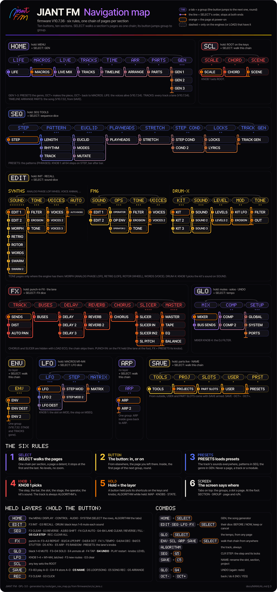

# JIANT FM — User Manual

**JIANT FM V10.8.72 for the M-VAVE FM-1** (public release; what changed since V10.8.48, the last public release,
is in [New in V10.8.72](#new-in-v10872-since-v10848))

> *Versión en español: [MANUAL.es.md](MANUAL.es.md).*

This manual is for musicians who have just installed JIANT FM and want to know how to play it, build songs with it
and, above all, **save their work without losing anything**. It follows the firmware as it is in that version: every
button, knob and message is named exactly as the device shows it.

> *Never used a synth or a step sequencer? Start with [First steps](FIRST-STEPS.md): six short tours, button by button.*

If you only read one chapter, read [12. Saving and loading](#12-saving-and-loading). Coming from V10.6c (the last
public version) or earlier: [What's new in this version](#whats-new-in-this-version).

## Contents

- [What's new in this version](#whats-new-in-this-version)
0. [Quick start](#0-quick-start)
1. [The panel](#1-the-panel)
2. [The screen](#2-the-screen)
3. [Pages and layers](#3-pages-and-layers)
4. [Engines](#4-engines)
5. [DRUM-X](#5-drum-x)
6. [The sequencer](#6-the-sequencer)
7. [ARRANGE: songs, sections and scenes](#7-arrange-songs-sections-and-scenes)
8. [Dice and UNDO](#8-dice-and-undo)
9. [Effects and master](#9-effects-and-master)
10. [Modulation and macros](#10-modulation-and-macros)
11. [Performance](#11-performance)
12. [Saving and loading](#12-saving-and-loading)
13. [System: TRACKS, LOAD and the MENU](#13-system-tracks-load-and-the-menu)
14. [MIDI and USB](#14-midi-and-usb)
15. [Web tools: emulator, installer, editor, backup](#15-web-tools-emulator-installer-editor-backup)
16. [Troubleshooting and FAQ](#16-troubleshooting-and-faq)

---

## What's new in this version

### New in V10.8.72 (since V10.8.48)

The versions V10.8.49 to V10.8.72 in one list. Where a chapter below still describes the earlier screen, this list is right.

**Sequencer**
- **SEQ EDIT** (V10.8.49–V10.8.53): hold **SEQ** on a SEQ page. It replaces SEQ TOOLS. KNOB 1 / KNOB 2 pick the steps,
  KNOB 3 the ACTION, KNOB 4 its amount, **D5** or **OCT+** does it, **F#5** is UNDO / REDO. 25 actions: STRETCH,
  SQUEEZE, REPEAT, NUDGE, ROTATE, SHIFT, REVERSE, DUP, TRANSP, OCTAVE, INVERT, STUTTER, ARP, MUTATE, GEN, RANDOM and more.
  No selection: the whole track. See [SEQ EDIT](#seq-edit-seq-held-v10853).
- **Steps by the keys** (V10.8.50–V10.8.51): two or more step keys held select those steps (**SEL 5-8**); step keys
  held + **EDIT** clear them; COPY, PASTE, DUP and CLEAR say which steps (**COPY 5-8**). See
  [Copy, paste and duplicate](#copy-paste-and-duplicate).
- **REC while stopped only arms** the track: PLAY starts the transport (on STEP's roll it arms step recording).

**Saving**
- **OVERWRITE A?** (V10.8.52): SAVE + C4–F4 or SAVE + OCT+ over a part with music asks first (OCT+ yes, OCT− no), once
  a part. **GLO + G4** puts the part back as it was. See [Quick store](#quick-store-while-playing-save-layer).
- **A saved generator draft is a project** (V10.8.52): SAVE › PROJECTS › SAVE says **SAVED SONG n** and that project is
  the open one from then on; RESTORE LAST brings it back. ARRANGE's OCT+ says **ROW DUPLICATED**.
- **Old projects** (V10.8.51): a project from before V10.7 says **OLD PROJECT: OPEN IN STUDIO** and is never erased.
  Felucca's first settings (PER1, PER2) are no longer read (V10.8.59). See
  [Old projects and old settings](#old-projects-and-old-settings-v10851-v10859).
- **JIANT Studio** (V10.8.51, V10.8.54): a project library (list, rename, copy, move, delete from the phone or the
  computer) and a converter that opens the old projects.

**Sound and the generator**
- **OTT** (V10.8.71): a two-band compressor on every track, **FX › TRACK › OTT** (DEPTH, TIME, UP/DN, X-OVER), from JIANT
  BYTE. V10.8.72: its law as JIANT BYTE's (10:1 at −16 dB, up to +30 dB, TIME 56).
- **The generator** (V10.8.68–V10.8.72): JIANT BYTE's song plans (templates by genre, 2 to 5 minutes, fills), each
  section its own automation (grich), call and response and EXPLORE's cut back, the drums' punch back, NEO CLASSIC with
  no drums. No piece goes over −1 dBFS before the master (V10.8.51). V10.8.72: OTT on the electronic genres.
- **MATH**: **WAVE SYNC** (V10.8.62) locks the formula's rhythm to the tempo, with the new preset **BYTE SYNC**; **LOOP**
  (V10.8.66) repeats it every 4 BAR … 1/32.
- **MOD AMOUNT** (V10.8.51): −200 … +198 %; 100 % sweeps the whole range.
- **DRUM-X** (V10.8.49): one GAIN, on LEVEL (KIT 2's KNOB 4 is gone; kits sound as before).
- **USB MIDI host** (V10.8.69): more keyboards are accepted, and the connection is tried three times.
- **RESOUND** (V10.8.54): **GLO + A4** gives every track a new sound, the song kept. See
  [RESOUND](#resound-glo-held--a4-v10854).

**Screen**
- **Big titles and the knob footer** (V10.8.65): a page with no picture shows its name large; a knob turned says its page
  on the footer (**LFO RATE 1.24 HZ**). See [Big titles, the knob footer and the banners](#big-titles-the-knob-footer-and-the-banners-v10853v10865).
- **OCT+ hints and banners** (V10.8.53–V10.8.54): a page with OCT+ gestures says them in its footer; RESTART, SD MUTED,
  LANE, REC GRID, PROJECT n, ALL UNMUTED, ROOT, QUANTIZE and A > B NEXT BAR are said on screen; the count-in is one line,
  **4 3 2 1**.
- **HOME › MACROS** is back (V10.8.64), ECO's third page, with **DICE MACROS** (HOME + SELECT). **LIFE**: KNOB 3 is
  **STEREO** (was PUMP), and every depth goes further above 60. See [The sections](#the-sections-and-their-chains).
- **HOME › BEING › VISUAL** and **MENU › DISPLAY › SAVER** (V10.8.56–V10.8.67): pictures from FM's own graphics that
  move with the music, on the whole screen. V10.8.72: smoother (fewer strokes instead of skipped frames). See
  [VISUAL and SAVER](#visual-and-saver-v10856v10867).
- **MENU › DISPLAY › PANEL** (V10.8.63): AUTO / A / B, for the screens of the late-2026 units. See
  [PANEL](#panel-the-late-2026-screens-v10863).
- **SCL › CHORD** names each degree's triad (**D-**, **E°**, **F**; V10.8.59). FX's DELAY draws its echoes as columns
  (V10.8.53). The creatures are drawn closer to their originals (V10.8.54–V10.8.55).
- **Gone for room**: ABOUT's AUDIO LOAD lines and SEQ › STEP FX's RAMP curve (V10.8.49), FX › MASTER › EQ's curve (V10.8.53).
- **Less CPU** (V10.8.60): more of the sound runs from RAM; the sound is the same bit for bit.

### New in V10.8.48 (since V10.8.21)

The versions V10.8.22 to V10.8.48 in one list. Where a chapter below still describes the earlier screen, this list is right.

- **GATE on the reverb and the delay** (V10.8.44): on **FX › REVERB** and **FX › DLY**, hold **OCT+** and turn
  **KNOB 4**: its card reads **GATE** (0–127; 0 off). The return stays open while something is sent to it and shuts a
  while after that falls silent (16: a 1/16, 64: a quarter, 127: two quarters), cutting the tail: a gated room, echoes
  that stop with the phrase. Saved with the project. See [Delay](#delay) and [Reverb](#reverb-five-models).
- **A LEVEL page on every engine** (V10.8.44): EDIT's first group ends with **LEVEL**: **GAIN** (0–12 dB), **LEVEL**,
  **PAN** (on a kit after KIT 2). GAIN left ANALOG's and PHASE's MORE page; OCT+ held + KNOB 4 on EDIT 1 still reaches it.
- **The ARP in time** (V10.8.45): while the transport plays an arpeggio starts on its RATE's grid and stays on it;
  recorded, each of its notes lands on its own step. See [ARP](#arp).
- **The header's load is a number** (V10.8.45), 0–99, where the five bars were. **MENU › ABOUT** lost the CPU clock
  and rails lines (V10.8.45); **LAST CRASH** is still there (V10.8.46). The velocity diagnostic is gone from the
  firmware: [VELOCITY_DIAG.es.md](VELOCITY_DIAG.es.md) is for older versions.
- **The song's words** (V10.8.47): SAVE › PART SLOTS' KNOB 2 is **PLAY/EDIT** (was LOAD; while the loop plays the part
  comes in on the next bar); the SAVE layer's STORE A–D are **SAVE A–D** (the screen says **SAVED A**); PLAY's mode
  LOOP is **PART** (PART / SONG); a song's END LOOP is **REPEAT** (the footer: **40 BARS · END REPEAT**); a part box
  with no name shows its bars in the song (**12 BARS**) instead of USED, and **PLAYING** instead of NOW; the chips'
  legend reads **ARRANGE  PART+BARS**; on JAM and TAKE, SEQ is **PART** and CAMBIO is **SWITCH**.
- **GENERATOR** (V10.8.43–V10.8.48): it leaves **SCL › HARMONY** as you set it (on, the piece sits on the key's tonic
  and HARMONY moves it); sections half as long, and a section that comes back is varied; RADIO's loop changes every
  16, 8 or 4 bars by tempo, and a STOP in the piece's last bar stops; every part moves (slow free LFOs on the filter
  and the shape, the pan), real envelopes by role (no part held at full sustain but organs and drones; leads little
  sustain and a long release), chords, leads and arps with their own filter type (BP, or HP with KEY TRK 100), the
  track's GAIN making up the level; a chord part on a lead's sound without its vibrato; PHONK always the drift; JAZZ's
  hats at half. See [8](#8-dice-and-undo).
- **RADIO and MOOD** (V10.8.39–V10.8.41; HOME › GENERATOR 4): **KNOB 3 RADIO** ON / OFF: when the song's last row
  ends (a loop: after 16 bars, 32 above 110 BPM; since V10.8.45 16, 8 or 4 bars) the generator makes the next piece by itself and it comes in on the
  bar line, ENTRY's way. It only goes on while a generated draft plays, not with FORM MY LOOP; press OCT+ once to
  start. **KNOB 4 MOOD**, CALM … MID … DANCE: it moves the energy and the drums (CALM: the kit lighter, gone near the
  end; DANCE: drums in every piece, the kick on the beats), with GENRE RANDOM it also leans the genres by their tempo,
  and in EXPLORE it moves the tempo. Neither is saved with the project. See [8](#8-dice-and-undo).
- **GENERATOR** (V10.8.39–V10.8.42): every genre retouched (its own traits, riffs, drums and mix), the kick tuned to
  the key, the genre **FUGA** removed (29 genres), HARD BASS with a DONK bass, DREAM POP's two arrangements, IDM
  AMBIENT from 76 BPM.
- **In time** (V10.8.40): the tempo is exact and every track takes its place from the transport, so after a LEN or
  DIV change, EUCLID, a mutation or a variation of another length a track is back with the others at its next step.
  **RESYNC**: hold **SEQ** and press **PLAY** while it plays: every track from its first step on the next bar, without
  stopping (GLO + PLAY is still the RESTART at once).
- **DJ FILTER on MIXER** (V10.8.38): on GLO › MIXER a tap of **OCT+** turns KNOB 4 between **BPM** and **DJ FILT**.
- **SEQ › NOTE is back** (V10.8.38), after STEP: FOCUS, PITCH, MOVE, MICRO. **SEQ › BAR**, the **PHRASES** pattern
  loader and **GLO › SYSTEM 2** (MIDI) are gone.
- **TRANS** (V10.8.38): SCL › CHORD's KNOB 4, the track's transpose (±24 semitones).
- **GAIN on every engine** (V10.8.38): on the engine's first EDIT page, **OCT+ held + KNOB 4**: 0–12 dB (since V10.8.44 also on the LEVEL page).
- **KEY TRK NOTE in tune** (V10.8.38): on LP and HP the resonance's peak sits on the note.
- **SWARM** (V10.8.38): **WAVE** on SWARM 2's KNOB 4 (the sine, or one of eight FLOAT formulas), a tag on the picture
  that says what it hears (**ALONE**, **AIR n**, **PROX n**, **AIR OFF**), and **MODE >T1 … >T6**: SWARM's notes play
  that track's engine.
- **KEY TRK on FILTER** (V10.8.37): on EDIT › FILTER, **OCT+ held + KNOB 2** (CUT's) picks **OFF / 50 / 100 / NOTE**,
  with a tag on the curve. At 50 and 100 the cutoff follows the key (100: a semitone a semitone, around C4), on every
  type, the combs too; NOTE is 100 with the final cutoff on the semitones: MOD SEQ › CUT plays tuned resonances. A
  track's, saved with the project, OFF by default.
- **MUTATE without a page** (V10.8.37): EVERY is a tag in EUCLID's picture ("EVERY 4"); set it with **OCT+ held + KNOB
  4** on EUCLID. OCT+ alone (when let go) mutates; OCT− goes back to the anchor.
- **Factory sounds retouched** (V10.8.37): sends by role (basses dry, leads more delay than reverb, pads more reverb),
  a late vibrato on the leads, the plucked strings darker when played softly, and movement on the sounds that had none
  (the kits, ANIMAL, WEST's struck ones and basses).
- **FX › DIST, KNOB 4: NOISE** (V10.8.36; 0–127, a track's): a noise that moves the gain and the tone inside the
  distortion: grain stuck to the note, not a hiss added (silence stays silent). Not on the AMP type.
- **FX › CHORUS, KNOB 4: MIX** (V10.8.36; 0–100 %, global): at 0 the chorus as it was; towards 100 each track's dry
  sound goes down by its CHORUS send and one modulated voice is left, in the middle: MIX 100 and the send whole, a
  vibrato.
- **CLOUD reverb** (V10.8.36): it starts with the note (no longer like a late delay); half the grains read just
  behind the present and the others 1, 2 or 3 sixteenths back, by the tempo; the tail a little lower.
- **GENERATOR** (V10.8.36): the mix by genre (the lead and the arp up where they were buried, less reverb on a club's
  stabs, the kick's DUCK stronger) and EXPLORE with the lead / arp dialogue.
- **DRONE CLAY, complete** (V10.8.27–V10.8.31; see [DRONE CLAY](#drone-clay-seq--clay-v10821)): each modulator has its
  own **RATE** on the bar's grid (1/64 … 4BAR, dotted, triplets and polyrhythms), the drone has **PITCH** (−24 … +36
  semitones), the hits (KICK, SNARE, HAT…) are a drum on any engine, and there are four pages: **DRONE CLAY · CLAY MOD
  · CLAY RHYTHM · CLAY TIME**. Under the scope, a thin bar a modulator shows what it adds now. A modulator at
  **AMOUNT 0** strikes nothing, and at **RATE HOLD** the drone is never struck again. **The keys play gestures** (the
  whites) and **the drone's degree** (the last seven); **RUN** has four values: SONG, FREE, SONG NOKEY, FREE NOKEY.
- **WEST › DUST** (V10.8.28): 1 to 95 is white noise going into the folder with the core (it folds and passes the gate
  with it: inside the timbre, not beside it); 96 to 127 is **METAL**, a metallic tone instead of the noise. It no
  longer crackles.
- **MUTATE is back, compact** (V10.8.35; without a page since V10.8.37): EUCLID's pattern mutates by itself every
  **EVERY** bars (OFF, 1, 2, 4, 8). On EUCLID, **OCT+** mutates and **OCT−** goes back to the anchor. See
  [MUTATE](#mutate-v1016-no-page-since-v10837).
- **LIVE is back, compact** (V10.8.35): on **SEQ › STEP FX**, the **black keys 1–9** change live how the selected
  track's sequence walks: RATE x2, x3/2, x2/3, REVERSE, PING-PONG, RANDOM, THIN, GIRO − and GIRO +. See
  [Live sequences](#live-sequences-the-black-keys-of-seq--step-fx-v10835).
- **EUCLID** (V10.8.35): on a melodic track **KNOB 4 is ROLE** (MELODY, CHORDS, BASS, ARP) and the MODES page is named
  **MELODY** (CONTOUR, RANGE, MOTIF, VARY). The picture is one ring of dots.
- **FILTER** (V10.8.35): the types **MS20** and **LP24** are gone (TYPE: LP, HP, BP, COMB, COMB-). A project or a user
  preset that used them opens with LP.
- **ENV › STAGE** is gone (V10.8.35): ENV's chain is ENV · ENV DEST · ENV 2. LOOP stays on ENV DEST.
- **FX › PUNCH IN** (V10.8.27, V10.8.33): the PUNCH LANE page and the lane's picture are gone; the punch-in lane itself
  stays (REC records it, the generator uses it).
- **MOD** (V10.8.22): turning a slot's SRC or DEST shows the whole route in full names ("LFO > FILTER CUTOFF"; E1–E8
  by the engine's own names), with HELP OFF too.
- **DRUM-X** (V10.8.32): the MATH formulas used as FM modulators sound clean, without steps.
- **GENERATOR** (V10.8.34): twelve more progressions, the contrast section with a progression and a register of its
  own, motifs with a signature leap, more call and response, and a dialogue between the lead and the arp.
- **JIANT Studio and the editor** (V10.8.23–V10.8.26, V10.8.33): the FM-1's screen mirror (only the rows that changed
  are sent), and the FM-1 tells which section, page and layer you are on, for Studio's live guide.

### New in V10.8.21 (since V10.7.81)

The betas V10.8.1 to V10.8.20 in one list. Where a chapter below still describes the older screen, this list wins.

- **Song mode** (HOME › JAM · TAKE · ARRANGE): play the four sequences A–D of every track live (F3–B3 pick A–D on
  all tracks, OCT+ GO, OCT− STOP, CAMBIO sets when a change lands). **REC** records the take; **K4 LOCK** plays it back
  and what you play over it is marked **YOU**; with a track selected, **REC** redoes that track for one round and
  **OCT−** undoes it. **TAKE** edits the changes (K1 pick, K2 move, K3 sequence, K4 bars, OCT+ new, OCT− delete). A help
  line on JAM and TAKE says what to do next (MENU › DISPLAY › HELP OFF hides it). GLO › LIVE is gone: JAM plays the
  sequences live.
- **Step components you play** (SEQ › STEP FX): the **PRESETS knob picks the step**; the 16 white keys play components
  while held — STUTTER, STUTTER /2, /4, RATCHET x2 x3 x4 x8, ARP UP / DOWN / UP-DOWN, OCTAVE UP / DOWN, RANDOM, TRANSPOSE
  +2, CHORD, MUTE — and with **REC** they are written into the step with their value and length (into COMP, or COMP 2
  when COMP is taken). A big **banner** names the key and what it does while held (also on the FX layer's punch-ins).
- **DRONE CLAY** (SEQ › CLAY, from JIANT BYTE): a sequencer per track — a very low drone in the track's own voice (RATE
  re-strikes it with the transport, or holds it) and four modulators (shape, euclid, amount, decay, gestures) aimed at
  any of the track's parameters; note gestures (ARP, CHORD, HIT) play on the scale. On MONO / LEGATO it yields the voice
  to the steps; a TIME or PITCH punch-in restarts it from its first hit.
- **Which track you are on, always**: a bar on top reads **TRACK N / ENGINE** in the track's own colour (T1 yellow, T2
  orange, T3 red, T4 magenta, T5 violet, T6 blue); the same colours on the mixer, the beings, JAM and TAKE.
- **Macros as destinations**: LFO › MACROS — KNOB 1 picks the macro, its destinations add up (16 routes in all); in the
  MOD matrix M1–M4 are destinations, not sources.
- **Redesigned screens**: FX in the HUD look (DELAY's echoes a tunnel, REVERB cells, CHORUS L/R orbit, SLICER, MASTER,
  DIST); FX › SENDS as columns; GLO › MIXER channels; ENV as layers of the last notes; LFO as a satellite writing its
  wave; EDIT › FOCUS a horizontal heat bar with the parameter's whole name and its modulation; ARRANGE and GENERATOR a
  living score (sections as wide as their bars, one lane per track); SCL › KEY the scale's whole name, its notes and
  degrees; SCL › CHORD the chord really played (D MIN7…), its notes and intervals, the seven degrees' chords. Names are
  whole where they fit (ECOSYSTEM, GENERATOR, MIXER, MODULATION…).
- **Power-on**: the boot "Six threads" with the signature drawn smooth and the version shown; the **click at power-on**
  is gone (the output opens after the audio has started, then fades in).
- **Removed for room**: GLO › LIVE, SEQ › STRETCH, MUTATE, the sequence dice (SEQ + SELECT; the sound dice stays), GLO ›
  GLOBAL COMP, ENV › TRACKS and the one-time teaching hints. Old projects open: their settings are kept and ignored. (MUTATE and LIVE came back, compact, in V10.8.35: see above.)

### New in V10.7.81 (since V10.7.16)

The betas V10.7.17 to V10.7.80 in one list. Where a chapter below still describes the older screen, this list wins.

**Drums**
- **DRUM-X in 8 pages**: KIT (MORPH SNAP TONE DECAY), KIT 2 (NOISE BODY GLUE GAIN), SOUND (PITCH DECAY LEVEL),
  SOUND 2 (NOISE COLOR PMOD), SOUND 3 (WAVE FILTER P.ENV), SOUND 4 (SIDE SEND KEY MAP), CROSS MOD, FILTER. **BODY** is
  the shell's resonance; **GAIN** is clean, 0 to +12 dB.
- **MATH formulas**: SOUND 3's WAVE goes on past SINE FM METAL BELL to **F01–F48**, a MATH formula as the sound's FM
  modulator, played as a wavetable and drawn on screen (four moments, cold to hot). **RATIO** (¼ … 16, 24 values) on
  KNOB 4, **MOD AMT** in COLOR's place. Two kits are made of formulas, **GLITCH FM** and **MATH LAB**; EDIT + SELECT
  (DICE) gives about half the sounds a formula of their own.

**Engines**
- **MATH MORPH**: ALGO B (where CHIP was) and MORPH A → B (where BEND was) glide from one formula to another.
- Every engine like the kit: FILTER (TYPE CUT RES IMAGE), PLAY (POLY GLIDE UNISON VEL), **GAIN** 0 … +12 dB clean.
- EDIT's pages by their names, the extras on one **MORE**, now **before PLAY**; **FOCUS** drawn in heat colours.

**Harmony and sequences**
- **SCL › HARMONY**, its own tab (KEY CHORD HARMONY SCENE): PROG LENGTH EVOLVE SKIP; every melodic sequence follows the
  progression, shown as roman numerals in the key, the playing chord lit. CHORD's sets: POP JAZZ SOUL DREAM QUART.
- **EUCLID › MODES › ROLE** (MELODY CHORDS BASS ARP) writes over the harmony the other tracks play; CONTOUR RANGE
  MOTIF shape the melody.
- Step components: **RAMP** (END: BACK HOLD PING), **FILL** (where LOCK was); STUT and RATCH on the tempo grid.

**Performance**
- Hold **FX**: a map of **named cells** (the effects by name, M1–M4 on top, the mutes T1–T6 below).
- **Punch-in editor**: OCT+ on FX › PUNCH IN (or FX + OCT+). Each key: WHAT (an effect, or a parameter: M1–M4, CUT,
  PITCH, TIMBRE, VOLUME, PAN, DIST, CHORUS, DELAY, REVERB, VIBRATO), HOW (HOLD LATCH QUANT, or RAMP UP / DN, SINE,
  STUTTER, S&H), AMOUNT (−100 … +100 %) and TIME (1/16 … 8 bars); two slots, A and B. New effects: REVERSE, FREEZE,
  TAPE STOP, PITCH UP / DOWN, STRETCH. FX › PUNCH IN's knobs are the macros M1–M4.
- **LIFE** (HOME › LIFE): the tracks move each other (FILTER TIMBRE PUMP FX).
- SCENE plays on the live tracks only; its **LEADER** can be the keys or a track's notes.

**Generator (GENE)**
- Seeds are fused (A+B in the name), never the same throw twice; it waits for the bar while playing; GENE 4: KEY NEW / KEEP.
- DUBSTEP (the wobble, its rate moving; MATH basses), SHOEGAZE, METALCORE, CUMBIA villera, eight more progressions
  (neo-soul, jazz, IDM, progressive); each genre its FX STYLE; MATH, WEST and STRING more often.

**Screens and settings**
- The song's pages live in HOME › SONG: TIMELINE ARRANGE PARTS CLIPS (SAVE saves and loads).
- **MENU › DISPLAY › PRESETS**: SCROLL (the knob walks the sounds) or MENU (the list opens as you turn).
- **MENU › HELP**: a knob's meaning in the header where it is not obvious. Oscilloscopes instead of decorative bars.
- Defaults: LARGE off, CLICK on REC, COUNT-IN 1 BAR.
- **GLO held + G4: UNDO.**

The **beta V10.8.1** redesigns the song mode (each track its sequences A–D, CAMBIO, a JAM take with LOCK); it is not
in this version. See the README.

### Since V10.6c

Everything since V10.6c, the last public version, in one list; each item links to its place in the manual.

**Before you update**
- **6 songs, not 8** (V10.6p). Songs 7 and 8 no longer open: their flash is kept for a drum sample bank. Move them
  into 1–6, or save a complete backup first (the editor's **Save backup**, or the installer's backup); the backup keeps
  all eight, and a restore says which songs stayed only in the file.
- **Very old projects retired** (V10.6s): projects saved by JIANT before 1.0.3 (FUN1 to FUN6) are refused and left
  untouched, and a DIGITAL sound loads as FM6's init. Open them in an earlier version (V10.6c) and save them again there if you still need them.
- **Older projects retired** (after V10.7.13, room for GENE's FORM MY LOOP): projects and backups saved in the
  formats FUN7 to FUNB (Felucca 1.0 / 1.1 and JIANT up to 0.5) are no longer read; at power-on such a project shows
  **OLD PROJECT: NOT READ** (since V10.8.51: **OLD PROJECT: OPEN IN STUDIO**, see
  [Old projects](#old-projects-and-old-settings-v10851-v10859)) and its slot is empty (the flash keeps it until you save over it). The web editor cannot
  convert them: open them in V10.7.13 or earlier and save them again there (that saves today's format). Also gone: the
  old user presets' conversions (SAMPLE PERC, TRIO, LOFI's chips, 0.3 / 0.4 values: such a preset loads as stored, a
  retired engine's playing as ANALOG), a retired engine's track in a project now gets ANALOG's first preset (not its
  nearest sound), and ADD's own creature (ADD draws the being, as the other engines did before 0.9.6).
- **Newer FM-1 units** (V10.6z): the FM-1s sold from late 2026 (logo on the front) have another flash chip. Older
  JIANT versions ran on them from RAM only (no saving, no GENE, no updates from the device); this version saves
  normally. If yours did not keep your songs, update.

**Songs**
- SAVE opens on the song: **TIMELINE**, **PARTS** and **CLIPS** (V10.6o, V10.6s), then SECTIONS. See
  [TIMELINE, PARTS and CLIPS](#timeline-parts-and-clips-save--song).
- **A song keeps the sounds you change while it plays** (V10.6z8); EDIT > **RECALL** brings a track's section sound back.
- **SAVE SONG AS** copies a whole song into another project (SAVE > PROJECT).

**Drums and the generator**
- **DRUM-X**: a quality pass (V10.6q), a classic CMOS cowbell, the **EXTENDED** key map by default with real fills
  and every sound chromatic (V10.6r), ACOUST gone (V10.6o), the punchy kicks and bright hats back (V10.6z9). See
  [The keys in V10.6r: EXTENDED](#the-keys-extended-v106r).
- **GENE** (HOME's generator, GEN until V10.6m) plays the owner's curated genres, CUMBIA, EBM, BAILE FUNK, PHONK, HIP
  HOP (trap, drill, pluggnb, boom bap or lofi), JAZZ at every tempo and TECHNO ROCK (rock or synth 80s) among them.
  SCL > SCENE's DRUM role can take a kit generated for the genre (**SCENE DRUM GEN**).
- The **thermal palette** everywhere: every note its own heat, the piano roll coloured by pitch class (V10.6w).

**Sequencer**
- Step component **RAMP** replaces JUMP (V10.6v): a step's parameter lock glides there over 1–32 steps or 1–16 bars.
- **REC keeps the feel** (V10.6z4): note lengths, legato as SLIDE, the velocity as played. **GATE 100 %** for new tracks.

**Playing**
- **Key velocity and aftertouch** (V10.6z7, after Charles Vestal's *Velo*): F3..C5 sensed, each key calibrated as you
  play; MENU > CONTROL > **VELOCITY**, **VEL MIN**, **AFTERTOUCH**, **VEL LEARN**. See
  [Key velocity and aftertouch](#key-velocity-and-aftertouch-v106z7).
- **Expression keys** (V10.6z4): a note held + OCT− a vibrato, + OCT+ a bend (MENU > AUDIO > **OCT BEND**).
- **SWARM** (EXT's Bluetooth instrument): a melody from how near you are, FAR / NEAR morph, the scale walk and
  **CHAOS** (in SELF's knob place). See [EXT › SWARM](#ext--swarm-a-melody-from-how-near-you-are-v106z6).
- FAR / NEAR calibration now takes the median of 2.5 s (**HOLD STILL**) (V10.6z8).
- **VOICE** no longer clips on open vowels; WORDS has **CONS**, the consonants' length (V10.6y).

**Connections**
- **NRPN** for every automatable parameter, knob moves sent as NRPN with MIDI OUT ALL (V10.6z3): [docs/NRPN.md](NRPN.md).
- The editor protocol is a versioned contract (1.2): [web/EDITOR_PROTOCOL.md](../web/EDITOR_PROTOCOL.md).
- The second core starts only on the stock power settings (after a SAFE START: one core) (V10.6z2).

---

## 0. Quick start

### Install

1. Open the **web installer** in Chrome or Edge on a computer, or Chrome on Android with a USB OTG cable (iPhone and
   iPad have no Web MIDI): <https://juanjiant-bit.github.io/JIANT/webapp/installer/>
2. Connect the FM-1 **directly** with a USB data cable.
3. **Coming from another custom firmware (Felucca, Skiff, baudgirl or any other)?** Return to official first, with
   the installer's **Return to official** button (it also saves that firmware's backup). Writing JIANT straight over
   another custom firmware has left an FM-1 unable to start.
4. Press **Install**. It first checks the FM-1's firmware and writes only over **official V16**, **official V15** or
   JIANT (anything else: it sends you to Return to official first). Don't unplug the cable while it writes.

**Return to official** takes M-VAVE's own `FM-1.fwsc` of **V16** (718,196 bytes, what M-VAVE offers now) or **V15**
(699,956 bytes), unzipped from M-VAVE's download page and checked byte for byte. It saves a complete JIANT backup
first; to come back, press Install and restore the backup with the editor.

JIANT has no user samples: if you come from Felucca, its user samples (USR1–3) are lost on install. Keep your WAV
files.

### Your first sound (1 minute)

1. Power on. The signature draws itself, then you land on **HOME**: six creatures, one per track. (V10.6e) The tracks
   start as a band in tune: **T1 DRUM-X** (ACOUSTIC), **T2 ANALOG** (PLUCK), **T3 PHASE** (INIT SAW), **T4 FM6**
   (FM BASS), **T5 VOICE** (CHANT) and **T6 ANIMAL** (WHISTLE), each its preset's sound, dry.
2. Turn **ALGORITHM** to pick a track (T1–T6). With the default **TRACKS 4** it stops at T4: T5 and T6 appear only with TRACKS 6 (see
   [13](#13-system-tracks-load-and-the-menu)).
3. Turn **PRESETS** to browse sounds. Play the keys.
4. Turn **KNOB 1–4**: on HOME they are the four most useful controls of the track's engine.
5. Don't like it? Hold **EDIT** and turn **SELECT**: the sound is rolled into a new variation and you hear it at once.
   **OCT+ OK** keeps it, **OCT− CANCEL** brings the sound back.

### Your first song (5 minutes)

1. Hold **HOME** and turn **SELECT** (or on HOME tap **HOME** to its last tab, GENE). The **GENERATOR** opens on
   **EXPLORE** (no genre, every rule broken): press **OCT+** as it is, or pick RANDOM or one of the genres with KNOB 1
   first. A whole song idea appears: engines, sounds, parts, scale, tempo and effects. Press **PLAY**.
2. Not your thing? Press **OCT+** again: a new seed, a new piece. Too busy? Turn **SELECT** one detent right for
   GENERATOR 2 and lower **DRUMS** or **ARP**, then OCT+: the same piece with that changed. **OCT−** goes back to
   ECOSYSTEM. To go back to what was there before: hold **GLO** and press **G4** (UNDO).
3. Like it? **Stop** (PLAY), then press **SAVE** and turn **SELECT** to **PART SLOTS** (the page before PROJECTS, where
   SAVE opens). Turn **KNOB 4** to the right so its card says **OCT+**, then press **OCT+**. Type a name with the keys
   (or keep the one offered) and press **OCT+** again. The screen says **SAVED**.
4. Make a variation (change some steps, mute a track) and save it into section **B**: on PART SLOTS turn **KNOB 1** to
   **B**, then KNOB 4 and OCT+ as before.
5. Hold **SAVE** and press **G5**: **ARRANGE** (the song's rows; HOME's SONG tab). Press **OCT+** to add a row, set its
   section with **KNOB 2** and its length with **KNOB 3** (bars). Add a row for A, one for B. Press **PLAY**: the song
   plays the rows in order.

That's the whole loop: **make music → save it into a section → chain sections in ARRANGE**.

---

## 1. The panel

The names below are the ones the firmware uses (the HARDWARE CALIBRATION screen asks for them by these names).

### Encoders and knobs

| Control | What it does |
| --- | --- |
| **SELECT** (encoder) | Alone (0.9.2): **walks the section's pages**, one page a detent, as one chain, stopping at its first and last page (no levels, no zoom; see [How navigation works](#how-navigation-works-six-rules-092)). In the MENU: its rows, all four tabs in one chain. With a button held: **HOME** + SELECT the **generator**, **EDIT** + SELECT the **sound dice**, **GLO** + SELECT the **tempo**, **SEQ / FX / ENV / LFO / SCL / ARP / SAVE** + SELECT walk that section's chain from wherever you are (V10.7.66: LFO's and FX's dice went; V10.8.21: the sequence's). With step keys held on SEQ: **COPY**. |
| **ALGORITHM** (encoder) | Selects the track from any page: T1–T6 (T1–T4 with TRACKS 4). The track is always ALGORITHM's (0.9.2: PRESETS no longer picks it on ENV, LFO, CHORD, ARP). In the MENU: the next / previous tab. With a layer held it does nothing (V10.7.66: the layer shows its MAP alone). |
| **PRESETS** (encoder) | **Always presets** (0.9.2): the selected track's sounds (every engine's factory presets, then your user presets) on every page, the generator's too. On the **SEQ** pages it moves the **step cursor** instead (V10.7.60: turned slowly a step, fast a whole bar; the header says the bar and the step). The generator's GENRE is GENERATOR 1's KNOB 1. In the MENU and with a button held it does nothing, except **EDIT held** (V10.7): it jumps to the first sound of the next / previous engine, the engine's name on screen. With MENU › DISPLAY › PRESETS on MENU it opens SAVE › PRESETS instead of loading at once. |
| **KNOB 1–4** | The four cards (columns) on screen. A page that picks something picks it with **KNOB 1** (the slot, the operator, the kit's sound, the row, a modulator, a macro; on SEQ › STEP it is SEQ, the track's sequence A–D). With a layer held, the layer's own knobs. Turning fast sweeps the whole range, slowly fine-tunes (MENU › CONTROL › KNOB ACCEL turns this off). In the MENU: KNOB n the setting on card n. |
| **MASTER** | The output volume. |

### Buttons

| Button | Tap | Hold |
| --- | --- | --- |
| **HOME** | HOME (0.9.2, as every section's button): from another section the HOME page last shown; on HOME the first page of the next group, round: **ECOSYSTEM → BEING → SONG → GENERATOR**, back to ECOSYSTEM (SONG: JAM · TAKE · ARRANGE; GENERATOR: the song generator, GEN until V10.6m). | About 0.7 s: opens the **MENU**. |
| **ENV** | The ENV section: from elsewhere the page last shown (at power-on ENV); inside it walks its pages: **ENV → ENV DEST → ENV 2** (V10.8.35; TRACKS went in V10.8.16, STAGE in V10.8.35). | (no layer) |
| **LFO** | The LFO section: from elsewhere the page last shown (at power-on LFO); inside **MODULATION → LFO → MOD SEQUENCE**, round. | (no layer since V10.7.66: the macros are the FX layer's knobs) |
| **FX** | The FX section: from elsewhere the page last shown; inside, the next module: **TRACK → BUSES → DELAY → REVERB → CHORUS → SLICER → PUNCH IN → MASTER** (PUNCH IN · MACROS; MASTER · TAPE · EQ), round. | **Punch-in FX** layer. |
| **SCL** | The SCL section (0.9.2: its own, ARP apart): **KEY → CHORD → HARMONY → SCENE**, round. | **SCL** layer: keys set the root. |
| **EDIT** | The EDIT section: from elsewhere the page last shown (one memory for the synths, one each for FM6 and DRUM); inside the next group: **SOUND → TONE → FOCUS → PLAY** (FM6: SOUND → TONE → OPERATOR → PLAY; DRUM: KIT → SOUND → TONE). Always EDIT (0.9.2: clearing a step is SEQ + G5, renaming SAVE + C5). A step held + EDIT still clears that step's locks. | **EDIT** layer: INIT, RECALL, DRUM-X sound mutes, SELECT the sound dice. Held + KNOB 1–4: **MOMENTARY** (the page under, put back when let go). |
| **GLO** | The GLO section: from elsewhere the page last shown; inside **MIXER → SETUP**, round (at power-on MIXER; SETUP: GLOBAL · SYSTEM · KEY SPLIT · KEY SPLIT 2; V10.8.38: on MIXER a tap of OCT+ turns KNOB 4 between BPM and DJ FILT). | **GLO** layer: mutes, solos, levels, tap tempo, UNDO. |
| **SAVE** | The SAVE section: from elsewhere the page last shown, and USER or PART SLOTS come with their **SAVE already picked** (SAVE, OCT+, OCT+ as before); inside **TOOLS → PROJECT → SOUND**, round (at power-on PROJECTS; the song's pages are HOME's since V10.7.63). | **SAVE** layer: play/store sections live; C5 NAME. |
| **ARP** | The ARP section (ARP · ARP 2, one group): from elsewhere the page last shown; inside, back to ARP. A chord held + ARP during step recording still arpeggiates it. | (no layer) |
| **SEQ** | The SEQ section: from elsewhere the page last shown (at power-on STEP, the piano roll); inside the next group (V10.8.35): **STEP → PATTERN → EUCLID → PLAYHEADS → STEP FX → AUTO → TRACK GEN → DRONE CLAY**, round. | **SEQ EDIT** (V10.8.53, on every SEQ page; was SEQ TOOLS): the steps selected, an ACTION, OCT+ does it; G5 CLR STEP. |
| **PLAY** | Start / stop. Held (~0.7 s): **PANIC**. | — |
| **REC** | Arms / disarms recording on the selected track. | **REC** layer: CLEAR, CLICK. (V10.7) Held past HOLD and let go with nothing else touched: **UNDO** (again: redo). |
| **OCT− / OCT+** | Keyboard octave (−3 to +3; both together: back to 0; on a DRUM track the kit stays on its keys: ratchets above, SHORT / GHOST / FLAM below, see [5](#5-drum-x)). On action pages and in dialogs: **OCT−** = back / NO, **OCT+** = do it / YES. | — |

### The keys

27 keys from **F3 to G5** (16 white, 11 black). They play the selected track. With a layer held they become that
layer's shortcuts; on the DRUM grid they are steps and lanes; on the NAME screen they type.

### Useful combinations

| Combination | Result |
| --- | --- |
| **GLO** held + **PLAY** | **RESTART**: from the top at once, without stopping (internal clock). |
| **SEQ** held + **PLAY** (playing) | (V10.8.40) **RESYNC**: every track from its first step on the next bar, in time, without stopping. |
| **OCT+** tapped on GLO › MIXER | (V10.8.38) KNOB 4 between **BPM** and **DJ FILT**, the master DJ FILTER. |
| **OCT+** held + **KNOB 4** on an engine's first EDIT page | (V10.8.38) **GAIN**, 0–12 dB on the track (also on EDIT › LEVEL, V10.8.44). On **FX › REVERB** and **FX › DLY** (V10.8.44): **GATE**. (On EUCLID: MUTATE's EVERY; on FILTER, OCT+ held + KNOB 2: KEY TRK.) |
| **PLAY** held (~0.7 s) | **PANIC: ALL NOTES OFF**. The transport stops and every sound ends at once: every track's voices, latched chords, arpeggios, punch-in repeats and the notes MIDI IN holds (a key or MIDI note let go afterwards does nothing; the next one plays as usual). MIDI OUT sends the note-off of every note it sent and All Notes Off (CC123) on the tracks' channels 1–6 (not with MIDI OUT OFF). For a note left hanging by a controller that lost its note-off; MIDI IN's CC120 / CC123 still do the same for their channel. |
| **GLO** held + **SELECT** | Tempo, from any page. |
| **GLO** held + **G4** | **UNDO** the last big change (again: redo). Also a part saved over (V10.8.52) and a RESOUND. |
| **GLO** held + **A4** | (V10.8.54) **RESOUND**: new sounds for every track, the song kept (see [RESOUND](#resound-glo-held--a4-v10854)). |
| **SEQ** held (a SEQ page) | (V10.8.53) **SEQ EDIT** (see [SEQ EDIT](#seq-edit-seq-held-v10853)); **F#5** UNDO / REDO of the last edit. |
| **REC** held alone, let go | (V10.7) **UNDO** too: held past HOLD (~0.5 s) with no key, knob, button or OCT touched; again: redo. Anything used while held keeps it the REC layer; a tap still arms recording. |
| **SEQ** held + **REC** | **CLEAR ALL SEQUENCES?** — all six tracks' steps and automation, and the punch-in lane. |
| **REC** held + **FX / EDIT / ENV / LFO / SCL / ARP / GLO** | Clears that part's automation on the selected track (GLO: the level and pan automation of all tracks; FX: also the punch-in lane). No dialog. |
| **SAVE** held + **OCT+** / **OCT−** | **SAVE** the music into the section playing / recall that section as stored. |
| **HOME** held + **SELECT** | The **generator** (HOME's last pages, GENERATOR 1–4; see [8](#8-dice-and-undo)). On HOME › MACROS (V10.8.64): **DICE MACROS**. |
| **EDIT** held + **SELECT** | The **sound dice** (see [8](#8-dice-and-undo)). |
| **SEQ / FX / ENV / LFO / SCL / ARP / SAVE** held + **SELECT** | Into that section and along its chain, as SELECT inside it. (0.9.2: a button held + **PRESETS** no longer walks pages.) |
| **EDIT** held + **PRESETS** | (V10.7) The first sound of the next / previous **engine** (its name on screen), instead of every preset one by one. Not while a momentary tweak (EDIT held + a knob turned) is in progress. |
| **SEQ** held + **G5** | **CLR STEP**: clears the cursor step and its locks (AUTO LIST: deletes the record). |
| **SAVE** held + **C5** | **NAME**: renames the slot on SAVE › USER, the part or the project on PART SLOTS / PROJECTS. |
| A step held (SEQ > STEP) + **KNOB 1–4** | A parameter lock on that step. |
| Step keys held (SEQ, the roll / grid) + **SELECT** / a step key + **REC** | **COPY** those steps / **PASTE** them from that step (see [Copy, paste and duplicate](#copy-paste-and-duplicate)). Two or more held: they are selected (**SEL 5-8**, V10.8.51); + **EDIT**: they are cleared (V10.8.50). |
| **OCT− + OCT+** held at power-on | HARDWARE CALIBRATION. |
| **OCT− + SAVE** held at power-on | (V10.8.63) The screen starts with PANEL A this time (see [PANEL](#panel-the-late-2026-screens-v10863)). |
| **OCT− + OCT+** held 5 s while running | Update mode (UBOOT), with a countdown from 2 s; let go to cancel. |
| A note held + **OCT−** / **OCT+** (V10.6z4) | **Expression keys**: OCT− held fades in a vibrato like raising a mod wheel (~200 ms), OCT+ held bends the note up along a fixed smooth curve (~300 ms) to MENU > AUDIO > **OCT BEND**'s range (default 2 semitones); both ease back when let go. With no note held, OCT− / OCT+ change the octave as ever (OCT BEND OFF: always). Recorded as automation while recording (REC + EDIT clears it); with MIDI OUT ALL sent as CC1 and pitch bend (set the receiver's bend range to OCT BEND's). Both held on a note never starts UBOOT. |

### Key velocity and aftertouch (V10.6z7)

The FM-1's keys F3..C5 sit over a carbon pill whose resistance falls as you press harder (the method is Charles
Vestal's, *Velo*, github.com/charlesvestal/fm1-velocity, GPL-3.0). JIANT reads it on every strike:

- **Velocity**: how hard the key lands, in the first milliseconds after it touches. It is continuous (1..127: every
  strike between soft and hard gives a value between), then MENU > CONTROL > **VELOCITY**'s curve and **VEL MIN**'s
  floor. On a synth track a note waits for its strike at most 2.2 ms (V10.7.10: a hard limit, even when a reading of
  the key is lost), under what you can feel; on a **DRUM** track (the selected one, or KEY SPLIT's half that goes to
  one) it never waits: it plays at once with the strike as read so far, or the key's recent average. It reaches
  everything a key plays: the sound (the engines and the matrix's VEL), chords and strums, the arpeggiator, recording
  (only 127 records as an accent) and MIDI OUT. VELOCITY **OFF**: every key 100, as before.
- **The top row (C#5..G5)** has no sensor (the FM-1 cannot read those seven keys' pressure), so it plays the **average of
  your recent strikes** (100 until you play the others). It has no aftertouch (a chord with sensed keys keeps theirs).
- **Calibration**: every key is different, and each learns your own soft, normal and hard strikes as you play (VEL
  LEARN ON, the default: it moves slowly, a stray strike does not throw it). It starts from the factory calibration
  (measured on the owner's FM-1) and is kept in the settings, written half a minute after you stop playing. **VEL
  LEARN RESET** puts the factory calibration back. To see it at work: the page <https://juanjiant-bit.github.io/JIANT/webapp/vel/> (*En vivo*, Chrome, over the editor's USB link) shows each
  note's velocity and each key's calibration.
- **Aftertouch**: with a key held, press it further down: its pressure (0..127) is the matrix's **AT** source (EDIT >
  MOD: any destination: filter, vibrato depth, level ...). New sounds (INIT SOUND, a new project) route it to the
  filter (slot 4, AT -> CUT +20) when that slot is free; saved projects and presets keep their own matrix. A resting
  finger does nothing (a dead zone), the value glides (no zipper), and lifting the key ends it. MENU > CONTROL >
  **AFTERTOUCH** sets how sensitive it is (LOW, MID, HIGH) or turns it OFF. It works with OCT− / OCT+ held too; it
  is recorded as automation with the expression keys and sent as channel aftertouch with MIDI OUT ALL.
- **A sound's VEL** (EDIT > VOICE 2, KNOB 3; 0..100 %, every engine but DRUM): how much velocity reaches *this* sound.
  **100 %** (every project, preset and song made before it) plays each note as hard as it was played; less brings every
  note's velocity toward 100 (50 %: a strike of 60 plays 80, one of 120 plays 110); **0 %** plays every note at 100,
  as VELOCITY OFF does, but for this track only. It applies to every source: the keys, the sequencer's steps, the arp,
  the punch-in repeats and MIDI in; the matrix's **VEL** reads the same value. A step's **ACCENT** still plays 127, and HUMAN and a RATCHET's DECAY
  still vary the notes.
  Recording keeps the velocity you played, so turning VEL up later brings the dynamics back. The factory **bass**
  presets load at **0 %** (a bass is better even), GENE's bass at **75 %** (its composed ghost notes still softer); every other
  preset at 100 %. Kept with the sound (projects, user presets, songs); NRPN 80, and the web editor's VOICE group.

---

## 2. The screen

### The look: COLORS (0.8.9; the only skin since V10.7.23)

From 0.8.9 to V10.7.22 **MENU › DISPLAY › SKIN** picked AIR, COLORS, BOTTOM or HUD. Since V10.7.23 there is no SKIN row
(and no STYLE row): **COLORS** is the one look, on every page and every palette, with the knobs' cards outlined.
Settings saved with another skin open in COLORS.

- **COLORS**: the LENTE layout in the **0.6 colours**. Black, near-black
  rounded cards with a small mark and the knob's name, **each knob its colour** on its value and its bar (JIANT,
  0.9.5 as the 0.6: each parameter's own colour **moves with its amount** as heat, violet when low to yellow and cream
  when high, a centred one such as PAN or DETUNE cold in the middle and hot at either end; the other palettes their
  four knob colours), the knob you turn framed in its colour; the
  group's tab filled violet; the selected track's number in an orange box, a violet ▶ and a big violet BPM in the header;
  a near-black rounded panel; the beings in the 0.6 heat (violet spikes, red and orange rings, cream nuclei).
- AIR, BOTTOM and HUD (the knob row on top or at the foot, the beings under everything) are gone with the SKIN row.

Values (cards, the header's BPM) are set in a rounded sans again (Inter Tight SemiBold), as in 0.6; names, tabs and the
breadcrumb stay in the 5 x 7 pixel letters. **MENU > LARGE** keeps its big cards on top, with COLORS' tabs and
colours.

Since 0.8.5 every page wears the skin of the design the owner approved (the HTML mock-up "LENTE"):

- **Header (top)**: one quiet line over a thin rule. At the left the play state (a grey square stopped, an orange
  triangle playing, violet while counting in) and the **BPM** (violet; orange while it changes), then BPM LOCK's lock
  and the REC dot (filled: the selected track armed; a ring: another track). In the middle what the page is of:
  **T1 · ANALOG ACID** (the track, its engine and its sound); on the song's pages (SAVE, ARRANGE, TOOLS, GLOBAL)
  **P1 NAME** (the project); on FX **T1** in orange. At the right the octave (**OCT +2**, or the song row while a song
  plays), the **load** (V10.8.45: a violet number, 0–99, the share of the audio time the sound takes; it moves once the load
  is 3 away; five small bars before) and the battery
  (violet when USB powers it). Messages appear in the middle ("SAVED", "T1 CLEARED"...), sometimes with a second line.
- **Cards**: the four boxes under the header are KNOB 1–4: the name small and grey on top, the value under it in white,
  and a thin violet bar under the value. The one you are turning lights orange, so it is the only colour on the cards.
  A value that is automated or locked has its name in violet; a dim card means "nothing here now". An action armed
  (SAVE, LOAD, ERASE, CLEAR...) is a violet-tinted card with its name violet and **OCT+** as its value. The cards have
  no icons since 0.8.5, and nothing else does (MENU > LARGE's cards: a violet dot for a value that moves on its own;
  the header: "!" before a NO FILE message, a drawn lock and song disc).
- **Page name**: changing page (or track) by hand shows the page's name over the footer for a moment, with the track and
  its engine at the right; on HOME the track's engine, "T1 HOME" small (on a lens page its breadcrumb lights up instead).
  The header, the cards and the graph stay in sight.
- **Granules**: a few dots drift behind the panel's graph, as on HOME (LOAD FULL with ANIM ON). They move only when the panel redraws anyway
  (a knob, the LFO, the envelope), so they cost no CPU.
- **Panel (middle)**: the page's graph — the engine's creature, an envelope, the LFO running, the step grid, a list...
- **Footer**: the step bars of the bar you edit (four under each card) or key hints, and under them a small grey
  **breadcrumb**: **SECTION · GROUP · page** and the page's place in the section's chain at the right (0.9.2; e.g.
  **FX · DELAY · DLY 2  7/20**, **ENV · ENV · ENV DEST  2/3**).
- **The tabs** (0.9.2): under the header, the section's **groups** (FX: TRK · BUS · DLY · REV · CHO · SLC · PCH · MST;
  SEQ: STEP · PAT · EUCL · HEAD · SFX · AUTO · GEN · CLAY), the one you are on lit (COLORS: filled violet; BOTTOM: a small pill; HUD and AIR:
  a dash), and **a dot a page** under each, the page shown lit. The cards under them, a taller panel, and the footer is
  the breadcrumb alone.

- **The small letters** (since 0.8.5): the cards' names, the tabs, the breadcrumb, the header's middle words and
  the panels' small captions and chips are set in a crisp 5 x 7 pixel face, the mock-up's small mono capitals; values
  stay in the larger rounded face.

**Colours** work like a thermal camera: cold (indigo, violet) is little, hot (red, orange, cream, white) is a lot (0.8.9: the 0.6 ramp). Violet is
what's selected, orange what's active.

**HOME** is the ecosystem: one creature per track, its species from its engine, its shape from its four knobs, swelling
and heating up with its own audio (0.8.8: swimming free over the whole screen by themselves, as before 0.8.5; see
[the sections](#the-sections-and-their-chains)). (0.9.7) Each being wears a small **face**: its eyes shut on a hit, its
mouth opens with its level. The selected track is drawn bigger, its number in violet, a muted one falls **asleep** (a dim
outline, its eyes shut), a track asleep (TRACKS 4) is drawn as muted. On the **MIXER**, asleep tracks are greyed and say OFF.

**Dialogs** ask before anything destructive: **OCT− NO**, **OCT+ YES**. (0.8.5, as the mock-up) They carry the
tabs **NOTICE · DICE · NAME**: a question is a card under a violet rule with its two buttons (YES in the accent); the sound dice (EDIT + SELECT) shows **BEFORE** and **NOW** side by side (the sound's being then and now) over a strip **KEEP DICED …? · SELECT: DICE AGAIN · OCT− CANCEL ·
OCT+ OK**; NAME has its cards CURSOR, CHAR, LEN and OCT+ SAVE / WRITE over the name, the keys' letters and the black
keys' functions. (0.9.5) A question's card covers only itself, its tabs and its breadcrumb: the page stays in sight
around it, still moving.

**Messages** (0.9.5): a message on a lens page shows as a small pill near the foot of the panel, over the page, which
keeps drawing and moving behind it (the header says it as well; not over HOME's beings or a layer's map); nothing goes
dark. The pill keeps clear of the page's own words: where the foot is written (AUTO LIST's rows) it
sits in the nearest free rows, and on a page with no free rows it is left out and the header alone says it. The
one-time teaching hints (EUCLID's "TURN A KNOB: A PATTERN", MOTION's and PUNCH's "REC + PLAY ...", each shown at most
twice) are gone since V10.8.18; a page with OCT+ gestures says them in its footer instead (V10.8.54, see
[Big titles, the knob footer and the banners](#big-titles-the-knob-footer-and-the-banners-v10853v10865)). Tapping a layer button says nothing (the
"HOLD [X] QUICK" hints are gone): hold it and its layer shows itself.

### Big titles, the knob footer and the banners (V10.8.53–V10.8.65)

- **Big titles** (V10.8.65): a page with no picture of its own shows its **name large**, with what it needs under it:
  GLO › GLOBAL, KEY SPLIT and KEY SPLIT 2, EDIT › LEVEL (the scope lower, under the name), FX › PUNCH IN, and SEQ ›
  DRONE CLAY, CLAY MOD, CLAY RHYTHM and CLAY TIME. HOME › LIFE says **LIFE** large with **ON** or **OFF** under it,
  HOME › MACROS says **MACROS** with **HOME+SELECT DICE** (V10.8.64). Pages with a picture stay as they were.
- **The knob footer** (V10.8.65): turn a knob and the footer says it whole for a moment, the page's name first:
  **LIFE STEREO 100 %**, **LFO RATE 1.24 HZ**, **GLOBAL BPM 121 BPM**. The cards keep their short labels. Not with a step
  held, in the MENU or in a dialog.
- **OCT+ hints** (V10.8.54): a page with OCT+ gestures says them in its footer, with the OCT+ key, for 1.5 s when you
  arrive and while OCT+ is held: an engine's first EDIT page **HOLD: K4 GAIN**, FILTER **HOLD: K2 KEY TRK**, REVERB and
  DLY **HOLD: K4 GATE**, EUCLID **MUTATE · HOLD: K4 EVERY**, PRESETS **KEEP**, SCENE **DICE**, PUNCH IN **EDITOR**,
  TRACK GEN **MAKE**, ARRANGE **ADD ROW**, TAKE **GO**, SYSTEM **OPEN**, HOME › VISUAL **NEW FIGURE**.
- **The count-in** (V10.8.53) is one line of figures, **4 3 2 1**, the beat now lit (with 2 BARS: **BAR 1 OF 2**).

**Banners** (V10.8.53–V10.8.54): every combination says what it did.

| You do | The screen says |
| --- | --- |
| GLO + PLAY while playing | **RESTART** |
| GLO + black keys 1–6 / 7–10 | **T3 MUTED** / **T3 ON**, **KICK MUTED** / **KICK ON** |
| GLO + E4 | **ALL UNMUTED** |
| GLO + A4 | **RESOUND #1234** |
| EDIT + black keys 1–8 on a DRUM track | **SD MUTED** / **SD ON** |
| SEQ + black keys 1–8 on a DRUM track | **LANE SD** |
| SCL + a key | **ROOT D** |
| REC + B3 | **QUANTIZE ON** / **QUANTIZE OFF** |
| REC + KNOB 2 | **REC GRID 75%** |
| SAVE + KNOB 1 | **PROJECT 3**, and under it **LET GO: OPEN** |
| SAVE + F3–B3 while playing | **B NEXT BAR**, or **A > B NEXT BAR** when A is playing |
| OCT+ on GLO › MIXER | **KNOB 4: DJ FILTER** / **KNOB 4: BPM** |

### VISUAL and SAVER (V10.8.56–V10.8.67)

**HOME › VISUAL** is BEING's second page (where ROUTES was until V10.7.66): a picture that moves with the music, on the
**whole screen** (no header, tabs, cards or footer). It is made from JIANT FM's own graphics: FX's DELAY, REVERB,
CHORUS, DIST and MASTER pictures, the envelope's curve, the LFO, HOME's ecosystem, a track's being and ANIMAL's creature
morphing (V10.8.67). They are **deformed** (warped, twisted, folded), **repeated** (kaleidoscope, trails, tiles) and
**broken** (strips, gaps, tears). A kick scatters the pieces and they gather again, a snare turns the copies, the hats
shiver, a note sends a ripple down the rows. Each song picks its own pictures (from the generator's seed, genre, mood
and energy, or from the project's sounds); a new section, twelve kicks or ten seconds bring the next picture.

| KNOB 1 | KNOB 2 | KNOB 3 | KNOB 4 |
| --- | --- | --- | --- |
| DENSITY | WOBBLE | PALETTE (MIXED, THERMAL, ORG/BLUE, GRN/RED, AMBER, MONO) | REACT (how much it follows the sound) |

- A knob turned shows its name and value on one line at the foot for a moment. **OCT+**: a new figure (**VISUAL #n**).
  Any other button leaves the page as usual. The knobs are not saved.
- It is light: a fixed budget of points, and it gives way when the sound is busy. Off its page nothing of it runs
  (V10.8.68). V10.8.72: when the sound is busy it draws fewer strokes instead of skipping frames, so it moves more
  smoothly.

**MENU › DISPLAY › SAVER** (V10.8.56): **OFF**, **1 MIN**, **3 MIN** (default), **5 MIN**, **10 MIN**. After that long
with no panel input the screen shows a VISUAL figure, a new one, on the whole screen, moving with the music. The first
press, key or knob turn only brings the page back (it does nothing else). It does not start while the MENU is open. If
SCREEN OFF comes later, the screen still goes dark at its time.

### PANEL: the late-2026 screens (V10.8.63)

Some FM-1 units sold from late 2026 may carry another 1.3" screen, whose colours look washed out with the usual
settings. **MENU › DISPLAY › PANEL** picks how the screen is set up:

- **AUTO** (default): **B** on the units with the new flash chip, **A** on the others.
- **A**: the screen as it always was.
- **B**: the same, then the settings of the newer panel.

A change applies at once, with no restart (the screen says **PANEL A** or **PANEL B**). **B is untested on the new
units.** If the screen stays dark or looks wrong: switch off, then hold **OCT− + SAVE** while you switch on. That
start uses A; set PANEL back in the MENU. (OCT− + OCT+ at power-on is still the calibration.)

---

## 3. Pages and layers

*The whole synth on one page: each section's button, its groups (the tabs on the screen) and its pages in the order
SELECT walks them (the number in each dot is the page's n of the footer's n/N; orange, the page at power-on; dashed,
a page only some engines or LOADs have), with the six rules, the held layers and the combos. Click it for the zoomable
SVG ([en español](navigation-map.es.svg)). It is generated from the firmware's chain tables (`tools/gen_nav_map.py`).*

### How navigation works: six rules (0.9.2)

Since 0.9.2 every section is driven the same way (the design the owner approved, the mock-up "navegación"): learn it
once and every section is known. Until 0.9.1 each part was a lens of three levels with sets of knobs; the pages, their
knobs, their pictures and every function are the same, only the way between them changed.

1. **SELECT walks the pages.** Turning SELECT goes through all the pages of the section, in one chain, a page a
   detent, and stops at the first and the last. No levels, no zoom. FX: SENDS → DIST → AUTO PAN → OTT → BUSES → DLY →
   DLY 2 → DLY 3 → REVERB → … → EQ.
2. **The section's button: in, or on.** From another section it brings you back to the page you were last on there.
   Already inside, it jumps to the **first page of the next group** (and goes round). On FX › DLY 2, FX goes to
   REVERB; on EDIT › FILTER, EDIT goes to FOCUS.
3. **PRESETS loads presets.** The track's sounds in every section, the generator's pages too. On the **SEQ** pages
   it moves the step cursor instead (V10.7.60: turned slowly a step, fast a whole bar). The **genre** is GENERATOR 1's
   KNOB 1. In the MENU it does nothing; with MENU › DISPLAY › PRESETS on MENU it opens SAVE › PRESETS.
4. **KNOB 1 picks.** When a page picks something (a slot, an operator, the kit's sound, a row, a modulator, a
   macro) KNOB 1 is the one that picks it. The track is always **ALGORITHM**'s. One exception (V10.8): on SEQ › STEP
   KNOB 1 is **SEQ**, the track's sequence A–D; the step cursor is PRESETS' and the step keys'.
5. **Hold = the layer.** Holding a button opens its layer of shortcuts, as before (past the HOLD time, MENU > HOLD,
   0.4 s by default: the keys and knobs change function while you hold it, a map shows what each key does; a key or a
   knob opens it at once; let go and you are back). Held + SELECT: **HOME** the generator, **EDIT** the sound dice, **GLO** the tempo, the other sections walk their chain (V10.7.66: LFO's and FX's dice went). (Held + PRESETS no longer walks pages: rule 3; V10.7:
   EDIT held + PRESETS jumps engine to engine.)
6. **The screen says where you are.** On top, the tabs are the section's **groups**, the one you are on lit and a dot
   for each of its pages. At the foot: **SECTION · GROUP · page** and **n/N**, the page's place in the chain:
   **FX · DELAY · DLY 2  7/20**. The same in AIR, COLORS, BOTTOM and HUD, every palette.

- Each section remembers the page it was left on (EDIT one for the synths and one each for FM6 and DRUM); at power-on
  SEQ opens on STEP, ENV on ENV, LFO on LFO, SAVE on PROJECTS, the others on their first page.
- **SCL and ARP are two sections** (until 0.9.1 one lens): SCL is KEY · CHORD · HARMONY · SCENE, ARP is ARP · ARP 2 (one group: an ARP
  tap inside goes back to ARP).
- **The generator is four HOME pages** (GENERATOR 1–4, HOME's last group), no longer a screen of its own: the section buttons work
  there, OCT+ makes the piece, OCT− goes back to ECO. HOME + SELECT still opens it from anywhere.
- **SAVE from outside** comes back to the SAVE page you left; **USER** and **PART SLOTS** come with their SAVE already
  picked, so SAVE, OCT+, OCT+ still stores the sound (or the section).
- **EDIT is always EDIT**: clearing a step went to the SEQ layer (**SEQ + G5**, CLR STEP; on AUTO LIST it deletes the
  record; TIME turned to REST clears a note too) and renaming to the SAVE layer (**SAVE + C5**, NAME).
- **The MENU** (hold HOME): SELECT walks every row (DISPLAY → CONTROL → AUDIO → SYSTEM), ALGORITHM jumps tabs, a knob
  changes the value, HOME closes it.
- Some pages only appear when they apply: FM6's operator pages on an FM6 track, DRUM-X's pages on a DRUM track, MORE on ANALOG, PHASE, MATH and WHEEL, WORDS and LYRIC STEP on VOICE, SWARM's pages on an EXT track playing SWARM, and with **LOAD ECO** the SLICER and CHORUS pages are hidden; the chain skips them.

### The sections and their chains

SELECT goes down each row from left to right; the button jumps to the next group's first page. Every page is the one
it was in 0.9.1, with its knobs and its picture (the ones 0.8.5's lenses drew).

| Section | Groups (the button) · pages (SELECT) | Pages |
| --- | --- | --- |
| **HOME** | **ECOSYSTEM**: ECOSYSTEM · LIFE · MACROS (V10.8.64) — **BEING**: BEING · VISUAL (V10.8.56) — **SONG**: JAM · TAKE · ARRANGE — **GENERATOR**: GENERATOR 1 · GENERATOR 2 · GENERATOR 3 · GENERATOR 4 | 12 |
| **EDIT** (a synth) | **SOUND**: the engine's two pages, shown by their own names (WAVES · SHAPE, FORMULA · MOTION …, see [4](#4-engines); ANALOG has one, OSC) · **LEVEL** (V10.8.44) — **TONE**: FILTER · WORDS (VOICE) · SWARM · SWARM 2 (EXT with SOURCE SWARM) — **FOCUS**: FOCUS (not on EXT) — **PLAY**: MORE (ANALOG, PHASE, MATH, WHEEL) · PLAY | 5 to 7 |
| **EDIT** (FM6) | **SOUND**: ALGO · PATCH · LEVEL — **TONE**: FILTER — **OPERATOR**: OPERATOR · OP ENV · OPERATOR 2 — **PLAY**: PLAY | 8 |
| **EDIT** (DRUM) | **KIT**: KIT · KIT 2 · LEVEL — **SOUND**: SOUND · SOUND 2 · SOUND 3 · SOUND 4 — **TONE**: CROSS MOD · FILTER | 9 |
| **SEQ** | (V10.8.38) **STEP**: STEP · NOTE — **PATTERN**: LENGTH · RHYTHM · TRACK — **EUCLID**: EUCLID · MODES (on a melodic track: MELODY) — **PLAYHEADS**: PLAYHEADS — **STEP FX**: STEP FX · STEP FX 2 — **AUTO**: AUTOMATION · AUTO LIST · LYRIC STEP (VOICE) — **TRACK GEN**: TRACK GEN (not on EXT) — **DRONE CLAY**: DRONE CLAY · CLAY MOD · CLAY RHYTHM · CLAY TIME | up to 18 |
| **FX** | **TRACK**: SENDS · DIST · AUTO PAN · OTT (V10.8.71) — **BUSES**: BUSES — **DELAY**: DLY · DLY 2 · DLY 3 — **REVERB**: REVERB · REVERB 2 — **CHORUS**: CHORUS — **SLICER**: SLICER · SL BUS · SL BUS 2 · SL PITCH — **PUNCH IN**: PUNCH IN · MACROS — **MASTER**: MASTER · TAPE · EQ | 20 |
| **GLO** | **MIXER**: MIXER · SENDS — **SETUP**: GLOBAL · SYSTEM · KEY SPLIT · KEY SPLIT 2 | 6 |
| **ENV** | (V10.8.35) **ENV**: ENV · ENV DEST · ENV 2 | 3 |
| **LFO** | **MODULATION**: MOD — **LFO**: LFO · LFO 2 · LFO DEST — **MOD SEQUENCE**: MOD SEQ · MOD SEQ 2 | 6 |
| **SCL** | **KEY**: KEY — **CHORD**: CHORD — **HARMONY**: HARMONY — **SCENE**: SCENE | 4 |
| **ARP** | **ARP**: ARP · ARP 2 | 2 |
| **SAVE** | **TOOLS**: TOOLS — **PROJECT**: PART SLOTS · PROJECTS — **SOUND**: USER · PRESETS | 5 |

A group whose name is too wide for its tab is shortened there: ECO, GENE (HOME); OPS (FM6); PAT, EUCL, HEAD, SFX, GEN,
CLAY (SEQ); TRK, BUS, DLY, REV, CHO, SLC, PCH, MST (FX); MIX (GLO); MOD, MOD SEQ (LFO); PROG (SCL's HARMONY). At
power-on each section opens on its first page, but LFO on LFO and SAVE on PROJECTS.

Pages that left the chains: HOME's ROUTES (the macros' routes are FX › MACROS; HOME's MACROS came back in V10.8.64, and
VISUAL took ROUTES' place in V10.8.56); ENV's TRACKS, TRACKS
DEST and STAGE; GLO's LIVE (MANO, RIELES), COMPS and SYSTEM 2 (MIDI); EDIT's MORPH, RETRIG and ROTOR (one **MORE** page an engine),
STEREO, VOICE and VOICE 2 (now **PLAY**); the DRUM kit's KIT 3, KIT 4, LEVELS and STEREO (their knobs on KIT 2, SOUND,
SOUND 4 and FILTER); SEQ's STRETCH, BAR, PHRASES and MUTATE (NOTE came back in V10.8.38); SAVE's TIMELINE, PARTS, CLIPS and SAVE SONG AS (the song is HOME ›
SONG: JAM, TAKE, ARRANGE).

- **ECO**: the six tracks' beings swimming free over the whole panel by themselves (0.8.8: as before 0.8.5), each
  swelling with its sound (a hit kicks it on), its number under it; the selected one larger, its number violet.
  (0.9.7, "today's being with a face") Each being is its species' spiky outline (the spikes as it sounds) in **three
  isotherms**, coloured by **its own level** like a thermal camera (quiet: cyan and blue; loud: red, orange and
  yellow; the inner lines warmer), and where its nuclei were a **face**: two eyes that **shut on a hit**, a mouth that
  **opens with the level**. A muted track's being sleeps (a dim outline, its eyes shut). (V10.6: the look up and the ring
  went with MUTATE.) The cytoplasm's
  granules drift behind them (drawn by the screen alone: nothing of the sound's time). **LIFE** (V10.7.62, where
  MACROS was until V10.8.64): KNOB 1–4 are FILTER, TIMBRE, **STEREO** (V10.8.64; PUMP before) and FX, how much the
  tracks move each other; **LIFE** large at the top, **ON** or **OFF** under it. **STEREO** pushes each track across the
  stereo field by its neighbours' sound (an offset on its own PAN), every other track the other way, so two tracks
  play apart; quiet, a track goes back to its PAN. A project's old PUMP value is now its STEREO. (V10.8.64) Every LIFE
  depth works as before up to 60 and then curves up: at 100 about 2.5 times as much (STEREO 100: hard left and right).
  **MACROS** (V10.8.64, ECO's third page): KNOB 1–4 are the macros **M1–M4**, the same four as the FX layer's knobs
  (one value each, shared). **HOME + SELECT** there is **DICE MACROS**: new routes for the macros on the tracks that
  sound, and new values for the four; one UNDO point (GLO + G4).
- **BEING**: the track's being large, its four HOME knobs as organs at the corners (a gauge each, its value, a vein to
  the body), the sound's name under it. (0.9.4) A VOICE track shows its **head**, an ANIMAL track its **creature**, a DRUM-X track
  its **kit of little beings** there (see [their pictures](#three-engines-draw-their-own-creature-094)); (0.9.6) the other six
  engines theirs ([a cell, a colony, worms, a swarm, a snail, a caterpillar](#six-more-engines-draw-their-own-creature-096)). (ROUTES went in V10.7.66: the macros' routes are FX › PUNCH IN › MACROS.)
  **VISUAL** (V10.8.56, BEING's second page): a picture of the music on the whole screen; see
  [VISUAL and SAVER](#visual-and-saver-v10856v10867).
- **ENV** › **TRACKS** / **TRACKS DEST**: the six tracks' envelopes as tiles (the selected one tinted with its level now a dot; DEST:
  FILTER, PITCH and SHAPE as bars under each), the knobs the selected track's — **ALGORITHM** picks the
  track. **ENV**: the envelope large / ENV DEST's columns, as before.
  (TRACKS and TRACKS DEST went in V10.8.16; **STAGE** in V10.8.35: LOOP is on ENV DEST.)
- **GLO** › **LIVE** (0.9.11; MANO and RIELES) went in V10.8.3; since V10.8.35 its live modifiers are on the black keys
  of SEQ › STEP FX ([11](#live-sequences-the-black-keys-of-seq--step-fx-v10835)).
- **GLO** › **MIX**: the six tracks as strips (MIXER: LEVEL with the meter, PAN, MUTE, and on KNOB 4 the tempo or, after a tap of OCT+, the DJ FILTER; **SENDS**: each track's sends as bars, the knobs the selected track's CHORUS, DLY and REV). **GLOBAL**: the bar of sixteenths, as before.
  **SYSTEM**: the tracks that play as chips, LOAD's three settings (the one set lit), MIDI's route, the CPU load over the
  last seconds as a line.
- **SCL · ARP** › **KEY**: the twelve notes round a circle (C on top), the scale's lit and joined, ROOT in the accent
  with the scale's name in the middle, QUANT and ALL TRK at the right, the scale on a keyboard under it; KNOB 1 sets
  ROOT. **CHORD**: the chord each degree of the key plays now (I–VII, as a key would play it: one note while CHORD is
  OFF or the voice isn't POLY). (V10.8.59) Each degree's tag names its **triad**, as HARMONY's PROG does (**D-**,
  **E°**, **F**), whatever CHORD's type; TYPE and VOICING are on the cards only; with CHORD off the name reads
  **CHORD OFF**. **ARP** / **ARP 2**: "MODE · RATE · OCT" and the pattern it plays over a triad (GATE
  the cells' length, SWING the off-beats late, PROB some left out); OFF says so.
- **LFO · MOD** › **MOD**: the matrix as a net — the sources down the left (those a slot reads lit), a curve from each
  slot's source to its box **D1–D4** on the right (DEST, AMT as a bar), the slot KNOB 1 picked framed with a pulse
  running along its curve. **LFO**: the wave under "RATE · WAVE" / **LFO DEST**: the LFO small
  on the left, the four amounts as rows lit by what the LFO sends now. **MOD SEQ** / **MOD SEQ 2**: the sixteen steps under their caption; KNOB 1 the step.
- **EDIT** › **SOUND**: the engine's creature on the left (0.9.4 / 0.9.6: each engine its own, see below; alive with the sound, the page's name over it, the sound's
  under it), the scope in a well and all eight E parameters as chips on the right, the page's four lit. **TONE**:
  **FILTER** draws TYPE's response at CUT with its RES peak (LP, HP, BP, COMB), CUT a line; **PLAY** (VOICE and VOICE 2 until V10.7.64) the voices one a row as full as they sound, with POLY, GLIDE, UNISON and VEL; the others keep their pictures. **FOCUS** (new): one E parameter large as a gauge — KNOB 1 picks it (E1–E8),
  KNOB 2 sets it, KNOB 3 the **source** of the MOD slot aimed at it (turned up from OFF a free slot takes it, its DEST
  that parameter; back to OFF frees it), KNOB 4 that slot's **AMT**; E1–E8 as tabs under it.
- **GENERATOR 1–4** are the generator (as HOME held + SELECT, from any page): **SELECT** turns its page (left of GENERATOR 1: ARRANGE), GENERATOR 1's **KNOB 1** the GENRE, **OCT+** makes the piece, **OCT−** back to ECO, a **HOME** tap on to ECO.

### Every page and its four knobs

"—" means an empty card. An "action" card, picked (turn the knob right), is tinted violet with its name violet and says **OCT+**; press OCT+ to do it.

**HOME**

| Page | KNOB 1 | KNOB 2 | KNOB 3 | KNOB 4 |
| --- | --- | --- | --- | --- |
| ECOSYSTEM, BEING | the selected track's four HOME knobs (its engine's, see [4](#4-engines)) | | | |
| LIFE (V10.7.62) | FILTER | TIMBRE | STEREO (V10.8.64; was PUMP) | FX (0–100 % each, the whole project's) |
| MACROS (V10.8.64) | M1 | M2 | M3 | M4 (the FX layer's macros; HOME + SELECT: DICE MACROS) |
| VISUAL (V10.8.56) | DENSITY | WOBBLE | PALETTE | REACT (not saved; OCT+ a new figure) |
| JAM | TRACK | PART (A–D; SEQ until V10.8.47) | SWITCH (AT ONCE, 1/16, 1/8, 1/4, 1/2, BAR; CAMBIO until V10.8.47) | TAKE (FREE / LOCK; ARM, REC) |
| TAKE (V10.8.2) | CHANGE | WHEN | PART | BARS |
| ARRANGE | ROW | PART (on END: STOP / x2–x8 / REPEAT) | BARS | SCENE |
| GENERATOR 1 | GENRE | SEED | ENERGY | FORM (LOOP, PARTS, SONG, MY LOOP) |
| GENERATOR 2 | DRUMS | BASS | CHORDS | ARP |
| GENERATOR 3 | LEAD | COMPLEX | SWING | HUMAN |
| GENERATOR 4 | KEY (NEW / KEEP) | ENTRY (ALL / BUILD) | RADIO (OFF / ON, V10.8.39) | MOOD (CALM … MID … DANCE, V10.8.39) |

**ENV** (per track)

| Page | KNOB 1 | KNOB 2 | KNOB 3 | KNOB 4 |
| --- | --- | --- | --- | --- |
| ENV | ATK | DEC | SUS | REL |
| ENV DEST | FILTER | PITCH | SHAPE | LOOP |
| ENV 2 (V10.22) | ATK | DEC | SUS | REL |

**LFO** (per track)

| Page | KNOB 1 | KNOB 2 | KNOB 3 | KNOB 4 |
| --- | --- | --- | --- | --- |
| MOD | SLOT (1–4) | SRC | DEST (its card reads TRACK, VOICE or MASTER, what the destination belongs to) | AMT (−200 … +198 %, V10.8.51) |
| LFO | RATE | WAVE | MODE (TRIG / FREE) | FADE |
| LFO 2 (0.9.18) | PHASE (TRIG's; dimmed in FREE) | — | — | — |
| LFO DEST | PITCH | FILTER | SHAPE | AMP |
| MOD SEQ | STEP (1–16) | LEVEL | LEN | SLEW |
| MOD SEQ 2 | DIV | — | — | — |

LFO **MODE**: **TRIG** restarts the LFO (at PHASE) and its FADE on each fresh phrase; **FREE** runs on across notes
and hits, never restarted (its FADE once, when a project loads or MODE is turned to FREE). Stored as PHASE −1, as
since 0.6.51: every project opens as it was.

**FX** (TRACK pages are per track; the rest are global)

| Page | KNOB 1 | KNOB 2 | KNOB 3 | KNOB 4 |
| --- | --- | --- | --- | --- |
| SENDS | CHORUS (send) | DLY (send) | REV (send) | DIST |
| DIST | DIST | TYPE | TONE | NOISE (V10.8.36) |
| AUTO PAN | DEPTH | RATE | SYNC | WAVE |
| OTT (V10.8.71) | DEPTH (0–100 %; 0 = off) | TIME | UP/DN | X-OVER |
| BUSES (0.8.5) | DLY (the delay's MIX) | REV (the reverb's SIZE) | CHO (the chorus' DEPTH) | SLC (the SLICER's DEPTH) |
| DLY | TIME | FEEDBK | TONE | MIX (OCT+ held: **GATE**, V10.8.44) |
| DLY 2 | WIDE | PITCH | SCATTER | MOD |
| DLY 3 | TYPE (ANALOG / DIGITAL / REVERS, V10.6h) | PING (OFF / ON) | DRIVE | RIGHT (V10.49: the right echo's own time) |
| REVERB | TYPE | SIZE | DAMP (RESO: FOLLOW) | PRE (SHIMMER/CLOUD: AIR; RESO: PITCH); OCT+ held: **GATE** (V10.8.44) |
| REVERB 2 | MOD | RATE | FILT | WIDE |
| CHORUS | RATE | DEPTH | STEREO | MIX (V10.8.36) |
| SLICER | MODE | PAT | RATE | DEPTH |
| SL BUS | T1 | T2 | T3 | T4 |
| SL BUS 2 | T5 | T6 | FX | — |
| SL PITCH | STEP | PITCH | LEN | QUANT |
| PUNCH IN | M1 | M2 | M3 | M4 (the macros, each card named by its first route: "M1 CUT"; OCT+ the punch-in editor) |
| MACROS (V10.8.7) | MACRO (M1–M4) | DEST | AMOUNT (−200 … +198 %, V10.8.51) | DESTS (how many that macro moves) |
| MASTER | CLIP | PUNCH | DUCK | REL |
| TAPE | TAPE | WOW | — | — |
| EQ | LOW | LO MID | HI MID | HIGH |

**SCL**

| Page | KNOB 1 | KNOB 2 | KNOB 3 | KNOB 4 |
| --- | --- | --- | --- | --- |
| KEY | ROOT | SCALE | QUANT | ALL TRK (0.7.6; was TRANS, and SCL 2 held ALL TR alone) |
| CHORD (0.6.81) | CHORD | VOICING | STRUM | TRANS (V10.8.38: ±24 semitones) |
| HARMONY (V10.7.66) | PROG | LENGTH | EVOLVE | SKIP (NONE, T1–T6) |
| SCENE (V10.24) | LEADER (OFF, KEYS, T1–T6, PRESS) | TRACK (T1–T6) | ROLE (KEEP CHORD ARP BASS LEAD; a kit: KEEP, DRUM) | CHORD (that track's chord; BASS and LEAD: PATTERN; DRUM: STYLE) |

**EDIT** (per track; which pages appear depends on the engine)

| Page | KNOB 1 | KNOB 2 | KNOB 3 | KNOB 4 | Shown on |
| --- | --- | --- | --- | --- | --- |
| the engine's two pages (EDIT 1, EDIT 2) | E1 | E2 | E3 | E4, then E5–E8 (V10.8.38: on the first page, with OCT+ held, KNOB 4 is **GAIN**, 0–12 dB) | every engine, by their own names (see [4](#4-engines)); ANALOG, FM6 and the kit differ: below |
| OSC | WAVE | DETUNE | MIX | INT (SAW3 / PLS3: WAVE, INT, INT 3, DETUNE) | ANALOG (its only page here: CUT and RES are FILTER's) |
| LEVEL (V10.8.44) | GAIN (0–12 dB, the track's) | LEVEL | PAN | — | every engine, after the engine's pages (DRUM: after KIT 2) |
| ALGO | ALG | FEEDBK | MOD | RATIO | FM6 |
| PATCH | SLOT | MOD ENV | VEL MOD | SPREAD | FM6 |
| FILTER | TYPE | CUT | RES | IMAGE (EXT: —) | every engine |
| WORDS | LANG | LYRIC | CONS (V10.6y: the consonants' length; POS on the first page when LANG is on) | — (OCT+ TYPE: the lyric) | VOICE (0.8.5, [words](#voice-words-and-lyrics-085)) |
| SWARM (V10.6z6) | SIDE (FAR / NEAR) | RATE | MOVE | TONE | EXT with SOURCE SWARM |
| SWARM 2 | SIDE (FAR / NEAR) | NOISE | MOD | WAVE (V10.8.38: 0 the sine, 1–8 a FLOAT formula) | EXT with SOURCE SWARM |
| FOCUS (0.8.5) | PARAM (E1–E8) | its value | SRC (the MOD slot on it) | AMT | the synths (not FM6, DRUM, EXT) |
| MORE | MORPH | DRIFT | — (GAIN until V10.8.44: now on LEVEL) | — | ANALOG, PHASE |
| MORE | RESTART | — | — | — | MATH |
| MORE | DEPTH | DUST | — | — | WHEEL (the rotor's) |
| PLAY | POLY (POLY, MONO, LEG, UNI) | GLIDE | UNISON (its spread) | VEL (the sound's velocity amount) | every engine but DRUM |
| OPERATOR | OP | COARSE | FINE | OUTPUT | FM6 |
| OP ENV | OP | STAGE | RATE | LEVEL | FM6 |
| OPERATOR 2 | OP | MODE (RATIO / FIXED) | DETUNE | KEY VEL | FM6 |
| KIT | MORPH | SNAP | TONE | DECAY | DRUM (the whole kit) |
| KIT 2 | NOISE | BODY | GLUE | — (V10.8.49: the kit's own GAIN left; the one GAIN is on LEVEL) | DRUM (the whole kit) |
| SOUND | SOUND | PITCH | DECAY | LEVEL | DRUM (one sound) |
| SOUND 2 | SOUND | NOISE | COLOR (with a formula: MOD AMT) | PMOD (the CLAP: HANDS; a GUIRO filter: SCRAPE) | DRUM (one sound) |
| SOUND 3 | SOUND | WAVE (SINE, FM, METAL, BELL, F01–F48) | FILTER (LP, BP, HP, GUIRO; each also SHORT) | P.ENV (with a formula: RATIO) | DRUM (one sound) |
| SOUND 4 | SOUND | SIDE (A / B) | SEND (OFF, CHO, DLY, REV) | KEY MAP (BASIC, EXTRA, or one sound chromatic: KICK … BELL) | DRUM (one sound; KEY MAP the kit's) |
| CROSS MOD | RATE | DEPTH | SHAPE | RAND | DRUM (the whole kit) |

**GLO** (MIXER and SENDS are per track; the SETUP pages are global)

| Page | KNOB 1 | KNOB 2 | KNOB 3 | KNOB 4 |
| --- | --- | --- | --- | --- |
| MIXER | LEVEL | PAN | MUTE | BPM, or DJ FILT (V10.8.38: a tap of OCT+ on this page switches the two) |
| SENDS (0.8.5) | CHORUS | DLY | REV | — (the selected track's, as FX › SENDS) |
| GLOBAL | BPM | SWING | CLOCK | TUNE |
| SYSTEM | TRACKS | LOAD | ROUTE | CPU (%) |

| KEY SPLIT | SPLIT | LOW TRK | HIGH TRK | KEY CUT |
| KEY SPLIT 2 | LOW OCT | HIGH OCT | MIDI CH | MIDI CUT |

**SAVE**

| Page | KNOB 1 | KNOB 2 | KNOB 3 | KNOB 4 |
| --- | --- | --- | --- | --- |
| TOOLS (V10.24) | TARGET (PROJECT, TRACK, SOUND, SONG, SYSTEM) | ACTION (PROJECT: CLEAR · TRACK: CLEAR · SOUND: INIT · SONG: DEL ROW, CLEAR · SYSTEM: CPU) | — | DO: **OCT+ held** |
| PART SLOTS | PART (A–D) | PLAY/EDIT (action, V10.8.47; was LOAD) | ERASE (action, V10.17) | SAVE (action) |
| PROJECTS | PROJECT (1–6) | LOAD (action) | ERASE (action) | SAVE (action) |
| USER | SLOT (U01–U32) | LOAD (action) | ERASE (action) | SAVE (action) |
| PRESETS | No. (the sound; it plays as you pass it) | ENG (the engine) | FAV (mark a favourite) | LIST (ALL / FAV / USER / a sound type, 0.9.12) — V10.24: **OCT+** keeps the sound, **OCT−** brings back the one before you browsed |

**ARP** (per track)

| Page | KNOB 1 | KNOB 2 | KNOB 3 | KNOB 4 |
| --- | --- | --- | --- | --- |
| ARP | MODE | RATE | OCT | GATE |
| ARP 2 | SWING | PROB | HOLD | ORDER |

**SEQ** (per track)

The SEQ pages are one chain of eight groups (V10.8.35; see [6](#finding-your-way-the-seq-chain)): **SELECT** walks
them page by page, a **SEQ** tap jumps to the next group.

| Group (SEQ tap) | Page (SELECT) | KNOB 1 | KNOB 2 | KNOB 3 | KNOB 4 |
| --- | --- | --- | --- | --- | --- |
| STEP | STEP (melodic: piano roll) | SEQ (V10.8: the track's sequence A–D) | NOTE | TIME (REST ← TIE ← NOTE → 2 ST … 16 ST: the note's length in steps; REST clears the step) | VEL (V10.8, was FLAG: 1–127, then ACC / SLD / A+S) |
| STEP | STEP (DRUM: grid) | SEQ | LANE | HIT | ACC |
| STEP | NOTE (V10.8.38, back) | FOCUS (the chord or one of its notes; a kit: STEP) | PITCH | MOVE (a step left / right) | MICRO (−32/64 … +31/64) |
| PATTERN | LENGTH | LEN | DIV | SWING | GATE |
| PATTERN | RHYTHM | SPAN (1–64) | FIT (OFF / ON) | — | — |
| PATTERN | TRACK | PITCH | CHANCE | HUMAN | REC GRID |
| EUCLID | EUCLID (V10.6) | HITS (DRUM-X LANE ALL: DENSITY, V10.7) | STEPS (2–64) | ROTATE | LANE (DRUM-X: ALL, BD … CB) · ROLE (melodic, V10.8.35: MELODY, CHORDS, BASS, ARP) |
| EUCLID | MODES (DRUM-X) · MELODY (melodic) | ACCENT · CONTOUR | GHOST · RANGE | RATCHET · MOTIF | VARY · VARY |
| PLAYHEADS | PLAYHEADS | HEAD | RATE | DIR | INTVL |
| STEP FX | STEP FX | ACTION | LENGTH | COND | VALUE (the step's first component) |
| STEP FX | STEP FX 2 | ACTION 2 | LENGTH | COND (ELSE: MONO) | VALUE (its second) |
| AUTO | AUTOMATION | PLAY (ON/OFF) | EVENT (count) | LOCK (count) | CLEAR (action) |
| AUTO | AUTO LIST | ROW | STEP | PARAM | VALUE |
| AUTO | LYRIC STEP (VOICE) | STEP | WORD | SYLL | PLACE (action) |
| TRACK GEN | TRACK GEN | GENRE | SEED | ROLE (a kit: BUSY) | ENERGY (OCT+: MAKE) |
| DRONE CLAY | DRONE CLAY (V10.8.21) | CLAY (OFF / ON) | DRONE (its octave on the ROOT) | PITCH (−24 … +36) | RATE |
| DRONE CLAY | CLAY MOD | MOD (1–4) | DEST | SHAPE | AMOUNT |
| DRONE CLAY | CLAY RHYTHM | MOD (1–4) | RATE | EUCLID | DECAY |
| DRONE CLAY | CLAY TIME | RUN (SONG, FREE, SONG NOKEY, FREE NOKEY) | SEED | — | — |

PRESETS on any SEQ page moves the step cursor (V10.7.60: turned slowly a step, fast a whole bar; the header says the
bar and the step).

### The layers (hold the button)

A held layer shows its **MAP** over the page (0.8.9): the keyboard itself, F3 to G5, every key that does something
named upright on it (light on the white keys, tinted on the black ones), the one held lit orange, the value now violet,
a muted track pale, what cannot be pressed now dim, and each white key's note under it. The FX layer shows its effects
as named cells instead (V10.7.77), and the punch-in held in large letters. The header names the layer in words,
**[GLO] SET**. Since V10.7.66 the MAP is the only view: KNOBS and STATE, and ALGORITHM switching between them, are gone.
The layers are FX, GLO, SCL, EDIT, SEQ (on the SEQ pages), REC and SAVE; ENV, ARP and, since V10.7.66, LFO have none.

**FX — punch-in effects** (details in [11](#11-performance))

| Keys | Effect |
| --- | --- |
| F3 G3 A3 | REPEAT 1/8, 1/16, 1/32 |
| B3 / C4 | REVERSE / FREEZE (V10.7.59) |
| D4 / E4 | OCT− / OCT+ |
| F4 | 1/2 TEMPO |
| G4 / A4 | DEC− / DEC+ |
| B4 / C5 | STUTTER 1/8 / 1/16 |
| D5 | ATK+ |
| E5 | ARP |
| F5 | RANDOM |
| G5 | erases the punch-in lane |
| Black keys 1–6 (F#3 G#3 A#3 C#4 D#4 F#4) | mute T1–T6 while held |
| G#4 | LOOP 3 |
| A#4 | TAPE STOP |
| C#5 / D#5 | PITCH UP / PITCH DOWN |
| F#5 | STRETCH |
| **Knobs** | the macros M1–M4 (V10.7.59) |

**GLO — mix**

| Keys | Action |
| --- | --- |
| Black keys 1–6 | MUTE T1–T6 (latched: press again to unmute; the screen says **T3 MUTED** / **T3 ON**) |
| Black keys 7–10 (G#4 A#4 C#5 D#5) | DRUM-X group mutes: KICK, SNARE, HAT, PERC (**KICK MUTED** / **KICK ON**) |
| F3–D4 | SOLO T1–T6 while held |
| E4 | unmute everything (tracks and drum groups): **ALL UNMUTED** |
| F4 | TAP tempo (from the third tap; internal clock only) |
| G4 | **UNDO** (again: redo) |
| A4 | **RESOUND** (V10.8.54): new sounds for the whole song, its notes kept ([RESOUND](#resound-glo-held--a4-v10854)) |
| PLAY | restart from the top |
| SELECT | tempo |
| **Knobs** | LEVEL T1–T4 (with T5 or T6 selected: T3–T6) |

**SCL** — any key sets the ROOT to its note name (the screen says **ROOT D**, V10.8.53). Knobs: ROOT, SCALE, ROTATE (the track's sequence played that many
steps later, −32 … +32; this layer is its only knob since SEQ › STRETCH went) and PITCH (SEQ › TRACK's).

**EDIT** — F3 **INIT** (the track's sound back to its engine's own defaults (a plain INIT, not a preset), dry: every effect send at 0; FM6 the init
voice, OP1 alone at full level; on DRUM the factory DRUM-X kit too), G3 **RECALL** (the sound as the current section stored it; on DRUM with its kit). Both ask first and leave the
steps alone. On a DRUM track, black keys 1–8 mute each DRUM-X sound (BD SD CP CH OH TM RS CB; the screen says **SD MUTED** / **SD ON**). **SELECT** (while EDIT is
held): the **sound dice** (0.9.9-seq2f, as before seq2e: SELECT is no sound parameter), with its KEEP / CANCEL dialog. The
cards show **ENG**, **No.** and **FAV**; the presets themselves are browsed on PRESETS only (KNOB 2), FAV marked there (KNOB 3).
The knobs are **MOMENTARY** (below).

**EDIT's three gestures** (0.9.9-seq2e):

1. **Tap EDIT** (press and let go, no knob turned): the EDIT pages, as always.
2. **Hold EDIT**, no knob turned: the EDIT layer above (INIT, RECALL, the DRUM-X mutes, SELECT the sound dice).
3. **Hold EDIT and turn any of KNOB 1–4: MOMENTARY.** The knob edits its parameter on the page that was showing when
   you pressed EDIT (any page: HOME, a FILTER page, FX, DLY, ENV …), live, as a normal edit. Turn as many knobs as you
   like. The screen stays on that page with the values moving and **MOMENTARY** in the header; the layer never comes.
   Let go of EDIT and every parameter you touched glides back (about 30 ms, no click) to the value it had when you first
   touched it. Letting go never changes page. Nothing is kept: a save, a section store, a user preset or the autosave
   made during the hold stores the values from before, and nothing is recorded into the automation. A turn decides at
   once, even before the layer would show; a turn after the layer showed closes it and goes MOMENTARY. Up to 16
   parameters a hold. Pages whose knobs are not plain parameters (steps, the kit's sounds, FM6's operators, lists,
   actions) say **NOT MOMENTARY HERE**. SELECT with EDIT held is always the sound dice, never MOMENTARY (a dice rolled
   during MOMENTARY stays, and that track's values are not put back).

**SEQ EDIT** (V10.8.53, on every SEQ page; it replaces SEQ TOOLS; the header says **[SEQ] EDIT**) — the roll (a DRUM
track: its grid) with the selected steps marked on top. The actions work on the **selected steps**, or on the whole
track when none are selected. Details and every action: [SEQ EDIT](#seq-edit-seq-held-v10853).

| Keys / knobs | Does |
| --- | --- |
| **KNOB 1 / KNOB 2** | START / END of the selection (after **A3**: MOVE / WIDTH) |
| **KNOB 3 / KNOB 4** | the ACTION / its amount |
| **D5** or **OCT+** | does the ACTION (footer: OCT+ DO IT) |
| **G3** or **OCT−** | no selection: **ALL STEPS** |
| **B3 C4 D4 E4** | select bar 1, 2, 3, 4 |
| **F#5** | UNDO / REDO the last edit |
| **F3** · **F4** · **C5** · **E5** · **F5** · **G5** | CLEAR · CLR AUTO · DUP · COPY · PASTE · CLR STEP (on the selection, or the whole track) |
| **C#5 / D#5** | NUDGE < / > (4/64 of a step) |
| **G4 · A4 · B4** (DRUM) | the lane's CLEAR, REVERSE, FILL; black keys 1–8 pick the lane |
| **REC** / **PLAY** (playing) | CLEAR ALL SEQUENCES? / **RESYNC** (V10.8.40) |

**G5 CLR STEP** is always the cursor step (on AUTO LIST it deletes the row's record). The PATTERN knobs (LEN, DIV,
SWING, GATE) are no longer on this layer: they are on SEQ › LENGTH.

**REC** — F3 **CLEAR** the selected track's steps and automation (no dialog; UNDO can bring it back), G3 **CLICK**
(OFF / REC / ON), A3 **UNDO** (again: redo), B3 **Q ON / Q OFF** (REC GRID at 100 % or 0 %; the screen says
**QUANTIZE ON** / **QUANTIZE OFF**). KNOB 1: CLICK; KNOB 2: **REC GRID**, how far what you record is pulled to the grid
(the screen says **REC GRID 75%**). (V10.7) REC held past HOLD and let go with **nothing
else touched** is **UNDO** (held alone again: redo); once a key, knob, button or OCT is used while it is held, it is
the REC layer as before.

**SAVE — song layer** (details in [7](#7-arrange-songs-sections-and-scenes))

| Keys | Action |
| --- | --- |
| F3 G3 A3 B3 | play section A / B / C / D (next bar while playing; at once when stopped). Several in one hold: a quick chain. |
| C4 D4 E4 F4 | SAVE A–D: the music into A / B / C / D (STORE until V10.8.47; the screen says SAVED A). Over a part with music: **OVERWRITE A?** first (V10.8.52) |
| D5 | PART / SONG: what PLAY plays (LOOP / SONG until V10.8.47; the screen says **PLAY: THE PART** / **PLAY: THE SONG**) |
| E5 | SONG REC on the map: records the JAM take (V10.8; see [7](#7-arrange-songs-sections-and-scenes)) |
| G5 | go to the ARRANGE page |
| C5 | **NAME** (0.9.2; was the EDIT tap): rename the slot on USER, the part on PART SLOTS, the project on PROJECTS (elsewhere: NAME: ON USER OR PROJECT) |
| OCT+ / OCT− | SAVE into / RECALL the section playing |
| **KNOB 1** | the project (1–6); applied when you let go of SAVE, stopped only (the screen says **PROJECT 3** and **LET GO: OPEN**) |

**LFO** — no layer since V10.7.66: holding LFO and turning SELECT walks LFO's pages. The macros M1–M4 are the FX
layer's knobs and FX › PUNCH IN's cards; their routes are on FX › PUNCH IN › MACROS.

---

## 4. Engines

Twelve engines, all synthesis, no samples: ANALOG, FM6, PHASE, **MATH** (LOFI until V10.6e), VOICE, WHEEL, **WEST**
(in NOISE's place since V10.7.37), DRUM-X, ANIMAL, **STRING** (a plucked, struck or bowed string, and guitar feedback), **ADD** (additive) and **EXT**
(external signals: the USB audio input, or SWARM, the Bluetooth around it). Any engine can go on any track. Pick them
with **PRESETS** (one list over every engine) or with KNOB 2 (ENG) on SAVE > PRESETS. Each track's four HOME knobs are
listed too.

**The order** (V10.6e): PRESETS, KNOB 2 (ENG) and the web editor's lists show the engines as **DRUM-X, ANALOG, PHASE,
FM6, VOICE, ANIMAL** (the tracks at power-on, T1–T6), then MATH, WHEEL, WEST, STRING, ADD, EXT. Only the order you see
changed: projects, user presets, favourites and backups name engines by their numbers, which stay, so everything saved
before loads as it was. PROGRAM CHANGE keeps 0.9.8's numbers (see [14](#14-midi-and-usb)).

**Smooth changes**: switching a track to another engine fades the old one out (about 12 ms) and what you are holding
(keys, or the notes the sequencer holds) goes on in the new engine, fading in; nothing is cut. Changing a list value
(WAVE, CHIP, a type) while notes sound makes a short dip (about 3 ms) instead of a click; the notes go on.

| Engine | EDIT 1 (its name on screen) | EDIT 2 (its name on screen) | HOME knobs |
| --- | --- | --- | --- |
| **ANALOG** | **OSC**: WAVE, DETUNE, MIX, INT (SAW3 / PLS3: WAVE, INT, INT 3, DETUNE) | none (V10.7.21): CUT and RES on FILTER, NOISE and DRIVE on FOCUS | CUT, RES, ATK, REL |
| **FM6** | **ALGO**: ALG, FEEDBK, MOD, RATIO | **PATCH**: SLOT, MOD ENV, VEL MOD, SPREAD | MOD, RATIO, MOD ENV, SLOT |
| **PHASE** | **WAVES**: WAVE, WAVE2, BRIGHT, ENV | **SHAPE**: DETUNE, LINE, SUB, FEEDBK | BRIGHT, ENV, DETUNE, REL |
| **MATH** (V10.6e) | **FORMULA**: CHIP (FLOAT: ALGO B), WAVE (BYTE / FLOAT / SYNC), ALGO, VARIANT | **MOTION**: MOTION, GRIT (FLOAT: FEEDBK), BEND (FLOAT: MORPH), LOOP (SYNC: OFF, 4 BAR … 1/32) | WAVE, ALGO, VARIANT, REL |
| **VOICE** | **VOWELS**: VOWEL, VOWEL2, TALK, SHIFT (LANG on: POS, THEME, ARTIC, SHIFT) | **SOURCE**: BUZZ, BREATH, RESO, RAND (LANG on: LOOP) | VOWEL, BUZZ, BREATH, TALK |
| **WHEEL** | **DRAWBARS**: BARS, SUB, BODY, TOP | **COLOR**: PERC, CLICK, GAIN (V10.7.64, in DRIVE's place; DRIVE on FOCUS), SPEED | BARS, PERC, DRIVE, SPEED |
| **WEST** (V10.7.37) | FOLD, SKEW, MOD, RATIO | GATE, DECAY, RES, DUST | FOLD, MOD, DECAY, DUST |
| **DRUM** (DRUM-X) | **KIT**: MORPH, SNAP, TONE, DECAY | **KIT 2**: NOISE, BODY, GLUE (V10.8.49: no GAIN; the one GAIN is on LEVEL) | MORPH, TUNE, TONE, DECAY |
| **ANIMAL** (0.8.3) | **CREATURE**: MODE, PRESS, CHAOS, SIZE | **HABITS**: SWEEP, RATE, GROUP, TEMP | PRESS, SWEEP, RATE, SIZE |
| **STRING** | **STRING**: EXCITE, DECAY, BRIGHT, POS (EXCITE FDBK: MOVE in POS's place) | **BODY**: STRETCH, BODY, SIZE, BOW (EXCITE FDBK, the guitar feedback: GAIN, DIST, SPEAKR, BLOOM) | EXCITE, DECAY, BRIGHT, POS |
| **ADD** | **SPECTRUM**: MODE (ten spectra), MORPH, BRIGHT, PARTIAL | **MOTION**: SHIFT, COMB, DECAY, MOTION | MODE, PARTIAL, COMB, DECAY |
| **EXT** (V10.6d) | SOURCE (IN 1, IN 2, 1+2, STEREO, SWARM), GAIN, GATE, MODE (THRU, KEYS) | WIDTH, RING, BITS, RATE | (SWARM: its own, see [EXT › SWARM](#ext--swarm-a-melody-from-how-near-you-are-v106z6)) |

- **GAIN on every engine** (V10.8.38): on the engine's first EDIT page hold **OCT+** and turn **KNOB 4**: its card reads
  **GAIN**, 0–12 dB clean on the track's level. OCT+ let go with nothing turned is still the keys' octave. (V10.8.44)
  The same GAIN is KNOB 1 of the **LEVEL** page, the last of EDIT's first group on every engine, with the track's
  **LEVEL** and **PAN** (the mixer's) beside it. WHEEL also has it on COLOR; ANALOG's and PHASE's MORE no longer do.
  (V10.8.49) DRUM-X's KIT 2 no longer has a GAIN of its own: LEVEL's is the one. A kit or project saved with that
  gain still sounds as it did.
- **ANALOG**: two oscillators. WAVE: SAW, SQR, TRI, SIN, PWM, SYNC, RING, SAW3, **PLS3** (V10.22: three pulses, oscillator 3 detuned the other way;
  MORPH sets the pulse width). Since V10.7.21 it has one page, **OSC**: WAVE, DETUNE, MIX and **INT**, oscillator 2's interval (±24 semitones); in **SAW3** and **PLS3** (V10.7.22) the page is WAVE, INT, **INT 3** (oscillator 3's own interval, V10.39; no noise in those two WAVEs) and DETUNE. CUT and RES are on FILTER, NOISE, DRIVE (and MIX in SAW3 / PLS3) on FOCUS, MORPH and DRIFT on MORE, GAIN on LEVEL (V10.8.44). A random choice (GEN, the dice) keeps INT and INT 3 at 0, a fourth, a fifth or an octave
  (V10.38). Its filter is per voice.
- **FM6**: a six-operator FM engine (Dexed's msfa), 32 algorithms drawn on screen, four voices per track. The knobs of its two pages, **ALGO** (ALG, FEEDBK, MOD, RATIO) and **PATCH** (SLOT, MOD ENV, VEL MOD, SPREAD), are macros over the patch. **SLOT**: the factory patches F1–F8, OWN (an edited or imported patch) and B1–B32
  (a 32-voice DX7 bank sent from the web editor; empty slots are skipped). A voice from the editor or a B slot plays
  as its file has it: the macros go back to none (0.8.1). **OPERATOR / OP ENV / OPERATOR 2** edit each
  of the six operators on the device (KNOB 1 picks the operator; then COARSE, FINE, OUTPUT / STAGE, RATE, LEVEL / MODE, DETUNE, KEY VEL); editing makes the patch the track's own (SLOT OWN),
  saved with the project. A bank voice you pick is copied into the track, so projects keep it even if you send
  another bank later. (0.9.6) Their panel is the algorithm as a **colony of operators** (OP ENV: the envelope with the
  operator riding it), every number they showed kept.
- **PHASE**: phase distortion. WAVE / WAVE2: SAW, SQR, PLS, DSIN, SPLS, RSAW, RTRI, RTRP. LINE: MIX or RING. **BRIGHT** is how far the phase is bent, **FEEDBK** feeds the output back into the phase. Its pages: WAVES, SHAPE.
- **MATH** (LOFI until V10.6e, its formulas alone): WAVE **BYTE** or **FLOAT**. The chip waves (PLS TRI SAW NOIS WRAM)
  and the STEP envelope are gone: a stored chip sound loads as ANALOG's nearest, one oscillator. Every MATH sound starts
  still (MOTION 0) with RESTART on, so a note plays in tune; the five FLOAT voices MATH KEYS, BASS, PAD, LEAD and BELL
  play at the note. Its pages: FORMULA and MOTION.
  - **BYTE** (bytebeat): **CHIP** the resolution (4BIT, 4B/2, 8BIT, 1BIT), **ALGO** the formula (B01–B48), **VARIANT**
    mutates it; then **MOTION, GRIT, BEND, LOOP**. MOTION speeds the formula's rhythm up or down (64 = as written; past
    127, SYNC: its rhythm in time with the bar, the note only its pitch), GRIT is a rate crusher, BEND folds time, LOOP
    repeats a tiny stretch (high LOOP turns the noise into a tuned note).
  - **FLOAT** (floatbeat): **ALGO** (F01–F48, formulas made of sines) and **VARIANT**; since V10.7.69 CHIP's knob is
    **ALGO B**, a second formula, and BEND's is **MORPH**, from ALGO to ALGO B; GRIT's is **FEEDBK**. Hold a key: the
    formula plays in that key.
  - **SYNC** (V10.8.62), WAVE's third value: BYTE with its rhythm locked to the tempo. The formula's slow part (its
    rhythm, the arp's steps) runs from the song's clock; the note sets only the pitch. So every key plays the same
    pattern in time, just transposed (on BYTE a key an octave up plays the rhythm twice as fast). At 120 BPM the
    rhythm is what C4 plays on BYTE with MOTION 0; MOTION still sets its speed. Stopped, it runs free at the BPM.
    The preset **BYTE SYNC** (BYTEBEAT on SYNC) comes right after BYTEBEAT in the list. It has no PROGRAM CHANGE
    number (MATH's 18 stay as they were); GEN leaves it out, and the sound dice roll only BYTE or FLOAT.
  - **LOOP with SYNC** (V10.8.66, KNOB 8, MOTION's KNOB 4): **OFF**, then **4 BAR, 2 BAR, 1 BAR, 1/2, 1/4, 1/8, 1/16,
    1/32**, then the usual LOOP amounts. A division restarts the formula at each window of the bar, so the pattern
    repeats exactly on the bar, wherever the note began. LOOP OFF, and every other WAVE, sound as before.
  - **MORE** page (RETRIG until V10.7.60): **RESTART ON** starts the formula from the top on every note.
- **MORPH** (EDIT › **MORE**, on ANALOG and PHASE; its own page until V10.7.60): the wave slides continuously toward the next ones (on ANALOG
  SAW > SQR > TRI > SIN, on PHASE toward its next shape). 0 = the wave as
  chosen. On ANALOG the **SHAPE** modulation moves the morph too, so an LFO or envelope sweeps the wave. The
  page draws one cycle of the morphed wave and says which two waves it blends. KNOB 2 is **DRIFT** (0–100 %, 0 = off):
  each voice's pitch (up to about ±27 cents) and filter wander slowly, each in its own way, as old analog oscillators
  do. A chord comes alive; at high values it goes seasick.
- **VOICE**: a formant voice (after klattsch): vowels, talk, breath. Its pages: VOWELS (VOWEL, VOWEL2, TALK, SHIFT) and SOURCE (BUZZ, BREATH, RESO, RAND). Since 0.8.5 it also sings words and lyrics (LANG: ES, EN, JA, RU, DE, FR, ZH, PT, GN): see [VOICE: words and lyrics](#voice-words-and-lyrics-085).
- **WHEEL**: a drawbar organ. DRAWBARS: **BARS** (sixteen registrations), SUB, BODY, TOP. COLOR: **PERC** (OFF, 2ND,
  3RD, 2SOFT, 3SOFT, 2SLOW, 3SLOW), CLICK (the key click), **GAIN** (0–12 dB; the DRIVE it replaced there is on FOCUS)
  and **SPEED**, the rotor's (OFF, SLOW, FAST). EDIT › **MORE** (ROTOR until V10.7.60): **DEPTH** (how much the rotary
  speaker swirls: 100 % as before, 0 % a still speaker) and **DUST** (0–100 %: an old organ's crackle and hiss while it
  plays).
- **WEST** (V10.7.37, in NOISE's place): west-coast synthesis. A complex oscillator (a sine core, or a triangle with
  the RATIOs ending in **T**) phase-modulated by a second oscillator (**MOD** its depth, **RATIO** its ratio to the
  note: 0.5 … 8), into a wavefolder (**FOLD** how far it folds, **SKEW** asymmetric folds: even harmonics) and then a
  low-pass gate (**GATE**: 0 a low-pass alone, 64 both, 127 a level alone; **DECAY** how long the strike takes to die
  away, and past 80 a held note sustains; **RES** the gate's resonance). Every note is a strike: a pluck, a bongo, a
  bell.
  **DUST** (V10.8.28): **0** none; **1–95** white noise into the folder with the core, so it folds and passes the gate
  with it (fused into the timbre), and from 48 on some of it straight to the gate too (air); **96–127** is **METAL**:
  instead of the noise, a metallic tone tuned to the note (the earlier NOISE engine's META registers) into the folder
  with the core at half. A project or a user preset made with NOISE opens as WEST in a DUST sound.
- **DRUM**: DRUM-X, see [5](#5-drum-x).
- **ANIMAL**: animal calls from physical models, see [ANIMAL](#animal-083) below.

### ANIMAL (0.8.3)

Animal calls built the way animals make them: **a source that oscillates or strikes** (a bird's syrinx, a cricket's
file and scraper, a cicada's tymbal, a frog's larynx, a wing) **exciting one or two resonators** (the wing, the
abdomen, the vocal sac, the vocal tract), driven by a slow layer of **pressure, tension and rhythm**. **MODE** picks
the source; every mode reads the eight knobs its own way and the screen relabels them. The key sets the tension (the
pitch, the carrier), the velocity the pressure; **a note starts a call**, so a sequence of notes is a sequence of calls,
in tune with the rest of the music.

| MODE | EDIT 1 (KNOB 2..4) | EDIT 2 | What it models |
| --- | --- | --- | --- |
| **CMOS** | TOUCH, COUPLE, CAP | HYST, RATE, GROUP, FM | the 40106 / 4093 "bird machine" (below) |
| **PULSE** | CLICK, Q, SIZE | DETUNE, RATE, GROUP, TEMP | crickets, katydids, cicadas, frogs and toads |
| **WHSTL** | PRESS, CHAOS, SIZE | SWEEP, RATE, GROUP, TEMP | birds' whistles (and a bat, transposed) |
| **WING** | BUZZ, DRIFT, SIZE | DOPPLR, RATE, GROUP, TEMP | mosquito, bee, fly |
| **GLOTT** | MOUTH, ROUGH, SIZE | SWEEP, RATE, GROUP, AIR | mammals: wolf, dog, roar, purr |

**The call's rhythm** (every mode but CMOS): **RATE** is the syllable rate (0.05–40 a second); **GROUP** how they
group: **HOLD** (one syllable as long as the note: a coo, a howl, a drone), **TRILL** (no gaps) or *n*+*m* (*n*
syllables, then *m* silent ones: 3+9 is a field cricket's chirp of three); **TEMP** (°C, 22 as written) scales every
rate the way temperature does in insects and frogs (Dolbear's law: a cricket at 30 °C chirps about 2.4 times as fast
as at 14 °C). **SIZE** moves the whole animal up or down from the key, a semitone a step (64: as played, lower:
smaller and higher; GLOTT: the vocal tract's length instead, every formant together, the pitch left alone).
**SWEEP** is each syllable's pitch gesture: an exponential hook from below (+) or above (−) onto the note, up to two
octaves; above 16 syllables a second it narrows, as a bird's trill can only be that fast and that wide (Podos).

- **CMOS**: the owner's breadboard circuit, a 40106 / 4093 Schmitt-trigger chip, two big capacitors, three pots and a
  probe touched by hand ("a machine of bird, monkey and bug songs"). A fast RC oscillator (an octave above the key:
  C5 chirps at ~1.05 kHz, as in the video) charges and discharges its capacitor exponentially between two thresholds;
  its square wave is band-limited at the exact edge. A slow one gates it (the 4093's NAND) and its capacitor's voltage
  sweeps it (the 40106's FM): the exponential charge is the "hook" you hear at the start of each chirp. **RATE** the
  slow one (the chirps a second), **CAP** how long it charges against how long it discharges (short blips .. long
  sweeps), **HYST** its threshold window (the hook's depth; + rises onto the note, − falls onto it), **FM** 0 the gate
  alone (beeps), 20 gate and sweep (the bird), 40 the sweep alone (a siren), **TOUCH** the hand on the probe (faster,
  less regular), **COUPLE** a second fast oscillator coupled both ways (locking, then chaos: bugs), **GROUP** a third,
  very slow one that groups the chirps into phrases, speeding up as it goes (monkeys).
- **PULSE**: an escapement. Each tooth of a cricket's file (each rib of a cicada's tymbal, each pulse of a frog's
  larynx) is an impulse into a resonator tuned to the key (the wing, the abdomen, the vocal sac). **CLICK** 100 %:
  one pulse a cycle of the resonance, the clockwork cricket's pure tone; lower, one pulse every 2 .. 64 cycles: clicks
  ringing it (a cicada's buzz, a frog's croak; at 1/2 a treefrog's two peaks an octave apart). **Q**: broadband
  (a katydid's rasp) to pure (a cricket). **DETUNE**: the pulses off the resonance (beats, an "anomalous" song) and
  jittered.
- **WHSTL**: a syrinx as a **Hopf oscillator**: the tone is born when the air-sac **PRESS**ure crosses a threshold and
  grows with it (its level ~ the square root of how far past: below the threshold it is silent, whatever the
  envelope), so every syllable has a real onset; the pitch rises a little with the level. **CHAOS**: noise in the
  pressure and the pitch, and a second harmonic.
- **WING**: a band-limited pulse at the wingbeat with a slow random **DRIFT** of pitch; **BUZZ** narrows it (brighter);
  each syllable is a fly-by: louder and brighter as it comes, its pitch shifted by **DOPPLR** (higher coming, lower
  going). HOLD: a steady hover.
- **GLOTT**: a glottal pulse into two formants. **MOUTH** closed (oo) to open (aa), and darker to brighter; **ROUGH**
  in two halves of what mammals do: period doubling (a subharmonic, F0/2) up to 50 %, then a logistic map jittering each
  cycle (deterministic chaos: a roar); **AIR**: breath noise. A purr: play low (C1–C2), ROUGH halves the pitch.

**Presets** (24): CMOS BIRD, CMOS TRILL, CMOS MONKEY, CMOS BUG · CRICKET, TREE CRICKT, KATYDID, CICADA, TREEFROG, TOAD,
BULLFROG · CANARY, CARDINAL, DOVE, OWL, PEEPER, BAT · MOSQUITO, BEE, FLY · WOLF, DOG BARK, ROAR, PURR. They are set to
sound right around C5 (the frogs' and mammals' an octave or two lower: BULLFROG and OWL C4, WOLF G4, ROAR C3, PURR C2).

ANIMAL came last in the PRESETS list in 0.8.3, after DRUM, so every sound before it kept its place and its PROGRAM CHANGE
number; since 0.9.9 the list shows it third (DRUM-X, VOICE, ANIMAL …) and PROGRAM CHANGE still numbers it last. It costs no RAM (each voice's state fits the voice), about 7.6 KB of flash, and at most ~85 % of the heaviest
engine's CPU with eight voices (GLOTT; CMOS, PULSE, WHSTL and WING about half): all eight voices on every mode.

### VOICE: words and lyrics (0.8.5)

VOICE sings: syllables, words and whole lyrics, in **Spanish**, **English** and **Japanese**. Turn it on with
EDIT > **WORDS** > **LANG** (OFF, ES, EN, JA), or pick a word preset: **CANTOR ES**, **CANTORA ES**, **SINGER EN**,
**UTA JA**, **WORD CHOIR**, **SCAT EN**, **ROBOT EN**, **WHISPER JA**. LANG OFF is the VOICE you know (its vowels),
note for note as before.

**How it sings.** Every note sings the next syllable of the lyric. Hold the note and the vowel holds; a TIE holds it
on; at the release the syllable's last consonants sound (the *s* of "es", the *n* of "sun"). Legato notes glide from
syllable to syllable, and a syllable whose end was not sung yet gets it quickly before the next one. With several
voices every voice sings the same syllable: a choir. The lyric loops when it ends.

**How it sounds (0.9.8).** Like a singer: the hiss of *s*, *sh*, *f* comes in and goes softly (band-passed, ~6 kHz for
*s*, under the vowel's level), the formants glide from sound to sound without corners, a note's vowel carries into the
next syllable, held notes take a gentle vibrato after about 0.3 s (each voice of a choir its own), and the voice is
never perfectly still (a little jitter and shimmer). A glide between notes eases out of the first and into the second
(an S-curve, as long as GLIDE says); singing words, legato notes glide a little (~60 ms) even with GLIDE at 0.

**EDIT > WORDS** (VOICE tracks only): **LANG**, **LYRIC**, **POS**; **OCT+** (TYPE) opens the lyric's typing screen.

| LYRIC | sings |
| --- | --- |
| **TEXT** | your lyric (empty: W1) |
| **W1–W16** | the dice: phrases of real words from the language's bank (theme: THEME), each as long as the pattern's notes; a seed each, so W3 is always the same lyric |
| **S1–S8** | scat: pseudo-words of the language's syllables (*la, ta, ri* · *doo, bop, yeah* · *ra, shi, n*) |

With LANG on the EDIT pages read **POS THEME ARTIC SHIFT** | **BUZZ BREATH Q LOOP** (the screen relabels them):

| Knob | Does |
| --- | --- |
| **POS** | AUTO: each note the next syllable. 1–127: the next note sings that syllable of the lyric, whenever POS changes: lock it on a step to start a line there, or automate it |
| **THEME** | the dice's words (W): LOVE, NIGHT, SEA, SKY, ANY, ROAD, DREAM, FIRE |
| **ARTIC** | the consonants: 100 % crisp (full closures, bursts, hiss) .. 0 % slurred (a mumble) |
| **SHIFT** | every formant up or down (−: a bigger voice, +: smaller, female, a child) |
| **BUZZ**, **BREATH**, **Q** | as for the vowels: brightness, air (127: a whisper), how sharp the formants are. (0.9.8) BUZZ's top (~112–127) also steadies the voice: no vibrato, no jitter, a machine (ROBOT EN) |
| **LOOP** | FREE: on through the lyric. 1, 2, 4, 8: back to its start every so many loops of the pattern (a chorus) |

**Writing a lyric.** On the device: EDIT > WORDS, **OCT+**. It is the NAME screen with room for 63 characters (the
field scrolls with the cursor): the keys type phone-style, **KNOB 3** throws the dice (a phrase of the generator in the
track's language and theme, to edit as you like), **OCT+** sets it (also while playing), **OCT−** cancels. From the
computer: the web editor's Sound tab shows a **Lyric** box on a VOICE track (LANG, LYRIC and the text; it turns
accents and ñ into what the device reads). Each track has its own lyric, saved with the project section.

**Text rules.**
- **Spanish** is read by rules, the way it is written: seseo (*z* and *ce ci* as *s*), *ll* and *y* as *y*, *rr* and
  an initial *r* trilled, *j* and *ge gi* as the jota, *ch*, *qu*, *gu*; diphthongs as one syllable (*bien*, *cuidado*).
  No accents needed; write **ñ as NY** (NINYO).
- **Japanese** in romaji (Hepburn or kunrei), **one note a mora**: *sakura* 3, *konnichiwa* 5 (ko-n-ni-chi-wa),
  *arigatou* 5 (a long *ou* sung o-o); a doubled consonant (*kitto*) is a short stop, not a note.
- **English** comes from a dictionary of ~2100 common words (from the CMU Pronouncing Dictionary) with their
  syllables; a word it lacks is read by rough letter rules, which work less well.
- A **-** on its own holds the vowel one more note (a melisma: *A - MOR* is a, a, mor). **_** joins two words into one
  (*MI_AMOR*: mia-mor, the Spanish *sinalefa*). Punctuation and digits only separate words.

**The screen.** A singing VOICE's EDIT pages show the language and the source, the syllables sung, the word in large,
its syllable's phonemes (the one sounding lit), your text from there on, and a vowel chart whose dot moves with the
formants (F1 down, F2 across: where the tongue is), with the voicing and noise levels.

**What to expect.** This is formant synthesis, like a vintage speech chip that sings: vowels, *s sh f*, *t k p*, *ch*,
*m n l* and the glides come through in context; *b d g*, *v z* and the English *r* are approximations, and
intelligibility drops at very short notes (a syllable's consonants take 40–100 ms before its vowel). Spanish and
Japanese read best (their spelling is regular); English depends on the dictionary.

**Cost.** No state per voice (the articulation is the track's); ~1 KB of RAM for the six lyrics and singers; ~42 KB
of flash (the English dictionary is most of it); about +9 % CPU over VOICE's vowels, so four voices singing still cost
well under ANALOG's eight.

### Three engines draw their own creature (0.9.4)

Where every engine shows its being (EDIT › SOUND on the left, HOME › BEING large), three engines draw something of their
own, in the same thermal line art (the colder the line, the less dense or quieter; white is hottest), moving only
while the track sounds and resting in silence:

- **VOICE: the vocal tract, alive** (0.9.9), seen close, the mouth and the neck filling the panel: the head's outline is
  a faint ghost (the brow, the nose, the lips, the chin, the throat) and the vocal tract a glowing tube of two walls,
  from the lips over the palate and the velum down the pharynx to the glottis, the trachea under it. **It sings what you
  hear**: the tongue (the tube's floor) rises and falls with the vowel's F1 and moves forward and back with F2, the jaw
  opens downward with F1, the lips round for o, u, w and sh and close for p, b, m, the lower lip touches the teeth for f
  and v, the tongue's tip, blade or body goes to the place of each consonant (t d n l r at the ridge, k g ng on the
  velum ..) and the tube narrows and heats there, with a hot mark where it closes; for m, n and ng the velum drops and a
  branch to the nose opens. Each glottal pulse is a bulge travelling up the tube (through the nose for m, n, ng), the
  vocal folds open and shut as a V with the voicing, and sound waves leave the mouth (the nose for the nasals); a jet of
  turbulence comes out of the constriction for s, sh, f, x and the bursts, and breath rises at the glottis for h and
  BREATH. The head nods a little at each vowel's onset and sways and breathes slowly with the level. With WORDS on it
  follows the syllable being sung (the phoneme, its formants and gains); without, VOWEL → VOWEL2 over TALK and BREATH
  (the nod at each note).
- **ANIMAL: a creature between a bird, an insect and a mammal.** Its outline, legs, wing, antennae and eye are the same
  points in the three animals, mixed: MODE sets the animal (CMOS and WHSTL a bird, PULSE and WING an insect, GLOTT a
  mammal) and the creature **metamorphoses** to it in about half a second; **SIZE** leans it along insect – bird –
  mammal (well past the presets' sizes: PULSE turned up grows into a bird, GLOTT turned down into a bat-like bird),
  and CHAOS stirs it. With each call: the beak or jaw opens and the throat (syrinx, larynx) swells, song arcs leave the
  mouth, an insect's wings buzz (PULSE: stridulating, its hind leg rubbing; WING: flapping in a blur) and its abdomen's
  segments pulse, a mammal's ribs breathe.
- **DRUM-X: the kit as little beings ("BICHOS")**, on **EDIT › KIT** (the first KIT page: the sound last struck named
  at the top right), on **EDIT › SOUND 1–4** (the sound being edited lit and named) and on **HOME › BEING**; KIT 2,
  KIT 3 and X-MOD keep the colony (a being per sound in two rows). Each drum is a small being with eyes and a mouth,
  standing as a kit does: the **kick** large in the middle (its core hot orange), the **snare** flat on its stand, the
  **toms** on little legs (the floor tom on longer ones), the **hi-hat** two shells on a stand (together on CH, the top
  one lifting with its mouth open on OH), the **crash** on a long stem and the **cowbell** a small head over the kick
  (both BELL), the **clap** two little ones that clap together, the **rim** (RS) a spark on the snare's edge. On each
  hit the drum's being **squashes, shuts its eyes and shouts** (its mouth opens), as hard as the hit sounds (the lane's
  own envelope: the velocity, the accent) and springing back as the sound decays (DECAY); a **GHOST** squashes a
  little, a **FLAM** twice (its hit to come a shadow under the drum), a **ratchet** (x2 x4 x8) over and over.

They cost about what a being costs to draw (host: the EDIT panel ~113 µs against ~122 µs for ANALOG's being; the
whole KIT screen with the kit's beings ~167 µs, as ANALOG's EDIT screen) and ~10 KB of flash for the three, 160 bytes
of RAM; nothing in the sound.

### Six more engines draw their own creature (0.9.6)

With 0.9.6 every engine has its own picture: ANALOG, FM6, WHEEL, NOISE, PHASE and MATH (LOFI then) draw theirs on **EDIT › SOUND**
(on the left; the scope and the chips on the right as before; 0.9.7: with **MENU › DISPLAY › SCOPE** ON — OFF, the default,
gives the creature the whole panel, centred, the sound's name a small caption in a corner) and on **HOME › BEING** (HOME's ecosystem keeps its
beings), in the same thermal line art, the bichos' face shared with DRUM-X's beings, moving only while the track sounds:

- **ANALOG: a cell.** Its membrane (three isotherms, the outer cold) is two cycles of the oscillators through the
  filter and the drive, drawn round in polar form: WAVE (and MORPH), DETUNE, MIX, NOISE and INT shape it, CUT on the
  note softens it, RES rings it; a SAW turns it into a pinwheel, a SQR into battlements. Where **DRIVE** clips the wave
  short spikes come out; a ring at **CUT** glows and spreads as much as **RES**; NOISE grows cilia; the two oscillators
  orbit inside at DETUNE's beat; the face shouts with the level and blinks on each note.
- **FM6: a colony of operators.** The six operators are little beings wired as the algorithm (the 32 charts' cells and
  routes: carriers standing on the output's floor, modulators above, a pulse down each wire as fast as its modulator's
  RATIO). Each one is as big and hot as its **LEVEL times its envelope now**, has as many spikes as its **RATIO**, and
  the feedback operator curls a tail as long as **FB**. On **OPERATOR** and **OPERATOR 2** the colony fills the panel
  with the operator picked lit (DETUNE makes it shimmer), "ALG 05 PAT" on the left and its frequency ("OP3 x1.50") on
  the right, the cards as before; on **OP ENV** the envelope as the patch has it (the stage KNOB 3 / 4 edit lit) and the
  operator's bicho **rides it** where its envelope is now: up the attack, along the hold, down the release.
- **WHEEL: nine tube worms**, one per drawbar, as tall as its level (the registration's digits under them), each with a
  crown of as many tentacles as its harmonic; the **rotor is a current** that bends them (SLOW, FAST, its DEPTH), PERC
  makes its worm leap and shout, CLICK lets bubbles out of their mouths, DUST drifts motes.
- **NOISE: a swarm** of protozoa round a queen: **COLOR** is how they walk (white: jittering in place; brown: drifting),
  **FREQ** how they swirl and how wide a ring they keep, **PEAK** how tight; in DUST each impulse makes some flare and
  jump; in LFSR and META they march in columns, one per bit of the register.
- **PHASE: a snail.** The shell's chambers sit at the **bent phase** (even at DCW 0; as DCW rises they crowd where the
  phase rushes, which is what phase distortion does), coloured by the output; **the foot's sole is the wave** (WAVE and
  WAVE2 alternating); FB frays the spiral, SUB makes the outer whorl breathe, the eyestalks pull in on each note; with
  DETUNE or RING a little snail follows (RING: a thread between them).
- **MATH (LOFI): a caterpillar** whose two skins are the **last 256 samples out** (the scope's own: nothing more is taken from
  the sound), held steps on BYTE, smooth on FLOAT. Its 8 segments are the **byte's bits** (the highest next to the
  head), each lit and lifting its legs with its bit; the antennae are tipped by the two lowest; the head is a bicho
  shouting with the level. On FLOAT and the chip waves (PLS TRI SAW NOIS WRAM) the same caterpillar, its skin the
  waveform and its segments lit by the wave's level.

Each draws into whatever rectangle it is given (EDIT's left panel, HOME's middle, the whole panel). About 14 KB of flash
for the six, 1.4 KB of RAM (the pool); each page draws no dearer than ANALOG's EDIT page with its being did; nothing
in the sound.

### EXT › SWARM: a melody from how near you are (V10.6z6)

**EXT** (engine 15) plays an external signal (the audio input: see [Sound from outside](#sound-from-outside-the-usb-input-and-the-ext-engine)); its **SOURCE** **SWARM** makes the sound out of the Bluetooth around the
FM-1 instead of the USB audio input. Since V10.6z6 SWARM is a **melody**, not only a drone: a **lead** voice plays notes
on the tempo's grid, and **how near something is** decides what it plays and how it sounds. The devices heard around
(MENU › SYSTEM › BLUETOOTH **AIR**) are still voices of their own underneath, a quieter bed.

**Where the closeness comes from** (V10.8.38: a tag on the picture says which, **PROX n** or **AIR n** with the number of devices heard, **ALONE**, or **AIR OFF** when nothing is heard and BLUETOOTH is not on AIR; the bar under it is the morph):

| Source | When | How quick |
| --- | --- | --- |
| **PROX** | BLUETOOTH **ON** with a central (a phone, a computer) connected: the link's RSSI, ~90–130 packets a second, as the matrix's PROX reads it (its FAR / NEAR points and MIN / MAX / SPEED on MENU › SYSTEM › BLUETOOTH). Not calibrated: its own range (the highest level nearest). | fast (~12 ms on top of PROX's own smoothing) |
| **AIR** | BLUETOOTH **AIR**: the **nearest** device heard (the strongest advertisement), through PROX's FAR / NEAR points when they are stored, else by how far its level is over the weakest device heard. | ~0.4 s (advertisements come a few times a second) |
| **ALONE** (SELF until V10.8.37) | nothing heard: SWARM walks FAR … NEAR by itself, so it still plays. | slow |

PROX wins over AIR when both could give it. Calibrate PROX (FAR with the phone away, NEAR with it on the FM-1) and SWARM
follows exactly that range.

**Calibrating FAR / NEAR** (MENU › SYSTEM › BLUETOOTH, OCT+ on the row while ON or AIR runs: the PROX page). (V10.6z8)
OCT− (FAR) or OCT+ (NEAR) now takes the point over **~2.5 s**: the screen says **HOLD STILL…** and the page counts
**HOLD STILL: FAR 0–100 %**; keep the phone where it is until **PROX FAR SET** / **PROX NEAR SET**. The point is the
median of those seconds, not one reading, so taking it twice at the same place gives the same point (the RSSI of
advertisements is noisy: one reading could land anywhere). Leave the page while it takes and nothing is stored. With
**AIR** the level the matrix's PROX reads is also smoothed four times longer and moves only once it changes by more
than about a level and a half (a hysteresis): steady where you stand, it still follows a hand in or out within a few
seconds. (SWARM's own AIR closeness keeps its ~0.4 s.)

**FAR and NEAR.** Like DRUM-X's patches A and B, SWARM keeps **two states** and plays between them: the closeness is the
morph, all the time, by itself (FAR at 0, NEAR at 128, every value in between mixed). EDIT › **SWARM** and **SWARM 2**
edit them: **KNOB 1 SIDE** (FAR / NEAR), then that side's values:

| Value | What it does | Factory FAR | Factory NEAR |
| --- | --- | --- | --- |
| **RATE** | the grid the lead plays on, in time with the transport (its own clock when stopped): 1/1, 1/2, 1/4, 1/8, 1/16, 1/32. The notes' length follows it (a pedal at 1/1, short at 1/32). | 1/2 | 1/16 |
| **MOVE** | how much the melody does on its own: under 24 a pedal (the same note re-struck softly); 24–63 a neighbour and back; from 41 some rests; from 64 an **arpeggio** of the chord's tones (1 3 5 8 5 3) on the melody's note; from 81 octave jumps. | 12 | 100 |
| **TONE** | sine → square, dark → open, past 90 a fold; the FM index. | 24 | 100 |
| **NOISE** | noise into the lead, coloured by TONE (a breath when dark, a hiss when open). | 30 | 12 |
| **MOD** | the modulators: vibrato (depth and rate), the FM's depth, and how much of CHAOS acts. | 14 | 88 |

Projects and presets from before V10.6z6 open with the factory pair (the two states live in slots no EXT sound used).

**The melody.** On every step of the grid the lead looks at how the closeness changed since the last step:
**coming nearer, it goes up** the scale; **moving away, down**; quick moves two degrees at once; still, MOVE decides
(pedal, neighbours, the arpeggio). Its notes are in the track's **ROOT / SCALE** (SCL page), from C3 over two octaves
(OCTAVE past half: three), turning back at the ends. With **SCALE CHR** it plays the **blues** (1 b3 3 4 b5 5 b7) and
slides into b3, 3, b5, 5 and b7 from a semitone below now and then. The devices' own hits wait for the grid's next
step too, so nothing comes in off the beat.

**The devices.** Every device heard adds modulation depth: one device mild, eight extreme. **CHAOS** is the ceiling:
what acts is CHAOS × that depth (the chain of voices, the fold, the ring as before), so CHAOS 0 keeps SWARM clean
however many phones are around. The factory SWARM presets set CHAOS 70–100. A device's own timbre (V10.6v) colours the
lead too: the nearest one gives it its FM ratio and depth.

**WAVE** (V10.8.38; SWARM 2's KNOB 4): **0** is the sine, as before; **1–8** put a cycle of one of eight FLOAT formulas (MATH's) in its place, brought to the sine's level.

**MODE >T1 … >T6** (V10.8.38; on the INPUT page, after THRU and KEYS): SWARM becomes a **note source**. Its own voices are silent and every hit plays a note on that track's engine instead (a DRUM track: its pads), the velocity the device's level, the length PLUCK's; the lead's line too. PROX in that track's MOD matrix can move its timbre.

**The screen.** EDIT 1 / 2 and the SWARM pages show the swarm (each device a square at its note, its place in the
image) with a bar under it: the morph, FAR left, NEAR right.

### FILTER (every engine)

EDIT > **FILTER**: **TYPE** LP, HP, BP, **COMB** or **COMB-** (V10.8.35: MS20 and LP24 are gone; a project or a preset that used them opens with LP. COMB and COMB- are a comb tuned to the note you play; CUT moves it, RES is how much
it rings), **CUT**, **RES**, and KNOB 4: on ANALOG its own DRIVE, on every other engine the track's DIST. On ANALOG
the filter is per voice; on MATH the filter page drives its per-voice filter; on the others it is a filter on the
track that follows LFO DEST / ENV DEST FILTER.

**KEY TRK** (V10.8.37): hold **OCT+** and turn **KNOB 2** (CUT's): **OFF, 50, 100 or NOTE**, with a tag on the curve.
At 50 and 100 the cutoff follows the newest note sounding (100: a semitone for a semitone, around C4), on every filter
type, the combs included. **NOTE** is 100 and the cutoff, after all its modulation, lands on the semitones: with MOD SEQ on CUT you play tuned resonances (V10.8.38: on LP and HP the resonance's peak sits on the note, in tune). A track's, saved with the project, OFF by default (OFF is exactly the sound as
before). OCT+ alone, on FILTER, is still the keys' octave, when let go.

**COMB** and **COMB-** (0.9.9-snd1): the comb is tuned to the newest note (CUT 64 = the note, ±32 semitones either
side) and glides when CUT or the note moves (no zipper). **RES** is how long it rings, the same on every note: from a
short colour (25 ms) up to ~9 s near self-oscillation at the top; a soft clip inside the loop keeps the ring bounded
and a damping low-pass in the loop (opening with RES) lets the highs die first, like a string. **COMB** (positive
feedback) is metallic and flanger-like; **COMB-** (negative) keeps only the odd harmonics: hollow, clarinet-like, at
the same pitch.

**CHORUS** (0.9.9-snd2) is lighter: its LFO is read every 64 samples (16, 8, 4 at the fastest RATEs) and the three
voices glide between, instead of three sines every sample; it sounds the same (-63 dB from before at the default).

**DELAY DRIVE** (0.9.9-snd2; DLY 3 KNOB 3, the page's free knob; 0–100): a soft saturation inside the delay's
feedback loop. A quiet repeat comes back as it went, a loud one is rounded and pressed down, so every pass gets a little
grittier and a little quieter, like a tape or a BBD driven hard; with FEEDBK past 100 it holds the runaway lower. 0 is
the delay exactly as before (a project of before opens with DRIVE 0).

### VOICE (every engine)

EDIT > **VOICE**: **VOICE** POLY, MONO, LEG (legato), UNI (unison); **GLIDE**; **MODE** RATE or TIME (how glide is
measured); **PRIO** LAST, LOW, HIGH. The six tracks share a budget of 8 voices; FM6 plays at most four per track. (0.9.8) VOICE glides as a singer: an S-curve in
pitch over the same time (the other engines: a straight line, as before).

---

## 5. DRUM-X

DRUM-X is a synthesized kit of eight sounds, **BD SD CP CH OH TM RS CB**, generated in real time.

- (0.7.2) **Eleven kits as the DRUM engine's presets**: DRUM-X (the factory kit), 909 CLUB, 808 BOOM, LOFI DUST,
  INDUSTRIAL, ACOUSTIC, DUB ROOTS, TECHNO RAW, BREAKS, HIP HOP (V10.34: boom bap, suggests the pattern BOOM BAP), LATIN
  PERC (V10.7.8: bombo, timbal, llamador, a **GUIRO** on the closed hat, maracas, conga, clave, cowbell). Browsing one (PRESETS on HOME, the editor, a PROGRAM CHANGE)
  loads the whole kit into the section: the eight sounds' A and B sides, their LAYERs and SENDs, and the track's KIT
  knobs. Switching engines, INIT SOUND, a project load and GEN leave the section's kit as it is; DRUM-X brings the
  factory kit back. Edit any of them in EDIT > SOUND; the section saves the result.

- Every sound has two sides, **A** and **B**. **MORPH** (KIT, KNOB 1, also on HOME) moves the whole kit between them:
  the knob to play live.
- The pages go **the whole kit first, then one sound, then the volumes and the stereo** (0.6.58):
  - **KIT** (EDIT 1): MORPH, TUNE, TONE, DECAY. **KIT 2** (EDIT 2): NOISE, **FM ENV** (FM struck with each hit and gone
    in a few milliseconds: a beater, a click, a metal edge on the attack, the tail clean), **FOLD** (a wavefolder after
    the envelope: a bright attack, a clean tail), DRIVE.
    (0.9.9-snd1) **FM ENV** and **FEEDBK** (KIT 3's and SOUND 4's) are on curves: most of the travel is musical (a
    beater, rubber, metal, a saw's edge growing on a sine; clean transients), the harsh noise only in the last steps
    (FM ENV past ~90 %, FEEDBK 14–15). The FM index is the same across the keyboard but eased on very high hits so it
    never folds into hiss; FEEDBK feeds back the mean of the last two samples (no fizz). Saved values keep their knob
    position, so a kit with FM ENV or FEEDBK up sounds cleaner than before.
  - **KIT 3**: **BP**, a band-pass on the metal sounds (the hats, the rim, the cowbell), OFF or 15 centres from about
    1.5 to 9 kHz; **FEEDBK**, every sound's oscillator fed back into itself (OFF, 1–15: warm, growl, grit, noise);
    **HANDS** (OFF, 1–15): more people clapping on the CLAP. Each extra hand strikes a few milliseconds after the first
    (3 to 45 ms), at its own moment and level, thrown again on every hit: never in time with the tempo. OFF is the clap
    as before; a few is a small group, 15 a crowd. **GLUE** (0.9.9-snd1; OFF, 1–15): one knob of glue / limiting on
    the kit's bus, after its DRV: OFF is the kit exactly as before; the middle a gentle compression (about 2:1, fast
    attack, ~90 ms release) that pulls the hits together; the top a hard limit with makeup and a soft clip (loud and
    dense, the peaks held). Saved with the project (a project of before opens with it OFF).
  - **X-MOD**: **RATE** (OFF, 4BAR … 1/32, in time), **DEPTH** (how far MORPH swings), **SHAPE** (SINE, TRI, SAW, RAMP,
    S&H), **RAND** (each hit gets its own MORPH and a little tune).
  - **FILTER**: the kit's.
  - **SOUND 1–4**, one sound each: KNOB 1 is always **SOUND** (which one; striking a key also picks it).
    - **SOUND**: SIDE (A / B), PITCH, PMOD (how far the pitch falls; with the filter GR, **SCRAPE**: below).
    - **SOUND 2**: DECAY, NOISE, COLOR, of the side picked on SOUND (KNOB 1 shows it: "SD B").
    - **SOUND 3**: **MODE** (wave SIN / FM / MTL / BEL, noise filter LP / BP / HP / GR, "+" for snap), **PM.TYPE** (how the
      pitch moves: DECAY, LONG, NOISE, SINE), **DRIVE** (ON / OFF).
      (V10.7.8) **GR**, the guiro: a band-pass whose hit is a stroke over a guiro's ridges, ticks at 24–64 Hz (PITCH sets
      the rate). SOUND's PMOD becomes **SCRAPE**, the stroke's length (0–173 ms), and the hit's velocity picks long or
      short: an accent (127) plays the whole stroke, "rrrrip", a soft hit only its start, "chk" (the length goes with the
      velocity's fourth power). Any sound can take it (a scraped tom, a scraped clap); the kits of before never had it,
      so they sound as they did.
    - **SOUND 4**: **LAYER** (OFF, 1–15): a second oscillator at an out-of-tune interval, frequency modulated by the
      sound, more as it goes up: from a metal edge to a clang with no note, so the sound melts into the rhythm and stays
      out of the harmony (the factory kit has it on the snare, the hats and the cowbell); **FEEDBK** (OFF, 1–15): that
      sound's own (added to KIT 3's); **SEND**: that hit alone into one effect, OFF then CHO, DLY, REV with 16 amounts
      each, on one knob ("REV 75%"), on top of the track's own sends (V10.7.10: every factory kit comes with all
      SENDs OFF, dry; a saved project keeps its own). The dice (DICE ALL; the sound dice) set
      LAYER and FEEDBK boldly. Each sound with a LAYER costs a little CPU (about as FEEDBK).
  - **LEVELS / LEVELS 2**: the level of each sound (KICK, SNARE, CLAP, HATCL, HATOP, TOM, RIM, BELL).
  - **STEREO**: **IMAGE** (automatable) sweeps the kit through its placings in the stereo field. 0 (MONO): every sound
    in the middle; the first turns open it; from there each step is another placing (each sound moves on its own
    curve), so turn it until the image sits right. The kick stays near the middle. DRV, DIST and the FILTER work on the
    kit's sum, so with them the image narrows (the page draws the sounds grey).
  - KIT 3, X-MOD, LAYER, FEEDBK and SEND are saved with the section's kit.
- **Mutes**: GLO held + black keys 7–10 mute the groups KICK, SNARE, HAT, PERC; EDIT held + black keys 1–8 mute each
  sound.
- **EDIT held + SELECT** rolls the kit dice (0.9.9-seq2f, again; DRUM's presets: PRESETS). **EDIT held + F3 (INIT)** brings the factory kit
  back.

### The kit in every octave (0.8.5)

The keys play the kit on the same keys at **every OCT** (C the kick, D the snare, F# the closed hat …); OCT now
changes **how** they play, not which sound. The screen says it when you press OCT on a DRUM track:

| OCT | What a key does | Recorded (REC) as the hit and its sound's mode |
|---|---|---|
| **+3** | **RATCHET x2**: the hit twice a step while held | **x4** (0.9.18: a sound's x4 spills two hits a step over two steps, as heard; was x2) |
| **+2** | **REPEAT**: the hit once a step while held, a roll at the step rate | a hit on every step held (**ON**) |
| **+1** | **REPEAT 1/2**: the hit every other step while held (0.9.17: every OCT half as fast again; 0.9.13 had already halved them) | a hit on every other step held (**ON**) |
| **0** | the kit as it always was | none (**ON**) |
| **−1** | **SHORT**: half the decay | **SHORT** |
| **−2** | **GHOST**: short, softer (~45 %), darker: a ghost note | **GHOST** |
| **−3** | **FLAM**: a soft grace hit, then the hit ~20 ms later (whatever the tempo) | **FLAM** |

- The ratchets are **in time**: playing, the hits fall on the step's RATCH grid (each step's start, then every step/n,
  swing included); stopped, every step/n of the track's DIV from the press. Letting go stops them.
- **Each sound has its own mode on each step** (0.8.5): a hi-hat roll recorded onto a step that has a kick ratchets
  the hi-hat only, a ghost snare leaves the kick as it is. The mode applies to that sound's hit and to its notes on the
  step (a low tom on TM); the last hit you record on a sound sets it.
- **Live recording keeps what you played**: the step you hit gets the hit and its sound's mode; hold a ratchet over
  several steps and every step it is held into is written too (and plays from the sequencer, so the next pass sounds
  exactly as you heard it). Let go before the middle of the last one and that step is put back, as with a held synth
  note.
- **See and edit it** on SEQ > STEP (the DRUM grid): KNOB 2 picks the sound, **KNOB 3 HIT** goes **--, ON, x2, x4, x8,
  SHORT, GHOST, FLAM** for it on the cursor step (left back to -- takes the hit and its mode away). A sound's x2 x4
  x8 spill over the steps after it as RATCH does (0.9.18: x2 a hit a step, x4 two, x8 four). The step's own RATCH
  (SEQ > COMP) repeats its other sounds: a sound with its own x2 / x4 / x8 or recorded ONCE is left out of it.
- **MIDI** (0.8.5): notes 35–81 still play the GM drum map exactly as before. The notes around it, which used to play
  their octave of 36–47 plain, are now these octaves, by pitch class: **23–34 SHORT, 11–22 GHOST, 0–10 FLAM, 82–93
  REPEAT 1/2, 94–105 REPEAT, 106–127 x2** (0.9.17; 84 the kick every other step, 96 the kick once a step, 108 the kick
  x2, 24 the kick SHORT, 114 the closed hat x2). The keys send those notes to
  MIDI OUT. **A song or MIDI setup that sent drum notes below 35 or above 81** (a kick on 24, say) will now hear these
  variations: move them into 35–81 (36–47 for the kit's own) to keep the old sound. Notes stored in the steps play as
  before, whatever their number.
- With the ARP on, the keys feed the arp plain (no ratchet, SHORT, GHOST or FLAM). The DRUM grid's lane keys are always the centre
  octave.

One kit per section, shared by every track on DRUM: while another track plays DRUM-X, browsing kit presets on a different track keeps that kit ("KIT OF T4 KEPT", 0.8.1); load kits on the drum track itself. The kit is saved with each section of a project (not with user presets — see [12](#12-saving-and-loading)).

### The keys: EXTENDED (V10.6r)

(V10.6r) **EDIT › KIT 4**, KNOB 2 **KEY MAP**: **EXTENDED** (the default of a new DRUM-X track; a kit load keeps the
track's choice) or **CLASSIC** (the octaves as described above). EXTENDED gives each octave a job, its name on screen
when OCT changes:

| OCT | EXTENDED |
| --- | --- |
| **+2 / +3** | **RATCH SETS**: the hits ratcheted, as above |
| **+1** | **FILLS**: real fills, nine kinds (snare rolls from 8ths to 16ths to 32nds, tom descents, flams, unisons, 3-3-2…) in three lengths; a crash on the next downbeat |
| **0** | **DRUM-X KIT**: the kit as always |
| **−1** | **KICK / TOM**: the kick (lower keys) and the tom (upper keys) played **chromatically**; or, with KEY MAP on one sound (KICK … BELL), that sound chromatic over the 27 keys (**BELL** for cowbell melodies) |
| **−2** | **FX KIT**: the sounds as variants (longer, fed back, folded, noisier); V10.7.10: no delay or reverb of their own any more (the kit's SENDs and the track's FX as any hit) |
| **−3** | **FLAM** |

A note recorded in EXTENDED plays back on the same sound at the same pitch. The sound itself: V10.6q rewrote the
engine for quality (no new knobs: cleaner noise, no aliasing on FM, the 808 clap's bursts, smoother FOLD / DRIVE /
FEEDBK curves) and made the **cowbell a classic CMOS one** (two squares at 1.47, band-passed, a click and a tail; COLOR
mixes, rings and FMs it, still tonal); V10.6z9 brought back the kicks' punch (their pre-V10.6q body, NOISE off by
default on a cube curve, a short knock when raised) and the bright hats. KIT 4's ACOUST is gone (V10.6o).

---

## 6. The sequencer

Each track has its own **64-step** pattern with its own length (LEN), division (DIV), swing and gate, so patterns
of different lengths turn against each other.

### Finding your way: the SEQ chain

The sequencer's pages are one chain in eight groups, as every section: **SELECT** walks them a page a detent (no wrap),
a **SEQ** tap jumps to the next group's first page (round), and the **tabs at the top** are the groups, **STEP · PAT ·
EUCL · HEAD · SFX · AUTO · GEN · CLAY**, the one you are on lit with a dot for each of its pages; the footer says
**SEQ · PATTERN · LENGTH  3/17** (18 on a VOICE track).

(V10.8.38) The chain is **STEP · NOTE · LENGTH · RHYTHM · TRACK · EUCLID · MODES (MELODY on a melodic track) ·
PLAYHEADS · STEP FX · STEP FX 2 · AUTOMATION · AUTO LIST · LYRIC STEP · TRACK GEN · DRONE CLAY · CLAY MOD · CLAY RHYTHM ·
CLAY TIME**. LYRIC STEP shows only on a VOICE track, TRACK GEN not on an EXT track. Gone: STRETCH (V10.8.20), MUTATE's
page (V10.8.37: EVERY is on EUCLID), BAR and the PHRASES pattern loader (V10.8.38). NOTE came back in V10.8.38.

| Group (tab) | Pages | What they do |
| --- | --- | --- |
| **STEP** | STEP · NOTE | **STEP**: the piano roll (a DRUM track: the grid); KNOB 1 is SEQ, the track's sequence A–D. **NOTE**: edits the cursor step: FOCUS (the chord, or one of its notes, drawn orange), PITCH, MOVE (a step left or right) and MICRO (off the grid). |
| **PATTERN** (PAT) | LENGTH · RHYTHM · TRACK | **LENGTH** (LEN, DIV, SWING, GATE) draws the notes as long as GATE plays them and the odd steps late by SWING; steps past LEN are dark. **RHYTHM**: SPAN and FIT. **TRACK** (PITCH, CHANCE, HUMAN, REC GRID) outlines where PITCH moves the notes. |
| **EUCLID** (EUCL) | EUCLID · MODES | See [EUCLID and MODES](#euclid-and-modes-v106). |
| **PLAYHEADS** (HEAD) | PLAYHEADS | Its extra heads over the roll as lines while they play. |
| **STEP FX** (SFX) | STEP FX · STEP FX 2 | The step's two components; the white keys play components, the black keys bend the sequence live ([11](#live-sequences-the-black-keys-of-seq--step-fx-v10835)). |
| **AUTO** | AUTOMATION · AUTO LIST · LYRIC STEP | A mark under each step with a record (a lock orange, automation white); on AUTO LIST the record picked has its step framed, the cards giving its row, step, parameter and value. |
| **TRACK GEN** (GEN) | TRACK GEN | The generator for the selected track alone: GENRE, SEED, ROLE (a kit: BUSY), ENERGY; OCT+ makes it. |
| **DRONE CLAY** (CLAY) | DRONE CLAY · CLAY MOD · CLAY RHYTHM · CLAY TIME | See [DRONE CLAY](#drone-clay-seq--clay-v10821). |

**One picture** (0.9.17) on the pages that work on the steps: a strip of the pattern's bars, small, on top (the one
you edit tinted) and under it the bar's **piano roll** across the whole width: 30 semitones, the scale's rows tinted,
the cursor a frame round its column, the playhead an orange line, a step with a component a small mark on top, a
parameter lock a mark at the foot, a key held on the track a mark at the left of its row (a DRUM track: the **grid**,
with its keys). The page's own marks go over it. EUCLID, TRACK GEN and DRONE CLAY draw their own pictures.

- **SEQ from another page** comes back to the page you left; at power-on STEP, the piano roll.
- **PRESETS** on a SEQ page moves the **step cursor** (V10.7.60): turned slowly a step, fast a whole bar; the header
  says the bar and the step. The step keys move it too.
- **SEQ held** opens **SEQ EDIT** on every SEQ page (V10.8.53; see [SEQ EDIT](#seq-edit-seq-held-v10853); **G5 CLR
  STEP** clears the cursor step; on NOTE with a note in focus, that note alone), **SEQ + REC** clears everything (it
  asks), **SEQ + PLAY** while it plays is **RESYNC**, a held step + a knob is a parameter lock (on STEP), step keys held
  + SELECT copy, a step key + REC pastes, and step keys held + EDIT clear those steps.
- **In time** (V10.8.40): every track takes its place from the transport at each step it enters, so a track whose LEN
  or DIV changed under it (the knobs, EUCLID's STEPS, a mutation, a variation or a sequence of another length) is back
  on the others' grid at its next step. Left free on purpose: the live modifiers' playheads (the black keys of STEP
  FX), a JUMP, FIT's own clock and an odd LEN with SWING. **RESYNC** (SEQ held + PLAY, playing) starts every track
  from its first step on the next bar.

### Writing steps

- **SEQ > STEP** on a melodic track is a **piano roll**. KNOB 1 is **SEQ**, the track's sequence A–D (V10.8; the step cursor is PRESETS' and the step keys'), KNOB 2 transposes the step,
  KNOB 3 is **TIME**, KNOB 4 is **VEL** (below). A step holds up to four notes.
- **VEL** (KNOB 4, V10.8; it was FLAG: – / ACC / SLD / A+S): **1–127** is the step's velocity (a step with none
  recorded shows **96**, what it plays at). A turn stops at 127; past it, one detent each: **ACC** (accent, plays at
  127), **SLD** (slide, keeps the velocity), **A+S** (both). Turning back down from ACC returns to VEL 127. (The DRUM grid: SEQ, LANE, HIT, ACC.)
- **A note's length** (0.8.4): KNOB 3 (TIME) is one range, REST ← TIE ← NOTE → 2 ST → … → 16 ST. On a note,
  turning right **lengthens** it: the steps after it become TIEs, one a detent (the card says **3 ST**, the roll draws
  the longer bar); a chord keeps all its notes. Turning left **shortens** it (its last TIEs become RESTs) down to
  NOTE, then the step itself becomes a TIE, then a REST, as before (a fast turn stops at NOTE first). It lengthens over
  RESTs and empty steps only: the **next note stops it** (the screen says NEXT NOTE; turn that step to TIE or clear it
  with SEQ + G5 to go on). At most 16 steps or LEN; near the end of the pattern it goes round to step 1, as the sequencer
  plays it. So any note, recorded or written, can be made longer or shorter afterwards with no REC. (On a DRUM track
  nothing changes: hits have no length.)
- **Step recording**: on STEP, while **stopped**, press **REC** (the screen says KEYS WRITE STEPS). Play a note or a
  chord: it goes into the cursor step, and when you let go the cursor moves on. Not armed, the keys just play.
  - **Length**: while the keys are held, turn **KNOB 1**: the note or chord lasts that many steps (1–16, ties after it).
    It is written when you let go, and the cursor jumps past it. **SELECT** does the same (0.9.9-seq2c), the note's bar
    growing on the roll as you turn.
  - **Cursor** (0.9.9-seq2c): armed and stopped with no key held, **SELECT** moves the cursor a step left / right
    (round inside LEN) instead of walking the pages; not armed it walks the pages as everywhere. DRUM-X's grid as before.
  - **Arpeggio**: while the keys are held, press **ARP**: the chord is written as an arpeggio into the roll. KNOB 1 is
    now its resolution (1/16, 1/8, 1/8., 1/4: a note every 1–4 steps), KNOB 2 the order (UP, DOWN, UP-DN, RND), KNOB 3
    the octaves (1–3). The screen shows the settings; letting go writes it, the cursor after it. KNOB 4 (and 2–3
    without ARP) still makes parameter locks on the step.
- **SEQ held + G5** (CLR STEP, 0.9.2; until 0.9.1 an EDIT tap) clears the cursor step and its locks and moves the
  cursor on; on NOTE with a note in focus it deletes that note alone. Turning TIME (KNOB 3) down to **REST** clears the
  step's notes too.
- On a **DRUM** track, STEP is a **grid**: white keys are the 16 steps of the page, black keys 1–8 pick the lane
  (and play it), black key 9 held is ACC (white keys then toggle accents), black keys 10 / 11 page down / up when
  LEN is over 16. Knobs: STEP, LANE, HIT, ACC.

### Live recording

Press **REC** anywhere (not on STEP while stopped): the track is armed; while stopped the transport does not
start: PLAY starts it (with a count-in if COUNT-IN is on). What you play is
recorded into the pattern, quantized to its steps, overdubbing. Knob moves on the selected track are recorded as
**automation**. MENU > AUDIO has the **CLICK** (OFF / REC / ON), **CLICK LEVEL** and **COUNT-IN** (OFF, 1 BAR, 2 BARS).

How a note is held is recorded too (V10.6z4): its **length** goes into the step it ends in (the step's LEN, in 1/16 of a
step; a note held to the step's end, or tied, plays the track's GATE), a **legato** (the next key down before the last
one is up) on a LEGATO / UNISON track records a **SLIDE** so it plays back as one gliding envelope, even when the next
note came in late (MONO and POLY: the notes touch, retriggered), and the **velocity** is kept as played (only 127 marks an
accent; 111–126 used to come back as 127). REC GRID (100 % by default) snaps where notes start, not how long they are; set
it to 0 % (REC + B3) to keep your timing too. A note played in the very first moment after PLAY goes to step 1 (it went
to the last step).

### Pattern pages

- **STEP FX** (step components v2, 0.9.9-seq2d; the pages were COMP and COMP 2 until V10.7.59): up to two per step, **STEP FX** the first (C1), **STEP FX 2** the second (C2). Pick the step on the roll (PRESETS or a step key; a key on the DRUM grid), then SELECT to STEP FX. Every component
  is the same four fields: **KNOB 1 ACTION**, **KNOB 2 LENGTH** (1–32: the steps it stays on, from its own on, as
  the track plays them), **KNOB 3 CONDITION** (on which passes of the pattern it acts), **KNOB 4 VALUE**. On the roll a
  step with components shows a small mark per component on top (violet pitch, orange time, grey flow, white sound),
  and a thin line of the same colour over the steps its LENGTH covers. (0.9.9-gen3) The cards show every value whole,
  in short: ACTION as below (STUT, TRANS, RAND), LENGTH as "8 ST", CONDITION as "1:4", "!3:8", "50%", "1ST", the
  card's label MONO / POLY where the step is either.
  - **ARP**: an arpeggio over its LENGTH, replacing those steps. VALUE: NOTES (the step's chord) or SCALE (up from
    its lowest note), the range, ORDER (UP DN UD RND: up, down, up-down, random) and RATE beside it (16 = 1/16, 32T,
    x1 … x8 past 1/64, in the track's time).
  - **SEQ**: the note walker. Each pass of the pattern this step plays the pattern's next programmed note (pass 1 its
    first note, pass 2 the second …): the same notes you wrote, recombined in time. VALUE: the note it starts from,
    LOOP or PING (bouncing back and forth).
  - **OCT+ / OCT-**: the steps of its LENGTH 1–3 octaves up / down, then back.
  - **RATCH**: every step of its LENGTH split into x2 … x8 parts; DECAY FLAT, FADE (each softer) or RISE.
  - **STUT** (stutter): this step again in place of the next ones (EVERY 1 … 4 steps; the steps between silent).
  - **MUTE**: its LENGTH of steps silent (CUT: what the track sounds is cut first).
  - **TRIG** (KNOB 1's last): an Elektron-style trig condition, MUTE the other way round: its LENGTH of steps play
    only on the passes its CONDITION holds, and are silent on the others (no CUT, no VALUE). The card shows the
    CONDITION as any: "4:4" plays on pass 4 of every 4. Example: play only on the 4th pass: **TRIG 4:4**. After it,
    PRE reads its condition (true on the passes it played); C2 ELSE over a C1 TRIG acts on the passes it plays (it
    did not mute), a C2 TRIG ELSE plays the passes C1 did not act. Its mark is MUTE's (grey). Also on GLO > COMPS.
    It is saved as a MUTE with a VALUE of its own: firmware before TRIG loads it as a MUTE CUT with the condition as
    it is (the opposite passes).
  - **TRANS** (transpose): the notes moved MOVE degrees (−7 … +7, in the scale). RANGE **FIX**: whenever its condition holds;
    RANGE 2 … 16: it adds a MOVE each pass its condition holds, round RANGE places (back to 0), acting every pass.
  - **RAND**: each note up or down the scale at random, up to 1–7 degrees.
  - **LOCK**: the step's parameter locks (hold the step and turn, see Parameter locks) only when its condition holds,
    held over its LENGTH. VALUE shows how many locks the step has.
  - **RAMP** (V10.6v, in JUMP's place: a JUMP of before is dropped): the step's first parameter lock is the parameter
    and its target; the value glides there **FROM KNOB** (the knob's value) or **OPP** (the other end of its range),
    over 1–32 steps or 1–16 bars, along a CURVE: LIN, EXP, LOG, S, STEPS, ZIGZAG. It never restarts itself while it
    runs, and glides back to the knob at its end and on STOP. No lock on the step: nothing. Not on GLO > COMPS.
  - **SHIFT**: the steps after it played from another place, round within the pattern (a playback map: the steps
    themselves never move), on the passes its condition picks. **CHORD**: the step's note played as a chord.
  - **SOUND** (a DRUM track): SHORT, GHOST or FLAM hits. **BEND** (kept from before): the note glides ±12 semitones.
  - **CONDITION**: **ALWAYS**; **25 / 50 / 75 %**; **1ST** / **!1ST** (the first pass after PLAY); **FILL** /
    **!FILL** (FX held); **PRE** / **!PRE** (the track's last condition held / did not); **NEI** / **!NEI** (the same,
    the track before); **N:M** / **!N:M** (pass N of every M, M up to 16). Passes are counted per track, per lap of
    its pattern.
  - **MONO / POLY**: C2's condition **ELSE** makes the step MONO: one component acts, C1 if its condition holds, else
    C2 (the card's label says MONO). Any other condition on C2 is POLY: both act, C1 on the step, C2 over the result.
  - Example: four notes on steps 1 5 9 13, each with C1 MUTE at !1:4, !2:4, !3:4, !4:4 (one note a bar), and on step 1
    C2 TRANSP +1 RANGE 4 at 1:4, LENGTH 16: a 16-bar melody, every bar different, then again.
  - **Projects before 0.9.9-seq2d** load migrated: ARP NOTES / SCALE an ARP over the TIEs after it, ARP SEQ the SEQ
    walker, TRIG a MUTE with the opposite condition, FILL MUTE !FILL, EVERY each component's condition, OCT OCT+ /
    OCT- (ALT: both slots, 1:2 and 2:2), TONAL a FIX TRANSP to the loop's end, WALK / CLIMB an adding TRANSP, ECHO
    RATCH (DECAY DOWN; EVEN FLAT), PULSE STUTTER over the empty steps, JUMP / REV JUMP, KILL MUTE CUT, TOUCH SOUND.
    Not quite the same: KILL's step is now silent; ARP SEQ walks instead of arpeggiating; EVERY beside a TRIG, FILL,
    alternating OCT or a WALK at a rate is dropped; OCT RND becomes 50 %; WALK / CLIMB UP-DN and RND go UP, CLIMB
    moves 7 degrees (an octave on a seven-note scale); JUMP x2 jumps once a pass. Saved again, the project is v2
    (firmware before seq2d refuses it). The step's own **CHANCE** and **RATCH** stay on the CHANCE page.
  - **Global components** (0.9.9-seq2f; *gone in V10.8.21 with its page, GLO > COMPS; what follows is how it was*): **GLO > COMPS** (GLO's third tab, after MIX since V10.37) is a lane of 16 steps on the
    transport's 1/16 (one bar, looping) whose components act on several tracks at once. The white keys pick its step,
    **KNOB 1–4** are ACTION, LENGTH, CONDITION, VALUE as on COMP (actions MUTE, TRIG, STUTTER, OCT+ / OCT−, RATCH, TRANSP,
    ARP on each track's own notes, RANDOM; conditions as the tracks', without NEI and ELSE; the passes are the
    bars since PLAY, the lane has its own PRE and its own dice). Black keys 1–6 turn the tracks it applies to on and
    off (the roll shows them as small marks under each step); **COMPS 2**: STEP, TRACK, that track ON / OFF, and
    **MODE**: **POLY** (the default) the global transforms the step first and the track's C1 / C2 run on the result
    (a track's ARP inside a global STUTTER); **MONO** while a global acts on a track, that track's own components do
    not. One component a step; its LENGTH counts global steps. An empty lane changes nothing. Example: step 1 STUTTER
    LENGTH 2 at 4:4 on all tracks, step 3 MUTE LENGTH 14 at 8:8 on T1 alone: every fourth bar stutters, bar 8 drops
    the drums. The lane is saved with the project (and in each section's slot); projects before seq2f load with it
    empty.
- **A long chord slide** (0.6.83): the glide into a chord lasts as long as that chord, its TIEs included; GLIDE sets
  how much of it (127: all of it). A chord held over TIEs on slow steps (e.g. DIV 1/4 at 120 BPM: ten steps, 5 s)
  slides that slowly and smoothly; new notes fade in as they glide.
- **LENGTH** (the PATTERN group's first page; PATTERN until V10.7): LEN (1–64), DIV, SWING, GATE — the pattern's length, its step's note value, its
  swing and the length of every note (a step's own length: STEP's TIE, or MICRO for its start). GATE is **100 %** for new
  tracks (V10.6z4; INIT, a new project, power-on; was 50 %): notes play their whole step and retrigger the next one (a
  SLIDE or TIE makes them legato). Projects and user presets keep the GATE they were saved with (one saved at 50 % loads
  50 %); clearing steps leaves GATE as it is; GEN sets its own per part.
- **Moving a note or a chord** that came in early or late: **NOTE**, KNOB 1 FOCUS on the step, KNOB 3 **MOVE** moves
  it sideways a step at a time (FOCUS ALL: the whole chord with its TIEs; one note focused: that note alone).
- **STRETCH** lost its page in V10.8.20. **STRETCH, SQUEEZE, REPEAT and NUDGE are back in SEQ EDIT** (V10.8.49; hold
  SEQ, see [SEQ EDIT](#seq-edit-seq-held-v10853)), on the selected steps or the whole track. The SCL layer's KNOB 3 is
  still ROTATE (−32 … +32: the sequence read from another step, without moving the steps), and a step's micro timing
  is NOTE's MICRO.
- **MICRO** (0.6.92, NOTE's KNOB 4; it was the TIMING page's OFFSET): the focused step's own place off the grid, in
  **64ths of a step** (0.9.1; it was sixteenths), from −32/64 (half a step early) to +31/64 (late): a 64th of a 1/16
  step is about 2 ms at 120 BPM. A 64th a detent (turned faster, more: knob acceleration); the card shows **+5/64**;
  0 puts it back on the grid. Early steps really sound early: the step before ends that much sooner and the grid
  is kept. The piano roll draws the notes where they play. A chord shares its step's offset; moving, stretching or
  repeating steps keeps it; saved with the project.
  **REC GRID** (TRACK's KNOB 4) is the recording quantize that writes it: 100 % (the default) live recording snaps to the
  grid; lower, the step keeps that much of where you played it (0 %: all of it, to the nearest 64th), early or late;
  50 % half way to the grid.
  Projects from before 0.9.1 play exactly as they did (their sixteenths are 4/64 each). A project saved with 64ths
  still loads on older firmware, which plays each step at the sixteenth at or before its 64ths (up to 3/64 sooner).
- **TRACK** (0.6.92; it was SHIFT + HUMAN): the whole track's settings. **PITCH** (±24 semitones; not on drums).
  **CHANCE**: the whole track's chance, 100 % plays every step as written, lower thins it out (each step's own chance,
  from the dice or the editor, scaled). **HUMAN** (one amount, 0–100 %): the track plays like a person, each note a
  little different every time round, the steps staying as written — its velocity up or down at random (up to ±50 at
  100 %), its start a little late (up to 40 ms, never more than a third of the step, never early; a chord's notes stay
  together, a STRUM keeps its spacing), its length longer or shorter (up to ±40 %), and its envelope's DECAY and
  RELEASE a little longer or shorter (up to ±20). 0 % plays exactly as written (the default). Kept when you change the
  sound; automatable. A project saved with the old VEL / TIME / GATE loads with the smallest of the three as its HUMAN.
  **REC GRID**: see MICRO. The old **C.LEN** (the components as a lane of their own length) is gone: components live on
  their steps, EVERY says how often they play.
- **AUTOMATION**: PLAY turns the track's automation on or off, EVENT and LOCK count the records, CLEAR erases them
  (OCT+, with a dialog). The automation is what you record by turning a knob while REC is on and the track plays (a
  value that moves along the pattern), and the parameter locks (a value a step, see below): this page shows how many
  of each the track holds and whether they play; the page's hint says so. AUTO LIST is where to see and edit each one.
- **AUTO LIST**: every automation event and lock as a list. KNOB 1 the row, 2 the step, 3 the parameter, 4 the value.
- **EUCLID** and **MODES** (V10.6): a euclidean pattern written live from four
  knobs, and four amounts that add to it. See [EUCLID and MODES](#euclid-and-modes-v106) below.
- **PLAYHEADS** (its own group; it was FUGUE), after the Fugue Machine: three more **playheads** (heads 2, 3, 4) read the same steps
  as the track's sequencer. KNOB 1 **HEAD** picks one, KNOB 2 **RATE** (OFF, 1/4, 1/3, 1/2, 2/3, x1, 3/2, x2, x3, x4 of
  the track's), KNOB 3 **DIR** (FWD, REV, PING, RND), KNOB 4 **INTVL**, its interval in degrees of the scale (−14 to +14;
  a drum track keeps its lanes). A head plays each step's notes with the step's velocity, accent and chance and the
  track's GATE (no components, locks or ratchets: those are the sequencer's): canons, counterpoint, patterns phasing
  against themselves. The page draws the steps, the sequencer's playhead and each head where it is. Saved with the
  section; the heads start and stop with the transport.
- **AUTO LIST**: on **+ ADD LOCK**, OCT+ adds a lock; on a record, OCT+ switches it between LOCK and AUTO; **SEQ +
  G5** (DEL REC; until 0.9.1 EDIT) deletes it.

### EUCLID and MODES (V10.6)

Under the **EUCLID** (**EUCL**) tab of the SEQ chain, after TRACK, there are three pages: **EUCLID** writes the
selected track's pattern as a euclidean rhythm, **MODES** (named **MELODY** on a melodic track) adds to it, and
**MUTATE** (V10.8.35; without a page of its own since V10.8.37) makes it change by itself every few bars.

**EUCLID in one minute**

Drums (a DRUM-X track):

1. Pick the track with **ALGORITHM**, press **SEQ** and turn **SELECT** to **EUCLID** (or tap SEQ until the **EUCL**
   tab lights).
2. **KNOB 4 LANE** starts on **ALL**: turn **KNOB 1 DENSITY** (1–8) for a whole kit, **KNOB 2 STEPS** and **KNOB 3
   ROTATE** for its length and groove.
3. To tweak one sound, **KNOB 4** to its lane (BD SD CP CH OH TM RS CB): HITS, STEPS and ROTATE now write that lane
   only.
4. **SELECT** one detent right, **MODES**: **ACCENT**, **GHOST**, **RATCHET**, **VARY**.
5. On MODES, **OCT+** a new variation, **OCT−** the one before. On EUCLID (V10.8.35), **OCT+** mutates the pattern now
   and **OCT−** goes back to what the knobs dialled. To undo: **GLO + G4**, or hold **REC** alone and let go.

Melodic (any other track):

1. Set the key first on **SCL** (ROOT, a SCALE other than CHR): the screen says **SCL**. Or leave it: EUCLID finds the
   key of the other tracks (**FROM T*n***), else picks one (**NEW KEY**).
2. **SEQ › EUCLID**: **KNOB 1 HITS** (exactly that many notes), **KNOB 2 STEPS**, **KNOB 3 ROTATE**, **KNOB 4 ROLE**
   (V10.8.35): what the track plays, **MELODY**, **CHORDS**, **BASS** or **ARP**.
3. **MELODY** (a melodic track's MODES page): **CONTOUR** (the melody's shape: WALK, UP, DOWN, ARCH, WAVE, LEAP,
   RANDOM), **RANGE** (2–15 notes), **MOTIF** (OFF, 2, 3, 4, 8: a motif repeated as a sequence) and **VARY**.
4. OCT+ / OCT− and the undo as above. Stop a song first: while a song plays the page says SONG PLAYS: STOP IT TO EDIT.

| Page | Track | KNOB 1 | KNOB 2 | KNOB 3 | KNOB 4 |
| --- | --- | --- | --- | --- | --- |
| EUCLID | DRUM-X, LANE ALL (V10.7) | DENSITY (1–8) | STEPS (2–64) | ROTATE | LANE (ALL BD SD CP CH OH TM RS CB) |
| EUCLID | DRUM-X, one lane | HITS | STEPS (2–64) | ROTATE | LANE |
| EUCLID | melodic | HITS | STEPS (2–64) | ROTATE | ROLE (MELODY CHORDS BASS ARP; V10.8.35) |
| MODES | DRUM-X | ACCENT | GHOST | RATCHET | VARY |
| MELODY (MODES on a melodic track) | melodic | CONTOUR (WALK UP DOWN ARCH WAVE LEAP RANDOM) | RANGE (2–15) | MOTIF (OFF 2 3 4 8) | VARY (0–100) |
| EUCLID, with OCT+ held (V10.8.37) | any | — | — | — | MUTATE's EVERY (OFF, 1, 2, 4, 8 bars) |

- **The picture** (V10.8.35): one ring of dots, the cycle of STEPS at the turn playing: the hits in the track's
  colour (an accent larger), the step playing white, and ROTATE's mark outside its first step. On DRUM-X it shows the
  lane picked (ALL: a step any lane hits). The earlier picture's concentric lanes, their list, the roll and VARY's
  turns are gone.
- **HITS, STEPS, ROTATE**: the hits spread as evenly as the steps allow (a euclidean rhythm), ROTATE turns them round.
  On DRUM-X **each of the eight sounds has its own** HITS, STEPS and ROTATE (LANE picks the one the knobs edit); the
  pattern's length is their least common length, up to 64.
- **LANE on DRUM-X** (V10.7): nine values, **ALL** (the default) then BD SD CP CH OH TM RS CB. Turning LANE itself
  writes nothing.
  - **ALL**: KNOB 1 is **DENSITY** (1–8, default 4) instead of HITS, and DENSITY, STEPS and ROTATE write a whole
    kit that plays: a kick, the snare on the backbeat (steps 5 and 13 of 16), closed hats (the open hat chokes the
    closed one), and as density rises sparser clap, open hat, tom, rim and bell. ROTATE turns the kick and the
    percussion (the groove); the snare and the hats stay. Each density sets every lane's HITS / STEPS / ROTATE, so
    picking a lane afterwards shows those values.
  - **One lane**: HITS, STEPS and ROTATE (and MODES, OCT+ / OCT−) write **only that lane**; the other lanes stay
    exactly as they were (if the lane's STEPS make the pattern longer, least common multiple up to 64, the others
    repeat).
- **MODES**: four amounts (0 = off) that add to what is generated. DRUM-X: **ACCENT** (a second euclid, of accents),
  **GHOST** (soft hits between), **RATCHET** (some hits x2 / x4), **VARY**.
  Melodic (the page is named **MELODY**): **CONTOUR** (WALK, UP, DOWN, ARCH, WAVE, LEAP, RANDOM), **RANGE** (2–15
  notes), **MOTIF** (OFF, 2, 3, 4, 8: repeated as a sequence) and **VARY**.
- **ROLE** (V10.7.67; on EUCLID's KNOB 4 since V10.8.35): **MELODY**, **CHORDS**, **BASS** or **ARP**, on the harmony
  the other melodic tracks play, bar by bar; else the key's (SCL › HARMONY moves it).
- **VARY** loosens the even grid: some hits move one to three steps (towards the offbeat, more in the second half, so
  it answers the first); on a melodic track, notes held over the gap after them. (V10.7: VARY only moves hits, it no
  longer adds a pickup or leaves a hit out, so **HITS is exactly the number of hits / notes that sound**: HITS 3, three
  hits.)
- **VARY in turns** (V10.16): with VARY above 0 the pattern is **four turns** of the cycle (STEPS 16: 64 steps; as
  many as fit in 64), each varied anew, **A A' A'' B**: the first close to the even grid, the middle ones by VARY, the
  last the most (on DRUM-X its end gets rolls on the snare and hats). On a melodic track the later turns answer the
  first one's motif: some notes kept, some new, by VARY. HITS stays exact in every turn. VARY 0: one turn, as before.
- **VARY in two halves** (V10.28): **0 to 50** varies the current sequence **without adding bars** (one turn; each
  value a different variation, 50 the most moved); **51 to 100** brings in the **four parts A A' A'' B**, further
  apart the higher.
- **All at 0 by default** (V10.28): EUCLID starts with no HITS (DRUM-X: DENSITY 0), MODES and VARY at 0, to build
  from nothing.
- **When the track already has a sequence** (recorded, edited, or a generator song; not an untouched factory
  pattern), EUCLID **transforms it with the same notes**: VARY moves its hits and keeps its held notes. Turning HITS, STEPS or ROTATE switches to the euclidean rhythm but still uses
  your notes (the screen says **YOUR SEQ** / **YOUR NOTES**). On DRUM-X only the lanes the sequence had.
- **EUCLID is reversible** (V10.31): it keeps your whole sequence (notes, chords, velocities, components, micro
  timing) and gives it back as it was when everything is at rest again (VARY and MODES 0, your own rhythm) or when
  **HITS / DENSITY go to 0** (YOUR SEQUENCE BACK). The whole copy is the last track EUCLID took; for another track
  taken earlier, its rhythm and notes come back.
- **A melodic track's notes**: inside the track's **SCL** (ROOT / SCALE) when it is set (the screen says **SCL**);
  else in the key the other tracks' notes fit best (**FROM T*n***); else a new scale and root (**NEW KEY**). The melody
  keeps the register the track had at the first turn (an empty track: around C4).
- **Live**: turning a knob writes the track's whole pattern again, at once (its automation stays). A new gesture
  after two seconds is an UNDO point (**GLO + G4**). On **MODES / MELODY**, **OCT+** is a new variation (NEW VARIATION: the same
  settings, new notes and details) and **OCT−** the one before (VARIATION BEFORE). On **EUCLID**
  (V10.8.35), **OCT+** mutates when let go (MUTATED) and **OCT−** goes back to the anchor (ANCHOR). While a song plays the page
  says **SONG PLAYS: STOP IT TO EDIT**.
- The EUCLID and MODES settings live in RAM for the session; the pattern itself is saved with the project like any
  pattern.

### MUTATE (V10.16; no page since V10.8.37)

*MUTATE was removed in V10.8.20, came back compact in V10.8.35, and since V10.8.37 has no page of its own: it lives on
EUCLID.*

On **SEQ › EUCLID**, hold **OCT+** and turn **KNOB 4**: you pick **EVERY** — OFF, 1, 2, 4 or 8 bars. EUCLID's picture
shows it as a tag ("EVERY 4"; nothing when OFF). With EVERY on and the transport playing, that track's EUCLID pattern
**mutates by itself** every so many bars: the change is worked out in the last beat and the new pattern comes in on
the next bar.

- **The anchor** is what you dialled with the knobs of EUCLID and MODES / MELODY (each time you turn one, that is the
  anchor). Every mutation starts **from the anchor**, not from the mutation before: the pattern orbits what you built
  and never drifts far.
- **What changes**: always a new seed (on a melody, some of the anchor's notes crossed with new ones), and by chance
  HITS (DENSITY), ROTATE and the amounts of MODES / MELODY. **How far**: as far as **VARY** says (a quarter at least).
  On DRUM-X with a lane picked on LANE, that lane mutates.
- **By hand**: on EUCLID, **OCT+** alone (when let go) makes a mutation (MUTATED) and **OCT−** goes back to the anchor
  (ANCHOR).
- It does not mutate while a song plays (ARRANGE's chain); stopped, it starts from the top again.
- V10.16's settings that are gone: AMOUNT, MODE and WHAT, and its page's picture. Old projects open all the same.

### DRONE CLAY (SEQ › CLAY, V10.8.21)

A sequencer per track, from JIANT BYTE: a very low **drone** in whatever voice the track has, and **four modulators**
that strike gestures on any parameter of the sound, each at its own rhythm. Four pages under SEQ's **CLAY** tab
(V10.8.27):

| Page | KNOB 1 | KNOB 2 | KNOB 3 | KNOB 4 |
| --- | --- | --- | --- | --- |
| DRONE CLAY | CLAY (OFF / ON) | DRONE (the note: the track's root in octave 0–3) | PITCH (−24 … +36 semitones) | RATE (HOLD, 1/64 … 4BAR, dotted, triplets, 1/5 1/10 1/20 1/7 1/14 1/28) |
| CLAY MOD | MOD (1–4) | DEST | SHAPE | AMOUNT |
| CLAY RHYTHM | MOD (1–4) | RATE (1/64 … 4BAR…) | EUCLID | DECAY |
| CLAY TIME | RUN (SONG, FREE, SONG NOKEY, FREE NOKEY) | SEED | — | — |

- **The drone**: a very low note (C0 to C3 on the track's ROOT) that is held. **RATE HOLD** holds it and never strikes
  it again (V10.8.30); any other RATE strikes it again on each step of that value, with the transport. On a DRUM
  track the drone is the kit's kick.
- **The modulators**: KNOB 1 **MOD** picks which of the four the other knobs edit (the same one on CLAY MOD and CLAY
  RHYTHM). **DEST** is where it goes (OFF, PITCH, CUTOFF, SHAPE, VOLUME, PAN, DIST, CHORUS, DELAY, REVERB, LFO RATE,
  VIBRATO, the engine's eight EDIT knobs by name, VOICE CUT, LEVEL), **SHAPE** the gesture it strikes, **AMOUNT** how
  much. On CLAY RHYTHM, **RATE** is that modulator's own grid (V10.8.27), **EUCLID** the steps of that grid it strikes
  on ("--" none, FUSE two rhythms drawn from SEED and joined, 1/1 every step, then 1/4 … 7/8, 3/16 … 9/16, 5/12, 7/12
  and the polyrhythms 2/5 … 5/13) and **DECAY** how long each strike lasts before it lets go.
- **The shapes (SHAPE)**: the **hits** first (KICK, SNARE, HAT, OPEN HAT, CLAP, RIM, TOM, ZAP, BITHAT, NOISE DN, SWELL,
  CRASH), then the **tables** (SINE, S&H, DRIFT, SPRING, STAIRS, BOUNCE…), the **gestures** (RAMP UP, RAMP DN, TRI,
  GATE, ENV UP, ENV DN, RISER, STUTTER…), the **notes** (ARP UP / DN / UPDN / RND, CHORD m, CHORD M, SUS4, m7, CLUSTER,
  +OCT, +5TH, GLIDE DN: real notes on the scale, two octaves over the drone) and **FM x1/2 … x7**. The hits are a drum
  on any engine (V10.8.27); on a DRUM track they play the kit's pads.
- **AMOUNT 0 strikes nothing** (V10.8.30): a modulator at AMOUNT 0 does nothing, and does not re-strike the drone.
- **The bars** (V10.8.29): under the scope, a thin bar a modulator runs from the middle to what it adds right now;
  the bar of the MOD the knobs edit is in the track's colour. A modulator without a DEST has no bar.
- **RUN**: **SONG** runs while the transport plays; **FREE** runs always, stopped too. **SEED** changes the variation
  (the FUSE rhythms).
- **The keys** (V10.8.31): with CLAY ON, while the drone runs, the **white keys** (the first twelve, F3 to C5) play no
  notes: they strike a gesture on the MOD picked, as hard as you play, for as long as its DECAY says. **OCT−** and
  **OCT+** pick the group: 0 the hits, +1 the tables, +2 the gestures, −1 the notes, −2 the FM ones. The **last seven
  keys** (C#5 to G5) pick the drone's **degree** on the track's scale. The other black keys do nothing. On a DRUM track
  the whites are the kit's pads. For the keys to play notes as usual, set **RUN** to **SONG NOKEY** or **FREE NOKEY**.
- In MONO / LEGATO the drone gives the voice to the steps; a punch-in on time or pitch restarts it from its first
  hit. Saved with the project.

### Parameter locks

On **SEQ > STEP** (the BAR group), **hold a step** (a grid key, or the note being entered on the roll) and turn a knob: that step gets
its own value of the parameter that knob edits on the sound page you visited last. Tap EDIT while holding the step to
clear its locks. (V10.8.50) Step keys held on the roll or the grid (the track not armed) + EDIT clear those **steps
whole**: notes, components and locks (**CLEAR 6-7**); one UNDO point. Automation events and locks share **64 records per section** (all tracks together); when they run out
the screen says **AUTOMATION FULL**.
(V10.5) What you record is **thinned** so far more fits: at the stop (and while recording, once over 56 are used)
each knob's curve keeps only the records it needs, within 1/32 of the knob's range. A stretch where the value stays put
becomes one record that **holds** it; a stretch that moves steadily becomes one **RAMP** record, which glides there step
by step from the record before (SEQ › AUTO LIST shows it as RAMP; the step component RAMP is another thing, see COMP).

### SEQ EDIT (SEQ held, V10.8.53)

Hold **SEQ** on any SEQ page (STEP, NOTE, LENGTH, EUCLID …): the screen becomes **SEQ EDIT** (the header says **[SEQ]
EDIT**). It replaces the SEQ TOOLS of V10.8.48. It shows the selected track's roll (a DRUM track: its grid), the
selected steps marked by a bar on top. Every action works on the **selected steps**; with **no selection**, on the
**whole track** (steps 1 to LEN). Let go of SEQ and you are back on your page. While a song plays (not the loop) it
says **SONG PLAYS: STOP IT TO EDIT**.

**The knobs** (while SEQ is held)

| Knob | Card | Does |
| --- | --- | --- |
| **KNOB 1** | START (after A3: MOVE) | the selection's first step (MOVE: the whole selection slides, its width kept) |
| **KNOB 2** | END (after A3: WIDTH) | its last step (WIDTH: how many steps) |
| **KNOB 3** | ACTION | the action, from the list below |
| **KNOB 4** | BY, AMOUNT, 64THS or MODE | the action's amount (turning ACTION sets its default) |

With no selection KNOB 1 and KNOB 2 read **ALL**; turn one of them to start a selection. **A3** switches them between
START / END and MOVE / WIDTH. The selection belongs to the track: it stays when you let go of SEQ, change page or
change track, until you clear it.

**Selecting with the keys**
- **B3, C4, D4, E4**: bar 1, 2, 3 or 4 (steps 1–16, 17–32 …; past LEN: **NO SUCH BAR**).
- **G3** or **OCT−**: no selection (**ALL STEPS**): the actions work on the whole track again.
- Without SEQ held, on the roll: hold two or more step keys (the screen says **SEL 5-8**). One key alone clears it.

**Doing it**
- **D5** or **OCT+** does the ACTION. The screen says what and where: **STRETCH x2 5-8**, **TRANSP +3 1-16**,
  **GEN TECHNO 5-8 #1791**.
- **F#5** is **UNDO** of the last edit (**UNDO STRETCH x2 5-8**); again: **REDO**. Each action is one UNDO point, so
  **GLO + G4** takes it back too.

**Keys that act at once** (no ACTION needed)

| Key | Does |
| --- | --- |
| **F3** | CLEAR the selected steps (none: the whole track's steps; its held notes end) |
| **F4** | CLR AUTO: the automation and locks of the selected steps (none: the whole track's); the steps stay |
| **C5** | DUP: the selection copied right after itself, LEN grown (64 at most: **NO ROOM**); the copy is then selected |
| **E5** | COPY the selection (none: steps 1 to LEN), into the clipboard of [Copy, paste and duplicate](#copy-paste-and-duplicate) |
| **F5** | PASTE onto the selection's first step; with no selection it replaces the whole sequence, LEN the copy's (as PASTE SEQ did) |
| **G5** | CLR STEP: the cursor step and its locks (NOTE with a note in focus: that note; AUTO LIST: the row's record) |
| **C#5 / D#5** | NUDGE < / >: the notes 4/64 of a step earlier / later together (**NUDGE +8/64**) |
| **G4 · A4 · B4** | DRUM: the lane's CLEAR, REVERSE, FILL (every step, every 2nd, every 4th, off) on the lane picked with black keys 1–8 (**LANE SD**) |
| **REC** | **CLEAR ALL SEQUENCES?** (all six tracks; it asks) |
| **PLAY** (playing) | **RESYNC** |

**The actions** (KNOB 3; KNOB 4 sets the amount)

| ACTION | KNOB 4 | Does |
| --- | --- | --- |
| STRETCH | x2–x4 | the steps that many times longer; the steps after them move along and LEN grows (64 at most); held notes stay held, locks and automation go with their steps |
| SQUEEZE | /2–/4 | the steps that many times shorter (of each group the first one that plays); LEN shrinks; **TOO SHORT** when there is nothing to squeeze |
| REPEAT | x2–x8, FILL | the steps played that many times in a row, with their locks (FILL: as many as fit in 64 steps) |
| NUDGE | −32 … +31 (64ths) | every note's MICRO moved by the same amount, each held at MICRO's range |
| ROTATE | −15 … +15 | the steps turned round inside the selection |
| SHIFT | −16 … +16 | the selection slid along the track, the steps it passes go round it (**AT THE EDGE** when it cannot) |
| REVERSE | — | the steps backwards (a note keeps its TIEs after it) |
| DUP · COPY | — | as **C5** and **E5** |
| PASTE | OVER, INSERT | as **F5**; INSERT moves the steps from there on along, LEN grown |
| CLEAR · CLR AUTO · CLR STEP | — | as **F3**, **F4** and **G5** |
| VEL RND | 5–100 % | each note's velocity varied by up to that much |
| NOTE RND | 1–7 | each note moved up or down by up to that many scale degrees |
| HUMANIZE | 1–16 (64ths) | each note's MICRO moved at random, up to that much either way (**HUMANIZED**) |
| TRANSP | −12 … +12 | the notes moved that many semitones |
| OCTAVE | −2 … +2 | the notes moved that many octaves |
| THIN | 5–100 % | that share of the notes left out, at random |
| INVERT | — | the notes mirrored round the middle of the lowest and the highest |
| STUTTER | x2–x4 | each note a ratchet of that many |
| ARP | UP, DOWN, UP+DN, RANDOM | a chord with TIEs after it becomes its notes, one a step |
| MUTATE | 5–100 % | that share of the notes changed a little: a degree or two, the velocity, the place |
| GEN | ANY or a genre | the track's generator writes inside the selection only, with a new seed each time; the rest stays |
| RANDOM | 1/4, 1/8, 1/16, 1/32 | new notes in the scale on that grid (a DRUM track: hits; 1/32: ratchets) |

NOTE RND, TRANSP, OCTAVE, INVERT and ARP are for notes: on a DRUM track they say **NOTES ONLY**. The others work on a
kit too.

### Copy, paste and duplicate

**Steps** (0.9.9-seq2h). On SEQ's roll pages (STEP, NOTE, ..; a DRUM track's grid too), stopped or playing, the **16 white keys are the steps of
the bar shown** (the cursor's bar, as on the grid and COMP):

- **COPY a step**: hold its key and turn **SELECT** (one detent is enough).
- **COPY a range**: hold its first and last keys and turn SELECT: every step between them.
- **COPY the bar**: hold keys **1 and 16** and turn SELECT.
- **PASTE**: hold a step key and **tap REC**: the clipboard lands from that step on, going round within LEN (4 steps
  pasted at 14 with LEN 16: 14 15 16 1).

- **SELECT a range** (V10.8.51): hold two or more step keys: those steps are the track's selection for
  [SEQ EDIT](#seq-edit-seq-held-v10853) (**SEL 5-8**).
- **CLEAR a range** (V10.8.50): hold the step keys and tap **EDIT**: every step between the first and the last key is
  cleared (notes, components, locks), one UNDO point.

The screen says which steps (V10.8.50): **COPY 5-8**, **PASTE 9-12**, **DUP 9-12**, **CLEAR 6-7**. The footer shows
**[n]** while the clipboard holds something.
What is copied: each step whole (notes, length / TIEs, accent, slide, ratchet, MICRO, chance, both components with their
LENGTH and N:M; on a DRUM track its lanes' hits, accents and lane modes) and the steps' parameter locks. The clipboard
stays when you change track, bar or section: select another track and paste. **DRUM <-> melodic** is refused (**DRUM
<-> NOTES: NO**). **UNDO** (GLO + G4) takes the last paste back.

REC tapped with no step key held, or with the clipboard empty, arms / disarms as always. On a melodic track **armed for
recording** the keys write (or record) notes, so copy and paste wait until REC is off; on the DRUM grid the white keys
stay the steps (a key pressed on an empty step for a copy or paste does not leave its hit there). On the roll the held
keys still sound their notes.

**A whole sequence**: hold **SEQ** (SEQ EDIT, on any SEQ page) with no steps selected (**G3** first if some are) and
press **E5 COPY**: the track's steps 1 to LEN go to the same clipboard. **F5 PASTE** replaces the selected track's
whole sequence with it, from step 1, its LEN the copy's (**NOTHING COPIED** when there is nothing). It works on another
track or after changing part; DRUM ↔ melodic is refused as above; UNDO takes it back. With steps selected, E5 copies
those steps and F5 pastes onto the selection's first step.

**Duplicate** (V10.8.50): in SEQ EDIT, **C5 DUP** pastes the selection (none: the whole track) right after itself and
makes LEN longer to hold it (64 at most: **NO ROOM**).

**A part into another** (A → B): hold **SAVE**, press **F3** (PLAY A; while playing it comes in on the next bar),
then, once A plays, **D4** (**SAVE B**): B now holds what A had. Stopped, SAVE › PART SLOTS does it with names:
PLAY/EDIT A, then SAVE into B ([12](#copying)).

**An ARRANGE row**: on HOME › ARRANGE, **KNOB 1** to the row and **OCT+**: a copy of it right after, selected (16
rows at most). The screen says **ROW DUPLICATED** (V10.8.52; **ROW ADDED** on an empty song).

| To copy | Gesture |
| --- | --- |
| Steps (two keys: a range; keys 1 and 16: the bar) | step keys held + turn **SELECT**; paste: a step held + **REC** |
| A track's whole sequence | SEQ held + **E5 COPY** (no selection); paste: SEQ held + **F5 PASTE** |
| Steps right after themselves | SEQ held + **C5 DUP** |
| Part A into part B | SAVE held + **F3** (PLAY A), then SAVE held + **D4** (SAVE B) |
| An ARRANGE row | **OCT+** on ARRANGE |

### Scale

**ROOT, SCALE and QUANT are global**: one scale for the whole song. Whatever track you set them on (knob, SCL layer,
MIDI, a project load), every melodic track follows it at once; drum tracks have none. Each track keeps its own TRANS.

- SCALE: CHR, MAJ, MIN, DOR, MIX, PEN, MPEN, HARM, PHRY, LYD, LOC, MEL, BLUES, WHOLE, DIMHW, DIMWH.
- QUANT: OFF; SNAP (keys snap to the scale); WHITE (the white keys walk the scale, black keys are silent); SEQ (as SNAP,
  and the sequencer's notes snap too as they play).
- **SCL > ALL TR**, KNOB 4 (0.7.6; SCL 2 until then; it was called STRN) moves every sequence up or down the scale (±14 degrees), on every track at
  once. It is global and saved with the project: if your notes sound lower or higher than the piano roll shows, look
  here. When it is not 0 the piano roll says **ALL TR** and its value, and PLAY says it too. 0 = off.
- The RESO reverb and the SLICER's pitch steps follow the scale too.
- (0.8.3) **A section keeps its key**: ROOT and SCALE are stored with each section, so a song can change key from one
  section to the next (GEN's PARTS does it for pop genres: the last section a whole step up). When the song brings in a
  section, the keys, CHORD, ALL TR and the RESO reverb follow its key, also with a DRUM track selected (then the first
  melodic track's key counts; until 0.8.3 a DRUM track selected kept the key before).

### CHORD (0.6.81)

**SCL > CHORD** makes a key play a chord on the track (after the Omnichord and the Orchid):

- **CHORD**: OFF; in the scale (every chord in key, nothing to think): **TRIAD**, **7TH**, **ADD9**, **SUS2**,
  **SUS4**, built on the key's degree (a key outside the scale takes the scale note below; CHR: the major scale of
  ROOT); shapes on any key: **MAJ**, **MIN**, **7**, **MAJ7**, **MIN7**, **POWER**. In a mode of seven notes (MAJ MIN
  DOR MIX HARM PHRY LYD LOC MEL) the chord is the mode's own on that degree (every other note of the scale). (0.8.3) In
  the scales of five, six or eight notes (PEN, MPEN, BLUES, WHOLE, DIMHW, DIMWH) every other note made odd stacks (C
  minor pentatonic's "triad" on C was C F Bb), so each tone is now the interval the chord asks for where the scale has
  it, else the nearest one it offers: a major or minor third (none: the chord becomes a suspension), a perfect fifth
  (else diminished over a minor third, augmented over a major one), a minor or major seventh (else a sixth), the ninth.
  Every tone stays in the scale: a pentatonic key gives triads, sus4 / sus2 chords and sixths (C minor pentatonic: Cm,
  Eb, Fsus4, Eb/G, Bbsus4; 7TH on F: F7sus4), whole tone augmented chords, the diminished scales diminished and
  dominant sevenths.
- **VOICING**: CLOSE (root position); **LEAD** (each chord takes the inversion nearest the last one: voice leading, the
  Orchid's smoothness); OPEN (the second tone an octave up); +BASS (the root an octave down added).
- **STRUM**: 0 all at once; up from there, the notes come in one after the other, low to high (up to ~63 ms apart), as
  a harp.

Letting the key go ends every note of its chord (those still to strum never come). The chord records into the step,
live and in step recording alike (0.6.83: step recording took the key's note alone), and the ARP arpeggiates it. The
keys of every note sounding light up, the chord's whole shape too: a way to see and learn the chords. With **STRUM**
(0.6.84) a recorded chord goes whole into the one step where the key went down (its later notes no longer spill into
the next step), and the sequencer strums every chord step back the same way, low to high (within half the step's
gate). STRUM at 0: the steps' chords as before, all at once. A drum track, MONO, LEGATO and UNISON play the root alone. MIDI notes play as they come.

### ARP

ARP: MODE, RATE, OCT (1–4), GATE. ARP 2: SWING, PROB, HOLD, ORDER (NOTE / PLAY). Modes: OFF, UP, DN, UPDN, RND, ORD,
REPEAT, DNUP, UP+8, CONV, DIVG, PINKY, THUMB, WALK, CHORD, **TRNS** (the keys and incoming MIDI transpose the track's
sequence by their distance from C4, without playing notes). **Key latch**: with MODE OFF, **HOLD ON** keeps the notes
sounding after you let go; the next chord replaces them.

**In time** (V10.8.45). While the transport plays (or counts in), an arpeggio's first step falls on its RATE's grid
of the transport: a key that comes up to 20 ms after a step starts on it at once, a later one waits for the next step,
and from there it runs on the sequencer's time, so it stays on the grid. While recording it never starts late (no 20 ms
grace: it waits for the next step), and each arpeggiated note is written on its own step (MICRO 0), whatever REC GRID. Stopped, the arpeggio
starts from the key, as before.

### Clearing

| To clear | Do |
| --- | --- |
| The selected track's steps and automation | **REC held + F3**, or SAVE > TOOLS > CLEAR SEQ |
| The selected track's steps (or only the steps selected) | SEQ EDIT **F3 CLEAR** (SEQ held) |
| All six tracks' steps, automation and the punch-in lane | **SEQ held + REC**, then OCT+ |
| **Everything** (NEW PROJECT): every track its power-on sound (V10.7.11: T1 DRUM-X ACOUSTIC, T2 ANALOG PLUCK, T3 PHASE INIT SAW, T4 FM6 FM BASS, T5 VOICE CHANT, T6 ANIMAL WHISTLE, dry), no steps or automation, the mix, effects, tempo and SLICER at their defaults, the song empty, macros at 0, the factory DRUM-X kit. Saved projects, user presets, MENU, CLOCK, TUNE and MIDI stay | **SAVE > TOOLS**, TARGET PROJECT, ACTION **CLEAR** (CLEAR PROJECT?), then OCT+ (UNDO brings the music back) |
| Only one part's automation on the selected track | **REC held + FX / EDIT / ENV / LFO / SCL / ARP / GLO** |
| *(not a clear)* A heavy test song, to measure the CPU on the device and listen for clicks (every live track chords of four with two step components a step and long glides, the kit on every lane, every FX on, 160 BPM) | **SAVE > TOOLS > 6 CPU TEST**, OCT+, then PLAY (UNDO brings your music back) |
| The track's automation, keeping the steps | SEQ EDIT **F4 CLR AUTO** (with steps selected: theirs only), or SEQ > AUTOMATION > CLEAR |
| Some steps | step keys held + **EDIT** (V10.8.50) |

A track clear says **T3 CLEARED** with **SEQ+REC: ALL TRACKS** under it as a reminder of the all-tracks combo.

---

## 7. ARRANGE: songs, sections and scenes

### The pieces

- A **project** is a song. There are **6 projects** (V10.6p: 8 before; songs 7 and 8 are gone, their flash
  is kept for a drum sample bank: move them into 1–6 or keep them in a backup before updating).
- Each project has **4 sections (parts), A–D**. A section is a full snapshot of the music: every track's sound, steps and
  automation, the DRUM-X kit and its mutes, the punch-in lane, the SLICER, the macros, plus the tempo and global effects.
- Each project has one **arrangement**: up to **16 rows**, each a section played for **1–64 bars**, optionally with a
  **scene**, and an **END** rule.
- (V10.8) Each project also has one **JAM take**: every track playing its own sequence A–D, each change written where
  it sounded.
- The song's pages are HOME's **SONG** group since V10.7.63: **JAM · TAKE · ARRANGE** (HOME, tapped to the SONG tab;
  SAVE + G5 goes straight to ARRANGE). SAVE keeps what stores and loads: TOOLS, PART SLOTS, PROJECTS, USER, PRESETS
  ([12](#12-saving-and-loading)).

That's 24 sections in total (6 × 4).

### Your first song, step by step

1. **Make a loop**: record it (REC), write steps, use [EUCLID](#euclid-and-modes-v106) or the generator
   ([Your first song (5 minutes)](#your-first-song-5-minutes)).
2. **Store it as section A**: hold **SAVE** and press **C4** (SAVE A). The screen says **SAVED A** (STORED A before V10.8.47). It works while playing. To
   give it a name, save it on SAVE › PART SLOTS instead ([12](#to-save-a-project-section)).
3. **Make B, C, D**: change the music (steps, sounds, a track muted…) and hold SAVE + **D4** (SAVED B), then
   **E4** (C) and **F4** (D). SAVE + F3–B3 plays a section back to check it (playing: on the next bar).
4. **Open the song**: stop (PLAY), tap **HOME** until the **SONG** tab and turn **SELECT** to **ARRANGE** (or hold SAVE
   and press **G5**). With no rows it says **NO ROWS**.
5. **Add the rows**: **OCT+** adds a row (ROW ADDED): the first is A, 4 bars; each next one is a copy of the row
   picked, after it (V10.6o). **KNOB 1** the row, **KNOB 2** its PART A–D, **KNOB 3** its BARS (1–64). For example
   A 8 · B 8 · A 8 · C 4 · D 8.
6. **END and scenes**: **KNOB 1** past the last row is **+ ADD**, then **END**: there **KNOB 2** picks **STOP** (once),
   **x2–x8** or **REPEAT** (LOOP until V10.8.47). A scene: set the mutes (GLO held + black keys 1–6) and macros you want, **KNOB 1** to the
   row, **KNOB 4** right: **SCENE STORED** (left: SCENE CLEARED).
7. **Play it**: stopped, press **PLAY** on ARRANGE. The song plays from the top; PLAY again stops it and the music you
   had before comes back (**SONG END**). From any other page: hold SAVE + **D5** (**PLAY: THE SONG**) and PLAY plays the
   song; SAVE + D5 again goes back to PLAY's mode **PART** (V10.8.48's banner still reads PLAY: THE LOOP). With no rows it says **ADD A SONG ROW**; a row on an empty
   section: the song won't start (**PART EMPTY**).
8. **Delete a row**: stopped, on ARRANGE, **KNOB 1** to the row, **OCT−**: **DELETE SONG ROW?**. **OCT+**
   deletes it, OCT− keeps it. It cannot be undone.
9. **Or play it instead of writing rows**: [JAM and TAKE](#jam-and-take-home--song).

### The ARRANGE page (HOME › ARRANGE)

ARRANGE is the third page of HOME's SONG group (JAM · TAKE · ARRANGE; until V10.7.63 it was a SAVE page; SAVE + G5
from anywhere). (V10.8.14) Its panel is the song as a score: the rows as blocks as wide as their bars, one lane per
track; with no rows it says **NO ROWS**.

| Knob | On a row | On + ADD | On END |
| --- | --- | --- | --- |
| KNOB 1 (ROW) | choose the row | | |
| KNOB 2 (PART) | its section A–D; turned left past A: **DELETE SONG ROW?** | adds a row (same section as the row above, 1 bar) | **STOP**, **x2 … x8**, **REPEAT** (LOOP until V10.8.47) |
| OCT+ | adds a row after the one picked, a copy of it, and selects it (V10.6o; 16 at most: **16 ROWS**) | | |
| OCT− | (V10.4) **DELETE SONG ROW?** for the row picked: OCT+ deletes it, OCT− keeps it (stopped) | | |
| KNOB 3 (BARS) | its bars (1–64) | adds a row | |
| KNOB 4 (SCENE) | right: store a **scene** (SCENE STORED); left: clear it (SCENE CLEARED) | | |

- **PLAY** on ARRANGE plays the song from the top; again: stop. (Until 0.8.4 OCT+ did too; now it adds a row.)
- When the song ends (or you stop it), the music you had before pressing PLAY comes back (SONG END).
- (V10.6z8) **A sound you change while a song plays stays.** Change a track's preset, its engine, a sound knob (EDIT,
  ENV, LFO, FX, MOD… anything a preset sets), an FM6 patch or the DRUM-X kit while a song (or a generated song, or a
  quick chain) plays, and that track keeps your sound over every section after it: the sections still bring their steps,
  pattern (LEN, DIV, swing, gate), arpeggio, scale, mix (level, pan) and mutes. Stopping brings the music you had before PLAY
  back (SONG END, your unsaved edits too) with your sounds over it (V10.7.6), and PLAY again keeps holding them. They
  follow the sections again after a new throw of the generator, a project or section loaded, a live section jump, or,
  for one track, EDIT layer **RECALL** (G3; it works while a song plays now): the section's stored sound back, and the
  next sections' after it.
- END: **STOP** plays the song once, **x2–x8** that many times, **REPEAT** forever. The footer gives the song's
  length and its end: **40 BARS · STOP**, **40 BARS · x2**, **40 BARS · END REPEAT**.
- If a row points to an empty section the song won't start: the screen says **PART EMPTY**.
- While a song plays, step editing, the generator and EUCLID are blocked (**SONG PLAYS: STOP IT TO EDIT**).
- To delete a row you can also use SAVE › TOOLS (TARGET SONG, ACTION DEL ROW: the row ARRANGE has selected). To delete
  the whole arrangement: TARGET SONG, ACTION CLEAR (**CLEAR SONG ORDER?**). Neither can be undone.
- The arrangement is saved automatically (about 2 seconds after a change, while stopped). See [12](#12-saving-and-loading).
- The per-track **FROM** and **VAR** of a row (the TIMELINE page, V10 to V10.7) have no page now; a song that has them
  still plays them.

### JAM and TAKE (HOME › SONG)

(V10.8) **JAM** is the song played by hand. Every track has its sequence in each of the parts A–D; on JAM you choose,
track by track, which one plays, while it plays. The panel is six tracks × four parts: the cell each track plays framed,
one asked for and not in yet dashed, the cell KNOB 1 and KNOB 2 point at ringed white.

| | JAM | TAKE |
| --- | --- | --- |
| KNOB 1 | TRACK | CHANGE: the take's change you edit (n/N) |
| KNOB 2 | PART: the part A–D (the cell; SEQ until V10.8.47) | WHEN: moves it (bar.beat.16th) |
| KNOB 3 | SWITCH: when a change lands (AT ONCE, 1/16, 1/8, 1/4, 1/2, BAR; CAMBIO until V10.8.47) | PART: its sequence A–D |
| KNOB 4 | TAKE: FREE or **LOCK** | BARS: the take's length |
| OCT+ | GO: the picked track to the picked sequence, on SWITCH's step (stopped: at once) | a new change (TAKE FULL when there is no room) |
| OCT− | that track stops on the next bar; after a LOCK round: undoes the round (ROUND UNDONE) | deletes the change |
| F3–B3 | part A–D on every track (playing: on the next bar; **PART EMPTY** if nothing is stored there) | — |
| REC | records the take | — |

- **The take**: press **REC** on JAM (**JAM REC NEXT BAR**; stopped: **JAM REC: PLAY**). From the next bar line it
  writes the tracks' sequences as they are and then every change where it sounds, a 16th exact. REC again or stopping
  ends it on a bar line. It replaces the take there was; stopped, it is kept with the project (**JAM TAKE KEPT**).
  Holding SAVE and pressing **E5** does the same from any page (the map still reads SONG REC).
- **LOCK** (KNOB 4 to the right, with a take): the take plays round and round and you jam over it; a track you moved
  yourself is drawn white and says **YOU** until the take's next change of it.
- **One track again**: in LOCK, pick a track and press **REC** (**REC TRACK**): from the next bar that track's changes
  are recorded for one round of the take and replace the ones it had (**TRACK DONE**). **OCT−** then brings the take
  back as it was (ROUND UNDONE).
- **TAKE** shows the take whole, the change picked ringed and its track lit; with no take the cards say **--** and the
  knobs say NO TAKE.
- Choosing a sequence on JAM (or SEQ › STEP's KNOB 1, which is the same switch for the selected track) ends a song or
  quick chain that was playing and puts PLAY back to PART (the loop).

### TIMELINE, PARTS and CLIPS (SAVE › SONG)

*Gone in V10.8: the song mode above, **HOME › JAM · TAKE · ARRANGE**, took their place.*

### SAVE SONG AS (SAVE › PROJECT)

*The page went in V10.7.20; **SAVE › PROJECTS** does it.* **KNOB 1** picks the destination project (1–6; it is not
opened), **KNOB 4** to the right arms SAVE, **OCT+**. A used destination asks **OVERWRITE PROJECT n?**; then the NAME
screen, where **KNOB 3** says whether the whole **SONG** or only the **LOOP** is written. It copies the whole song:
sections A–D (with the unsaved edits of the one playing), the tempo and globals, the rows, bars, END and scenes, and
PART / SONG. Stop first (**STOP TO SAVE**). The project you copied from stays open and unchanged; open the copy with
PROJECTS' LOAD.

### Scenes

A scene is stored per row and recalls, when that row starts: the track mutes (T1–T6), the DRUM-X group mutes, the
macros M1–M4 and the punch-in note effects being held. It stays in effect through the following rows that have none.
Scenes apply when a song plays, not in a quick chain.

### Playing sections live (SAVE layer)

Hold **SAVE**:

- **F3–B3**: play section A–D. While playing it comes in on the **next bar**; stopped, it loads at once.
- Tap **two or more** of F3–B3 in one hold: a **quick chain** — they play in turn, each for its longest pattern's
  length, round and round, starting on the next bar (stopped: at once).
- **C4–F4**: **SAVE A–D** (STORE A–D until V10.8.47), the music now into A–D; the screen says **SAVED A** (works
  while playing; see [12](#12-saving-and-loading) for when it reaches flash). F3 then D4 copies part A into B.
- **OCT+**: **SAVE** into the section playing (PLAY A PART FIRST if none). **OCT−**: **RECALL** it as stored.
- **D5**: **PART / SONG** (LOOP / SONG until V10.8.47) — in SONG mode, PLAY from any page plays the arrangement.
- **E5**: records the **JAM take** (V10.8; the key still reads SONG REC), as REC on JAM: see
  [JAM and TAKE](#jam-and-take-home--song). Before V10.8 it wrote the sections you played into the arrangement's rows.
- **G5**: jump to ARRANGE.
- **C5**: NAME, on SAVE › USER, PART SLOTS or PROJECTS.
- **KNOB 1**: pick another project; it switches when you let go of SAVE (stopped only) and **loads its section A**.

---

## 8. Dice and UNDO

### GEN — the song generator (HOME + SELECT)

Hold **HOME** and turn **SELECT**, from any page, or on HOME walk the chain with **SELECT** (ECOSYSTEM · LIFE · BEING ·
JAM · TAKE · ARRANGE · **GENERATOR 1 · 2 · 3 · 4**) or tap HOME to its next group (ECOSYSTEM → BEING → SONG →
GENERATOR). The **GENERATOR** is HOME's last group, four ordinary pages: **SELECT** turns the page, **KNOB 1–4** set the
four values shown (PRESETS loads the track's sounds there, as everywhere), **OCT+** makes the piece and **OCT−** goes
back to ECOSYSTEM (the piece stays; **UNDO**, GLO + G4, brings back what was there before); every section button works
from there. On GENERATOR 1–3 the panel shows the song as ARRANGE draws it (no song yet: the sections) and a line of
state (**READY**, **PLAYING**, **SONG READY**, or **DRAFT · SAVE KEEPS · OCT+ NEW**); on GENERATOR 4, a radio. **PLAY**
runs and stops the transport without leaving the screen (0.6.97).

**The generator can't make a piece while a song plays** (SONG mode, SAVE + D5, ARRANGE's PLAY, or a quick chain): OCT+
says **SONG PLAYS: STOP IT TO EDIT**. Stop the song, or turn SONG mode off with **SAVE + D5** so PLAY plays the loop.
(RADIO, below, is the exception: it changes the piece by itself on the bar line.)

**A part set OFF stays off** (V10.8). The piece always has two melodic parts at least, but only parts left on
**AUTO** are filled in for that (BASS first, then CHORDS). **The GENRE is kept** between visits (V10.8); power-on and
NEW PROJECT start on EXPLORE.

| Page | KNOB 1 | KNOB 2 | KNOB 3 | KNOB 4 |
|---|---|---|---|---|
| GENERATOR 1 | **GENRE**: **EXPLORE** (no genre, every rule broken, below), RANDOM (half its throws are mutants of two genres, named A+B) or one of the 29 genres (below), in that order | **SEED** 0000–9999 | **ENERGY** 0–100 % | **FORM**: LOOP, PARTS, SONG, MY LOOP |
| GENERATOR 2 | **DRUMS** | **BASS** | **CHORDS** | **ARP** — each OFF, 10–100 %, or **AUTO** (the genre's); OFF stays off (V10.8) |
| GENERATOR 3 | **LEAD** (as above) | **COMPLEX** 0–100 % | **SWING** AUTO or 0–100 % | **HUMAN** 0–100 % |
| GENERATOR 4 | **KEY**: NEW or KEEP | **ENTRY**: ALL or BUILD | **RADIO**: OFF or ON (V10.8.39) | **MOOD**: CALM … MID … DANCE (V10.8.39) |

**RADIO** (V10.8.39; GENERATOR 4, KNOB 3). ON, the generator goes on by itself: on the last bar of the piece (a song:
its last row's last bar; a loop: every 16 bars above 110 BPM, 8 above 74 BPM, 4 slower; V10.8.45, it was 32 / 16;
since V10.8.68, with MOOD at −15 or lower, half as many) it
throws a new seed and makes the next piece, which comes in on the bar line as an OCT+ would, ENTRY's way. (V10.8.43)
A **STOP** in that last bar stops: the next piece is made only once the bar has played through, or the song has
reached its own END. It only goes on while a piece the generator made is
playing as a **draft** (not yet saved), never over a saved song, and not with FORM MY LOOP. Press **OCT+** once to
make the first piece and PLAY. GENERATOR 4's panel is a radio: its speaker pulses with the beat while RADIO is ON and
it plays, the dial's needle is MOOD, and **RADIO n** counts the pieces it has made. Not saved with the project.

**MOOD** (V10.8.39–V10.8.41; GENERATOR 4, KNOB 4), from **CALM** through **MID** (the middle: nothing changes) to
**DANCE**, in steps of 5 from −50 to +50:
- **the energy**: it is added to ENERGY (up to ±60).
- **the drums**, with every GENRE: towards CALM the kit goes down, the kick first, shorter and darker (a light hand down
  to −25; near −50 only a soft closed hat is left); towards DANCE the kick is whole and the snare, clap and hats come
  up, longer and driven, with a kick on the bar's first and third beats from +25 and on every beat from +40. A genre
  whose drums are no four on the floor (half-time, breaks, electro, jazz) keeps its own kick's places.
- **the genre**, with GENRE **RANDOM**: of a few genres drawn, the one whose tempo sits nearest the mood (about 80 BPM
  calm … 150 dance); the further from MID, the more it leans.
- **the tempo**, in **EXPLORE**: pulled towards about 72 BPM (CALM) or 138 (DANCE). With RADIO ON and MOOD on the DANCE
  side, the next piece takes the tempo of its range nearest the piece before.
- **the sound and the form, towards CALM** (V10.8.68): longer attacks and releases (a pad's and a texture's most, an
  arp's least), a softer filter envelope, wetter sends (the pads' and the texture's reverb, the lines' delay). From
  −25, chords a genre would stab are held or swell in instead. Sections get longer and, with RADIO, the changes come
  more slowly. The build's DJ FILTER sweep
  (below) never plays from −15.
- **towards DANCE** (V10.8.68): the kick's pump (the master's DUCK) deeper, held between 40 and 60. Every DANCE piece
  has drums, except NEO CLASSIC's.
Not saved with the project.

**What V10.8.43–V10.8.48 changed in every piece:**
- **SCL › HARMONY is yours** (V10.8.43): a throw no longer touches its four values. With HARMONY on, the piece and
  each of its sections sit on the key's tonic chord (no contrast progression, no break on the subdominant) and
  HARMONY's progression moves them; off, as before.
- **Shorter sections** (V10.8.45): PARTS' and SONG's rows half as long as before, none much over 24 seconds (shorter at
  slow tempos); MY LOOP's as they were. (Since V10.8.69 SONG and PARTS take their rows and lengths from a song plan
  instead, below.) Each row has its own macro values, a small step from the row before (an arc,
  V10.8.46), and a section that comes back plays its lead, its arp and the free drum lines as ARRANGE's VAR 1 / 2: it
  never returns identical.
- **Parts that move** (V10.8.46): a melodic part without a vibrato gets a slow LFO free of the notes (5 to 20 s, each
  part its own period) on the filter and on the shape (the bass: its filter only), and wanders across the stereo over
  two or four bars (the bass stays in the middle); a lead's and an arp's notes also move the shape with their envelope.
- **Envelopes by role** (V10.8.45–V10.8.48): real decays and tails; no part is held at full sustain but held organs and
  drones. A lead has a long decay, little sustain (about 37 % at most) and a long release; a plucked lead and the arp
  are short; stabbed chords come in fast and fall; held chords swell in, hold (about 75 % at most) and fade long; the
  bass is firm in. Towards MOOD CALM the attacks are softer and the releases longer.
- **A filter type each** (V10.8.48): on ANALOG and PHASE the chords, the lead, the arp and the texture take their own
  filter TYPE (LP, BP or HP), never the same band as the part before; BP and HP with **KEY TRK 100** (FILTER's tag
  reads 100), so the band follows the notes. The bass keeps its filter; FM6, STRING and MATH parts, acid and dub keep
  their sound's; never a COMB.
- **GAIN makes up the level** (V10.8.48): the track's GAIN (EDIT › LEVEL) is the piece's own, so what a low sustain or
  a band takes away is made up (a lead or an arp up to +8 dB, chords and bass half as much).
- **Details**: a chord, pad or texture part on a lead's sound loses that sound's fast vibrato (V10.8.43); MOOD DANCE's
  drum decays a little shorter and its pump deeper; the build's high-pass rises smoothly over its last bar (V10.8.46;
  since V10.8.68 a low-pass sweep, below); PHONK always takes the drift map (V10.8.46); JAZZ's hi-hats and ride at
  about half level (V10.8.47).

**What V10.8.51–V10.8.72 changed in every piece:**
- **Song plans** (V10.8.69, from JIANT BYTE): **SONG** and **PARTS** lay out ARRANGE from a plan of the genre's
  family. The club's plans (the classic, the DJ's long in and out, drop after drop, the groove's), the song's (the pop
  song, the band's, a short one), hip hop's (the hook first, or the verse first) and the arc's (the layers in to a
  climax, one layer alone first, two crests). A seed picks one plan and throws its rows: some play in half the seeds,
  some by ENERGY (a second drop, the last chorus again). A row is an intro, a groove, a break, a build, a drop or an
  outro, each played by one of the piece's sections. ENERGY sets the lengths: high, longer drops; low, longer intros,
  breaks and outros. The plan is then fitted to **two to five minutes**, and the drum **fills** are placed at the rows'
  ends, the ones into a break, a build or a drop first. PARTS plays its plan at half length. The 24-second cap of
  V10.8.45 is gone.
- **The timbre moves** (V10.8.69): in each section every melodic part's timbre (the engine's E6 knob) rises over its
  loop, more with COMPLEX; in the break it goes back down.
- **Each section its own automation** (V10.8.70, JIANT BYTE's): the kit's TONE rises over the build; its DECAY rises
  toward the turn (only up, so the kit keeps its punch); a snare roll is muted into the turn; with COMPLEX past 55 the
  hats' offbeats get an 80 % chance; the delay is thrown on the lead's last note; the arp's filter ramps over the
  build; a stab chord lands in a melodic part (genres that stab their chords, not EXPLORE); the break's pads get a
  slower attack and a longer release. Not with FORM MY LOOP.
- **Call and response** and **EXPLORE's cut** stay (V10.8.70): in one piece in two, where the lead speaks (two notes or
  more in a half bar) the arp is silent, and it answers in the lead's gaps; in almost half the EXPLORE pieces the
  cycle's last beat or two are cut, silent but for the drums and one odd track.
- **The mix** (V10.8.68–V10.8.69): the drums keep their punch (the kit's DECAY and DRIVE, the heavy kits' DIST,
  CLIP 60–85 with a heavy kit, else 35–65); PHONK's and BAILE FUNK's 808 3 dB lower; the delay ping-pongs in three
  pieces in four.
- **No clipping** (V10.8.51): each genre has its own headroom. Every part comes down by the same amount, so no piece's
  track or mix goes over **−1 dBFS** before the master (before, up to +13 dBFS). The master's leveler brings the
  loudness back.
- **The build's DJ FILTER** (V10.8.68): in a third of the pieces the build ends with a smooth **low-pass** sweep that
  opens into the drop (a third of those dip and open again). It was a high-pass. Never towards CALM.
- **NEO CLASSIC never has drums** (V10.8.68), not even with MOOD DANCE.
- **EXPLORE** (V10.8.68): chords in every piece, the arp and the lead in four pieces in five; wetter, and the delay
  ping-pong; more pads, strings and drones on the chords (no stab, hoover or guitar there) and a drone instead of
  noise on the texture, the pads and textures often swelling in; no chip or hoover leads (an electric piano instead);
  a role on a random engine half as often as before;
  locrian rarely; fewer odd tricks a piece; the step components mostly arps and echoes (RAND and BEND rarely).
- **OTT** (V10.8.72): the electronic genres' pieces put **FX › OTT** on their tracks (see [OTT](#ott-fx--track-v10871)).

The piece is **deterministic**: the same settings make the same piece every time, so a seed you like can be dialled
back. **OCT+ with the settings unchanged throws a new seed** (another piece); turn a knob and press OCT+ and you get
the **same piece with that one thing changed** — every part draws its random numbers from its own stream, so BASS
turned leaves the drums and the lead as they were. The last piece's name is its genre and its seed (**HOUSE 0421**).

**A genre's throws differ** (V10.6z10). Each throw of a genre takes its own **bass** (one of the genre's three
archetypes, a few of its steps moved), its own **groove** (the genre's extra kicks in a place or two of its idiom, the
hats and the percussion from the genre's pools where they are not its identity: cumbia's guiro, the dembow's 3 + 3 + 2,
jazz's ride stay; now and then a euclid on a percussion lane; IDM's breaks one of four), its own **progression** (the
genre's own a third of the time, else one its harmony's grammar writes), its own **sounds** (another of the engine's
presets of the same type a third of the time) and a **tempo** around ENERGY's place in the genre's range. In PARTS and
SONG the **sections develop**: their bass, chords and arp a variation of A's, the lead's motif developed another way,
a one-chord piece's sections denser or thinner, higher or lower. And **OCT+ never throws the core** (progression, bass,
map, groove) **of one of the genre's last eight throws**: it tries other seeds first. A seed is still its song.

The genres, as KNOB 1 turns them after EXPLORE and RANDOM (V10.6n: the owner's list, in its order):
MINIMAL TECHNO, HARD TECHNO, HARD BASS, HOUSE, DEEP HOUSE, TECH HOUSE, TRIBAL, CUMBIA, REGGAETON, DEMBOW, ELECTRO,
BREAKBEAT, DRUM & BASS, IDM GLITCH, IDM AMBIENT, IDM WEIRD, KRAUT, EBM, NEO CLASSIC, ELECTRO METAL, TECHNO ROCK,
DREAM POP, PHONK, BAILE FUNK, JAZZ, HIP HOP, DUBSTEP, SHOEGAZE, METALCORE — 29 since V10.8.41, when FUGA went
(V10.6w: HIP HOP's throws each one of trap, drill, pluggnb, boom bap
or lofi; TECHNO ROCK's techno rock, rock or synth 80s; JAZZ in swung eighths, its BPM the half of the felt tempo). Each one knows its tempo
range, its scales and chord progressions, its drum map and kit, its bass archetypes and register, how its chords, arp
and lead speak, which sound recipe each role takes, how human it plays and its space (reverb type, delay type and
time, how wet).

(V10.7.8, the owner's ask) **CUMBIA**'s güiro is a güiro: DRUM-X's filter GR on the closed hat (LATIN PERC's, with its
llamador, maracas, conga and clave), a long stroke on each beat's "e" and a short one on its "and", another short one
on 2's and 4's "a" leading into the next beat (digital keeps its on the beat), the accents the long strokes; villera
is now **RKT** (the owner's reference, MC Caco's, ~92 BPM): a short kick and the clap on every quarter, the güiro's
stroke on the beat and a "chk" on its "a" pulled ~28 ms early (MICRO: the triplet's pull), the conga on the "and"s, the
bass and the keys low under the drums. **REGGAETON** is harder and has more room: the kit and the 808 driven (romántico's clean), the 808 shorter,
the plucked arp a minor riff up front, the pad and the hook under it, LATIN PERC's conga and clave. **BAILE FUNK** is
ultra-minimal: the tamborzão's "tum tcha" on 3, 6 and 12 two tom shots (low on the tom, high on the clap's lane), the
cowbell's answer, no snare, clap, hats or chords, the 808 short, punchy and gliding up at the bar's end, the chant's
chops sparse.

**A clean base** (0.9.9-gen1): every piece starts from **NEW PROJECT's state** — every track's parameters, sound,
steps, step components, p-locks and automation, MUTATE, the song's globals (but the clock, tune, MIDI and routing),
the punch-in and global component lanes, DRUM-X's kit (GLUE, octaves, sends, layers), FUGUE's playheads, PLAY's SONG
mode — so nothing of the piece before, or of your edits, carries into it: **the same settings and seed make the same
project whatever was there**. Kept: the tempo under **BPM LOCK**, the project's name and your own sections (PARTS never
writes over them); **UNDO** brings the old music back.

**Sound archetypes and pattern grammar** (0.9.9-gen1). Each role of a genre plays a **sound archetype** set in the
engine's real parameters: the engine and its factory preset (a bass always the archetype's engine), the oscillator
wave, the filter type, cutoff, resonance and envelope amount, the amp envelope, glide, drive and chorus, an LFO on the
filter, each with a small random range so two seeds differ but stay the sound. Some of them:

| Archetype | Where (V10.8.72's genres) | The sound |
|---|---|---|
| **ACID** (the 303) | BREAKBEAT | (0.9.9-gen2, after X0X's Open303) ANALOG saw (or square), one oscillator, no noise; LP low (~400 Hz at rest), RES 104–120 (high, never ringing on its own), the envelope high on it (~2 kHz at the peak) with a short decay (400–900 ms) over a sustain (the note's body: ANALOG's one envelope is the level's too); an **ACCENT** opens the filter ~2 octaves more and plays louder; LEGATO, so a **SLIDE** holds the gate and the next note glides (MODE TIME, ~55 ms whatever the interval) **without retriggering** the envelope; DIST after |
| **TECH BASS** | HARD TECHNO, TECH HOUSE, TRIBAL, TECHNO ROCK | ANALOG saw or square, short, resonant LP, envelope, drive |
| **EBM BASS** | EBM, ELECTRO METAL | ANALOG square through the resonant **LP** filter (V10.8.35; the MS20 before), short, envelope, drive |
| **808** | REGGAETON, DEMBOW, PHONK, BAILE FUNK, HIP HOP | a sine's long boom, glide 30+, driven |
| **WOBBLE** | DUBSTEP | fat saws, resonant LP moved by an LFO **on the beat** (1/8) |
| **REESE** | DRUM & BASS | SAW3 detuned, a slow LFO on the filter, chorus |
| **OCTAVE BASS** | ELECTRO | ANALOG saw or square plucked by the filter envelope |
| **UPRIGHT** | JAZZ | a triangle, short and plucked |
| **SUB** | MINIMAL TECHNO, DEEP HOUSE, IDM AMBIENT, DREAM POP | a sine, LP low |
| **DONK** (V10.8.42, in SUPERSAW's place) | HARD BASS | PHASE (RESO DROPS / FB BASS), mono, driven, a SUB under it |
| **FM BASS** | HOUSE, CUMBIA, IDM GLITCH, IDM WEIRD | FM6 FM BASS / HARD BASS |

Over the genre's drum map, bass archetypes, chord play, arp and lead, a **pattern grammar** a genre adds: on the bass,
ACCENTs off the kick, SLIDEs into the next note (its glide), octave jumps on the offbeat sixteenths (each 0–3 by
genre: ELECTRO jumps most, REGGAETON, DRUM & BASS, PHONK, HIP HOP and DUBSTEP slide, EBM and HARD TECHNO accent; the acid bass keeps the 303's own
rules, after X0X's TB-3PO (0.9.9-gen2): one 16-step line, ~68 % of the steps a note (the bar's first always), the mode's
degrees over the chord (the root most), an octave up a third of the time and down now and then, ACCENTs on ~30 % of the
notes, SLIDEs on ~25 % (never into a rest), now and then a TIE, every other bar a few notes re-rolled); **DRUM-X GLUE** where the genre bus-compresses
(the techno family, EBM, DnB, dubstep); now and then the closed hat **rolled on the beat's last sixteenth every other
loop** (HARD TECHNO, REGGAETON, DEMBOW, ELECTRO, BREAKBEAT, DRUM & BASS, IDM GLITCH, IDM WEIRD, TECHNO ROCK, PHONK, HIP HOP); A role's sound is always its archetype (no more neighbour recipes swapped in).

**Leads and drums** (0.9.9-gen2). A lead's vibrato is a singer's, not a siren's: LFO PITCH 1 (~19 cents), 5.1–6.3 Hz,
faded in over 160–450 ms so the attack is clean, the filter's LFO off under it; otherwise no pitch LFO, only a slow,
subtle one on the filter. Pads never get more than a tiny, slow pitch drift (EXPLORE included). The drums leave room for
the bass and the lead: every lane's DECAY shorter (the kick's tail, the clap, the hats, the toms most; the 808 and DUB
kicks shorter too), the kits' pitch sweep, FM and drive offsets halved, the snare's FEEDBK 2–4, MORPH moving less, GLUE
at most 8, the drum track's LEVEL 94 (was 106) and drier sends.

**EXPLORE** (0.8.6), the first choice and where the screen always opens (at power-on, after NEW PROJECT, every time
you open GEN), follows **no genre** and breaks their rules on purpose, so every seed is a very different piece
(**LAST: EXPLORE 0421**):
- **Tempo** from 76 to 154 BPM, now and then an extreme (60–76 or 168–180); MOOD moves it (above); **any drum map** (the procedural IDM's too) and kit, its sounds pulled far
  from the kit's; any three bass archetypes against any kick rule; any chord play, voicing, arp and lead; a role may
  take another role's kind of sound (a plucked bass, a bell lead, an organ texture).
- **The key**: a mode of seven from the SCALE page, the exotic ones likeliest (phrygian, lydian, harmonic and melodic
  minor; **locrian** too, but rarely since V10.8.68), the lead on a pentatonic, hexatonic or gapped set over it. **Harmony**: one to four chords on
  any degrees in any order (non-functional moves), any quality, now and then a borrowed, secondary or flat-side chord
  (the out-of-key notes), a family and colours thrown too; a PARTS song's last section may move anywhere (a semitone,
  a tritone ..), not just a whole step up.
- **Time**: a chord 8 to 48 steps, the loop 8 to 64 (odd metres: 3/4, 5/4, 7/8 ..); **each track its own LEN and
  DIV** (1/8, 1/32, 8T, 16T: polyrhythm), a track's own swing, drum hits off the grid.
- **Sound**: **any engine on any role**, ANIMAL and VOICE included (VOICE singing words in ES / EN / JA, a phrase or
  scat), FM6, ANIMAL and VOICE on two tracks at most; DRUM-X's octaves per sound on the steps (x2 x4 x8, SHORT, GHOST,
  FLAM); wide pans, glides, vibratos, detune, distortion types (V10.8: glide, vibrato and detune less often and
  shallower: less pitch wobble).
- **Motion**: step components scattered (RAND, OCT, BEND, ECHO, PULSE, WALK, CLIMB, ARP, TONAL, some every
  other loop), **PLAYHEADS** on a track or two; the delay's grain pitch (V10.8: one piece in ten, an octave up or down) and spray,
  ping-pong, any reverb.
- What it keeps: it always plays (two melodic parts at least, the genres' levels, the shared voice budget, the delay
  short of self-oscillation), the **SCALE page** and the **CHORD page** say the key and the chords it plays, and every
  note is in that key but the coloured chords' own tones and the approaches. The same seed is the same piece; the
  genres' pieces are untouched by it; a genre's piece after it starts from the clean base (DIV 1/16, no PLAYHEADS).

What a piece is made of:

- **Drums** from a **map of priorities** (after Mutable Instruments' Grids): every step of every lane has a level, a
  hit where the level clears the density DRUMS sets, so ghosts go first as you turn it down and the kick's anchors
  last. Then the snare's ghost notes on the best positions (the sixteenth before 2 and 4 first), the hats' accent cell
  (house, funk, garage, machine), a small variation on the even bars (COMPLEX), the genre's **fill** on the phrase's
  last bar (a snare roll, a tom run, the kick dropped, a hat roll, a linear funk fill, Blue Monday's sixteenth kicks,
  a dub rim, a break before the one) and the snare laid back where the genre plays late (TIMING). ENERGY and the
  amounts decide how much plays; the kick is never dropped from the one.
- **The key** (0.8.3): a mode of seven notes for every genre (its list: major, minor, dorian, mixolydian, phrygian,
  lydian, harmonic and melodic minor), **written to the SCALE page** (ROOT, SCALE, and QUANT SNAP unless you chose
  another QUANT) on every track, so the keys you play afterwards, the CHORD page, ALL TR and the RESO reverb are in the
  piece's key. A genre that sings pentatonic or blues (in V10.8.72: DEEP HOUSE) gets the mode that
  holds it (dorian or aeolian; major for the major pentatonic) and its **lead** keeps to the pentatonic notes: the
  chords stay real chords and every note is still in the SCALE page's scale. The chord track's **CHORD page** is set
  to the piece's chords (TRIAD, 7TH, ADD9, SUS2 or SUS4, as its progression is coloured), VOICING LEAD, a strum where
  a guitar plays them; CHORD is off on the other tracks.
- **Harmony** (0.8.3): each genre has a family (modal loops; seventh-chord loops; functional pop; colour washes; film;
  jazz) and progressions written as degrees of the mode, each loop ending on the chord that leads back to its first
  (IV–I, bVII–i, V–i, bII–i ..): i bVII, i iv7, i bII (phrygian), I V vi IV, vi IV I V, I vi IV V, i bVI bIII bVII,
  the Andalusian i bVII bVI V, the Aeolian bVI bVII i, i7 bIIImaj7 bVII7 iv7, ii7 V7 Imaj7, Imaj7 vi7 ii7 V7, the
  bossa's Imaj7 II7 ii7 V7, I bVII IV I .. A mode that would turn one of its chords diminished (dorian's vi, lydian's
  #iv) never takes that progression: the genre's next one, else the mode's own loop. Then the cadences and colours the
  genre allows: the minor key's **dominant raised before its tonic** (the leading tone: HARD BASS, CUMBIA,
  NEO CLASSIC, JAZZ, HIP HOP), **jazz's turnaround** (ii–V in the last bar), a **secondary dominant** on the second half of the chord
  before its target (V/vi, V/ii, V/IV: NEO CLASSIC, JAZZ; with COMPLEX), a major key's **IV going minor** before
  I (mixture: KRAUT, NEO CLASSIC), the flat side borrowed in major (bVII, bVI: KRAUT,
  NEO CLASSIC). Harmonic rhythm by genre: a chord every bar, every two or four bars, or one chord for the whole loop.
  Chords are triads, sevenths, ninths (never a b9), add9, sus2 / sus4 (a perfect fourth only), sixths, quartal stacks,
  power chords, recoloured by the genre (plain, rich, suspended, quartal, power, parallel).
- **Bass** from about fifty **archetypes written against the kick**: house offbeat and bounce, deep walking
  sixteenths, techno rolling sixteenths and octave bounce, Detroit, EBM, italo, psy, UK garage, Jamerson, around the
  kick, on the one, slap, Good Times, jazz walking and two-feel, boogie, country, ska, tumbao, bossa, rock eighths,
  punk sixteenths, McCartney, Peter Hook, motorik, angular post punk, indie, one drop, steppers, rockers, dub,
  boom bap, trap 808s, DnB, jungle, wobble, pedal, fifths, Suicide, Kraftwerk; and **acid** by the 303's rules
  (accents on 3–5 steps, slides on 2–3, an octave jump after a slide, the accents varied over the bars). **The root at
  every chord change** (a chord that comes in mid-bar gets its root there), the archetype's third, fifth and seventh
  the chord's own (a borrowed or raised chord's too), approaches by a semitone into the next root on a weak beat (they
  always resolve: a thinner bass never leaves one hanging), a pickup at the end of the fourth bar; the kick
  **doubled**, **answered** (the bass stays off the kick's steps), **interlocked** (and a note right after it) or
  sustained under it, as the genre does.
- **Chords voiced** (0.8.3): of each chord's inversions and spreads, the one nearest the last chord, voice by voice
  (common tones held, the least motion: about 4.6 semitones a change in all, against 5.5 before), in C3..G5, no second
  below G3 and no close third at the very bottom; close in the hand for stabs and comping, **spread** (drop 2) for the
  washes and film, **rootless** (3 5 7 9) where jazz and deep house have the bass on the root, moved in parallel for
  techno and impressionism; played held, swelling, stabbed on the offbeats, pulsed, dubbed through the delay, skanked,
  comped, pushed, as a drone, sparse, broken (UK garage) or trance-gated, each held to its own chord's end.
- **Arp**: an order over the voiced chord — up, up and down, down, Alberti, Glass's groups, a Reich pulse, a
  sequencer, a walk, cycles of 3 or 5 against the bar (polymetric), a trance gate, octaves — in sixteenths or
  eighths, with holes (ARP), in D3..D5; each chord's figure from its first note; only the chord's tones.
- **Lead** (0.8.3: composed, not walked): a one-bar **motif** — a rhythm cell (a long note and two short, a
  tresillo, a pickup into three, a dotted push ..) and a contour of steps (a third now and then, a leap turned back by a
  step, an arch, a fall, a rise or a wave) — developed over the four-bar **phrase** by a template: a **period**
  (antecedent closing open on the 2nd or the 5th, consequent closing on the tonic), a **sentence** (the motif, its
  sequence, a continuation climbing to the climax two thirds in, the cadence), **A A B A'**, **call and response** (the
  answer the call's contour turned), the techno **hook** A A A A', or the dub's with a bar of space; one operator on a
  varied bar (its last note left out, its end moved, a neighbour into its last note). The motif moves to each bar's
  chord the voice-led way (its first note the chord tone a step from the last note; the same chord: the motif as it
  was). The rules every lead keeps: **a chord tone on beats 1 and 3**, on 2 and 4 a chord tone or a passing note that
  moves by steps, passing and neighbour notes between, **mostly steps** (60 % of its moves), never more than an octave,
  a leap past a fourth followed by a step back, a range of about a tenth, the phrase **closing on a stable degree**
  (the tonic, the third or the fifth on a chord tone) and held, no minor ninth or tritone over the chord's root, no
  avoid note held (a fourth over a major third), a borrowed or raised chord's tones followed (the minor key's b7
  becomes the leading tone over its V). Or: a hypnotic **ostinato** on an euclid (its cell's notes on the chord at the
  beats), a machine's figure moved with the chord, **long notes** as a guide-tone line (each the chord tone a step or a
  third on, a short figure stepping into it now and then), a **tintinnabuli** line (stepwise, a chord tone on each long
  note, a passing note between). Never above A5 (B5 in a section lifted a step); high notes softer. Each lead, figure
  and drum pattern is the genre's own for a seed (the same seed in two genres: two tunes).
- **Sounds** by **recipe** a role: sub, acid, Reese, FM bass, rock bass, Hook's chorused bass, wow bass; pad,
  strings, choir, organ (WHEEL), electric piano, stab, dub chord, pluck, bell, lead, vox lead, chip, keys, drone,
  noise, texture, hoover, a shoegaze wall, a tremolo guitar. A recipe picks an engine, a factory sound whose name fits,
  moves its parameters a little, shapes the envelope, the filter (type, cutoff, resonance, the envelope on it), a slow
  LFO, drive, chorus, glide, the voice mode. The **kit** is one of seven (the factory kit as it is, 909, 808, click,
  industrial, soft, breaks; the dub kit is gone since V10.6p) written over the factory DRUM-X kit, the drum track's TONE, DECAY, NOISE and DRIVE with it.
- **Mix**: level, pan and sends by role and by how wet the genre is; **HUMAN** sets SEQ > TRACK's HUMAN on every track by
  the role (hats and leads more, the kick none) scaled by how human the genre is (a band more than a machine);
  SWING the genre's unless set; DUCK, CLIP and PUNCH on the master; the delay's TYPE, PING-PONG and TIME and the
  reverb's type the genre's.
- With **TRACKS 6** the sixth track is a **texture** (a drone, noise, a choir, an organ, strings) in long notes.
- **FORM**: **LOOP** writes one loop (2 or 4 bars). **PARTS** also stores sections **A** (the piece), **B** (a break:
  no drums, no bass) and **C** (a drop: the drums denser) and fills ARRANGE (PLAY plays the song, as 0.6.81's DICE ALL
  did); since V10.8.69 its rows come from a song plan at half length (above; it was A B A C). (0.8.3) The sections are one piece in one key: B starts the loop on its predominant (the
  same chords turned: IV–I–V–vi for I–V–vi–IV; a one-chord loop goes to its subdominant and back), the motif and the
  figures the same, moved onto those chords; where the genre lifts (in V10.8.72 none of the 29 does; EXPLORE about a third of the time) **C is a whole step
  up**, a real key change stored in the section with its SCALE page (pop's last chorus). The modal loops (MINIMAL TECHNO, TECH
  HOUSE, EBM, KRAUT ..) keep their loop in every section. **SONG** writes a club form: **A** the drop, **B** the intro (drums and bass), **C** the build
  (the chords in, their filter opening over the loop, a roll at its end, the delay thrown on the last step) and **D**
  the break (no drums, no bass, the chords wetter; 0.8.3: on its predominant, but in the modal loops). Since V10.8.69
  ARRANGE's rows come from a song plan of two to five minutes (above; until V10.8.68 B C A D C A, no row over about
  24 s). The genres written as an arc (IDM GLITCH, IDM AMBIENT, IDM WEIRD, KRAUT, NEO CLASSIC, DREAM POP, SHOEGAZE; and EXPLORE) get an arc instead (thin, in, apex: on its
  predominant). Sections of yours (stored by you, not by GEN) are never
  overwritten: then the piece stays one loop.

Every piece replaces every track's steps, sounds, kit, mix and automation. Mutes are left as they are. The roles that
play go on the first tracks (drums on the DRUM track), so with TRACKS 4 you hear the most important ones.

#### FORM MY LOOP: your loop made a song

Set **FORM** to **MY LOOP** and press **OCT+**: GEN turns the loop you are playing into a whole song, by the rules of
the **GENRE** you picked. Nothing of your loop changes: its tracks, steps, sounds and mix stay as they are, and they are
section **A**, the song's peak (its drop). Every other section is the genre's, played on your sounds. GEN:

- **listens to your loop**: its key and mode (major, minor, dorian, mixolydian, phrygian or harmonic minor; each note
  weighed by its length, its velocity and whether it falls on the beat; the bass, the lowest notes, tell the tonic).
  Where your loop does not decide (a power riff with no third, an 808 on its root and fifth), GEN takes the genre's own
  mode, then the minor one, and the darker one when your loop is distorted (a track's DIST) or the genre is a heavy one:
  a dark loop stays dark, an E-F riff is E phrygian. DRUM-X counts too where it plays a pitch: a lane with little noise
  and a long ring (an 808, a tuned tom) and the notes of an EXTENDED kit's chromatic run (KICK / TOM or a lane's CHROM).
  A loop of drums alone has no key: GEN's own key and progression for the genre are used.
- **harmonises it again with every seed**: a chord a bar (a half bar in a one-bar loop) that **contains your loop's
  notes there** (its root, third and fifth what sounds most, the bass note one of them, little of yours a semitone off
  them; a seventh where your loop plays it; power chords in the genres that play them). A quarter of the seeds keep the
  chords heard in the loop; the others draw each bar's chord by how well it fits, the genre's own chords and, in a dark
  loop, the minor ones more likely: another progression under the same loop, still in its key and mode.
- **adds the parts your loop lacks, only on empty tracks** (no note; never on yours), by **BASS**, **CHORDS** and **ARP**
  on GENERATOR 2 (AUTO: the genre's; OFF: none): a bass where your loop has none, chords on that seed's progression where it
  has none, and on the arp's track a **counter-melody made of your melody**: the same notes moved an eighth or a beat,
  its first half answered, turned upside down round its first note or kept to the beats, an octave away, in your key
  (no melody in the loop: an arp of the chords). Their sounds and mix are the genre's. No empty track: nothing is added
  and the screen says **NO EMPTY TRACK: ARRANGED** (the other sections are still the genre's, on your sounds).
- **brings the genre into the song** around the drop: **B**, the verse, plays the genre's drums (its own pattern:
  REGGAETON's dembow, HARD BASS's kicks, ...) on your kit, and the genre's bass, chords, arp and lead on your tracks'
  sounds, over the genre's own progression in your key (its borrowed chords and colours included); **C**, the build,
  the genre's parts on the drop's chords, its drums the verse's or your loop's (half the seeds) over four bars with a
  roll on the snare, clap or rim getting faster and louder, the kick out at the end, in a third of the seeds the DJ FILTER's low-pass sweep opening into the drop (V10.8.68; a high-pass before),
  the chords' filter rising, a stutter into the drop; **D**, the break, no drums and no bass, on the genre's chords or
  the drop's from its predominant, wetter, the synths an octave up on its last bar.
- **arranges it** with SONG's rows, each seed its own: the club's plan or an arc (an arc more often in the genres that
  play one), the verse in the groove and in some of the intros and outros, the rows' lengths, each section's energy (how
  busy the arp, the lead, the chords' pulse); the intro and the outro with the drums thinned (the off-beat sixteenths
  out) and few layers, the layers coming in by the genre's priorities, fills at the phrases' ends (ARRANGE's FILL), and
  every drop row your whole loop as it is. **RANDOM** picks the genre by your tempo and drums (four kicks a bar from
  100 BPM HOUSE, over 138 BPM HARD TECHNO, else KRAUT from 110 BPM, DREAM POP below); **EXPLORE** picks a different
  genre each seed, one whose tempo is near your loop's, and harmonises more freely. Muted tracks of yours stay muted.
  The tempo and the swing stay your loop's.

It is a SONG as GEN's are: **PLAY** plays it (ARRANGE shows its rows), **SAVE** keeps it (all its parts and
its rows, as any GEN song: a draft until you save it). **OCT+** again throws another seed: another song from the same
loop (the parts it added are made again). **UNDO** (GLO + G4) brings your loop back as it was, in PART mode (LOOP before V10.8.47), the song
gone (from a song you had saved, open it again from SAVE > PROJECT: it is still there). An empty loop: **THE LOOP IS
EMPTY**, nothing made.

### Sound dice (EDIT + SELECT)

(0.9.9-seq2f: **EDIT + SELECT** is the sound dice again; seq2e had given it to the presets, which stay on PRESETS.)
The sound dice: the selected track loads a random factory preset of its engine and each engine
parameter moves up to a quarter of its range. On DRUM, both sides of every kit sound are rolled around the factory kit.
You hear it at once under **KEEP DICED SOUND?** (DRUM: **KEEP DICED KIT?**): turn SELECT again for another roll,
**OCT+ OK** keeps it, **OCT− CANCEL** brings back the sound you had before the first roll (only that track's sound:
the music plays on). After OK, **GLO held + G4** still undoes it.

### Sequence, LFO and FX dice (gone)

These dice are gone: the LFO's and the FX's (LFO + SELECT, FX + SELECT) were removed in V10.7.66 and the sequence's (SEQ + SELECT) in V10.8.21. The sound dice (EDIT + SELECT) stays; SEQ, LFO and FX held + SELECT now walk their section's pages.

### Macro dice

The LFO layer went in V10.7.66, and with it **F3** (new routes) and **G3** (clear them). Random macro routes are
still thrown at power-on for every track that has none (two a track, never on PITCH), and by the generator on every
track that is not muted. See [10](#10-modulation-and-macros).

### UNDO (GLO held + G4)

One step back over the **last big change**. Pressing it again goes forward (redo). The transport keeps playing.
(V10.7) **REC held alone** does the same: hold REC past HOLD (~0.5 s) and let go without touching anything else (no
key, knob, button or OCT): UNDO; hold it alone again: redo. Used with anything else it stays the REC layer (CLICK,
REC Q, A3 …), and a REC tap still arms recording. GLO + G4 still works.
G4 breathes on the GLO map when there is something to undo; with nothing, it says **NOTHING TO UNDO**.

**UNDO covers**: DICE ALL, a sound diced, a track cleared (REC F3, TOOLS CLEAR SEQ), CLEAR ALL SEQUENCES (SEQ + REC),
NEW PROJECT, INIT and RECALL (EDIT layer or TOOLS), clearing the automation (SEQ > AUTOMATION),
and a section loaded with **SAVE › PART SLOTS › LOAD**. It restores the music as it was: sounds, steps, automation, the
kit, the punch-in lane, the macros, the tempo and global effects. It also covers every **SEQ EDIT** action and a range
cleared with step keys + EDIT (V10.8.49–V10.8.53), a **RESOUND** (V10.8.54), **DICE MACROS** (V10.8.64), and a part
saved over with the SAVE layer, SAVE + C4–F4 or SAVE + OCT+ (V10.8.52: GLO + G4 puts the part's old content back;
again: saves it again).

**UNDO does not cover**: section jumps, quick chains and RECALL from the SAVE layer, switching project with the SAVE
layer's KNOB 1, CLEAR SONG, deleting a row, SONG REC, the other saves (SAVE › PART SLOTS, SAVE › PROJECTS, user
presets), user preset loads, sounds picked with PRESETS, or ordinary knob turns. It is not available while a song plays
(**SONG PLAYS: STOP IT TO EDIT**). It keeps only one step, in RAM: it's gone after power-off.

### RESOUND (GLO held + A4, V10.8.54)

For a song you like with sounds you don't: hold **GLO** and press **A4**. Every track that plays a part gets a **new
sound for its role**: a bass gets a bass, the chords a chord sound, the drums another kit. The notes, the steps, the
pattern and the song stay, the next parts keep the new sounds, and the music plays on. For a generated song
the sounds come from its genre; for your own song, from a genre near its tempo. Each press is a new throw (the screen
says **RESOUND #1234**); **GLO + G4** brings the sounds back (one UNDO point). Nothing to work on: **NOTHING TO
RESOUND**. The GLO map names A4 **RESOUND** (V10.8.71).

---

## 9. Effects and master

### FX's chain: TRACK · BUSES · DELAY · REVERB · CHORUS · SLICER · PUNCH IN · MASTER

(0.9.2; 0.9.9-snd2: MASTER last, the end of the chain) FX is one flat chain of 20 pages in eight groups (19 until OTT came in V10.8.71), its tabs **TRK · BUS · DLY · REV · CHO · SLC · PCH · MST**:
**SELECT** walks every page (SENDS → DIST → AUTO PAN → OTT → BUSES → DLY → DLY 2 → DLY 3 → REVERB → REVERB 2 → CHORUS →
SLICER → SL BUS → SL BUS 2 → SL PITCH → PUNCH IN → MACROS → MASTER → TAPE → EQ), an **FX** tap jumps to the next
module (round), and there is no module picker any more (until 0.9.1 SELECT zoomed TRACK ↔ BUSES ↔ EFFECT, PRESETS
picked the module and the FX tap its page). PRESETS loads the track's sounds, as everywhere.

| Group | Pages | What the screen shows |
| --- | --- | --- |
| **TRACK** | SENDS (CHORUS DLY REV DIST) · DIST · AUTO PAN · OTT | The track's set: its picture (the four sends as columns, DIST's curve with TYPE and TONE, AUTO PAN's swing with WAVE and RATE; OTT: its name large and its two bands, below). |
| **BUSES** | BUSES | The modules as tiles, each its picture small; with LOAD ECO CHORUS and SLICER are dark ("ECO"). Knobs: **DLY** (the delay's MIX), **REV** (the reverb's SIZE), **CHO** (the chorus' DEPTH), **SLC** (the SLICER's DEPTH). |
| **DELAY · REVERB · CHORUS · SLICER · PUNCH IN · MASTER** | DLY · DLY 2 · DLY 3 — REVERB · REVERB 2 — CHORUS — SLICER · SL BUS · SL BUS 2 · SL PITCH — PUNCH IN · MACROS — MASTER · TAPE · EQ | The module large. PUNCH IN: the macros M1–M4 on its four cards, OCT+ the punch-in editor (V10.8.33: the lane's picture is gone); MACROS: the macros' routes. With LOAD ECO the chain skips CHORUS and SLICER. |

- **FX from another page** comes back to the FX page you left.
- The footer says **FX · DELAY · DLY 2  7/20**; the header shows the track, **T1**, in orange.
- The pictures follow the values (a turn redraws them) and, while it plays or sounds, the sound (0.8.5, FX live): the
  echoes swell with the level and a pulse runs along them, the reverb's tail swells and a line sweeps it, the chorus
  waves run at RATE (V10.8.53: **DELAY** draws each echo as a **column** of heat cells, the first as high as MIX, each
  next one lower by FEEDBK, as far apart as TIME, the one sounding yellow, with **1/8 · 5 ECHOES** over them; REVERB
  its tail as columns of cells; CHORUS two sines), the slicer frames the step playing, MASTER's meter follows the output, DIST's level is a dot on its curve, AUTO PAN's dot swings. Stopped and silent they hold still (drawn by the
  screen alone; nothing of the audio's time).

### Per track

- **FX**: DIST amount and the three sends (CHORUS, DLY, REV).
- **DIST**: amount, **TYPE** (SOFT, HARD, FOLD, CRUSH, RECT, **AMP**), **TONE** (darker / brighter). **AMP** is a guitar
  amp: two valve stages that clip unevenly (low DIST clean, then crunch, then lead), the bias breathing with the level,
  and a speaker cabinet with its presence peak; TONE moves the cabinet's brightness. **NOISE** (V10.8.36, KNOB 4,
  0–127): a low-passed noise moves the drive's gain and TONE's corner, so grain appears round every harmonic of the
  note; nothing is added (silence stays silent, the level as it was). Not on AMP.
- **AUTO PAN**: the track's pan swung left and right around its PAN. **DEPTH** (0 = off), **RATE**, **SYNC** (BEAT:
  RATE in divisions 4BAR … 1/32, locked to the bar; FREE: RATE in Hz), **WAVE** (SIN, TRI, SAW, SQR, S&H).
- **OTT** (V10.8.71): the track's two-band compressor, below.
- **FILTER**: see [4](#4-engines).

### OTT (FX › TRACK, V10.8.71)

A light two-band compressor on each track, from JIANT BYTE. It brings the quiet parts up and squeezes the loud parts
down, in a low band and a high band. It sits after DIST in the track's chain. The page is TRACK's fourth, after AUTO PAN.

- **DEPTH** (0–100 %): how much. **0 = off**: the track skips OTT completely, the sound is exactly as without it and
  it costs no CPU. The depth grows gently (it is squared): 50 does about a quarter of what 100 does.
- **What 100 does** (V10.8.72): quiet parts come up by as much as **+30 dB**, loud parts over **−16 dB** are squeezed
  about **10:1**, and a limiter (8:1) holds the peaks over −3 dBFS. Very quiet sound (under −60 dB) is not brought
  up, so no hiss comes with it. (V10.8.71: up to +28 dB under −12 dBFS, about 10:1 over −15 dBFS.)
- **TIME** (8.8 ms … 1.41 s): how fast it follows each band's level (the release; the attack is much quicker). The
  default is **56** (V10.8.72, about 58 ms on the card; V10.8.71: 72, 185 ms).
- **UP/DN** (−100 … +98 %): the balance. Turned left, less upward (the quiet parts come up less); turned right, less
  downward (the loud parts are squeezed less). 0: both in full.
- **X-OVER** (63 Hz … 4.2 kHz, 187 Hz by default): where the low band ends and the high band starts.
- **The page**: OTT's name large, **OFF** under it at DEPTH 0, and two columns, **LOW** and **HIGH**. In each, the
  band's level as it plays (dim grey cells) and the gain it gets right now: a bar up or down from the middle line with
  its dB, coloured by how much (cool a little, hot a lot).
- **HOME**: on ECO a track with OTT on shows an **OTT** tag under its number, in the same colour.
- **CPU**: under the overload guard OTT works at half its depth; while the load stays over 90 % it eases out. The
  sound is never cut.
- **Saved** with the project and with a user preset (SAVE › USER): all four values, even at DEPTH 0. Projects and
  presets from before V10.8.71 open with OTT off. The web editor reaches it too (editor protocol 1.4).
- **GEN** (V10.8.72) turns OTT on in the electronic genres' pieces (see [GEN](#gen--the-song-generator-home--select)).

### SLICER (one, on a bus)

- **SLICER**: **MODE** OFF, GATE, STUT; **PAT** 1–16; **RATE** 1/8 … 32T; **DEPTH**.
- **SL BUS / SL BUS 2**: ON / OFF for what goes in: **T1–T6** and **FX** (the delay, reverb and chorus returns).
  Everything on chops the whole mix after the effects; with FX off the tails ring free.
- **SL PITCH**: the repeats follow a 16-step pitch sequence (±24 semitones). KNOB 1 the step, KNOB 2 its pitch, LEN,
  QUANT (CHR or SCL: the song's scale).
- Each section keeps its own SLICER settings. With **LOAD ECO** there is no SLICER (its tracks go straight to the mix).

### Delay

- **DLY**: **TIME** (synced divisions 4BAR … 1/32, or free times from 5 ms to 2.95 s; V10.8: the dotted **1/4D, 1/8D,
  1/16D** too, placed by length: 4BAR, 2BAR, 1/1, 1/2, 1/4D, 1/4, 1/8D, 1/8, 1/16D, 8T, 1/16, 16T, 1/32; saved projects
  keep their times), **FEEDBK**, **TONE** (below the
  middle darker, above thinner), **MIX**. FEEDBK behaves like an analog delay's (a tape, a PT2399; 0.6.86, 0.6.89):
  with **TONE in the middle (50 %)** each repeat is a copy of what went in; at **100 %** the echoes hold their level
  for a long time (they fade very slowly and are never cut off), and **past 100 %** they grow into themselves and
  hold, saturating softly instead of clipping (turn it back down to let them die). Up to 80 % it is as before.
  **TONE** is resonant: from the middle down a low-pass sweeping from ~8 kHz to ~250 Hz, from the middle up a low cut
  sweeping from ~70 Hz to ~3 kHz, both with a peak at the cutoff, so the repeats get darker or thinner and narrow to
  a band each pass (dub style), and at either end with FEEDBK high the loop self-oscillates at that band.
- **Long times** (0.8.4): every division plays its real length up to **2.97 s**, the longest (before, anything past
  1.49 s was cut to 1.49 s: 1/2 below 81 BPM, 1/1 below 162 BPM, 2BAR, 4BAR). To fit them the delay's line runs at
  three rates, chosen by TIME on its own:

  | TIME | Line | Top end of the repeats |
  | --- | --- | --- |
  | up to 0.74 s | full rate | full range, as before |
  | 0.74 s – 1.49 s | half rate | flat to ~9.5 kHz, -3 dB at ~10.4 kHz |
  | 1.49 s – 2.97 s | a quarter rate | flat to ~4.7 kHz, -3 dB at ~5.2 kHz |

  So the longer the time, the darker the tail, like a tape or bucket-brigade delay. Only the top end is lost:
  there is no grit or aliasing (anything folded back is more than 70 dB down) and no extra noise. The rate is
  applied once, so the repeats do not get darker with each pass (only TONE and FEEDBK do that). MOD, the GRAIN delay,
  PING, WIDE, TYPE and TONE work the same at every rate. On the two slower rates the first echo comes ~1 ms (half)
  or ~4 ms (quarter) late; the repeats stay exactly TIME apart. When TIME crosses 0.74 s or 1.49 s (knob, tempo,
  automation, a project or section load, an external clock) the delay fades out over 3 ms and starts again empty.
  That leaves a short gap: the echoes already in the line are dropped, but there is no click. A clock that wavers
  around a boundary does not restart it again and again. Long echoes come back at full level even when nothing else
  is playing.
- **DLY 2**: **WIDE** (the right echo later), and the **GRAIN** delay: **PITCH** (±12 semitones per repeat) and
  **SPRAY**. With LOAD LITE or ECO the GRAIN delay plays as a plain delay (the card says LITE / ECO). **MOD**
  (0.6.86): the tape's drift, slow WOW and fast FLUTTER on the repeats (0, the default: none, exact copies; ~20 a
  tape's; up to a seasick chorus); the repeats stay bright while they drift (0.6.89); saved with the project.
- **DLY 3** (0.6.90): **TYPE**: **ANALOG** (the default: the soft saturation, the resonant TONE, FEEDBK past 100 %
  self-oscillating) or **DIGITAL** (clean repeats, TONE a plain filter, FEEDBK 100 % at most: past it the repeats
  just hold, never grow). **PING**: **ON** sends the repeats left, right, left … across the stereo field, each one
  FEEDBK softer (TIME up to 1.49 s since 0.8.4, the right side at twice TIME; WIDE and the GRAIN delay out of it).
  Saved with the project.
- **GATE** (V10.8.44): on **DLY**, hold **OCT+** and turn **KNOB 4** (its card reads GATE while OCT+ is held; MIX keeps
  its value; OCT+ alone is still the octave). 0 (the default): off, the delay exactly as without it. Above 0 the delay
  listens to what is sent to it: open while that is louder than about −36 dB, held **GATE / 64 of a quarter** after it
  falls (16: a 1/16, 64: a quarter, 127: two quarters), then MIX and FEEDBK glide to 0 (about 12 ms): the repeats
  stop with the phrase, and the line starts empty when the gate opens again. Saved with the project.

### Reverb (five models)

**REVERB > TYPE** picks the model; **SIZE** is the decay on every model. KNOB 3 and 4 change meaning with the type:

| TYPE | What it is | KNOB 3 | KNOB 4 |
| --- | --- | --- | --- |
| **ROOM** | Classic room | DAMP | PRE (pre-delay, ms) |
| **SPRING** | Amp spring tank | DAMP | PRE |
| **SHIMR** (shimmer) | Rises an octave on every pass | DAMP | **AIR** (±24 st: darker and lower / airier and higher) |
| **RESO** | Four strings tuned to the song's scale | **FOLLOW** (OFF / T1–T6: the chord follows the lowest note that track plays) | **PITCH** (the chord 0–14 steps up the scale) |
| **CLOUD** | Granular wash that starts with the note (V10.8.36: half the grains just behind the present, the others 1, 2 or 3 sixteenths back); SIZE at max freezes it | DAMP | **AIR** |

**REVERB 2**: **MOD** (modulation depth), **RATE**, **FILT** (input tone: darker / brighter; 0.6.86 resonant, a band at the cutoff to carve the room's place), **WIDE**.

**GATE** (V10.8.44): on **REVERB**, hold **OCT+** and turn **KNOB 4** (its card reads GATE while OCT+ is held; PRE
keeps its value). 0 (the default): off. Above 0 the reverb's return is open while what is sent to it is louder than
about −36 dB, held **GATE / 64 of a quarter** after it falls (16: a 1/16, 64: a quarter, 127: two quarters), then cut
over about 6 ms: the gated snare of the 80s, or a tail that never covers the next hit. It works on every TYPE. Saved
with the project.

With **LOAD LITE**, SHIMMER and CLOUD play as ROOM and RESO as SPRING; with **LOAD ECO** every reverb plays as SPRING.
The settings stay; the TYPE card shows LITE or ECO under its value.

Changing the model (the knob, automation or motion, a project or song section, MIDI, the editor, or LOAD going LITE /
ECO and back) cuts the old model's tail with a short fade (under a millisecond, no click) and the new one starts
silent. Since 0.8.4 coming back to **CLOUD** starts an empty cloud, a frozen one too (it used to resume the cloud left
from before).

### Chorus

**CHORUS**: RATE, DEPTH, **STEREO** (0 as always, down to mono, up to about twice as wide) and **MIX** (V10.8.36,
KNOB 4, 0–100 %): at 0 the chorus as it was; towards 100 each track's dry goes down by its CHORUS send and the three
voices become one, in the middle: MIX 100 and the send whole, a vibrato. Hidden with LOAD ECO
(a track's chorus send card then says ECO).

### MASTER

- **CLIP**: saturation that adds character, not volume.
- **PUNCH**: fattens the DRUM tracks.
- **DUCK**: the kick pulls the rest down; **REL** is its release.

### DJ FILTER (0.9.1; GLO › MIXER's KNOB 4 after a tap of OCT+, V10.8.38)

On **GLO › MIXER**, KNOB 4 is the tempo (BPM) or the DJ FILTER: a short tap of **OCT+** on that page turns it from one
to the other, and the card's label says which, **BPM** or **DJ FILT** (with a note held OCT+ is the expression key, as
everywhere). Since V10.8.54 the screen also says it: **KNOB 4: DJ FILTER** or **KNOB 4: BPM**. From V10.8.3 to V10.8.37 it had no knob on the device (GLO › LIVE, where it had gone in V10.37, was
removed); MIDI, the web editor and automation reach it as before.

One knob on the whole mix, just before CLIP and the leveler. **In the middle (OFF) it is out of the chain**: nothing
is processed and the sound is exactly as without it. Turned left it is a **low-pass** sweeping down (darker: from
~15 kHz a detent off the middle to ~70 Hz at the end); turned right a **high-pass** sweeping up (thinner: from ~30 Hz
to ~6 kHz). The sweep follows the ear (each detent the same musical step), with a mild resonance that grows a little
toward the ends. The card shows the cutoff and the side (**1.2k LP**, **400 HP**, **OFF**) and a small response
curve where the bar would be.
- It glides: the cutoff follows the knob in ~6 ms, no zipper; going into the chain, out of it and from one side to the
  other it crossfades (~6 ms), so crossing the middle never clicks. Turning the knob, it stops once in the middle.
- **Automation**: armed and playing, turning it records it on the selected track (SEQ › AUTOMATION, AUTO LIST shows
  **DJ FILT** rows; automation only, no lock); a stop or the loop's restart brings back where the knob was. The editor
  can set and record it too.
- Saved with the project (in the place a never-used global had: every older project loads with it OFF). Firmware
  before 0.9.1 loads a newer project without its DJ FILTER and its automation.
- Cost: nothing in the middle; on, about 200 instructions a sample on the FM-1 (the CPU TEST song +1.7 % on the host).

---

## 10. Modulation and macros

- **ENV DEST**: the envelope to FILTER, PITCH, SHAPE; **LOOP ON**: with the note held, the envelope goes back to the
  attack when it reaches sustain (an ADSR-shaped LFO).
- **ENV 2** (V10.22, after ENV DEST): a second ADSR per voice that goes nowhere by itself: pick **SRC ENV2** on a MOD
  slot and send it to any DEST, like the LFO.
- **LFO**: RATE, WAVE (SIN, TRI, SAW, SQR, S&H, **DRIFT**: V10.36, a smooth random wander for drones and pads that breathe; with RATE 4BAR … 16BAR it drifts slowly), MODE, FADE; **LFO 2**: PHASE. **LFO DEST**: PITCH, FILTER, SHAPE, AMP.
  - **RATE** is free in Hz; turn it left past the slowest and it goes **in time** with the tempo (16BAR and 8BAR, V10.27, then 4BAR, 2BAR, 1BAR, 1/2,
    1/4, 1/8D, 1/4T, 1/8, 1/8T, 1/16, 1/16T, 1/32), locked to the bar while the transport plays (in TRIG, PHASE is its
    offset), in either MODE: a note never moves it then.
  - **MODE TRIG**: a new phrase (a note with none held) restarts the LFO at **PHASE** (LFO 2) and fades it in again over
    **FADE**; a note played legato over another does not. **MODE FREE**: no note restarts anything: the LFO just runs,
    and FADE fades it in only once, when the project loads or when you turn MODE to FREE. In FREE, PHASE is dimmed:
    the phase TRIG had is kept for when you go back to TRIG. (Until 0.9.18 FREE was PHASE turned left past 0, and FREE
    still faded in again on every phrase; projects keep their mode: PHASE FREE opens as MODE FREE.)
- **MOD matrix**: 4 slots per track (KNOB 1 picks the slot).
  - Sources: OFF, LFO, ENV, VEL, KEY, RAND, MODW (MIDI CC1), AT (aftertouch), EXPR (CC11), **M1–M4**, **STEP** (MSEQ), **NOISE** (a smooth random wander, a new value about every 46 ms: a living wobble on
    the filter, the pan, a send), PROX (V10.14), **ENV2** (V10.22), **IN ENV** (V10.54: the level of what comes in on the
    audio input, see [Sound from outside](#sound-from-outside-the-usb-input-and-the-ext-engine)), **T1 ENV – T6 ENV**
    (another track's level) and **OCT+ / OCT−** (V10.7.22: the expression keys).
  - Destinations: PITCH, CUT, SHP, AMP, PAN, DIST, CHO, DLY, REV, RATE (LFO rate), VIB, **E1–E8** (the engine's own
    EDIT knobs, shown by name), **CLIP** and **PNCH** (the master), and (0.7.0) the FX buses: **D.TIM D.FB D.TON D.MIX**
    (DELAY TIME, FDBK, TONE, MIX), **R.SIZ R.DMP** (REVERB SIZE, DAMP), **C.RAT C.DEP** (CHORUS RATE, DEPTH). AMT 64 at a
    full source = the parameter's whole range; every track's slots on the same bus add. A STEP source (the mod
    sequence) on D.TIM sequences the delay time.
  - **AMT** (V10.8.51): **−200 … +198 %** (it was −100 … +98 %). 100 % is the old full amount, so a slot can now
    push twice as far. The macros' routes (FX › PUNCH IN › MACROS, AMOUNT) go as far. Projects, presets and routes
    saved before load as they were.
- **MSEQ**: a 16-step modulation sequencer per track, like a CV sequencer. KNOB 1 picks the step, KNOB 2 sets its
  level, LEN and SLEW; DIV on MSEQ 2. Use it from MOD with SRC **STEP**.

### Macros M1–M4

- **Hold LFO**: KNOB 1–4 become M1–M4, and the map shows where each one goes ("NO ROUTE: MOD SRC" if nowhere).
- Let go: they stay **latched** — KNOB 1–4 keep moving the macros on any page — until you press LFO again.
- Every power-on starts with random routes (two per track) on tracks that have none. **F3** rolls new
  routes on the tracks that are sounding; **G3** clears them. (V10.8) Random routes (power-on, F3, GEN, the dice)
  never aim at **PITCH**: a macro drifting the pitch put whole tracks out of tune. Set a PITCH route by hand on LFO > MOD.
- Routes are ordinary MOD slots (SRC M1–M4): edit them by hand on LFO > MOD. Macro values are saved with each section.

---

## 11. Performance

### Live sequences: the black keys of SEQ › STEP FX (V10.8.35)

*GLO › LIVE (0.9.11) was removed in V10.8.3; its modifiers came back in V10.8.35, compact, on the black keys of SEQ ›
STEP FX. Each track's four sequences A–D are played from **HOME › JAM**.*

On **SEQ › STEP FX** (and STEP FX 2) the white keys hold step components; the **black keys 1 to 9**, counted from the
left, change **how the sequencer walks** the selected track, never the steps:

| Black key | What it does | How |
| --- | --- | --- |
| 1 | **RATE x2** (twice as fast) | held |
| 2 | **RATE x3/2** | held |
| 3 | **RATE x2/3** | held |
| 4 | **REVERSE** (backwards) | held |
| 5 | **PING-PONG** (there and back) | held |
| 6 | **RANDOM** (steps at random) | held |
| 7 | **THIN** (half the steps silent) | held |
| 8 | **GIRO −** (the playhead a step back) | a press |
| 9 | **GIRO +** (the playhead a step on) | a press |

- The held ones come in on the next 1/16 and, let go, the track is **back in phase**: it lands where it would have
  been had you touched nothing. Several at once add up (the last RATE and the last direction count).
- **GIRO** stays: the other key undoes it, or PLAY again.
- None of this is saved or changes the written sequence. A banner names each one as you press it.
- The black keys 10 and 11 are still page back / on.

### Punch-in FX (hold FX)

Effects that act while their key is held and go back exactly when you let go. The audio ones work on the master: the
whole mix, what comes in on an EXT track too. This is the factory map (V10.7.59); the **punch-in editor** (OCT+ on
**FX › PUNCH IN**) lets you change what each key does.

- **On the audio** (the white keys at the left): **REPEAT 1/8, 1/16, 1/32** (F3 G3 A3): a stutter of what just
  played; **REVERSE** (B3): each stretch, the one before it backwards; **FREEZE** (C4): the reverb frozen (nothing new
  goes into it and its SIZE goes to the top). On the blacks: **TAPE STOP** (A#4): the mix slows down like a tape to
  silence; **PITCH UP / PITCH DOWN** (C#5 D#5): the mix's pitch ramps 12 semitones up or down over a bar and stays
  there; **STRETCH** (F#5): half a beat recorded, then played twice as slow at its own pitch, round and round. REPEAT,
  REVERSE, TAPE STOP and STRETCH come in on the next 1/16 while playing; of the buffer effects the last one pressed
  plays. Below about 81 BPM, REPEAT 1/8 records at a lower quality (lo-fi), and much slower it is shown dimmed.
- **On the notes**: OCT− / OCT+ (D4 E4), 1/2 TEMPO (F4), DEC− (short, plucky) / DEC+ (long) (G4 A4), STUTTER 1/8 / 1/16
  (B4 C5), ATK+ (slow attacks, drums too) (D5), ARP (E5; on a DRUM track a new fill every press), RANDOM (F5). They come
  in on the next 1/16 and act on every track. **G#4 LOOP 3**: every track repeats its last 3 steps while held; let go
  and it is back where it would have been.
- **Knobs** while FX is held (V10.7.59): the four **macros M1–M4**, moving whatever you routed them to on **FX ›
  MACROS**. They start from the value they had and go back to it when FX is let go (with FX LATCH they stay; OCT−
  ALL OFF puts them back). The earlier knobs (FILTER, CRUSH, THROW, DEPTH) are gone: to throw a track into the
  delay, route a macro to DLY (it moves every track's delay send).
- **Black keys 1–6**: mute T1–T6 while held (not saved).
- **G5 CLR AUTO**: FX + G5 empties the punch-in lane (its automation) and nothing else, stopped or playing; while
  recording it erases only where the playhead passes.

**The punch-in lane**: each section has a lane, 64 steps of 1/16 (4 bars) by default; LEN and RES keep the
project's value and are no longer edited on the device. With **REC armed and playing** (not
during a song), the **note effects (D4–F5)** you hold are recorded into it, one per step (the audio ones and the mutes
are not recorded). Hold **FX + G5** while playing to erase where the playhead passes; stopped, FX + G5 erases the whole
lane. **REC held + FX** also clears it (along with the track's FX automation). Saved with the section. The page that
drew it (FX › PUNCH, with LEN, RES and the lane's cells) is gone (V10.8.27, V10.8.33): **FX › PUNCH IN** has the
macros M1–M4 on its knobs and opens the editor with OCT+.

**Lock**: hold FX until its map opens and let go without touching anything: the FX layer stays open (**[FX]
LOCKED**), as the macros do with LFO; the keys play the effects (momentary: held on, let go off), the knobs are FX's
macros and OCT− is ALL OFF, with both hands free. Press **FX** again to unlock (latched effects you left on stay on). Held with keys or knobs, FX
works as before and closes when let go.

**FX LATCH** (MENU > CONTROL > FX LATCH, **OFF by default**; ON by default from 0.6.44 to 0.6.63): ON, a key pressed
with FX toggles its effect on and off, the knob macros keep their values, **FX + OCT−** turns everything off (FX ALL
OFF). Latched effects are not recorded into the lane.

### Mutes and solos

- **GLO held**: black keys 1–6 mute T1–T6 (latched, saved with the project and in scenes); F3–D4 solo while held;
  black keys 7–10 mute the DRUM-X groups; E4 unmutes everything.
- MIXER's KNOB 3 is the selected track's MUTE; KNOB 4 is BPM or, after a tap of OCT+, the DJ FILTER (V10.8.38).
- **EDIT held** on a DRUM track: black keys 1–8 mute each DRUM-X sound.
- **FX held**: black keys 1–6 mute while held.

### Live layers and the song

The SAVE layer (section jumps on the bar, quick chains, store, recall, the JAM take's REC) is described in
[7](#7-arrange-songs-sections-and-scenes). GLO + PLAY restarts from the top at once, without stopping; SEQ + PLAY (V10.8.40) is **RESYNC**: every track from its first step on the next bar.

---

## 12. Saving and loading

This is the chapter to read carefully. JIANT keeps several kinds of data in different places, saved in different ways.

### The big picture

- **The music** is what's playing now, in RAM: all six tracks' sounds and steps, automation, effects, tempo.
- **Sections** (A–D of each of the 6 projects) are where you **save** music permanently, in flash.
- **The arrangement** (rows, END, scenes) belongs to the project and saves itself.
- **User presets** (32 slots) save single sounds.
- **Settings** (the MENU, TRACKS, LOAD) save themselves.
- **The autosave** is a safety copy of the music, so you find it again after power-off. **It is not a save into a
  section**, and it does not happen at power-off.

### What is saved where

| What | Where it lives | How it gets saved | Survives power-off? |
| --- | --- | --- | --- |
| The music now (sounds, steps, automation, tempo, effects, kit, macros, punch-in lane, SLICER) | RAM | Not saved by itself — store it into a section. The **autosave** keeps a copy. | Only via the autosave |
| A **section** (A–D of a project) | Flash | **SAVE › PART SLOTS › SAVE** (stopped), or **SAVE layer C4–F4 / OCT+** | Yes (layer stores: once you stop) |
| The **arrangement** (rows, bars, END, scenes) of each project | Flash (song index) | Automatically, ~2 s after a change while stopped | Yes |
| **User presets** U01–U32 (one sound + a 16-step pattern) | Flash | **SAVE > USER > SAVE** (stopped) | Yes |
| **Settings** (MENU, TRACKS, LOAD, favourites) | Flash | Automatically (MENU: when it closes; while playing: after you stop) | Yes |
| The **autosave** | Flash, its own place | 10 s after the last change, stopped and idle, at most once a minute | Yes (restored at power-on if RESTORE LAST is ON) |
| The **FM6 voice bank** B1–B32 | Flash, its own place | Sent from the web editor | Yes (not in the backup: keep the .syx) |
| **UNDO** | RAM | — | No |

### How the autosave really works

- It writes a copy of the music **after 10 seconds without changes**, only when the transport is **stopped**, no key or
  button is held and nothing is sounding, and **at most once a minute**.
- It does **not** save when you switch off. If you change something and power off within those seconds, that last
  change is lost. To be safe: **stop, wait ~10 s**, or better, save into a section.
- At power-on the device starts at zero, as **NEW PROJECT** leaves it (V10.6e: T1 DRUM-X, T2 ANALOG, T3 PHASE, T4 FM6,
  T5 VOICE, T6 ANIMAL, each its preset's sound, dry; no
  steps). With **MENU > SYSTEM > RESTORE LAST ON** the autosave becomes the music instead (the screen says
  **RESTORED**). RESTORE LAST is **OFF** by default since 0.6.40: no autosave at all.
- After a crash, a hang or a failed start, the autosave is not restored (the music that was playing could be what
  crashed).

### SAVE's chain: TOOLS · PROJECT · SOUND

SAVE is a chain of five pages in three groups, as every section: **SELECT** walks TOOLS → PART SLOTS → PROJECTS →
USER → PRESETS, a **SAVE** tap jumps to the next group (round). At power-on SAVE opens **PROJECTS**. (The song's pages,
JAM · TAKE · ARRANGE, are HOME's since V10.7.63; until 0.9.1 SELECT zoomed LIBRARY ↔ PROJECT ↔ SOUND.)

| Group | Pages | What the screen shows | Knobs |
| --- | --- | --- | --- |
| **TOOLS** | TOOLS | The tools as a list. | TARGET, ACTION, —, DO (OCT+ held) |
| **PROJECT** | PART SLOTS · PROJECTS | PART SLOTS: the open project's four parts large, each with its name (unnamed: its bars in the song, **12 BARS**, **0 BARS** in no row; USED until V10.8.47; or EMPTY), the one playing marked **PLAYING** (NOW until V10.8.47); under them the song's rows as chips, **ARRANGE  PART+BARS** (A8 = part A, 8 bars). / PROJECTS: the six projects as tiles: the number, the name (its part A's), the four parts A–D as chips (stored: in the part's colour; empty: dark); the project open tinted and framed violet. | PART, PLAY/EDIT (V10.8.47; was LOAD), ERASE (V10.17), SAVE / PROJECT, LOAD, ERASE, SAVE |
| **SOUND** | USER · PRESETS | The track's being (its engine's creature, alive with its sound), the track and its sound under it; at the right the 32 user slots (a stored one: its engine's creature small and its name) or the factory sounds. | SLOT, LOAD, ERASE, SAVE / No., ENG, FAV, LIST |

- **SAVE from another page** comes back to the SAVE page you left; **USER** and **PART SLOTS** come with their SAVE
  already picked: SAVE, OCT+, OCT+ stores the sound (or the part), as before. Reached from inside, SAVE is not picked
  for you (KNOB 4 to the right).
- The other projects' tiles are read from the flash a project a frame (the headers only: no loading, nothing the
  audio notices) and kept until a project is saved, loaded or renamed.
- The footer says **SAVE · PROJECT · PROJECTS  3/5**. The OCT+ / OCT− hints are not drawn on these pages: the armed
  card says OCT+.

### To save a project section

1. **Stop** the transport (saving needs it stopped: otherwise **STOP TO SAVE**).
2. Press **SAVE** and turn **SELECT** to **PART SLOTS** (the PROJECT group's first page).
3. **KNOB 1**: the part A–D, drawn large with its name (or its bars in the song, or EMPTY).
4. **KNOB 4** to the right: SAVE is picked ([OCT+]). Press **OCT+**.
5. If the part already holds something: **OVERWRITE PROJECT A?** (with its name). OCT+ YES.
6. The **NAME** screen opens with a name ready. Edit it or not, then **OCT+** writes. **OCT−** cancels and writes
   nothing.
7. The screen says **SAVED**.

A section stores the music **including the tempo and global effects**. The **project's name** is its section A's name.
PART SLOTS always works on the project that is open. To write into another project, see [Copying](#copying).

### To erase a section (V10.17)

1. Stop the music. **SAVE › PART SLOTS**, **KNOB 1** to the part.
2. **KNOB 3** to the right: **ERASE** is picked. Press **OCT+**: **ERASE PART B?** (with its name).
3. **OCT+** erases it (**OCT−** cancels): the part is **EMPTY** again, in flash too (its chip goes dark on
   PROJECTS). The music you are hearing stays as it is.

A whole project: SAVE › PROJECTS, **KNOB 1** the project, **KNOB 3** ERASE, OCT+: **ERASE PROJECT n?**.

### To load a section

1. **SAVE › PART SLOTS**, **KNOB 1** the part.
2. **KNOB 2** to the right (**PLAY/EDIT**; LOAD until V10.8.47; the footer says OCT+ PLAY), press **OCT+**.

While the loop (or a quick chain) plays, the part comes in **on the next bar**, as SAVE + F3–B3 does (V10.8.47; it cut
in at once before). Stopped, or while a song plays, it loads as before: it **stops playback** and replaces the music: sounds, steps, automation, the kit, the punch-in lane, the macros,
and the **tempo, effects, MIDI routing and clock settings** stored with it. The arrangement stays. If you didn't mean
it, **GLO + G4** (UNDO) brings back what you had.

### Quick store while playing (SAVE layer)

Hold SAVE and press **C4–F4** (**SAVE A–D**; the screen says **SAVED A**) to store the music into section A–D of the
current project, or **OCT+** (SAVE) to store into the section playing. This works **while playing**, without naming. The store is in **RAM at once and goes to flash
when you stop**. If you power off before stopping, it's lost — so stop before switching off.

**Saving over a part** (V10.8.52): if the part already holds music, the screen first asks **OVERWRITE A?**, with
**UNDO: GLO + G4** under it. **OCT+** saves, **OCT−** leaves the part as it was. It asks once for each part, until
another project opens. After saving, **GLO + G4** puts the part's old content back; press it again to save once more.
An empty part is saved at once.

### Copying

- **A section to another letter**: PLAY/EDIT it, then SAVE it into the other letter (SAVE › PART SLOTS); or, playing,
  hold SAVE and press F3 (PLAY A), then D4 (SAVE B). See [Copy, paste and duplicate](#copy-paste-and-duplicate).
- **The whole song to another project** ("save as"): stopped, SAVE › PROJECTS, **KNOB 1** to the other project (it is
  not opened), **KNOB 4** SAVE, **OCT+** (see [SAVE SONG AS](#save-song-as-save--project)). A project with music asks
  **OVERWRITE PROJECT n?** first. On the NAME screen **KNOB 3** picks SONG (everything) or LOOP (the music now, alone);
  the screen says **SAVED SONG n** (or **SAVED LOOP n**).
- **A generator draft** (V10.8.52): saved this way, the draft **ends**: project n is the open project from then on, so
  SAVE + C4, the flash writes and the autosave go there, and **RESTORE LAST** brings this song back after power-off.
  (Before V10.8.52 it stayed a draft and RESTORE LAST gave back the music from before the generator.)

### Switching projects

- On **SAVE › PROJECTS, KNOB 1** only picks a project (V10.7.20): nothing is opened. **KNOB 2** LOAD + OCT+ opens it,
  **KNOB 4** SAVE + OCT+ writes the song you have into it, **KNOB 3** ERASE + OCT+ empties it.
- With the **SAVE layer's KNOB 1** (hold SAVE, turn, let go) the project changes **and its section A becomes the
  music** (if it has one). The previous music is replaced and **UNDO cannot bring it back** — save it first.
- Both need the transport stopped (**STOP TO CHANGE PROJECT** / **STOP TO CHANGE SONG**). Sections stored with the
  SAVE layer are written to flash before switching.

### Naming (the NAME screen)

Opens when you save a section or a user preset, and with **SAVE held + C5** (NAME, 0.9.2; until 0.9.1 an EDIT tap)
on SAVE › USER, PART SLOTS or PROJECTS (renames the selected slot, part or project; only the name is written). Up to 12 characters, upper case.

| Control | Does |
| --- | --- |
| White keys | Letters phone-style: AB, CD, EF, GH, IJK, LM, NO, PQ, RS, TU, VW, XYZ, then 123, 456, 789, 0-. — tap again within 0.8 s for the next character |
| Black keys (by name) | **F#** cursor left, **G#** space, **A#** cursor right, **C#** delete, **D#** switch ABC / 123 (digits and symbols, one per key) |
| KNOB 1 | move the cursor |
| KNOB 2 | change the character at the cursor |
| OCT+ / OCT− | write / cancel |

An empty name: a project section gets none, a user preset an automatic one.

The same screen types a VOICE track's **lyric** (EDIT > WORDS, OCT+): up to 63 characters, the field scrolls with the
cursor, **KNOB 3** throws the dice, and OCT+ sets it even while playing (it is not a flash write).

### User presets (SAVE > USER)

32 slots for single sounds. **SAVE** comes back to this page with SAVE already picked (when you left SAVE on it, as at
power-on), so **SAVE, OCT+, OCT+** saves the selected track's sound with the offered name.

- **KNOB 1**: the slot (U01–U32). **KNOB 2** LOAD, **KNOB 3** ERASE (asks first), **KNOB 4** SAVE (asks before
  overwriting, then NAME). Turn the knob right to pick, **OCT+** to do it. Saving and erasing need the transport stopped.
- A user preset stores the **engine, its sound parameters and a 16-step pattern**; an FM6 sound keeps its patch.
- It does **not** store the **DRUM-X kit** (that lives in the project sections).
- Loading one loads the sound only.
- Your user presets also appear when browsing with PRESETS, after the factory sounds.

### Old projects and old settings (V10.8.51, V10.8.59)

- **Projects saved before V10.7** (before the SLICER bus, with the step components of before 0.9.9, a retired engine
  such as SAMPLE, PHYS, GRAIN or SLICE, or the old GM drum part) are **no longer converted on load** (V10.8.51). Loading
  one says **OLD PROJECT: OPEN IN STUDIO** (LOAD no longer says EMPTY SLOT for them). The project is **never erased or
  written over by loading**: it stays in the flash as it was. Open it with **JIANT Studio**'s converter, which loads it
  and saves it in today's format; or make a complete backup first.
- The very old formats (FUN7 to FUNB: Felucca 1.0 / 1.1 and JIANT up to 0.5) say the same, but Studio's converter does
  not read them either: open them in V10.7.13 or earlier and save them again there.
- **Settings** (V10.8.59): the first settings formats, PER1 and PER2 (Felucca's, before JIANT 0.6), are no longer
  migrated. If your FM-1 still had them, the global settings (the MENU) start from their defaults once; set them again.
  The later formats (PER3, PER4) are read as before.

### Saving FAQ

**I switched off and my last changes are gone.** The autosave only writes after 10 s of no changes while stopped, at
most once a minute, never at power-off. Stop and wait a moment, or save into a section.

**It says STOP TO SAVE.** Saving into a section or a user preset writes flash, which pauses the audio for a moment, so
it only happens stopped. Press PLAY to stop and try again (the NAME screen stays open; PLAY there only stops).

**It says SAVED (NO FLASH).** The flash chip wasn't detected, so the save only went to RAM. It survives a reset, not a
power-off. Restart the device; if it keeps saying it, see [16](#16-troubleshooting-and-faq).

**It says SECTION 90% FULL / TOO FULL TO SAVE / SECTION FULL.** A section has a fixed size. Very busy music (six tracks
of chords on all 64 steps plus lots of automation) can outgrow it. Saving a section that doesn't fit says SECTION FULL
and leaves the stored one untouched. Shorten patterns, clear unused steps or automation.

**I stored with the SAVE layer while playing and lost it.** Layer stores reach flash when you stop. Stop before
switching off.

**Is my arrangement saved?** Yes, automatically, a couple of seconds after each change while stopped.

**Where's my drum kit in a user preset?** User presets don't store the DRUM-X kit; save the project section instead.

**Can I back everything up?** Yes: the web editor's complete backup includes all 6 projects (a backup made before
V10.6p holds 8: restoring it brings 1–6 back and says which stayed in the file) with their sections,
arrangements and scenes, the user presets and the settings. See [15](#15-web-tools-emulator-installer-editor-backup).

---

## 13. System: TRACKS, LOAD and the MENU

### TRACKS (GLO > SYSTEM, KNOB 1 — also MENU > AUDIO > TRACKS)

- **4** (the default): T1–T4 play; **T5 and T6 are asleep**. They keep their sound, steps and mix and cost nothing.
  If a note is sent to an asleep track (a key, MIDI, its steps) or PLAY starts with steps on them, the screen says
  **T5-T6 ASLEEP** and **GLO>SYSTEM>TRACKS 6**. Asleep tracks are dim on the GLO map, greyed on HOME and the MIXER.
- **6**: all six tracks play. Watch the header's load.

### LOAD (GLO > SYSTEM, KNOB 2 — also MENU > AUDIO > LOAD (SYSTEM until 0.9.11))

How heavy the sound may get.

| LOAD | What changes while it sounds |
| --- | --- |
| **FULL** (default) | Everything as set. |
| **LITE** | SHIMMER and CLOUD reverbs play as ROOM, RESO as SPRING; the GRAIN delay plays plain; FM6 plays two voices. The screen draws lighter: the beings and graphs animate at about 20 frames a second with simpler outlines, and values change at once (no rolling digits). |
| **ECO** | LITE, plus every reverb plays as a light SPRING, **no SLICER** (its tracks go straight to the mix), **no chorus** (their pages are hidden), at most **4 voices** per synth track and **6 voices** between all tracks (8 otherwise, 12 with both cores; the drums count too). When the load climbs, nearly silent tails are let go sooner. The screen at about 14 frames a second, the beings simpler still. |

LOAD only changes how things are rendered: **projects keep their settings** and sound as saved on FULL (or on another
FM-1). The cards of swapped effects say LITE or ECO. LOAD frees **CPU**, not RAM: the firmware reserves all its memory
at start-up. The **CPU** card (KNOB 4 on SYSTEM) and the header's load (a number 0–99 since V10.8.45) show the audio load. TRACKS and LOAD are
device settings, not part of a project.

### SYSTEM 2 (GLO > SYSTEM 2)

*Gone in V10.8.38.* It was a status page (USB, TRS IN, BT) with nothing to edit. Bluetooth is set in the MENU (hold HOME, tab
SYSTEM, row BLUETOOTH; OCT+ there opens the PROX page). GLO's SETUP group is now GLOBAL · SYSTEM · KEY SPLIT · KEY SPLIT 2.

### ROUTE (GLO > SYSTEM, KNOB 3)

**CH1-6**: MIDI channels 1–6 play tracks 1–6, channels 7–16 are ignored. **SEL**: every channel plays the selected
track.

### GLOBAL (GLO > GLOBAL)

**BPM** (40–240), **SWING**, **CLOCK** (INT, USB +BT, TRS: follow MIDI clock and start/stop from that input; USB +BT is USB or Bluetooth), **TUNE**
(±50).

### The MENU (hold HOME)

**SELECT** walks every row (0.9.2), all four tabs in one chain (DISPLAY → CONTROL → AUDIO → SYSTEM; it stops at the
first and the last), **ALGORITHM** jumps to the next / previous tab (its first row), **any knob** or **OCT+ / OCT−**
changes the value; PRESETS does nothing here. HOME closes it (settings are saved then). The screen shows the tab's rows,
the selected row's four as cards (ROWS 1–4, ROWS 5–8, ROWS 9–12) with their knob's number; the tabs on top,
the footer **MENU · DISPLAY · SCOPE  2/37**. The header says MENU · DISPLAY.

| Tab | Row | Values |
| --- | --- | --- |
| DISPLAY | COLOR | GREY, GREEN, AMBER, ICE, VIOLET, ROSE, PAPER, HI-CON, NIGHT, MONO, **JIANT** (default) |
| DISPLAY | SCOPE | **OFF** (default), ON — (0.9.7) an engine's EDIT pages: OFF the creature on the whole panel, centred, the page's name and the sound's name small in its corners; ON the creature on the left, the SCOPE card and the chips as before. Settings saved before 0.9.7 load as OFF |
| DISPLAY | LARGE | OFF, ON (big labels and values) |
| DISPLAY | ANIM | ON, OFF (values snap; the power-on signature appears whole) |
| DISPLAY | LEDS | OFF, DIM LO, **DIM HI** (default), INV — (0.7.3) the idle glow's LEDs take turns frame to frame, so the glow no longer hums through the speaker once the music stops |
| DISPLAY | SCREEN OFF | **NEVER** (default), 5 MIN, 15 MIN, 30 MIN, 60 MIN |
| DISPLAY | SAVER | OFF, 1 MIN, **3 MIN** (default), 5 MIN, 10 MIN — (V10.8.56) the screen saver: a VISUAL figure after that long with no panel input; see [VISUAL and SAVER](#visual-and-saver-v10856v10867) |
| DISPLAY | HELP | ON, OFF — (V10.7.60) a knob's meaning in the header where it is not obvious, and JAM's and TAKE's help line |
| DISPLAY | PRESETS | **SCROLL** (the PRESETS knob walks the sounds), MENU (the list opens as you turn) — (V10.7.81) |
| DISPLAY | PANEL | **AUTO** (default), A, B — (V10.8.63) how the screen is set up; see [PANEL](#panel-the-late-2026-screens-v10863) |
| CONTROL | HOLD | 0.3 s, **0.4 s** (default), 0.5 s, 0.6 s — how long until a held button opens its layer |
| CONTROL | KNOB ACCEL | **ON** (default), OFF |
| CONTROL | FX LATCH | **OFF** (default since 0.6.64), ON |
| CONTROL | BPM LOCK | OFF, ON — DICE ALL keeps the tempo (the tempo is GLO + SELECT, GLO's F4 TAP or GLOBAL's BPM) |
| CONTROL | SCALE LEDS | OFF, ON — the keys of the scale glow, the root brighter |
| CONTROL | MIDI OUT | **KEYS**, CLOCK, ALL, OFF — what goes out over USB MIDI (and Bluetooth; see [14](#14-midi-and-usb)) |
| CONTROL | MIDI MAP | **FACTORY** (the standard CC map), CUSTOM ADD (the map and your learned CCs), CUSTOM (your learned CCs alone) — see [MIDI LEARN](#midi-learn-0912) |
| CONTROL | LEARN | **OFF**, SEL TRACK, FIXED TRK, CLEAR ALL — arms MIDI LEARN when the MENU closes; not saved |
| CONTROL | VELOCITY | OFF, SOFT, **NORMAL** (default), HARD — the keys play as hard as you strike them (F3..C5; the top row C#5..G5 has no sensor and follows your recent dynamics). The curve: SOFT louder for less, HARD needs more. OFF: every key 100, exactly as before. See [Key velocity and aftertouch](#key-velocity-and-aftertouch-v106z7) |
| CONTROL | VEL MIN | 1, 10, **20** (default), 30, 40, 50, 64, 80 — the softest strike's velocity (the range is scaled, no step) |
| CONTROL | AFTERTOUCH | OFF, LOW, **MID** (default), HIGH — pressing a held key harder: the matrix's **AT** source (new sounds route it to the filter, CUT +20), recorded, and sent as channel aftertouch with MIDI OUT ALL |
| CONTROL | VEL LEARN | **ON** (default), OFF, RESET — each key learns your soft, normal and hard strikes as you play (kept in the settings); RESET puts the factory calibration back, then learns again |
| AUDIO | SPEAKER EQ | FLAT, LOWCUT, BASS+ (an EQ on the master for the small speaker; also reaches the outputs and USB) |
| AUDIO | USB LEVEL | MASTER (USB follows the MASTER knob), FIXED (USB at full level), −6 / −12 / −18 / −24 dB (USB fixed and attenuated: for a phone or a computer whose input clips at the full level) |
| AUDIO | CLICK | OFF, REC (while a track is armed and playing), ON |
| AUDIO | CLICK LEVEL | LOW, MID, HIGH |
| AUDIO | COUNT-IN | OFF, 1 BAR, 2 BARS |
| AUDIO | TRACKS | **4** (default), 6 |
| AUDIO | LOAD | ECO, LITE, **FULL** (default) — the same as GLO › SYSTEM KNOB 2 |
| AUDIO | OCT BEND | OFF, 1, **2** (default), 3, 4, 5, 7, 12 ST — (V10.6z4) the expression keys: OCT+ held on a note bends up this far, OCT− a vibrato; OFF: OCT is the octave even with a note held (see Useful combinations) |
| SYSTEM | USB | AUDIO (stereo USB audio and MIDI, the default; was CONSOLE until V10.6d, when the serial console left), STEREO (audio + MIDI only, class 0; was OFF: helps macOS 13–15 see the USB audio input), STEMS (0.7.1: an 8-channel audio input, see "Stems" below), IN+OUT (0.7.5: stereo audio both ways, see "USB audio in" below), STEMS+IN (0.8.0: the stems with the audio output too, see "Stems with a voice" below) |
| SYSTEM | RESTORE LAST | **OFF** (default: no autosave, power-on at zero), ON (the last session back at power-on) |
| SYSTEM | CPU CORES | 1 CORE, **2 CORES** (default) — from the next start; (V10.6z2) the second core only starts on the stock power settings (not after a SAFE START) |
| SYSTEM | CPU CLOCK | **360 MHZ** (default), 320 MHZ — from the next start |
| SYSTEM | BLUETOOTH | **OFF**, ON (Bluetooth MIDI: ADV, then CONN), AIR (listens only: PROX and SWARM) — OCT+ on the row opens the PROX page (FAR / NEAR); see [Bluetooth](#bluetooth-midi-and-prox-v1013v1020) |
| SYSTEM | CALIBRATION | OCT+ opens HARDWARE CALIBRATION (teach each button and knob) |
| SYSTEM | ABOUT | OCT+ opens: version, QR code, **LAST CRASH** (kept across power-off) and credits (scroll with SELECT, OCT− back). V10.8.45 removed the CPU clock and rails lines and the hex lines of a crash since power-on; V10.8.49 the AUDIO LOAD lines (the header's number shows the load) |

INIT SYSTEM is no longer in the MENU: **SAVE › TOOLS › CLEAR PROJECT** does it. If you hear clicks, watch the header's
load number and look at ABOUT's **LAST CRASH**: a photo of that screen helps when you report a problem.

---

## 14. MIDI and USB

**A practical guide** (playing from a keyboard, CCs, clock, a Circuit Tracks recipe, what it cannot do): [docs/MIDI.md](MIDI.md).

- **USB** is class-compliant MIDI and audio: the master output reaches the computer as a USB audio input.
- **MIDI IN** over USB and the **TRS** jack. **ROUTE** decides which track each channel plays (see
  [13](#13-system-tracks-load-and-the-menu)). Incoming notes on an armed track are recorded like the keys.
- **MIDI OUT** (over USB; MENU > CONTROL > **MIDI OUT**, 0.6.72), each track on its channel (T1 = channel 1 … T6 =
  channel 6):
  - **KEYS** (the default): the keys send their notes, as before.
  - **CLOCK**: and the clock (24 a beat) with **START / STOP**, while the tempo is the FM-1's own (CLOCK INT): a drum
    machine or a DAW follows it. The clock runs while stopped too, so the follower knows the tempo before PLAY.
  - **ALL**: and every note the FM-1 plays: the sequencer, the arp, PLAYHEADS and the punch-in repeats, with the punch-ins'
    OCT− / OCT+ and RANDOM on them; each note gets its note-off, and STOP, a panic or a change of the setting end
    whatever is still on. Record the FM-1's music into a DAW as MIDI, or play other synths from it.
  - **OFF**: nothing.
- **PROGRAM CHANGE** (0.6.72): program *n* on the channel a track plays loads the PRESETS list's sound number *n* + 1
  (every engine's presets in their order, then the user presets) into that track; the selection stays where it was.
  (0.9.9) The engines in 0.9.8's order, ANALOG, FM6, PHASE, MATH (LOFI's number, V10.6h), VOICE, WHEEL, NOISE, DRUM, ANIMAL, whatever the
  PRESETS page shows (it starts with DRUM-X now): a MIDI setup's program numbers keep loading the sounds they did.
  Programs reach the list's first 128 sounds: since 0.8.3 that ends inside ANIMAL's presets (it comes last), so the
  user presets after it are picked on the device or from the editor.
- **Sections and projects** (0.6.80): **channel 16** is the song's: its PROGRAM CHANGE never loads a sound (whatever
  ROUTE). Programs **0–3** jump to section **A–D** of the project (playing: on the next bar, as the song layer's keys;
  stopped: at once; an empty one is said so); programs **16–21** load project **1–6** with its section A (stopped only,
  as SAVE › PROJECTS' LOAD). A foot controller or a DAW can run a set.
- **Not possible**: MIDI OUT on the **TRS** jack (the FM-1's jack is an input only: no output line goes to it).
  Bluetooth MIDI works since V10.12: see [Bluetooth MIDI and PROX](#bluetooth-midi-and-prox-v1013v1020).
- **Clock**: GLO > GLOBAL > CLOCK **USB** or **TRS** follows that input's clock and Start / Continue / Stop. With an
  external clock, TAP and GLO + PLAY restart are disabled.
- **Controllers** (on the track the channel plays): CC5 glide, CC7 level, CC10 pan, CC71 resonance and CC74 cutoff (the
  engine's own, where it has them), CC72 release, CC73 attack, CC75 decay, CC91 reverb send, CC93 chorus send,
  CC94 delay send; **CC16–23** the engine's own eight values (EDIT 1 / EDIT 2's knobs, E1–E8, whatever the engine:
  CC16 is KNOB 1 of EDIT 1), **CC102 / CC103** the post filter's cutoff / resonance, **CC104** drive, **CC105** sustain
  (0.6.96). CC1 (mod wheel), CC11 (expression) and channel aftertouch are sources in the MOD matrix (MODW, EXPR,
  AT). Pitch bend, sustain (CC64), All Sound Off (CC120) and All Notes Off (CC123) work. A CC is recorded as automation
  like a knob move.
- **NRPN** (V10.6z3): every parameter automation can record (the sound, the mix, the effects, E1–E8 of any engine) and
  the globals (tempo, swing, the buses, the SLICER, the DJ FILTER ..; not the clock, routing, loads or the engine
  switch) have an NRPN, with up to 14 bits of resolution. **CC99 0** + **CC98** the parameter's number on the
  channel the track plays (channel 16 also with ROUTE CH1-6: the selected track); **CC99 1** + CC98 the global's
  number, on channel 16 (or any channel the FM-1 hears); then **CC6** (and **CC38** for the fine part) the value,
  over the parameter's whole range. The numbers and ranges: [docs/NRPN.md](NRPN.md) (made from the firmware itself).
  The CCs above stay as they were. With **MIDI OUT ALL**, turning a knob on the panel sends its NRPN (a track's on its
  channel, a global's on channel 16): a DAW records the moves and plays them back to the FM-1.
- **For apps** (V10.6z3): the editor protocol (SysEx, web/EDITOR_PROTOCOL.md) is a versioned contract (1.0) that only
  grows; an app can also follow the transport, the punch-ins and each MUTATE as they happen, with no MIDI OUT setting.
- USB MIDI and audio name: **"FM-1"** (since V10, 2026-10-30, so the apps made for the FM-1 find it; 0.9.12–V9
  "JIANT", 0.7.0–0.9.11 "JIANT FM"; "FM-1 Update" while a package installs). In a DAW the MIDI port is "FM-1": Ableton
  Live and other Windows programs list "FM-1" (a second one "2- FM-1"), macOS the device "FM-1" and its port "FM-1",
  Linux "FM-1 MIDI 1". Up to 0.9.11 Windows could keep showing
  "Felucca" (it remembered the first name it saw); from 0.9.12 it reads the name again. If macOS still shows an old
  name, open Audio MIDI Setup > MIDI Studio with the FM-1 unplugged, delete its old entry, and plug it in again. The
  web editor and the installer also accept a device still named "JIANT", "JIANT FM" or "Felucca".

### SCENE: one key plays the whole band (V10.24)

SCL › **SCENE** (SCL, then SCL again until SCENE, or SELECT). Each track gets a **role**; with **SCENE ON** every key
you play reaches all the tracks with a role at once, each in its own way, all from that one note and the key (SCL):

| Role | What the key plays on that track |
| --- | --- |
| **KEEP** | nothing: the track plays its own sequence (a kit is always KEEP) |
| **CHORD** | the key's chord of the scale (the track's CHORD type; OFF: a triad); the track's voice becomes POLY |
| **ARP** | that chord into the track's arp (the arp turns on, UP, if it was off) |
| **BASS** | the key an octave down |
| **LEAD** | the key an octave up |
| **DRUM** | (a kit) the key writes a beat of its own (V10.6j; KNOB 4 STYLE: FOUR, BREAK, HALF, SPARSE, or **GEN**, V10.6r: the kit and beat GENE writes for the last genre, each key BASE, DENSE, BREAK or FILL) |

- **KNOB 1** SCENE OFF / ON, **KNOB 2** the TRACK, **KNOB 3** its ROLE, **KNOB 4** that track's CHORD type; on BASS and
  LEAD their **PATTERN** over the key's chord (V10.6j; BASS: ROOT PUMP OCTAVE R-5 WALK ROLL BOUNCE ACID; LEAD: HOOK ARC RISE
  STEPS SPARSE BOUNCE CONVRG RANDOM; V10.6m: **GEN**, a line in the last GENE genre's style), on DRUM its STYLE.
- At power-on SCENE is OFF and every track KEEP (V10.26). **OCT+** on this page **dices** the roles: each role goes to one
  track at most, so two tracks never play the same thing and never two play chords (it keeps the polyphony); the kit
  stays KEEP. **OCT−** sets every track KEEP. Turned ON with no role set, SCENE dices one. Giving a track a role another
  track has (KNOB 3) sends that other track to KEEP. T5 and T6 need **6 TRACKS** (MENU).
- **REC** armed and playing: every track with a role records what it played into its own steps (chords into one step,
  the arp its notes), so one take writes the whole scene; the KEEP tracks are untouched.
- The page shows the six tracks, their roles and the notes the last key made on each.
- SCENE and the roles are the session's: they start OFF at power-on.

### Bluetooth MIDI and PROX (V10.13–V10.20)

- **Connect**: MENU › SYSTEM › **BLUETOOTH** ON (with the music stopped the first time). The row shows **ADV** (waiting) and
  **CONN** once an app is connected. Connect from a Bluetooth MIDI app on the phone or computer (it appears as
  **JIANT FM-1**); keep the app in the foreground, phones cut Bluetooth for apps in the background.
- **MIDI in**: what the app sends plays the FM-1 exactly as USB-MIDI does (notes, CC, program change, bend, clock with
  CLOCK USB +BT, MIDI LEARN and MAP). **MIDI out**: what MENU › CONTROL › MIDI OUT lets out (KEYS / CLOCK / ALL) goes to the app too.
  No SysEx (the editor and updates stay on USB).
- **PROX**: a modulation source from **how close the connected phone is** (its Bluetooth signal, filtered). It follows
  the phone, not a hand. On the BLUETOOTH row (CONN) press **OCT+**: the PROX page. Phone away (a metre or so): **OCT−**
  (FAR). Phone on the FM-1, top left: **OCT+** (NEAR). Then on a track's MOD page pick **SRC PROX** (e.g. DEST CUT).
  It fades to 0 when the phone disconnects. The page also shows the link (L1, packets read / received) and the raw
  signal words.
- **AIR** (V10.35, an experiment): the third value of the BLUETOOTH row. The radio stops advertising (no MIDI) and only
  **listens** to every Bluetooth device around: phones, watches, headphones, TVs. PROX then follows how strongly they
  are heard, which a body or a hand near the antenna (top left of the back) shadows, so no phone is needed in your
  hand. On the BLUETOOTH row (AIR) press **OCT+**, calibrate FAR (away) and NEAR (hand on it) as above. It needs some
  Bluetooth devices nearby; with none it stays at 0.

### USB HOST: a keyboard or an audio interface straight in (V10.41, experimental)

MENU › SYSTEM › USB › **HOST**, then close the MENU: the FM-1's USB port becomes the host of a class compliant USB-MIDI
keyboard or controller (no computer in between), alone or behind a hub. What it plays reaches the FM-1 as USB-MIDI
does: notes, CC, program change, bend, the clock and start / stop (CLOCK USB +BT), MIDI LEARN and MAP.
- **Power**: the FM-1 does not power the port. Use a keyboard with its own power supply, or put a **powered USB hub**
  between them.
- **An audio interface** (V10.53): if what you plug in is a class compliant USB audio interface (audio class 1.0,
  16 bit, 44.1 kHz or, since V10.57, 48 kHz), its input is the FM-1's audio input: a track with the **EXT** engine
  takes it (see [Sound from outside](#sound-from-outside-the-usb-input-and-the-ext-engine)).
- Messages: USB HOST: PLUG A MIDI KEYBOARD, USB MIDI KEYBOARD READY, USB AUDIO IN READY: USE INPUT (an audio
  interface), NOT USB MIDI OR AUDIO 16BIT 44.1-48K (a device that is neither), LOW SPEED: NOT SUPPORTED, USB DEVICE
  LOST (it reconnects by itself).
- **More keyboards** (V10.8.69): the FM-1 now accepts keyboards whose USB description it used to refuse: a MIDI
  output-only interface listed before the one with the input, an interrupt input that asks to be polled every frame
  (interval 0), and any packet size from 4 to 64 bytes. It also tries a keyboard **three times** (a bus reset each
  time, with a longer pause after it) and gives it more time after it gets its address, so a keyboard slow to answer
  no longer reads **NOT USB MIDI**. If it still says so, unplug the keyboard, plug it in again, and check its power.
- While HOST is on there is no USB to a computer: no editor, no stems, no MIDI to the computer. Any other USB value turns
  it off. HOST is never saved: the FM-1 always powers on as a USB device, so the installer and the editor always work.
- Input only: nothing is sent to the keyboard. Its code lives in the Bluetooth area of the flash (a broken install
  says USB HOST: INSTALL AGAIN). From Melodee (Kerem Kilic; the USB host enumeration by recursivefieldinstruments).

### MIDI LEARN (0.9.12)

Any knob of a track's sound to any CC of your controller, on the device (from Felucca 1.5's MIDI LEARN):

1. **MENU › CONTROL › LEARN**: **SEL TRACK** (the CC follows whichever track is selected when it comes) or **FIXED
   TRK** (the CC stays on the track it was learned on). Hold HOME, ALGORITHM to the CONTROL tab, SELECT to LEARN, then
   HOME to close the menu: learning starts.
2. **Turn a knob** on any page that edits a track's parameter (HOME, EDIT, ENV, LFO, FX, the MIXER, GLO's levels):
   the screen says **LEARN T2 CUT: SEND A CC** (or its CC if it already has one).
3. **Move the controller's knob** (send the CC): **CC21 > T2 CUT**. From then on that CC sets T2's CUT as the knob
   does (0–127 over its range, recorded as automation like a knob), on **any channel** and over **USB or the TRS jack**.
4. Turn the next knob, send the next CC … **LEARN OFF** when you are done (with LEARN on, knobs keep picking).

- One CC sets one parameter; a parameter has one CC: learning it again replaces the old one. **Ten** at most
  (**LEARN FULL**: clear one by learning its CC to another knob, or everything with LEARN **CLEAR ALL**).
- **Never learned** (**CC7 RESERVED**, and they keep doing their own): CC0 / 32 (bank select), CC1 (mod wheel), CC6 /
  38 / 96–101 (data entry, RPN), CC11 (expression), CC64 (sustain) and CC120–127 (channel modes). The standard map's CCs (CC5 7 10 16–23 71–75 91 93 94 102–105)
  can be learned: with MIDI MAP on CUSTOM ADD, a learned CC wins over the map's meaning of that number.
- **Kept with the settings** (not in a project; a settings backup carries it); **MENU › CONTROL › LEARN CLEAR ALL** (when the MENU closes) forgets
  them all. ROUTE still decides which channels are heard (CH1-6 ignores channels 7–16).
- **MENU › CONTROL › MIDI MAP** decides what the CCs do: **FACTORY** the standard map alone, **CUSTOM ADD** the map and
  your learned CCs (learning with FACTORY switches to it), **CUSTOM** your learned CCs alone. Learned CCs work over
  USB, the TRS jack and Bluetooth.

### Stems (0.7.1)

Two ways to get each track on its own, to post-process them one by one in a DAW:

- **Over USB, live: MENU > SYSTEM > USB > STEMS.** The device re-enumerates as an 8-channel USB audio input at 44.1 kHz,
  16 bit (set the DAW's input to the device, 8 channels): channels 1–6 are the six tracks, each mono with its LEVEL,
  DIST, SLICER routing and mutes in and its PAN left out (what it adds to the mix, L + R halved); channels 7–8 are the
  FX return in stereo (the DELAY, REVERB and CHORUS buses, the SLICER's when it is on). All before the master: no
  leveler, limiter, CLIP or MASTER knob on them, so the sum of the eight is the mix as the buses hear it. USB LEVEL at
  −6 dB or lower gives headroom. The serial console is off in this mode; USB-MIDI, the editor and the installer still
  work. The speaker and the headphones play the master as always.

  **0.9.8: clean stems.** Until 0.9.7 the 8-channel endpoint said 720 bytes (45 frames) while the FM-1 sends 46 frames
  whenever its clock gets ahead (often: it runs a little fast): the host dropped each such packet and paused, the FM-1's
  ring filled and whole blocks of 32 frames were lost, about a hundred times a second, in every channel at once: clicks,
  and a chopped, "separated by AI" sound in each stem (the stereo mix modes were not affected). Now 736 bytes; the ring
  also keeps a millisecond more in hand in STEMS and STEMS+IN, and a frame repeated after an underrun is made up spread
  over a packet instead of skipped. **Update the FM-1 and the app (JIANT Stems 1.1), and record again**: a take made
  with 0.9.7 cannot be mended afterwards. A track through the **SLICER** now has its own sound as the SLICER let it
  through in its stem (its repeats in the first such track's stem, or with the SLICER's FX ON in the FX return), so the
  eight still add up to the mix (until 0.9.7 that track was in its stem dry and again, sliced, in the FX return).
  What a stem is: exactly what the track adds to the mix in that take, so it nulls against the track rendered alone
  in the same take. The things that make one track depend on the others are in it, as in the mix: **DUCK** (the kick's
  pump on the other tracks), and the **shared voices** (8 among all tracks; **LOAD ECO**: 6, 4 a track, and with the
  load budget tight the tails already under −50 dB are trimmed): a note another track's note took the voice from ends
  early (a 6 ms fade). In the mix that is masked; soloed, a dense song can sound gated. For stems, record at **LOAD
  FULL** when the CPU allows it, and keep the song's polyphony within the budget.
- **From a backup, offline: the emulator page's "Stems".** Back up the FM-1 (the editor's or the installer's "Back up"),
  open the emulator page, unfold "Stems", load the backup file, pick a song (its rows play once; a LOOP song once
  round) or the live section with a bar count, and press Render. Each track is rendered alone with its own share of
  the DELAY, REVERB and CHORUS (the other tracks' sends left out), plus the whole MIX (the master as the FM-1 plays it),
  all the same length, 16-bit 44.1 kHz stereo, in one ZIP: T1.wav .. T6.wav and MIX.wav (a silent track is left out).
  Faster than real time, no USB limits, nothing on the device.

### Sound from outside: the USB input and the EXT engine

The FM-1 does not only make sound: it listens too. A voice, a guitar, another synth or a loop from the computer comes
in as one more track and goes through everything JIANT does: the filter, the combs, lo-fi, the SLICER, the punch-ins,
the effects; and it can modulate the other tracks as well.

**1. How the audio comes in.** Three ways; in all three the input is stereo (IN 1 the left, IN 2 the right).

- **From the computer or the phone: MENU › SYSTEM › USB › IN+OUT** (0.7.5). The FM-1 re-enumerates (the serial console
  is off) and the host lists "JIANT FM" as a USB **speaker** too, stereo, 16 bit, 44.1 kHz. Choose the FM-1 as the
  output in the host's sound settings (or in the DAW / the app), set 44.1 kHz, and play. The FM-1 follows the host's
  clock (~3.6 ms behind); if the host stops sending, the input fades out and comes back when it resumes. Some hosts
  make a newly connected USB audio device the default output: that is why IN+OUT is a choice of its own, not on by
  default.
- **From a USB audio interface plugged into the FM-1: MENU › SYSTEM › USB › HOST** (V10.53). A class compliant
  interface, 16 bit at 44.1 kHz (or 48 kHz since V10.57: the FM-1 converts it), with one or two inputs. The screen says
  **USB AUDIO IN READY: USE INPUT**. The FM-1 does not power the port: the interface needs its own supply or a powered
  hub. While HOST is on there is no USB to the computer (no editor, no recording over USB), and HOST is not saved: pick
  it again after power-on.
- **With STEMS+IN** (see below): the audio the host sends comes in and returns recorded on a stem of its own.

**2. An EXT track makes it sound.** Since V10.56 the input **only sounds where a track with the EXT engine takes it**
(before, it came in by itself on the last track; it changed because an app that monitors what it records sent the
FM-1's own output back, a feedback loop). Pick a track, and with **PRESETS** go to EXT's sounds: **IN 1, IN 2, IN 1+2,
STEREO IN, MIC GATE, SPACE IN, TRANCE GATE, RING IN, CRUSH IN**. Its two EDIT pages are named **INPUT** and **COLOR**:

| Page | KNOB 1 | KNOB 2 | KNOB 3 | KNOB 4 |
| --- | --- | --- | --- | --- |
| INPUT | **SOURCE**: IN 1, IN 2, 1+2 (both summed, mono), STEREO (the whole image), SWARM | **GAIN**: 64 = as it comes, 127 = +12 dB | **GATE**: a noise gate (0 off) | **MODE**: THRU or KEYS |
| COLOR | **WIDTH**: the stereo width (SOURCE STEREO, MODE THRU) | **RING**: ring modulation (MODE KEYS) | **BITS**: fewer bits | **RATE**: samples held, 1 to 32 |

- The screen shows the two inputs as meters (lit: the ones SOURCE takes), GATE's level across them and, between
  them, IN ENV's level.
- **GATE** opens when the input goes over its level and closes when it falls under three quarters of it: it takes
  out the background noise between phrases.
- **Two EXT tracks** can take IN 1 and IN 2 each, with a chain of their own: a microphone and a guitar, say.
- Then, as any track: **FILTER, DIST, LEVEL, PAN, the sends, MUTE and the MOD matrix**. On STEREO, DIST also narrows
  the image a little.
- SOURCE **SWARM** is not the audio input: it is the Bluetooth instrument (see
  [EXT › SWARM](#ext--swarm-a-melody-from-how-near-you-are-v106z6)). SWARM and a USB input on another track can play
  together.

**3. THRU and KEYS; RING.** With **MODE THRU** the input sounds all the time. With **MODE KEYS** it sounds only while a
note plays, at the track's envelope (ENV: ATK, DEC, SUS, REL): the keys and the sequencer's steps open and close it.
Write 1/16 steps with a short DEC and a held pad coming in turns into a trance gate in time; a voice turns into
percussion. On KEYS, **RING** multiplies the input by a sine at the pitch of the note you play: ring modulation that
follows the keys, from metallic to robotic. (On KEYS the input plays in mono.)

**4. FILTER and the combs.** The EXT track's EDIT › FILTER filters the input: **LP, HP, BP** with CUT and RES, and
**COMB / COMB-**, a feedback comb tuned to the newest note the track played (see [FILTER](#filter-every-engine)).
With COMB and a high RES, a noise or a voice rings like a string at the note you play; COMB- sounds hollower. Move CUT
with the LFO, the envelope or IN ENV so the filter breathes.

**5. Lo-fi: BITS, RATE, DIST.** BITS lowers the resolution (grain, quantisation noise); RATE holds each sample up to
32 times (aliasing, an old sampler's sound); the track's DIST (FX › DIST) saturates.

**6. Stutter: the SLICER.** On **FX › SL BUS** turn the EXT track on (and FX to cut the returns too) so it goes
through the [SLICER](#slicer-one-on-a-bus). **MODE GATE** cuts it in patterns (PAT 1–16); **MODE STUT**
records the steps that play and repeats the last one on the others: a stutter in time, **RATE** 1/8 to 32T and
**DEPTH** the repeat's level. **SL PITCH** tunes each repeat with a 16-step sequence. With LOAD ECO there is no SLICER.

**7. Audio punch-ins.** Hold **FX** and play the keys: REPEAT, REVERSE, FREEZE, TAPE STOP, PITCH UP / DOWN and STRETCH
act on the whole mix, your input included, and it all comes back when you let go. While FX is held the knobs are
the macros M1–M4. See [Punch-in FX](#punch-in-fx-hold-fx).

**8. The sends.** The EXT track's sends (FX › SENDS) take the input into CHORUS, DELAY and REVERB, the same buses
the synths use. To throw it into the echo at the right moment, dub style, route a macro to DLY on **FX › MACROS**
and turn it with FX held: it raises every track's delay send, the input's too, and when FX is let go it is back
where it was.

**9. The input as a modulator: IN ENV.** In the matrix (LFO › MOD), the source **IN ENV** is the level of what comes
in (up at once, down in about 50 ms; it watches both inputs). Send it to any destination of any track: CUT, PITCH, AMP,
PAN, a send. It works even when no track plays the input: the input can be a controller only. With a negative amount
it ducks: the synths go down when you speak. (JIANT Studio calls it FOLLOW.) The
sources **T1 ENV – T6 ENV** do the same with another track's level.

**10. Recording.** What is recorded over USB has the input in it as its track mixed it: **IN+OUT** sends the host the
stereo master; **STEMS+IN** sends each track apart, the FX return and the voice on two channels of its own (see
below). With an interface on the HOST port there is no USB audio to the computer: record from the audio output.

### Stems with a voice (0.8.0, test version)

**MENU > SYSTEM > USB > STEMS+IN** is STEMS and IN+OUT together, for the phone app: the phone's microphone goes out to
the FM-1, comes into the **last track** (its LEVEL, PAN, MUTE and its CHORUS, DELAY and REVERB
sends: your voice through that track's effects; if a track has the EXT engine, it comes in on that one instead), and **10 channels** come back: T1–T6, the FX return L R, then **the
voice as the track mixed it** and **the voice as it came**. The voice has a channel of its own (not in the track's
stem), so the app can move it earlier by the round trip's latency and the voice lands in time with what you heard;
the second voice channel is the reference the app measures that latency against. The voice's share of the FX return
cannot be moved (it is mixed with every track's): its reverb and delays stay the latency late (~20–30 ms: in a
reverb it sounds like pre-delay). The phone app reads and writes the FM-1 with its own USB driver (Android passes
only some of a USB device's channels to apps). Test version: the app is JIANT Probe for now (its test 7).

---

## 15. Web tools: emulator, installer, editor, backup

All three run in the browser and update themselves with every change to the firmware.

### Emulator — <https://juanjiant-bit.github.io/JIANT/emu/>

The same code as the FM-1, with sound, in the browser. Play it with the mouse or the computer keyboard: **Z–'** and
**Q–O** rows are the keys, **1** to **=** the buttons from FX to REC, **[ ]** OCT− / OCT+, **↑ ↓** SELECT, **← →**
ALGORITHM; **Shift-click** holds a button. Great for learning the layers without the device.

### Installer — <https://juanjiant-bit.github.io/JIANT/webapp/installer/>

Chrome or Edge on a computer, or Chrome on Android (USB OTG), the FM-1 connected straight in.

- **Install** the current JIANT (it checks the FM-1 first: official V16, official V15 or JIANT only). **Back up
  first** when you update from V10.6o or earlier: this version keeps 6 songs (8 before), and very old projects
  (before 1.0.3) no longer open. Earlier versions stay in the version list.
- **Return to official**: give it M-VAVE's unmodified **FM-1.fwsc** of **V16** or **V15** (checked locally in the
  browser). It first saves a complete backup (current music, saved music, sound banks and settings). Use this before
  installing JIANT if your FM-1 runs **another custom firmware** (Felucca, Skiff, baudgirl…), and whenever you want to
  go back to stock. The official firmware cannot open JIANT music; to restore the backup later, reinstall JIANT and use
  the editor.

### Velocity view — <https://juanjiant-bit.github.io/JIANT/webapp/vel/>

(V10.6z5, V10.6z7) Each note's velocity and each key's calibration, live, over USB (Chrome or Edge; protocol 1.1 or
later). From V10.8.45 on the firmware has no velocity diagnostic: the page connects but shows no presses or captures
(the keys' velocity and pressure work as always). See [Key velocity and aftertouch](#key-velocity-and-aftertouch-v106z7). The velocity diagnostic (the presses
it captured) left the firmware in V10.8.45: the step-by-step test in [VELOCITY_DIAG.es.md](VELOCITY_DIAG.es.md) is
for older versions.

### Editor — <https://juanjiant-bit.github.io/JIANT/webapp/editor/>

Every parameter from the computer, over USB. Tabs: Sound, 6-OP FM, Sequencer, Tracks, Library, Projects, Settings.

- **6-OP FM**: edit FM6 patches, import .syx, and **Send to the device's voice bank (B1–B32)**.
- **Sound**, on a VOICE track (0.8.5): the **Lyric** box: LANG, LYRIC and the lyric's text, **Send** writes it to the
  track (accents and ñ converted).
- **Projects**: the project slots, and the **Complete backup**: **Save backup** and **Restore backup**.

### The complete backup

**Save backup** downloads one file with: the current music, **all 6 projects with their 4 sections each**, the
arrangements and scenes, the 32 user presets (with their FM6 patches) and the settings. **Restore backup** replaces
all of that on the device (keep USB connected). The **FM6 voice bank (B1–B32) is not included**: keep your .syx files.

Back up before updating, before returning to stock, and whenever you finish something you love.

### Studio › Projects — <https://juanjiant-bit.github.io/JIANT/studio/>

JIANT Studio's **Projects** page (Chrome or Edge, the FM-1 on USB) keeps backups in the browser and holds two tools for
the FM-1's projects.

**Project library** (V10.8.54; it needs JIANT FM V10.8.54 or later). **Read the projects** lists the six projects:
each one's name and which parts A–D it holds, the open one marked **OPEN** and a GEN draft **GEN**.
- **Rename**: type a name (up to 12 characters, in capitals) and press Enter; it changes on the FM-1 at once.
  **Name parts** names B, C or D (A's name is the project's).
- **Copy to…** and **Move to…** another project (1–6), and **Delete**. **Export** downloads a project as a file;
  **Import here** writes a file Studio exported into that place.
- Before anything is overwritten or deleted, Studio asks, and downloads a copy of what was there.
- The open project cannot be overwritten, moved, deleted or imported over. Nothing is done while the FM-1 plays:
  press STOP and try again.

**Old projects (before V10.7)**. Since V10.8.51 the FM-1 no longer converts projects saved before V10.7 when it loads
them: it says **OLD PROJECT: OPEN IN STUDIO** and leaves the slot untouched. Studio converts them:
- **Check and convert the FM-1** first keeps a **full backup** of the FM-1 in this browser ("Before converting"). Then
  it looks for the old projects and converts **only those**. It lists them and asks before it writes them to the FM-1.
  Then open them on the FM-1 (SAVE › PROJECTS).
- **Convert a backup file…** does the same to an old backup file: the converted copy is downloaded as a new file
  (its name ends in "-converted").

---

## 16. Troubleshooting and FAQ

### The installer does not install: what to do

Installer: <https://juanjiant-bit.github.io/JIANT/webapp/installer/>. When something fails it shows a **What to do**
box with the steps for that error; if that is not enough, press **COPY REPORT** and paste it into your message (the
browser, the MIDI ports it saw, the FM-1's firmware, the step it stopped at).

- **"This browser has no WebMIDI"**: Chrome or Edge on a computer. **iPhone and iPad cannot** (no browser there has
  WebMIDI); Safari has none; Android Chrome with an OTG cable may work, a computer is safer.
- **MIDI not allowed / blocked**: the icon left of the address → Site settings → MIDI devices → Allow; reload.
  Brave: Shields off for the site.
- **FM-1 not found**: switch it on; a USB **data** cable (many only charge); straight into the computer, no hub. Then
  try **Is it in boot mode (WL80UBOOT)?**.
- **Another program is using its MIDI port** (Windows: one program per port): close the M-VAVE app, the DAW, MIDI-OX
  and other tabs with the JIANT editor; replug, reload, press Install.
- **An older official firmware (V14, V13…)**: Return to official (V16 or V15, no backup needed), then Install.
- **Felucca, Skiff or another custom firmware**: Return to official first. It saves that firmware's backup first
  (Felucca's with its samples; Skiff's in its own format, for Skiff's editor) or, when it cannot make one, asks before
  going on without; then Install.
- **Where is FM-1.fwsc?** M-VAVE's download page (<https://www.m-vave.com/download>): FM-1, firmware V16 (what it
  offers now), unzip it, the file FM-1.fwsc (718,196 bytes; V15's, if you kept it, is 699,956 bytes). We cannot host
  it: it is M-VAVE's. Picking the ZIP, another version or a JIANT
  package is told apart.
- **Stopped half way** (update mode not found, stopped, connection lost): do not switch it off; replug and press the
  same button: it resumes. Windows may take a minute to install the update mode's driver the first time.
- **Black screen**: connect it and press Install again; **WL80UBOOT** is the chip's boot mode (another cable, straight
  in; else [FM-1 Transporter](https://github.com/kurogedelic/FM-1-transporter)).
- **Page not found**: use the address above exactly; old links (`/JIANT/installer/`, `/JIANT/webapp/`, a link with
  `:1:1` stuck to it) now redirect by themselves.

### The firmware

**MENU › SYSTEM › BLUETOOTH says MISSING (was NO SEG), or "BLUETOOTH PART MISSING: REINSTALL: JIANT INSTALLER".** The
Bluetooth part of JIANT (it also holds GEN, the songs' saving, USB HOST and more) was not installed: reinstall with the
web installer (above). Other flashing tools write only the main firmware.

**My songs are not kept after power-off (a newer FM-1).** FM-1s sold from late 2026 (the logo on the front) have a
different flash chip (JEDEC 0xB36014). JIANT before V10.6z did not know it and ran from RAM only: nothing was saved,
GENE was missing and the device could not update itself. Install the current version (the installer writes from the
computer, so it works on those units): from then on it saves normally.

**Songs 7 and 8 are gone.** Since V10.6p JIANT keeps 6 songs (projects; the flash of 7 and 8 is kept for a drum
sample bank). An FM-1 left on song 7 or 8 opens on song 6, with a one-time notice if they held music. A backup made before updating still holds them:
move what you need into 1–6 with an earlier version, or keep the file.

**It says SAFE START.** A start that hung was reset, and this start skipped the power setup (V10.46). It plays on one
core then (V10.6z2: the second core starts only on the stock power settings); the next normal power-on is back to two.

**T5 or T6 is silent.** TRACKS is set to 4 (the default): T5 and T6 are asleep. GLO > SYSTEM > TRACKS **6** (or
MENU > AUDIO > TRACKS). The screen tells you when you play into an asleep track.

**After clearing a sequence, notes still played on all tracks.** This was fixed in v0.6.28: a clear now ends the
punch-in lane's repeats (STUTTER, ARP), a DRUM track with no steps gets no ARP fill, and a section jump or quick chain
waiting for the bar is called off. If something still plays after a clear, it may be the **punch-in lane**: hold
**REC and press FX** to erase it (or **SEQ + REC** to clear everything).

**Two cores (0.6.71) and MENU › SYSTEM › CPU CORES (0.9.12).** The second core renders some synth tracks; MENU › SYSTEM › ABOUT
says **CORES 2**, or **CORES 1** and why. Since 0.9.12 **MENU › SYSTEM › CPU CORES** chooses **2 CORES** (the default) or
**1 CORE**, kept with the settings, from the next start. If the FM-1 crashes or hangs while both cores work, or the
second core misreads, stops answering or faults, it **turns 2 CORES off for good** and says so (**2 CORES OFF AFTER A
CRASH** / **CORE 2 FAILED: 1 CORE**, then MENU › SYSTEM › CPU CORES); ABOUT then reads **CORES 1 (AFTER A CRASH)**. Set
2 CORES again only if you want to test it. Hold **REC** while powering on for one core that session only.
With both cores running the tracks share **12 voices** instead of 8 (each track still at most 8); on one core (1 CORE
set, after a crash, REC held) it is 8, and a second core that stops brings the budget back to 8 from the next note.

**It crashes: a red screen "JIANT CRASH" (or "FELUCCA CRASH" before 0.7.0) with numbers.** Take a photo of it and
tell us the version (MENU › SYSTEM › ABOUT). How to read it:

- 0.9.12 on: the version, **CORE 0 OF 2** (the core that faulted, of how many were running), **CODE xx-nn** (the cause
  and the vector, below), then **VEC, PC, EMU, DBG, RETS**.
- Before 0.9.12 the same five numbers came unlabelled, in that order, top to bottom: VEC (1 = the CPU exception), PC
  (where it failed), EMU and DBG (the cause bits), RETS (who called the function that failed).
- The code: **IL** illegal instruction, **MA** misaligned access, **DZ** divide by zero, **ST** stack overflow, **PC**
  a jump outside the code, **WR** a write into a protected area, **MM** the memory unit, **BU** an access to no memory
  (a bad pointer), **WD** a hang (the watchdog reset it: no red screen), **??** none of those.
- The FM-1 restarts by itself after 4 s. The last crash stays in the settings, also after switching off: **MENU >
  ABOUT > LAST CRASH** shows it as one line (`IL01 2C 0.9.12 0201ABCD 0201ABCD`: code and vector, cores, version, PC,
  RETS). The editor's settings backup carries it too.
- For developers: `tools/crash_decode.py VEC PC EMU DBG RETS` names the function, against the ELF of the version that
  crashed.

**What to try when it crashes now and then (even idle).** In this order, a few hours each:
1. **MENU › SYSTEM › CPU CORES 1 CORE** (0.9.12 does it by itself after the first crash with both cores; before 0.9.12,
   hold REC at every power-on).
2. **MENU › SYSTEM › CPU CLOCK 320 MHZ**: the chip at JieLi's rated clock instead of the 360 MHz the FM-1's boot
   sets (switched at the next power-on; until V10.8.44 ABOUT showed **CPU 320 MHZ**, since V10.8.45 it has no clock
   line). About 11 % less CPU: a heavy song may shed voices sooner (LOAD LITE helps). If the FM-1 refuses (its clock
   is set up differently), it stays at 360 MHz.
3. If it still crashes: the photo, the version and LAST CRASH, please.

**Clicks, stutters, the header's load near 99.** Keep TRACKS on 4, try **LOAD LITE** or **ECO**, use fewer voices (MONO,
fewer FM6 tracks), lighter reverbs (CLOUD and SHIMMER are the heaviest). Check MENU > SYSTEM > ABOUT > AUDIO LOAD.

**SELECT doesn't change the tempo.** Since 0.6.67 SELECT alone scrolls the pages; the tempo is **GLO held + SELECT**
(or GLO's F4 TAP, or GLO > GLOBAL's BPM knob).

**The knobs control M1–M4 instead of the page.** The macros are latched (header [LFO] LATCH). Press LFO.

**A song won't start: "PART EMPTY" / "ADD A SONG ROW".** A row points to an empty section, or there are no rows.
Save music into that section, or change the row.

**It says SONG PLAYS: STOP IT TO EDIT.** A song (SONG mode, SAVE + D5, or ARRANGE's PLAY) or a quick chain is playing; stop it to edit steps, use GEN, EUCLID, tools or UNDO (or turn SONG mode
off with SAVE + D5 so PLAY plays the loop).

**The keys feel inverted / a button does the wrong thing.** Run HARDWARE CALIBRATION: hold OCT− and OCT+ while powering
on (or MENU > SYSTEM > CALIBRATION) and teach each button and knob. A piano key cancels.

**A new USB mode doesn't show up on the phone or computer.** Since 0.9.10 the FM-1 leaves the bus for half a second
when MENU › SYSTEM › USB changes (it came back after ~25 ms, and some phones and hubs did not notice it had gone, so
they kept the old mode); it appears about a second after the menu closes. Older firmware: switch again, or unplug.

**SAVED (NO FLASH).** The flash chip wasn't detected; saves stay in RAM only. Power-cycle the device. If it persists,
back up what you can with the editor and reinstall.

**The FM-1 stays black after an interrupted update.** Check whether the computer sees it as **WL80UBOOT** (a USB device
4C4A:8057): that's the chip's boot mode and the installer can write it again (try another cable). To enter update mode
deliberately from a running device, hold **OCT− + OCT+** for 5 seconds. If that isn't enough,
[FM-1 Transporter](https://github.com/kurogedelic/FM-1-transporter) reads and writes the flash with a Seeed XIAO RP2040.

**I want the factory firmware back.** Use the installer's **Return to official** section with M-VAVE's V16 or V15
(it backs up first).

**I came from baudgirl / Felucca / Skiff. Can I install directly?** No: return to official first with the installer, then
install JIANT. Going straight from another custom firmware has bricked an FM-1.

**Where did my Felucca samples go?** JIANT has no user samples; that flash now holds the songs.

---

If you resonate with my work, consider supporting me on Ko-fi (https://ko-fi.com/juanjiant) — in Argentina: Cafecito (https://cafecito.app/juanjiant).
