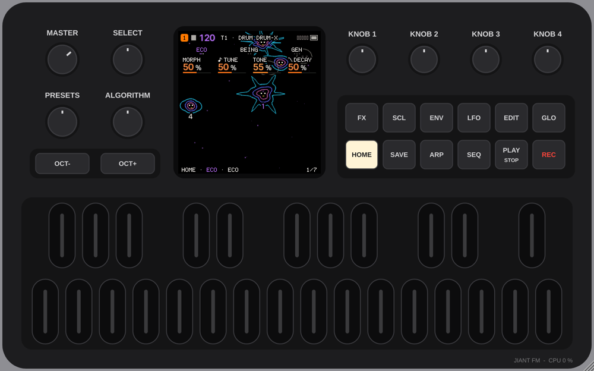

# JIANT FM as VST3, AU, AUv3, LV2 and an app

The whole JIANT FM firmware as an instrument plugin for DAWs and iPad hosts (AUM, GarageBand, Logic, Cubasis...), and
as a standalone app, built with JUCE 9 from the same sources as the FM-1 ([`ports/core`](../core)).



Unlike the MPC plugin ([`ports/mpc-plugin`](../mpc-plugin)), the editor here is JIANT's own: its screen, live, and the
FM-1's panel as the browser emulator draws it: MASTER, SELECT, PRESETS, ALGORITHM, KNOB 1-4, the twelve buttons, OCT
- / +, the 27 keys and their lights. Mouse or fingers (several at once on an iPad), the mouse wheel on the knobs,
SHIFT-click holds a button, and the computer keyboard as the emulator's (Z..' and Q..O the keys, 1..= the buttons,
[ ] OCT, arrows SELECT / ALGORITHM).

| | |
| --- | --- |
| Formats | VST3 (macOS, Windows, Linux), AU and AUv3 (macOS), AUv3 and the app (iOS / iPadOS), LV2 (Linux), standalone |
| MIDI | channels 1-4 play tracks 1-4 (GLO > MIDI IN ROUTE CH1-4); CCs as JIANT's MIDI map |
| Web editor | the standalone app answers [the web editor](../../web/editor.html) (its SysEx in, the replies out of the MIDI output chosen in its settings: connect the two through a virtual MIDI cable, e.g. IAC on macOS, loopMIDI on Windows); it shows as "JIANT FM app / plugin" with SAMPLE, GRAIN and DRUM-X's samples. The plugins take the editor's SysEx but have no MIDI output (their buses as before), so a DAW does not pass the replies back |
| Sync | **Host** (default): the sequencer follows the host's transport and tempo; **Internal**: its own tempo |
| Parameters | Volume (the MASTER knob), Sync |
| Saved | in the host's project: the live section, the songs, the user presets |
| Sample rate | any (the firmware's 44.1 kHz, resampled) |
| Power | a computer's CPU: every track its own 8 voices; the firmware's own load governor on the real time ([`ports/README.md`](../README.md)) |
| Several per session | up to 8 instances in one DAW session (one process), each a whole JIANT of its own, on its own audio thread if the host gives it one: the core is compiled 8 times, every copy's symbols its own ([`ports/core/jiant_copies.h`](../core/jiant_copies.h)); a 9th stays silent and says so. Memory: ~1 MB of code and ~6.4 MB of zeroed data per copy in the binary, resident only once a copy plays; the sample slots as loaded, the recorder's 60 s spare (21 MB, zeroed until it records) per playing instance |

## Build

```sh
ports/juce-plugin/build.sh                    # this computer's formats -> build/juce-plugin/JiantFM_artefacts/Release
ports/juce-plugin/build.sh -DJIANT_CHECK=ON   # and the checks: tests/plugin_check.cpp, tests/editor_shot.cpp, tests/sysex_check.cpp
```

JUCE 9.0.5 is fetched (or `JUCE_DIR=<a checkout>`). macOS: `-G Xcode` (AUv3). iOS:
`cmake -S ports/juce-plugin -B build/juce-ios -G Xcode -DCMAKE_SYSTEM_NAME=iOS`. `.github/workflows/ports.yml` builds
every platform on each push to `ports/`, and keeps the results as the run's artifacts.

The check (`plugin_check <plugin>`) loads the built plugin as a host loads it (JUCE's VST3 / AU hosting): its
description, a chord at 44.1, 48 and 96 kHz in blocks of 32 to 1024 frames (it sounds, then it is silent after the
note-offs, nothing non-finite), the state out and back; then 4 instances
at once on 4 threads, each its own sound (no two the same; a note into one sounds there only), each its own state
(saved, changed, put back), 8 sounding, the 9th silent, one closed and its JIANT taken by a new one; the editor made. macOS adds Apple's
`auval`. `sysex_check` makes the processor as the standalone app does and sends the web editor's INFO, PRESET and DESC
through processBlock: the replies come back in its MIDI (the device as a computer, its big CPU's engines).

## Installing

- **macOS**: `JIANT FM.vst3` into `~/Library/Audio/Plug-Ins/VST3`, `JIANT FM.component` into
  `~/Library/Audio/Plug-Ins/Components`; the app carries the AUv3. The builds are not notarized: the first time,
  right-click > Open (or `xattr -dr com.apple.quarantine <the bundle>`).
- **Windows**: `JIANT FM.vst3` into `C:\Program Files\Common Files\VST3`.
- **Linux**: `JIANT FM.vst3` into `~/.vst3`, `JIANT FM.lv2` into `~/.lv2`.
- **iPad / iPhone (AUM)**: the `.ipa` is unsigned: it installs once signed with your Apple ID (Sideloadly, AltStore) or
  through TestFlight with a developer account. Then AUM lists JIANT FM among its instruments.

## Licences

JIANT is GPL-3.0-only; JUCE 9 is used under the AGPLv3. The plugin as a whole is conveyed under the AGPLv3 (GPLv3
section 13); JIANT's own files keep the GPL. The VST3 SDK JUCE carries is MIT.
